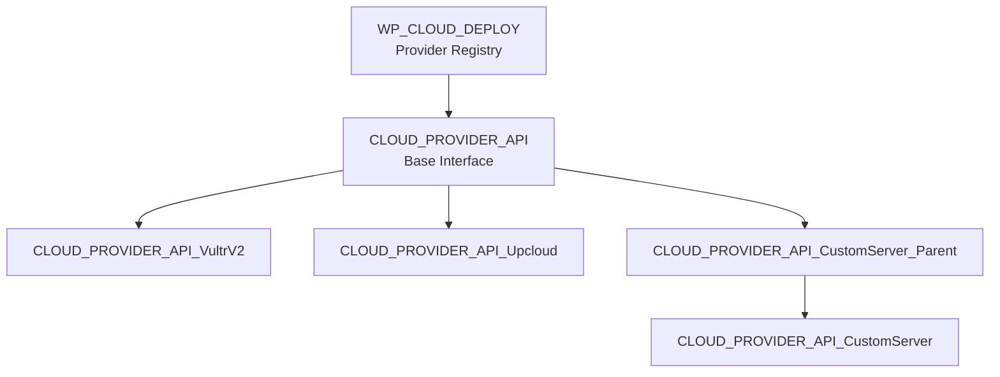
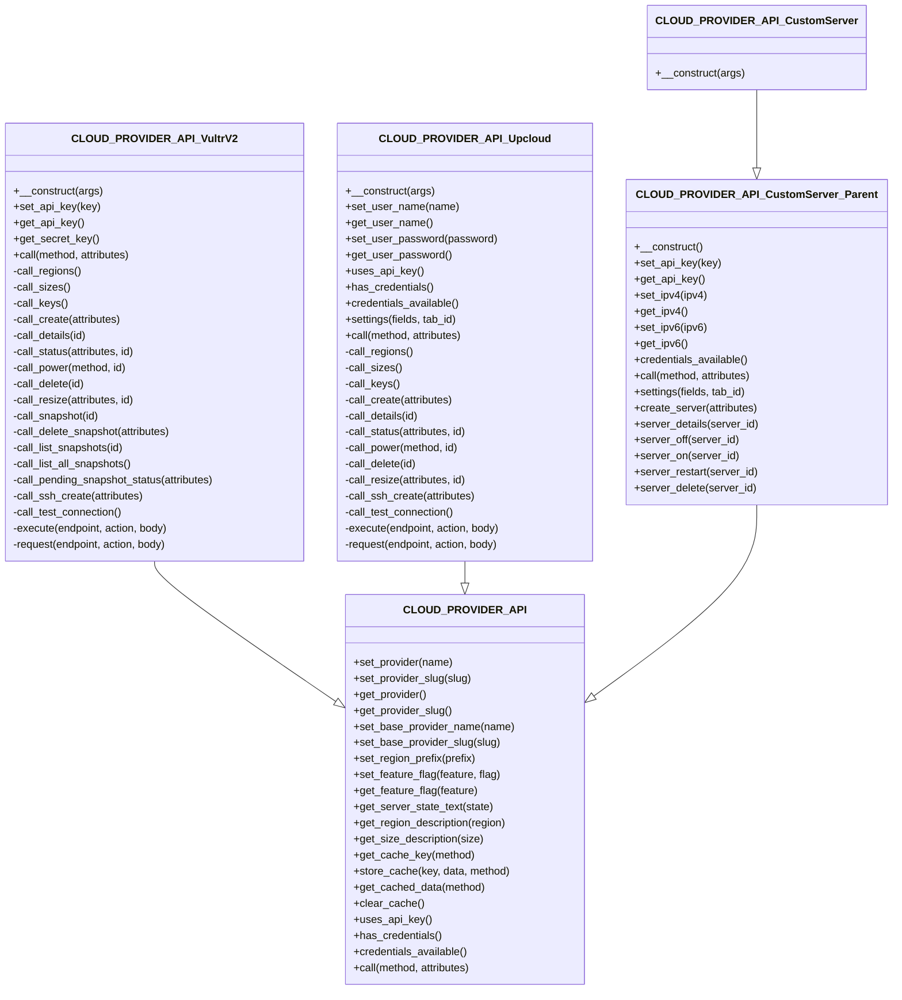
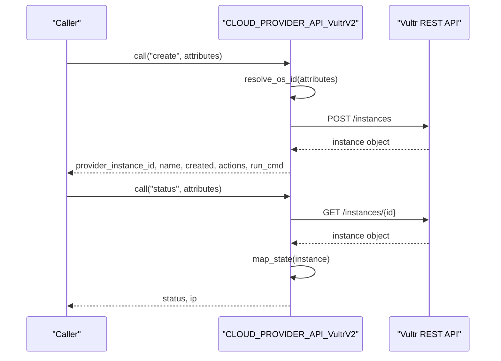
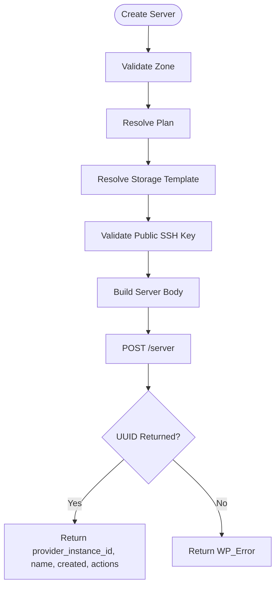
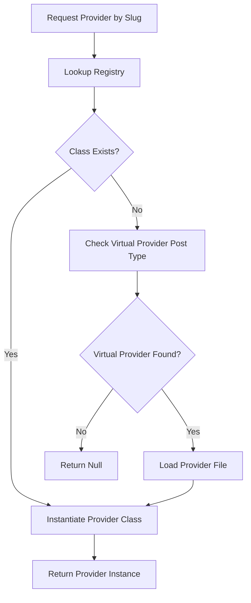
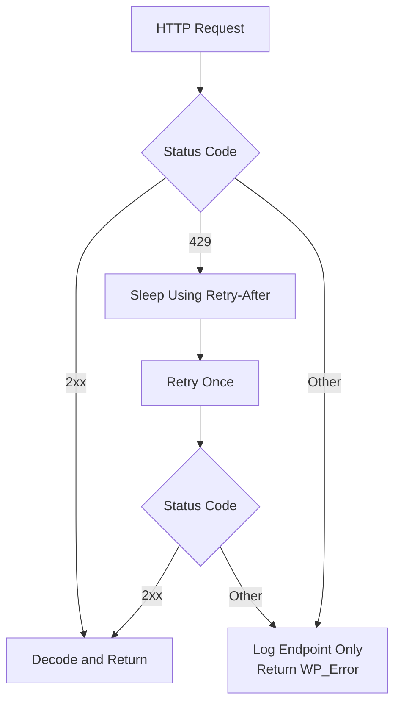
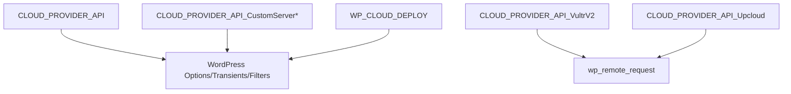

# Cloud Provider Integration

<cite>
**Referenced Files in This Document **
- [wp-cloud-deploy.php](file://includes/core/wp-cloud-deploy.php)
- [class-cloud-provider-api.php](file://includes/core/providers/class-cloud-provider-api.php)
- [class-vultr-v2.php](file://includes/core/providers/class-vultr-v2.php)
- [class-upcloud.php](file://includes/core/providers/class-upcloud.php)
- [class-custom-server-parent.php](file://includes/core/providers/class-custom-server-parent.php)
- [class-custom-server.php](file://includes/core/providers/class-custom-server.php)
</cite>

## Table of Contents
1. [Introduction](#introduction)
2. [Project Structure](#project-structure)
3. [Core Components](#core-components)
4. [Architecture Overview](#architecture-overview)
5. [Detailed Component Analysis](#detailed-component-analysis)
6. [Dependency Analysis](#dependency-analysis)
7. [Performance Considerations](#performance-considerations)
8. [Troubleshooting Guide](#troubleshooting-guide)
9. [Conclusion](#conclusion)
10. [Appendices](#appendices)

## Introduction
This document explains SimpleStack’s cloud provider abstraction layer that supports Vultr API v2, UpCloud API 1.3, and custom server configurations. It covers the provider interface design, authentication mechanisms, common operations such as instance creation, modification, and deletion, provider-specific features, rate limiting, error handling, region and size mappings, the provider registration system, configuration examples, credential management, troubleshooting, limitations, best practices, and migration strategies between providers.

The abstraction is implemented as a base class with concrete provider implementations. Providers are registered centrally and can be extended through both built-in classes and virtual provider records stored in WordPress.

## Project Structure
The provider subsystem lives under `includes/core/providers`. The main components are:

- Base provider interface and shared behavior: `class-cloud-provider-api.php`
- Vultr implementation: `class-vultr-v2.php`
- UpCloud implementation: `class-upcloud.php`
- Custom server parent and concrete wrapper: `class-custom-server-parent.php`, `class-custom-server.php`
- Provider registry and loader: `wp-cloud-deploy.php`

**Diagram sources **
- [wp-cloud-deploy.php:32-37](file://includes/core/wp-cloud-deploy.php#L32-L37)
- [class-cloud-provider-api.php:15-167](file://includes/core/providers/class-cloud-provider-api.php#L15-L167)
- [class-vultr-v2.php:30-127](file://includes/core/providers/class-vultr-v2.php#L30-L127)
- [class-upcloud.php:33-128](file://includes/core/providers/class-upcloud.php#L33-L128)
- [class-custom-server-parent.php:15-98](file://includes/core/providers/class-custom-server-parent.php#L15-L98)
- [class-custom-server.php:15-76](file://includes/core/providers/class-custom-server.php#L15-L76)

**Section sources**
- [wp-cloud-deploy.php:32-37](file://includes/core/wp-cloud-deploy.php#L32-L37)
- [class-cloud-provider-api.php:15-167](file://includes/core/providers/class-cloud-provider-api.php#L15-L167)

## Core Components
The core component is the base provider class. It defines:

- Provider identity: name, slug, baseline provider for custom servers, dashboard link, help link, and region prefix.
- Feature flags: snapshots, backup enablement, dynamic tags, custom images, resize, SSH key creation, connection testing.
- Shared state constants: new, active, errored, in-progress, off, unknown.
- Credential helpers: API key getter/setter, secret key getter, credential fingerprint, and availability checks.
- Caching utilities: cache key generation, transient storage, cache clearing, and cached method lists.
- Common formatting: region and size description helpers, script URL helper for provisioning scripts.

Key responsibilities:

- Provide a uniform `call(method, attributes)` entry point for all providers.
- Normalize provider states into shared constants.
- Support per-provider feature toggles so UIs can show or hide capabilities.
- Centralize caching logic to reduce repeated API calls for regions, sizes, keys, and other stable data.

**Section sources**
- [class-cloud-provider-api.php:15-167](file://includes/core/providers/class-cloud-provider-api.php#L15-L167)
- [class-cloud-provider-api.php:173-207](file://includes/core/providers/class-cloud-provider-api.php#L173-L207)
- [class-cloud-provider-api.php:248-325](file://includes/core/providers/class-cloud-provider-api.php#L248-L325)
- [class-cloud-provider-api.php:397-414](file://includes/core/providers/class-cloud-provider-api.php#L397-L414)
- [class-cloud-provider-api.php:423-478](file://includes/core/providers/class-cloud-provider-api.php#L423-L478)
- [class-cloud-provider-api.php:481-642](file://includes/core/providers/class-cloud-provider-api.php#L481-L642)
- [class-cloud-provider-api.php:655-704](file://includes/core/providers/class-cloud-provider-api.php#L655-L704)

## Architecture Overview
The architecture follows a clear separation between the provider interface and provider-specific implementations.

**Diagram sources **
- [class-cloud-provider-api.php:15-753](file://includes/core/providers/class-cloud-provider-api.php#L15-L753)
- [class-vultr-v2.php:30-1308](file://includes/core/providers/class-vultr-v2.php#L30-L1308)
- [class-upcloud.php:33-1275](file://includes/core/providers/class-upcloud.php#L33-L1275)
- [class-custom-server-parent.php:15-649](file://includes/core/providers/class-custom-server-parent.php#L15-L649)
- [class-custom-server.php:15-79](file://includes/core/providers/class-custom-server.php#L15-L79)

## Detailed Component Analysis

### Provider Interface Design
The base provider class defines the contract:

- Identity and metadata: provider name, slug, baseline provider, dashboard link, help link, region prefix.
- Feature flags: snapshot support, backup enablement, dynamic tags, custom images, resize, SSH key creation, test connection.
- State normalization: maps provider-specific states to shared constants like active, off, errored, in-progress.
- Credentials: API key, secret key, fingerprint, and availability checks.
- Caching: methods eligible for caching, cache key generation, transient storage, and cache clearing.
- Common helpers: region and size descriptions, script URL helper for provisioning.

Providers override:

- `call(method, attributes)` to implement supported operations.
- Authentication helpers when needed.
- Region, size, and OS mapping logic.
- Error handling and response decoding.

**Section sources**
- [class-cloud-provider-api.php:15-167](file://includes/core/providers/class-cloud-provider-api.php#L15-L167)
- [class-cloud-provider-api.php:397-414](file://includes/core/providers/class-cloud-provider-api.php#L397-L414)
- [class-cloud-provider-api.php:423-478](file://includes/core/providers/class-cloud-provider-api.php#L423-L478)
- [class-cloud-provider-api.php:481-642](file://includes/core/providers/class-cloud-provider-api.php#L481-L642)
- [class-cloud-provider-api.php:655-704](file://includes/core/providers/class-cloud-provider-api.php#L655-L704)

### Vultr API v2 Implementation
Vultr uses bearer token authentication via an encrypted API key. Key behaviors:

- Authentication: Bearer token from decrypted option `vpn_vultr-v2_apikey`.
- Base URL: `https://api.vultr.com/v2/`.
- Pagination: Cursor-based pagination with page size capped at 500 and maximum pages guarded.
- Power operations: Reboot, start, and halt return no operation ID; completion is inferred from instance status and power status, with a timeout backstop.
- User data: Must be base64 encoded before sending.
- SSH keys: Can be created remotely; key IDs are returned by the provider.
- Snapshots: Create, delete, list per instance, list all account snapshots, and poll pending snapshot status.
- Resize: In-place upgrades; downgrades require manual intervention documented in the UI.
- OS mapping: WPCD OS keys map to Vultr image labels with fallback to family matching.
- Rate limiting: On HTTP 429, waits once using `Retry-After` if available, then retries once.
- Error handling: Converts transport errors and provider errors into `WP_Error` objects without logging secrets.

Common operations:

- Regions: Returns region ID to label mapping.
- Sizes: Returns plan ID to human-readable label mapping, filtering out tiny plans.
- Keys: Returns SSH key ID to name mapping.
- Create: Validates region, plan, OS, hostname, optional backups, SSH key attachment, and user-data startup commands.
- Details: Returns OS, IPv4, IPv6, name, and normalized status.
- Status: Reports completed or in-progress based on pending action and instance state.
- Power: Starts, stops, or reboots instances.
- Delete: Destroys instances.
- Resize: Changes plan.
- Snapshot operations: Creates, deletes, lists, and polls snapshots.
- SSH create: Registers public key with Vultr.
- Test connection: Calls account endpoint to validate credentials.

**Diagram sources **
- [class-vultr-v2.php:183-250](file://includes/core/providers/class-vultr-v2.php#L183-L250)
- [class-vultr-v2.php:369-453](file://includes/core/providers/class-vultr-v2.php#L369-L453)
- [class-vultr-v2.php:455-553](file://includes/core/providers/class-vultr-v2.php#L455-L553)
- [class-vultr-v2.php:832-861](file://includes/core/providers/class-vultr-v2.php#L832-L861)

**Section sources**
- [class-vultr-v2.php:30-127](file://includes/core/providers/class-vultr-v2.php#L30-L127)
- [class-vultr-v2.php:183-250](file://includes/core/providers/class-vultr-v2.php#L183-L250)
- [class-vultr-v2.php:257-333](file://includes/core/providers/class-vultr-v2.php#L257-L333)
- [class-vultr-v2.php:335-360](file://includes/core/providers/class-vultr-v2.php#L335-L360)
- [class-vultr-v2.php:369-453](file://includes/core/providers/class-vultr-v2.php#L369-L453)
- [class-vultr-v2.php:455-553](file://includes/core/providers/class-vultr-v2.php#L455-L553)
- [class-vultr-v2.php:555-638](file://includes/core/providers/class-vultr-v2.php#L555-L638)
- [class-vultr-v2.php:640-765](file://includes/core/providers/class-vultr-v2.php#L640-L765)
- [class-vultr-v2.php:767-823](file://includes/core/providers/class-vultr-v2.php#L767-L823)
- [class-vultr-v2.php:832-960](file://includes/core/providers/class-vultr-v2.php#L832-L960)
- [class-vultr-v2.php:962-1019](file://includes/core/providers/class-vultr-v2.php#L962-L1019)
- [class-vultr-v2.php:1021-1156](file://includes/core/providers/class-vultr-v2.php#L1021-L1156)
- [class-vultr-v2.php:1158-1308](file://includes/core/providers/class-vultr-v2.php#L1158-L1308)

### UpCloud API 1.3 Implementation
UpCloud authenticates with HTTP Basic using an account username and password pair rather than an API key. Key behaviors:

- Authentication: Username and password from encrypted options `vpn_upcloud_user_name` and `vpn_upcloud_user_password`.
- Base URL: `https://api.upcloud.com/1.3/`.
- Storage templates: A template must be cloned to create a disk; the implementation resolves a suitable Ubuntu template.
- User data: Plain script string; not base64 encoded.
- SSH keys: Public key material is sent inline during server creation; registering a key in the UpCloud account is best effort.
- Snapshots: Not exposed through this control panel; feature flags are disabled because UpCloud identifies backups by storage device and date.
- Resize: Requires the server to be stopped first; UI instructs operators to watch the provider dashboard and restart manually.
- Rate limiting: On HTTP 429, waits once using `Retry-After` if available, then retries once.
- Error handling: Converts transport errors and provider errors into `WP_Error` objects without logging secrets.

Common operations:

- Regions: Returns zone ID to label mapping.
- Sizes: Returns plan name to human-readable label mapping.
- Keys: Returns SSH key title to title mapping.
- Create: Validates zone, plan, storage template, public SSH key, hostname, networking, and optional user-data startup commands.
- Details: Returns IPv4, IPv6, name, and normalized status; OS field is empty because UpCloud does not report installed OS on the server record.
- Status: Reports completed or in-progress based on pending action and server state.
- Power: Starts, stops, or restarts servers.
- Delete: Destroys servers.
- Resize: Changes plan.
- SSH create: Best-effort registration of public key; returns local marker.
- Test connection: Calls account endpoint to validate credentials.

**Diagram sources **
- [class-upcloud.php:491-602](file://includes/core/providers/class-upcloud.php#L491-L602)
- [class-upcloud.php:891-989](file://includes/core/providers/class-upcloud.php#L891-L989)

**Section sources**
- [class-upcloud.php:33-128](file://includes/core/providers/class-upcloud.php#L33-L128)
- [class-upcloud.php:173-231](file://includes/core/providers/class-upcloud.php#L173-L231)
- [class-upcloud.php:247-289](file://includes/core/providers/class-upcloud.php#L247-L289)
- [class-upcloud.php:310-372](file://includes/core/providers/class-upcloud.php#L310-L372)
- [class-upcloud.php:379-451](file://includes/core/providers/class-upcloud.php#L379-L451)
- [class-upcloud.php:453-482](file://includes/core/providers/class-upcloud.php#L453-L482)
- [class-upcloud.php:491-602](file://includes/core/providers/class-upcloud.php#L491-L602)
- [class-upcloud.php:604-776](file://includes/core/providers/class-upcloud.php#L604-L776)
- [class-upcloud.php:778-841](file://includes/core/providers/class-upcloud.php#L778-L841)
- [class-upcloud.php:843-1087](file://includes/core/providers/class-upcloud.php#L843-L1087)
- [class-upcloud.php:1089-1275](file://includes/core/providers/class-upcloud.php#L1089-L1275)

### Custom Server Configuration
Custom servers allow integration with existing infrastructure that is not managed directly by a cloud provider API. The implementation includes:

- Parent class: Defines settings fields for IPv4, IPv6, root user, region name, server size, and public SSH key name.
- Concrete class: Wraps the parent and allows overriding provider name, slug, dashboard link, and region prefix.
- Behavior: Does not perform real provisioning; it simulates lifecycle operations and returns configured IP addresses.

Use cases:

- Integrating with bare-metal servers or external orchestration systems.
- Providing a placeholder provider for environments where provisioning is handled outside SimpleStack.
- Demonstrating how to extend the provider interface for non-API workflows.

Limitations:

- No real API calls.
- Lifecycle operations are simulated.
- Useful for configuration and workflow testing rather than automated provisioning.

**Section sources**
- [class-custom-server-parent.php:15-98](file://includes/core/providers/class-custom-server-parent.php#L15-L98)
- [class-custom-server-parent.php:100-176](file://includes/core/providers/class-custom-server-parent.php#L100-L176)
- [class-custom-server-parent.php:178-317](file://includes/core/providers/class-custom-server-parent.php#L178-L317)
- [class-custom-server-parent.php:319-452](file://includes/core/providers/class-custom-server-parent.php#L319-L452)
- [class-custom-server-parent.php:454-649](file://includes/core/providers/class-custom-server-parent.php#L454-L649)
- [class-custom-server.php:15-79](file://includes/core/providers/class-custom-server.php#L15-L79)

### Provider Registration System
Providers are registered in the central registry and loaded dynamically:

- Built-in providers: Vultr, UpCloud, Digital Ocean, and Custom Server are listed in the registry array.
- Class loading: When a provider is requested, the system loads the corresponding class file. If the class is not found, it attempts to load a virtual provider defined in the `wpcd_cloud_provider` custom post type.
- Virtual providers: Allow renaming, aliasing, and configuring provider display names, slugs, region prefixes, and dashboard links without changing the underlying implementation.

To add a new provider:

1. Create a new PHP class extending `CLOUD_PROVIDER_API`.
2. Place the class file under `includes/core/providers` with naming convention `class-<provider>.php`.
3. Register the provider slug and display name in the registry array.
4. Implement required methods: constructor, `call`, authentication helpers, region/size mapping, and error handling.
5. Optionally register virtual provider metadata if you need multiple named instances with different display settings.

**Diagram sources **
- [wp-cloud-deploy.php:32-37](file://includes/core/wp-cloud-deploy.php#L32-L37)
- [wp-cloud-deploy.php:1256-1267](file://includes/core/wp-cloud-deploy.php#L1256-L1267)
- [wp-cloud-deploy.php:1282-1317](file://includes/core/wp-cloud-deploy.php#L1282-L1317)

**Section sources**
- [wp-cloud-deploy.php:32-37](file://includes/core/wp-cloud-deploy.php#L32-L37)
- [wp-cloud-deploy.php:1256-1267](file://includes/core/wp-cloud-deploy.php#L1256-L1267)
- [wp-cloud-deploy.php:1282-1317](file://includes/core/wp-cloud-deploy.php#L1282-L1317)

### Authentication Mechanisms
- Vultr: Bearer token authentication using an encrypted API key stored in `vpn_vultr-v2_apikey`.
- UpCloud: HTTP Basic authentication using encrypted username and password stored in `vpn_upcloud_user_name` and `vpn_upcloud_user_password`.
- Custom Server: Uses a placeholder API key field but relies on configured IPv4/IPv6 addresses and optional root user name.

Credential validation:

- Base class provides `has_credentials()` and `credentials_available()` to check whether required secrets and SSH keys are present.
- UpCloud overrides these to check username/password plus public/private SSH key pairs.
- Vultr overrides secret key retrieval to use its API key for cache isolation.

Best practices:

- Never log raw API keys, passwords, or request bodies.
- Use encrypted options for secrets.
- Prefer least-privilege accounts where possible.

**Section sources**
- [class-vultr-v2.php:120-161](file://includes/core/providers/class-vultr-v2.php#L120-L161)
- [class-upcloud.php:117-188](file://includes/core/providers/class-upcloud.php#L117-L188)
- [class-upcloud.php:203-231](file://includes/core/providers/class-upcloud.php#L203-L231)
- [class-cloud-provider-api.php:655-704](file://includes/core/providers/class-cloud-provider-api.php#L655-L704)

### Common Operations
All providers expose a unified `call(method, attributes)` interface. Supported methods include:

- Metadata: `regions`, `sizes`, `keys`.
- Lifecycle: `create`, `details`, `status`, `reboot`, `off`, `on`, `delete`.
- Modification: `resize`.
- Snapshots: `snapshot`, `delete_snapshot`, `list_snapshots`, `list_all_snapshots`, `pending_snapshot_status`.
- SSH: `ssh_create`.
- Connectivity: `test_connection`.

Attributes commonly used:

- `id` or `provider_instance_id`: Provider-assigned instance identifier.
- `region`: Region, zone, or location identifier.
- `size` or `size_raw`: Mapped or raw plan identifier.
- `name`: Human-readable server name.
- `initial_os`: WPCD OS key mapped to provider-specific image/template.
- `post_id`: Server post ID used to read pending actions.
- `new_size`: Target plan for resize.
- `public_key` and `public_key_name`: SSH key material for registration.

**Section sources**
- [class-cloud-provider-api.php:481-507](file://includes/core/providers/class-cloud-provider-api.php#L481-L507)
- [class-vultr-v2.php:183-250](file://includes/core/providers/class-vultr-v2.php#L183-L250)
- [class-upcloud.php:310-372](file://includes/core/providers/class-upcloud.php#L310-L372)

### Region and Size Mappings
- Vultr:
  - Regions: Fetched from `/regions`; labels combine city and country, optionally prefixed.
  - Sizes: Fetched from `/plans`; filters out tiny plans and formats labels with CPU, RAM, disk, cost, and bandwidth.
  - OS mapping: WPCD OS keys map to Vultr image labels with fallback to family matching.
- UpCloud:
  - Regions: Fetched from `/zone`; labels come from zone descriptions, optionally prefixed.
  - Sizes: Fetched from `/plan`; labels describe cores, RAM, storage tier, and traffic.
  - OS mapping: WPCD OS keys map to Ubuntu versions; a suitable storage template is resolved and cached.

**Section sources**
- [class-vultr-v2.php:257-333](file://includes/core/providers/class-vultr-v2.php#L257-L333)
- [class-vultr-v2.php:885-960](file://includes/core/providers/class-vultr-v2.php#L885-L960)
- [class-upcloud.php:379-451](file://includes/core/providers/class-upcloud.php#L379-L451)
- [class-upcloud.php:891-989](file://includes/core/providers/class-upcloud.php#L891-L989)

### Rate Limiting and Error Handling
Both Vultr and UpCloud implementations handle rate limiting and errors consistently:

- Rate limiting: On HTTP 429, sleep briefly using `Retry-After` if provided, then retry once.
- Transport errors: Convert `WP_Error` responses into provider-specific error codes.
- Provider errors: Decode JSON payloads and extract provider error codes and messages.
- Logging: Log only method and endpoint; never log secrets, headers, or request bodies.

**Diagram sources **
- [class-vultr-v2.php:1158-1227](file://includes/core/providers/class-vultr-v2.php#L1158-L1227)
- [class-upcloud.php:1124-1193](file://includes/core/providers/class-upcloud.php#L1124-L1193)

**Section sources**
- [class-vultr-v2.php:1158-1227](file://includes/core/providers/class-vultr-v2.php#L1158-L1227)
- [class-upcloud.php:1124-1193](file://includes/core/providers/class-upcloud.php#L1124-L1193)

### Provider-Specific Features and Limitations
- Vultr:
  - Supports snapshots, snapshot deletion, snapshot listing, resize, SSH key creation, connection testing, and enabling backups on server creation.
  - Custom images feature flag is explicitly disabled because no code path reads stored custom image IDs.
  - Dynamic tags and backup enablement flags are set; however, actual tag usage depends on higher layers.
- UpCloud:
  - Supports resize, SSH key creation, and connection testing.
  - Snapshots and backups are disabled because UpCloud identifies backups by storage device and date, which does not fit the snapshot-ID contract.
  - Custom images, dynamic tags, and backup enablement flags are disabled.
- Custom Server:
  - Simulated provider; useful for configuration and workflow testing but not for real provisioning.

**Section sources**
- [class-vultr-v2.php:100-118](file://includes/core/providers/class-vultr-v2.php#L100-L118)
- [class-upcloud.php:96-115](file://includes/core/providers/class-upcloud.php#L96-L115)

### Migration Strategies Between Providers
When migrating between providers:

1. Map WPCD size keys to provider-specific plan identifiers in settings.
2. Map WPCD OS keys to provider-specific image/template identifiers.
3. Update SSH key strategy:
   - Vultr: Use provider SSH key registry.
   - UpCloud: Send public key inline during server creation.
4. Review region/zone labels and adjust UI expectations.
5. Validate backup and snapshot policies:
   - Vultr supports snapshot operations.
   - UpCloud requires managing backups through the provider dashboard.
6. Test connectivity and provisioning flows before decommissioning the old provider.

**Section sources**
- [class-vultr-v2.php:378-453](file://includes/core/providers/class-vultr-v2.php#L378-L453)
- [class-upcloud.php:491-602](file://includes/core/providers/class-upcloud.php#L491-L602)

## Dependency Analysis
The provider subsystem has clear dependencies:

- Base class depends on WordPress functions for options, transients, and filters.
- Vultr depends on `wp_remote_request` and parses JSON responses.
- UpCloud depends on `wp_remote_request` and constructs Basic auth headers.
- Custom server depends on WordPress options for static configuration.
- Registry depends on WordPress post types for virtual providers.

**Diagram sources **
- [class-cloud-provider-api.php:481-642](file://includes/core/providers/class-cloud-provider-api.php#L481-L642)
- [class-vultr-v2.php:1238-1255](file://includes/core/providers/class-vultr-v2.php#L1238-L1255)
- [class-upcloud.php:1204-1222](file://includes/core/providers/class-upcloud.php#L1204-L1222)
- [wp-cloud-deploy.php:1282-1317](file://includes/core/wp-cloud-deploy.php#L1282-L1317)

**Section sources**
- [class-cloud-provider-api.php:481-642](file://includes/core/providers/class-cloud-provider-api.php#L481-L642)
- [class-vultr-v2.php:1238-1255](file://includes/core/providers/class-vultr-v2.php#L1238-L1255)
- [class-upcloud.php:1204-1222](file://includes/core/providers/class-upcloud.php#L1204-L1222)
- [wp-cloud-deploy.php:1282-1317](file://includes/core/wp-cloud-deploy.php#L1282-L1317)

## Performance Considerations
- Caching:
  - Read-only methods like `regions`, `sizes`, and `keys` are cached using transients.
  - Cache keys include provider slug, version, and secret hash to avoid collisions across accounts.
  - Cache lifetime is configurable via options; default is 15 minutes.
- Pagination:
  - Vultr paginates list endpoints with cursor-based pagination and guards against unbounded loops.
- Network timeouts:
  - HTTP requests use a 30-second timeout.
- Power operations:
  - Both Vultr and UpCloud stamp transient timestamps to prevent indefinite waiting when provider signals are missing.

Recommendations:

- Tune cache lifetimes for high-throughput environments.
- Monitor transient expiration and clear caches after credential changes.
- Avoid excessive concurrent provisioning to reduce rate-limit risk.

**Section sources**
- [class-cloud-provider-api.php:481-642](file://includes/core/providers/class-cloud-provider-api.php#L481-L642)
- [class-vultr-v2.php:1093-1156](file://includes/core/providers/class-vultr-v2.php#L1093-L1156)
- [class-vultr-v2.php:1058-1091](file://includes/core/providers/class-vultr-v2.php#L1058-L1091)
- [class-upcloud.php:1089-1122](file://includes/core/providers/class-upcloud.php#L1089-L1122)

## Troubleshooting Guide
Common issues and resolutions:

- Missing provider instance ID:
  - Ensure the correct `id` or `provider_instance_id` attribute is passed for operations requiring an instance.
- Missing region or zone:
  - Verify that the selected region or zone exists and is valid for the provider.
- Missing plan or size:
  - Map WPCD size keys to provider plan identifiers in settings.
- SSH key problems:
  - Vultr: Register public key and attach key ID during creation.
  - UpCloud: Ensure public key is configured and private key is available for connection.
- Connection failures:
  - Use `test_connection` to validate credentials.
  - Check network connectivity and firewall rules.
- Rate limiting:
  - Reduce concurrent operations or wait for provider recovery.
- Snapshot differences:
  - Vultr supports snapshot operations.
  - UpCloud requires managing backups through the provider dashboard.

Logging guidance:

- Logs contain method and endpoint only; secrets are excluded.
- Inspect provider-specific error codes and messages returned by `WP_Error`.

**Section sources**
- [class-vultr-v2.php:183-250](file://includes/core/providers/class-vultr-v2.php#L183-L250)
- [class-upcloud.php:310-372](file://includes/core/providers/class-upcloud.php#L310-L372)
- [class-vultr-v2.php:1158-1227](file://includes/core/providers/class-vultr-v2.php#L1158-L1227)
- [class-upcloud.php:1124-1193](file://includes/core/providers/class-upcloud.php#L1124-L1193)

## Conclusion
SimpleStack’s cloud provider abstraction provides a consistent interface for managing servers across Vultr, UpCloud, and custom server configurations. The base class standardizes identity, features, state reporting, credentials, and caching, while each provider implements authentication, API calls, error handling, and provider-specific behaviors. The registry supports both built-in providers and virtual providers, making it straightforward to extend the system. By following the configuration, credential, and migration guidance in this document, teams can operate reliably across providers and adapt to provider differences without rewriting application logic.

## Appendices

### Provider Configuration Examples
- Vultr:
  - Configure encrypted API key in `vpn_vultr-v2_apikey`.
  - Map WPCD size keys to Vultr plan IDs.
  - Map WPCD OS keys to Ubuntu image labels.
  - Attach SSH key ID during server creation.
- UpCloud:
  - Configure encrypted username and password in `vpn_upcloud_user_name` and `vpn_upcloud_user_password`.
  - Map WPCD size keys to UpCloud plan names.
  - Ensure public SSH key is configured for inline installation.
  - Manage backups through the UpCloud dashboard.
- Custom Server:
  - Configure IPv4 and optional IPv6 addresses.
  - Set descriptive region name, server size, and public SSH key name.
  - Optionally set custom root user name.

**Section sources**
- [class-vultr-v2.php:120-127](file://includes/core/providers/class-vultr-v2.php#L120-L127)
- [class-upcloud.php:117-128](file://includes/core/providers/class-upcloud.php#L117-L128)
- [class-custom-server-parent.php:319-452](file://includes/core/providers/class-custom-server-parent.php#L319-L452)

### Adding a New Cloud Provider
Steps:

1. Create a new class extending `CLOUD_PROVIDER_API`.
2. Implement constructor, `call`, authentication helpers, region/size mapping, and error handling.
3. Place the class file under `includes/core/providers` with naming convention `class-<provider>.php`.
4. Register the provider slug and display name in the registry array.
5. Test with `test_connection` and basic lifecycle operations.
6. Optionally define virtual provider metadata for multiple named instances.

**Section sources**
- [wp-cloud-deploy.php:32-37](file://includes/core/wp-cloud-deploy.php#L32-L37)
- [wp-cloud-deploy.php:1256-1267](file://includes/core/wp-cloud-deploy.php#L1256-L1267)
- [wp-cloud-deploy.php:1282-1317](file://includes/core/wp-cloud-deploy.php#L1282-L1317)