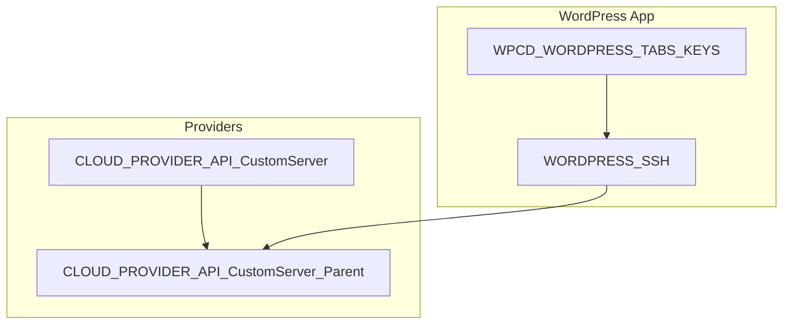
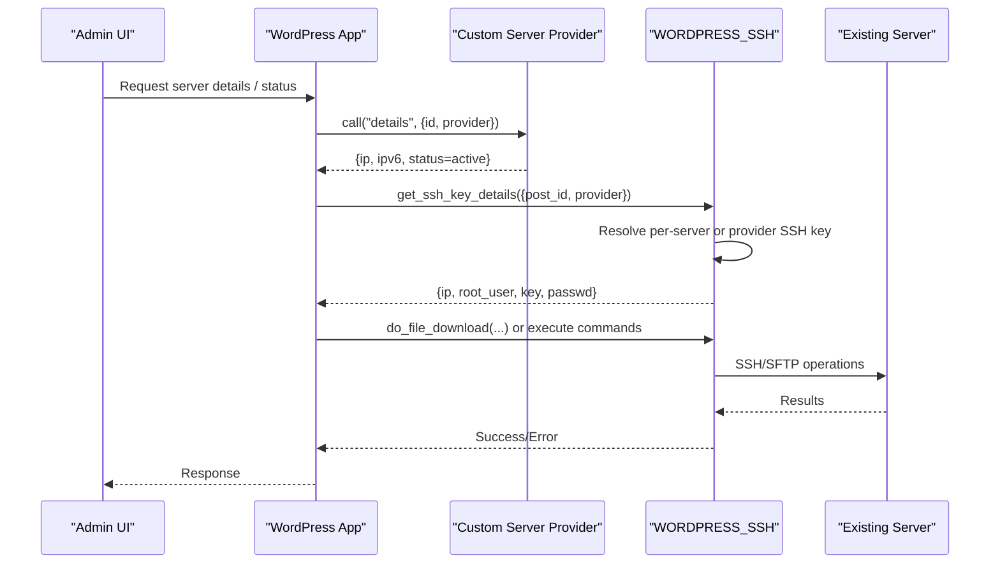
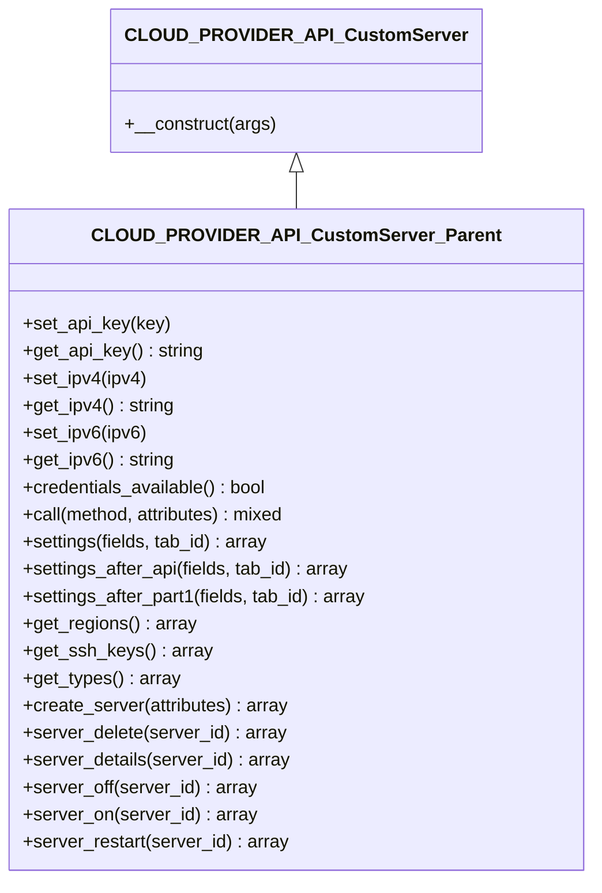
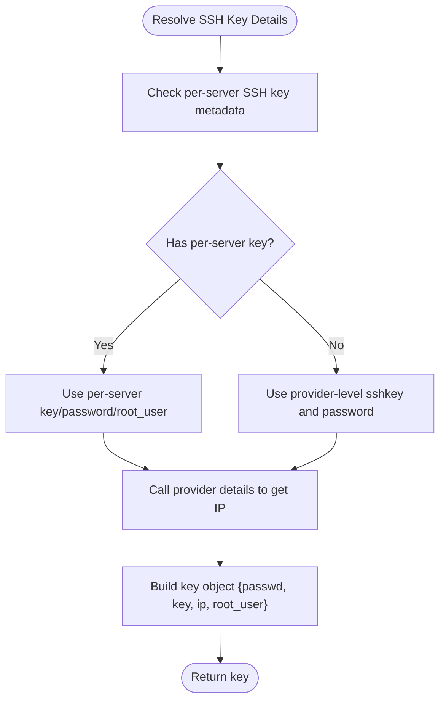
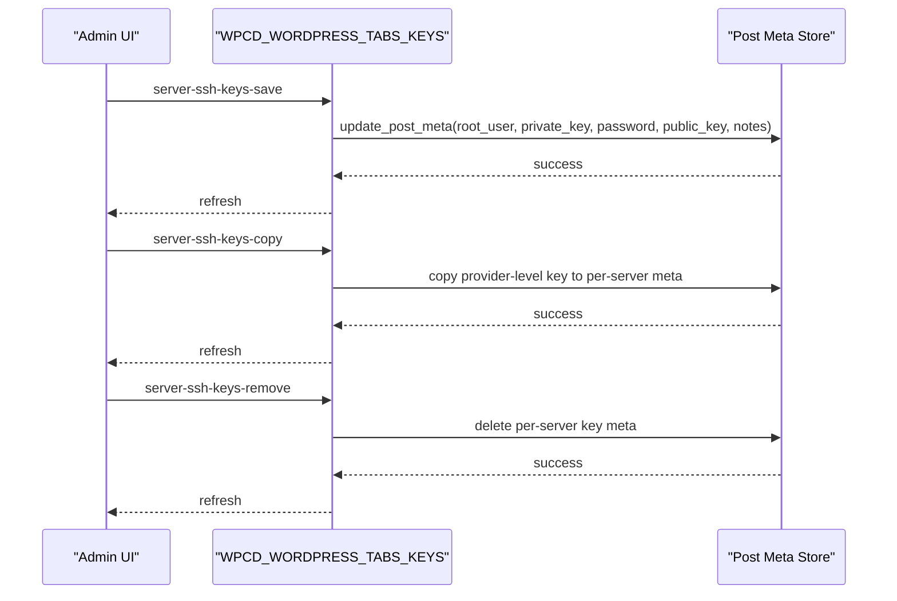
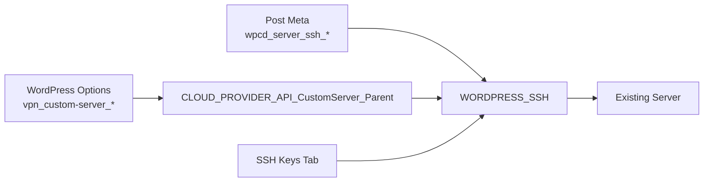

# Custom Server Provider

<cite>
**Referenced Files in This Document**
- [class-custom-server-parent.php](file://includes/core/providers/class-custom-server-parent.php)
- [class-custom-server.php](file://includes/core/providers/class-custom-server.php)
- [class-wordpress-ssh.php](file://includes/core/apps/wordpress-app/class-wordpress-ssh.php)
- [sshkeys.php](file://includes/core/apps/wordpress-app/tabs-server/sshkeys.php)
- [README.md](file://README.md)
</cite>

## Table of Contents
1. [Introduction](#introduction)
2. [Project Structure](#project-structure)
3. [Core Components](#core-components)
4. [Architecture Overview](#architecture-overview)
5. [Detailed Component Analysis](#detailed-component-analysis)
6. [Dependency Analysis](#dependency-analysis)
7. [Performance Considerations](#performance-considerations)
8. [Troubleshooting Guide](#troubleshooting-guide)
9. [Conclusion](#conclusion)

## Introduction
This document explains the Custom Server provider, which allows managing existing servers that were not provisioned through cloud APIs. It covers:
- SSH-based server discovery and inventory via provider details
- Credential management for SSH access (per-server or provider-level keys)
- Supported operations such as status checks, file operations, and command execution over SSH
- Configuration examples for custom servers, SSH access setup, and server groups
- Security considerations for SSH key management and permissions
- Troubleshooting connectivity issues

The Custom Server provider is a lightweight adapter that maps SimpleStack’s provider API to an already-running server by IP address and SSH credentials.

**Section sources**
- [README.md:11-20](file://README.md#L11-L20)

## Project Structure
The Custom Server provider consists of two PHP classes and integrates with the WordPress app SSH layer and UI tabs for SSH keys.

**Diagram sources**
- [class-custom-server-parent.php:15-98](file://includes/core/providers/class-custom-server-parent.php#L15-L98)
- [class-custom-server.php:15-76](file://includes/core/providers/class-custom-server.php#L15-L76)
- [class-wordpress-ssh.php:22-139](file://includes/core/apps/wordpress-app/class-wordpress-ssh.php#L22-L139)
- [sshkeys.php:15-27](file://includes/core/apps/wordpress-app/tabs-server/sshkeys.php#L15-L27)

**Section sources**
- [class-custom-server-parent.php:15-98](file://includes/core/providers/class-custom-server-parent.php#L15-L98)
- [class-custom-server.php:15-76](file://includes/core/providers/class-custom-server.php#L15-L76)
- [class-wordpress-ssh.php:22-139](file://includes/core/apps/wordpress-app/class-wordpress-ssh.php#L22-L139)
- [sshkeys.php:15-27](file://includes/core/apps/wordpress-app/tabs-server/sshkeys.php#L15-L27)

## Core Components
- CLOUD_PROVIDER_API_CustomServer_Parent: Base implementation for the Custom Server provider. It defines settings fields, region/key/size placeholders, and implements provider API methods like create_server, server_details, server_on/off/restart, and call routing.
- CLOUD_PROVIDER_API_CustomServer: A configurable subclass that overrides provider name, slug, dashboard link, and region prefix at runtime.
- WORDPRESS_SSH: Handles SSH/SFTP connections using phpseclib3, resolves SSH credentials from per-server metadata or provider settings, and performs file downloads and other SSH operations.
- WPCD_WORDPRESS_TABS_KEYS: UI tab for managing per-server SSH keys, including saving, copying from provider settings, and removing per-server keys.

Key responsibilities:
- Provider configuration: IPv4/IPv6 addresses, root user, display-only region/size/key names
- Inventory and status: server_details returns static active state and configured IPs
- SSH credential resolution: per-server private key/password/root_user or fallback to provider-level options
- Operations: status checks, power actions (no-op), file operations via SSH, and command execution via scripts executed over SSH

**Section sources**
- [class-custom-server-parent.php:65-98](file://includes/core/providers/class-custom-server-parent.php#L65-L98)
- [class-custom-server-parent.php:327-452](file://includes/core/providers/class-custom-server-parent.php#L327-L452)
- [class-custom-server-parent.php:457-503](file://includes/core/providers/class-custom-server-parent.php#L457-L503)
- [class-custom-server-parent.php:510-536](file://includes/core/providers/class-custom-server-parent.php#L510-L536)
- [class-custom-server-parent.php:556-578](file://includes/core/providers/class-custom-server-parent.php#L556-L578)
- [class-custom-server-parent.php:586-628](file://includes/core/providers/class-custom-server-parent.php#L586-L628)
- [class-custom-server.php:22-76](file://includes/core/providers/class-custom-server.php#L22-L76)
- [class-wordpress-ssh.php:22-139](file://includes/core/apps/wordpress-app/class-wordpress-ssh.php#L22-L139)
- [sshkeys.php:15-27](file://includes/core/apps/wordpress-app/tabs-server/sshkeys.php#L15-L27)

## Architecture Overview
The Custom Server provider integrates into SimpleStack’s provider abstraction. The WordPress app uses this provider to discover server details and perform SSH-based operations.

**Diagram sources**
- [class-custom-server-parent.php:556-578](file://includes/core/providers/class-custom-server-parent.php#L556-L578)
- [class-wordpress-ssh.php:78-139](file://includes/core/apps/wordpress-app/class-wordpress-ssh.php#L78-L139)

## Detailed Component Analysis

### Custom Server Provider Classes
- CLOUD_PROVIDER_API_CustomServer_Parent
  - Sets provider name/slug/dashboard link and loads provider-level settings (API key placeholder, IPv4/IPv6, root user).
  - Adds provider-specific settings fields for IPv4/IPv6, root user, and display-only region/size/public SSH key name.
  - Implements provider API methods:
    - sizes/regions/keys: return display-only values from settings
    - create_server: returns synthetic instance data with configured IPs
    - server_details: returns active status and IPs
    - server_on/server_off/server_restart: no-op status changes
    - call: routes method names to appropriate handlers
- CLOUD_PROVIDER_API_CustomServer
  - Overrides provider_name, provider_slug, provider_dashboard_link, and provider_region_prefix via constructor args.

**Diagram sources**
- [class-custom-server-parent.php:15-98](file://includes/core/providers/class-custom-server-parent.php#L15-L98)
- [class-custom-server-parent.php:327-452](file://includes/core/providers/class-custom-server-parent.php#L327-L452)
- [class-custom-server-parent.php:457-503](file://includes/core/providers/class-custom-server-parent.php#L457-L503)
- [class-custom-server-parent.php:510-536](file://includes/core/providers/class-custom-server-parent.php#L510-L536)
- [class-custom-server-parent.php:556-628](file://includes/core/providers/class-custom-server-parent.php#L556-L628)
- [class-custom-server.php:22-76](file://includes/core/providers/class-custom-server.php#L22-L76)

**Section sources**
- [class-custom-server-parent.php:65-98](file://includes/core/providers/class-custom-server-parent.php#L65-L98)
- [class-custom-server-parent.php:327-452](file://includes/core/providers/class-custom-server-parent.php#L327-L452)
- [class-custom-server-parent.php:457-503](file://includes/core/providers/class-custom-server-parent.php#L457-L503)
- [class-custom-server-parent.php:510-536](file://includes/core/providers/class-custom-server-parent.php#L510-L536)
- [class-custom-server-parent.php:556-628](file://includes/core/providers/class-custom-server-parent.php#L556-L628)
- [class-custom-server.php:22-76](file://includes/core/providers/class-custom-server.php#L22-L76)

### SSH Credential Resolution and File Operations
- WORDPRESS_SSH::get_ssh_key_details resolves SSH connection parameters:
  - Per-server metadata takes precedence: wpcd_server_ssh_private_key, wpcd_server_ssh_private_key_password, wpcd_server_ssh_root_user
  - Fallback to provider-level options: vpn_{provider}_sshkey, vpn_{provider}_sshkey_passwd
  - Retrieves IP from provider details call
- WORDPRESS_SSH::do_file_download uses resolved credentials to download files from the server via SFTP

**Diagram sources**
- [class-wordpress-ssh.php:78-139](file://includes/core/apps/wordpress-app/class-wordpress-ssh.php#L78-L139)
- [class-custom-server-parent.php:556-578](file://includes/core/providers/class-custom-server-parent.php#L556-L578)

**Section sources**
- [class-wordpress-ssh.php:78-139](file://includes/core/apps/wordpress-app/class-wordpress-ssh.php#L78-L139)

### SSH Keys Management UI
- WPCD_WORDPRESS_TABS_KEYS provides a tab to manage per-server SSH keys:
  - Save per-server private key, public key, notes, and root user
  - Copy provider-level SSH key settings to per-server record
  - Remove per-server keys to revert to provider-level defaults

**Diagram sources**
- [sshkeys.php:102-133](file://includes/core/apps/wordpress-app/tabs-server/sshkeys.php#L102-L133)
- [sshkeys.php:155-325](file://includes/core/apps/wordpress-app/tabs-server/sshkeys.php#L155-L325)
- [sshkeys.php:335-392](file://includes/core/apps/wordpress-app/tabs-server/sshkeys.php#L335-L392)

**Section sources**
- [sshkeys.php:102-133](file://includes/core/apps/wordpress-app/tabs-server/sshkeys.php#L102-L133)
- [sshkeys.php:155-325](file://includes/core/apps/wordpress-app/tabs-server/sshkeys.php#L155-L325)
- [sshkeys.php:335-392](file://includes/core/apps/wordpress-app/tabs-server/sshkeys.php#L335-L392)

## Dependency Analysis
- Provider layer depends on WordPress options for provider-level settings (IPv4/IPv6, root user, display-only region/size/key name).
- WordPress app SSH layer depends on:
  - Per-server post meta for SSH keys and root user
  - Provider-level options for SSH key and password
  - Provider API to resolve IP address via details call
- UI tabs depend on WordPress app SSH layer for displaying and editing SSH keys.

**Diagram sources**
- [class-custom-server-parent.php:65-98](file://includes/core/providers/class-custom-server-parent.php#L65-L98)
- [class-wordpress-ssh.php:78-139](file://includes/core/apps/wordpress-app/class-wordpress-ssh.php#L78-L139)
- [sshkeys.php:155-325](file://includes/core/apps/wordpress-app/tabs-server/sshkeys.php#L155-L325)

**Section sources**
- [class-custom-server-parent.php:65-98](file://includes/core/providers/class-custom-server-parent.php#L65-L98)
- [class-wordpress-ssh.php:78-139](file://includes/core/apps/wordpress-app/class-wordpress-ssh.php#L78-L139)
- [sshkeys.php:155-325](file://includes/core/apps/wordpress-app/tabs-server/sshkeys.php#L155-L325)

## Performance Considerations
- Provider calls are lightweight; most operations return static data or no-op status changes.
- SSH operations may be slow due to network latency and authentication overhead; consider:
  - Reusing SSH sessions where possible
  - Avoiding large file transfers during peak times
  - Using SFTP efficiently for bulk operations

[No sources needed since this section provides general guidance]

## Troubleshooting Guide
Common issues and resolutions:
- Cannot connect to server
  - Verify IPv4/IPv6 addresses in provider settings
  - Ensure SSH key matches the server’s authorized keys for the root user
  - Confirm firewall rules allow SSH (port 22) from the control plane
- Permission denied when connecting
  - Check root user setting matches the server’s admin account
  - Validate private key and optional passphrase
  - Ensure proper permissions on server-side SSH directories and authorized_keys
- Status shows active but unreachable
  - Confirm server is running and reachable over the network
  - Validate DNS/resolution if using hostnames elsewhere
- File download fails
  - Verify file path exists on the server
  - Check read permissions for the target file

Operational notes:
- Power actions (on/off/reboot) are no-ops in the Custom Server provider; they only change internal status flags.
- Server deletion is also a no-op; it sets status to off without external action.

**Section sources**
- [class-custom-server-parent.php:556-628](file://includes/core/providers/class-custom-server-parent.php#L556-L628)
- [class-wordpress-ssh.php:35-62](file://includes/core/apps/wordpress-app/class-wordpress-ssh.php#L35-L62)

## Conclusion
The Custom Server provider enables managing existing servers by mapping SimpleStack’s provider API to IP-based access and SSH credentials. It supports:
- Inventory and status checks via provider details
- SSH-based file operations and command execution through the WordPress app SSH layer
- Flexible credential management with per-server overrides and provider-level defaults
- UI-driven SSH key management and copying from provider settings

For secure and reliable operation, ensure correct SSH key provisioning, appropriate permissions, and network accessibility. Use the troubleshooting guide to diagnose connectivity and permission issues.

[No sources needed since this section summarizes without analyzing specific files]