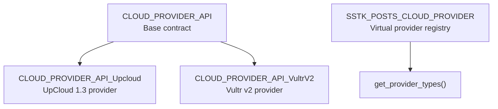
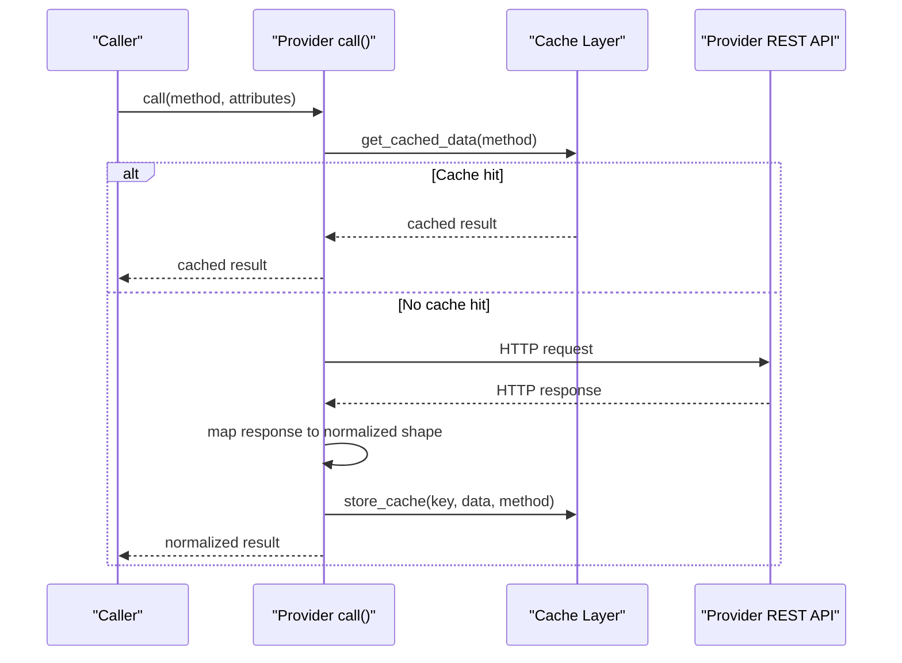
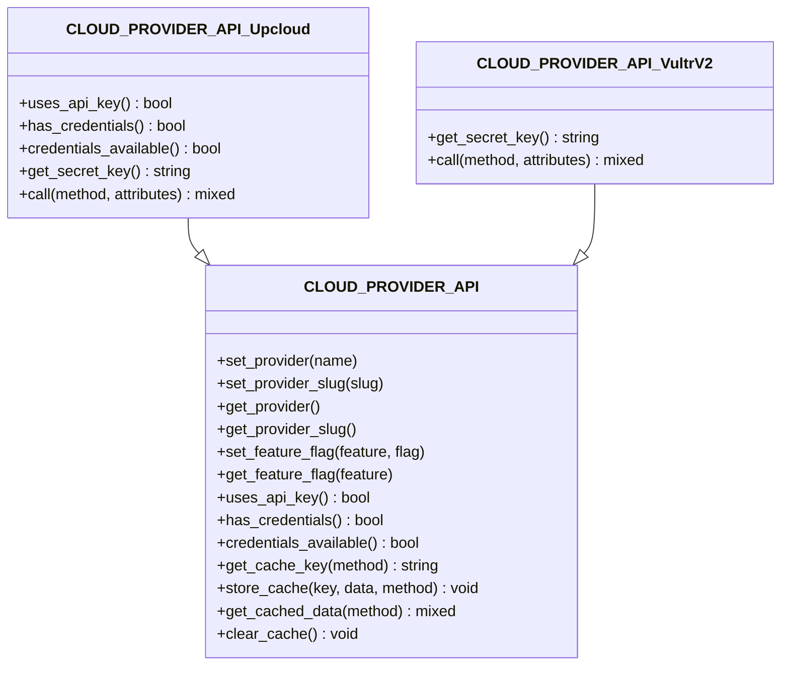
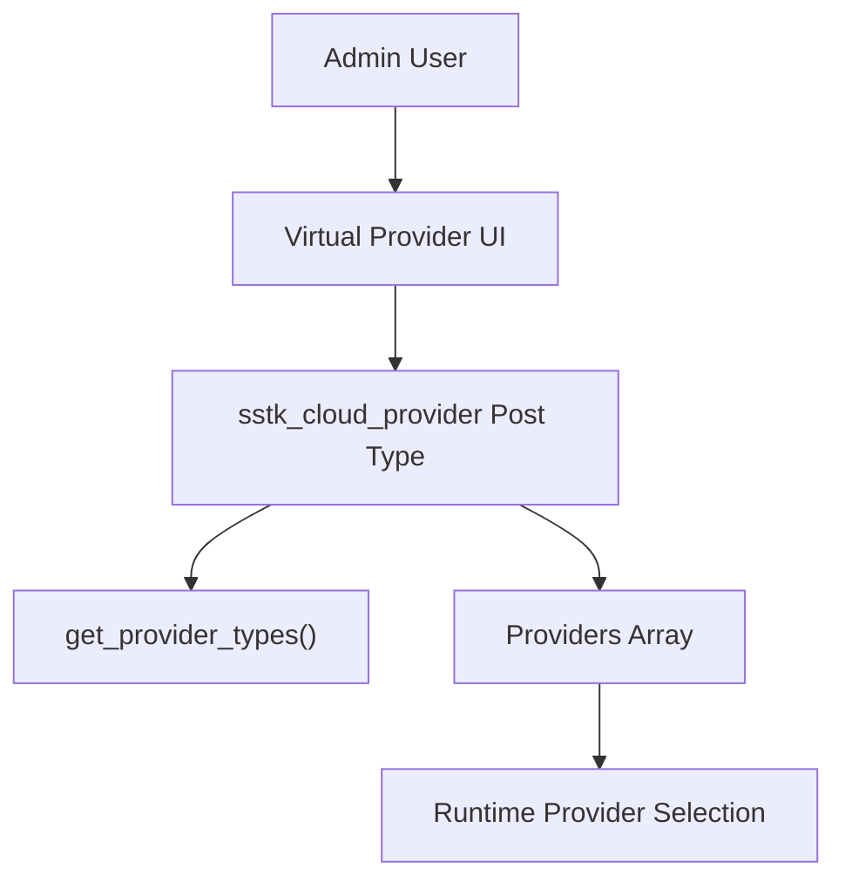

# Extending Providers

<cite>
**Referenced Files in This Document**
- [class-cloud-provider-api.php](file://includes/core/providers/class-cloud-provider-api.php)
- [class-upcloud.php](file://includes/core/providers/class-upcloud.php)
- [class-vultr-v2.php](file://includes/core/providers/class-vultr-v2.php)
- [class-sstk-posts-cloud-provider.php](file://includes/core/class-sstk-posts-cloud-provider.php)
- [ControllerServersTest.php](file://tests/phpunit/rest-api/ControllerServersTest.php)
- [class-sstk-cloud-provider-test.php](file://tests/data/class-sstk-cloud-provider-test.php)
</cite>

## Table of Contents
1. [Introduction](#introduction)
2. [Project Structure](#project-structure)
3. [Core Components](#core-components)
4. [Architecture Overview](#architecture-overview)
5. [Detailed Component Analysis](#detailed-component-analysis)
6. [Dependency Analysis](#dependency-analysis)
7. [Performance Considerations](#performance-considerations)
8. [Troubleshooting Guide](#troubleshooting-guide)
9. [Conclusion](#conclusion)
10. [Appendices](#appendices)

## Introduction
This guide explains how to extend Simple Stack with a new cloud provider. It focuses on the provider class hierarchy, the required `call()` contract, authentication patterns, API client setup, error handling conventions, feature flags, caching, and integration with the provider registry. It also provides a complete hypothetical provider example, testing strategies, and best practices for API versioning, rate limiting, and provider-specific optimizations.

Simple Stack currently ships Vultr API v2 and UpCloud API 1.3 only. The base provider contract is defined by `CLOUD_PROVIDER_API`; concrete providers implement provider-specific behavior. This guide describes the extension contract, but adding another provider requires an explicit product-scope decision and corresponding registry, credential, UI, guard, and test changes.

## Project Structure
Provider-related code lives under the provider directory. The most important files are:

- Base provider contract and shared utilities.
- Concrete provider implementations.
- A virtual provider post type that lets administrators register multiple accounts or aliases for a provider type.
- Tests that demonstrate how to inject a test provider into the runtime.

**Diagram sources**
- [class-cloud-provider-api.php:15-753](file://includes/core/providers/class-cloud-provider-api.php#L15-L753)
- [class-upcloud.php:33-800](file://includes/core/providers/class-upcloud.php#L33-L800)
- [class-vultr-v2.php:30-800](file://includes/core/providers/class-vultr-v2.php#L30-L800)
- [class-sstk-posts-cloud-provider.php:560-577](file://includes/core/class-sstk-posts-cloud-provider.php#L560-L577)

**Section sources**
- [class-cloud-provider-api.php:15-753](file://includes/core/providers/class-cloud-provider-api.php#L15-L753)
- [class-upcloud.php:33-800](file://includes/core/providers/class-upcloud.php#L33-L800)
- [class-vultr-v2.php:30-800](file://includes/core/providers/class-vultr-v2.php#L30-L800)
- [class-sstk-posts-cloud-provider.php:560-577](file://includes/core/class-sstk-posts-cloud-provider.php#L560-L577)

## Core Components
The provider system is built around a base class that defines shared state, credential helpers, feature flags, cache keys, and UI hooks. Concrete providers override this base class to implement their own API endpoints, authentication, and response mapping.

Key responsibilities:

- **Base provider class**: Provides provider identity, dashboard/help links, root user configuration, feature flags, cache key generation, transient storage, credential checks, and helper methods for translating provider states.
- **UpCloud provider**: Directly extends the base class and implements HTTP Basic authentication, plan resolution, storage template cloning, SSH key handling, power operations, resize, and status inference.
- **Vultr v2 provider**: Directly extends the base class and implements bearer token authentication, paginated list fetching, instance lifecycle, snapshot management, SSH key registration, and status inference.

**Section sources**
- [class-cloud-provider-api.php:15-753](file://includes/core/providers/class-cloud-provider-api.php#L15-L753)
- [class-upcloud.php:33-800](file://includes/core/providers/class-upcloud.php#L33-L800)
- [class-vultr-v2.php:30-800](file://includes/core/providers/class-vultr-v2.php#L30-L800)

## Architecture Overview
At runtime, Simple Stack invokes a provider through its `call($method, $attributes)` interface. The caller passes a method name such as `regions`, `sizes`, `keys`, `create`, `details`, `status`, `reboot`, `off`, `on`, `delete`, `resize`, `snapshot`, `ssh_create`, or `test_connection`. Each provider maps those methods to its own API endpoints and normalizes the response into a consistent shape.

**Diagram sources**
- [class-upcloud.php:310-372](file://includes/core/providers/class-upcloud.php#L310-L372)
- [class-vultr-v2.php:183-250](file://includes/core/providers/class-vultr-v2.php#L183-L250)
- [class-cloud-provider-api.php:481-585](file://includes/core/providers/class-cloud-provider-api.php#L481-L585)

## Detailed Component Analysis

### Base Provider Contract
The base provider class defines:

- Provider identity fields: friendly name, slug, and base provider type for virtual aliases.
- Dashboard and help links.
- Root user configuration.
- Feature flags for capabilities like snapshots, backups, dynamic tags, custom images, resize, SSH key creation, and connection testing.
- Credential helpers: `uses_api_key()`, `has_credentials()`, `credentials_available()`, `get_credential_fingerprint()`.
- Cache infrastructure: cache key prefix, cache methods, maybe-cache methods, cache key generation, transient storage, cache clearing, and transient listing.
- State translation helpers and region/size description helpers.

When implementing a new provider, you should:

1. Decide whether your provider uses an API key or another credential model.
2. Override `uses_api_key()` if needed.
3. Override `has_credentials()` if your credentials differ from a simple API key.
4. Override `credentials_available()` if SSH key requirements or other prerequisites differ.
5. Set feature flags in your constructor to expose supported capabilities.
6. Use the provided cache helpers when appropriate.

**Section sources**
- [class-cloud-provider-api.php:15-753](file://includes/core/providers/class-cloud-provider-api.php#L15-L753)

### UpCloud Provider
UpCloud directly extends the base provider and uses a credential model distinct from Vultr's bearer token:

- Authentication uses HTTP Basic with username and password instead of a bearer token.
- `uses_api_key()` returns false.
- `has_credentials()` checks both username and password.
- `get_secret_key()` returns the password so cache keys remain account-scoped.
- `credentials_available()` requires account credentials plus public and private SSH keys.
- Settings screen adds username/password fields and removes the default API key field.
- Create flow resolves a storage template, clones it into a disk, and installs SSH keys inline.
- Power operations return no operation ID; completion is inferred from server state with a timeout backstop.
- Resize is implemented but leaves manual restart to the operator.
- Snapshots are intentionally not exposed because UpCloud identifies backups differently.

**Section sources**
- [class-upcloud.php:33-800](file://includes/core/providers/class-upcloud.php#L33-L800)

### Vultr v2 Provider
Vultr v2 also extends the base provider and follows a modern REST pattern:

- Authentication uses a bearer token stored in encrypted settings.
- `get_secret_key()` returns the API key for cache isolation.
- List endpoints are paginated and fetched through a helper that respects provider limits.
- Instance creation supports mapped size keys, OS resolution, backup toggles, SSH key IDs, and base64-encoded user data.
- Power operations return no operation ID; completion is inferred from instance status fields with a timeout backstop.
- Snapshot operations include create, delete, list per instance, list all, and pending status polling.
- SSH key registration creates a key in the provider and returns a provider-managed identifier.

**Section sources**
- [class-vultr-v2.php:30-800](file://includes/core/providers/class-vultr-v2.php#L30-L800)

## Dependency Analysis
The supported provider classes extend `CLOUD_PROVIDER_API` directly. The base class is the single source of shared state, credential-shape, cache, and UI behavior; each concrete provider owns its HTTP and response-mapping implementation.

**Diagram sources**
- [class-cloud-provider-api.php:15-753](file://includes/core/providers/class-cloud-provider-api.php#L15-L753)
- [class-upcloud.php:33-800](file://includes/core/providers/class-upcloud.php#L33-L800)
- [class-vultr-v2.php:30-800](file://includes/core/providers/class-vultr-v2.php#L30-L800)

**Section sources**
- [class-cloud-provider-api.php:15-753](file://includes/core/providers/class-cloud-provider-api.php#L15-L753)
- [class-upcloud.php:33-800](file://includes/core/providers/class-upcloud.php#L33-L800)
- [class-vultr-v2.php:30-800](file://includes/core/providers/class-vultr-v2.php#L30-L800)

## Detailed Component Analysis

### Step-by-Step Process for Implementing a New Provider

#### Step 1: Choose Your Inheritance Path
- Extend `CLOUD_PROVIDER_API` directly. The supported implementations do not share a provider-specific parent class, so authentication, request building, and response mapping belong in the concrete provider.

#### Step 2: Define Provider Identity
In your constructor:

- Call the parent constructor.
- Set the provider name and slug.
- Set the base provider name and slug used by virtual provider aliases.
- Set the provider dashboard link where users obtain credentials.
- Set the region prefix if you need to distinguish multiple accounts of the same provider type.

#### Step 3: Configure Credentials
Choose one of these patterns:

- **Bearer token**: Store and decrypt an API key, then pass it in an Authorization header.
- **HTTP Basic**: Store username and password, then build Basic auth headers.
- **Custom credentials**: Override `uses_api_key()`, `has_credentials()`, and `get_secret_key()` to match your provider’s needs.

Always ensure sensitive values are decrypted before use and never logged.

#### Step 4: Declare Feature Flags
Use `set_feature_flag()` to advertise capabilities:

- `ssh_create`: Can the provider create or register SSH keys?
- `test_connection`: Can the provider validate connectivity?
- `snapshots`, `snapshot-delete`, `snapshot-list`: Snapshot support.
- `backups`, `enable_backups_on_server_create`: Backup support.
- `custom_images`: Support for custom images.
- `dynamic_tags`, `enable_dynamic_tags_on_server_create`: Tag support.
- `resize`: Plan or size changes.

#### Step 5: Implement `call($method, $attributes)`
Your `call()` method should:

1. Return cached data for safe read methods when available.
2. Validate required credentials.
3. Normalize the engine's `provider_instance_id` attribute into `id` when needed.
4. Dispatch to provider-specific handlers for each method.
5. Map provider responses into a normalized structure expected by Simple Stack.
6. Cache read-only results.
7. Return `WP_Error` objects for failures.

Common methods:

- `regions`: Region id or zone id to display label.
- `sizes`: Plan or size id to display label.
- `keys`: SSH key id to key name.
- `create`: Returns provider instance id, name, created timestamp, actions, and optional run command.
- `details`: Returns OS, IP, IPv6, name, and status.
- `status`: Returns operation status and IP when applicable.
- `reboot`, `off`, `on`: Starts async power operations.
- `delete`: Destroys the resource.
- `resize`: Changes the plan or size.
- `snapshot`, `delete_snapshot`, `list_snapshots`, `list_all_snapshots`, `pending_snapshot_status`: Snapshot lifecycle.
- `ssh_create`: Registers an SSH key.
- `test_connection`: Validates credentials and connectivity.

#### Step 6: Handle Errors Consistently
Return `WP_Error` objects with descriptive codes and messages. Avoid logging secrets. When a provider returns asynchronous operations without operation IDs, infer completion from resource state and use a timeout backstop to prevent wedged states.

#### Step 7: Integrate With the Provider Registry
There are two relevant registry mechanisms:

- **Provider types**: The virtual provider UI exposes a dropdown of provider types via `get_provider_types()`. If you add a new provider type, make sure it appears there.
- **Virtual providers**: Administrators can create virtual providers that alias a provider type under a different name, slug, and dashboard link. These are stored as posts and merged into the providers array when active.

For a brand-new provider class, ensure the provider type is registered so it can be selected in the virtual provider UI. For multiple accounts of an existing provider, create virtual providers pointing to the existing provider type.

**Section sources**
- [class-cloud-provider-api.php:15-753](file://includes/core/providers/class-cloud-provider-api.php#L15-L753)
- [class-upcloud.php:310-372](file://includes/core/providers/class-upcloud.php#L310-L372)
- [class-vultr-v2.php:183-250](file://includes/core/providers/class-vultr-v2.php#L183-L250)
- [class-sstk-posts-cloud-provider.php:560-577](file://includes/core/class-sstk-posts-cloud-provider.php#L560-L577)
- [class-sstk-posts-cloud-provider.php:588-617](file://includes/core/class-sstk-posts-cloud-provider.php#L588-L617)

### Complete Hypothetical Provider Example
Below is a conceptual outline for a new provider called “ExampleCloud”. This is not copied from the repository; it illustrates how to apply the documented patterns.

- Class name: `CLOUD_PROVIDER_API_ExampleCloud`
- Base class: `CLOUD_PROVIDER_API`
- Constants:
  - `_URL`: Base REST endpoint.
  - `_DEFAULT_OS_LABEL`: Default OS image label.
- Constructor:
  - Call parent constructor.
  - Set provider name and slug.
  - Set the base provider name and slug used by virtual aliases.
  - Set dashboard link.
  - Set feature flags for SSH creation, connection testing, snapshots, resize, and backups.
  - Load encrypted API key.
- Authentication:
  - Bearer token in Authorization header.
  - `get_secret_key()` returns the API key.
- Methods:
  - `call_regions()`: Fetches regions and maps them to labels.
  - `call_sizes()`: Fetches plans and filters out undersized plans.
  - `call_keys()`: Lists SSH keys.
  - `call_create()`: Creates an instance with region, plan, OS, hostname, backups, SSH key, and optional user data.
  - `call_details()`: Returns OS, IP, IPv6, name, and status.
  - `call_status()`: Infers completion from instance state with a timeout backstop.
  - `call_power()`: Reboots, starts, or stops the instance.
  - `call_delete()`: Deletes the instance.
  - `call_resize()`: Changes the plan.
  - `call_snapshot()`, `call_delete_snapshot()`, `call_list_snapshots()`, `call_list_all_snapshots()`, `call_pending_snapshot_status()`: Snapshot operations.
  - `call_ssh_create()`: Registers an SSH key.
  - `call_test_connection()`: Calls a lightweight endpoint to verify credentials.

This example follows the same structure as Vultr v2 and UpCloud, with explicit validation, normalized responses, caching, and error handling.

[No sources needed since this section describes a hypothetical implementation]

### Testing Strategies
Simple Stack includes PHPUnit tests and a test provider injection pattern:

- The test controller creates a server post and sets provider metadata.
- It loads a test provider class and registers it under a test key.
- You can follow this pattern to mock your provider during unit and integration tests.

Recommended testing approach:

1. Create a test provider class that extends your provider or the base provider.
2. Mock or stub HTTP requests to avoid calling the real API.
3. Test credential validation, missing-id errors, and unsupported methods.
4. Test region, size, and key listing normalization.
5. Test create, details, status, power, delete, resize, snapshot, and SSH key flows.
6. Verify caching behavior for read-only methods.
7. Verify that secrets are never leaked in logs or error messages.

**Section sources**
- [ControllerServersTest.php:150-172](file://tests/phpunit/rest-api/ControllerServersTest.php#L150-L172)
- [class-sstk-cloud-provider-test.php](file://tests/data/class-sstk-cloud-provider-test.php)

## Dependency Analysis
The provider registry integrates with the virtual provider post type. The virtual provider UI lists provider types and allows administrators to define multiple accounts. Active virtual providers are merged into the providers array.

**Diagram sources**
- [class-sstk-posts-cloud-provider.php:560-577](file://includes/core/class-sstk-posts-cloud-provider.php#L560-L577)
- [class-sstk-posts-cloud-provider.php:588-617](file://includes/core/class-sstk-posts-cloud-provider.php#L588-L617)

**Section sources**
- [class-sstk-posts-cloud-provider.php:560-577](file://includes/core/class-sstk-posts-cloud-provider.php#L560-L577)
- [class-sstk-posts-cloud-provider.php:588-617](file://includes/core/class-sstk-posts-cloud-provider.php#L588-L617)

## Performance Considerations
- Use the provided cache helpers for read-only methods like regions, sizes, and keys.
- Avoid unnecessary API calls by checking cache hits before making network requests.
- Respect provider pagination limits and guard against unbounded loops.
- Use timeouts for asynchronous operations that do not return operation IDs.
- Prefer minimal payloads and selective fields when the provider supports it.
- Avoid logging sensitive data, full request URLs, headers, or bodies.

[No sources needed since this section provides general guidance]

## Troubleshooting Guide
Common issues and debugging techniques:

- **Missing credentials**: Ensure `has_credentials()` and `credentials_available()` reflect your provider’s actual requirements.
- **Unsupported method**: Return `WP_Error('not-supported', ...)` for methods your provider does not implement.
- **Missing ID**: Validate required IDs for operations like details, status, reboot, off, on, delete, resize, and snapshot operations.
- **Asynchronous operations**: If the provider does not return an operation ID, infer completion from resource state and use a transient-based timeout.
- **API versioning**: Pin your provider class to a specific API version constant and document breaking changes.
- **Rate limiting**: Add retry logic with exponential backoff for throttled responses.
- **Secret leakage**: Audit logs, error messages, and debug output to ensure tokens, passwords, and keys are never printed.

**Section sources**
- [class-upcloud.php:310-372](file://includes/core/providers/class-upcloud.php#L310-L372)
- [class-vultr-v2.php:183-250](file://includes/core/providers/class-vultr-v2.php#L183-L250)

## Conclusion
Extending Simple Stack with a provider means implementing the `call()` contract, configuring credentials and feature flags, normalizing responses, handling errors consistently, and integrating with the registry. Use UpCloud as the reference for HTTP Basic authentication and state inference, and Vultr v2 for bearer tokens, paginated lists, and snapshots. The shipping scope remains Vultr and UpCloud only; another provider requires an explicit scope change. Follow the testing patterns to validate behavior without depending on live APIs, and adopt best practices for API versioning, rate limiting, caching, and secret safety.

[No sources needed since this section summarizes without analyzing specific files]

## Appendices

### Required Method Summary
Implement or override these methods as needed:

- Constructor: provider identity, dashboard link, feature flags, credentials.
- `call($method, $attributes)`: main dispatch and response mapping.
- `uses_api_key()`: true unless your provider uses another credential model.
- `has_credentials()`: check whether required credentials exist.
- `credentials_available()`: check whether credentials plus any additional prerequisites exist.
- `get_secret_key()`: return the value used for cache key isolation.
- Provider-specific helpers: region, size, key, create, details, status, power, delete, resize, snapshot, SSH key, and connection test methods.

**Section sources**
- [class-cloud-provider-api.php:15-753](file://includes/core/providers/class-cloud-provider-api.php#L15-L753)
- [class-upcloud.php:310-372](file://includes/core/providers/class-upcloud.php#L310-L372)
- [class-vultr-v2.php:183-250](file://includes/core/providers/class-vultr-v2.php#L183-L250)