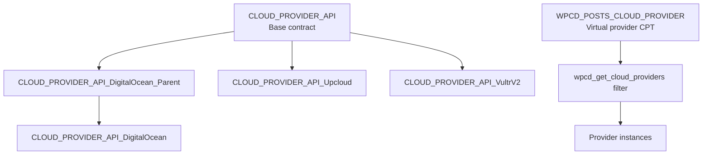
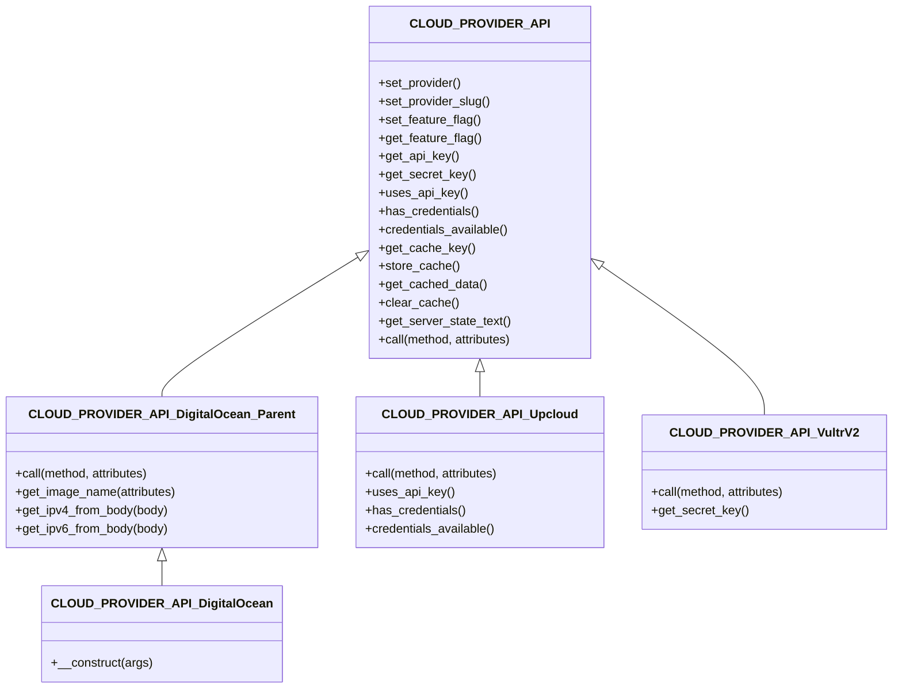
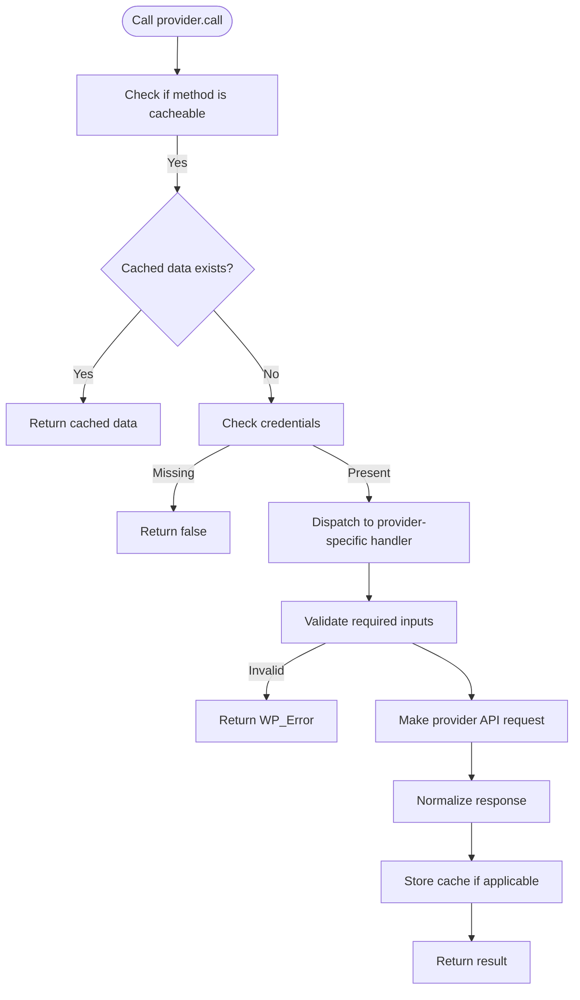
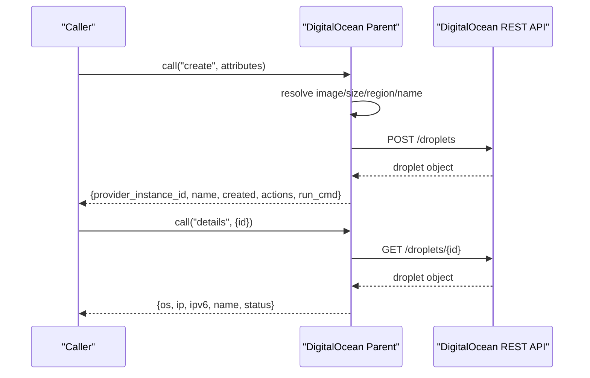
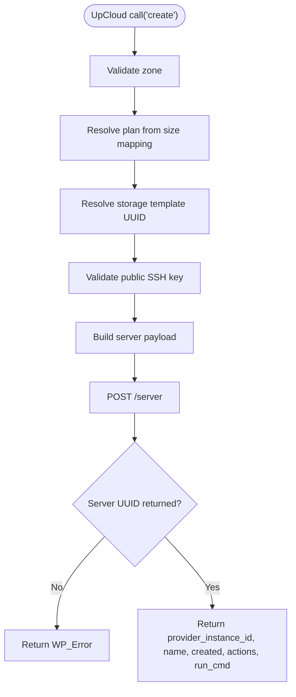
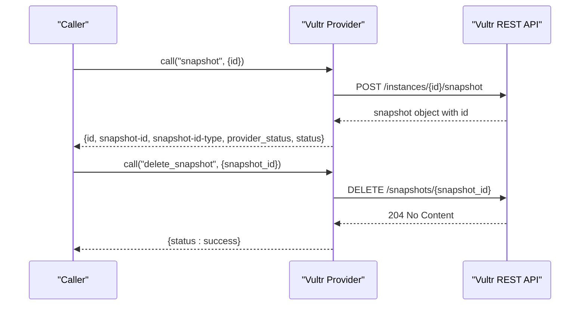
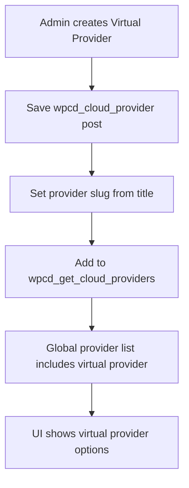
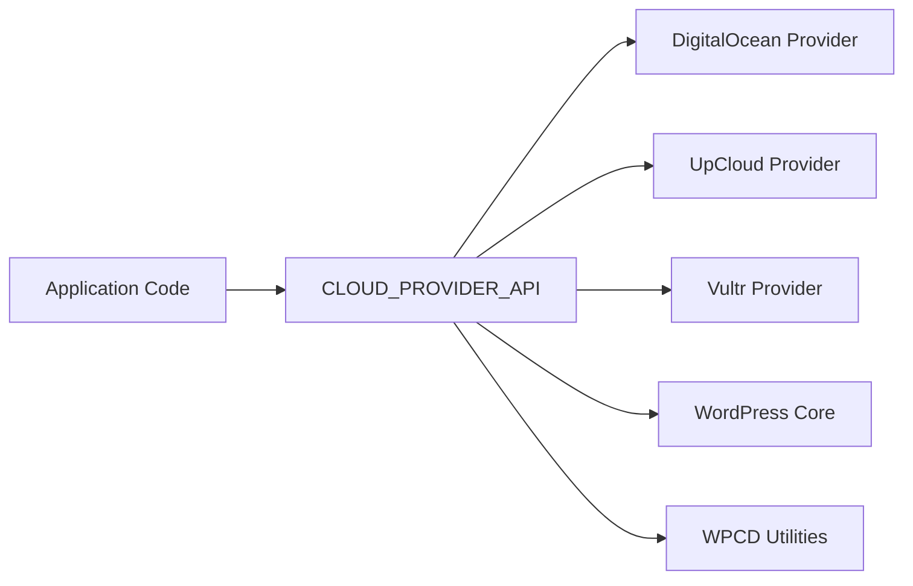

# Provider Abstraction Layer

<cite>
**Referenced Files in This Document**
- [class-cloud-provider-api.php](file://includes/core/providers/class-cloud-provider-api.php)
- [class-digital-ocean-parent.php](file://includes/core/providers/class-digital-ocean-parent.php)
- [class-digital-ocean.php](file://includes/core/providers/class-digital-ocean.php)
- [class-upcloud.php](file://includes/core/providers/class-upcloud.php)
- [class-vultr-v2.php](file://includes/core/providers/class-vultr-v2.php)
- [class-wpcd-posts-cloud-provider.php](file://includes/core/class-wpcd-posts-cloud-provider.php)
- [wp-cloud-deploy.php](file://includes/core/wp-cloud-deploy.php)
- [class-wpcd-settings.php](file://includes/core/class-wpcd-settings.php)
- [class-wpcd-cloud-provider-test.php](file://tests/data/class-wpcd-cloud-provider-test.php)
</cite>

## Table of Contents
1. [Introduction](#introduction)
2. [Project Structure](#project-structure)
3. [Core Components](#core-components)
4. [Architecture Overview](#architecture-overview)
5. [Detailed Component Analysis](#detailed-component-analysis)
6. [Dependency Analysis](#dependency-analysis)
7. [Performance Considerations](#performance-considerations)
8. [Troubleshooting Guide](#troubleshooting-guide)
9. [Conclusion](#conclusion)

## Introduction
This document explains SimpleStack’s cloud provider abstraction layer. It covers the base provider interface, common instance lifecycle methods, authentication patterns, error handling, provider registration and discovery, and how to implement custom providers. It also documents secure credential handling, rate-limiting considerations, testing strategies, and the benefits of abstraction for supporting multiple cloud services and migrating between them.

The abstraction centers on a shared base class that defines the provider contract, concrete provider implementations for DigitalOcean, UpCloud, and Vultr, and WordPress hooks that register virtual providers and expose provider settings.

## Project Structure
The provider system lives under `includes/core/providers` and is integrated with WordPress post types and settings:

- Base provider contract and shared utilities: `class-cloud-provider-api.php`
- Provider implementations:
  - DigitalOcean parent and concrete class: `class-digital-ocean-parent.php`, `class-digital-ocean.php`
  - UpCloud implementation: `class-upcloud.php`
  - Vultr v2 implementation: `class-vultr-v2.php`
- Virtual provider registration and UI: `class-wpcd-posts-cloud-provider.php`
- Global provider registry and filters: `wp-cloud-deploy.php`
- Settings screen integration: `class-wpcd-settings.php`
- Test double for providers: `class-wpcd-cloud-provider-test.php`

**Diagram sources**
- [class-cloud-provider-api.php:15-167](file://includes/core/providers/class-cloud-provider-api.php#L15-L167)
- [class-digital-ocean-parent.php:15-84](file://includes/core/providers/class-digital-ocean-parent.php#L15-L84)
- [class-digital-ocean.php:15-61](file://includes/core/providers/class-digital-ocean.php#L15-L61)
- [class-upcloud.php:33-128](file://includes/core/providers/class-upcloud.php#L33-L128)
- [class-vultr-v2.php:30-127](file://includes/core/providers/class-vultr-v2.php#L30-L127)
- [class-wpcd-posts-cloud-provider.php:588-616](file://includes/core/class-wpcd-posts-cloud-provider.php#L588-L616)
- [wp-cloud-deploy.php:1330-1364](file://includes/core/wp-cloud-deploy.php#L1330-L1364)

**Section sources**
- [class-cloud-provider-api.php:15-167](file://includes/core/providers/class-cloud-provider-api.php#L15-L167)
- [class-wpcd-posts-cloud-provider.php:588-616](file://includes/core/class-wpcd-posts-cloud-provider.php#L588-L616)
- [wp-cloud-deploy.php:1330-1364](file://includes/core/wp-cloud-deploy.php#L1330-L1364)

## Core Components
- Base provider class: Defines the provider contract, feature flags, credential helpers, cache key management, state normalization, and shared HTTP request behavior.
- Concrete providers: Implement provider-specific API calls, authentication, and response mapping while adhering to the shared contract.
- Virtual provider registration: Adds user-defined provider aliases (e.g., “Client A – DigitalOcean”) backed by real provider classes.
- Provider registry: Exposes all available providers via a filter so other plugins or white-label builds can extend or modify the list.

Key responsibilities:
- Instance lifecycle: create, details, status, reboot/off/on, delete, resize.
- Enumeration: regions, sizes, SSH keys.
- Optional features: snapshots, backup toggles, dynamic tags, SSH key creation, connection tests.
- Credentials: API keys or username/password pairs, encrypted at rest.
- Error handling: consistent `WP_Error` responses and normalized states.
- Caching: transients for read-only data like regions and sizes.

**Section sources**
- [class-cloud-provider-api.php:15-167](file://includes/core/providers/class-cloud-provider-api.php#L15-L167)
- [class-cloud-provider-api.php:423-450](file://includes/core/providers/class-cloud-provider-api.php#L423-L450)
- [class-cloud-provider-api.php:481-585](file://includes/core/providers/class-cloud-provider-api.php#L481-L585)
- [class-cloud-provider-api.php:645-704](file://includes/core/providers/class-cloud-provider-api.php#L645-L704)

## Architecture Overview
The abstraction follows a clear inheritance model:

- `CLOUD_PROVIDER_API` provides:
  - Provider identity (name, slug, base provider).
  - Feature flags (snapshots, resize, SSH key creation, test connection, etc.).
  - Credential helpers (`get_api_key`, `get_secret_key`, `uses_api_key`, `has_credentials`, `credentials_available`).
  - Cache key generation and transient storage for enumerations.
  - State normalization helpers.
- Each provider extends the base class and implements its own `call()` method, which maps internal method names to provider endpoints and normalizes responses.

**Diagram sources**
- [class-cloud-provider-api.php:15-167](file://includes/core/providers/class-cloud-provider-api.php#L15-L167)
- [class-digital-ocean-parent.php:15-84](file://includes/core/providers/class-digital-ocean-parent.php#L15-L84)
- [class-digital-ocean.php:15-61](file://includes/core/providers/class-digital-ocean.php#L15-L61)
- [class-upcloud.php:33-128](file://includes/core/providers/class-upcloud.php#L33-L128)
- [class-vultr-v2.php:30-127](file://includes/core/providers/class-vultr-v2.php#L30-L127)

## Detailed Component Analysis

### Base Provider Contract: CLOUD_PROVIDER_API
Responsibilities:
- Identity and configuration: provider name/slug, dashboard link, region prefix, help link.
- Feature flags: snapshot support, backups, resize, SSH key creation, test connection, dynamic tags, custom images.
- Credentials:
  - `get_api_key()` and `get_secret_key()` are template methods; descendants provide actual values.
  - `uses_api_key()` indicates whether the provider uses an API key or another mechanism.
  - `has_credentials()` checks configured secrets.
  - `credentials_available()` checks broader prerequisites such as SSH keys.
- Caching:
  - `get_cache_methods()` lists safe-to-cache methods.
  - `get_maybe_cache_methods()` lists all potentially cached methods.
  - `get_cache_key()` generates unique keys including provider slug, site context, and secret hash.
  - `store_cache()` and `get_cached_data()` manage transients.
- State normalization: `get_server_state_text()` maps internal states to human-readable labels.

Common methods exposed to callers:
- `call(method, attributes)` — abstracted entry point implemented by each provider.
- `get_region_description()` and `get_size_description()` — optional overrides for display text.

Error handling:
- Returns `WP_Error` for unsupported operations or missing inputs.
- Normalizes provider-specific errors into consistent structures.

**Diagram sources**
- [class-cloud-provider-api.php:481-585](file://includes/core/providers/class-cloud-provider-api.php#L481-L585)
- [class-cloud-provider-api.php:645-704](file://includes/core/providers/class-cloud-provider-api.php#L645-L704)

**Section sources**
- [class-cloud-provider-api.php:15-167](file://includes/core/providers/class-cloud-provider-api.php#L15-L167)
- [class-cloud-provider-api.php:423-450](file://includes/core/providers/class-cloud-provider-api.php#L423-L450)
- [class-cloud-provider-api.php:481-585](file://includes/core/providers/class-cloud-provider-api.php#L481-L585)
- [class-cloud-provider-api.php:645-704](file://includes/core/providers/class-cloud-provider-api.php#L645-L704)

### DigitalOcean Provider
Highlights:
- Inherits from `CLOUD_PROVIDER_API_DigitalOcean_Parent`, which centralizes most DigitalOcean logic.
- Uses bearer token authentication via `Authorization: Bearer`.
- Implements `call()` with a switch over supported methods: sizes, keys, regions, create, snapshot, reboot/off/on, status, delete, details, resize, ssh_create, test_connection.
- Response normalization:
  - Sizes filtered to exclude very small plans.
  - Regions optionally prefixed for multi-account scenarios.
  - Create returns provider instance id, name, created timestamp, actions, and run command.
  - Snapshot flow includes intermediate action IDs due to provider limitations.
- Retry behavior: certain read methods retry once after a short delay when encountering non-successful HTTP codes.
- Auto-start after resize: schedules a cron to restart servers after resize completion.

**Diagram sources**
- [class-digital-ocean-parent.php:162-534](file://includes/core/providers/class-digital-ocean-parent.php#L162-L534)

**Section sources**
- [class-digital-ocean-parent.php:15-84](file://includes/core/providers/class-digital-ocean-parent.php#L15-L84)
- [class-digital-ocean-parent.php:162-534](file://includes/core/providers/class-digital-ocean-parent.php#L162-L534)
- [class-digital-ocean.php:15-61](file://includes/core/providers/class-digital-ocean.php#L15-L61)

### UpCloud Provider
Highlights:
- Authenticates with HTTP Basic using account username and password rather than an API key.
- Overrides `uses_api_key()`, `has_credentials()`, and `credentials_available()` to reflect username/password and inline SSH key installation.
- Implements `call()` with explicit handlers for regions, sizes, keys, create, details, status, power operations, delete, resize, ssh_create, and test_connection.
- Snapshots are not supported through this control panel; related methods return `WP_Error`.
- Power operations are asynchronous without operation IDs; completion is inferred from server state with a timeout backstop.
- Storage templates must be cloned to create disks; create resolves a template UUID before issuing the server creation request.

**Diagram sources**
- [class-upcloud.php:491-602](file://includes/core/providers/class-upcloud.php#L491-L602)

**Section sources**
- [class-upcloud.php:33-128](file://includes/core/providers/class-upcloud.php#L33-L128)
- [class-upcloud.php:310-372](file://includes/core/providers/class-upcloud.php#L310-L372)
- [class-upcloud.php:491-602](file://includes/core/providers/class-upcloud.php#L491-L602)
- [class-upcloud.php:697-776](file://includes/core/providers/class-upcloud.php#L697-L776)

### Vultr v2 Provider
Highlights:
- Uses bearer token authentication similar to DigitalOcean but with different endpoint semantics.
- Implements comprehensive `call()` handlers for regions, sizes, keys, create, details, status, power operations, delete, resize, snapshots (create/delete/list/pending status), ssh_create, and test_connection.
- Pagination helper fetches all pages safely with bounded page counts.
- Power operations return no operation ID; completion is inferred from instance state with a timeout backstop.
- User data must be base64 encoded before sending to the API.

**Diagram sources**
- [class-vultr-v2.php:650-696](file://includes/core/providers/class-vultr-v2.php#L650-L696)

**Section sources**
- [class-vultr-v2.php:30-127](file://includes/core/providers/class-vultr-v2.php#L30-L127)
- [class-vultr-v2.php:183-250](file://includes/core/providers/class-vultr-v2.php#L183-L250)
- [class-vultr-v2.php:369-453](file://includes/core/providers/class-vultr-v2.php#L369-L453)
- [class-vultr-v2.php:500-588](file://includes/core/providers/class-vultr-v2.php#L500-L588)

### Virtual Provider Registration and Discovery
Virtual providers allow multiple accounts per provider type (e.g., multiple DigitalOcean accounts) by defining a custom post type record that points to a base provider class. The registration process:

- Registers the `wpcd_cloud_provider` custom post type and associated meta boxes.
- Adds filters to include virtual providers in the global provider list via `wpcd_get_cloud_providers`.
- Prevents deletion of virtual providers that are still referenced by servers.

**Diagram sources**
- [class-wpcd-posts-cloud-provider.php:505-555](file://includes/core/class-wpcd-posts-cloud-provider.php#L505-L555)
- [class-wpcd-posts-cloud-provider.php:588-616](file://includes/core/class-wpcd-posts-cloud-provider.php#L588-L616)

**Section sources**
- [class-wpcd-posts-cloud-provider.php:505-555](file://includes/core/class-wpcd-posts-cloud-provider.php#L505-L555)
- [class-wpcd-posts-cloud-provider.php:588-616](file://includes/core/class-wpcd-posts-cloud-provider.php#L588-L616)
- [class-wpcd-posts-cloud-provider.php:649-749](file://includes/core/class-wpcd-posts-cloud-provider.php#L649-L749)

### Provider Registry and Filters
The global provider registry exposes a filter `wpcd_get_cloud_providers` that allows other plugins or white-label builds to add, remove, or modify providers. The base provider class also registers a filter for provider dashboard links and supports feature flag configuration.

Key integration points:
- `wpcd_get_cloud_providers` filter used to assemble the final provider list.
- `wpcd_provider_types` filter used to define supported provider types in the virtual provider UI.
- Per-provider dashboard link filter: `wpcd_cloud_provider_settings_api_key_label_desc_{provider}`.

**Section sources**
- [wp-cloud-deploy.php:1330-1364](file://includes/core/wp-cloud-deploy.php#L1330-L1364)
- [class-wpcd-posts-cloud-provider.php:560-577](file://includes/core/class-wpcd-posts-cloud-provider.php#L560-L577)
- [class-cloud-provider-api.php:377-389](file://includes/core/providers/class-cloud-provider-api.php#L377-L389)

### Authentication Patterns
Two primary patterns are implemented:

- API key/bearer token:
  - DigitalOcean and Vultr use bearer tokens stored in encrypted options and passed via the `Authorization: Bearer` header.
  - `get_api_key()` returns the decrypted token; `get_secret_key()` may alias it for cache key hashing.
- Username/password (HTTP Basic):
  - UpCloud stores username and password in encrypted options and sends them via HTTP Basic authentication.
  - `uses_api_key()` returns false; `has_credentials()` checks both fields; `get_secret_key()` returns the password for cache key hashing.

Credential availability checks:
- `credentials_available()` ensures not only secrets are present but also required SSH keys for provisioning.

Security notes:
- Secrets are decrypted at runtime and never logged.
- UpCloud explicitly avoids logging headers, bodies, or full URLs containing credentials.

**Section sources**
- [class-digital-ocean-parent.php:74-84](file://includes/core/providers/class-digital-ocean-parent.php#L74-L84)
- [class-vultr-v2.php:120-127](file://includes/core/providers/class-vultr-v2.php#L120-L127)
- [class-upcloud.php:117-128](file://includes/core/providers/class-upcloud.php#L117-L128)
- [class-upcloud.php:172-231](file://includes/core/providers/class-upcloud.php#L172-L231)
- [class-cloud-provider-api.php:173-207](file://includes/core/providers/class-cloud-provider-api.php#L173-L207)
- [class-cloud-provider-api.php:645-704](file://includes/core/providers/class-cloud-provider-api.php#L645-L704)

### Error Handling Strategies
Consistent error handling across providers:
- Missing inputs return `WP_Error` with descriptive messages.
- Unsupported operations return `WP_Error` with a “not-supported” code.
- HTTP errors are detected and converted to `WP_Error`, often including provider-specific error objects when available.
- Asynchronous operations track state via transients and timeouts to avoid wedging servers in pending states.

Examples:
- DigitalOcean retries select read methods once after a delay.
- UpCloud infers power operation completion from server state with a timeout.
- Vultr infers power operation completion from instance state with a timeout.

**Section sources**
- [class-digital-ocean-parent.php:348-390](file://includes/core/providers/class-digital-ocean-parent.php#L348-L390)
- [class-upcloud.php:697-776](file://includes/core/providers/class-upcloud.php#L697-L776)
- [class-vultr-v2.php:500-588](file://includes/core/providers/class-vultr-v2.php#L500-L588)

### Common Instance Management Methods
All providers implement a unified `call()` interface for instance lifecycle and enumeration:

- Create:
  - Validates region/zone, plan/size mapping, OS selection, and SSH key material.
  - Builds provider-specific payloads and returns normalized results including provider instance id, name, created timestamp, actions, and optional run commands.
- Details:
  - Returns OS, IP addresses, name, and normalized status.
- Status:
  - Reports operation completion or in-progress state, often inferring completion for asynchronous APIs.
- Power operations:
  - Reboot, off, on map to provider-specific endpoints and return in-progress status with action identifiers where applicable.
- Delete:
  - Destroys the instance and returns a done status.
- Resize:
  - Changes plan/size; may require manual restart depending on provider constraints.
- Enumeration:
  - Regions, sizes, and SSH keys are fetched and cached.

**Section sources**
- [class-digital-ocean-parent.php:188-534](file://includes/core/providers/class-digital-ocean-parent.php#L188-L534)
- [class-upcloud.php:310-372](file://includes/core/providers/class-upcloud.php#L310-L372)
- [class-vultr-v2.php:183-250](file://includes/core/providers/class-vultr-v2.php#L183-L250)

### Testing Provider Implementations
A minimal test double is provided to avoid calling real providers during tests:

- `WPCD_Cloud_Provider_Test` extends `CLOUD_PROVIDER_API` and overrides `call()` to return a fixed success response.
- This enables unit tests to validate orchestration logic without network dependencies.

Best practices:
- Extend `CLOUD_PROVIDER_API` and override `call()` to simulate provider responses.
- Assert that callers handle `WP_Error` and normalized state strings correctly.
- Mock credential retrieval and SSH key availability to cover validation paths.

**Section sources**
- [class-wpcd-cloud-provider-test.php:17-23](file://tests/data/class-wpcd-cloud-provider-test.php#L17-L23)

## Dependency Analysis
Provider classes depend on:
- WordPress functions for options, transients, AJAX, and HTTP requests.
- WPCD core utilities for decryption, option access, and logging.
- Filters and actions for extending provider behavior and settings.

Coupling and cohesion:
- High cohesion within each provider implementation around its specific API.
- Low coupling to caller code via the shared `call()` contract.
- Shared caching and credential logic reduces duplication in the base class.

Potential circular dependencies:
- None observed among provider classes; dependencies flow from concrete providers to the base class and WordPress core.

External integrations:
- Cloud provider REST APIs (DigitalOcean, UpCloud, Vultr).
- WordPress admin UI and settings screens.

**Diagram sources**
- [class-cloud-provider-api.php:15-167](file://includes/core/providers/class-cloud-provider-api.php#L15-L167)
- [class-digital-ocean-parent.php:162-534](file://includes/core/providers/class-digital-ocean-parent.php#L162-L534)
- [class-upcloud.php:310-372](file://includes/core/providers/class-upcloud.php#L310-L372)
- [class-vultr-v2.php:183-250](file://includes/core/providers/class-vultr-v2.php#L183-L250)

**Section sources**
- [class-cloud-provider-api.php:15-167](file://includes/core/providers/class-cloud-provider-api.php#L15-L167)

## Performance Considerations
- Caching:
  - Read-only methods like regions, sizes, and keys are cached via transients.
  - Cache keys incorporate provider slug, site context, and secret hash to avoid collisions across accounts.
  - Cache lifetimes are configurable via options.
- Network efficiency:
  - DigitalOcean retries select read methods once to mitigate transient failures.
  - Vultr paginates list endpoints with bounded page counts to prevent unbounded loops.
- Asynchronous operations:
  - Power operations and resizes use transients and timeouts to avoid indefinite pending states.

Recommendations:
- Prefer cached enumeration methods where possible.
- Avoid logging sensitive request details; providers already guard against this.
- Tune cache lifetimes based on provider update frequency and operational needs.

**Section sources**
- [class-cloud-provider-api.php:481-585](file://includes/core/providers/class-cloud-provider-api.php#L481-L585)
- [class-digital-ocean-parent.php:348-390](file://includes/core/providers/class-digital-ocean-parent.php#L348-L390)
- [class-vultr-v2.php:43-53](file://includes/core/providers/class-vultr-v2.php#L43-L53)

## Troubleshooting Guide
Common issues and resolutions:
- Missing credentials:
  - Ensure API key or username/password is configured and decrypted correctly.
  - Verify SSH key pair is present for provisioning.
- Unsupported operations:
  - Some providers do not support snapshots or certain power operations; check feature flags and provider documentation.
- Asynchronous operations stuck:
  - Check transient backstops and provider dashboards for completion signals.
- Rate limiting:
  - Implement exponential backoff and jitter for retries when providers return throttling errors.
  - Respect provider quotas and consider batching enumeration requests.

Settings screen integration:
- Provider-specific fields are added via filters; ensure they are rendered and saved correctly.
- Private SSH keys are encrypted at rest and decrypted only when needed.

**Section sources**
- [class-wpcd-settings.php:1394-1424](file://includes/core/class-wpcd-settings.php#L1394-L1424)
- [class-upcloud.php:172-231](file://includes/core/providers/class-upcloud.php#L172-L231)
- [class-vultr-v2.php:18-29](file://includes/core/providers/class-vultr-v2.php#L18-L29)

## Conclusion
SimpleStack’s provider abstraction layer provides a robust, extensible foundation for managing cloud instances across multiple providers. The base class defines a clear contract for instance lifecycle, enumeration, authentication, and error handling, while concrete implementations encapsulate provider-specific details. Virtual provider registration and the global provider registry enable flexible configuration and migration between providers. By leveraging shared caching, credential management, and consistent error handling, the system simplifies multi-cloud operations and supports secure, maintainable integrations.