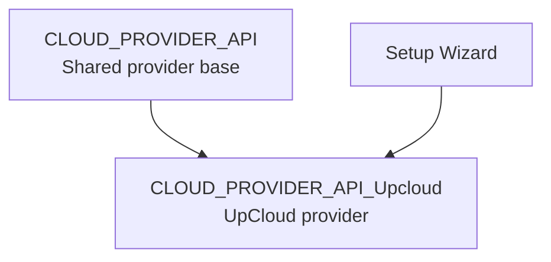
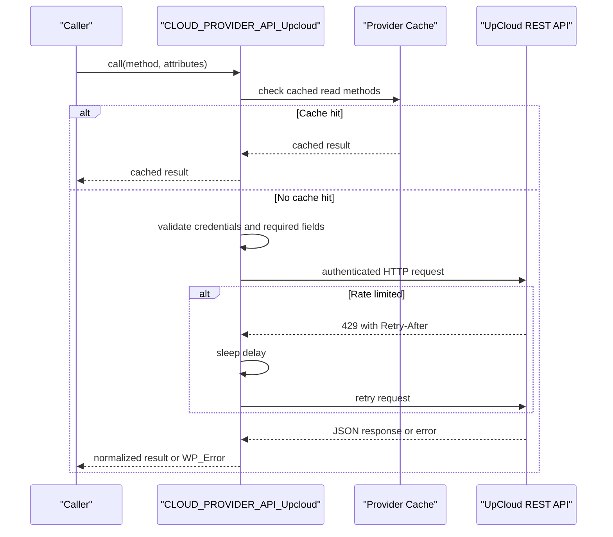
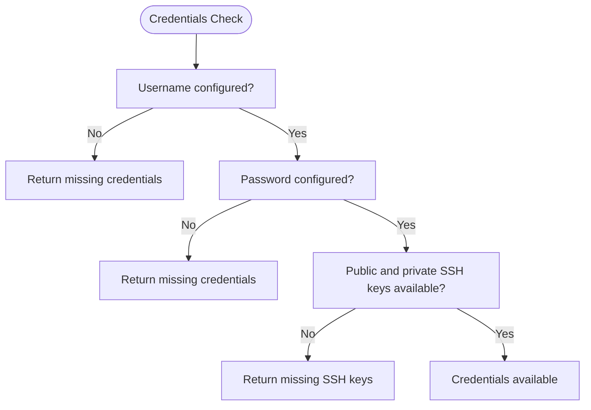
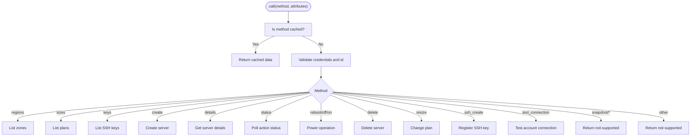
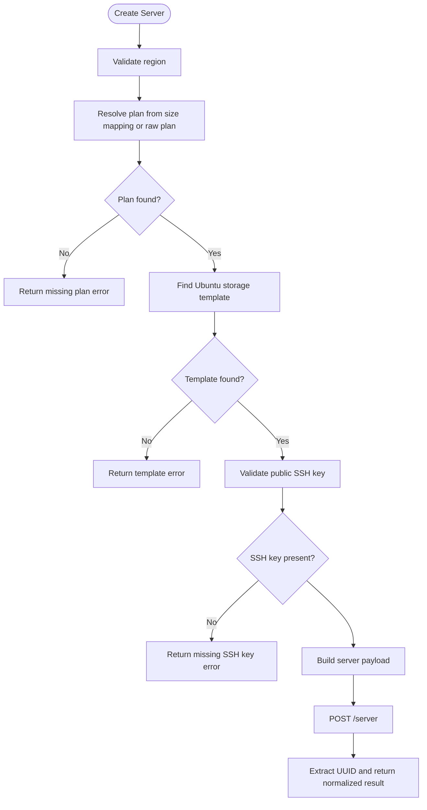
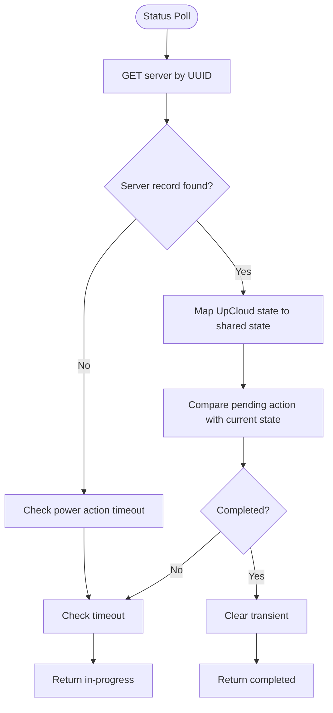
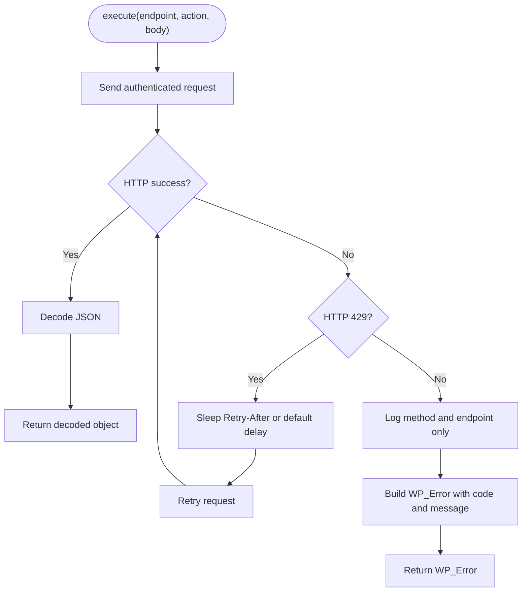
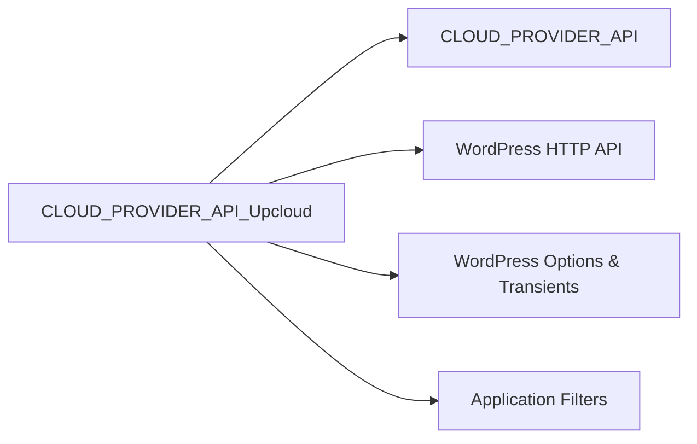

# UpCloud Provider Implementation

<cite>
**Referenced Files in This Document**
- [class-upcloud.php](file://includes/core/providers/class-upcloud.php)
- [class-cloud-provider-api.php](file://includes/core/providers/class-cloud-provider-api.php)
- [class-wpcd-setup-wizard.php](file://includes/core/class-wpcd-setup-wizard.php)
</cite>

## Table of Contents
1. [Introduction](#introduction)
2. [Project Structure](#project-structure)
3. [Core Components](#core-components)
4. [Architecture Overview](#architecture-overview)
5. [Detailed Component Analysis](#detailed-component-analysis)
6. [Dependency Analysis](#dependency-analysis)
7. [Performance Considerations](#performance-considerations)
8. [Troubleshooting Guide](#troubleshooting-guide)
9. [Conclusion](#conclusion)
10. [Appendices](#appendices)

## Introduction
This document explains the UpCloud provider implementation for API version 1.3 inside the project. It covers authentication, instance lifecycle operations, storage and networking setup, SSH key handling, error handling, caching, rate limiting, and operational guidance. It also clarifies which UpCloud features are supported by this provider and which are intentionally disabled because they do not fit the shared provider contract.

The implementation is a PHP class that extends the shared cloud provider base class and translates generic provider actions into UpCloud REST calls.

## Project Structure
The UpCloud provider lives under the providers directory and implements the shared provider interface used across all cloud backends. The most relevant files are:

- `includes/core/providers/class-upcloud.php`: UpCloud-specific provider implementation.
- `includes/core/providers/class-cloud-provider-api.php`: Shared base class defining common behavior, constants, and helper contracts.
- `includes/core/class-wpcd-setup-wizard.php`: Setup wizard integration that recognizes UpCloud as a special provider during connection steps.

**Diagram sources**
- [class-cloud-provider-api.php:125-146](file://includes/core/providers/class-cloud-provider-api.php#L125-L146)
- [class-upcloud.php:12-33](file://includes/core/providers/class-upcloud.php#L12-L33)
- [class-wpcd-setup-wizard.php:545-549](file://includes/core/class-wpcd-setup-wizard.php#L545-L549)

**Section sources**
- [class-upcloud.php:1-33](file://includes/core/providers/class-upcloud.php#L1-L33)
- [class-cloud-provider-api.php:125-146](file://includes/core/providers/class-cloud-provider-api.php#L125-L146)
- [class-wpcd-setup-wizard.php:545-549](file://includes/core/class-wpcd-setup-wizard.php#L545-L549)

## Core Components
The UpCloud provider defines a single main class with these responsibilities:

- Authentication using UpCloud account username and password via HTTP Basic.
- Listing regions, plans, and SSH keys.
- Creating servers from Ubuntu templates with public IPv4 networking and inline SSH key installation.
- Reading server details and status.
- Performing power operations: start, stop, and restart.
- Deleting servers.
- Resizing servers to a new plan.
- Registering SSH keys best-effort while keeping local key pairs usable even if registration fails.
- Testing connectivity against the UpCloud account endpoint.
- Caching read-only list endpoints.
- Handling HTTP 429 rate limits with one retry after honoring the `Retry-After` header when present.
- Logging only safe request metadata; never logging headers, bodies, or full URLs containing credentials.

Key behaviors:

| Area | Behavior |
|---|---|
| Authentication | HTTP Basic with encrypted username and password stored in settings. |
| Instance IDs | Uses UpCloud server UUIDs. |
| Regions | Mapped from UpCloud zones; supports optional region prefix. |
| Plans | Uses plan names such as `2xCPU-4GB`; no numeric plan ID. |
| Storage | Clones an Ubuntu template disk; does not expose snapshots through this control panel. |
| Networking | Creates a public IPv4 interface on server creation. |
| SSH Keys | Public key installed inline; private key remains local for WPCD access. |
| Backups/Snapshots | Disabled in UI because UpCloud backups are tied to storage devices and dates rather than snapshot IDs. |
| Custom Images | Not offered because the code path does not read custom image options back. |
| Dynamic Tags | Not supported by this provider. |

**Section sources**
- [class-upcloud.php:17-32](file://includes/core/providers/class-upcloud.php#L17-L32)
- [class-upcloud.php:96-127](file://includes/core/providers/class-upcloud.php#L96-L127)
- [class-upcloud.php:172-231](file://includes/core/providers/class-upcloud.php#L172-L231)
- [class-upcloud.php:379-482](file://includes/core/providers/class-upcloud.php#L379-L482)
- [class-upcloud.php:491-602](file://includes/core/providers/class-upcloud.php#L491-L602)
- [class-upcloud.php:611-776](file://includes/core/providers/class-upcloud.php#L611-L776)
- [class-upcloud.php:797-841](file://includes/core/providers/class-upcloud.php#L797-L841)

## Architecture Overview
At runtime, the provider receives a method name and attributes, validates required inputs, performs optional cache hits, builds UpCloud requests, and returns normalized results or `WP_Error` objects.

**Diagram sources**
- [class-upcloud.php:310-372](file://includes/core/providers/class-upcloud.php#L310-L372)
- [class-upcloud.php:1133-1193](file://includes/core/providers/class-upcloud.php#L1133-L1193)

## Detailed Component Analysis

### Authentication and Credentials
UpCloud uses HTTP Basic authentication with an account username and password. The provider stores both values encrypted in settings and constructs the `Authorization` header for every request. It explicitly does not use bearer tokens or an API key field.

Important credential-related points:

- `uses_api_key()` returns false.
- `has_credentials()` checks both username and password.
- `credentials_available()` additionally requires a locally stored public SSH key and private SSH key so servers can be created and accessed.
- Settings fields added for UpCloud are `vpn_upcloud_user_name` and `vpn_upcloud_user_password`.
- The dashboard link points to the UpCloud API account page.

**Diagram sources**
- [class-upcloud.php:172-231](file://includes/core/providers/class-upcloud.php#L172-L231)
- [class-upcloud.php:247-289](file://includes/core/providers/class-upcloud.php#L247-L289)
- [class-upcloud.php:1204-1222](file://includes/core/providers/class-upcloud.php#L1204-L1222)

**Section sources**
- [class-upcloud.php:17-32](file://includes/core/providers/class-upcloud.php#L17-L32)
- [class-upcloud.php:117-127](file://includes/core/providers/class-upcloud.php#L117-L127)
- [class-upcloud.php:172-231](file://includes/core/providers/class-upcloud.php#L172-L231)
- [class-upcloud.php:247-289](file://includes/core/providers/class-upcloud.php#L247-L289)
- [class-upcloud.php:1204-1222](file://includes/core/providers/class-upcloud.php#L1204-L1222)

### API Request Lifecycle
All provider actions go through a central dispatcher. Read-only list methods are cached. Required identifiers are validated before calling provider-specific handlers. Unsupported methods return a clear error instead of silently failing.

**Diagram sources**
- [class-upcloud.php:310-372](file://includes/core/providers/class-upcloud.php#L310-L372)

**Section sources**
- [class-upcloud.php:310-372](file://includes/core/providers/class-upcloud.php#L310-L372)

### Region, Plan, and Key Discovery
- **Regions**: Calls the zone listing endpoint and returns zone IDs mapped to labels. A provider-level region prefix can be applied.
- **Plans**: Calls the plan listing endpoint. Plan names like `2xCPU-4GB` become array keys because UpCloud has no numeric plan ID.
- **SSH Keys**: Lists registered SSH keys by title.

These lists are cached to avoid repeated API calls.

**Section sources**
- [class-upcloud.php:379-405](file://includes/core/providers/class-upcloud.php#L379-L405)
- [class-upcloud.php:416-450](file://includes/core/providers/class-upcloud.php#L416-L450)
- [class-upcloud.php:458-482](file://includes/core/providers/class-upcloud.php#L458-L482)

### Server Creation
Server creation is the most complex operation. It validates region, plan, OS template, and SSH key presence, then builds a request body that includes:

- Zone.
- Title and hostname.
- Plan.
- Storage device cloned from an Ubuntu template.
- Login user set to root with inline SSH key installation.
- Public IPv4 network interface.
- Optional cloud-init startup commands supplied by the application layer.

The returned result contains the provider instance ID, display name, creation timestamp, action tracking, and any run command.

**Diagram sources**
- [class-upcloud.php:491-602](file://includes/core/providers/class-upcloud.php#L491-L602)
- [class-upcloud.php:891-964](file://includes/core/providers/class-upcloud.php#L891-L964)

**Section sources**
- [class-upcloud.php:491-602](file://includes/core/providers/class-upcloud.php#L491-L602)
- [class-upcloud.php:891-964](file://includes/core/providers/class-upcloud.php#L891-L964)

### Server Details and Status
- **Details**: Reads a single server record and maps state to shared constants. IP extraction returns a sentinel value when no matching address is found.
- **Status**: Used for asynchronous power operations. Because UpCloud does not return an operation ID, completion is inferred from server state and a transient time limit prevents wedging.

**Diagram sources**
- [class-upcloud.php:611-687](file://includes/core/providers/class-upcloud.php#L611-L687)
- [class-upcloud.php:1096-1122](file://includes/core/providers/class-upcloud.php#L1096-L1122)

**Section sources**
- [class-upcloud.php:611-687](file://includes/core/providers/class-upcloud.php#L611-L687)
- [class-upcloud.php:876-889](file://includes/core/providers/class-upcloud.php#L876-L889)
- [class-upcloud.php:991-1067](file://includes/core/providers/class-upcloud.php#L991-L1067)
- [class-upcloud.php:1096-1122](file://includes/core/providers/class-upcloud.php#L1096-L1122)

### Power Operations
Supported power operations are reboot, off, and on. Each maps to an UpCloud endpoint. After a successful request, a transient records when the operation started so status polling can detect timeouts.

**Section sources**
- [class-upcloud.php:697-722](file://includes/core/providers/class-upcloud.php#L697-L722)
- [class-upcloud.php:1096-1122](file://includes/core/providers/class-upcloud.php#L1096-L1122)

### Server Deletion
Deletion calls the server resource endpoint with DELETE and returns a simple done status.

**Section sources**
- [class-upcloud.php:731-740](file://includes/core/providers/class-upcloud.php#L731-L740)

### Server Resize
Resize changes the server plan. UpCloud requires the server to be stopped before changing its plan. The provider sends the modify request but does not automatically stop or restart the server. Operators should follow the UI guidance to manage the server state in the UpCloud dashboard.

**Section sources**
- [class-upcloud.php:742-776](file://includes/core/providers/class-upcloud.php#L742-L776)

### SSH Key Registration
SSH key registration is best-effort. WPCD generates the key pair locally first, stores the public key for server creation, and keeps the private key for SSH access. Registering the key with UpCloud is optional visibility help; failure does not discard the local key pair.

**Section sources**
- [class-upcloud.php:778-824](file://includes/core/providers/class-upcloud.php#L778-L824)

### Connection Test
Connection testing calls the account endpoint and returns a boolean test status based on whether the response contains an account object.

**Section sources**
- [class-upcloud.php:826-841](file://includes/core/providers/class-upcloud.php#L826-L841)

### Storage Templates and Operating System Selection
Storage templates are fetched once and cached. The provider selects an Ubuntu template whose title matches the requested release and prefers templates marked online. If no suitable template exists, it returns a specific error.

OS selection maps WPCD OS keys such as `ubuntu2404lts` to UpCloud template labels. A default Ubuntu release is used when no explicit version is provided.

**Section sources**
- [class-upcloud.php:891-964](file://includes/core/providers/class-upcloud.php#L891-L964)
- [class-upcloud.php:966-989](file://includes/core/providers/class-upcloud.php#L966-L989)

### Network Setup
On creation, the provider configures a public IPv4 interface. IPv4 and IPv6 addresses are extracted from the server record, returning sentinel strings when no matching address is found.

**Section sources**
- [class-upcloud.php:533-572](file://includes/core/providers/class-upcloud.php#L533-L572)
- [class-upcloud.php:991-1067](file://includes/core/providers/class-upcloud.php#L991-L1067)

### Error Handling and Rate Limiting
The provider centralizes error handling:

- Transport errors become `WP_Error` with a transport error code.
- HTTP errors include the status code and, when available, UpCloud’s error code and message.
- HTTP 429 triggers one retry after sleeping for the advertised delay or a bounded default.
- Logs only the HTTP method and endpoint; never logs headers, bodies, or full URLs.

**Diagram sources**
- [class-upcloud.php:1133-1193](file://includes/core/providers/class-upcloud.php#L1133-L1193)

**Section sources**
- [class-upcloud.php:1133-1193](file://includes/core/providers/class-upcloud.php#L1133-L1193)

### Feature Flags and Provider Contract Differences
The provider disables several features that do not map cleanly to UpCloud:

- Snapshots and backup management are disabled because UpCloud backups belong to storage devices and are identified by date rather than snapshot IDs.
- Custom images are not offered because the surrounding code does not read custom image options back.
- Dynamic tags are not supported.
- Enabling backups on server create is not exposed.

**Section sources**
- [class-upcloud.php:101-116](file://includes/core/providers/class-upcloud.php#L101-L116)

## Dependency Analysis
The UpCloud provider depends on:

- The shared provider base class for common behavior, constants, and helper contracts.
- WordPress functions for remote HTTP requests, transients, options, and JSON encoding/decoding.
- The application layer for filters such as the run command hook and for reading/writing provider settings.

**Diagram sources**
- [class-upcloud.php:33-38](file://includes/core/providers/class-upcloud.php#L33-L38)
- [class-upcloud.php:1133-1272](file://includes/core/providers/class-upcloud.php#L1133-L1272)
- [class-cloud-provider-api.php:125-146](file://includes/core/providers/class-cloud-provider-api.php#L125-L146)

**Section sources**
- [class-upcloud.php:310-372](file://includes/core/providers/class-upcloud.php#L310-L372)
- [class-upcloud.php:1133-1272](file://includes/core/providers/class-upcloud.php#L1133-L1272)

## Performance Considerations
- **Caching**: Region, plan, SSH key, and template lists are cached to reduce API calls.
- **Rate Limiting**: HTTP 429 responses trigger one retry after honoring `Retry-After`, capped at a reasonable maximum.
- **Timeouts**: HTTP requests use a 30-second timeout.
- **Power Operation Timeouts**: A transient tracks when power operations begin and expires after a fixed period to prevent indefinite waiting.
- **Hostname Normalization**: Hostnames are sanitized and truncated to avoid invalid server names.

Recommendations:

- Prefer cached reads where possible.
- Avoid rapid repeated resize or power operations without allowing time for state stabilization.
- Monitor UpCloud dashboard for long-running plan changes because resize does not auto-restart the server.

**Section sources**
- [class-upcloud.php:379-482](file://includes/core/providers/class-upcloud.php#L379-L482)
- [class-upcloud.php:1133-1193](file://includes/core/providers/class-upcloud.php#L1133-L1193)
- [class-upcloud.php:1196-1222](file://includes/core/providers/class-upcloud.php#L1196-L1222)
- [class-upcloud.php:1096-1122](file://includes/core/providers/class-upcloud.php#L1096-L1122)
- [class-upcloud.php:1069-1087](file://includes/core/providers/class-upcloud.php#L1069-L1087)

## Troubleshooting Guide

### Common Errors and Causes
| Symptom | Likely Cause | Resolution |
|---|---|---|
| Missing provider instance ID error | Calling an operation that requires a server UUID without providing it. | Ensure the server UUID is passed as the provider instance ID. |
| Missing region error | Creating a server without selecting a zone. | Select a valid UpCloud zone. |
| Missing plan error | Size mapping did not resolve to a plan name. | Configure the provider size-to-plan mapping or pass a raw plan name. |
| Missing SSH key error | No public SSH key configured for the provider. | Generate and save the SSH key pair in provider settings. |
| No storage template error | No matching Ubuntu template found. | Verify the selected OS version and that UpCloud offers the template. |
| No server record returned | UpCloud response lacked a server object. | Check API response and retry after transient network issues. |
| No IP found sentinel | Server record lacks a public IPv4 or IPv6 address. | Wait for networking to initialize or inspect the server in the UpCloud dashboard. |
| HTTP 429 | UpCloud rate limiting. | Wait for the advised delay; the provider retries once automatically. |
| Snapshot buttons unavailable | Snapshots feature flag is disabled. | Use the UpCloud control panel to manage backups. |

### Credential Issues
- Confirm both UpCloud account username and password are configured.
- Use an API-only sub-account rather than the root account credentials.
- Remember that the password is sent only to `api.upcloud.com` and is encrypted at rest.

### Operational Guidance
- For resize, stop the server in the UpCloud dashboard before applying the new plan, then start it again manually.
- For backups, use the UpCloud control panel because snapshot management is intentionally disabled in this provider.
- For SSH access, ensure the local private key is saved alongside the public key used during server creation.

**Section sources**
- [class-upcloud.php:331-370](file://includes/core/providers/class-upcloud.php#L331-L370)
- [class-upcloud.php:491-602](file://includes/core/providers/class-upcloud.php#L491-L602)
- [class-upcloud.php:742-776](file://includes/core/providers/class-upcloud.php#L742-L776)
- [class-upcloud.php:1133-1193](file://includes/core/providers/class-upcloud.php#L1133-L1193)

## Conclusion
The UpCloud provider implementation provides a focused, secure, and predictable interface for managing virtual servers on UpCloud API 1.3. It emphasizes safe credential handling, clear error reporting, caching for performance, and realistic feature boundaries. While managed databases, object storage, and advanced monitoring are not part of this provider’s scope, the implementation delivers reliable instance provisioning, lifecycle management, storage templating, and basic networking configuration.

## Appendices

### Provider Configuration Summary
- **Authentication**: UpCloud account username and password via HTTP Basic.
- **Settings keys**: Username and password fields are added for the UpCloud provider and stored encrypted.
- **Dashboard link**: Points to the UpCloud API account page.
- **Setup wizard**: Recognizes UpCloud as a special case where no token is needed.

**Section sources**
- [class-upcloud.php:93-127](file://includes/core/providers/class-upcloud.php#L93-L127)
- [class-upcloud.php:247-289](file://includes/core/providers/class-upcloud.php#L247-L289)
- [class-wpcd-setup-wizard.php:545-549](file://includes/core/class-wpcd-setup-wizard.php#L545-L549)

### Supported Operations Matrix
| Operation | Supported | Notes |
|---|---:|---|
| List regions | Yes | Returns zone IDs and labels. |
| List plans | Yes | Uses plan names as identifiers. |
| List SSH keys | Yes | Returns key titles. |
| Create server | Yes | Requires region, plan, Ubuntu template, and public SSH key. |
| Get details | Yes | Returns name, status, and IPs. |
| Poll status | Yes | Infers completion for power operations. |
| Reboot | Yes | Maps to restart. |
| Stop | Yes | Maps to stop. |
| Start | Yes | Maps to start. |
| Delete | Yes | Deletes server resource. |
| Resize | Yes | Sends modify request; operator manages server state. |
| Register SSH key | Best effort | Local key pair remains usable even if registration fails. |
| Test connection | Yes | Calls account endpoint. |
| Snapshots/backups | No | Disabled by design. |
| Custom images | No | Not offered by this provider. |
| Dynamic tags | No | Not supported. |

**Section sources**
- [class-upcloud.php:96-116](file://includes/core/providers/class-upcloud.php#L96-L116)
- [class-upcloud.php:337-370](file://includes/core/providers/class-upcloud.php#L337-L370)