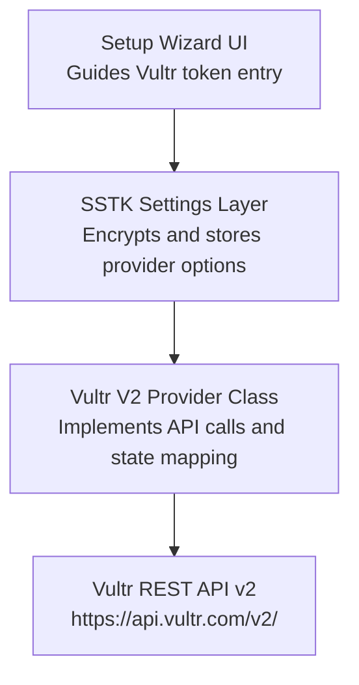
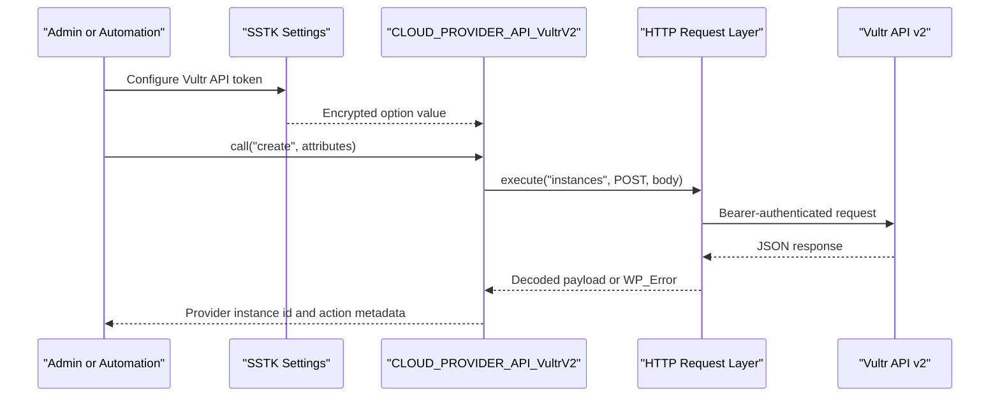
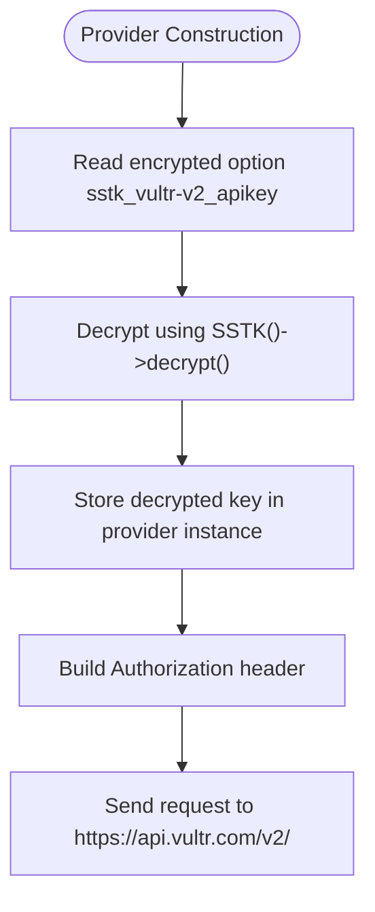
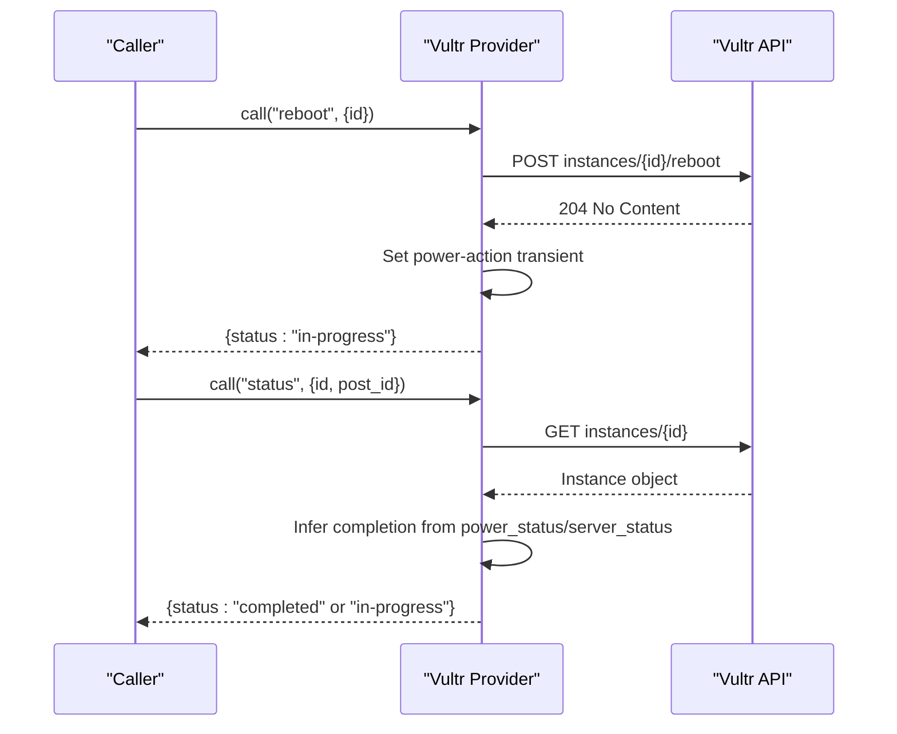
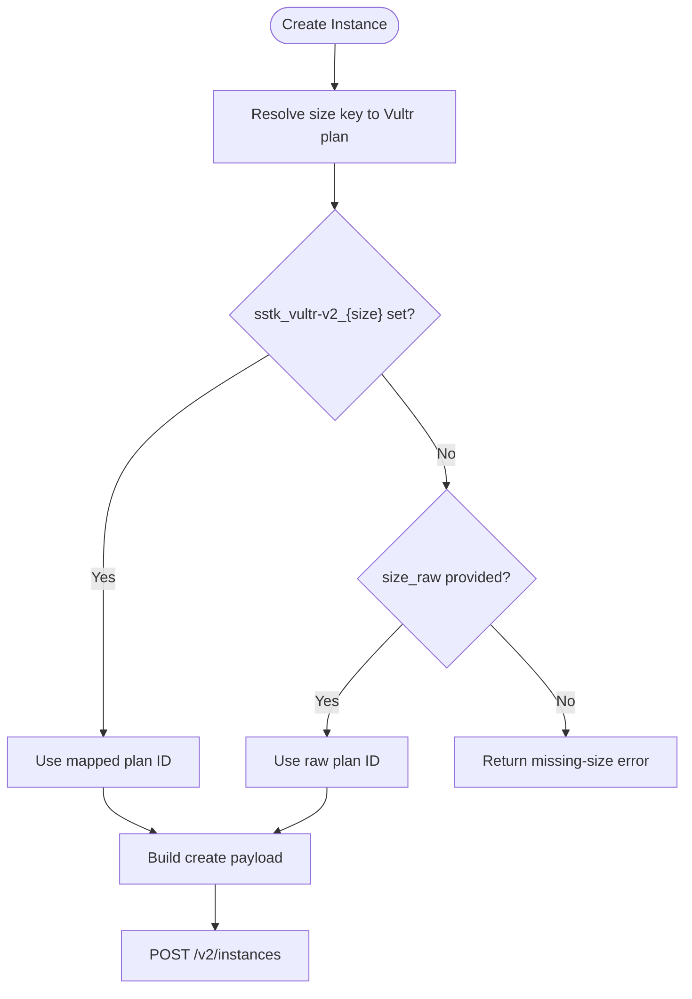
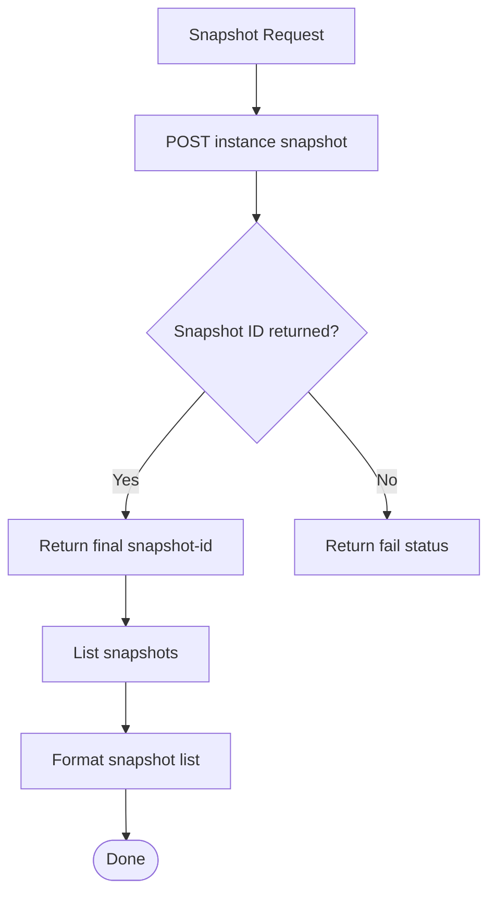
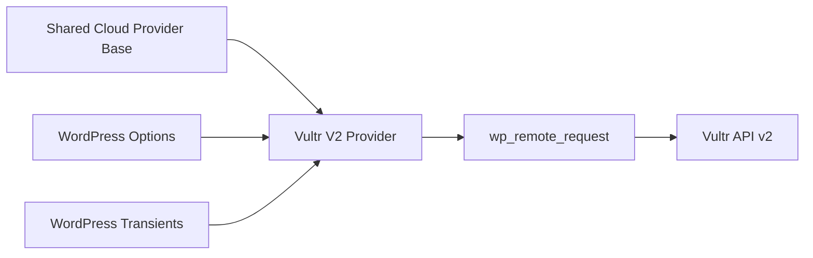

# Vultr Provider Implementation

<cite>
**Referenced Files in This Document**
- [class-vultr-v2.php](file://includes/core/providers/class-vultr-v2.php)
- [class-sstk-settings.php](file://includes/core/class-sstk-settings.php)
- [class-sstk-setup-wizard.php](file://includes/core/class-sstk-setup-wizard.php)
- [AGENTS.md](file://AGENTS.md)
</cite>

## Table of Contents
1. [Introduction](#introduction)
2. [Project Structure](#project-structure)
3. [Core Components](#core-components)
4. [Architecture Overview](#architecture-overview)
5. [Detailed Component Analysis](#detailed-component-analysis)
6. [Dependency Analysis](#dependency-analysis)
7. [Performance Considerations](#performance-considerations)
8. [Troubleshooting Guide](#troubleshooting-guide)
9. [Conclusion](#conclusion)
10. [Appendices](#appendices)

## Introduction
This document explains the Vultr API v2 provider implementation used by Simple Stack. It covers how authentication works, how instance lifecycle operations are implemented, how regions and plans are mapped, how network-related configuration is handled, and how Vultr-specific features such as snapshots and backups are supported. It also documents rate limiting behavior, error handling, retry strategies, and practical guidance for configuring credentials, mapping Simple Stack server sizes to Vultr plans, and troubleshooting connection issues.

Simple Stack targets Vultr (API v2) and UpCloud as its cloud providers, with Ubuntu 24.04 LTS / 26.04 LTS and OpenLiteSpeed as the target stack. The Vultr provider lives under the provider layer and implements a shared cloud-provider contract.

**Section sources**
- [AGENTS.md:14-20](file://AGENTS.md#L14-L20)

## Project Structure
The Vultr provider is implemented as a single PHP class that extends the shared cloud-provider base class. Configuration, credential storage, and UI wiring are provided by the settings and setup wizard layers.

**Diagram sources**
- [class-sstk-settings.php:1632-1675](file://includes/core/class-sstk-settings.php#L1632-L1675)
- [class-sstk-setup-wizard.php:551-560](file://includes/core/class-sstk-setup-wizard.php#L551-L560)
- [class-vultr-v2.php:30-127](file://includes/core/providers/class-vultr-v2.php#L30-L127)

**Section sources**
- [class-vultr-v2.php:30-127](file://includes/core/providers/class-vultr-v2.php#L30-L127)
- [class-sstk-settings.php:1632-1675](file://includes/core/class-sstk-settings.php#L1632-L1675)
- [class-sstk-setup-wizard.php:551-560](file://includes/core/class-sstk-setup-wizard.php#L551-L560)

## Core Components
The Vultr provider is centered around one main class. Its responsibilities include:

- Declaring the provider name, slug, dashboard link, and feature flags.
- Loading the encrypted API key from WordPress options.
- Routing generic `call()` requests to specific methods such as create, details, status, reboot, off, on, delete, resize, snapshot, and SSH key management.
- Fetching and caching regions, plans, OS images, and SSH keys.
- Building authenticated HTTP requests against the Vultr v2 base URL.
- Handling pagination, power-operation timeouts, and response decoding.
- Mapping Vultr instance states into Simple Stack’s shared state constants.

Key constants and behaviors:
- Base URL: `https://api.vultr.com/v2/`.
- Default OS label: Ubuntu 24.04 LTS x64.
- Pagination page size: 500 items per page.
- Maximum pages fetched per list endpoint: 20.
- Power-action timeout: 1800 seconds.

Feature flags enabled:
- SSH creation.
- Connection testing.
- Snapshots, snapshot deletion, and snapshot listing.
- Resize.
- Backups and enabling backups on server creation.

Feature flags explicitly disabled:
- Custom images.
- Dynamic tags and dynamic tag enablement on server creation.

**Section sources**
- [class-vultr-v2.php:30-127](file://includes/core/providers/class-vultr-v2.php#L30-L127)

## Architecture Overview
The Vultr provider integrates into Simple Stack through a layered architecture:

1. **Settings and Setup Wizard**: Guides users to obtain a Vultr API token and stores it securely.
2. **Provider Class**: Implements the cloud-provider contract and translates Simple Stack operations into Vultr API calls.
3. **HTTP Transport**: Builds bearer-token requests, handles success/failure, retries once on rate limiting, and decodes JSON responses.
4. **State Mapping**: Converts Vultr instance fields into Simple Stack’s internal state representation.

**Diagram sources**
- [class-sstk-settings.php:1632-1675](file://includes/core/class-sstk-settings.php#L1632-L1675)
- [class-vultr-v2.php:183-250](file://includes/core/providers/class-vultr-v2.php#L183-L250)
- [class-vultr-v2.php:1167-1256](file://includes/core/providers/class-vultr-v2.php#L1167-L1256)

## Detailed Component Analysis

### Authentication and Credentials
Authentication uses a bearer token stored in an encrypted WordPress option named after the provider slug. For Vultr, the option key pattern is `sstk_vultr-v2_apikey`. During construction, the provider decrypts this value and stores it internally. The same decrypted key is returned by `get_secret_key()` so that cache keys can be scoped per account.

Credential flow:
- The setup wizard tells administrators where to obtain the Vultr API token.
- The settings layer encrypts the token when saving provider settings.
- The provider reads and decrypts the token at runtime.
- Every outgoing request adds an `Authorization: Bearer` header.

Important security notes:
- The API key must never appear in logs, exception messages, or REST responses.
- The request helper logs only the HTTP method and endpoint.
- The `user_data` field may contain startup scripts; it must not contain secrets because it is base64-encoded but not cryptographically protected.

**Diagram sources**
- [class-vultr-v2.php:19-28](file://includes/core/providers/class-vultr-v2.php#L19-L28)
- [class-vultr-v2.php:120-127](file://includes/core/providers/class-vultr-v2.php#L120-L127)
- [class-vultr-v2.php:159-161](file://includes/core/providers/class-vultr-v2.php#L159-L161)
- [class-vultr-v2.php:1238-1256](file://includes/core/providers/class-vultr-v2.php#L1238-L1256)

**Section sources**
- [class-vultr-v2.php:19-28](file://includes/core/providers/class-vultr-v2.php#L19-L28)
- [class-vultr-v2.php:120-161](file://includes/core/providers/class-vultr-v2.php#L120-L161)
- [class-sstk-setup-wizard.php:551-560](file://includes/core/class-sstk-setup-wizard.php#L551-L560)
- [class-sstk-settings.php:1632-1675](file://includes/core/class-sstk-settings.php#L1632-L1675)

### Instance Lifecycle Operations
The provider supports the following lifecycle operations through the unified `call()` method:

| Operation | Method | Purpose | Notes |
|---|---|---|---|
| Create | `create` | Provision a new Vultr instance | Requires region, plan, and OS image. Supports optional SSH key and cloud-init script. |
| Details | `details` | Read instance details | Returns OS, IPv4, IPv6, name, and mapped state. |
| Status | `status` | Check async operation completion | Infers completion from `power_status`, `server_status`, and elapsed time. |
| Reboot | `reboot` | Reboot instance | Vultr returns 204 No Content; completion inferred. |
| Stop | `off` | Halt instance | Completion inferred from `power_status` stopped. |
| Start | `on` | Start instance | Completion inferred from `power_status` running. |
| Delete | `delete` | Destroy instance | Returns done status after successful DELETE. |
| Resize | `resize` | Change plan | Sends PATCH with new plan ID. |

Power operations:
- Vultr’s power endpoints return 204 with no operation ID.
- The provider stamps a transient when starting a power action.
- A separate status check determines whether the operation has completed based on instance state.
- If the expected signal never arrives, the operation times out after 1800 seconds.

**Diagram sources**
- [class-vultr-v2.php:211-248](file://includes/core/providers/class-vultr-v2.php#L211-L248)
- [class-vultr-v2.php:500-588](file://includes/core/providers/class-vultr-v2.php#L500-L588)
- [class-vultr-v2.php:1058-1091](file://includes/core/providers/class-vultr-v2.php#L1058-L1091)

**Section sources**
- [class-vultr-v2.php:211-248](file://includes/core/providers/class-vultr-v2.php#L211-L248)
- [class-vultr-v2.php:369-453](file://includes/core/providers/class-vultr-v2.php#L369-L453)
- [class-vultr-v2.php:462-553](file://includes/core/providers/class-vultr-v2.php#L462-L553)
- [class-vultr-v2.php:563-638](file://includes/core/providers/class-vultr-v2.php#L563-L638)
- [class-vultr-v2.php:832-861](file://includes/core/providers/class-vultr-v2.php#L832-L861)

### Region and Plan Mappings
Regions and plans are fetched directly from Vultr and cached:

- Regions: The provider lists all regions and builds labels from city and country. An optional region prefix can be applied.
- Plans: The provider lists all plans, filters out tiny plans with less than 1024 MB RAM, and formats a human-readable label including CPUs, RAM, disk, monthly cost, and bandwidth.

Plan selection during creation:
- Simple Stack stores a mapping from a user-facing size key such as `small` or `medium` to the actual Vultr plan ID in options named `sstk_vultr-v2_{size}`.
- If no mapping exists, the provider accepts `size_raw` as the raw Vultr plan ID.
- If neither is present, creation fails with a missing-size error.

**Diagram sources**
- [class-vultr-v2.php:257-333](file://includes/core/providers/class-vultr-v2.php#L257-L333)
- [class-vultr-v2.php:376-392](file://includes/core/providers/class-vultr-v2.php#L376-L392)

**Section sources**
- [class-vultr-v2.php:257-333](file://includes/core/providers/class-vultr-v2.php#L257-L333)
- [class-vultr-v2.php:376-392](file://includes/core/providers/class-vultr-v2.php#L376-L392)

### Network Configuration
Network configuration in the Vultr provider focuses on IP address extraction and hostname normalization rather than direct firewall rule management:

- IPv4 address: Extracted from `main_ip`; if missing or zero, the provider returns a sentinel indicating no IP was found.
- IPv6 address: Extracted from `v6_main_ip`; if missing, the provider returns a sentinel indicating no IPv6 was found.
- Hostname: Normalized to lowercase alphanumeric characters and hyphens, trimmed, truncated to 63 characters, and given a fallback timestamp-based name if invalid.

Firewall rules on the provisioned server are typically managed by application-layer scripts rather than by the Vultr provider itself.

**Section sources**
- [class-vultr-v2.php:962-1019](file://includes/core/providers/class-vultr-v2.php#L962-L1019)

### Vultr-Specific Features: Snapshots and Backups
Snapshots:
- Creating a snapshot posts to the instance snapshot endpoint and receives a final snapshot ID immediately.
- Deleting a snapshot deletes by snapshot ID.
- Listing snapshots supports both per-instance and account-wide listing.
- Pending snapshot status checks the snapshot record until it completes.

Backups:
- Backups can be enabled or disabled on server creation via a provider setting.
- The provider enables the backup feature flag and exposes an option to enable backups on server creation.

**Diagram sources**
- [class-vultr-v2.php:650-765](file://includes/core/providers/class-vultr-v2.php#L650-L765)
- [class-vultr-v2.php:1021-1056](file://includes/core/providers/class-vultr-v2.php#L1021-L1056)

**Section sources**
- [class-vultr-v2.php:650-765](file://includes/core/providers/class-vultr-v2.php#L650-L765)
- [class-vultr-v2.php:1021-1056](file://includes/core/providers/class-vultr-v2.php#L1021-L1056)

### SSH Key Management
The provider supports registering a public SSH key with Vultr:

- Input requires a public key and optionally a key name.
- If no name is provided, a timestamped default name is generated.
- On success, the provider returns the newly created Vultr SSH key ID.
- When creating an instance, a configured SSH key ID can be attached automatically.

**Section sources**
- [class-vultr-v2.php:767-805](file://includes/core/providers/class-vultr-v2.php#L767-L805)
- [class-vultr-v2.php:417-421](file://includes/core/providers/class-vultr-v2.php#L417-L421)

### OS Image Resolution
The provider maps Simple Stack OS keys to Vultr OS image names:

- Supported mappings include Ubuntu 18.04 LTS, 20.04 LTS, 22.04 LTS, 24.04 LTS, and 26.04 LTS.
- If no exact match is found, the provider falls back to the newest image whose name starts with the requested family.
- If no matching image exists, provisioning fails with a no-OS error.

**Section sources**
- [class-vultr-v2.php:885-960](file://includes/core/providers/class-vultr-v2.php#L885-L960)

## Dependency Analysis
The Vultr provider depends on several shared components:

- Shared cloud-provider base class: Provides common request helpers, caching, state constants, and provider metadata.
- WordPress options: Stores encrypted API keys, SSH key IDs, backup preferences, and size-to-plan mappings.
- WordPress HTTP transport: Used to send authenticated requests to Vultr.
- Transient storage: Used to track power-action start times and avoid indefinite waits.

**Diagram sources**
- [class-vultr-v2.php:30-127](file://includes/core/providers/class-vultr-v2.php#L30-L127)
- [class-vultr-v2.php:1058-1091](file://includes/core/providers/class-vultr-v2.php#L1058-L1091)
- [class-vultr-v2.php:1167-1256](file://includes/core/providers/class-vultr-v2.php#L1167-L1256)

**Section sources**
- [class-vultr-v2.php:30-127](file://includes/core/providers/class-vultr-v2.php#L30-L127)
- [class-vultr-v2.php:1058-1091](file://includes/core/providers/class-vultr-v2.php#L1058-L1091)
- [class-vultr-v2.php:1167-1256](file://includes/core/providers/class-vultr-v2.php#L1167-L1256)

## Performance Considerations
- Caching: Read-only methods such as regions, sizes, and keys are cached using the shared provider cache mechanism.
- Pagination limits: List endpoints fetch up to 500 items per page and stop after 20 pages to prevent unbounded loops.
- Power-operation timeout: Long-running power actions are bounded by a 1800-second timeout to avoid leaving servers stuck in performing states.
- Rate-limit handling: A 429 response triggers a single retry after waiting for the advertised delay or a default delay.

Recommendations:
- Avoid excessive polling of status endpoints.
- Prefer cached list endpoints where possible.
- Keep provider tokens and size mappings up to date to reduce failed provisioning attempts.

[No sources needed since this section provides general guidance]

## Troubleshooting Guide

### Common Connection Issues
- Missing API key: If the decrypted API key is empty, the provider returns early without calling the API.
- Access control restrictions: The setup wizard instructs administrators to allow the WordPress site’s IP address in Vultr’s access control settings.
- DNS or network failure: Transport errors are wrapped as `WP_Error` and logged with the HTTP method and endpoint.

### Rate Limits and Retry Behavior
- A 429 response causes the provider to wait before retrying once.
- The wait duration respects the `Retry-After` header when numeric, clamped between 1 and 30 seconds.
- If the retry still fails, the provider returns a `WP_Error` with either the Vultr error code or a generic transport error.

### Error Codes and Messages
- Validation errors: Missing instance ID, missing region, missing plan, missing snapshot ID, missing public key.
- Provider errors: Generic Vultr error codes extracted from the response payload.
- Transport errors: Network-level failures reported through `WP_Error`.

### Operational State Problems
- Power operations stuck: The provider uses transients and elapsed-time checks to mark long-running power actions as expired.
- No IP assigned: IPv4 and IPv6 getters return sentinel values when addresses are unavailable.
- Snapshot not completing: Pending snapshot status queries the snapshot record until it reports complete.

**Section sources**
- [class-vultr-v2.php:193-209](file://includes/core/providers/class-vultr-v2.php#L193-L209)
- [class-vultr-v2.php:500-553](file://includes/core/providers/class-vultr-v2.php#L500-L553)
- [class-vultr-v2.php:739-765](file://includes/core/providers/class-vultr-v2.php#L739-L765)
- [class-vultr-v2.php:969-998](file://includes/core/providers/class-vultr-v2.php#L969-L998)
- [class-vultr-v2.php:1176-1227](file://includes/core/providers/class-vultr-v2.php#L1176-L1227)
- [class-sstk-setup-wizard.php:551-560](file://includes/core/class-sstk-setup-wizard.php#L551-L560)

## Conclusion
The Vultr v2 provider in Simple Stack provides a focused, secure, and resilient integration with the Vultr API. It handles authentication through bearer tokens, implements core instance lifecycle operations, maps regions and plans, supports snapshots and backups, and includes robust error handling and rate-limit retry logic. Administrators should configure the API token, map Simple Stack server sizes to Vultr plans, and ensure network access controls allow the WordPress site to reach Vultr.

[No sources needed since this section summarizes without analyzing specific files]

## Appendices

### Provider Configuration Summary
- Provider slug: `vultr-v2`.
- Dashboard link: Vultr API settings page.
- Feature flags: SSH creation, connection testing, snapshots, resize, backups.
- Disabled features: Custom images, dynamic tags.

**Section sources**
- [class-vultr-v2.php:78-127](file://includes/core/providers/class-vultr-v2.php#L78-L127)

### Credential Setup Steps
1. Obtain a Vultr API token from the Vultr console.
2. Allow the WordPress site’s IP address in Vultr access control.
3. Enter the token in the Vultr provider settings.
4. Save settings so the token is encrypted and available to the provider.

**Section sources**
- [class-sstk-setup-wizard.php:551-560](file://includes/core/class-sstk-setup-wizard.php#L551-L560)
- [class-sstk-settings.php:1632-1675](file://includes/core/class-sstk-settings.php#L1632-L1675)

### Mapping Simple Stack Server Sizes to Vultr Plans
- Use provider settings to map each Simple Stack size key to a Vultr plan ID.
- The provider reads `sstk_vultr-v2_{size}` to determine the plan during creation.
- If no mapping exists, pass `size_raw` with the actual Vultr plan ID.

**Section sources**
- [class-vultr-v2.php:376-392](file://includes/core/providers/class-vultr-v2.php#L376-L392)