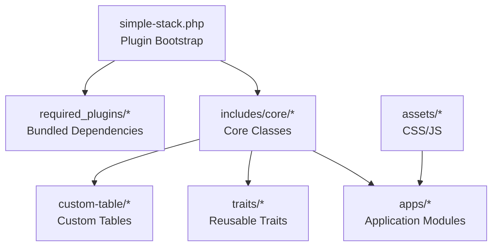
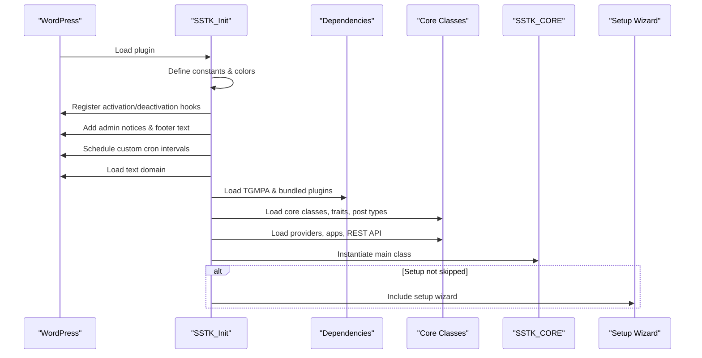
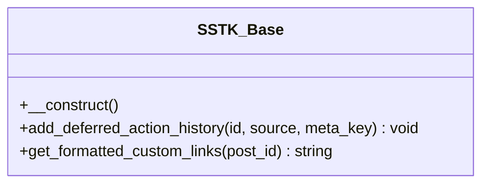
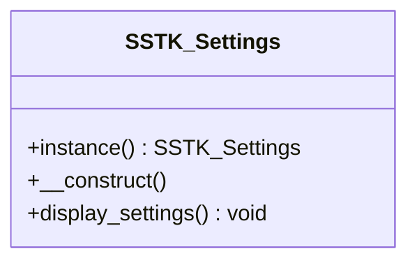
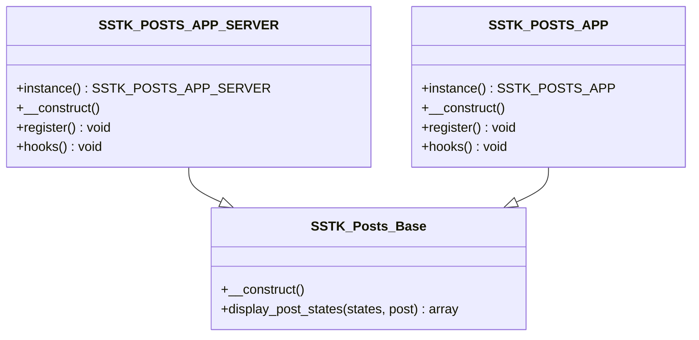
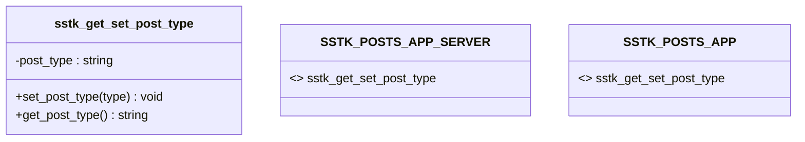
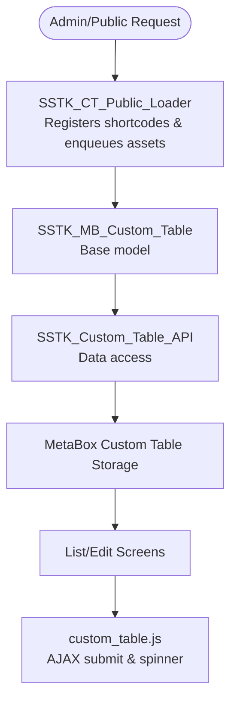
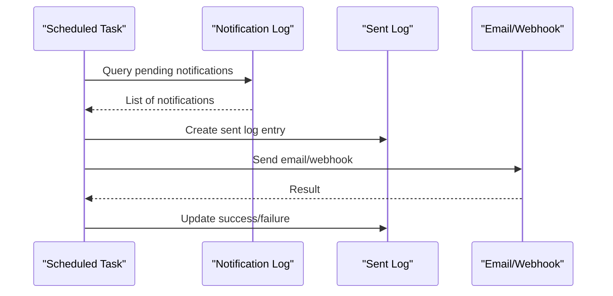
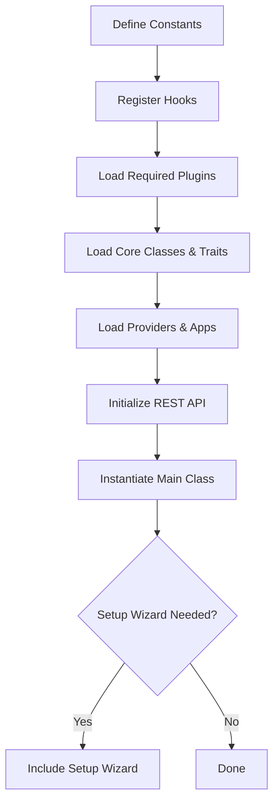
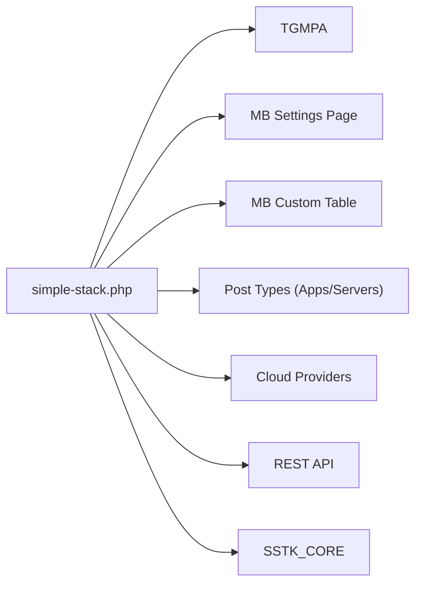

# Core Components

<cite>
**Referenced Files in This Document**   
- [simple-stack.php](file://simple-stack.php)
- [class-sstk-base.php](file://includes/core/class-sstk-base.php)
- [class-sstk-settings.php](file://includes/core/class-sstk-settings.php)
- [class-sstk-posts-base.php](file://includes/core/class-sstk-posts-base.php)
- [class-sstk-posts-app-server.php](file://includes/core/class-sstk-posts-app-server.php)
- [class-sstk-posts-app.php](file://includes/core/class-sstk-posts-app.php)
- [get_set_post_type.php](file://includes/core/traits/get_set_post_type.php)
- [class-sstk-custom-table.php](file://includes/core/custom-table/class-sstk-custom-table.php)
- [loader.php](file://includes/core/apps/wordpress-app/public/custom-table/loader.php)
- [custom_table.js](file://assets/js/custom_table.js)
- [class-sstk-posts-notify-log.php](file://includes/core/class-sstk-posts-notify-log.php)
- [class-sstk-posts-notify-sent-log.php](file://includes/core/class-sstk-posts-notify-sent-log.php)
</cite>

## Table of Contents
1. [Introduction](#introduction)
2. [Project Structure](#project-structure)
3. [Core Components](#core-components)
4. [Architecture Overview](#architecture-overview)
5. [Detailed Component Analysis](#detailed-component-analysis)
6. [Dependency Analysis](#dependency-analysis)
7. [Performance Considerations](#performance-considerations)
8. [Troubleshooting Guide](#troubleshooting-guide)
9. [Conclusion](#conclusion)

## Introduction
This document explains the core foundation of Simple Stack, focusing on:
- Base class architecture and shared utilities
- Settings management powered by a settings page framework
- Post type infrastructure for servers and sites
- Plugin bootstrap, dependency loading order, and initialization sequence
- Trait-based composition for modular functionality
- Custom table system for performance-critical data
- Logging and notification systems
- Extension points and WordPress hook integration patterns
- Configuration patterns, environment handling, and separation of concerns

## Project Structure
Simple Stack is organized around a central bootstrap file that defines constants, registers hooks, loads dependencies, and initializes core modules. Core logic lives under `includes/core`, with application-specific logic under `includes/core/apps`. Supporting UI assets live under `assets`, and bundled third-party plugins are under `required_plugins`.

**Diagram sources**
- [simple-stack.php:106-414](file://simple-stack.php#L106-L414)

**Section sources**
- [simple-stack.php:1-130](file://simple-stack.php#L1-L130)
- [simple-stack.php:267-414](file://simple-stack.php#L267-L414)

## Core Components
- Base class for shared behavior across components
- Settings manager providing a unified configuration surface
- Post type base and concrete types for apps and servers
- Trait registry enabling modular feature composition
- Custom table layer for high-performance data models
- Logging and notification subsystems

**Section sources**
- [class-sstk-base.php:15-106](file://includes/core/class-sstk-base.php#L15-L106)
- [class-sstk-settings.php:25-66](file://includes/core/class-sstk-settings.php#L25-L66)
- [class-sstk-posts-base.php:13-85](file://includes/core/class-sstk-posts-base.php#L13-L85)
- [class-sstk-posts-app-server.php:12-57](file://includes/core/class-sstk-posts-app-server.php#L12-L57)
- [class-sstk-posts-app.php:12-56](file://includes/core/class-sstk-posts-app.php#L12-L56)
- [get_set_post_type.php:10-47](file://includes/core/traits/get_set_post_type.php#L10-L47)
- [class-sstk-custom-table.php:12-86](file://includes/core/custom-table/class-sstk-custom-table.php#L12-L86)

## Architecture Overview
The plugin bootstraps early, defines constants, schedules cron intervals, and then loads required files in a strict order to ensure dependencies exist before use. After loading, it instantiates the main application class and optionally starts the setup wizard.

**Diagram sources**
- [simple-stack.php:24-130](file://simple-stack.php#L24-L130)
- [simple-stack.php:267-414](file://simple-stack.php#L267-L414)

**Section sources**
- [simple-stack.php:24-130](file://simple-stack.php#L24-L130)
- [simple-stack.php:267-414](file://simple-stack.php#L267-L414)

## Detailed Component Analysis

### Base Class Architecture
`SSTK_Base` provides shared utilities used by multiple components. It includes helpers for tracking deferred actions and formatting custom links stored in post metadata.

Key responsibilities:
- Deferred action history tracking per server/app record
- Formatting and rendering custom link lists from metadata

**Diagram sources**
- [class-sstk-base.php:22-106](file://includes/core/class-sstk-base.php#L22-L106)

**Section sources**
- [class-sstk-base.php:22-106](file://includes/core/class-sstk-base.php#L22-L106)

### Settings Management System
`SSTK_Settings` manages the plugin’s settings page using a settings page framework. It registers AJAX handlers, enqueues scripts, and builds metaboxes for general, logging, provider cache, misc, tools, and cloud provider sections.

Highlights:
- Singleton pattern for instance access
- Centralized options storage via the settings framework
- Extensible metabox registration allowing app-level additions
- Admin-facing controls for timeouts, logging levels, log trimming, provider caches, and UI visibility

**Diagram sources**
- [class-sstk-settings.php:32-66](file://includes/core/class-sstk-settings.php#L32-L66)

**Section sources**
- [class-sstk-settings.php:32-66](file://includes/core/class-sstk-settings.php#L32-L66)
- [class-sstk-settings.php:72-530](file://includes/core/class-sstk-settings.php#L72-L530)

### Post Type Infrastructure (Servers and Sites)
Simple Stack uses WordPress custom post types to represent servers (`sstk_app_server`) and applications/sites (`sstk_app`). Both extend `SSTK_Posts_Base`, which handles common state label logic and delete protection indicators.

Responsibilities:
- Registering post types and taxonomies
- Hooking into WordPress admin screens (columns, filters, search, meta boxes)
- Managing permissions and owner changes
- Rendering list tables and detail views

**Diagram sources**
- [class-sstk-posts-base.php:16-85](file://includes/core/class-sstk-posts-base.php#L16-L85)
- [class-sstk-posts-app-server.php:15-57](file://includes/core/class-sstk-posts-app-server.php#L15-L57)
- [class-sstk-posts-app.php:15-56](file://includes/core/class-sstk-posts-app.php#L15-L56)

**Section sources**
- [class-sstk-posts-base.php:16-85](file://includes/core/class-sstk-posts-base.php#L16-L85)
- [class-sstk-posts-app-server.php:15-162](file://includes/core/class-sstk-posts-app-server.php#L15-L162)
- [class-sstk-posts-app.php:15-170](file://includes/core/class-sstk-posts-app.php#L15-L170)

### Trait-Based Composition Pattern
Traits provide reusable features without deep inheritance. The core trait registry is loaded during bootstrap, and both server and app post type classes compose traits for:
- Post type getter/setter
- Taxonomy metaboxes
- Team associations
- Labels and notes

**Diagram sources**
- [get_set_post_type.php:13-47](file://includes/core/traits/get_set_post_type.php#L13-L47)
- [class-sstk-posts-app-server.php:17-21](file://includes/core/class-sstk-posts-app-server.php#L17-L21)
- [class-sstk-posts-app.php:17-21](file://includes/core/class-sstk-posts-app.php#L17-L21)

**Section sources**
- [get_set_post_type.php:13-47](file://includes/core/traits/get_set_post_type.php#L13-L47)
- [simple-stack.php:419-443](file://simple-stack.php#L419-L443)

### Custom Table System for Performance-Critical Data
For high-throughput data such as DNS zones, records, and providers, Simple Stack integrates a custom table layer built on top of a custom tables framework. Models are registered and exposed through an API, with admin and public interfaces.

Key elements:
- Abstract base model for custom tables
- Model factory and API accessors
- Public loader exposing shortcodes and enqueueing JS
- Client-side interactions for inline editing and AJAX operations

**Diagram sources**
- [loader.php:6-21](file://includes/core/apps/wordpress-app/public/custom-table/loader.php#L6-L21)
- [class-sstk-custom-table.php:15-86](file://includes/core/custom-table/class-sstk-custom-table.php#L15-L86)
- [custom_table.js:9-41](file://assets/js/custom_table.js#L9-L41)

**Section sources**
- [class-sstk-custom-table.php:15-86](file://includes/core/custom-table/class-sstk-custom-table.php#L15-L86)
- [loader.php:6-21](file://includes/core/apps/wordpress-app/public/custom-table/loader.php#L6-L21)
- [custom_table.js:9-41](file://assets/js/custom_table.js#L9-L41)

### Logging Framework
Logging is configurable via the settings screen. Types include error, trace, warning, debug, security, provider-cache, better cron, and other categories. Log limits and auto-trim thresholds are defined per log type. Logs are persisted as WordPress posts and can be trimmed automatically.

Configuration aspects:
- Selectable log categories
- Include/exclude text and file filters
- Auto-trim limits per log type
- Debug.log integration for selected categories

**Section sources**
- [class-sstk-settings.php:194-322](file://includes/core/class-sstk-settings.php#L194-L322)

### Notification System
Notifications are tracked through dedicated log post types:
- Pending notifications
- Sent logs
- User alerts and sent confirmations

The system scans pending notifications, matches them against user preferences, and sends emails or webhooks accordingly.

**Diagram sources**
- [class-sstk-posts-notify-log.php:400-412](file://includes/core/class-sstk-posts-notify-log.php#L400-L412)
- [class-sstk-posts-notify-sent-log.php:262-272](file://includes/core/class-sstk-posts-notify-sent-log.php#L262-L272)
- [class-sstk-posts-notify-sent-log.php:362-467](file://includes/core/class-sstk-posts-notify-sent-log.php#L362-L467)

**Section sources**
- [class-sstk-posts-notify-log.php:400-412](file://includes/core/class-sstk-posts-notify-log.php#L400-L412)
- [class-sstk-posts-notify-sent-log.php:262-272](file://includes/core/class-sstk-posts-notify-sent-log.php#L262-L272)
- [class-sstk-posts-notify-sent-log.php:362-467](file://includes/core/class-sstk-posts-notify-sent-log.php#L362-L467)

### Plugin Bootstrap Process and Initialization Sequence
Bootstrap responsibilities:
- Define plugin constants and brand colors
- Register activation/deactivation hooks
- Add admin notices and footer text
- Schedule custom cron intervals
- Load language files
- Load required plugins and dependencies
- Load core classes, traits, post types, providers, apps, and REST API
- Instantiate the main application class
- Optionally start the setup wizard

**Diagram sources**
- [simple-stack.php:24-130](file://simple-stack.php#L24-L130)
- [simple-stack.php:267-414](file://simple-stack.php#L267-L414)

**Section sources**
- [simple-stack.php:24-130](file://simple-stack.php#L24-L130)
- [simple-stack.php:267-414](file://simple-stack.php#L267-L414)

### Dependency Loading Order
The bootstrap ensures dependencies load in a safe order:
1. Third-party plugin activation library
2. Bundled settings and metabox frameworks
3. Core functions and utilities
4. Roles/capabilities and statistics
5. Traits and base classes
6. Post types and logs
7. Providers and apps
8. REST API controllers
9. Main application class

**Section sources**
- [simple-stack.php:267-414](file://simple-stack.php#L267-L414)

### WordPress Hooks Integration and Extension Points
Common extension points:
- Settings metaboxes: filter to add sections after welcome message and at the end of misc tab
- Server/App list columns: filters to modify headers and content
- Row actions: filter to append custom actions
- Scripts localization: filter to pass additional parameters to client-side code
- Provider cache clearing and SSH key generation: AJAX endpoints
- Cleanup tasks: AJAX endpoints to reset stuck processes

Examples:
- Extend server list row actions
- Append app-level summary data to the app list column
- Localize JavaScript with nonce and action names

**Section sources**
- [class-sstk-settings.php:151-152](file://includes/core/class-sstk-settings.php#L151-L152)
- [class-sstk-settings.php:513-516](file://includes/core/class-sstk-settings.php#L513-L516)
- [class-sstk-posts-app-server.php:173-177](file://includes/core/class-sstk-posts-app-server.php#L173-L177)
- [class-sstk-posts-app.php:212-233](file://includes/core/class-sstk-posts-app.php#L212-L233)

### Configuration Patterns and Environment Handling
- Early options and constants control behavior (e.g., skipping welcome messages, hiding warnings, disabling email notifications).
- Multisite-aware script versioning ensures cache busting per site when debugging is enabled.
- Encryption key presence enforced via admin notices; default permalinks disallowed.
- Cron health checks and email alerts for missing critical tasks.

**Section sources**
- [simple-stack.php:86-103](file://simple-stack.php#L86-L103)
- [simple-stack.php:452-543](file://simple-stack.php#L452-L543)
- [simple-stack.php:550-621](file://simple-stack.php#L550-L621)

### Separation of Concerns Between Core Modules
- Bootstrap orchestrates loading but delegates responsibilities to specialized classes.
- Settings encapsulates configuration UI and persistence.
- Post type classes manage CMS integration and admin UX.
- Custom table layer isolates high-performance data models.
- Logging and notifications are decoupled as distinct post-type-backed subsystems.
- Providers and apps are loaded conditionally and independently.

**Section sources**
- [simple-stack.php:267-414](file://simple-stack.php#L267-L414)
- [class-sstk-settings.php:32-66](file://includes/core/class-sstk-settings.php#L32-L66)
- [class-sstk-posts-app-server.php:15-162](file://includes/core/class-sstk-posts-app-server.php#L15-L162)
- [class-sstk-posts-app.php:15-170](file://includes/core/class-sstk-posts-app.php#L15-L170)
- [class-sstk-custom-table.php:15-86](file://includes/core/custom-table/class-sstk-custom-table.php#L15-L86)

## Dependency Analysis

**Diagram sources**
- [simple-stack.php:267-414](file://simple-stack.php#L267-L414)

**Section sources**
- [simple-stack.php:267-414](file://simple-stack.php#L267-L414)

## Performance Considerations
- Use custom tables for high-volume data to avoid overhead of post metadata queries.
- Configure log trim limits to prevent unbounded growth of log tables.
- Adjust long-running command timeouts based on provider performance characteristics.
- Enable provider caching where appropriate to reduce external API calls.
- Ensure cron jobs run reliably to keep background processing efficient.

[No sources needed since this section provides general guidance]

## Troubleshooting Guide
Common issues and resolutions:
- Missing encryption key: define a strong key in wp-config to secure sensitive data.
- Default permalinks: change to a non-default structure to enable callbacks.
- Cron not running: verify scheduled tasks and consider better cron methods.
- Script readability: ensure script directories are readable by the web server.
- Stuck deployments: use cleanup endpoints to reset in-process states.

**Section sources**
- [simple-stack.php:452-543](file://simple-stack.php#L452-L543)
- [simple-stack.php:550-621](file://simple-stack.php#L550-L621)

## Conclusion
Simple Stack’s core is structured around a clear bootstrap process, a robust base class, a centralized settings system, and a flexible post type infrastructure. Trait-based composition enables modular extensions, while the custom table layer supports performance-critical workloads. Logging and notifications are well-isolated, and numerous extension points allow integrators to tailor behavior through WordPress hooks. Proper configuration and environment handling ensure reliability across diverse hosting environments.

[No sources needed since this section summarizes without analyzing specific files]