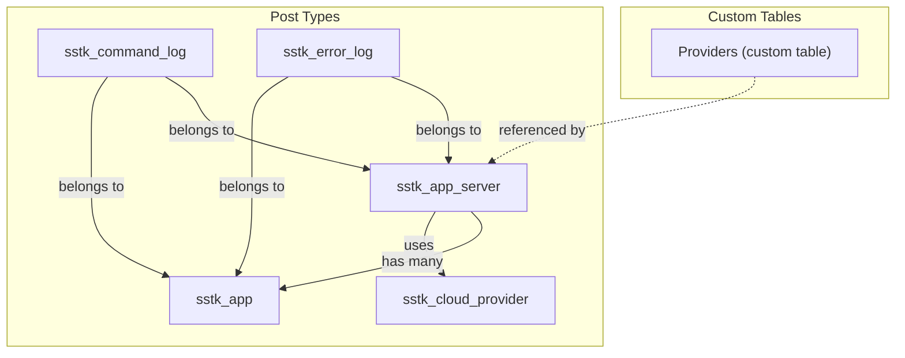
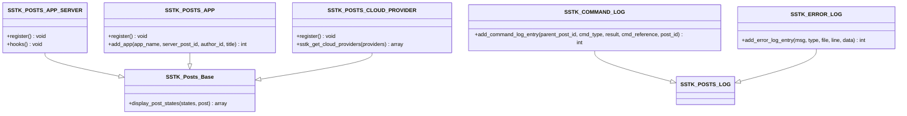
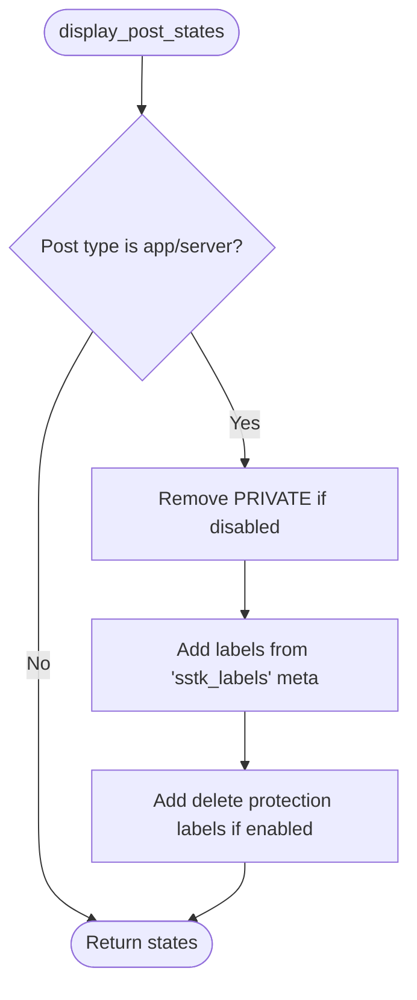
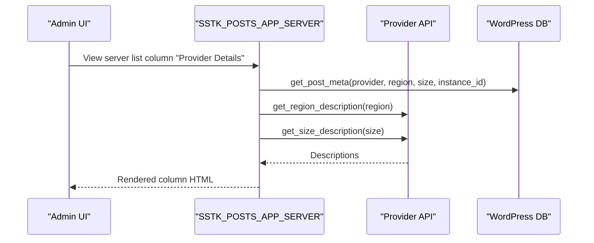
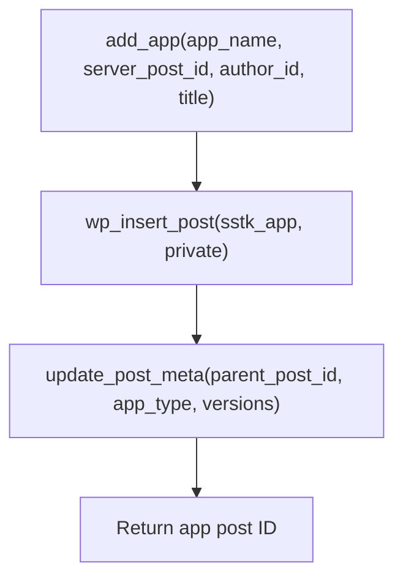
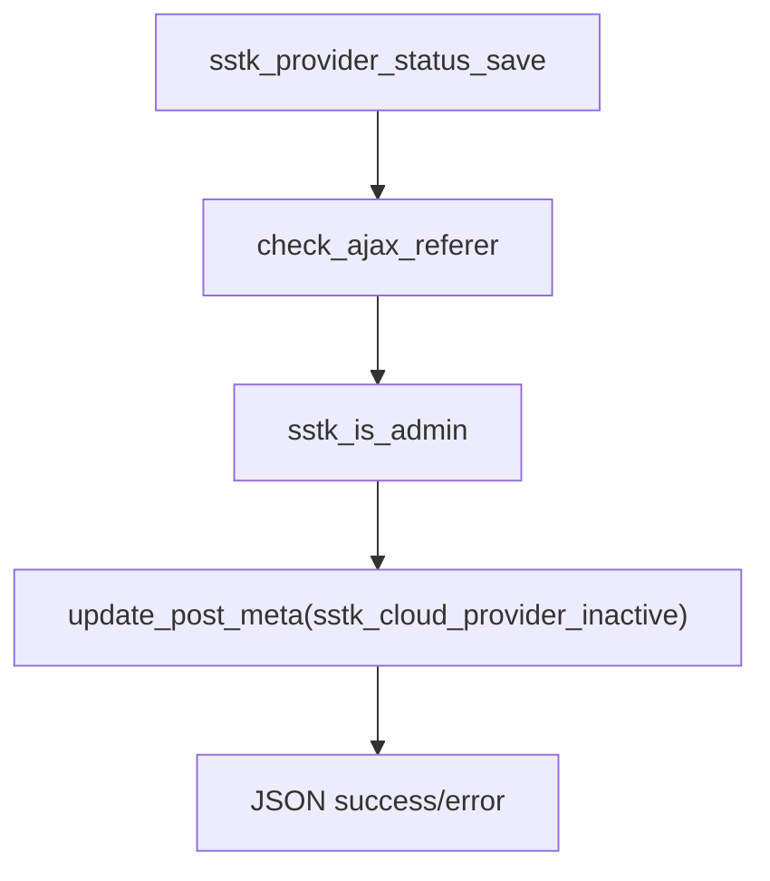
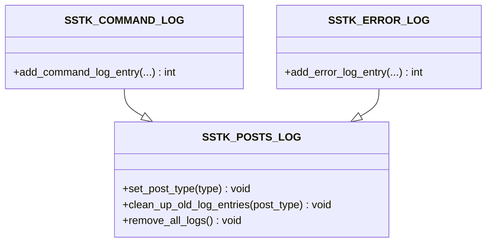
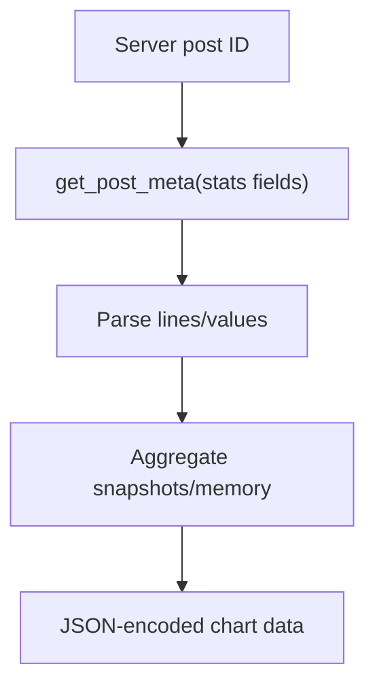
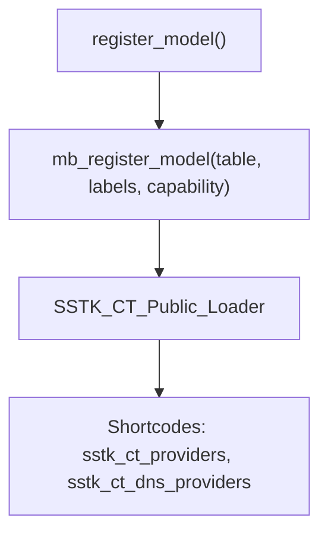
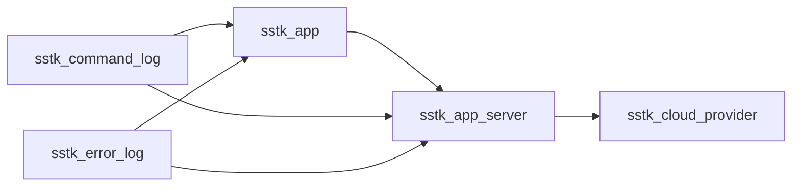

# Data Models & Post Types

<cite>
**Referenced Files in This Document**
- [class-sstk-posts-base.php](file://includes/core/class-sstk-posts-base.php)
- [class-sstk-posts-app-server.php](file://includes/core/class-sstk-posts-app-server.php)
- [class-sstk-posts-app.php](file://includes/core/class-sstk-posts-app.php)
- [class-sstk-posts-cloud-provider.php](file://includes/core/class-sstk-posts-cloud-provider.php)
- [class-sstk-posts-log.php](file://includes/core/class-sstk-posts-log.php)
- [class-sstk-posts-command-log.php](file://includes/core/class-sstk-posts-command-log.php)
- [class-sstk-posts-error-log.php](file://includes/core/class-sstk-posts-error-log.php)
- [class-sstk-server-statistics.php](file://includes/core/class-sstk-server-statistics.php)
- [class-sstk-provider.php](file://includes/core/custom-table/class-sstk-provider.php)
- [loader.php](file://includes/core/apps/wordpress-app/public/custom-table/loader.php)
</cite>

## Table of Contents
1. [Introduction](#introduction)
2. [Project Structure](#project-structure)
3. [Core Components](#core-components)
4. [Architecture Overview](#architecture-overview)
5. [Detailed Component Analysis](#detailed-component-analysis)
6. [Dependency Analysis](#dependency-analysis)
7. [Performance Considerations](#performance-considerations)
8. [Troubleshooting Guide](#troubleshooting-guide)
9. [Conclusion](#conclusion)

## Introduction
This document describes Simple Stack’s data model for WordPress post types and related entities: servers, applications (sites), cloud providers, and logs. It explains how the base post type class extends WordPress native post types, documents metadata schemas for server configurations, site properties, and provider credentials, and outlines database relationships including custom tables used for high-frequency operations like logs and statistics. It also covers validation rules, business constraints, integrity mechanisms, and migration/version compatibility considerations.

## Project Structure
The data model is implemented primarily through custom post types and a small set of custom tables:
- Custom post types: sstk_app_server, sstk_app, sstk_cloud_provider, and log post types (sstk_command_log, sstk_error_log).
- Custom tables: Provider table via MetaBox Custom Table integration.
- Metadata: Extensive use of post meta to store configuration, state, and operational data.

**Diagram sources**
- [class-sstk-posts-app-server.php:1814-1842](file://includes/core/class-sstk-posts-app-server.php#L1814-L1842)
- [class-sstk-posts-app.php:161-169](file://includes/core/class-sstk-posts-app.php#L161-L169)
- [class-sstk-posts-cloud-provider.php:505-553](file://includes/core/class-sstk-posts-cloud-provider.php#L505-L553)
- [class-sstk-posts-command-log.php:63-103](file://includes/core/class-sstk-posts-command-log.php#L63-L103)
- [class-sstk-posts-error-log.php:63-101](file://includes/core/class-sstk-posts-error-log.php#L63-L101)
- [class-sstk-provider.php:57-84](file://includes/core/custom-table/class-sstk-provider.php#L57-L84)

**Section sources**
- [class-sstk-posts-app-server.php:1814-1842](file://includes/core/class-sstk-posts-app-server.php#L1814-L1842)
- [class-sstk-posts-app.php:161-169](file://includes/core/class-sstk-posts-app.php#L161-L169)
- [class-sstk-posts-cloud-provider.php:505-553](file://includes/core/class-sstk-posts-cloud-provider.php#L505-L553)
- [class-sstk-provider.php:57-84](file://includes/core/custom-table/class-sstk-provider.php#L57-L84)

## Core Components
- Base post type class: Provides shared behavior for display states and common UI hooks.
- Server post type: Represents infrastructure instances; stores provider, region, size, IPs, and status.
- App post type: Represents installed sites/applications on servers; links to parent server and tracks app type and ownership.
- Cloud provider post type: Virtual provider definitions with activation flags and descriptive metadata.
- Log post types: Command and error logs attached to servers or apps.
- Statistics helper: Reads and formats server metrics stored as post meta for charts.
- Custom table: Providers table for high-frequency operations.

Key responsibilities:
- Registration and capability mapping for each post type.
- Column rendering and filtering for admin lists.
- Validation and sanitization around save flows.
- Integrity checks preventing deletion when referenced.

**Section sources**
- [class-sstk-posts-base.php:16-84](file://includes/core/class-sstk-posts-base.php#L16-L84)
- [class-sstk-posts-app-server.php:316-325](file://includes/core/class-sstk-posts-app-server.php#L316-L325)
- [class-sstk-posts-app.php:161-169](file://includes/core/class-sstk-posts-app.php#L161-L169)
- [class-sstk-posts-cloud-provider.php:113-117](file://includes/core/class-sstk-posts-cloud-provider.php#L113-L117)
- [class-sstk-posts-command-log.php:63-103](file://includes/core/class-sstk-posts-command-log.php#L63-L103)
- [class-sstk-posts-error-log.php:63-101](file://includes/core/class-sstk-posts-error-log.php#L63-L101)
- [class-sstk-server-statistics.php:15-34](file://includes/core/class-sstk-server-statistics.php#L15-L34)
- [class-sstk-provider.php:57-84](file://includes/core/custom-table/class-sstk-provider.php#L57-L84)

## Architecture Overview
The system uses WordPress post types as the primary entities and leverages post meta for rich configuration. Relationships are expressed via meta fields rather than foreign keys.

**Diagram sources**
- [class-sstk-posts-base.php:16-84](file://includes/core/class-sstk-posts-base.php#L16-L84)
- [class-sstk-posts-app-server.php:15-57](file://includes/core/class-sstk-posts-app-server.php#L15-L57)
- [class-sstk-posts-app.php:15-56](file://includes/core/class-sstk-posts-app.php#L15-L56)
- [class-sstk-posts-cloud-provider.php:15-38](file://includes/core/class-sstk-posts-cloud-provider.php#L15-L38)
- [class-sstk-posts-command-log.php:15-34](file://includes/core/class-sstk-posts-command-log.php#L15-L34)
- [class-sstk-posts-error-log.php:15-34](file://includes/core/class-sstk-posts-error-log.php#L15-L34)

## Detailed Component Analysis

### Base Post Type Class
- Purpose: Centralizes common behaviors such as displaying custom post states and labels for servers and apps.
- Key behavior: Removes “PRIVATE” state label conditionally and injects custom labels from meta. Adds delete protection indicators.

**Diagram sources**
- [class-sstk-posts-base.php:38-80](file://includes/core/class-sstk-posts-base.php#L38-L80)

**Section sources**
- [class-sstk-posts-base.php:16-84](file://includes/core/class-sstk-posts-base.php#L16-L84)

### Servers (sstk_app_server)
- Registration: Registers the server post type and taxonomy group.
- Capabilities: Uses dedicated capabilities for management.
- Columns: Renders provider details, region, size, instance ID, local/remote status, app count, groups, owners.
- Integrity: Prevents trash/delete when protected; restricts actions based on permissions.

**Diagram sources**
- [class-sstk-posts-app-server.php:356-459](file://includes/core/class-sstk-posts-app-server.php#L356-L459)

**Section sources**
- [class-sstk-posts-app-server.php:316-325](file://includes/core/class-sstk-posts-app-server.php#L316-L325)
- [class-sstk-posts-app-server.php:334-346](file://includes/core/class-sstk-posts-app-server.php#L334-L346)
- [class-sstk-posts-app-server.php:356-459](file://includes/core/class-sstk-posts-app-server.php#L356-L459)
- [class-sstk-posts-app-server.php:1814-1842](file://includes/core/class-sstk-posts-app-server.php#L1814-L1842)

### Applications/Sites (sstk_app)
- Registration: Registers the app post type and group taxonomy.
- Creation: add_app creates a private post and sets initial plugin version metas.
- Parent relationship: Links to server via parent_post_id.
- Ownership: Tracks app owner and displays server info columns.

**Diagram sources**
- [class-sstk-posts-app.php:761-793](file://includes/core/class-sstk-posts-app.php#L761-L793)

**Section sources**
- [class-sstk-posts-app.php:161-169](file://includes/core/class-sstk-posts-app.php#L161-L169)
- [class-sstk-posts-app.php:761-793](file://includes/core/class-sstk-posts-app.php#L761-L793)

### Cloud Providers (sstk_cloud_provider)
- Registration: Registers virtual provider post type with restricted menu visibility.
- Activation: Active/inactive toggle via meta; affects inclusion in provider lists.
- Deletion protection: Prevents deletion if any server references it.

**Diagram sources**
- [class-sstk-posts-cloud-provider.php:268-303](file://includes/core/class-sstk-posts-cloud-provider.php#L268-L303)

**Section sources**
- [class-sstk-posts-cloud-provider.php:113-117](file://includes/core/class-sstk-posts-cloud-provider.php#L113-L117)
- [class-sstk-posts-cloud-provider.php:268-303](file://includes/core/class-sstk-posts-cloud-provider.php#L268-L303)
- [class-sstk-posts-cloud-provider.php:649-749](file://includes/core/class-sstk-posts-cloud-provider.php#L649-L749)

### Logs (Command and Error)
- Base logging class: Provides common hooks, search enhancements, bulk action restrictions, and auto-trimming logic.
- Command log: Stores command execution results linked to parent posts (server or app).
- Error log: Stores structured error entries with filtering rules and sensitive data redaction.

**Diagram sources**
- [class-sstk-posts-log.php:17-53](file://includes/core/class-sstk-posts-log.php#L17-L53)
- [class-sstk-posts-command-log.php:15-34](file://includes/core/class-sstk-posts-command-log.php#L15-L34)
- [class-sstk-posts-error-log.php:15-34](file://includes/core/class-sstk-posts-error-log.php#L15-L34)

**Section sources**
- [class-sstk-posts-log.php:17-53](file://includes/core/class-sstk-posts-log.php#L17-L53)
- [class-sstk-posts-log.php:224-311](file://includes/core/class-sstk-posts-log.php#L224-L311)
- [class-sstk-posts-command-log.php:63-103](file://includes/core/class-sstk-posts-command-log.php#L63-L103)
- [class-sstk-posts-command-log.php:282-321](file://includes/core/class-sstk-posts-command-log.php#L282-L321)
- [class-sstk-posts-error-log.php:63-101](file://includes/core/class-sstk-posts-error-log.php#L63-L101)
- [class-sstk-posts-error-log.php:257-353](file://includes/core/class-sstk-posts-error-log.php#L257-L353)

### Server Statistics
- Reads chart-ready data from post meta (disk usage, vnstat traffic, vmstat memory).
- Formats and aggregates values for frontend visualization.

**Diagram sources**
- [class-sstk-server-statistics.php:42-124](file://includes/core/class-sstk-server-statistics.php#L42-L124)
- [class-sstk-server-statistics.php:133-170](file://includes/core/class-sstk-server-statistics.php#L133-L170)
- [class-sstk-server-statistics.php:212-253](file://includes/core/class-sstk-server-statistics.php#L212-L253)

**Section sources**
- [class-sstk-server-statistics.php:15-34](file://includes/core/class-sstk-server-statistics.php#L15-L34)
- [class-sstk-server-statistics.php:42-124](file://includes/core/class-sstk-server-statistics.php#L42-L124)
- [class-sstk-server-statistics.php:133-170](file://includes/core/class-sstk-server-statistics.php#L133-L170)
- [class-sstk-server-statistics.php:212-253](file://includes/core/class-sstk-server-statistics.php#L212-L253)

### Custom Table System (Providers)
- Uses MetaBox Custom Table to define a dedicated table for providers.
- Exposes public endpoints and shortcodes for listing providers.

**Diagram sources**
- [class-sstk-provider.php:57-84](file://includes/core/custom-table/class-sstk-provider.php#L57-L84)
- [loader.php:6-21](file://includes/core/apps/wordpress-app/public/custom-table/loader.php#L6-L21)

**Section sources**
- [class-sstk-provider.php:57-84](file://includes/core/custom-table/class-sstk-provider.php#L57-L84)
- [loader.php:6-21](file://includes/core/apps/wordpress-app/public/custom-table/loader.php#L6-L21)

## Dependency Analysis
- Post type dependencies:
  - sstk_app depends on sstk_app_server via parent_post_id.
  - Logs depend on either sstk_app or sstk_app_server via parent_post_id.
  - sstk_app_server references sstk_cloud_provider via sstk_server_provider meta.
- Capability dependencies:
  - Server and provider management use dedicated capabilities (e.g., sstk_manage_servers, sstk_manage_settings).
  - Logs require sstk_manage_logs.

**Diagram sources**
- [class-sstk-posts-app.php:761-793](file://includes/core/class-sstk-posts-app.php#L761-L793)
- [class-sstk-posts-command-log.php:282-321](file://includes/core/class-sstk-posts-command-log.php#L282-L321)
- [class-sstk-posts-error-log.php:257-353](file://includes/core/class-sstk-posts-error-log.php#L257-L353)
- [class-sstk-posts-cloud-provider.php:649-749](file://includes/core/class-sstk-posts-cloud-provider.php#L649-L749)

**Section sources**
- [class-sstk-posts-app.php:761-793](file://includes/core/class-sstk-posts-app.php#L761-L793)
- [class-sstk-posts-command-log.php:282-321](file://includes/core/class-sstk-posts-command-log.php#L282-L321)
- [class-sstk-posts-error-log.php:257-353](file://includes/core/class-sstk-posts-error-log.php#L257-L353)
- [class-sstk-posts-cloud-provider.php:649-749](file://includes/core/class-sstk-posts-cloud-provider.php#L649-L749)

## Performance Considerations
- Auto-trim logs: The base log class enforces configurable limits to prevent unbounded growth across log post types.
- Chart data formatting: Statistics helper parses and aggregates large text blocks into JSON arrays for efficient frontend rendering.
- Custom tables: Used for high-frequency operations to reduce overhead on postmeta queries where appropriate.

[No sources needed since this section provides general guidance]

## Troubleshooting Guide
- Deleting providers: If a virtual provider cannot be deleted, check whether any servers reference it; the system prevents deletion to maintain referential integrity.
- Purging logs: Use the provided AJAX endpoints to purge all logs or only sent logs; ensure you have admin privileges and valid nonces.
- Sensitive data in logs: Logs sanitize known password patterns before persisting to avoid leaking secrets.

**Section sources**
- [class-sstk-posts-cloud-provider.php:649-749](file://includes/core/class-sstk-posts-cloud-provider.php#L649-L749)
- [class-sstk-posts-log.php:361-472](file://includes/core/class-sstk-posts-log.php#L361-L472)
- [class-sstk-posts-command-log.php:301-318](file://includes/core/class-sstk-posts-command-log.php#L301-L318)
- [class-sstk-posts-error-log.php:322-347](file://includes/core/class-sstk-posts-error-log.php#L322-L347)

## Conclusion
Simple Stack models servers, applications, and cloud providers using WordPress custom post types with extensive post meta. Relationships are enforced via meta fields and capability checks, while logs provide robust auditing and cleanup. Custom tables complement post types for performance-critical data. The design balances flexibility with integrity, enabling scalable management of multi-provider environments.

[No sources needed since this section summarizes without analyzing specific files]