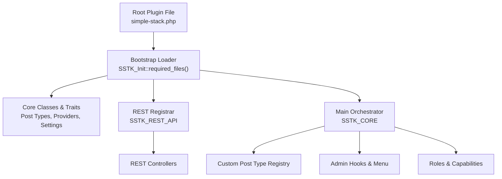
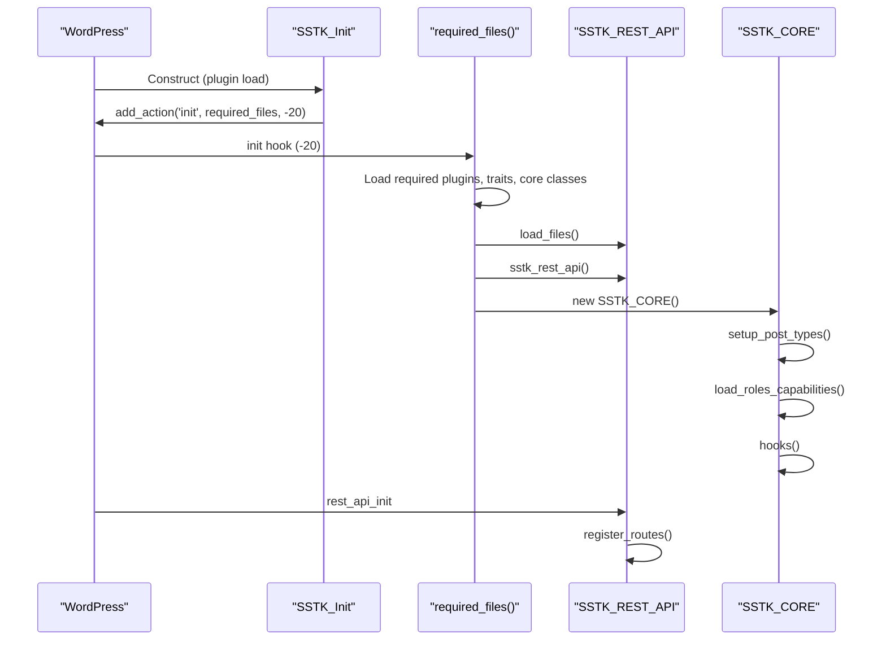
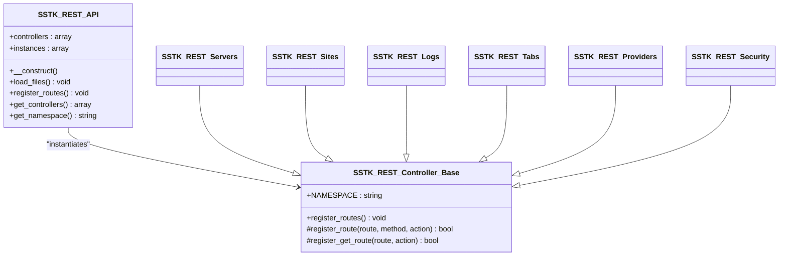
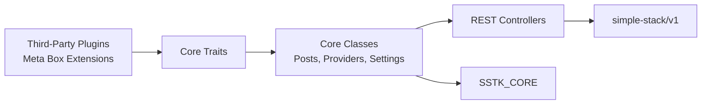
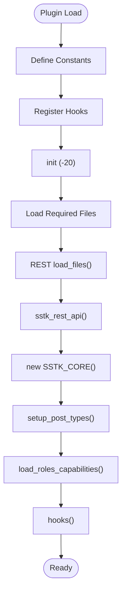

# Plugin Bootstrap & Initialization

<cite>
**Referenced Files in This Document**   
- [simple-stack.php](file://simple-stack.php)
- [simple-stack.php](file://includes/core/simple-stack.php)
- [class-sstk-base.php](file://includes/core/class-sstk-base.php)
- [functions-classes.php](file://includes/core/functions-classes.php)
- [class-sstk-rest-api.php](file://includes/core/api/class-sstk-rest-api.php)
- [class-sstk-rest-api-controller-base.php](file://includes/core/apps/wordpress-app/rest-api/class-sstk-rest-api-controller-base.php)
</cite>

## Table of Contents
1. [Introduction](#introduction)
2. [Project Structure](#project-structure)
3. [Core Components](#core-components)
4. [Architecture Overview](#architecture-overview)
5. [Detailed Component Analysis](#detailed-component-analysis)
6. [Dependency Analysis](#dependency-analysis)
7. [Performance Considerations](#performance-considerations)
8. [Troubleshooting Guide](#troubleshooting-guide)
9. [Conclusion](#conclusion)
10. [Appendices](#appendices)

## Introduction
This document explains Simple Stack’s plugin bootstrap and initialization system. It covers how the plugin loads dependencies, registers WordPress hooks, initializes custom post types, sets up the REST API, validates environment configuration, and exposes extension points for extending the lifecycle. The main orchestrator is `SSTK_CORE`, which is instantiated during the plugin’s early boot sequence.

## Project Structure
Simple Stack follows a layered structure:
- Root plugin file defines constants, global hooks, activation/deactivation logic, and the bootstrap loader.
- Core classes live under `includes/core`.
- The main application orchestrator is `SSTK_CORE`.
- The Simple Stack REST layer lives under `includes/core/api` and uses its own registrar.
- A shared base class provides common functionality to core components.

**Diagram sources**
- [simple-stack.php:267-414](file://simple-stack.php#L267-L414)
- [simple-stack.php:81-138](file://includes/core/simple-stack.php#L81-L138)
- [class-sstk-rest-api.php:51-99](file://includes/core/api/class-sstk-rest-api.php#L51-L99)

**Section sources**
- [simple-stack.php:1-130](file://simple-stack.php#L1-L130)
- [simple-stack.php:267-414](file://simple-stack.php#L267-L414)

## Core Components
- **SSTK_Init**: Bootstraps constants, schedules cron intervals, registers activation/deactivation hooks, loads required files, and triggers the main orchestrator.
- **SSTK_CORE**: Main application orchestrator that sets up post types, roles/capabilities, admin hooks, menu pages, asset loading, encryption utilities, provider registry, and logging.
- **SSTK_REST_API**: REST namespace registrar that loads controller files and registers routes on `rest_api_init`.
- **SSTK_Base**: Shared base class providing deferred action history and formatted custom links helpers used by core classes.

**Section sources**
- [simple-stack.php:19-130](file://simple-stack.php#L19-L130)
- [simple-stack.php:15-138](file://includes/core/simple-stack.php#L15-L138)
- [class-sstk-rest-api.php:21-99](file://includes/core/api/class-sstk-rest-api.php#L21-L99)
- [class-sstk-base.php:22-105](file://includes/core/class-sstk-base.php#L22-L105)

## Architecture Overview
The bootstrap flow is staged to ensure dependencies are loaded before higher-level components run:

1. **Constants and Global Setup**: Defined early in `SSTK_Init::__construct`.
2. **Required Files Loading**: Triggered at `init` with priority `-20` via `SSTK_Init::required_files`.
3. **REST Layer Registration**: Controller files are loaded; the REST namespace is registered later on `rest_api_init`.
4. **Main Orchestrator Instantiation**: `SSTK_CORE` is constructed, setting up post types, roles, and hooks.
5. **Setup Wizard Trigger**: Conditionally included if setup has not been completed.

**Diagram sources**
- [simple-stack.php:106-130](file://simple-stack.php#L106-L130)
- [simple-stack.php:267-414](file://simple-stack.php#L267-L414)
- [class-sstk-rest-api.php:51-99](file://includes/core/api/class-sstk-rest-api.php#L51-L99)
- [simple-stack.php:81-138](file://includes/core/simple-stack.php#L81-L138)

## Detailed Component Analysis

### SSTK_Init: Bootstrap and Lifecycle Manager
Responsibilities:
- Define uppercase `SSTK_*` plugin constants; provisioning script versioning is fixed to `v2` rather than configured here.
- Register cron schedules.
- Hook into activation/deactivation, admin notices, language loading, shutdown checks, and footer text.
- Load required third-party plugins and internal classes.
- Instantiate the main orchestrator.

Key behaviors:
- Constants are defined once and use the uppercase `SSTK_*` contract; retired lowercase aliases are not retained.
- Cron schedules include every minute, two minutes, and fifteen minutes.
- Activation runs component-specific activation routines and flushes rewrite rules.
- Deactivation runs corresponding cleanup routines.
- Required files are loaded in a strict order to satisfy dependencies.
- The REST API registrar is loaded after app classes so controllers can access the app engine and provider registry.

Extension points:
- Add new required files inside `required_files()` in the correct dependency order.
- Use existing conditional includes for optional features (e.g., email notifications, custom DNS tables).

**Section sources**
- [simple-stack.php:24-130](file://simple-stack.php#L24-L130)
- [simple-stack.php:166-235](file://simple-stack.php#L166-L235)
- [simple-stack.php:267-414](file://simple-stack.php#L267-L414)

### SSTK_CORE: Main Application Orchestrator
Responsibilities:
- Provide a global instance reference (`$GLOBALS['SSTK_CORE']`).
- Set up custom post types through lazy instantiation.
- Load roles and capabilities.
- Register admin hooks for menu highlighting, legacy CPT redirection, submenu ordering, error/notification logging, and script/style enqueues.
- Manage the Simple Stack React admin app container and Vite manifest-based assets.
- Provide encryption utilities and sensitive value redaction.
- Manage cloud provider discovery and virtual provider support.

Initialization steps:
- Constructor sets global reference, then calls post type setup, role loading, and hook registration.
- `hooks()` registers admin UI behavior and logging handlers.
- `setup_post_types()` lazily instantiates post type classes and stores them in `SSTK()->classes`.
- `load_roles_capabilities()` ensures the roles/capabilities class is available.

Provider management:
- `get_cloud_providers()` returns the filtered supported provider list: `vultr-v2` and `upcloud` only.
- `get_active_cloud_providers()` filters out providers without valid credentials.
- Virtual providers are aliases of supported Vultr or UpCloud provider types, not a custom-server provider.

Logging and security:
- `log_error()` writes to debug log and optionally to database, redacting sensitive values.
- Encryption/decryption methods accept only authenticated `sstk-encrypt-v2:` envelopes and resolve keys from `SSTK_ENCRYPTION_KEY` or the persistent `sstk_encryption_key_v2` fallback.

**Section sources**
- [simple-stack.php:81-138](file://includes/core/simple-stack.php#L81-L138)
- [simple-stack.php:678-726](file://includes/core/simple-stack.php#L678-L726)
- [simple-stack.php:1460-1464](file://includes/core/simple-stack.php#L1460-L1464)
- [simple-stack.php:1194-1213](file://includes/core/simple-stack.php#L1194-L1213)
- [simple-stack.php:971-1141](file://includes/core/simple-stack.php#L971-L1141)
- [simple-stack.php:1238-1331](file://includes/core/simple-stack.php#L1238-L1331)

### SSTK_REST_API: REST Namespace Registrar
Responsibilities:
- Load controller files during bootstrap without instantiating them prematurely.
- Register the `simple-stack/v1` namespace on `rest_api_init`.
- Instantiate each controller and call its `register_routes()` method.
- Expose controller instances for diagnostics and tests.

Controller list:
- Servers, Sites, Logs, Tabs, Providers, Security.

Base controller contract:
- Each admin controller extends `SSTK_REST_Controller_Base`, which centralizes route registration, `manage_options` authorization, validation, response envelopes, and redaction. Two callbacks outside this controller layer are intentionally public and authenticate independently: the provisioning command callback uses a pending-command transient, and the GitHub webhook uses HMAC-SHA1.

**Diagram sources**
- [class-sstk-rest-api.php:21-119](file://includes/core/api/class-sstk-rest-api.php#L21-L119)
- [class-sstk-rest-api-controller-base.php:63-104](file://includes/core/apps/wordpress-app/rest-api/class-sstk-rest-api-controller-base.php#L63-L104)

**Section sources**
- [class-sstk-rest-api.php:51-99](file://includes/core/api/class-sstk-rest-api.php#L51-L99)
- [class-sstk-rest-api-controller-base.php:63-104](file://includes/core/apps/wordpress-app/rest-api/class-sstk-rest-api-controller-base.php#L63-L104)

### SSTK_Base: Shared Base Class
Responsibilities:
- Provide deferred action history tracking for server/app records.
- Format and render custom links stored in post meta.

Usage:
- Core classes extend this base to share these utilities.

Complexity notes:
- Deferred action history maintains a bounded list (last 15 entries), trimming older entries and adding timestamps as keys.

**Section sources**
- [class-sstk-base.php:22-105](file://includes/core/class-sstk-base.php#L22-L105)

### Environment Detection, Configuration Validation, and Error Handling
Environment checks performed during bootstrap:
- PHP version validation with admin notice guidance.
- Localhost detection warning.
- Encryption key presence and default placeholder detection.
- Permalink structure validation.
- Readability check for script execution folder.
- Critical cron activity monitoring with transient-backed throttling and email alerts.

Error handling patterns:
- Admin notices inform operators about misconfiguration.
- Shutdown hook sends emails when critical crons are absent.
- Logging utility redacts sensitive values and supports multiple output channels.

Configuration validation highlights:
- Early options and transients control notice frequency and email suppression.
- Options like `permalink_structure` and `SSTK_ENCRYPTION_KEY` are validated.

**Section sources**
- [simple-stack.php:452-543](file://simple-stack.php#L452-L543)
- [simple-stack.php:550-623](file://simple-stack.php#L550-L623)
- [simple-stack.php:630-668](file://simple-stack.php#L630-L668)
- [simple-stack.php:1194-1213](file://includes/core/simple-stack.php#L1194-L1213)

### Extending the Initialization Process
Recommended approaches:
- Add new required files in `SSTK_Init::required_files()` respecting dependency order.
- Register new REST controllers by adding their class name to `SSTK_REST_API::$controllers` and ensuring they extend the base controller.
- Extend provider lists via the `sstk_get_cloud_providers` filter.
- Hook into admin menus using `admin_menu` and reorder submenus via `sstk_main_menu_submenus_order`.
- Use `SSTK()->classes` to lazily instantiate additional services during `init`.

Examples:
- Adding a new REST endpoint:
  - Create a controller class extending `SSTK_REST_Controller_Base`.
  - Implement `register_routes()` to define endpoints.
  - Add the controller class name to the registrar’s controller list.
- Adding a new initialization step:
  - Use `add_action('init', 'your_init_function', -10)` to run early.
  - Ensure dependencies are loaded before your function executes.

**Section sources**
- [simple-stack.php:267-414](file://simple-stack.php#L267-L414)
- [class-sstk-rest-api.php:30-37](file://includes/core/api/class-sstk-rest-api.php#L30-L37)
- [simple-stack.php:166-205](file://includes/core/simple-stack.php#L166-L205)
- [functions-classes.php:29-50](file://includes/core/functions-classes.php#L29-L50)

## Dependency Analysis
The bootstrap depends on a strict ordering:
- Third-party plugins and Meta Box extensions must be loaded before core classes.
- Core traits and functions must be present before post type classes.
- Provider classes must be loaded before the REST layer accesses the provider registry.
- The main orchestrator must be instantiated after all foundational classes are available.

**Diagram sources**
- [simple-stack.php:267-393](file://simple-stack.php#L267-L393)
- [class-sstk-rest-api.php:63-75](file://includes/core/api/class-sstk-rest-api.php#L63-L75)

**Section sources**
- [simple-stack.php:267-393](file://simple-stack.php#L267-L393)

## Performance Considerations
- Lazy instantiation: Post type classes and settings are created only when needed, reducing startup overhead.
- Conditional loading: Optional features (email notifications, custom DNS tables) are loaded based on configuration flags.
- Manifest caching: The Vite build manifest is read once per request and cached in memory.
- Asset scoping: Scripts/styles are enqueued only on relevant screens to avoid unnecessary payload.
- Transient throttling: Cron checks and notices use transients to limit repeated computations and I/O.

Best practices:
- Avoid heavy operations in constructors; defer to hooks.
- Use early options for lightweight configuration reads.
- Keep REST controller instantiation minimal until routes are requested.
- Cache expensive lookups within the request scope.

[No sources needed since this section provides general guidance]

## Troubleshooting Guide
Common issues and resolutions:
- Missing encryption key: Define `SSTK_ENCRYPTION_KEY` in `wp-config.php` to complete the setup wizard. Runtime encryption outside the wizard falls back to the persistent `sstk_encryption_key_v2` option.
- Default permalink structure: Change permalinks to non-default to enable callbacks.
- Script readability: Ensure the scripts folder allows `.txt` files to be readable by web servers.
- Cron failures: Verify scheduled events and consider enabling better cron methods; suppress emails via early option if desired.
- Missing admin bundle: Rebuild assets with Node tools; the admin page shows an operator-facing message when the manifest is absent.

Diagnostic tools:
- Admin notices provide contextual warnings.
- Debug logging captures errors with sensitive value redaction.
- REST namespace availability can be verified via the help screen.

**Section sources**
- [simple-stack.php:452-543](file://simple-stack.php#L452-L543)
- [simple-stack.php:324-336](file://includes/core/simple-stack.php#L324-L336)
- [simple-stack.php:1194-1213](file://includes/core/simple-stack.php#L1194-L1213)

## Conclusion
Simple Stack’s bootstrap system is structured around a clear separation of concerns:
- `SSTK_Init` manages constants, hooks, and dependency loading.
- `SSTK_CORE` orchestrates post types, roles, admin UI, and core services.
- `SSTK_REST_API` provides a secure, scoped REST interface for the React admin client.
- `SSTK_Base` offers shared utilities for core classes.

Extensibility is supported through filters, actions, and lazy instantiation patterns. Operators should follow the documented extension points to maintain compatibility and performance.

[No sources needed since this section summarizes without analyzing specific files]

## Appendices

### Bootstrap Flow Summary
- Constants and globals are defined early.
- Required files are loaded at `init` with high priority.
- REST controllers are loaded but routed on `rest_api_init`.
- Main orchestrator sets up post types, roles, and hooks.
- Setup wizard is conditionally included.

**Diagram sources**
- [simple-stack.php:24-130](file://simple-stack.php#L24-L130)
- [simple-stack.php:267-414](file://simple-stack.php#L267-L414)
- [simple-stack.php:81-138](file://includes/core/simple-stack.php#L81-L138)