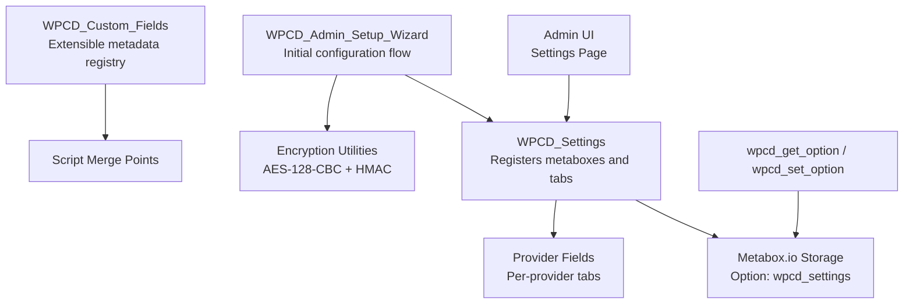
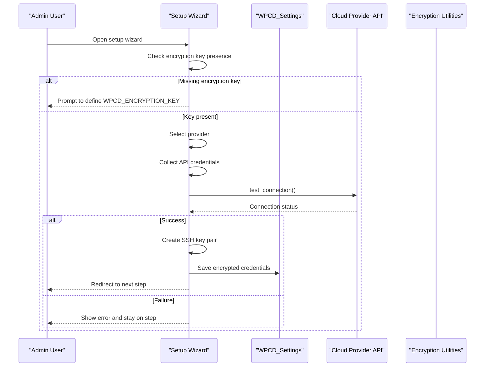
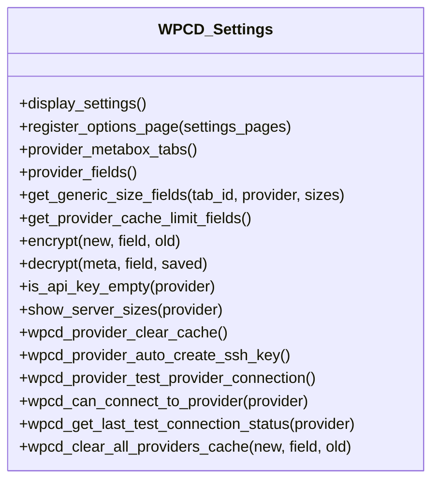
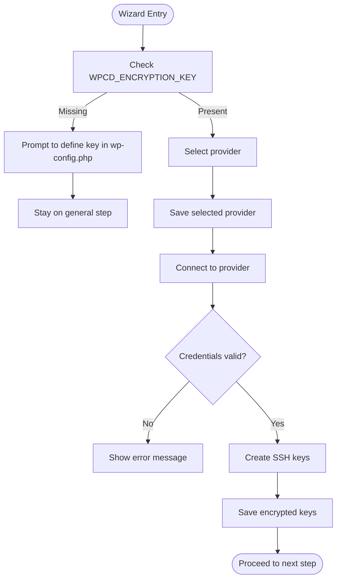
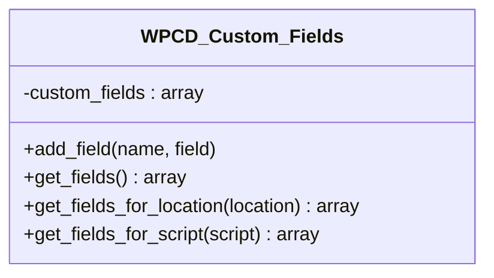
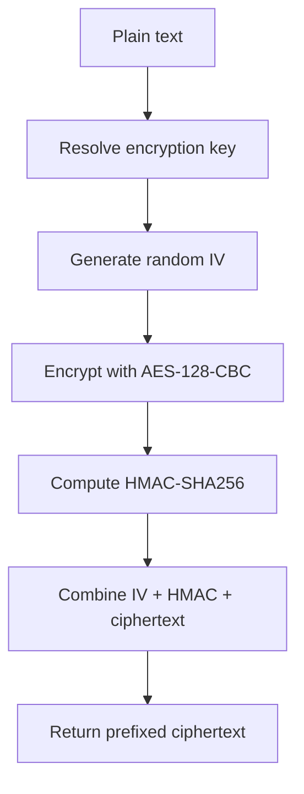
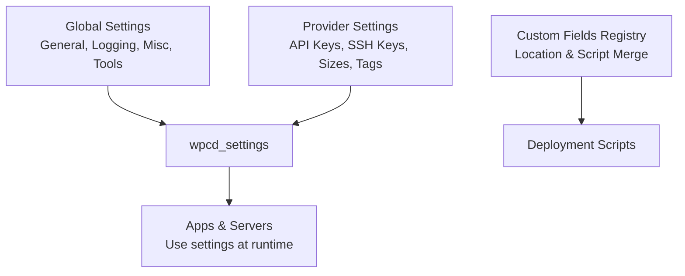
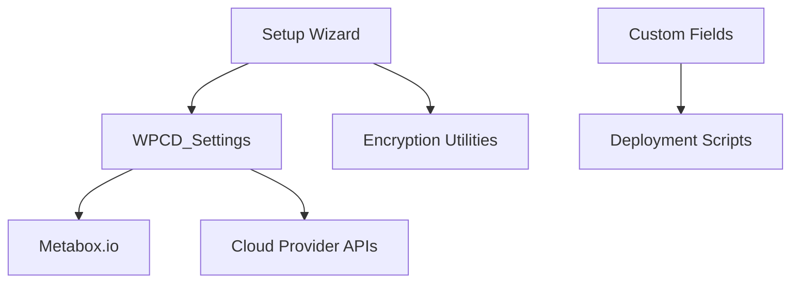

# Settings Management System

<cite>
**Referenced Files in This Document**
- [class-wpcd-settings.php](file://includes/core/class-wpcd-settings.php)
- [class-wpcd-setup-wizard.php](file://includes/core/class-wpcd-setup-wizard.php)
- [class-wpcd-custom-fields.php](file://includes/core/class-wpcd-custom-fields.php)
- [wp-cloud-deploy.php](file://includes/core/wp-cloud-deploy.php)
- [functions.php](file://includes/core/functions.php)
- [class-wpcd-setup.php](file://includes/core/class-wpcd-setup.php)
</cite>

## Table of Contents
1. [Introduction](#introduction)
2. [Project Structure](#project-structure)
3. [Core Components](#core-components)
4. [Architecture Overview](#architecture-overview)
5. [Detailed Component Analysis](#detailed-component-analysis)
6. [Dependency Analysis](#dependency-analysis)
7. [Performance Considerations](#performance-considerations)
8. [Troubleshooting Guide](#troubleshooting-guide)
9. [Conclusion](#conclusion)
10. [Appendices](#appendices)

## Introduction
This document explains SimpleStack’s settings management system. It covers how configuration is stored, validated, and retrieved; the setup wizard flow for initial configuration; the custom fields system used to store additional metadata; examples for adding new settings, validating user input, and migrating configuration data between versions; the relationship between global settings, provider-specific configurations, and per-server/site options; and security considerations including encryption mechanisms for sensitive credentials.

## Project Structure
The settings subsystem is centered around a core settings class that registers a WordPress admin settings page using Metabox.io. Provider-specific configuration is dynamically generated per cloud provider. A setup wizard guides users through initial configuration, including encryption key setup, provider selection, credential validation, and SSH key creation. Custom fields provide an extensible registry for additional metadata that can be merged into scripts or rendered in specific UI locations.

**Diagram sources**
- [class-wpcd-settings.php:72-1109](file://includes/core/class-wpcd-settings.php#L72-L1109)
- [class-wpcd-setup-wizard.php:162-214](file://includes/core/class-wpcd-setup-wizard.php#L162-L214)
- [wp-cloud-deploy.php:971-1141](file://includes/core/wp-cloud-deploy.php#L971-L1141)
- [functions.php:144-196](file://includes/core/functions.php#L144-L196)
- [class-wpcd-custom-fields.php:19-114](file://includes/core/class-wpcd-custom-fields.php#L19-L114)

**Section sources**
- [class-wpcd-settings.php:72-1109](file://includes/core/class-wpcd-settings.php#L72-L1109)
- [class-wpcd-setup-wizard.php:162-214](file://includes/core/class-wpcd-setup-wizard.php#L162-L214)
- [functions.php:144-196](file://includes/core/functions.php#L144-L196)
- [class-wpcd-custom-fields.php:19-114](file://includes/core/class-wpcd-custom-fields.php#L19-L114)

## Core Components
- WPCD_Settings: Registers the main settings page, defines global and provider-specific fields, handles encryption/decryption hooks, and provides utilities for testing connections and clearing caches.
- WPCD_Admin_Setup_Wizard: Orchestrates the first-time setup flow, validates encryption key presence, collects provider credentials, tests connectivity, and creates SSH keys.
- WPCD_Custom_Fields: Provides a registry for custom fields with location-based and script-merge capabilities.
- Encryption Utilities (WPCD): Implements AES-128-CBC encryption with HMAC verification and supports v1/v2 formats.
- Options API Helpers: wpcd_get_option and wpcd_set_option abstract reading/writing to the Metabox.io-managed option array.

**Section sources**
- [class-wpcd-settings.php:32-1109](file://includes/core/class-wpcd-settings.php#L32-L1109)
- [class-wpcd-setup-wizard.php:21-214](file://includes/core/class-wpcd-setup-wizard.php#L21-L214)
- [class-wpcd-custom-fields.php:19-114](file://includes/core/class-wpcd-custom-fields.php#L19-L114)
- [wp-cloud-deploy.php:971-1141](file://includes/core/wp-cloud-deploy.php#L971-L1141)
- [functions.php:144-196](file://includes/core/functions.php#L144-L196)

## Architecture Overview
SimpleStack uses a layered architecture for settings:
- Global settings are defined as metabox fields under the main settings page and stored in the wpcd_settings option via Metabox.io.
- Provider-specific settings are dynamically generated per cloud provider and stored under the same option array with provider-scoped keys.
- Sensitive values (API keys, private SSH keys, passwords) are encrypted on save and decrypted on retrieval using filters attached to Metabox.io field meta.
- The setup wizard enforces secure initialization by requiring an encryption key before proceeding and validates provider credentials before allowing further steps.

**Diagram sources**
- [class-wpcd-setup-wizard.php:312-366](file://includes/core/class-wpcd-setup-wizard.php#L312-L366)
- [class-wpcd-setup-wizard.php:371-440](file://includes/core/class-wpcd-setup-wizard.php#L371-L440)
- [class-wpcd-setup-wizard.php:445-731](file://includes/core/class-wpcd-setup-wizard.php#L445-L731)
- [class-wpcd-setup-wizard.php:736-794](file://includes/core/class-wpcd-setup-wizard.php#L736-L794)
- [wp-cloud-deploy.php:971-1141](file://includes/core/wp-cloud-deploy.php#L971-L1141)

## Detailed Component Analysis

### WPCD_Settings
Responsibilities:
- Registers the settings page and tabs.
- Defines global settings sections (general, logging, misc, tools).
- Generates per-provider tabs and fields (API keys, SSH keys, sizes, tags, cache controls).
- Attaches Metabox.io filters to encrypt/decrypt sensitive fields.
- Provides AJAX handlers for clearing provider caches, auto-creating SSH keys, and testing provider connections.

Key implementation patterns:
- Dynamic provider tab generation based on registered providers.
- Conditional rendering of advanced fields only when credentials are configured and connection is verified.
- Centralized encryption/decryption via filters on specific field IDs.

**Diagram sources**
- [class-wpcd-settings.php:72-1109](file://includes/core/class-wpcd-settings.php#L72-L1109)
- [class-wpcd-settings.php:1117-1696](file://includes/core/class-wpcd-settings.php#L1117-L1696)
- [class-wpcd-settings.php:1710-1803](file://includes/core/class-wpcd-settings.php#L1710-L1803)
- [class-wpcd-settings.php:1814-2163](file://includes/core/class-wpcd-settings.php#L1814-L2163)

**Section sources**
- [class-wpcd-settings.php:72-1109](file://includes/core/class-wpcd-settings.php#L72-L1109)
- [class-wpcd-settings.php:1117-1696](file://includes/core/class-wpcd-settings.php#L1117-L1696)
- [class-wpcd-settings.php:1710-1803](file://includes/core/class-wpcd-settings.php#L1710-L1803)
- [class-wpcd-settings.php:1814-2163](file://includes/core/class-wpcd-settings.php#L1814-L2163)

### WPCD_Admin_Setup_Wizard
Responsibilities:
- Displays an admin notice prompting users to start the wizard.
- Enforces presence of WPCD_ENCRYPTION_KEY before allowing progression.
- Guides users through provider selection, credential entry, connection testing, and SSH key creation.
- Saves provider credentials securely and redirects between steps.

Flow highlights:
- General setup checks encryption key constant.
- Provider selection stores selected provider in options.
- Connect to provider validates API token and saves encrypted credentials.
- Create SSH keys generates a key pair, uploads public key, and stores private key encrypted.

**Diagram sources**
- [class-wpcd-setup-wizard.php:312-366](file://includes/core/class-wpcd-setup-wizard.php#L312-L366)
- [class-wpcd-setup-wizard.php:371-440](file://includes/core/class-wpcd-setup-wizard.php#L371-L440)
- [class-wpcd-setup-wizard.php:445-731](file://includes/core/class-wpcd-setup-wizard.php#L445-L731)
- [class-wpcd-setup-wizard.php:736-794](file://includes/core/class-wpcd-setup-wizard.php#L736-L794)

**Section sources**
- [class-wpcd-setup-wizard.php:68-100](file://includes/core/class-wpcd-setup-wizard.php#L68-L100)
- [class-wpcd-setup-wizard.php:162-214](file://includes/core/class-wpcd-setup-wizard.php#L162-L214)
- [class-wpcd-setup-wizard.php:312-366](file://includes/core/class-wpcd-setup-wizard.php#L312-L366)
- [class-wpcd-setup-wizard.php:371-440](file://includes/core/class-wpcd-setup-wizard.php#L371-L440)
- [class-wpcd-setup-wizard.php:445-731](file://includes/core/class-wpcd-setup-wizard.php#L445-L731)
- [class-wpcd-setup-wizard.php:736-794](file://includes/core/class-wpcd-setup-wizard.php#L736-L794)

### WPCD_Custom_Fields
Responsibilities:
- Maintains a registry of custom fields with metadata such as display location, type, options, and script merge flags.
- Provides methods to retrieve all fields, filter by location, and filter by script name for merging into deployment scripts.

Usage patterns:
- Add fields programmatically via add_field(name, field_array).
- Retrieve fields for a specific location using get_fields_for_location(location).
- Retrieve fields eligible for script merging using get_fields_for_script(script_name).

**Diagram sources**
- [class-wpcd-custom-fields.php:19-114](file://includes/core/class-wpcd-custom-fields.php#L19-L114)

**Section sources**
- [class-wpcd-custom-fields.php:19-114](file://includes/core/class-wpcd-custom-fields.php#L19-L114)

### Encryption Utilities
Responsibilities:
- Encrypts sensitive strings using AES-128-CBC with a random IV and HMAC-SHA256 integrity check.
- Supports legacy v1 format and modern v2 format with dynamic IV.
- Derives encryption key from WPCD_ENCRYPTION_KEY constant, fallback to database-stored key, or generates one if missing.

Security characteristics:
- Uses OpenSSL for cryptographic operations.
- Stores IV and HMAC alongside ciphertext for v2 format.
- Validates HMAC during decryption to detect tampering.

**Diagram sources**
- [wp-cloud-deploy.php:971-1007](file://includes/core/wp-cloud-deploy.php#L971-L1007)
- [wp-cloud-deploy.php:1041-1141](file://includes/core/wp-cloud-deploy.php#L1041-L1141)

**Section sources**
- [wp-cloud-deploy.php:971-1007](file://includes/core/wp-cloud-deploy.php#L971-L1007)
- [wp-cloud-deploy.php:1041-1141](file://includes/core/wp-cloud-deploy.php#L1041-L1141)

### Options API Helpers
Responsibilities:
- wpcd_get_option retrieves values from the Metabox.io-managed option array.
- wpcd_get_early_option reads directly from WordPress options for early bootstrap scenarios.
- wpcd_set_option writes values directly to the option array.

Behavior:
- Defaults domain to wpcd_settings.
- Returns false if Metabox.io is not available for read operations.

**Section sources**
- [functions.php:144-196](file://includes/core/functions.php#L144-L196)

## Architecture Overview
The settings architecture separates concerns across global configuration, provider-specific configuration, and extensible metadata:

- Global settings: Defined in WPCD_Settings metaboxes and stored under wpcd_settings. Examples include logging preferences, cache limits, UI toggles, and brand colors.
- Provider-specific configuration: Dynamically generated per provider with fields for API keys, SSH keys, server sizes, tags, and cache controls. Stored under the same option array with provider-scoped keys.
- Per-server/site options: Not managed by WPCD_Settings; these are typically post meta for server and app entities. The settings system focuses on application-wide and provider-level configuration.

**Diagram sources**
- [class-wpcd-settings.php:72-1109](file://includes/core/class-wpcd-settings.php#L72-L1109)
- [class-wpcd-settings.php:1117-1696](file://includes/core/class-wpcd-settings.php#L1117-L1696)
- [class-wpcd-custom-fields.php:19-114](file://includes/core/class-wpcd-custom-fields.php#L19-L114)

## Detailed Component Analysis

### Configuration Storage and Retrieval
- Storage: All settings are stored in the wpcd_settings option via Metabox.io. Global fields are defined in WPCD_Settings, while provider fields are generated dynamically.
- Retrieval: Use wpcd_get_option for normal access and wpcd_get_early_option for early bootstrap. Sensitive fields are automatically decrypted via Metabox.io filters.

Best practices:
- Always use wpcd_get_option for consistency.
- Avoid direct database writes except in controlled automation paths.
- Ensure sensitive fields are marked for encryption via the appropriate field ID filters.

**Section sources**
- [functions.php:144-196](file://includes/core/functions.php#L144-L196)
- [class-wpcd-settings.php:1658-1692](file://includes/core/class-wpcd-settings.php#L1658-L1692)

### Validation and Sanitization
- Frontend validation: Some JavaScript files perform client-side validation for webhooks and URLs.
- Backend validation: Setup wizard steps validate required inputs and redirect back with error messages if invalid.
- Provider connection testing: AJAX endpoints verify permissions and nonce, then call provider APIs to validate credentials.

Recommendations:
- Implement server-side validation for all user inputs.
- Use sanitize_text_field and FILTER_INPUT where applicable.
- Leverage existing nonce checks for AJAX actions.

**Section sources**
- [class-wpcd-setup-wizard.php:421-440](file://includes/core/class-wpcd-setup-wizard.php#L421-L440)
- [class-wpcd-setup-wizard.php:682-731](file://includes/core/class-wpcd-setup-wizard.php#L682-L731)
- [class-wpcd-settings.php:1905-1932](file://includes/core/class-wpcd-settings.php#L1905-L1932)
- [class-wpcd-settings.php:2000-2048](file://includes/core/class-wpcd-settings.php#L2000-L2048)

### Migration Between Versions
- Default settings: WPCD_Setup initializes default values for wpcd_settings on activation.
- Versioned encryption: Encryption utilities support v1 and v2 formats, enabling migration of existing encrypted data without re-encryption.
- Data sync: Optional data sync features allow exporting/importing settings and records between sites, facilitating environment migrations.

Migration strategy:
- Define new defaults in WPCD_Setup and ensure they are applied on upgrade.
- Use versioned encryption to maintain compatibility with existing data.
- Provide export/import workflows for complex configuration sets.

**Section sources**
- [class-wpcd-setup.php:36-58](file://includes/core/class-wpcd-setup.php#L36-L58)
- [wp-cloud-deploy.php:1021-1029](file://includes/core/wp-cloud-deploy.php#L1021-L1029)
- [wp-cloud-deploy.php:1041-1141](file://includes/core/wp-cloud-deploy.php#L1041-L1141)
- [class-wpcd-settings.php:856-1038](file://includes/core/class-wpcd-settings.php#L856-L1038)

### Adding New Settings
Steps:
1. Define a new metabox field in WPCD_Settings under the appropriate tab.
2. If the field contains sensitive data, attach encryption/decryption filters for the field ID.
3. Provide validation logic in the relevant handler or AJAX endpoint.
4. Expose the setting via wpcd_get_option for retrieval.

Example pattern:
- Add field definition in provider_fields or global metaboxes.
- Attach rwmb_{field}_value filter to encrypt on save.
- Attach rwmb_{field}_field_meta filter to decrypt on load.

**Section sources**
- [class-wpcd-settings.php:1658-1692](file://includes/core/class-wpcd-settings.php#L1658-L1692)
- [functions.php:144-196](file://includes/core/functions.php#L144-L196)

### Security Considerations
- Encryption key: Require WPCD_ENCRYPTION_KEY constant for secure storage of sensitive data.
- Sensitive fields: Automatically encrypt API keys, private SSH keys, and passwords using Metabox.io filters.
- Access control: Restrict settings page access to administrators and enforce capability checks.
- Nonce validation: Validate nonces for all AJAX actions to prevent CSRF attacks.

Recommendations:
- Always define WPCD_ENCRYPTION_KEY in wp-config.php.
- Avoid logging sensitive data; use redaction utilities where necessary.
- Limit exposure of private keys in UI and logs.

**Section sources**
- [class-wpcd-setup-wizard.php:312-366](file://includes/core/class-wpcd-setup-wizard.php#L312-L366)
- [class-wpcd-settings.php:1658-1692](file://includes/core/class-wpcd-settings.php#L1658-L1692)
- [wp-cloud-deploy.php:971-1141](file://includes/core/wp-cloud-deploy.php#L971-L1141)

## Dependency Analysis
The settings system depends on:
- Metabox.io for form rendering and option storage.
- WordPress options API for persistent storage.
- Cloud provider APIs for dynamic field generation and credential validation.
- Encryption utilities for securing sensitive data.

Coupling:
- WPCD_Settings is tightly coupled with Metabox.io and provider APIs.
- Setup wizard depends on WPCD_Settings for provider field generation and encryption utilities for credential handling.
- Custom fields are loosely coupled and can be extended independently.

Potential circular dependencies:
- None identified; dependencies are hierarchical and unidirectional.

External integrations:
- Cloud providers (e.g., Vultr, UpCloud, Hetzner, Linode, DigitalOcean).
- WordPress admin UI and AJAX infrastructure.

**Diagram sources**
- [class-wpcd-settings.php:72-1109](file://includes/core/class-wpcd-settings.php#L72-L1109)
- [class-wpcd-setup-wizard.php:162-214](file://includes/core/class-wpcd-setup-wizard.php#L162-L214)
- [wp-cloud-deploy.php:971-1141](file://includes/core/wp-cloud-deploy.php#L971-L1141)
- [class-wpcd-custom-fields.php:19-114](file://includes/core/class-wpcd-custom-fields.php#L19-L114)

**Section sources**
- [class-wpcd-settings.php:72-1109](file://includes/core/class-wpcd-settings.php#L72-L1109)
- [class-wpcd-setup-wizard.php:162-214](file://includes/core/class-wpcd-setup-wizard.php#L162-L214)
- [wp-cloud-deploy.php:971-1141](file://includes/core/wp-cloud-deploy.php#L971-L1141)
- [class-wpcd-custom-fields.php:19-114](file://includes/core/class-wpcd-custom-fields.php#L19-L114)

## Performance Considerations
- Provider caching: Cache provider responses (sizes, keys, regions) to reduce API calls and respect rate limits. Adjust cache durations via provider cache limit fields.
- Lazy loading: Only render advanced provider fields when credentials are configured and connection is verified.
- Minimize database writes: Use wpcd_get_early_option for read-heavy early bootstrap scenarios to avoid unnecessary Metabox.io overhead.

Optimization tips:
- Increase cache durations after initial setup to improve performance.
- Clear provider caches selectively when needed rather than globally.
- Avoid excessive logging in production environments.

**Section sources**
- [class-wpcd-settings.php:1755-1777](file://includes/core/class-wpcd-settings.php#L1755-L1777)
- [class-wpcd-settings.php:1814-1854](file://includes/core/class-wpcd-settings.php#L1814-L1854)
- [functions.php:163-170](file://includes/core/functions.php#L163-L170)

## Troubleshooting Guide
Common issues and resolutions:
- Missing encryption key: The setup wizard will block progression until WPCD_ENCRYPTION_KEY is defined. Define it in wp-config.php and retry.
- Provider connection failures: Use the Test Connection button to validate credentials. Check network access, IP whitelisting, and API permissions.
- Stale provider data: Clear provider caches via the Clear Cached Data button to refresh lists of keys and sizes.
- Sensitive data exposure: Ensure encryption filters are active for sensitive fields and avoid logging raw credentials.

Debugging steps:
- Verify nonce validity for AJAX actions.
- Check WordPress error logs for PHP warnings or deprecations.
- Inspect Metabox.io field definitions for missing encryption filters.

**Section sources**
- [class-wpcd-setup-wizard.php:312-366](file://includes/core/class-wpcd-setup-wizard.php#L312-L366)
- [class-wpcd-settings.php:1905-1932](file://includes/core/class-wpcd-settings.php#L1905-L1932)
- [class-wpcd-settings.php:2000-2048](file://includes/core/class-wpcd-settings.php#L2000-L2048)

## Conclusion
SimpleStack’s settings management system provides a robust, extensible framework for managing global and provider-specific configurations. It emphasizes security through mandatory encryption keys and automatic encryption of sensitive fields. The setup wizard streamlines initial configuration, while custom fields enable flexible metadata handling. By following the recommended patterns for adding settings, validating input, and migrating data, developers can extend the system safely and efficiently.

## Appendices

### Example: Adding a New Setting
- Define a new metabox field in WPCD_Settings under the appropriate tab.
- If sensitive, attach encryption/decryption filters for the field ID.
- Retrieve the setting using wpcd_get_option.

Reference paths:
- [class-wpcd-settings.php:1658-1692](file://includes/core/class-wpcd-settings.php#L1658-L1692)
- [functions.php:144-196](file://includes/core/functions.php#L144-L196)

### Example: Validating User Input
- Use sanitize_text_field and FILTER_INPUT for backend validation.
- Implement AJAX handlers with nonce checks and permission validation.

Reference paths:
- [class-wpcd-setup-wizard.php:421-440](file://includes/core/class-wpcd-setup-wizard.php#L421-L440)
- [class-wpcd-settings.php:1905-1932](file://includes/core/class-wpcd-settings.php#L1905-L1932)

### Example: Migrating Configuration Data
- Update default settings in WPCD_Setup for new versions.
- Use versioned encryption to maintain compatibility with existing data.
- Leverage data sync features for cross-site migrations.

Reference paths:
- [class-wpcd-setup.php:36-58](file://includes/core/class-wpcd-setup.php#L36-L58)
- [wp-cloud-deploy.php:1021-1029](file://includes/core/wp-cloud-deploy.php#L1021-L1029)
- [class-wpcd-settings.php:856-1038](file://includes/core/class-wpcd-settings.php#L856-L1038)