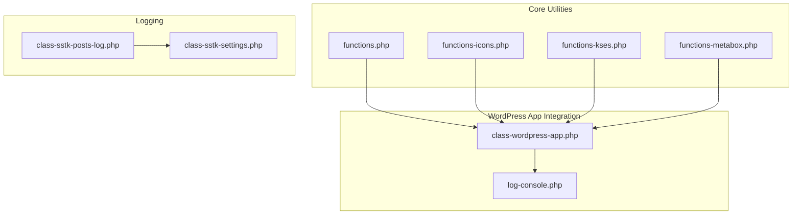
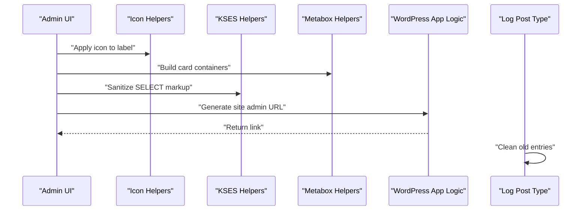
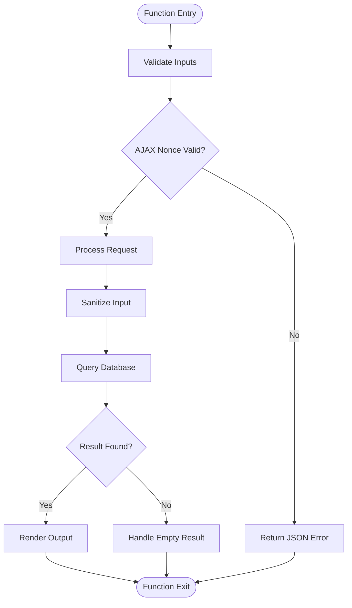
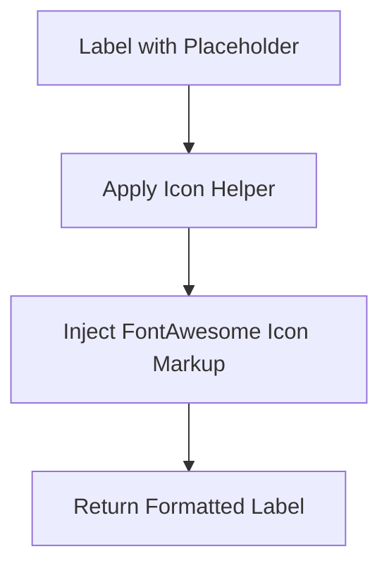
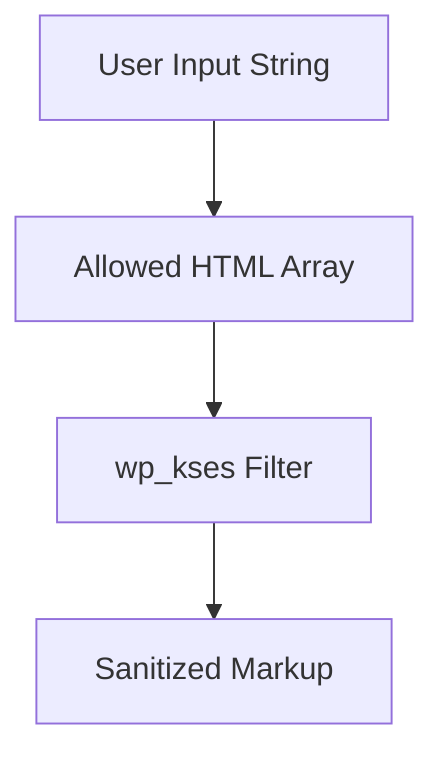
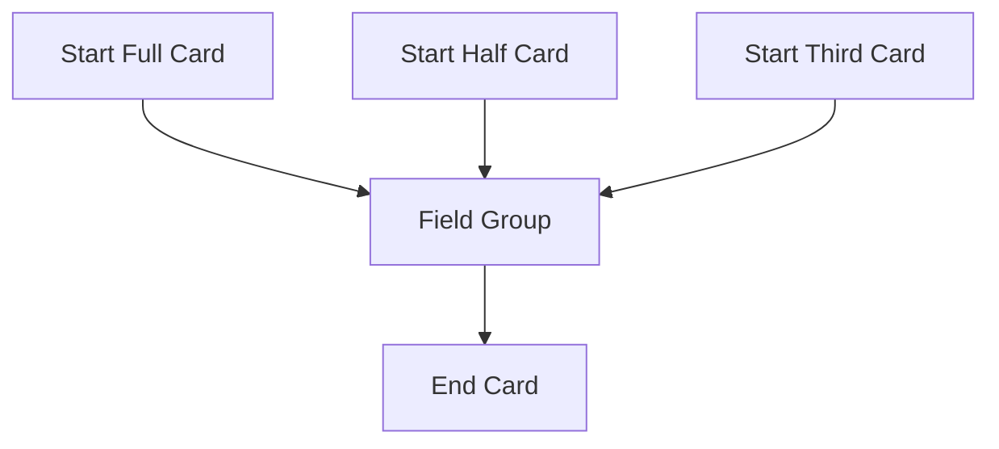
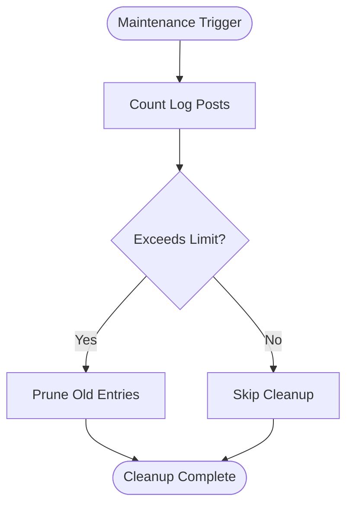
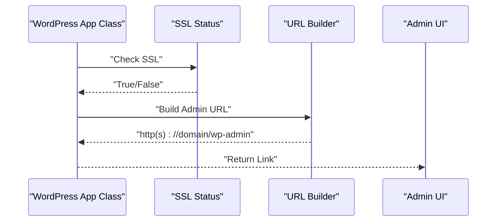
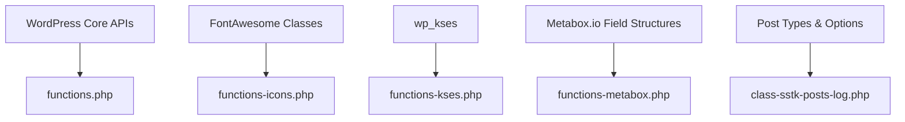

# Utility Functions & Helpers

<cite>
**Referenced Files in This Document**
- [functions.php](file://includes/core/functions.php)
- [functions-icons.php](file://includes/core/functions-icons.php)
- [functions-kses.php](file://includes/core/functions-kses.php)
- [functions-metabox.php](file://includes/core/functions-metabox.php)
- [class-sstk-posts-log.php](file://includes/core/class-sstk-posts-log.php)
- [class-sstk-settings.php](file://includes/core/class-sstk-settings.php)
- [class-wordpress-app.php](file://includes/core/apps/wordpress-app/class-wordpress-app.php)
- [log-console.php](file://includes/core/apps/wordpress-app/templates/log-console.php)
</cite>

## Table of Contents
1. [Introduction](#introduction)
2. [Project Structure](#project-structure)
3. [Core Components](#core-components)
4. [Architecture Overview](#architecture-overview)
5. [Detailed Component Analysis](#detailed-component-analysis)
6. [Dependency Analysis](#dependency-analysis)
7. [Performance Considerations](#performance-considerations)
8. [Troubleshooting Guide](#troubleshooting-guide)
9. [Conclusion](#conclusion)

## Introduction
This document explains Simple Stack’s utility functions and helper methods that power common operations across the application. It focuses on:
- Reusable helpers for file handling, string manipulation, WordPress integration, and security.
- The icon management system used to keep UI elements consistent.
- KSES sanitization helpers for secure HTML processing.
- Metabox helper functions for building admin interface elements.
- Logging utilities, date formatting helpers, and URL generation patterns.
- Security considerations and best practices for extending the utility library.

The goal is to make these utilities understandable for both developers and non-technical users who need to extend or maintain Simple Stack safely.

## Project Structure
Simple Stack centralizes reusable PHP helpers under `includes/core`. The most relevant files for this documentation are:
- `functions.php`: General-purpose helpers (string cleaning, permissions, random values, UUIDs, clipboard wrappers, etc.).
- `functions-icons.php`: Icon prefix helpers for consistent FontAwesome usage.
- `functions-kses.php`: KSES allowed HTML arrays and filtering helpers.
- `functions-metabox.php`: Metabox card container helpers for admin UI layout.
- `class-sstk-posts-log.php` and `class-sstk-settings.php`: Logging configuration and log post type behavior.
- `class-wordpress-app.php`: Example URL generation for site admin links.
- `log-console.php`: Admin template for displaying command logs.

**Diagram sources**
- [functions.php:1-2041](file://includes/core/functions.php#L1-L2041)
- [functions-icons.php:1-572](file://includes/core/functions-icons.php#L1-L572)
- [functions-kses.php:1-55](file://includes/core/functions-kses.php#L1-L55)
- [functions-metabox.php:1-161](file://includes/core/functions-metabox.php#L1-L161)
- [class-sstk-posts-log.php:199-240](file://includes/core/class-sstk-posts-log.php#L199-L240)
- [class-sstk-settings.php:208-224](file://includes/core/class-sstk-settings.php#L208-L224)
- [class-wordpress-app.php:1079-1112](file://includes/core/apps/wordpress-app/class-wordpress-app.php#L1079-L1112)
- [log-console.php:1-17](file://includes/core/apps/wordpress-app/templates/log-console.php#L1-L17)

**Section sources**
- [functions.php:1-2041](file://includes/core/functions.php#L1-L2041)
- [functions-icons.php:1-572](file://includes/core/functions-icons.php#L1-L572)
- [functions-kses.php:1-55](file://includes/core/functions-kses.php#L1-L55)
- [functions-metabox.php:1-161](file://includes/core/functions-metabox.php#L1-L161)
- [class-sstk-posts-log.php:199-240](file://includes/core/class-sstk-posts-log.php#L199-L240)
- [class-sstk-settings.php:208-224](file://includes/core/class-sstk-settings.php#L208-L224)
- [class-wordpress-app.php:1079-1112](file://includes/core/apps/wordpress-app/class-wordpress-app.php#L1079-L1112)
- [log-console.php:1-17](file://includes/core/apps/wordpress-app/templates/log-console.php#L1-L17)

## Core Components
This section summarizes the main utility areas and their responsibilities.

- General helpers (`functions.php`)
  - String manipulation: safe start/end checks, substring extraction, line splitting, key-value pair replacement, domain normalization, alphanumeric cleaning, bash escaping.
  - Randomness and identifiers: cryptographically secure random strings, default password generators, UUID generation.
  - WordPress integration: option accessors, nonce checks, role and permission helpers, team membership queries, public/admin query detection.
  - UI helpers: HTML5 details summary text, loading SVG code, clipboard copy wrapper, label wrapping helpers.
  - Feature flags: WooCommerce, Git, Multi-Tenant, custom DNS provider tables.

- Icon management (`functions-icons.php`)
  - A set of functions that prepend a FontAwesome icon to a label using `sprintf`, ensuring consistent iconography across buttons and headers.

- KSES sanitization (`functions-kses.php`)
  - Allowed HTML arrays for SELECT inputs and a helper function to sanitize user-provided markup via `wp_kses`.

- Metabox helpers (`functions-metabox.php`)
  - Card container builders for full-width, half-width, third-width, and page-heading layouts, plus closing helpers. These return field arrays consumed by the metabox system.

- Logging utilities
  - Log post type cleanup routines and settings for logging categories.
  - Templates for rendering log consoles in the admin UI.

- WordPress app integration
  - URL generation for site admin links with protocol selection based on SSL status.

**Section sources**
- [functions.php:26-130](file://includes/core/functions.php#L26-L130)
- [functions.php:267-305](file://includes/core/functions.php#L267-L305)
- [functions.php:337-419](file://includes/core/functions.php#L337-L419)
- [functions.php:439-467](file://includes/core/functions.php#L439-L467)
- [functions.php:482-524](file://includes/core/functions.php#L482-L524)
- [functions.php:550-574](file://includes/core/functions.php#L550-L574)
- [functions.php:612-659](file://includes/core/functions.php#L612-L659)
- [functions.php:697-769](file://includes/core/functions.php#L697-L769)
- [functions.php:1062-1075](file://includes/core/functions.php#L1062-L1075)
- [functions.php:1115-1124](file://includes/core/functions.php#L1115-L1124)
- [functions.php:1241-1269](file://includes/core/functions.php#L1241-L1269)
- [functions.php:1325-1395](file://includes/core/functions.php#L1325-L1395)
- [functions.php:1450-1497](file://includes/core/functions.php#L1450-L1497)
- [functions.php:1500-1511](file://includes/core/functions.php#L1500-L1511)
- [functions.php:1520-1527](file://includes/core/functions.php#L1520-L1527)
- [functions.php:1601-1614](file://includes/core/functions.php#L1601-L1614)
- [functions.php:1628-1635](file://includes/core/functions.php#L1628-L1635)
- [functions.php:1645-1658](file://includes/core/functions.php#L1645-L1658)
- [functions.php:1671-1693](file://includes/core/functions.php#L1671-L1693)
- [functions.php:1702-1720](file://includes/core/functions.php#L1702-L1720)
- [functions.php:1734-1758](file://includes/core/functions.php#L1734-L1758)
- [functions.php:1773-1781](file://includes/core/functions.php#L1773-L1781)
- [functions.php:1797-1817](file://includes/core/functions.php#L1797-L1817)
- [functions.php:1826-1840](file://includes/core/functions.php#L1826-L1840)
- [functions.php:1850-1887](file://includes/core/functions.php#L1850-L1887)
- [functions.php:1892-1899](file://includes/core/functions.php#L1892-L1899)
- [functions.php:1909-1913](file://includes/core/functions.php#L1909-L1913)
- [functions.php:1923-2006](file://includes/core/functions.php#L1923-L2006)
- [functions-icons.php:22-572](file://includes/core/functions-icons.php#L22-L572)
- [functions-kses.php:18-54](file://includes/core/functions-kses.php#L18-L54)
- [functions-metabox.php:28-158](file://includes/core/functions-metabox.php#L28-L158)
- [class-sstk-posts-log.php:199-240](file://includes/core/class-sstk-posts-log.php#L199-L240)
- [class-sstk-settings.php:208-224](file://includes/core/class-sstk-settings.php#L208-L224)
- [class-wordpress-app.php:1079-1112](file://includes/core/apps/wordpress-app/class-wordpress-app.php#L1079-L1112)
- [log-console.php:1-17](file://includes/core/apps/wordpress-app/templates/log-console.php#L1-L17)

## Architecture Overview
At runtime, Simple Stack’s utilities are invoked from various parts of the plugin:
- Admin screens use metabox helpers to render structured cards.
- Buttons and labels use icon helpers to ensure consistent visuals.
- User input is sanitized through KSES helpers before being rendered.
- URLs for site administration are generated with awareness of SSL state.
- Logs are stored as posts and cleaned up according to configured limits.

**Diagram sources**
- [functions-icons.php:22-572](file://includes/core/functions-icons.php#L22-L572)
- [functions-metabox.php:28-158](file://includes/core/functions-metabox.php#L28-L158)
- [functions-kses.php:18-54](file://includes/core/functions-kses.php#L18-L54)
- [class-wordpress-app.php:1079-1112](file://includes/core/apps/wordpress-app/class-wordpress-app.php#L1079-L1112)
- [class-sstk-posts-log.php:199-240](file://includes/core/class-sstk-posts-log.php#L199-L240)

## Detailed Component Analysis

### General Helper Functions (`functions.php`)
Key responsibilities:
- Child post retrieval and deletion based on custom meta.
- Safe title retrieval without WordPress prefixes.
- Robust unserialization with multiple fallback attempts.
- Option accessors for early and late loads.
- Nonce validation for AJAX endpoints.
- Line ending normalization and last-line extraction.
- Substring extraction and deletion helpers.
- Key-value pair replacement in strings.
- Cryptographically secure random string and password generators.
- Compatibility shims for PHP 8 string functions.
- Domain normalization and alphanumeric cleaning.
- Clipboard copy wrapper and label div/span wrappers.
- UUID generation and feature flag checks.
- Team and permission helpers for content visibility.

Complexity highlights:
- Recursive deletion between markers uses recursion to remove all occurrences.
- Permission-based post queries build dynamic SQL placeholders and prepared statements.
- Random string generation uses `random_int` for cryptographic security.

Security considerations:
- Nonce checks prevent CSRF on AJAX actions.
- Prepared SQL queries avoid injection risks.
- Input sanitization helpers restrict characters to safe sets.

**Diagram sources**
- [functions.php:267-305](file://includes/core/functions.php#L267-L305)
- [functions.php:697-769](file://includes/core/functions.php#L697-L769)
- [functions.php:1115-1124](file://includes/core/functions.php#L1115-L1124)

**Section sources**
- [functions.php:26-130](file://includes/core/functions.php#L26-L130)
- [functions.php:267-305](file://includes/core/functions.php#L267-L305)
- [functions.php:337-419](file://includes/core/functions.php#L337-L419)
- [functions.php:439-467](file://includes/core/functions.php#L439-L467)
- [functions.php:482-524](file://includes/core/functions.php#L482-L524)
- [functions.php:550-574](file://includes/core/functions.php#L550-L574)
- [functions.php:612-659](file://includes/core/functions.php#L612-L659)
- [functions.php:697-769](file://includes/core/functions.php#L697-L769)
- [functions.php:1062-1075](file://includes/core/functions.php#L1062-L1075)
- [functions.php:1115-1124](file://includes/core/functions.php#L1115-L1124)
- [functions.php:1241-1269](file://includes/core/functions.php#L1241-L1269)
- [functions.php:1325-1395](file://includes/core/functions.php#L1325-L1395)
- [functions.php:1450-1497](file://includes/core/functions.php#L1450-L1497)
- [functions.php:1500-1511](file://includes/core/functions.php#L1500-L1511)
- [functions.php:1520-1527](file://includes/core/functions.php#L1520-L1527)
- [functions.php:1601-1614](file://includes/core/functions.php#L1601-L1614)
- [functions.php:1628-1635](file://includes/core/functions.php#L1628-L1635)
- [functions.php:1645-1658](file://includes/core/functions.php#L1645-L1658)
- [functions.php:1671-1693](file://includes/core/functions.php#L1671-L1693)
- [functions.php:1702-1720](file://includes/core/functions.php#L1702-L1720)
- [functions.php:1734-1758](file://includes/core/functions.php#L1734-L1758)
- [functions.php:1773-1781](file://includes/core/functions.php#L1773-L1781)
- [functions.php:1797-1817](file://includes/core/functions.php#L1797-L1817)
- [functions.php:1826-1840](file://includes/core/functions.php#L1826-L1840)
- [functions.php:1850-1887](file://includes/core/functions.php#L1850-L1887)
- [functions.php:1892-1899](file://includes/core/functions.php#L1892-L1899)
- [functions.php:1909-1913](file://includes/core/functions.php#L1909-L1913)
- [functions.php:1923-2006](file://includes/core/functions.php#L1923-L2006)

### Icon Management System (`functions-icons.php`)
Purpose:
- Provide consistent icon prefixes for labels and buttons.
- Use FontAwesome classes via `sprintf` to inject icons into localized strings.

Usage pattern:
- Call an icon helper with a label containing a placeholder.
- The helper returns the label prefixed with the appropriate icon markup.

Examples of available helpers include restart, power, calendar, phone, trash, erase, uninstall, install, virus, key, skeleton key, updates, upgrade, update, run, open, close, about, save, email, load, download, upload, logs, warning, danger, checkmark, x, change, change code, PHP, backup, restore, prune, snapshot, AWS, SSL, clock, duplicate, file manager, tools, API, and add.

Best practices:
- Always pass a label with at least one placeholder to ensure proper formatting.
- Keep icon semantics aligned with action meaning (e.g., use delete/trash icons for destructive actions).

**Diagram sources**
- [functions-icons.php:22-572](file://includes/core/functions-icons.php#L22-L572)

**Section sources**
- [functions-icons.php:22-572](file://includes/core/functions-icons.php#L22-L572)

### KSES Sanitization Functions (`functions-kses.php`)
Purpose:
- Define allowed HTML tags and attributes for specific contexts (e.g., SELECT inputs).
- Provide a helper to sanitize user-provided HTML using `wp_kses`.

Key functions:
- `sstk_kses_allowed_select()`: Returns an array of allowed tags and attributes for SELECT and OPTION elements.
- `sstk_kses_select($data)`: Sanitizes a string using the allowed SELECT configuration.

Security considerations:
- Only explicitly allow necessary tags and attributes to minimize XSS risk.
- Use these helpers whenever rendering user-controlled markup in admin interfaces.

**Diagram sources**
- [functions-kses.php:18-54](file://includes/core/functions-kses.php#L18-L54)

**Section sources**
- [functions-kses.php:18-54](file://includes/core/functions-kses.php#L18-L54)

### Metabox Helper Functions (`functions-metabox.php`)
Purpose:
- Build card container field arrays for metabox.io fields.
- Support different column widths and special page headings.

Available helpers:
- Full-width card: `sstk_start_full_card($tab)`
- Full-width card without border: `sstk_start_full_card_no_border($tab)`
- Full-width card for page heading: `sstk_start_full_card_page_heading($tab)`
- Half-width card: `sstk_start_half_card($tab)`
- One-third width card: `sstk_start_one_third_card($tab)`
- Two-thirds width card: `sstk_start_two_thirds_card($tab)`
- Closing card: `sstk_end_card($tab)`

Usage pattern:
- Wrap related fields within start and end helpers to create visually grouped sections.
- Use tab parameter to associate fields with a specific metabox tab.

**Diagram sources**
- [functions-metabox.php:28-158](file://includes/core/functions-metabox.php#L28-L158)

**Section sources**
- [functions-metabox.php:28-158](file://includes/core/functions-metabox.php#L28-L158)

### Logging Utilities
Responsibilities:
- Clean up old log entries to prevent database growth.
- Configure logging categories via settings.
- Render log consoles in the admin UI.

Key behaviors:
- Log cleanup counts private and published posts and prunes beyond configured limits.
- Settings define which types of events are logged (error, trace, warning, debug, security, provider cache, better cron, other).
- Admin templates provide a console view for command results.

**Diagram sources**
- [class-sstk-posts-log.php:199-240](file://includes/core/class-sstk-posts-log.php#L199-L240)
- [class-sstk-settings.php:208-224](file://includes/core/class-sstk-settings.php#L208-L224)

**Section sources**
- [class-sstk-posts-log.php:199-240](file://includes/core/class-sstk-posts-log.php#L199-L240)
- [class-sstk-settings.php:208-224](file://includes/core/class-sstk-settings.php#L208-L224)
- [log-console.php:1-17](file://includes/core/apps/wordpress-app/templates/log-console.php#L1-L17)

### Date Formatting Helpers
Observation:
- The repository does not define dedicated date formatting helper functions in the core utility files reviewed.
- Date-related logic appears in shell scripts and external configurations rather than PHP helpers.

Recommendation:
- If you need consistent date formatting, consider adding helpers in `functions.php` that wrap WordPress’s `date_i18n` or `gmdate` with standardized formats.

[No sources needed since this section provides general guidance]

### URL Generation Functions
Patterns observed:
- Site admin URLs are constructed with protocol selection based on SSL status.
- Public listing pages use `get_permalink` and query args for admin routes.

Example flow:
- Determine SSL status.
- Build admin URL with http or https accordingly.
- Optionally wrap the link with an icon or label.

**Diagram sources**
- [class-wordpress-app.php:1079-1112](file://includes/core/apps/wordpress-app/class-wordpress-app.php#L1079-L1112)

**Section sources**
- [class-wordpress-app.php:1079-1112](file://includes/core/apps/wordpress-app/class-wordpress-app.php#L1079-L1112)

## Dependency Analysis
Utility dependencies:
- `functions.php` depends on WordPress APIs (`get_option`, `update_option`, `wp_verify_nonce`, `get_posts`, `wpdb`, etc.).
- `functions-icons.php` depends on FontAwesome classes and localization via `sprintf`.
- `functions-kses.php` depends on `wp_kses`.
- `functions-metabox.php` depends on metabox.io field structures.
- Logging classes depend on WordPress post types and options.

Coupling and cohesion:
- High cohesion within each utility file; low coupling between them except where shared WordPress APIs are used.
- No circular dependencies among the reviewed utility files.

External integrations:
- FontAwesome for icons.
- Metabox.io for admin field rendering.
- WordPress REST and admin APIs for data access.

**Diagram sources**
- [functions.php:1-2041](file://includes/core/functions.php#L1-L2041)
- [functions-icons.php:1-572](file://includes/core/functions-icons.php#L1-L572)
- [functions-kses.php:1-55](file://includes/core/functions-kses.php#L1-L55)
- [functions-metabox.php:1-161](file://includes/core/functions-metabox.php#L1-L161)
- [class-sstk-posts-log.php:199-240](file://includes/core/class-sstk-posts-log.php#L199-L240)

**Section sources**
- [functions.php:1-2041](file://includes/core/functions.php#L1-L2041)
- [functions-icons.php:1-572](file://includes/core/functions-icons.php#L1-L572)
- [functions-kses.php:1-55](file://includes/core/functions-kses.php#L1-L55)
- [functions-metabox.php:1-161](file://includes/core/functions-metabox.php#L1-L161)
- [class-sstk-posts-log.php:199-240](file://includes/core/class-sstk-posts-log.php#L199-L240)

## Performance Considerations
- Avoid excessive recursion in string manipulation; prefer iterative approaches when possible.
- Cache repeated option reads if called frequently in tight loops.
- Use prepared statements for database queries to reduce overhead and improve safety.
- Limit log retention via configured thresholds to prevent large post tables.
- Prefer lightweight icon helpers over inline HTML generation in hot paths.

[No sources needed since this section provides general guidance]

## Troubleshooting Guide
Common issues and resolutions:
- Nonce failures on AJAX requests: Ensure correct action names and nonce values are passed.
- Unexpected HTML stripping: Verify KSES allowed arrays match the intended markup.
- Metabox layout problems: Confirm start/end card helpers are paired correctly and tabs match.
- Log table growth: Adjust auto-trim settings and verify cleanup routines run during maintenance.
- URL protocol mismatches: Double-check SSL status detection and URL construction logic.

**Section sources**
- [functions.php:267-305](file://includes/core/functions.php#L267-L305)
- [functions-kses.php:18-54](file://includes/core/functions-kses.php#L18-L54)
- [functions-metabox.php:28-158](file://includes/core/functions-metabox.php#L28-L158)
- [class-sstk-posts-log.php:199-240](file://includes/core/class-sstk-posts-log.php#L199-L240)
- [class-wordpress-app.php:1079-1112](file://includes/core/apps/wordpress-app/class-wordpress-app.php#L1079-L1112)

## Conclusion
Simple Stack’s utility functions provide a robust foundation for string handling, security, UI consistency, and WordPress integration. By leveraging icon helpers, KSES sanitization, metabox card builders, and logging utilities, developers can build secure and maintainable admin interfaces. When extending the library, follow established patterns: validate inputs, sanitize outputs, use prepared queries, and keep helpers focused and cohesive.

[No sources needed since this section summarizes without analyzing specific files]