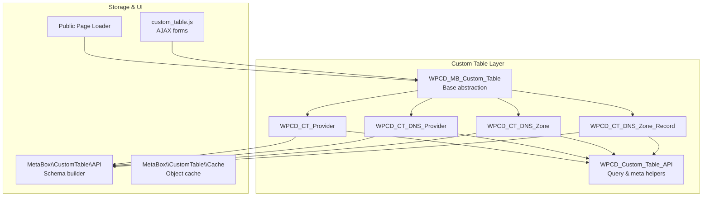
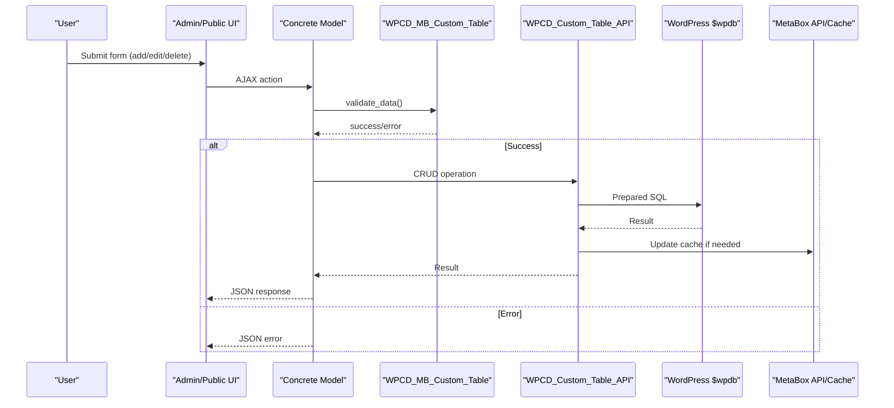
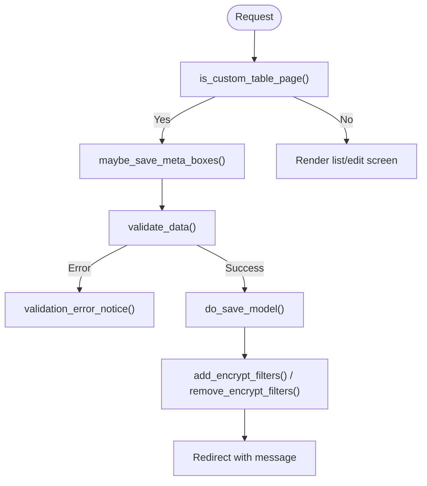
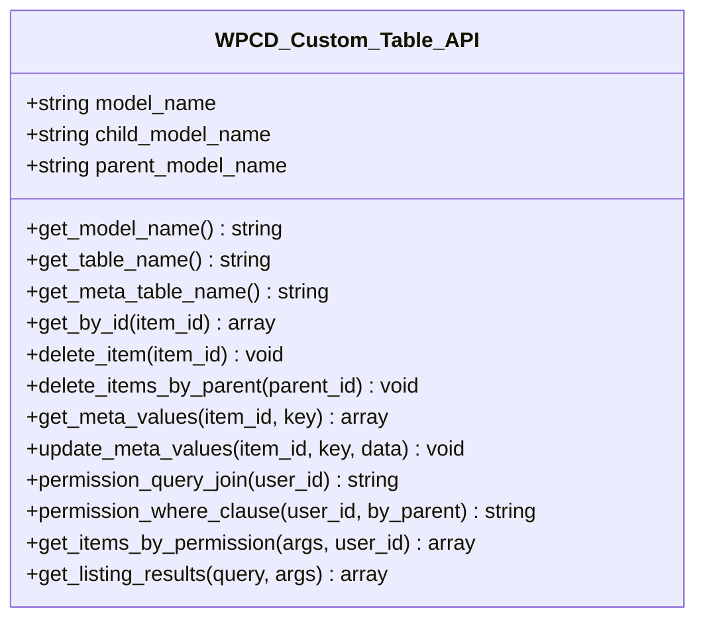
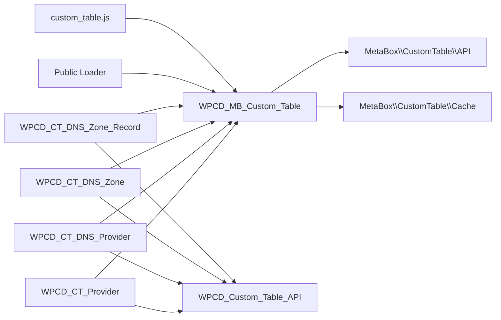

# Custom Database Tables

<cite>
**Referenced Files in This Document**
- [class-wpcd-custom-table.php](file://includes/core/custom-table/class-wpcd-custom-table.php)
- [class-wpcd-provider.php](file://includes/core/custom-table/class-wpcd-provider.php)
- [class-wpcd-dns-provider.php](file://includes/core/custom-table/class-wpcd-dns-provider.php)
- [class-wpcd-dns-zone.php](file://includes/core/custom-table/class-wpcd-dns-zone.php)
- [class-wpcd-dns-zone-record.php](file://includes/core/custom-table/class-wpcd-dns-zone-record.php)
- [class-wpcd-custom-table-api.php](file://includes/core/custom-table/api/class-wpcd-custom-table-api.php)
- [API.php](file://required_plugins/mb-custom-table/src/API.php)
- [Cache.php](file://required_plugins/mb-custom-table/src/Cache.php)
- [loader.php](file://includes/core/apps/wordpress-app/public/custom-table/loader.php)
- [custom_table.js](file://assets/js/custom_table.js)
</cite>

## Table of Contents
1. [Introduction](#introduction)
2. [Project Structure](#project-structure)
3. [Core Components](#core-components)
4. [Architecture Overview](#architecture-overview)
5. [Detailed Component Analysis](#detailed-component-analysis)
6. [Dependency Analysis](#dependency-analysis)
7. [Performance Considerations](#performance-considerations)
8. [Troubleshooting Guide](#troubleshooting-guide)
9. [Conclusion](#conclusion)

## Introduction
This document explains SimpleStack’s custom database table abstraction layer and its concrete implementations for Providers, DNS Providers, DNS Zones, and DNS Zone Records. It covers the base class architecture, table creation methods, query building and optimization strategies, data integrity constraints, permission model, transaction handling, and backup/restore considerations. The goal is to make the system understandable for both developers and operators who need to extend or maintain these tables.

## Project Structure
The custom table subsystem lives under includes/core/custom-table and integrates with a third-party MetaBox custom table plugin for storage and admin UI. Key files:
- Base abstraction and shared logic: class-wpcd-custom-table.php
- Concrete models: class-wpcd-provider.php, class-wpcd-dns-provider.php, class-wpcd-dns-zone.php, class-wpcd-dns-zone-record.php
- Query API: class-wpcd-custom-table-api.php
- Storage schema builder (MetaBox): required_plugins/mb-custom-table/src/API.php
- Caching helper (MetaBox): required_plugins/mb-custom-table/src/Cache.php
- Public page loader: includes/core/apps/wordpress-app/public/custom-table/loader.php
- Frontend AJAX handler: assets/js/custom_table.js

**Diagram sources**
- [class-wpcd-custom-table.php:15-112](file://includes/core/custom-table/class-wpcd-custom-table.php#L15-L112)
- [class-wpcd-provider.php:9-106](file://includes/core/custom-table/class-wpcd-provider.php#L9-L106)
- [class-wpcd-dns-provider.php:10-85](file://includes/core/custom-table/class-wpcd-dns-provider.php#L10-L85)
- [class-wpcd-dns-zone.php:9-80](file://includes/core/custom-table/class-wpcd-dns-zone.php#L9-L80)
- [class-wpcd-dns-zone-record.php:9-82](file://includes/core/custom-table/class-wpcd-dns-zone-record.php#L9-L82)
- [class-wpcd-custom-table-api.php:4-74](file://includes/core/custom-table/api/class-wpcd-custom-table-api.php#L4-L74)
- [API.php:14-21](file://required_plugins/mb-custom-table/src/API.php#L14-L21)
- [Cache.php:4-47](file://required_plugins/mb-custom-table/src/Cache.php#L4-L47)
- [loader.php:87-104](file://includes/core/apps/wordpress-app/public/custom-table/loader.php#L87-L104)
- [custom_table.js:22-41](file://assets/js/custom_table.js#L22-L41)

**Section sources**
- [class-wpcd-custom-table.php:15-112](file://includes/core/custom-table/class-wpcd-custom-table.php#L15-L112)
- [class-wpcd-provider.php:9-106](file://includes/core/custom-table/class-wpcd-provider.php#L9-L106)
- [class-wpcd-dns-provider.php:10-85](file://includes/core/custom-table/class-wpcd-dns-provider.php#L10-L85)
- [class-wpcd-dns-zone.php:9-80](file://includes/core/custom-table/class-wpcd-dns-zone.php#L9-L80)
- [class-wpcd-dns-zone-record.php:9-82](file://includes/core/custom-table/class-wpcd-dns-zone-record.php#L9-L82)
- [class-wpcd-custom-table-api.php:4-74](file://includes/core/custom-table/api/class-wpcd-custom-table-api.php#L4-L74)
- [API.php:14-21](file://required_plugins/mb-custom-table/src/API.php#L14-L21)
- [Cache.php:4-47](file://required_plugins/mb-custom-table/src/Cache.php#L4-L47)
- [loader.php:87-104](file://includes/core/apps/wordpress-app/public/custom-table/loader.php#L87-L104)
- [custom_table.js:22-41](file://assets/js/custom_table.js#L22-L41)

## Core Components
- WPCD_MB_Custom_Table: Abstract base that registers models, wires admin/public views, handles validation, permissions, encryption, and provides common utilities.
- WPCD_Custom_Table_API: Abstract query API providing CRUD, meta management, permission-aware listing, and pagination helpers.
- Concrete models:
  - WPCD_CT_Provider: Cloud provider configuration and credentials.
  - WPCD_CT_DNS_Provider: DNS provider configuration and secret keys.
  - WPCD_CT_DNS_Zone: Domain zones linked to a DNS provider.
  - WPCD_CT_DNS_Zone_Record: DNS records linked to a zone.

Key responsibilities:
- Table creation via MetaBox API using dbDelta.
- Model registration and form rendering via MetaBox.
- Permission checks based on owner, allowed users, and allowed roles.
- Encryption of sensitive fields before persistence.
- AJAX-driven inline add/edit/delete flows.

**Section sources**
- [class-wpcd-custom-table.php:15-112](file://includes/core/custom-table/class-wpcd-custom-table.php#L15-L112)
- [class-wpcd-custom-table-api.php:4-74](file://includes/core/custom-table/api/class-wpcd-custom-table-api.php#L4-L74)
- [class-wpcd-provider.php:57-106](file://includes/core/custom-table/class-wpcd-provider.php#L57-L106)
- [class-wpcd-dns-provider.php:54-85](file://includes/core/custom-table/class-wpcd-dns-provider.php#L54-L85)
- [class-wpcd-dns-zone.php:53-80](file://includes/core/custom-table/class-wpcd-dns-zone.php#L53-L80)
- [class-wpcd-dns-zone-record.php:52-82](file://includes/core/custom-table/class-wpcd-dns-zone-record.php#L52-L82)

## Architecture Overview
The architecture follows a layered design:
- Presentation/UI: Admin pages and public shortcodes render list/edit screens.
- Controller-like models: Each custom table model extends the base class and defines table schema, metaboxes, and validation.
- Data access: A dedicated API class encapsulates SQL queries, joins, and permission filters.
- Storage: MetaBox’s API uses WordPress dbDelta to create/maintain tables; MetaBox Cache provides object caching.

**Diagram sources**
- [class-wpcd-custom-table.php:212-312](file://includes/core/custom-table/class-wpcd-custom-table.php#L212-L312)
- [class-wpcd-custom-table-api.php:85-133](file://includes/core/custom-table/api/class-wpcd-custom-table-api.php#L85-L133)
- [API.php:14-21](file://required_plugins/mb-custom-table/src/API.php#L14-L21)
- [Cache.php:4-47](file://required_plugins/mb-custom-table/src/Cache.php#L4-L47)

## Detailed Component Analysis

### Base Class: WPCD_MB_Custom_Table
Responsibilities:
- Model discovery and instantiation by name.
- Registration of model and MetaBox integration.
- Activation hooks to create tables and meta table.
- Validation, nonce verification, and permission checks.
- Encryption/decryption of sensitive fields.
- Listing and child items display for admin and public contexts.

Notable behaviors:
- Activation creates tables for provider, dns_provider, dns_zone, dns_zone_record, plus a shared meta table wpcd_ct_model_meta.
- Provides get_items(), user_can_add(), user_can_edit(), user_can_delete(), check_action_permission().
- Supports inline edit/add via AJAX and renders public/admin list tables.

**Diagram sources**
- [class-wpcd-custom-table.php:212-312](file://includes/core/custom-table/class-wpcd-custom-table.php#L212-L312)
- [class-wpcd-custom-table.php:331-361](file://includes/core/custom-table/class-wpcd-custom-table.php#L331-L361)
- [class-wpcd-custom-table.php:425-489](file://includes/core/custom-table/class-wpcd-custom-table.php#L425-L489)

**Section sources**
- [class-wpcd-custom-table.php:15-112](file://includes/core/custom-table/class-wpcd-custom-table.php#L15-L112)
- [class-wpcd-custom-table.php:122-163](file://includes/core/custom-table/class-wpcd-custom-table.php#L122-L163)
- [class-wpcd-custom-table.php:212-312](file://includes/core/custom-table/class-wpcd-custom-table.php#L212-L312)
- [class-wpcd-custom-table.php:873-926](file://includes/core/custom-table/class-wpcd-custom-table.php#L873-L926)
- [class-wpcd-custom-table.php:938-988](file://includes/core/custom-table/class-wpcd-custom-table.php#L938-L988)
- [class-wpcd-custom-table.php:1009-1032](file://includes/core/custom-table/class-wpcd-custom-table.php#L1009-L1032)
- [class-wpcd-custom-table.php:1068-1152](file://includes/core/custom-table/class-wpcd-custom-table.php#L1068-L1152)
- [class-wpcd-custom-table.php:1240-1242](file://includes/core/custom-table/class-wpcd-custom-table.php#L1240-L1242)

### Query API: WPCD_Custom_Table_API
Responsibilities:
- Provide consistent table naming and meta table access.
- Implement basic CRUD operations (get_by_id, delete_item, delete_items_by_parent).
- Manage per-item metadata (allowed_roles, allowed_users) via a shared meta table.
- Build permission-aware queries with JOINs and WHERE clauses.
- Prepare pagination and count queries.

Key patterns:
- All SQL uses prepared statements via $wpdb->prepare.
- Permission filtering joins the meta table and matches owner, allowed_roles, allowed_users.
- Listing returns {items_count, items} structure.

**Diagram sources**
- [class-wpcd-custom-table-api.php:4-74](file://includes/core/custom-table/api/class-wpcd-custom-table-api.php#L4-L74)
- [class-wpcd-custom-table-api.php:85-133](file://includes/core/custom-table/api/class-wpcd-custom-table-api.php#L85-L133)
- [class-wpcd-custom-table-api.php:145-233](file://includes/core/custom-table/api/class-wpcd-custom-table-api.php#L145-L233)
- [class-wpcd-custom-table-api.php:246-416](file://includes/core/custom-table/api/class-wpcd-custom-table-api.php#L246-L416)

**Section sources**
- [class-wpcd-custom-table-api.php:4-74](file://includes/core/custom-table/api/class-wpcd-custom-table-api.php#L4-L74)
- [class-wpcd-custom-table-api.php:85-133](file://includes/core/custom-table/api/class-wpcd-custom-table-api.php#L85-L133)
- [class-wpcd-custom-table-api.php:145-233](file://includes/core/custom-table/api/class-wpcd-custom-table-api.php#L145-L233)
- [class-wpcd-custom-table-api.php:246-416](file://includes/core/custom-table/api/class-wpcd-custom-table-api.php#L246-L416)

### Provider Model: WPCD_CT_Provider
Purpose:
- Stores cloud provider configurations including API keys and SSH keys.
- Defines table schema and metabox fields for provider settings.
- Handles encryption of sensitive fields during save.

Table columns include:
- provider_name, description, base_provider
- api_access_key, api_secret_key, api_key_notes
- ssh_public_key_id, ssh_public_key, ssh_private_key, ssh_private_key_password, ssh_key_notes
- region, azure_tenant, azure_subscription, azure_storage_type
- enable_backups, enable_ipv6, tags, server_sizes, other_notes, owner

Security:
- Sensitive fields are encrypted before saving and decrypted when displayed.
- Permissions enforced via owner, allowed_roles, allowed_users.

**Section sources**
- [class-wpcd-provider.php:57-106](file://includes/core/custom-table/class-wpcd-provider.php#L57-L106)
- [class-wpcd-provider.php:145-398](file://includes/core/custom-table/class-wpcd-provider.php#L145-L398)
- [class-wpcd-provider.php:434-447](file://includes/core/custom-table/class-wpcd-provider.php#L434-L447)
- [class-wpcd-provider.php:454-481](file://includes/core/custom-table/class-wpcd-provider.php#L454-L481)

### DNS Provider Model: WPCD_CT_DNS_Provider
Purpose:
- Manages DNS provider configurations and secrets.
- Exposes child tables for Zones and Zone Records within the same edit screen.

Table columns include:
- dns_name, dns_short_description, dns_provider, dns_secret_key, dns_notes, owner

Behavior:
- Creates a public page for DNS providers listing.
- Renders nested containers for zones and zone records.
- Validates inputs and enforces permissions.

**Section sources**
- [class-wpcd-dns-provider.php:54-85](file://includes/core/custom-table/class-wpcd-dns-provider.php#L54-L85)
- [class-wpcd-dns-provider.php:123-314](file://includes/core/custom-table/class-wpcd-dns-provider.php#L123-L314)
- [class-wpcd-dns-provider.php:345-372](file://includes/core/custom-table/class-wpcd-dns-provider.php#L345-L372)
- [class-wpcd-dns-provider.php:378-415](file://includes/core/custom-table/class-wpcd-dns-provider.php#L378-L415)

### DNS Zone Model: WPCD_CT_DNS_Zone
Purpose:
- Represents domains/zones associated with a DNS provider.
- Enforces default zone marking and permission inheritance from parent provider.

Table columns include:
- parent_id, domain, is_system_default

Behavior:
- Adds “Records” row action to load zone records via AJAX.
- After save, marks default zone if applicable.
- Validates domain presence and permissions.

**Section sources**
- [class-wpcd-dns-zone.php:53-80](file://includes/core/custom-table/class-wpcd-dns-zone.php#L53-L80)
- [class-wpcd-dns-zone.php:98-134](file://includes/core/custom-table/class-wpcd-dns-zone.php#L98-L134)
- [class-wpcd-dns-zone.php:179-195](file://includes/core/custom-table/class-wpcd-dns-zone.php#L179-L195)
- [class-wpcd-dns-zone.php:206-268](file://includes/core/custom-table/class-wpcd-dns-zone.php#L206-L268)
- [class-wpcd-dns-zone.php:332-370](file://includes/core/custom-table/class-wpcd-dns-zone.php#L332-L370)
- [class-wpcd-dns-zone.php:391-419](file://includes/core/custom-table/class-wpcd-dns-zone.php#L391-L419)

### DNS Zone Record Model: WPCD_CT_DNS_Zone_Record
Purpose:
- Stores DNS record entries (A, AAAA, CNAME, TXT, NS) for a zone.
- Provides AJAX container and add/edit/delete flows.

Table columns include:
- parent_id, type, name, content, ttl, notes

Behavior:
- Loads records via AJAX into a container.
- Validates type, name, content, TTL.
- Deletes records individually or cascades on zone deletion.

**Section sources**
- [class-wpcd-dns-zone-record.php:52-82](file://includes/core/custom-table/class-wpcd-dns-zone-record.php#L52-L82)
- [class-wpcd-dns-zone-record.php:90-155](file://includes/core/custom-table/class-wpcd-dns-zone-record.php#L90-L155)
- [class-wpcd-dns-zone-record.php:241-306](file://includes/core/custom-table/class-wpcd-dns-zone-record.php#L241-L306)
- [class-wpcd-dns-zone-record.php:317-402](file://includes/core/custom-table/class-wpcd-dns-zone-record.php#L317-L402)
- [class-wpcd-dns-zone-record.php:407-431](file://includes/core/custom-table/class-wpcd-dns-zone-record.php#L407-L431)

## Dependency Analysis
- Models depend on the base class for validation, permissions, and UI wiring.
- Models use WPCD_Custom_Table_API for all database interactions.
- Table schemas are created through MetaBox\CustomTable\API which wraps dbDelta.
- Public pages are loaded via a shortcode mechanism that delegates to the model’s public rendering.
- Frontend JavaScript handles inline form submission and spinner states.

**Diagram sources**
- [class-wpcd-custom-table.php:15-112](file://includes/core/custom-table/class-wpcd-custom-table.php#L15-L112)
- [class-wpcd-custom-table-api.php:4-74](file://includes/core/custom-table/api/class-wpcd-custom-table-api.php#L4-L74)
- [API.php:14-21](file://required_plugins/mb-custom-table/src/API.php#L14-L21)
- [Cache.php:4-47](file://required_plugins/mb-custom-table/src/Cache.php#L4-L47)
- [loader.php:87-104](file://includes/core/apps/wordpress-app/public/custom-table/loader.php#L87-L104)
- [custom_table.js:22-41](file://assets/js/custom_table.js#L22-L41)

**Section sources**
- [class-wpcd-custom-table.php:15-112](file://includes/core/custom-table/class-wpcd-custom-table.php#L15-L112)
- [class-wpcd-custom-table-api.php:4-74](file://includes/core/custom-table/api/class-wpcd-custom-table-api.php#L4-L74)
- [API.php:14-21](file://required_plugins/mb-custom-table/src/API.php#L14-L21)
- [Cache.php:4-47](file://required_plugins/mb-custom-table/src/Cache.php#L4-L47)
- [loader.php:87-104](file://includes/core/apps/wordpress-app/public/custom-table/loader.php#L87-L104)
- [custom_table.js:22-41](file://assets/js/custom_table.js#L22-L41)

## Performance Considerations
- Query Optimization:
  - All queries use prepared statements to prevent injection and leverage MySQL optimizations.
  - Permission-aware listing builds efficient JOINs and WHERE clauses, grouping by ID to avoid duplicates.
  - Pagination uses LIMIT/OFFSET via prepare_query_limit; counts are computed via a derived table to support accurate totals.
- Caching:
  - MetaBox Cache provides object-level caching keyed by table group rwmb_{table}_table_data.
  - Use get/set/delete to cache frequently accessed rows and invalidate on mutations.
- Indexing Strategy:
  - Columns used in WHERE and JOINs should be indexed at the database level (e.g., parent_id, owner, domain).
  - For high-volume DNS records, consider indexes on parent_id and type/name combinations.
- I/O Patterns:
  - Avoid N+1 queries by leveraging batch operations where possible.
  - Prefer single-pass updates for allowed_roles/allowed_users via update_meta_values.

[No sources needed since this section provides general guidance]

## Troubleshooting Guide
Common issues and resolutions:
- Form validation errors:
  - Ensure nonces are present and valid; verify view/action nonce generation and verification.
  - Check required fields in each model’s validate_data method.
- Permission denied:
  - Confirm user role/user membership against allowed_roles/allowed_users stored in meta table.
  - Verify owner field is set correctly on new items.
- Missing tables:
  - Re-run activation routine to ensure tables are created via MetaBox API.
- AJAX failures:
  - Inspect frontend console and network tab; confirm custom_table.js handlers are active.
  - Validate that wp_ajax_* actions are registered and return JSON responses.

Operational tips:
- When deleting a DNS provider, dependent zones and records are cascaded automatically.
- When deleting a zone, its records are deleted first to maintain referential integrity.

**Section sources**
- [class-wpcd-custom-table.php:873-926](file://includes/core/custom-table/class-wpcd-custom-table.php#L873-L926)
- [class-wpcd-custom-table.php:938-988](file://includes/core/custom-table/class-wpcd-custom-table.php#L938-L988)
- [class-wpcd-dns-provider.php:378-415](file://includes/core/custom-table/class-wpcd-dns-provider.php#L378-L415)
- [class-wpcd-dns-zone.php:391-419](file://includes/core/custom-table/class-wpcd-dns-zone.php#L391-L419)
- [custom_table.js:22-41](file://assets/js/custom_table.js#L22-L41)

## Conclusion
SimpleStack’s custom table abstraction provides a robust, extensible foundation for managing structured data beyond WordPress posts. The base class centralizes validation, permissions, and UI concerns, while the API layer standardizes database interactions and permission enforcement. Concrete models for Providers and DNS entities demonstrate secure handling of sensitive data, hierarchical relationships, and AJAX-driven workflows. With careful indexing and caching, the system scales well for performance-critical scenarios such as DNS management. Operators should follow the outlined procedures for schema changes, backups, and troubleshooting to maintain data integrity and availability.

[No sources needed since this section summarizes without analyzing specific files]