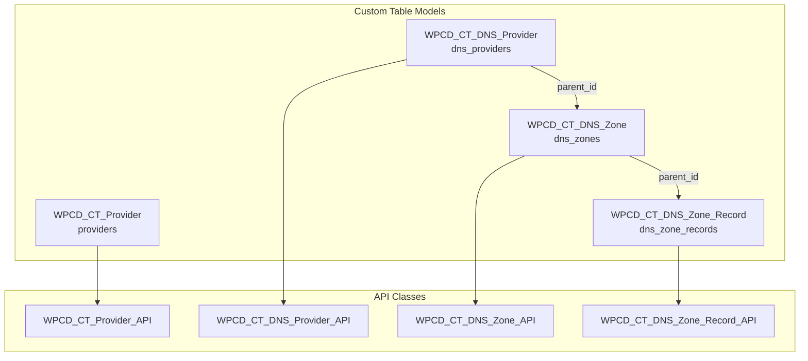
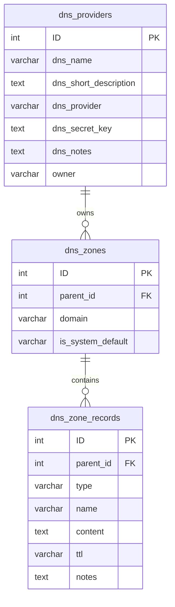
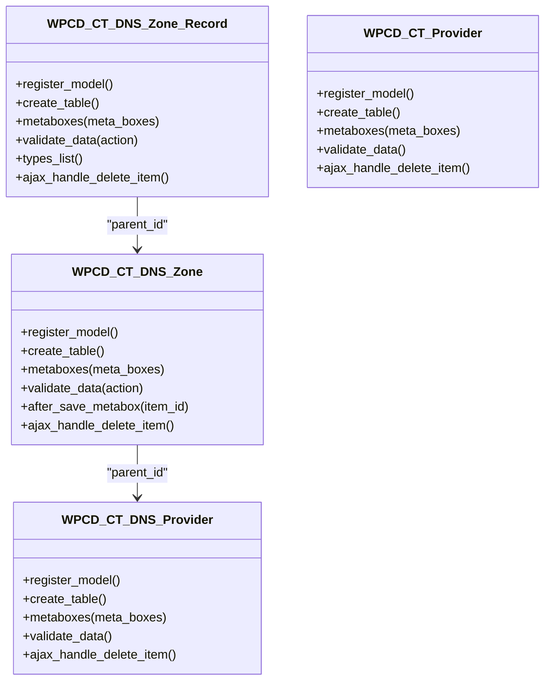
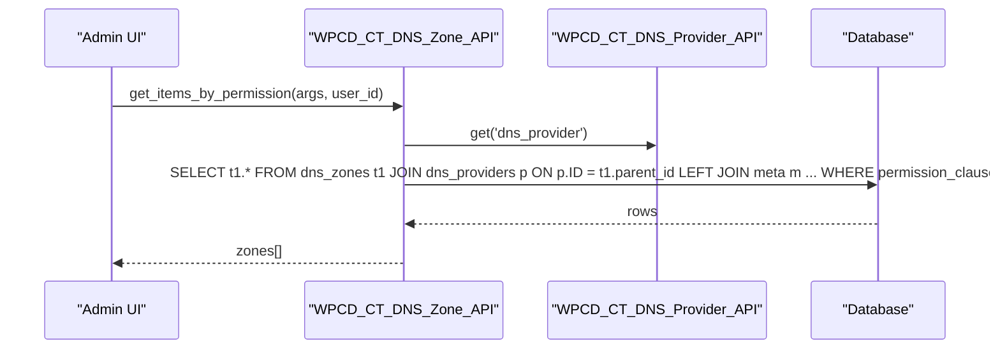

# Provider and DNS Tables

<cite>
**Referenced Files in This Document**
- [class-wpcd-dns-provider.php](file://includes/core/custom-table/class-wpcd-dns-provider.php)
- [class-wpcd-dns-zone.php](file://includes/core/custom-table/class-wpcd-dns-zone.php)
- [class-wpcd-dns-zone-record.php](file://includes/core/custom-table/class-wpcd-dns-zone-record.php)
- [class-wpcd-provider.php](file://includes/core/custom-table/class-wpcd-provider.php)
- [class-wpcd-ct-dns-provider-api.php](file://includes/core/custom-table/api/class-wpcd-ct-dns-provider-api.php)
- [class-wpcd-ct-dns-zone-api.php](file://includes/core/custom-table/api/class-wpcd-ct-dns-zone-api.php)
- [class-wpcd-ct-dns-zone-record-api.php](file://includes/core/custom-table/api/class-wpcd-ct-dns-zone-record-api.php)
- [class-wpcd-ct-provider-api.php](file://includes/core/custom-table/api/class-wpcd-ct-provider-api.php)
</cite>

## Table of Contents
1. [Introduction](#introduction)
2. [Project Structure](#project-structure)
3. [Core Components](#core-components)
4. [Architecture Overview](#architecture-overview)
5. [Detailed Component Analysis](#detailed-component-analysis)
6. [Dependency Analysis](#dependency-analysis)
7. [Performance Considerations](#performance-considerations)
8. [Troubleshooting Guide](#troubleshooting-guide)
9. [Conclusion](#conclusion)

## Introduction
This document explains the provider and DNS-related database tables used by the system, focusing on:
- The provider table schema for cloud infrastructure providers
- The DNS provider table schema for DNS service accounts
- DNS zone management structures and default zone handling
- DNS record storage patterns and supported types
- Field definitions, relationships between DNS zones and records, and data validation rules
- Query optimization strategies for large DNS datasets and indexing approaches
- Data synchronization patterns with external DNS providers and conflict resolution strategies

The implementation uses a custom table framework to define models, create tables, register admin UIs, and enforce permissions and validation.

## Project Structure
The relevant code is organized under the custom-table module:
- Model classes define table schemas, forms, validation, and lifecycle hooks
- API classes encapsulate table metadata and provide permission-aware queries
- Relationships are enforced via parent_id columns and permission joins

**Diagram sources**
- [class-wpcd-provider.php:78-106](file://includes/core/custom-table/class-wpcd-provider.php#L78-L106)
- [class-wpcd-dns-provider.php:73-85](file://includes/core/custom-table/class-wpcd-dns-provider.php#L73-L85)
- [class-wpcd-dns-zone.php:72-80](file://includes/core/custom-table/class-wpcd-dns-zone.php#L72-L80)
- [class-wpcd-dns-zone-record.php:70-82](file://includes/core/custom-table/class-wpcd-dns-zone-record.php#L70-L82)
- [class-wpcd-ct-provider-api.php:6-20](file://includes/core/custom-table/api/class-wpcd-ct-provider-api.php#L6-L20)
- [class-wpcd-ct-dns-provider-api.php:6-20](file://includes/core/custom-table/api/class-wpcd-ct-dns-provider-api.php#L6-L20)
- [class-wpcd-ct-dns-zone-api.php:6-20](file://includes/core/custom-table/api/class-wpcd-ct-dns-zone-api.php#L6-L20)
- [class-wpcd-ct-dns-zone-record-api.php:6-20](file://includes/core/custom-table/api/class-wpcd-ct-dns-zone-record-api.php#L6-L20)

**Section sources**
- [class-wpcd-provider.php:78-106](file://includes/core/custom-table/class-wpcd-provider.php#L78-L106)
- [class-wpcd-dns-provider.php:73-85](file://includes/core/custom-table/class-wpcd-dns-provider.php#L73-L85)
- [class-wpcd-dns-zone.php:72-80](file://includes/core/custom-table/class-wpcd-dns-zone.php#L72-L80)
- [class-wpcd-dns-zone-record.php:70-82](file://includes/core/custom-table/class-wpcd-dns-zone-record.php#L70-L82)

## Core Components
- Providers (cloud infrastructure): stores credentials, SSH keys, region, tags, and configuration flags
- DNS Providers: stores DNS service account details and notes
- DNS Zones: domains associated with a DNS provider; supports marking one as system default
- DNS Zone Records: resource records (A, AAAA, CNAME, TXT, NS) belonging to a DNS zone

Key responsibilities:
- Schema creation and field definitions
- Admin UI registration and inline editing
- Validation and permission checks
- Permission-aware listing and child-item queries

**Section sources**
- [class-wpcd-provider.php:78-106](file://includes/core/custom-table/class-wpcd-provider.php#L78-L106)
- [class-wpcd-dns-provider.php:73-85](file://includes/core/custom-table/class-wpcd-dns-provider.php#L73-L85)
- [class-wpcd-dns-zone.php:72-80](file://includes/core/custom-table/class-wpcd-dns-zone.php#L72-L80)
- [class-wpcd-dns-zone-record.php:70-82](file://includes/core/custom-table/class-wpcd-dns-zone-record.php#L70-L82)

## Architecture Overview
The DNS data model is hierarchical:
- A DNS Provider owns multiple DNS Zones
- Each DNS Zone contains multiple DNS Zone Records
- Permissions are enforced by joining through the DNS Provider’s allowed users/roles

**Diagram sources**
- [class-wpcd-dns-provider.php:73-85](file://includes/core/custom-table/class-wpcd-dns-provider.php#L73-L85)
- [class-wpcd-dns-zone.php:72-80](file://includes/core/custom-table/class-wpcd-dns-zone.php#L72-L80)
- [class-wpcd-dns-zone-record.php:70-82](file://includes/core/custom-table/class-wpcd-dns-zone-record.php#L70-L82)

## Detailed Component Analysis

### Provider Table (Cloud Infrastructure)
Purpose:
- Stores cloud provider configurations, including base provider type, API keys, SSH keys, region, feature toggles, tags, and optional Azure-specific fields.

Schema highlights:
- provider_name, description, base_provider
- api_access_key, api_secret_key, api_key_notes
- ssh_public_key_id, ssh_public_key, ssh_private_key, ssh_private_key_password, ssh_key_notes
- region, enable_backups, enable_ipv6, tags, server_sizes, other_notes
- azure_tenant, azure_subscription, azure_storage_type
- owner

Validation and security:
- Required fields: provider_name, base_provider
- Secret fields are encrypted before persisting and decrypted when rendering
- Deletion requires nonce verification and permission checks

Relationships:
- Not directly referenced by DNS tables; serves as a separate entity for cloud infrastructure provisioning

**Section sources**
- [class-wpcd-provider.php:78-106](file://includes/core/custom-table/class-wpcd-provider.php#L78-L106)
- [class-wpcd-provider.php:434-447](file://includes/core/custom-table/class-wpcd-provider.php#L434-L447)
- [class-wpcd-provider.php:454-481](file://includes/core/custom-table/class-wpcd-provider.php#L454-L481)
- [class-wpcd-ct-provider-api.php:6-20](file://includes/core/custom-table/api/class-wpcd-ct-provider-api.php#L6-L20)

### DNS Provider Table
Purpose:
- Represents a DNS service account (e.g., Cloudflare, GoDaddy, DNS Made Easy) with credentials and descriptive metadata.

Schema highlights:
- dns_name (required), dns_short_description
- dns_provider (required, enumerated selection)
- dns_secret_key (secret payload)
- dns_notes
- owner

Validation:
- Requires dns_name and dns_provider
- Supports user/role-based access control via allowed roles and allowed users

UI integration:
- Provides inline sections to manage zones and zone records from the provider edit screen

**Section sources**
- [class-wpcd-dns-provider.php:73-85](file://includes/core/custom-table/class-wpcd-dns-provider.php#L73-L85)
- [class-wpcd-dns-provider.php:126-189](file://includes/core/custom-table/class-wpcd-dns-provider.php#L126-L189)
- [class-wpcd-dns-provider.php:345-372](file://includes/core/custom-table/class-wpcd-dns-provider.php#L345-L372)
- [class-wpcd-dns-provider.php:317-338](file://includes/core/custom-table/class-wpcd-dns-provider.php#L317-L338)
- [class-wpcd-ct-dns-provider-api.php:6-20](file://includes/core/custom-table/api/class-wpcd-ct-dns-provider-api.php#L6-L20)

### DNS Zone Table
Purpose:
- Manages DNS domains (zones) bound to a DNS provider. Supports designating one zone as the system default.

Schema highlights:
- parent_id (references dns_providers.ID)
- domain (required)
- is_system_default (flag)

Default zone behavior:
- When a zone is marked as system default, all other zones’ default flags are cleared

Permissions:
- Access to zones is derived from the owning DNS provider’s permissions

UI integration:
- Inline add/edit within the DNS provider context
- Row actions to load zone records

**Section sources**
- [class-wpcd-dns-zone.php:72-80](file://includes/core/custom-table/class-wpcd-dns-zone.php#L72-L80)
- [class-wpcd-dns-zone.php:193-195](file://includes/core/custom-table/class-wpcd-dns-zone.php#L193-L195)
- [class-wpcd-dns-zone.php:240-268](file://includes/core/custom-table/class-wpcd-dns-zone.php#L240-L268)
- [class-wpcd-dns-zone.php:179-186](file://includes/core/custom-table/class-wpcd-dns-zone.php#L179-L186)
- [class-wpcd-ct-dns-zone-api.php:47-71](file://includes/core/custom-table/api/class-wpcd-ct-dns-zone-api.php#L47-L71)

### DNS Zone Record Table
Purpose:
- Stores DNS resource records for a given DNS zone.

Schema highlights:
- parent_id (references dns_zones.ID)
- type (required; enumerated: A, AAAA, CNAME, TXT, NS)
- name (required)
- content (required)
- ttl (required)
- notes (optional)

Validation:
- All required fields must be present
- Type values are constrained to an extensible list

Permissions:
- Access is inherited from the DNS zone’s owning DNS provider

UI integration:
- Inline add/edit within the DNS zone context
- Dynamic loading of records per zone

**Section sources**
- [class-wpcd-dns-zone-record.php:70-82](file://includes/core/custom-table/class-wpcd-dns-zone-record.php#L70-L82)
- [class-wpcd-dns-zone-record.php:212-223](file://includes/core/custom-table/class-wpcd-dns-zone-record.php#L212-L223)
- [class-wpcd-dns-zone-record.php:244-306](file://includes/core/custom-table/class-wpcd-dns-zone-record.php#L244-L306)
- [class-wpcd-dns-zone-record.php:364-402](file://includes/core/custom-table/class-wpcd-dns-zone-record.php#L364-L402)

### Class Diagram

**Diagram sources**
- [class-wpcd-dns-provider.php:54-85](file://includes/core/custom-table/class-wpcd-dns-provider.php#L54-L85)
- [class-wpcd-dns-zone.php:53-80](file://includes/core/custom-table/class-wpcd-dns-zone.php#L53-L80)
- [class-wpcd-dns-zone-record.php:52-82](file://includes/core/custom-table/class-wpcd-dns-zone-record.php#L52-L82)
- [class-wpcd-provider.php:57-106](file://includes/core/custom-table/class-wpcd-provider.php#L57-L106)

## Dependency Analysis
Permission-aware queries join through the DNS provider to ensure that only authorized users can view or modify zones and records.

**Diagram sources**
- [class-wpcd-ct-dns-zone-api.php:99-143](file://includes/core/custom-table/api/class-wpcd-ct-dns-zone-api.php#L99-L143)
- [class-wpcd-ct-dns-provider-api.php:6-20](file://includes/core/custom-table/api/class-wpcd-ct-dns-provider-api.php#L6-L20)

**Section sources**
- [class-wpcd-ct-dns-zone-api.php:99-143](file://includes/core/custom-table/api/class-wpcd-ct-dns-zone-api.php#L99-L143)
- [class-wpcd-ct-dns-zone-record-api.php:51-106](file://includes/core/custom-table/api/class-wpcd-ct-dns-zone-record-api.php#L51-L106)

## Performance Considerations
Optimization strategies for large DNS datasets:

- Indexing recommendations
  - dns_zones.parent_id: index to accelerate lookups by DNS provider and cascading deletes
  - dns_zones.domain: unique index to prevent duplicate domains per provider and speed up domain searches
  - dns_zones.is_system_default: index if frequently filtered for default zone selection
  - dns_zone_records.parent_id: index to optimize fetching records per zone
  - dns_zone_records.type: index if filtering by record type is common
  - dns_zone_records.name: index if querying by record name is frequent
  - dns_providers.dns_provider: index if filtering by provider type is common

- Query patterns
  - Prefer scoped queries by parent_id to limit result sets
  - Use GROUP BY id where necessary to avoid duplicates after joins
  - Avoid SELECT * in production paths; select only needed columns

- Caching
  - Cache provider-level listings and default zone results at application level
  - Invalidate caches on provider/zone/record mutations

- Concurrency
  - Use transactions around bulk operations (e.g., deleting a provider and its children)
  - Ensure atomic updates when toggling is_system_default

[No sources needed since this section provides general guidance]

## Troubleshooting Guide
Common issues and resolutions:

- Missing required fields
  - DNS Provider: dns_name and dns_provider are required
  - DNS Zone: domain is required
  - DNS Zone Record: type, name, content, and ttl are required

- Permission errors
  - Editing or viewing zones/records requires permission on the owning DNS provider
  - Verify allowed users/roles and owner settings on the DNS provider

- Default zone conflicts
  - Only one zone should be marked as system default; saving a new default clears others

- Deletion cascades
  - Deleting a DNS provider removes all its zones and their records
  - Deleting a zone removes all its records

- Nonce and CSRF protection
  - All mutation endpoints verify nonces; failures indicate stale or missing tokens

**Section sources**
- [class-wpcd-dns-provider.php:345-372](file://includes/core/custom-table/class-wpcd-dns-provider.php#L345-L372)
- [class-wpcd-dns-zone.php:240-268](file://includes/core/custom-table/class-wpcd-dns-zone.php#L240-L268)
- [class-wpcd-dns-zone-record.php:364-402](file://includes/core/custom-table/class-wpcd-dns-zone-record.php#L364-L402)
- [class-wpcd-dns-provider.php:378-415](file://includes/core/custom-table/class-wpcd-dns-provider.php#L378-L415)
- [class-wpcd-dns-zone.php:391-419](file://includes/core/custom-table/class-wpcd-dns-zone.php#L391-L419)
- [class-wpcd-dns-zone-record.php:407-431](file://includes/core/custom-table/class-wpcd-dns-zone-record.php#L407-L431)

## Conclusion
The system models DNS infrastructure using three core tables: dns_providers, dns_zones, and dns_zone_records. Relationships are enforced via parent_id columns, and permissions flow from DNS providers down to zones and records. Validation ensures data integrity, while permission-aware APIs secure access. For large-scale deployments, apply targeted indexes, cache hot paths, and use transactions for consistency. External DNS provider synchronization should leverage these tables as the source of truth, with conflict resolution strategies based on timestamps, versioning, or explicit merge policies.

[No sources needed since this section summarizes without analyzing specific files]