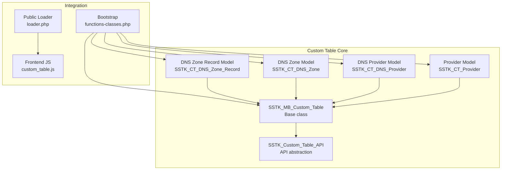
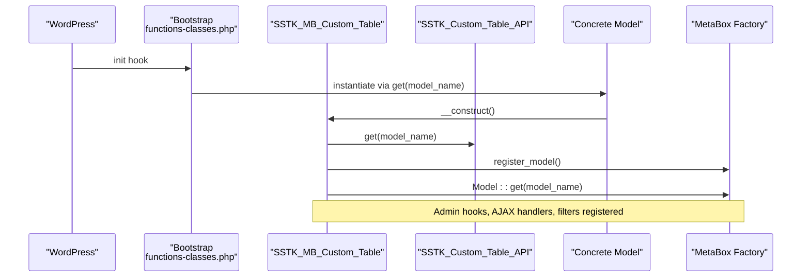
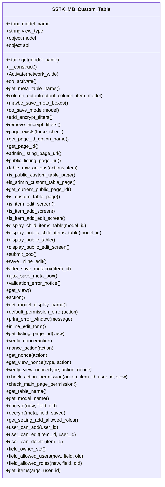
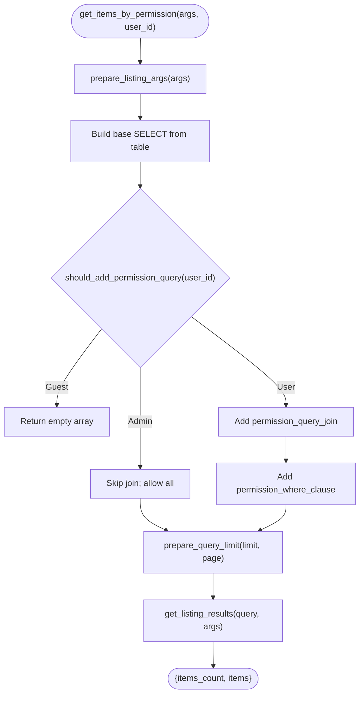
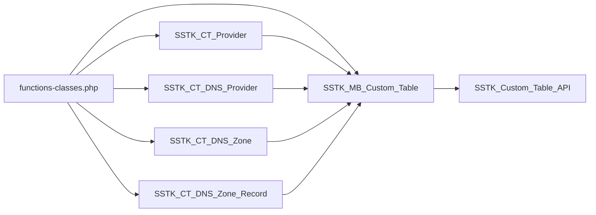

# Table Abstraction Layer

<cite>
**Referenced Files in This Document**
- [class-sstk-custom-table.php](file://includes/core/custom-table/class-sstk-custom-table.php)
- [class-sstk-custom-table-api.php](file://includes/core/custom-table/api/class-sstk-custom-table-api.php)
- [class-sstk-provider.php](file://includes/core/custom-table/class-sstk-provider.php)
- [class-sstk-dns-provider.php](file://includes/core/custom-table/class-sstk-dns-provider.php)
- [class-sstk-dns-zone.php](file://includes/core/custom-table/class-sstk-dns-zone.php)
- [class-sstk-dns-zone-record.php](file://includes/core/custom-table/class-sstk-dns-zone-record.php)
- [functions-classes.php](file://includes/core/functions-classes.php)
- [loader.php](file://includes/core/apps/wordpress-app/public/custom-table/loader.php)
- [custom_table.js](file://assets/js/custom_table.js)
</cite>

## Table of Contents
1. [Introduction](#introduction)
2. [Project Structure](#project-structure)
3. [Core Components](#core-components)
4. [Architecture Overview](#architecture-overview)
5. [Detailed Component Analysis](#detailed-component-analysis)
6. [Dependency Analysis](#dependency-analysis)
7. [Performance Considerations](#performance-considerations)
8. [Troubleshooting Guide](#troubleshooting-guide)
9. [Conclusion](#conclusion)

## Introduction
This document explains the custom database table abstraction layer used by the project to manage structured data outside WordPress posts and options. It focuses on:
- The base class that standardizes table models, admin UI, permissions, and AJAX workflows
- The table registration system using a model factory
- Query builder patterns for listing, filtering, and permission-aware queries
- Concrete examples of table definitions, field mappings, and constraints
- Benefits, performance considerations, extension points, and migration guidance

The implementation is centered around a base class and concrete models for providers and DNS-related entities (DNS provider, DNS zone, DNS zone record).

## Project Structure
The custom table subsystem lives under includes/core/custom-table and integrates with the MetaBox Custom Table library. Key files:
- Base class and API abstractions
- Concrete table models (provider, dns_provider, dns_zone, dns_zone_record)
- Public loader and JS for front-end interactions
- Bootstrap logic that wires everything into WordPress

**Diagram sources**
- [class-sstk-custom-table.php:15-112](file://includes/core/custom-table/class-sstk-custom-table.php#L15-L112)
- [class-sstk-custom-table-api.php:4-41](file://includes/core/custom-table/api/class-sstk-custom-table-api.php#L4-L41)
- [class-sstk-provider.php:9-73](file://includes/core/custom-table/class-sstk-provider.php#L9-L73)
- [class-sstk-dns-provider.php:10-68](file://includes/core/custom-table/class-sstk-dns-provider.php#L10-L68)
- [class-sstk-dns-zone.php:9-67](file://includes/core/custom-table/class-sstk-dns-zone.php#L9-L67)
- [class-sstk-dns-zone-record.php:9-65](file://includes/core/custom-table/class-sstk-dns-zone-record.php#L9-L65)
- [functions-classes.php:53-102](file://includes/core/functions-classes.php#L53-L102)
- [loader.php:6-21](file://includes/core/apps/wordpress-app/public/custom-table/loader.php#L6-L21)
- [custom_table.js:1-41](file://assets/js/custom_table.js#L1-L41)

**Section sources**
- [functions-classes.php:53-102](file://includes/core/functions-classes.php#L53-L102)
- [loader.php:6-21](file://includes/core/apps/wordpress-app/public/custom-table/loader.php#L6-L21)

## Core Components
- SSTK_MB_Custom_Table: Abstract base class providing common behavior for all custom tables (model registration, admin integration, nonce handling, permissions, encryption hooks, public/admin page helpers).
- SSTK_Custom_Table_API: Abstract API layer for CRUD operations, meta storage, and permission-aware listing queries.
- Concrete models:
  - SSTK_CT_Provider: Manages cloud provider configurations.
  - SSTK_CT_DNS_Provider: Manages DNS provider credentials and settings.
  - SSTK_CT_DNS_Zone: Manages zones belonging to a DNS provider.
  - SSTK_CT_DNS_Zone_Record: Manages records belonging to a DNS zone.

Key responsibilities:
- Registering models via mb_register_model
- Creating tables on activation
- Rendering admin/list views and inline add/edit forms
- Handling AJAX save/delete and validation
- Enforcing owner-based and role/user-based access control

**Section sources**
- [class-sstk-custom-table.php:15-112](file://includes/core/custom-table/class-sstk-custom-table.php#L15-L112)
- [class-sstk-custom-table-api.php:4-41](file://includes/core/custom-table/api/class-sstk-custom-table-api.php#L4-L41)
- [class-sstk-provider.php:9-73](file://includes/core/custom-table/class-sstk-provider.php#L9-L73)
- [class-sstk-dns-provider.php:10-68](file://includes/core/custom-table/class-sstk-dns-provider.php#L10-L68)
- [class-sstk-dns-zone.php:9-67](file://includes/core/custom-table/class-sstk-dns-zone.php#L9-L67)
- [class-sstk-dns-zone-record.php:9-65](file://includes/core/custom-table/class-sstk-dns-zone-record.php#L9-L65)

## Architecture Overview
The architecture follows a layered pattern:
- Base class encapsulates shared lifecycle, UI, and security behaviors.
- API layer abstracts DB access and query building.
- Concrete models define schema, form fields, and domain-specific logic.
- Bootstrap wires models into the application and initializes them.
- Public loader and JS provide front-end capabilities.

**Diagram sources**
- [functions-classes.php:78-102](file://includes/core/functions-classes.php#L78-L102)
- [class-sstk-custom-table.php:80-112](file://includes/core/custom-table/class-sstk-custom-table.php#L80-L112)
- [class-sstk-custom-table-api.php:32-41](file://includes/core/custom-table/api/class-sstk-custom-table-api.php#L32-L41)

## Detailed Component Analysis

### Base Class: SSTK_MB_Custom_Table
Responsibilities:
- Provides static factory get(model_name) to resolve concrete classes by naming convention.
- Constructor sets up API instance, registers model, loads MetaBox model, attaches admin UI, and registers AJAX endpoints.
- Activation routines create tables and the shared meta table.
- Helpers for page detection, view/action resolution, nonce generation/verification, and permission checks.
- Encryption hooks for sensitive fields.
- Default permission methods and user capability checks.

Important behaviors:
- Table name resolution delegates to API.
- Listing items uses permission-aware API methods.
- Inline add/edit forms are rendered via MetaBox registry and saved through standardized flows.

**Diagram sources**
- [class-sstk-custom-table.php:15-112](file://includes/core/custom-table/class-sstk-custom-table.php#L15-L112)
- [class-sstk-custom-table.php:122-163](file://includes/core/custom-table/class-sstk-custom-table.php#L122-L163)
- [class-sstk-custom-table.php:170-193](file://includes/core/custom-table/class-sstk-custom-table.php#L170-L193)
- [class-sstk-custom-table.php:212-312](file://includes/core/custom-table/class-sstk-custom-table.php#L212-L312)
- [class-sstk-custom-table.php:331-381](file://includes/core/custom-table/class-sstk-custom-table.php#L331-L381)
- [class-sstk-custom-table.php:391-416](file://includes/core/custom-table/class-sstk-custom-table.php#L391-L416)
- [class-sstk-custom-table.php:425-489](file://includes/core/custom-table/class-sstk-custom-table.php#L425-L489)
- [class-sstk-custom-table.php:527-578](file://includes/core/custom-table/class-sstk-custom-table.php#L527-L578)
- [class-sstk-custom-table.php:600-672](file://includes/core/custom-table/class-sstk-custom-table.php#L600-L672)
- [class-sstk-custom-table.php:679-708](file://includes/core/custom-table/class-sstk-custom-table.php#L679-L708)
- [class-sstk-custom-table.php:717-737](file://includes/core/custom-table/class-sstk-custom-table.php#L717-L737)
- [class-sstk-custom-table.php:744-758](file://includes/core/custom-table/class-sstk-custom-table.php#L744-L758)
- [class-sstk-custom-table.php:765-800](file://includes/core/custom-table/class-sstk-custom-table.php#L765-L800)
- [class-sstk-custom-table.php:801-846](file://includes/core/custom-table/class-sstk-custom-table.php#L801-L846)
- [class-sstk-custom-table.php:855-863](file://includes/core/custom-table/class-sstk-custom-table.php#L855-L863)
- [class-sstk-custom-table.php:873-926](file://includes/core/custom-table/class-sstk-custom-table.php#L873-L926)
- [class-sstk-custom-table.php:938-988](file://includes/core/custom-table/class-sstk-custom-table.php#L938-L988)
- [class-sstk-custom-table.php:995-1006](file://includes/core/custom-table/class-sstk-custom-table.php#L995-L1006)
- [class-sstk-custom-table.php:1017-1032](file://includes/core/custom-table/class-sstk-custom-table.php#L1017-L1032)
- [class-sstk-custom-table.php:1039-1089](file://includes/core/custom-table/class-sstk-custom-table.php#L1039-L1089)
- [class-sstk-custom-table.php:1100-1152](file://includes/core/custom-table/class-sstk-custom-table.php#L1100-L1152)
- [class-sstk-custom-table.php:1159-1242](file://includes/core/custom-table/class-sstk-custom-table.php#L1159-L1242)

**Section sources**
- [class-sstk-custom-table.php:15-112](file://includes/core/custom-table/class-sstk-custom-table.php#L15-L112)
- [class-sstk-custom-table.php:122-163](file://includes/core/custom-table/class-sstk-custom-table.php#L122-L163)
- [class-sstk-custom-table.php:873-926](file://includes/core/custom-table/class-sstk-custom-table.php#L873-L926)
- [class-sstk-custom-table.php:938-988](file://includes/core/custom-table/class-sstk-custom-table.php#L938-L988)
- [class-sstk-custom-table.php:1017-1032](file://includes/core/custom-table/class-sstk-custom-table.php#L1017-L1032)
- [class-sstk-custom-table.php:1039-1089](file://includes/core/custom-table/class-sstk-custom-table.php#L1039-L1089)
- [class-sstk-custom-table.php:1100-1152](file://includes/core/custom-table/class-sstk-custom-table.php#L1100-L1152)
- [class-sstk-custom-table.php:1159-1242](file://includes/core/custom-table/class-sstk-custom-table.php#L1159-L1242)

### API Abstraction: SSTK_Custom_Table_API
Responsibilities:
- Provide consistent table/meta table names
- Implement basic CRUD operations (get_by_id, delete_item, update_owner)
- Manage per-item metadata (allowed roles/users)
- Build permission-aware listing queries with joins and where clauses
- Prepare pagination limits and counts

Query builder highlights:
- prepare_query_limit builds LIMIT clauses
- permission_where_clause constructs WHERE conditions based on owner and allowed roles/users
- permission_query_join adds LEFT JOIN to meta table scoped by model
- get_items_by_permission composes SELECT, JOIN, WHERE, GROUP BY, and LIMIT
- get_listing_results executes queries and returns items with total count

**Diagram sources**
- [class-sstk-custom-table-api.php:246-257](file://includes/core/custom-table/api/class-sstk-custom-table-api.php#L246-L257)
- [class-sstk-custom-table-api.php:266-275](file://includes/core/custom-table/api/class-sstk-custom-table-api.php#L266-L275)
- [class-sstk-custom-table-api.php:287-301](file://includes/core/custom-table/api/class-sstk-custom-table-api.php#L287-L301)
- [class-sstk-custom-table-api.php:313-331](file://includes/core/custom-table/api/class-sstk-custom-table-api.php#L313-L331)
- [class-sstk-custom-table-api.php:342-348](file://includes/core/custom-table/api/class-sstk-custom-table-api.php#L342-L348)
- [class-sstk-custom-table-api.php:359-381](file://includes/core/custom-table/api/class-sstk-custom-table-api.php#L359-L381)
- [class-sstk-custom-table-api.php:393-414](file://includes/core/custom-table/api/class-sstk-custom-table-api.php#L393-L414)

**Section sources**
- [class-sstk-custom-table-api.php:4-41](file://includes/core/custom-table/api/class-sstk-custom-table-api.php#L4-L41)
- [class-sstk-custom-table-api.php:59-74](file://includes/core/custom-table/api/class-sstk-custom-table-api.php#L59-L74)
- [class-sstk-custom-table-api.php:85-133](file://includes/core/custom-table/api/class-sstk-custom-table-api.php#L85-L133)
- [class-sstk-custom-table-api.php:145-217](file://includes/core/custom-table/api/class-sstk-custom-table-api.php#L145-L217)
- [class-sstk-custom-table-api.php:226-233](file://includes/core/custom-table/api/class-sstk-custom-table-api.php#L226-L233)
- [class-sstk-custom-table-api.php:246-275](file://includes/core/custom-table/api/class-sstk-custom-table-api.php#L246-L275)
- [class-sstk-custom-table-api.php:287-381](file://includes/core/custom-table/api/class-sstk-custom-table-api.php#L287-L381)
- [class-sstk-custom-table-api.php:393-414](file://includes/core/custom-table/api/class-sstk-custom-table-api.php#L393-L414)

### Concrete Models

#### Provider Model: SSTK_CT_Provider
- Registers model with labels, parent menu, capability, and visibility flags.
- Defines table columns including provider details, SSH keys, Azure settings, tags, server sizes, notes, and owner.
- Creates a public page with a shortcode for listing providers.
- Defines metabox fields for UI, including encrypted fields for secrets and SSH keys.
- Implements validation and AJAX delete handler.

Table definition example (columns):
- provider_name: varchar(250) NOT NULL
- description: text DEFAULT NULL
- base_provider: varchar(100) NOT NULL
- api_access_key: varchar(200) DEFAULT NULL
- api_secret_key: text DEFAULT NULL
- api_key_notes: text DEFAULT NULL
- ssh_public_key_id: varchar(100) DEFAULT NULL
- ssh_public_key: text DEFAULT NULL
- ssh_private_key: text DEFAULT NULL
- ssh_private_key_password: varchar(250) DEFAULT NULL
- ssh_key_notes: text NULL
- region: varchar(100) DEFAULT NULL
- azure_tenant: varchar(200) DEFAULT NULL
- azure_subscription: varchar(300) DEFAULT NULL
- azure_storage_type: varchar(300) DEFAULT NULL
- enable_backups: varchar(1) DEFAULT NULL
- enable_ipv6: varchar(1) DEFAULT NULL
- tags: varchar(250) DEFAULT NULL
- server_sizes: text DEFAULT NULL
- other_notes: text DEFAULT NULL
- owner: varchar(100) DEFAULT NULL

Field type mappings (UI to DB):
- text -> varchar/text
- textarea -> text
- select -> varchar
- checkbox -> varchar(1)
- key_value -> text (serialized or JSON-like structure stored as text)

Constraints:
- Required fields enforced in validate_data
- Nonce verification before save/delete
- Owner-based and role/user-based permissions via base class

**Section sources**
- [class-sstk-provider.php:57-73](file://includes/core/custom-table/class-sstk-provider.php#L57-L73)
- [class-sstk-provider.php:78-106](file://includes/core/custom-table/class-sstk-provider.php#L78-L106)
- [class-sstk-provider.php:111-127](file://includes/core/custom-table/class-sstk-provider.php#L111-L127)
- [class-sstk-provider.php:145-398](file://includes/core/custom-table/class-sstk-provider.php#L145-L398)
- [class-sstk-provider.php:403-428](file://includes/core/custom-table/class-sstk-provider.php#L403-L428)
- [class-sstk-provider.php:454-481](file://includes/core/custom-table/class-sstk-provider.php#L454-L481)

#### DNS Provider Model: SSTK_CT_DNS_Provider
- Registers model and creates table with DNS provider fields and owner.
- Creates public page with shortcode for listing DNS providers.
- Metaboxes include required fields, secret key, and permissions.
- Delegates child tables (zones and records) rendering to related models.
- Validates input and handles deletion cascading to zones and records.

Table definition example (columns):
- dns_name: varchar(250) NOT NULL
- dns_short_description: text
- dns_provider: varchar(100) NOT NULL
- dns_secret_key: text
- dns_notes: text
- owner: varchar(100) DEFAULT NULL

Validation rules:
- Name and provider selection required
- Permission checks for add/edit/delete

Cascading delete:
- Deletes child zones and their records when deleting a DNS provider

**Section sources**
- [class-sstk-dns-provider.php:54-68](file://includes/core/custom-table/class-sstk-dns-provider.php#L54-L68)
- [class-sstk-dns-provider.php:73-85](file://includes/core/custom-table/class-sstk-dns-provider.php#L73-L85)
- [class-sstk-dns-provider.php:90-105](file://includes/core/custom-table/class-sstk-dns-provider.php#L90-L105)
- [class-sstk-dns-provider.php:123-314](file://includes/core/custom-table/class-sstk-dns-provider.php#L123-L314)
- [class-sstk-dns-provider.php:345-372](file://includes/core/custom-table/class-sstk-dns-provider.php#L345-L372)
- [class-sstk-dns-provider.php:378-415](file://includes/core/custom-table/class-sstk-dns-provider.php#L378-L415)

#### DNS Zone Model: SSTK_CT_DNS_Zone
- Registers model and creates table with parent_id, domain, and default flag.
- Adds inline edit metabox with domain and default checkbox.
- Shows parent provider info and provides row actions to load records.
- After save, marks default zone if applicable.
- Validates domain presence and enforces permissions based on parent provider.
- Provides container and AJAX endpoint to render child zones table.

Table definition example (columns):
- parent_id: int(11) NOT NULL
- domain: varchar(200) NOT NULL
- is_system_default: varchar(1) DEFAULT NULL

Permissions:
- Edit/add/delete requires permission on parent DNS provider

Child relationship:
- Zones belong to a DNS provider via parent_id
- Records belong to a zone via parent_id

**Section sources**
- [class-sstk-dns-zone.php:53-67](file://includes/core/custom-table/class-sstk-dns-zone.php#L53-L67)
- [class-sstk-dns-zone.php:72-80](file://includes/core/custom-table/class-sstk-dns-zone.php#L72-L80)
- [class-sstk-dns-zone.php:98-134](file://includes/core/custom-table/class-sstk-dns-zone.php#L98-L134)
- [class-sstk-dns-zone.php:141-168](file://includes/core/custom-table/class-sstk-dns-zone.php#L141-L168)
- [class-sstk-dns-zone.php:179-186](file://includes/core/custom-table/class-sstk-dns-zone.php#L179-L186)
- [class-sstk-dns-zone.php:193-195](file://includes/core/custom-table/class-sstk-dns-zone.php#L193-L195)
- [class-sstk-dns-zone.php:206-231](file://includes/core/custom-table/class-sstk-dns-zone.php#L206-L231)
- [class-sstk-dns-zone.php:240-268](file://includes/core/custom-table/class-sstk-dns-zone.php#L240-L268)
- [class-sstk-dns-zone.php:277-280](file://includes/core/custom-table/class-sstk-dns-zone.php#L277-L280)
- [class-sstk-dns-zone.php:291-293](file://includes/core/custom-table/class-sstk-dns-zone.php#L291-L293)
- [class-sstk-dns-zone.php:301-327](file://includes/core/custom-table/class-sstk-dns-zone.php#L301-L327)
- [class-sstk-dns-zone.php:332-370](file://includes/core/custom-table/class-sstk-dns-zone.php#L332-L370)
- [class-sstk-dns-zone.php:375-386](file://includes/core/custom-table/class-sstk-dns-zone.php#L375-L386)
- [class-sstk-dns-zone.php:391-419](file://includes/core/custom-table/class-sstk-dns-zone.php#L391-L419)

#### DNS Zone Record Model: SSTK_CT_DNS_Zone_Record
- Registers model and creates table with parent_id, type, name, content, ttl, notes.
- Provides container and AJAX endpoint to render child records table.
- Metabox defines record type, name, content, TTL, and notes.
- Validates required fields and enforces permissions via parent zone and provider.
- Supports extensible record types via filter.

Table definition example (columns):
- parent_id: int(11) NOT NULL
- type: varchar(200) NOT NULL
- name: varchar(200) DEFAULT NULL
- content: text DEFAULT NULL
- ttl: varchar(200) DEFAULT NULL
- notes: text NULL

Extensibility:
- Record types list can be extended via sstk_zone_record_types filter

**Section sources**
- [class-sstk-dns-zone-record.php:52-65](file://includes/core/custom-table/class-sstk-dns-zone-record.php#L52-L65)
- [class-sstk-dns-zone-record.php:70-82](file://includes/core/custom-table/class-sstk-dns-zone-record.php#L70-L82)
- [class-sstk-dns-zone-record.php:90-113](file://includes/core/custom-table/class-sstk-dns-zone-record.php#L90-L113)
- [class-sstk-dns-zone-record.php:118-155](file://includes/core/custom-table/class-sstk-dns-zone-record.php#L118-L155)
- [class-sstk-dns-zone-record.php:161-172](file://includes/core/custom-table/class-sstk-dns-zone-record.php#L161-L172)
- [class-sstk-dns-zone-record.php:180-204](file://includes/core/custom-table/class-sstk-dns-zone-record.php#L180-L204)
- [class-sstk-dns-zone-record.php:212-223](file://includes/core/custom-table/class-sstk-dns-zone-record.php#L212-L223)
- [class-sstk-dns-zone-record.php:241-306](file://includes/core/custom-table/class-sstk-dns-zone-record.php#L241-L306)
- [class-sstk-dns-zone-record.php:317-355](file://includes/core/custom-table/class-sstk-dns-zone-record.php#L317-L355)
- [class-sstk-dns-zone-record.php:364-402](file://includes/core/custom-table/class-sstk-dns-zone-record.php#L364-L402)
- [class-sstk-dns-zone-record.php:407-431](file://includes/core/custom-table/class-sstk-dns-zone-record.php#L407-L431)
- [class-sstk-dns-zone-record.php:440-456](file://includes/core/custom-table/class-sstk-dns-zone-record.php#L440-L456)

### Table Registration System
- Each model implements register_model() calling mb_register_model with table, labels, parent menu, position, capability, and visibility flags.
- Bootstrap functions-classes.php conditionally loads custom table components and initializes model instances into SSTK()->classes.
- The MetaBox Custom Table library provides the underlying model factory and storage abstraction.

Registration example pattern:
- mb_register_model(model_name, { table, labels, parent, position, capability, show_in_menu, show_in_menu_custom })

**Section sources**
- [class-sstk-provider.php:57-73](file://includes/core/custom-table/class-sstk-provider.php#L57-L73)
- [class-sstk-dns-provider.php:54-68](file://includes/core/custom-table/class-sstk-dns-provider.php#L54-L68)
- [class-sstk-dns-zone.php:53-67](file://includes/core/custom-table/class-sstk-dns-zone.php#L53-L67)
- [class-sstk-dns-zone-record.php:52-65](file://includes/core/custom-table/class-sstk-dns-zone-record.php#L52-L65)
- [functions-classes.php:53-102](file://includes/core/functions-classes.php#L53-L102)

### Query Builder Patterns
- Base class get_items delegates to API get_items_by_permission which composes SQL with permission joins and where clauses.
- Pagination is handled via prepare_query_limit and get_listing_results computes total items.
- Child relationships use get_items_by_parent and get_child_items_by_permission (inherited or extended by models).

Usage pattern:
- $model->get_items([limit => N, page => P], $user_id)

**Section sources**
- [class-sstk-custom-table.php:1240-1242](file://includes/core/custom-table/class-sstk-custom-table.php#L1240-L1242)
- [class-sstk-custom-table-api.php:359-381](file://includes/core/custom-table/api/class-sstk-custom-table-api.php#L359-L381)
- [class-sstk-custom-table-api.php:393-414](file://includes/core/custom-table/api/class-sstk-custom-table-api.php#L393-L414)

### Field Type Mappings and Constraints
Common mappings observed across models:
- text -> varchar(n) or text depending on length
- textarea -> text
- select -> varchar(n)
- checkbox -> varchar(1)
- key_value -> text (for complex structures like server sizes)

Constraints:
- Required fields validated in each model’s validate_data method
- Nonce verification before any mutation
- Owner-based ownership and role/user-based access control enforced via base class methods

**Section sources**
- [class-sstk-provider.php:78-106](file://includes/core/custom-table/class-sstk-provider.php#L78-L106)
- [class-sstk-provider.php:145-398](file://includes/core/custom-table/class-sstk-provider.php#L145-L398)
- [class-sstk-provider.php:454-481](file://includes/core/custom-table/class-sstk-provider.php#L454-L481)
- [class-sstk-dns-provider.php:73-85](file://includes/core/custom-table/class-sstk-dns-provider.php#L73-L85)
- [class-sstk-dns-provider.php:123-314](file://includes/core/custom-table/class-sstk-dns-provider.php#L123-L314)
- [class-sstk-dns-provider.php:345-372](file://includes/core/custom-table/class-sstk-dns-provider.php#L345-L372)
- [class-sstk-dns-zone.php:72-80](file://includes/core/custom-table/class-sstk-dns-zone.php#L72-L80)
- [class-sstk-dns-zone.php:98-134](file://includes/core/custom-table/class-sstk-dns-zone.php#L98-L134)
- [class-sstk-dns-zone.php:240-268](file://includes/core/custom-table/class-sstk-dns-zone.php#L240-L268)
- [class-sstk-dns-zone-record.php:70-82](file://includes/core/custom-table/class-sstk-dns-zone-record.php#L70-L82)
- [class-sstk-dns-zone-record.php:241-306](file://includes/core/custom-table/class-sstk-dns-zone-record.php#L241-L306)
- [class-sstk-dns-zone-record.php:364-402](file://includes/core/custom-table/class-sstk-dns-zone-record.php#L364-L402)

### Extension Points
- New table types: Create a new class extending SSTK_MB_Custom_Table, implement register_model, create_table, metaboxes, validate_data, and optionally ajax_handle_delete_item.
- Extend record types: Apply filter sstk_zone_record_types in SSTK_CT_DNS_Zone_Record::types_list.
- Public pages: Use SSTK_CT_Public_Loader to enqueue scripts and handle shortcodes for front-end lists.

**Section sources**
- [class-sstk-dns-zone-record.php:212-223](file://includes/core/custom-table/class-sstk-dns-zone-record.php#L212-L223)
- [loader.php:6-21](file://includes/core/apps/wordpress-app/public/custom-table/loader.php#L6-L21)

## Dependency Analysis
The following diagram shows how bootstrap wires models and how models depend on the base class and API.

**Diagram sources**
- [functions-classes.php:53-102](file://includes/core/functions-classes.php#L53-L102)
- [class-sstk-custom-table.php:15-112](file://includes/core/custom-table/class-sstk-custom-table.php#L15-L112)
- [class-sstk-custom-table-api.php:4-41](file://includes/core/custom-table/api/class-sstk-custom-table-api.php#L4-L41)

**Section sources**
- [functions-classes.php:53-102](file://includes/core/functions-classes.php#L53-L102)

## Performance Considerations
- Query efficiency:
  - Permission-aware queries use a single LEFT JOIN to the meta table and GROUP BY ID to avoid duplicates.
  - Pagination is applied at the SQL level via LIMIT to reduce payload size.
- Count optimization:
  - Total count is computed via a subquery to ensure accurate pagination totals.
- AJAX workflows:
  - Inline add/edit forms minimize page reloads and reduce overhead.
- Data size:
  - Sensitive fields are encrypted before storage to protect data without impacting query performance.

Recommendations:
- Keep list queries limited and paginated.
- Avoid heavy transformations in PHP when not necessary; leverage SQL WHERE and JOINs.
- Cache expensive lookups if needed, but be mindful of cache invalidation on updates.

[No sources needed since this section provides general guidance]

## Troubleshooting Guide
Common issues and resolutions:
- Tables not created:
  - Ensure plugin activation triggers do_activate for all models.
  - Verify multisite activation loops correctly switch blogs.
- Missing admin menus or public pages:
  - Confirm register_model flags (show_in_menu, show_in_menu_custom) and capability settings.
  - Check that public pages are created via create_public_page and option values are set.
- Validation errors:
  - Inspect validate_data implementations for required fields and permission checks.
  - Ensure nonces are present and valid in AJAX requests.
- Permission denied:
  - Review user_can_add, user_can_edit, and user_can_delete logic.
  - Verify allowed_roles and allowed_users meta values for items.
- Cascading deletes:
  - When deleting DNS providers, ensure child zones and records are removed appropriately.

Debugging tips:
- Enable WordPress debug logging to capture AJAX responses and notices.
- Validate nonce actions and view-specific nonces for AJAX endpoints.
- Check that the correct model is instantiated via SSTK_MB_Custom_Table::get(model_name).

**Section sources**
- [class-sstk-custom-table.php:122-163](file://includes/core/custom-table/class-sstk-custom-table.php#L122-L163)
- [class-sstk-provider.php:454-481](file://includes/core/custom-table/class-sstk-provider.php#L454-L481)
- [class-sstk-dns-provider.php:345-372](file://includes/core/custom-table/class-sstk-dns-provider.php#L345-L372)
- [class-sstk-dns-zone.php:240-268](file://includes/core/custom-table/class-sstk-dns-zone.php#L240-L268)
- [class-sstk-dns-zone-record.php:364-402](file://includes/core/custom-table/class-sstk-dns-zone-record.php#L364-L402)

## Conclusion
The custom table abstraction layer provides a robust, extensible foundation for managing structured data in WordPress. By centralizing common behaviors in SSTK_MB_Custom_Table and abstracting database operations in SSTK_Custom_Table_API, it ensures consistent table registration, secure CRUD operations, and permission-aware querying. Concrete models demonstrate practical usage patterns for providers and DNS entities, while extension points allow adding new table types and features. Proper attention to migrations, schema updates, and compatibility across WordPress versions will maintain reliability and performance.

[No sources needed since this section summarizes without analyzing specific files]