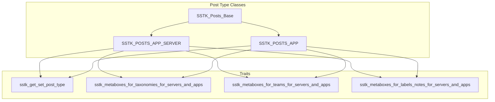
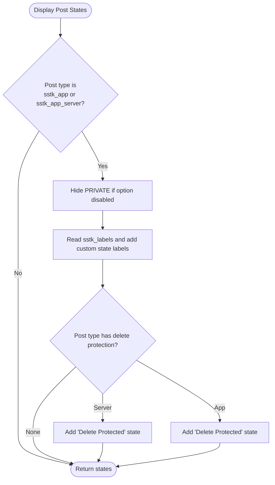
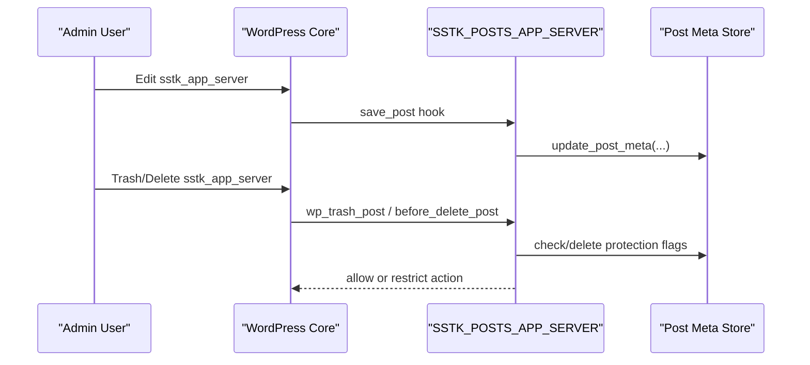
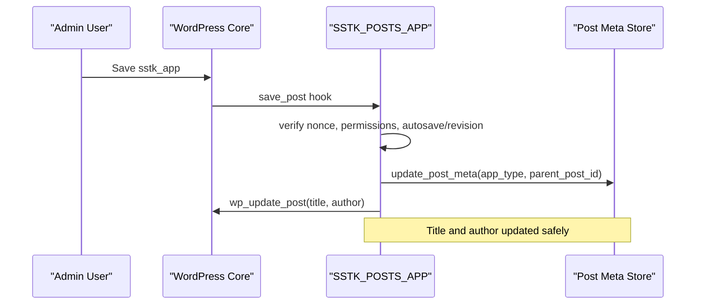
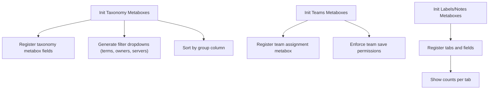
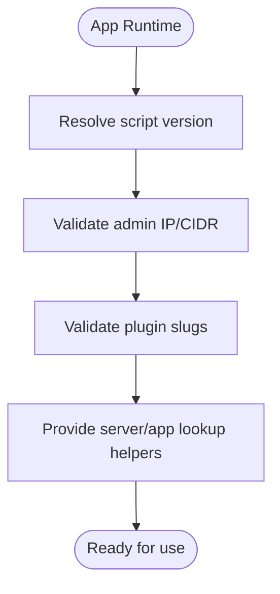
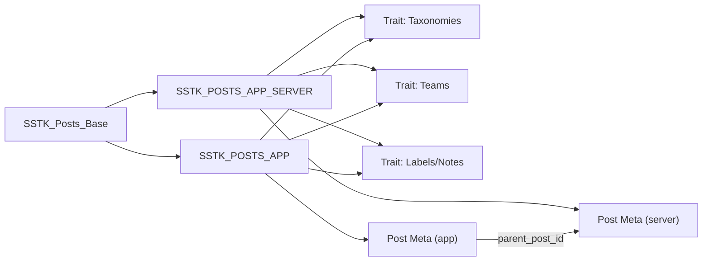

# Custom Post Types

<cite>
**Referenced Files in This Document**
- [class-sstk-posts-base.php](file://includes/core/class-sstk-posts-base.php)
- [class-sstk-posts-app-server.php](file://includes/core/class-sstk-posts-app-server.php)
- [class-sstk-posts-app.php](file://includes/core/class-sstk-posts-app.php)
- [class-sstk-app.php](file://includes/core/apps/class-sstk-app.php)
- [get_set_post_type.php](file://includes/core/traits/get_set_post_type.php)
- [metaboxes_for_taxonomies_for_servers_and_apps.php](file://includes/core/traits/metaboxes_for_taxonomies_for_servers_and_apps.php)
- [metaboxes_for_teams_for_servers_and_apps.php](file://includes/core/traits/metaboxes_for_teams_for_servers_and_apps.php)
- [metaboxes_for_labels_notes_for_servers_and_apps.php](file://includes/core/traits/metaboxes_for_labels_notes_for_servers_and_apps.php)
</cite>

## Table of Contents
1. [Introduction](#introduction)
2. [Project Structure](#project-structure)
3. [Core Components](#core-components)
4. [Architecture Overview](#architecture-overview)
5. [Detailed Component Analysis](#detailed-component-analysis)
6. [Dependency Analysis](#dependency-analysis)
7. [Performance Considerations](#performance-considerations)
8. [Troubleshooting Guide](#troubleshooting-guide)
9. [Conclusion](#conclusion)

## Introduction
This document describes Simple Stack’s custom post types sstk_app_server and sstk_app, focusing on their data model, relationships, metadata, validation, lifecycle hooks, admin interface integration, and the base class architecture with traits that provide shared functionality. It also explains how servers and applications relate, how ownership and teams are modeled, and how state is represented and enforced.

## Project Structure
The custom post type logic is implemented as two main classes that extend a common base and share reusable behavior via traits:
- Base class for post-type management and display states.
- Server post type class (sstk_app_server).
- Application post type class (sstk_app).
- Traits for taxonomy metaboxes, team assignment, labels/notes, and post type getter/setter.
- App runtime class (SSTK_APP) provides app-level utilities and script configuration.

**Diagram sources**
- [class-sstk-posts-base.php:16-84](file://includes/core/class-sstk-posts-base.php#L16-L84)
- [class-sstk-posts-app-server.php:15-56](file://includes/core/class-sstk-posts-app-server.php#L15-L56)
- [class-sstk-posts-app.php:15-56](file://includes/core/class-sstk-posts-app.php#L15-L56)
- [get_set_post_type.php:13-46](file://includes/core/traits/get_set_post_type.php#L13-L46)
- [metaboxes_for_taxonomies_for_servers_and_apps.php:13-49](file://includes/core/traits/metaboxes_for_taxonomies_for_servers_and_apps.php#L13-L49)
- [metaboxes_for_teams_for_servers_and_apps.php:13-27](file://includes/core/traits/metaboxes_for_teams_for_servers_and_apps.php#L13-L27)
- [metaboxes_for_labels_notes_for_servers_and_apps.php:14-26](file://includes/core/traits/metaboxes_for_labels_notes_for_servers_and_apps.php#L14-L26)

**Section sources**
- [class-sstk-posts-base.php:16-84](file://includes/core/class-sstk-posts-base.php#L16-L84)
- [class-sstk-posts-app-server.php:15-56](file://includes/core/class-sstk-posts-app-server.php#L15-L56)
- [class-sstk-posts-app.php:15-56](file://includes/core/class-sstk-posts-app.php#L15-L56)

## Core Components
- SSTK_Posts_Base: Shared base for post-type classes; manages display of post states and custom labels.
- SSTK_POSTS_APP_SERVER: Registers and manages the sstk_app_server CPT, columns, filters, meta boxes, and server-specific behaviors.
- SSTK_POSTS_APP: Registers and manages the sstk_app CPT, columns, filters, meta boxes, and application-specific behaviors.
- Traits: Provide reusable UI and filtering logic for taxonomies, teams, labels/notes, and post type identity.
- SSTK_APP: Runtime app abstraction used by specific app implementations (e.g., WordPress app), including script versioning and security helpers.

Key responsibilities:
- CPT registration and capability gating.
- Admin list columns and sorting.
- Meta box definitions and saving.
- Filtering and search extension.
- Team assignment and visibility controls.
- Labels and notes rendering and state display.

**Section sources**
- [class-sstk-posts-base.php:25-80](file://includes/core/class-sstk-posts-base.php#L25-L80)
- [class-sstk-posts-app-server.php:62-162](file://includes/core/class-sstk-posts-app-server.php#L62-L162)
- [class-sstk-posts-app.php:61-156](file://includes/core/class-sstk-posts-app.php#L61-L156)
- [metaboxes_for_taxonomies_for_servers_and_apps.php:35-49](file://includes/core/traits/metaboxes_for_taxonomies_for_servers_and_apps.php#L35-L49)
- [metaboxes_for_teams_for_servers_and_apps.php:20-27](file://includes/core/traits/metaboxes_for_teams_for_servers_and_apps.php#L20-L27)
- [metaboxes_for_labels_notes_for_servers_and_apps.php:21-26](file://includes/core/traits/metaboxes_for_labels_notes_for_servers_and_apps.php#L21-L26)

## Architecture Overview
The system uses a layered approach:
- Base class encapsulates shared post-state display logic.
- Two CPT classes implement domain-specific features while reusing traits.
- Traits abstract common admin UI concerns (taxonomies, teams, labels/notes).
- The app runtime class centralizes app-level configuration and helper methods.

```mermaid
classDiagram
class SSTK_Posts_Base {
+display_post_states(states, post) array
}
class SSTK_POSTS_APP_SERVER {
+register() void
+hooks() void
+app_server_table_sorting(columns) array
+app_server_table_content(column_name, post_id) void
+enqueue_scripts(hook) void
}
class SSTK_POSTS_APP {
+register() void
+hooks() void
+app_table_sorting(columns) array
+app_table_content(column_name, post_id) void
+add_meta_boxes() void
+save_meta_values(post_id, post) void
+add_app(app_name, server_post_id, author_id, title) int
}
class sstk_get_set_post_type {
+set_post_type(type) void
+get_post_type() string
}
class sstk_metaboxes_for_taxonomies_for_servers_and_apps {
+init_hooks_for_taxonomies_for_servers_and_apps() void
+generate_term_dropdown(taxonomy, first_option) string
+generate_owner_dropdown(post_type, field_key, first_option) string
+sstk_sort_group_column(clauses, wp_query) string
}
class sstk_metaboxes_for_teams_for_servers_and_apps {
+init_hooks_for_teams_for_servers_and_apps() void
+sstk_register_teams_metaboxes(metaboxes) array
+sstk_assign_teams_before_save_post(post_id) void
}
class sstk_metaboxes_for_labels_notes_for_servers_and_apps {
+init_hooks_for_labels_notes_for_servers_and_apps() void
+sstk_register_labels_notes_metaboxes(metaboxes) array
}
SSTK_POSTS_APP_SERVER --|> SSTK_Posts_Base
SSTK_POSTS_APP --|> SSTK_Posts_Base
SSTK_POSTS_APP_SERVER ..> sstk_get_set_post_type
SSTK_POSTS_APP_SERVER ..> sstk_metaboxes_for_taxonomies_for_servers_and_apps
SSTK_POSTS_APP_SERVER ..> sstk_metaboxes_for_teams_for_servers_and_apps
SSTK_POSTS_APP_SERVER ..> sstk_metaboxes_for_labels_notes_for_servers_and_apps
SSTK_POSTS_APP ..> sstk_get_set_post_type
SSTK_POSTS_APP ..> sstk_metaboxes_for_taxonomies_for_servers_and_apps
SSTK_POSTS_APP ..> sstk_metaboxes_for_teams_for_servers_and_apps
SSTK_POSTS_APP ..> sstk_metaboxes_for_labels_notes_for_servers_and_apps
```

**Diagram sources**
- [class-sstk-posts-base.php:16-84](file://includes/core/class-sstk-posts-base.php#L16-L84)
- [class-sstk-posts-app-server.php:15-56](file://includes/core/class-sstk-posts-app-server.php#L15-L56)
- [class-sstk-posts-app.php:15-56](file://includes/core/class-sstk-posts-app.php#L15-L56)
- [get_set_post_type.php:13-46](file://includes/core/traits/get_set_post_type.php#L13-L46)
- [metaboxes_for_taxonomies_for_servers_and_apps.php:35-49](file://includes/core/traits/metaboxes_for_taxonomies_for_servers_and_apps.php#L35-L49)
- [metaboxes_for_teams_for_servers_and_apps.php:20-27](file://includes/core/traits/metaboxes_for_teams_for_servers_and_apps.php#L20-L27)
- [metaboxes_for_labels_notes_for_servers_and_apps.php:21-26](file://includes/core/traits/metaboxes_for_labels_notes_for_servers_and_apps.php#L21-L26)

## Detailed Component Analysis

### Base Class: SSTK_Posts_Base
Responsibilities:
- Removes or adds post states for sstk_app and sstk_app_server based on settings and meta.
- Adds custom label states from sstk_labels meta.
- Adds delete protection indicators when enabled.

Validation and business rules:
- Conditional removal of PRIVATE state based on option sstk_show_private_state.
- Deletion protection flags read from sstk_server_delete_protection and sstk_app_delete_protection.

**Diagram sources**
- [class-sstk-posts-base.php:38-80](file://includes/core/class-sstk-posts-base.php#L38-L80)

**Section sources**
- [class-sstk-posts-base.php:25-80](file://includes/core/class-sstk-posts-base.php#L25-L80)

### Server Post Type: SSTK_POSTS_APP_SERVER
Registration and capabilities:
- Registers CPT sstk_app_server with restricted menu visibility and capability-based creation.
- Sets associated taxonomy sstk_app_server_group and group key for sorting.

Admin UI:
- Adds custom columns (provider, region, instance ID, local status, app count, group, owner, assigned teams).
- Extends search and filtering via pre_get_posts and parse_query.
- Integrates with Meta Box IO for labels/notes, taxonomies, and teams.

Lifecycle hooks:
- save_post to persist meta values.
- wp_trash_post/before_delete_post to enforce deletion protections.
- untrashed_post to restore related state.
- Row actions filtered via sstk_actions.

Relationships:
- Apps reference servers via parent_post_id meta.
- Server lists show linked apps and counts.

**Diagram sources**
- [class-sstk-posts-app-server.php:62-162](file://includes/core/class-sstk-posts-app-server.php#L62-L162)
- [class-sstk-posts-app-server.php:1776-1824](file://includes/core/class-sstk-posts-app-server.php#L1776-L1824)

**Section sources**
- [class-sstk-posts-app-server.php:62-162](file://includes/core/class-sstk-posts-app-server.php#L62-L162)
- [class-sstk-posts-app-server.php:316-325](file://includes/core/class-sstk-posts-app-server.php#L316-L325)
- [class-sstk-posts-app-server.php:1776-1824](file://includes/core/class-sstk-posts-app-server.php#L1776-L1824)

### Application Post Type: SSTK_POSTS_APP
Registration and capabilities:
- Registers CPT sstk_app with restricted menu visibility and capability-based creation.
- Associates taxonomy sstk_app_group and group key for sorting.

Admin UI:
- Adds custom columns (type, short description, server details, IPv4/IPv6, provider, region, owners, groups, teams).
- Extends search/filtering and integrates with Meta Box IO for labels/notes, taxonomies, and teams.

Data persistence:
- save_meta_values validates nonce, permissions, autosave/revision checks, then updates app_type, parent_post_id, title, and author.
- add_app creates a new private app record with initial plugin version metadata.

Relationships:
- parent_post_id links an app to its server.
- Owner fields reflect both server and app authors.

**Diagram sources**
- [class-sstk-posts-app.php:61-156](file://includes/core/class-sstk-posts-app.php#L61-L156)
- [class-sstk-posts-app.php:703-751](file://includes/core/class-sstk-posts-app.php#L703-L751)

**Section sources**
- [class-sstk-posts-app.php:61-156](file://includes/core/class-sstk-posts-app.php#L61-L156)
- [class-sstk-posts-app.php:703-751](file://includes/core/class-sstk-posts-app.php#L703-L751)
- [class-sstk-posts-app.php:754-793](file://includes/core/class-sstk-posts-app.php#L754-L793)

### Traits: Shared Functionality
- sstk_get_set_post_type: Provides set_post_type/get_post_type to identify the managed CPT.
- sstk_metaboxes_for_taxonomies_for_servers_and_apps: Registers taxonomy metaboxes (color, visibility), generates dropdowns for filtering by terms, owners, servers, and sorts by group column.
- sstk_metaboxes_for_teams_for_servers_and_apps: Registers team assignment metabox and enforces permission checks during save.
- sstk_metaboxes_for_labels_notes_for_servers_and_apps: Registers tabs for descriptions, notes, labels, links, and admin-only notes; displays counts and respects feature permissions.

**Diagram sources**
- [metaboxes_for_taxonomies_for_servers_and_apps.php:35-49](file://includes/core/traits/metaboxes_for_taxonomies_for_servers_and_apps.php#L35-L49)
- [metaboxes_for_taxonomies_for_servers_and_apps.php:161-232](file://includes/core/traits/metaboxes_for_taxonomies_for_servers_and_apps.php#L161-L232)
- [metaboxes_for_taxonomies_for_servers_and_apps.php:424-442](file://includes/core/traits/metaboxes_for_taxonomies_for_servers_and_apps.php#L424-L442)
- [metaboxes_for_teams_for_servers_and_apps.php:20-27](file://includes/core/traits/metaboxes_for_teams_for_servers_and_apps.php#L20-L27)
- [metaboxes_for_teams_for_servers_and_apps.php:38-71](file://includes/core/traits/metaboxes_for_teams_for_servers_and_apps.php#L38-L71)
- [metaboxes_for_teams_for_servers_and_apps.php:81-89](file://includes/core/traits/metaboxes_for_teams_for_servers_and_apps.php#L81-L89)
- [metaboxes_for_labels_notes_for_servers_and_apps.php:21-26](file://includes/core/traits/metaboxes_for_labels_notes_for_servers_and_apps.php#L21-L26)
- [metaboxes_for_labels_notes_for_servers_and_apps.php:37-228](file://includes/core/traits/metaboxes_for_labels_notes_for_servers_and_apps.php#L37-L228)

**Section sources**
- [get_set_post_type.php:13-46](file://includes/core/traits/get_set_post_type.php#L13-L46)
- [metaboxes_for_taxonomies_for_servers_and_apps.php:35-49](file://includes/core/traits/metaboxes_for_taxonomies_for_servers_and_apps.php#L35-L49)
- [metaboxes_for_teams_for_servers_and_apps.php:20-27](file://includes/core/traits/metaboxes_for_teams_for_servers_and_apps.php#L20-L27)
- [metaboxes_for_labels_notes_for_servers_and_apps.php:21-26](file://includes/core/traits/metaboxes_for_labels_notes_for_servers_and_apps.php#L21-L26)

### App Runtime: SSTK_APP
Responsibilities:
- Provides app-level helpers such as script version resolution, admin IP validation, and plugin slug validation for provisioning scripts.
- Exposes getters/setters for app name/description and script paths.
- Offers utility methods to retrieve server/app records and addresses.

Security and validation:
- get_sstk_admin_ip validates allowed OpenLiteSpeed console access IPs/CIDRs.
- get_post_site_install_plugins sanitizes plugin slugs to safe characters.

**Diagram sources**
- [class-sstk-app.php:216-228](file://includes/core/apps/class-sstk-app.php#L216-L228)
- [class-sstk-app.php:242-267](file://includes/core/apps/class-sstk-app.php#L242-L267)
- [class-sstk-app.php:283-314](file://includes/core/apps/class-sstk-app.php#L283-L314)

**Section sources**
- [class-sstk-app.php:216-228](file://includes/core/apps/class-sstk-app.php#L216-L228)
- [class-sstk-app.php:242-267](file://includes/core/apps/class-sstk-app.php#L242-L267)
- [class-sstk-app.php:283-314](file://includes/core/apps/class-sstk-app.php#L283-L314)

## Dependency Analysis
- SSTK_POSTS_APP_SERVER depends on:
  - SSTK_Posts_Base for shared state display.
  - Traits for taxonomy, teams, labels/notes, and post type identity.
  - WordPress hooks for admin UI, meta saving, and lifecycle events.
- SSTK_POSTS_APP depends on:
  - SSTK_Posts_Base for shared state display.
  - Traits for taxonomy, teams, labels/notes, and post type identity.
  - WordPress hooks for admin UI, meta saving, and lifecycle events.
- Both CPTs rely on post meta for relationships and attributes:
  - sstk_app_server: provider, region, size, instance ID, OS, local status, remote state, delete protection, assigned teams, group terms.
  - sstk_app: app_type, parent_post_id, owner, delete protection, assigned teams, group terms.

**Diagram sources**
- [class-sstk-posts-base.php:16-84](file://includes/core/class-sstk-posts-base.php#L16-L84)
- [class-sstk-posts-app-server.php:62-162](file://includes/core/class-sstk-posts-app-server.php#L62-L162)
- [class-sstk-posts-app.php:61-156](file://includes/core/class-sstk-posts-app.php#L61-L156)
- [metaboxes_for_taxonomies_for_servers_and_apps.php:35-49](file://includes/core/traits/metaboxes_for_taxonomies_for_servers_and_apps.php#L35-L49)
- [metaboxes_for_teams_for_servers_and_apps.php:20-27](file://includes/core/traits/metaboxes_for_teams_for_servers_and_apps.php#L20-L27)
- [metaboxes_for_labels_notes_for_servers_and_apps.php:21-26](file://includes/core/traits/metaboxes_for_labels_notes_for_servers_and_apps.php#L21-L26)

**Section sources**
- [class-sstk-posts-app-server.php:316-325](file://includes/core/class-sstk-posts-app-server.php#L316-L325)
- [class-sstk-posts-app.php:161-169](file://includes/core/class-sstk-posts-app.php#L161-L169)

## Performance Considerations
- Avoid unnecessary meta queries in list screens; leverage existing filters and indexes where possible.
- Use get_posts with fields => ids when only IDs are needed (as seen in server app count listing).
- Limit large dropdowns with search-enabled selects (owner dropdown already applies a class for large sets).
- Prefer filtering at query time using parse_query and posts_where rather than post-processing results.

[No sources needed since this section provides general guidance]

## Troubleshooting Guide
Common issues and resolutions:
- Delete protection prevents trashing/deleting:
  - Ensure sstk_server_delete_protection or sstk_app_delete_protection is not set unless intended.
  - Check display_post_states to confirm protective labels appear.
- Team changes blocked:
  - Non-admin users cannot change team assignments; verify role permissions and current vs. requested team arrays.
- Private state visibility:
  - If PRIVATE state is unexpectedly hidden, review sstk_show_private_state option.
- Missing columns or filters:
  - Confirm options controlling column visibility (e.g., sstk_show_app_list_ipv4, wordpress_app_fe_hide_title_in_server_list).
- Search not finding records:
  - Verify pre_get_posts hooks for extending search and posts_where modifications.

**Section sources**
- [class-sstk-posts-base.php:38-80](file://includes/core/class-sstk-posts-base.php#L38-L80)
- [metaboxes_for_teams_for_servers_and_apps.php:81-89](file://includes/core/traits/metaboxes_for_teams_for_servers_and_apps.php#L81-L89)
- [class-sstk-posts-app-server.php:716-800](file://includes/core/class-sstk-posts-app-server.php#L716-L800)
- [class-sstk-posts-app.php:510-639](file://includes/core/class-sstk-posts-app.php#L510-L639)

## Conclusion
Simple Stack models servers and applications as custom post types with rich metadata, robust admin interfaces, and clear separation of concerns through a base class and traits. Relationships are primarily expressed via post meta (parent_post_id), while ownership and team assignments are handled through post author and dedicated team meta. Validation and lifecycle hooks ensure data integrity and user-permission enforcement across create, edit, trash, and delete operations. The design supports extensibility and maintainability, making it straightforward to add new app types and administrative features.

[No sources needed since this section summarizes without analyzing specific files]