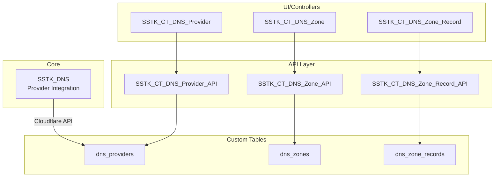
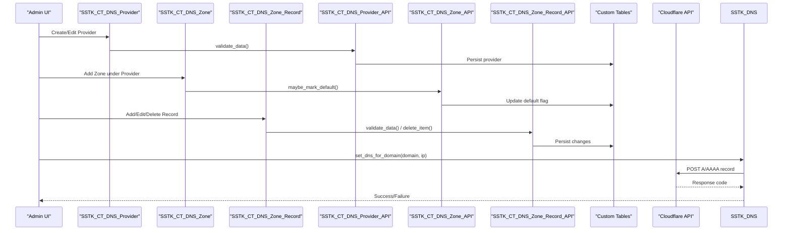
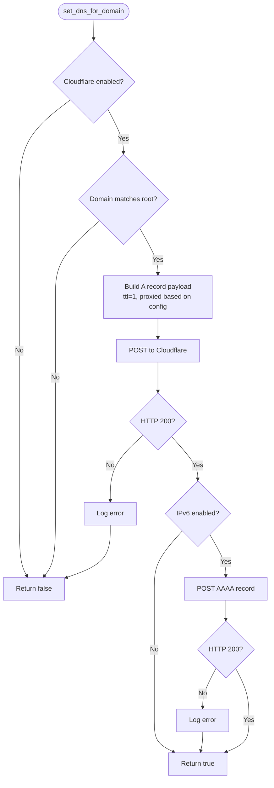
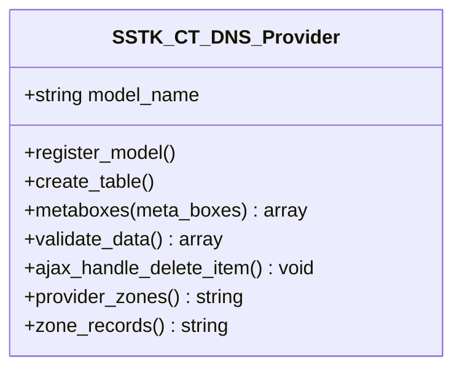
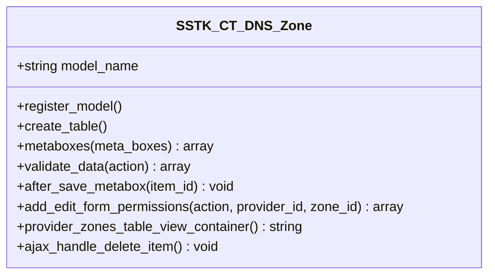
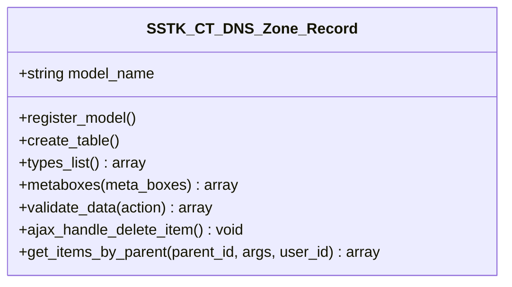
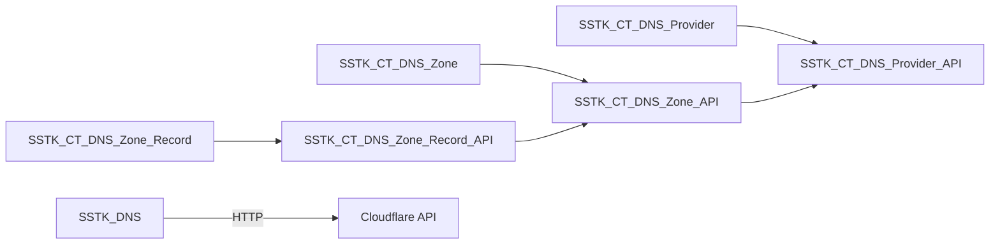

# DNS Data Structures

<cite>
**Referenced Files in This Document**
- [class-sstk-dns.php](file://includes/core/class-sstk-dns.php)
- [class-sstk-dns-provider.php](file://includes/core/custom-table/class-sstk-dns-provider.php)
- [class-sstk-dns-zone.php](file://includes/core/custom-table/class-sstk-dns-zone.php)
- [class-sstk-dns-zone-record.php](file://includes/core/custom-table/class-sstk-dns-zone-record.php)
- [class-sstk-ct-dns-provider-api.php](file://includes/core/custom-table/api/class-sstk-ct-dns-provider-api.php)
- [class-sstk-ct-dns-zone-api.php](file://includes/core/custom-table/api/class-sstk-ct-dns-zone-api.php)
- [class-sstk-ct-dns-zone-record-api.php](file://includes/core/custom-table/api/class-sstk-ct-dns-zone-record-api.php)
</cite>

## Table of Contents
1. [Introduction](#introduction)
2. [Project Structure](#project-structure)
3. [Core Components](#core-components)
4. [Architecture Overview](#architecture-overview)
5. [Detailed Component Analysis](#detailed-component-analysis)
6. [Dependency Analysis](#dependency-analysis)
7. [Performance Considerations](#performance-considerations)
8. [Troubleshooting Guide](#troubleshooting-guide)
9. [Conclusion](#conclusion)

## Introduction
This document explains the DNS data management structures and operations in the project. It covers:
- The DNS provider abstraction for managing credentials and access control
- Zone management classes for domains under a provider
- Record manipulation methods for creating, updating, and deleting DNS records
- Data flow between providers, local storage (custom tables), and application components
- Error handling, validation, and permission checks
- TTL management and propagation considerations
- Bulk operations and performance optimization strategies

The system uses custom tables to persist DNS providers, zones, and records, while an integration layer interacts with external DNS providers (currently Cloudflare).

## Project Structure
DNS-related functionality is organized into:
- Core DNS integration class for provider interactions
- Custom table models for providers, zones, and records
- API helpers for querying and permission enforcement

**Diagram sources**
- [class-sstk-dns.php:16-464](file://includes/core/class-sstk-dns.php#L16-L464)
- [class-sstk-dns-provider.php:10-418](file://includes/core/custom-table/class-sstk-dns-provider.php#L10-L418)
- [class-sstk-dns-zone.php:9-422](file://includes/core/custom-table/class-sstk-dns-zone.php#L9-L422)
- [class-sstk-dns-zone-record.php:9-459](file://includes/core/custom-table/class-sstk-dns-zone-record.php#L9-L459)
- [class-sstk-ct-dns-provider-api.php:6-58](file://includes/core/custom-table/api/class-sstk-ct-dns-provider-api.php#L6-L58)
- [class-sstk-ct-dns-zone-api.php:6-179](file://includes/core/custom-table/api/class-sstk-ct-dns-zone-api.php#L6-L179)
- [class-sstk-ct-dns-zone-record-api.php:6-108](file://includes/core/custom-table/api/class-sstk-ct-dns-zone-record-api.php#L6-L108)

**Section sources**
- [class-sstk-dns.php:16-464](file://includes/core/class-sstk-dns.php#L16-L464)
- [class-sstk-dns-provider.php:10-418](file://includes/core/custom-table/class-sstk-dns-provider.php#L10-L418)
- [class-sstk-dns-zone.php:9-422](file://includes/core/custom-table/class-sstk-dns-zone.php#L9-L422)
- [class-sstk-dns-zone-record.php:9-459](file://includes/core/custom-table/class-sstk-dns-zone-record.php#L9-L459)

## Core Components
- SSTK_DNS: Provider integration for Cloudflare; manages temporary domain generation and record CRUD against the provider.
- SSTK_CT_DNS_Provider: Model and UI for DNS providers; stores credentials and permissions; manages zones and records via child tables.
- SSTK_CT_DNS_Zone: Model and UI for DNS zones; enforces default zone semantics and parent-child relationships.
- SSTK_CT_DNS_Zone_Record: Model and UI for DNS records; supports standard record types and TTL fields.
- API classes: Provide permission-aware queries and display name helpers for each model.

Key responsibilities:
- Provider abstraction: SSTK_DNS encapsulates Cloudflare-specific calls; other providers can be added by extending this class or adding new integrations.
- Local storage: Custom tables store provider metadata, zones, and records with permission scoping.
- Application components: Admin UI and AJAX endpoints use the models and APIs to manage DNS state.

**Section sources**
- [class-sstk-dns.php:16-464](file://includes/core/class-sstk-dns.php#L16-L464)
- [class-sstk-dns-provider.php:10-418](file://includes/core/custom-table/class-sstk-dns-provider.php#L10-L418)
- [class-sstk-dns-zone.php:9-422](file://includes/core/custom-table/class-sstk-dns-zone.php#L9-L422)
- [class-sstk-dns-zone-record.php:9-459](file://includes/core/custom-table/class-sstk-dns-zone-record.php#L9-L459)
- [class-sstk-ct-dns-provider-api.php:6-58](file://includes/core/custom-table/api/class-sstk-ct-dns-provider-api.php#L6-L58)
- [class-sstk-ct-dns-zone-api.php:6-179](file://includes/core/custom-table/api/class-sstk-ct-dns-zone-api.php#L6-L179)
- [class-sstk-ct-dns-zone-record-api.php:6-108](file://includes/core/custom-table/api/class-sstk-ct-dns-zone-record-api.php#L6-L108)

## Architecture Overview
The DNS subsystem follows a layered architecture:
- Presentation/UI: Admin pages and inline edit forms render through model metaboxes and AJAX handlers.
- Domain Models: Each model handles validation, permissions, and persistence via its API.
- API Layer: Permission-aware queries and helper methods for display names and defaults.
- External Providers: SSTK_DNS integrates with Cloudflare using stored credentials.

**Diagram sources**
- [class-sstk-dns-provider.php:345-418](file://includes/core/custom-table/class-sstk-dns-provider.php#L345-L418)
- [class-sstk-dns-zone.php:193-268](file://includes/core/custom-table/class-sstk-dns-zone.php#L193-L268)
- [class-sstk-dns-zone-record.php:364-431](file://includes/core/custom-table/class-sstk-dns-zone-record.php#L364-L431)
- [class-sstk-dns.php:88-108](file://includes/core/class-sstk-dns.php#L88-L108)
- [class-sstk-dns.php:158-262](file://includes/core/class-sstk-dns.php#L158-L262)

## Detailed Component Analysis

### DNS Provider Abstraction (SSTK_DNS)
Responsibilities:
- Generate unique subdomains and full temporary domains
- Determine active root domain from configuration
- Integrate with Cloudflare to add, query, and delete A/AAAA records
- Log errors and return boolean outcomes

Key behaviors:
- set_dns_for_domain: Validates domain belongs to configured root, then delegates to cloudflare_add_subdomain
- cloudflare_add_subdomain: Builds JSON payload, sets TTL=1, optionally adds AAAA, logs errors, returns success/failure
- cloudflare_get_subdomain_details/id: Queries Cloudflare for existing records
- cloudflare_delete_subdomain: Deletes A and optional AAAA records

Error handling:
- Uses WordPress HTTP functions and logs errors via do_action('sstk_log_error', ...)
- Checks response codes and returns false on failure

Propagation and TTL:
- Sets TTL=1 for rapid propagation during automation
- Optional IPv6 AAAA record creation controlled by settings

**Diagram sources**
- [class-sstk-dns.php:88-108](file://includes/core/class-sstk-dns.php#L88-L108)
- [class-sstk-dns.php:158-262](file://includes/core/class-sstk-dns.php#L158-L262)

**Section sources**
- [class-sstk-dns.php:16-464](file://includes/core/class-sstk-dns.php#L16-L464)

### DNS Provider Model (SSTK_CT_DNS_Provider)
Responsibilities:
- Register and create the dns_providers custom table
- Manage form fields, validation, and permissions
- Provide containers for zones and records within the provider edit screen
- Handle deletion cascading to zones and records

Data model highlights:
- Fields: dns_name, dns_short_description, dns_provider, dns_secret_key, dns_notes, owner
- Permissions: Owner-based and role/user allowlists

Validation and deletion:
- validate_data ensures required fields and permissions
- ajax_handle_delete_item removes all associated zones and records before deleting the provider

**Diagram sources**
- [class-sstk-dns-provider.php:10-418](file://includes/core/custom-table/class-sstk-dns-provider.php#L10-L418)

**Section sources**
- [class-sstk-dns-provider.php:10-418](file://includes/core/custom-table/class-sstk-dns-provider.php#L10-L418)

### DNS Zone Model (SSTK_CT_DNS_Zone)
Responsibilities:
- Register and create the dns_zones custom table
- Enforce default zone semantics (only one default per provider)
- Provide inline editing and AJAX views for zones
- Validate and enforce permissions based on parent provider

Data model highlights:
- Fields: parent_id, domain, is_system_default

Default zone logic:
- after_save_metabox triggers maybe_mark_default to ensure only one default zone exists

Permissions:
- add_edit_form_permissions checks user ability to edit the parent provider

**Diagram sources**
- [class-sstk-dns-zone.php:9-422](file://includes/core/custom-table/class-sstk-dns-zone.php#L9-L422)

**Section sources**
- [class-sstk-dns-zone.php:9-422](file://includes/core/custom-table/class-sstk-dns-zone.php#L9-L422)

### DNS Zone Record Model (SSTK_CT_DNS_Zone_Record)
Responsibilities:
- Register and create the dns_zone_records custom table
- Support standard DNS record types (A, AAAA, CNAME, TXT, NS)
- Provide inline editing and AJAX views for records
- Validate and enforce permissions based on parent zone/provider

Data model highlights:
- Fields: parent_id, type, name, content, ttl, notes

Validation:
- validate_data enforces required fields: type, name, content, ttl

Deletion:
- ajax_handle_delete_item deletes a single record after permission checks

**Diagram sources**
- [class-sstk-dns-zone-record.php:9-459](file://includes/core/custom-table/class-sstk-dns-zone-record.php#L9-L459)

**Section sources**
- [class-sstk-dns-zone-record.php:9-459](file://includes/core/custom-table/class-sstk-dns-zone-record.php#L9-L459)

### API Helpers
- SSTK_CT_DNS_Provider_API: Provides get_item_display_name for provider names
- SSTK_CT_DNS_Zone_API: Provides default zone retrieval, default marking, and permission-aware queries
- SSTK_CT_DNS_Zone_Record_API: Provides permission-aware child item queries joining provider meta

These APIs centralize SQL joins and permission logic used by models.

**Section sources**
- [class-sstk-ct-dns-provider-api.php:6-58](file://includes/core/custom-table/api/class-sstk-ct-dns-provider-api.php#L6-L58)
- [class-sstk-ct-dns-zone-api.php:6-179](file://includes/core/custom-table/api/class-sstk-ct-dns-zone-api.php#L6-L179)
- [class-sstk-ct-dns-zone-record-api.php:6-108](file://includes/core/custom-table/api/class-sstk-ct-dns-zone-record-api.php#L6-L108)

## Dependency Analysis
- Models depend on their respective API classes for permission-aware queries and display helpers.
- Zone and Record models depend on Provider permissions to determine access.
- SSTK_DNS depends on WordPress options for Cloudflare credentials and settings.

**Diagram sources**
- [class-sstk-dns-provider.php:10-418](file://includes/core/custom-table/class-sstk-dns-provider.php#L10-L418)
- [class-sstk-dns-zone.php:9-422](file://includes/core/custom-table/class-sstk-dns-zone.php#L9-L422)
- [class-sstk-dns-zone-record.php:9-459](file://includes/core/custom-table/class-sstk-dns-zone-record.php#L9-L459)
- [class-sstk-ct-dns-provider-api.php:6-58](file://includes/core/custom-table/api/class-sstk-ct-dns-provider-api.php#L6-L58)
- [class-sstk-ct-dns-zone-api.php:6-179](file://includes/core/custom-table/api/class-sstk-ct-dns-zone-api.php#L6-L179)
- [class-sstk-ct-dns-zone-record-api.php:6-108](file://includes/core/custom-table/api/class-sstk-ct-dns-zone-record-api.php#L6-L108)
- [class-sstk-dns.php:158-262](file://includes/core/class-sstk-dns.php#L158-L262)

**Section sources**
- [class-sstk-dns-provider.php:10-418](file://includes/core/custom-table/class-sstk-dns-provider.php#L10-L418)
- [class-sstk-dns-zone.php:9-422](file://includes/core/custom-table/class-sstk-dns-zone.php#L9-L422)
- [class-sstk-dns-zone-record.php:9-459](file://includes/core/custom-table/class-sstk-dns-zone-record.php#L9-L459)
- [class-sstk-ct-dns-zone-api.php:6-179](file://includes/core/custom-table/api/class-sstk-ct-dns-zone-api.php#L6-L179)
- [class-sstk-ct-dns-zone-record-api.php:6-108](file://includes/core/custom-table/api/class-sstk-ct-dns-zone-record-api.php#L6-L108)
- [class-sstk-dns.php:158-262](file://includes/core/class-sstk-dns.php#L158-L262)

## Performance Considerations
- TTL Management:
  - Automation sets TTL=1 for fast propagation when adding records via Cloudflare.
  - For production stability, consider higher TTLs for long-lived records and lower TTLs for frequent updates.
- Bulk Operations:
  - Use the provided AJAX endpoints to batch add/edit/delete records within the UI.
  - When integrating programmatically, group multiple Cloudflare requests where possible and handle rate limits.
- Query Optimization:
  - API classes use JOINs and GROUP BY to enforce permissions efficiently.
  - Avoid unnecessary re-renders by leveraging the provided container elements for zones and records.

[No sources needed since this section provides general guidance]

## Troubleshooting Guide
Common issues and resolutions:
- Validation Errors:
  - Missing required fields (e.g., domain, type, name, content, ttl) will cause save failures. Ensure all fields are populated.
  - Refer to model validate_data methods for exact field requirements.
- Permission Denied:
  - Users must have appropriate roles/users allowed for the provider. Check provider owner and allowlists.
  - Zone and record edits inherit permissions from the parent provider.
- Cloudflare Integration Failures:
  - Verify Cloudflare options are enabled and credentials are correct.
  - Check error logs emitted via sstk_log_error action for detailed messages.
  - Confirm that the domain being managed matches the configured root domain.

Operational tips:
- After deleting a provider, all associated zones and records are removed automatically.
- Default zone semantics ensure only one default zone per provider; saving a new default clears others.

**Section sources**
- [class-sstk-dns-provider.php:345-418](file://includes/core/custom-table/class-sstk-dns-provider.php#L345-L418)
- [class-sstk-dns-zone.php:240-268](file://includes/core/custom-table/class-sstk-dns-zone.php#L240-L268)
- [class-sstk-dns-zone-record.php:364-431](file://includes/core/custom-table/class-sstk-dns-zone-record.php#L364-L431)
- [class-sstk-dns.php:188-209](file://includes/core/class-sstk-dns.php#L188-L209)

## Conclusion
The DNS subsystem provides a robust framework for managing DNS providers, zones, and records with strong permission controls and clear separation of concerns. The Cloudflare integration offers automated record management with configurable TTLs and comprehensive error logging. Extensibility points exist to support additional providers and advanced bulk operations. Proper use of validation, permissions, and TTL tuning ensures reliable and performant DNS management across environments.

[No sources needed since this section summarizes without analyzing specific files]