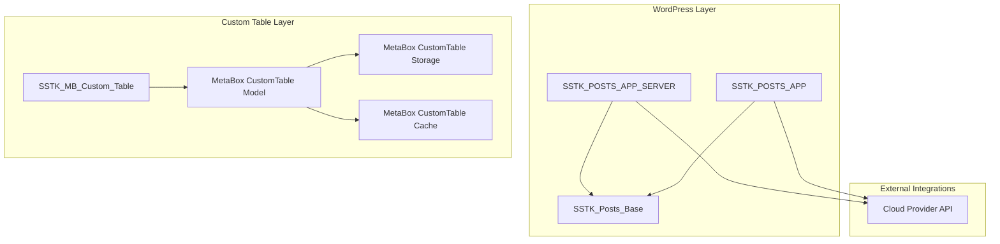
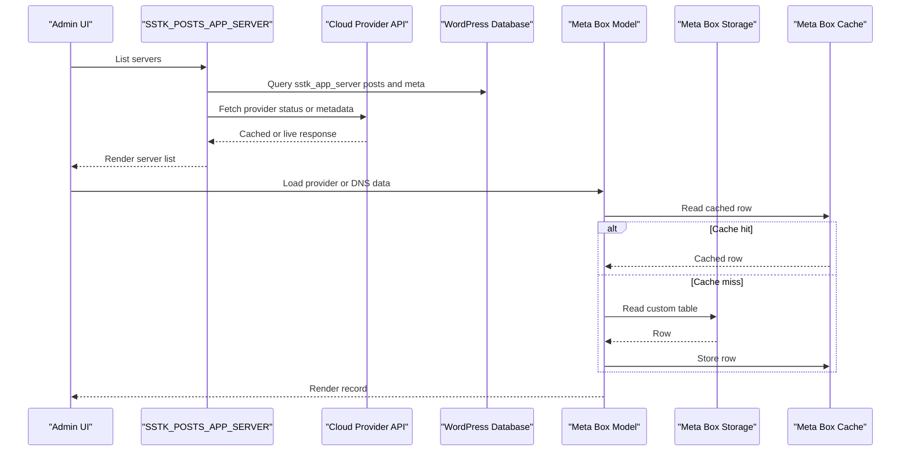
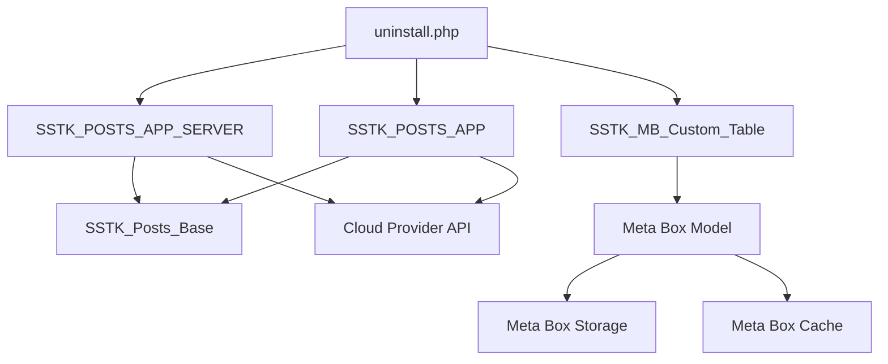

# Data Access Patterns

<cite>
**Referenced Files in This Document**
- [class-sstk-posts-base.php](file://includes/core/class-sstk-posts-base.php)
- [class-sstk-posts-app-server.php](file://includes/core/class-sstk-posts-app-server.php)
- [class-sstk-posts-app.php](file://includes/core/class-sstk-posts-app.php)
- [class-sstk-custom-table.php](file://includes/core/custom-table/class-sstk-custom-table.php)
- [Model.php](file://required_plugins/mb-custom-table/src/Model/Model.php)
- [Cache.php](file://required_plugins/mb-custom-table/src/Cache.php)
- [Storage.php](file://required_plugins/mb-custom-table/src/Storage.php)
- [loader.php](file://includes/core/apps/wordpress-app/public/custom-table/loader.php)
- [class-cloud-provider-api.php](file://includes/core/providers/class-cloud-provider-api.php)
- [uninstall.php](file://uninstall.php)
- [tests/uninstall-harness.php](file://tests/uninstall-harness.php)
</cite>

## Table of Contents
1. [Introduction](#introduction)
2. [Project Structure](#project-structure)
3. [Core Components](#core-components)
4. [Architecture Overview](#architecture-overview)
5. [Detailed Component Analysis](#detailed-component-analysis)
6. [Dependency Analysis](#dependency-analysis)
7. [Performance Considerations](#performance-considerations)
8. [Troubleshooting Guide](#troubleshooting-guide)
9. [Conclusion](#conclusion)

## Introduction

Simple Stack uses two complementary persistence layers:

- WordPress custom post types for servers, sites and operational logs.
- Meta Box custom tables for structured provider and DNS records.

The data-access layer relies on WordPress query hooks, post metadata, transient caches and the
Meta Box model/cache/storage APIs. Cross-site data synchronization is retired: there is no
export/import service, remote receiver or synchronization cron schedule.

## Project Structure

**Section sources**
- [class-sstk-posts-base.php](file://includes/core/class-sstk-posts-base.php)
- [class-sstk-posts-app-server.php](file://includes/core/class-sstk-posts-app-server.php)
- [class-sstk-posts-app.php](file://includes/core/class-sstk-posts-app.php)
- [class-sstk-custom-table.php](file://includes/core/custom-table/class-sstk-custom-table.php)
- [class-cloud-provider-api.php](file://includes/core/providers/class-cloud-provider-api.php)

## Core Components

- **Base post class:** shared display-state and label behavior for Simple Stack post types.
- **Server post type:** server records, provider integration, admin columns and filters.
- **Site post type:** site records, parent-server relationships, admin columns and filters.
- **Custom table framework:** CRUD, validation, admin/public rendering and persistence for
  provider and DNS data.
- **Lifecycle cleanup:** prefixed options, posts, metadata, terms, cron hooks, roles,
  capabilities and custom tables are removed across a multisite network on uninstall.

## Architecture Overview

## Detailed Component Analysis

### Base Post Type Architecture

`SSTK_Posts_Base` centralizes behavior shared by the server and site post types, including
conditional display-state labels and protected-record indicators. Concrete post classes add
their own columns, filters, metadata and provider integration.

### Query Building Patterns

Server and site list screens extend the normal WordPress query pipeline:

- `pre_get_posts` expands admin search to relevant metadata and titles.
- `posts_where` adds custom conditions.
- `parse_query` applies supported filters.
- List-table columns render provider, address, group and related-record data.

WordPress owns pagination for post-type lists. Meta Box list-table classes provide pagination
for custom-table views.

### Caching Mechanisms

Two cache layers are important:

- **Provider API transients:** cache selected provider API methods and invalidate them when
  credentials or configuration change.
- **Meta Box row cache:** stores custom-table rows in WordPress object-cache groups and updates
  or deletes entries when records change.

The React provider settings controller also caches region and size counts for 300 seconds under
`sstk_provider_counts_<provider>`. A `refresh=1` request bypasses that cache; provider failures
return zero advisory counts rather than breaking the settings screen.

### Custom Post Types and Custom Tables

- `sstk_app_server` and `sstk_app` store high-level control-plane entities and relationships.
- Provider and DNS records use custom tables through the Meta Box model layer.
- Site records point at their parent server through `parent_post_id`.
- The public custom-table loader connects shortcode-driven list and edit views to Meta Box
  models.

### Data Portability and Lifecycle

Cross-site data synchronization is retired. There is no service for moving users, teams,
servers, sites or settings between control-plane installations. Each installation is
configured explicitly.

`uninstall.php` removes Simple Stack data across every site in a multisite network, including
prefixed options, transients, posts, metadata, terms, cron hooks, roles, capabilities and custom
tables. Cron cleanup discovers every scheduled hook beginning with `sstk_`. Role cleanup also
removes direct user capability assignments. `tests/uninstall-harness.php` exercises these paths
with WordPress API stubs and a recording database double while checking that unrelated data is
preserved.

### Error Handling and Consistency

Multi-step operations use WordPress APIs and explicit error checks rather than a shared database
transaction wrapper. Callers must therefore treat each persisted step as independently
fallible and avoid assuming that a later failure rolls back earlier writes.

AJAX and REST handlers return structured success or error responses. Long-running SSH operations
use command logs and status callbacks so the admin UI can report progress and failures.

## Dependency Analysis

## Performance Considerations

- Narrow post queries before rendering columns and avoid repeated metadata reads in loops.
- Use Meta Box row caching for frequently accessed custom-table records.
- Keep provider transients short-lived and clear them after credential changes.
- Batch writes where the underlying API supports it; otherwise report partial failure clearly.
- Monitor SSH command logs and REST activity for slow provider calls or long-running tasks.

## Troubleshooting Guide

- **Stale provider data:** clear the relevant provider transient or request a refreshed provider
  count.
- **Missing custom-table row:** verify the table exists, the model uses the expected table name
  and the row cache was invalidated after the write.
- **Unexpected admin-list results:** inspect the active `parse_query`, `posts_where` and
  `pre_get_posts` filters before changing the underlying query code.
- **Partial uninstall:** run `php tests/uninstall-harness.php` and inspect network options,
  cron hooks, user capabilities and custom tables on each blog.

## Conclusion

Simple Stack combines WordPress post types for flexible control-plane entities with Meta Box
custom tables for structured provider and DNS data. Standard WordPress query hooks, targeted
transients and object-cache groups keep reads predictable. New extensions should use the
current `sstk_` identifiers, fixed `scripts/v2` provisioning and the existing permission,
validation and logging patterns.
