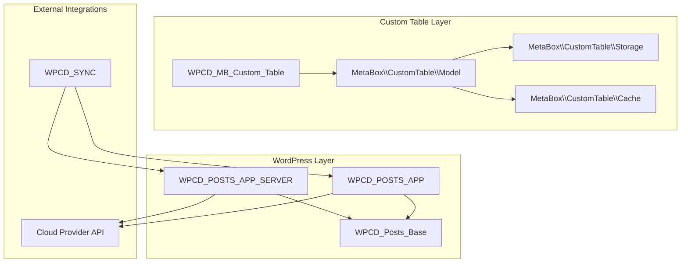
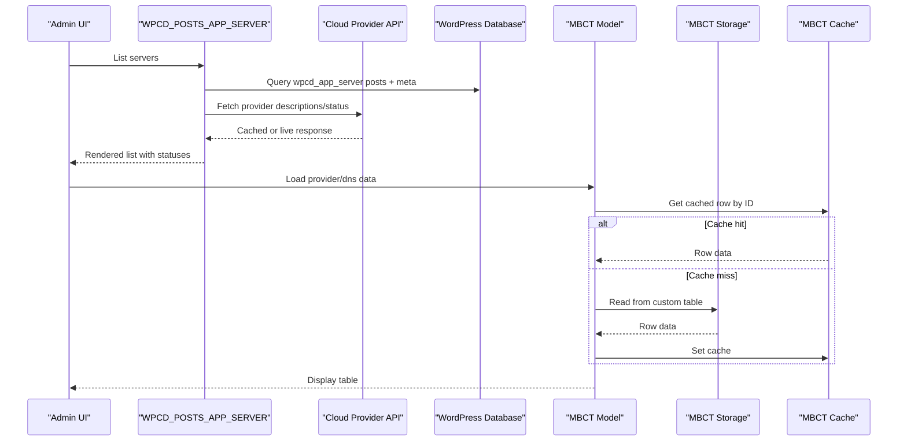
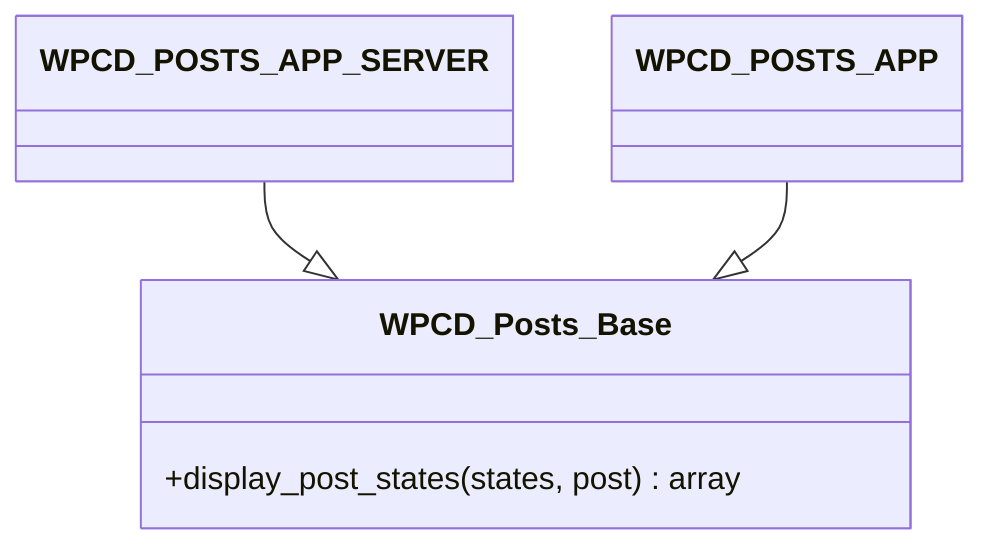
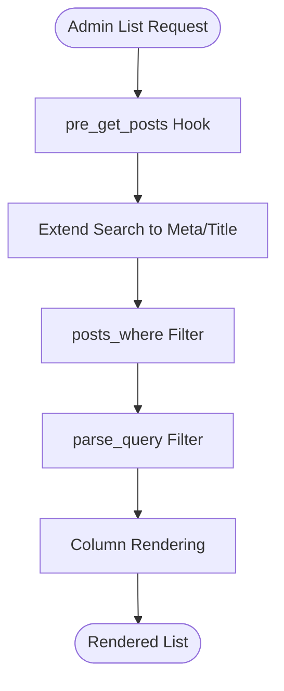
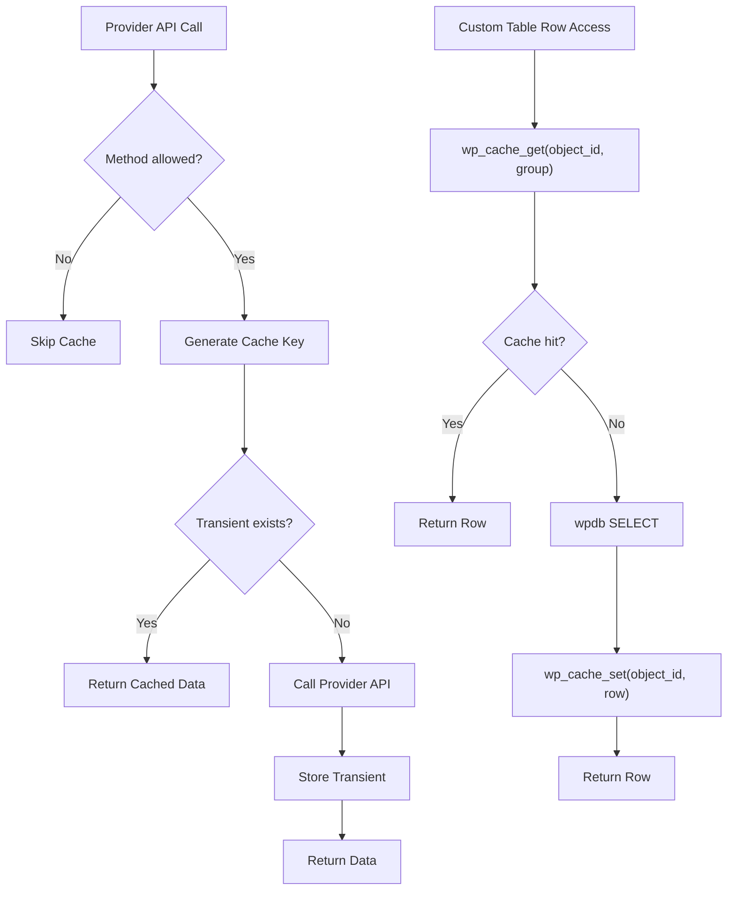
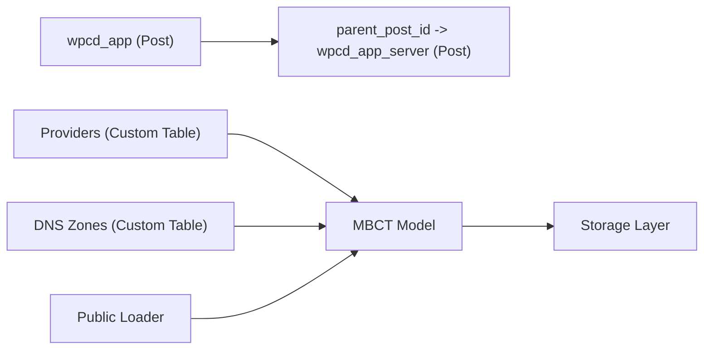
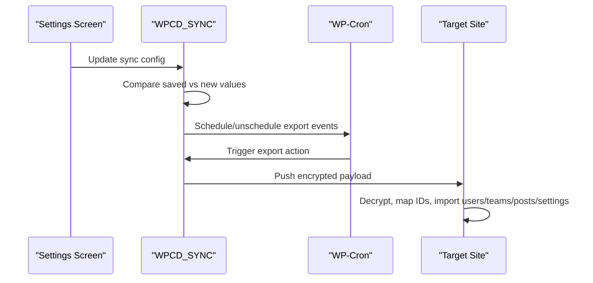
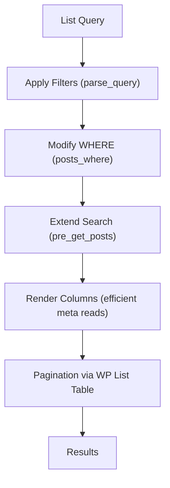
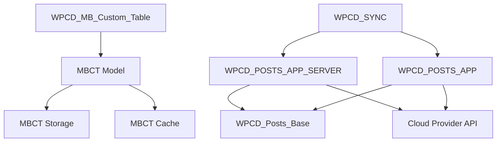

# Data Access Patterns

<cite>
**Referenced Files in This Document**
- [class-wpcd-posts-base.php](file://includes/core/class-wpcd-posts-base.php)
- [class-wpcd-posts-app-server.php](file://includes/core/class-wpcd-posts-app-server.php)
- [class-wpcd-posts-app.php](file://includes/core/class-wpcd-posts-app.php)
- [class-wpcd-sync.php](file://includes/core/class-wpcd-sync.php)
- [class-wpcd-custom-table.php](file://includes/core/custom-table/class-wpcd-custom-table.php)
- [Model.php](file://required_plugins/mb-custom-table/src/Model/Model.php)
- [Cache.php](file://required_plugins/mb-custom-table/src/Cache.php)
- [Storage.php](file://required_plugins/mb-custom-table/src/Storage.php)
- [loader.php](file://includes/core/apps/wordpress-app/public/custom-table/loader.php)
- [class-cloud-provider-api.php](file://includes/core/providers/class-cloud-provider-api.php)
</cite>

## Table of Contents
1. [Introduction](#introduction)
2. [Project Structure](#project-structure)
3. [Core Components](#core-components)
4. [Architecture Overview](#architecture-overview)
5. [Detailed Component Analysis](#detailed-component-analysis)
6. [Dependency Analysis](#dependency-analysis)
7. [Performance Considerations](#performance-considerations)
8. [Troubleshooting Guide](#troubleshooting-guide)
9. [Conclusion](#conclusion)

## Introduction
This document explains the data access patterns and query optimization strategies used throughout SimpleStack. It focuses on:
- The base post type class architecture for custom post types (CPTs).
- Query building patterns, including admin search, filtering, and column rendering.
- Caching mechanisms for both WordPress object cache and provider API transients.
- The relationship between custom post types and custom tables, including synchronization and consistency models.
- Efficient querying patterns, pagination handling, and search optimization.
- Transaction management, error handling, and performance monitoring for data operations.
- Best practices for extending data access layers while maintaining backward compatibility.

## Project Structure
SimpleStack organizes data access across two primary layers:
- Custom Post Types (CPTs): Represent core entities such as servers and apps using WordPress posts with rich metadata.
- Custom Tables: High-performance storage for structured data like providers, DNS zones, and records, managed via a custom table framework.

**Diagram sources**
- [class-wpcd-posts-base.php:16-80](file://includes/core/class-wpcd-posts-base.php#L16-L80)
- [class-wpcd-posts-app-server.php:15-57](file://includes/core/class-wpcd-posts-app-server.php#L15-L57)
- [class-wpcd-posts-app.php:15-56](file://includes/core/class-wpcd-posts-app.php#L15-L56)
- [class-wpcd-custom-table.php:15-112](file://includes/core/custom-table/class-wpcd-custom-table.php#L15-L112)
- [Model.php:4-42](file://required_plugins/mb-custom-table/src/Model/Model.php#L4-L42)
- [Cache.php:4-47](file://required_plugins/mb-custom-table/src/Cache.php#L4-L47)
- [Storage.php:163-181](file://required_plugins/mb-custom-table/src/Storage.php#L163-L181)
- [class-cloud-provider-api.php:512-554](file://includes/core/providers/class-cloud-provider-api.php#L512-L554)
- [class-wpcd-sync.php:15-52](file://includes/core/class-wpcd-sync.php#L15-L52)

**Section sources**
- [class-wpcd-posts-base.php:16-80](file://includes/core/class-wpcd-posts-base.php#L16-L80)
- [class-wpcd-posts-app-server.php:15-57](file://includes/core/class-wpcd-posts-app-server.php#L15-L57)
- [class-wpcd-posts-app.php:15-56](file://includes/core/class-wpcd-posts-app.php#L15-L56)
- [class-wpcd-custom-table.php:15-112](file://includes/core/custom-table/class-wpcd-custom-table.php#L15-L112)
- [Model.php:4-42](file://required_plugins/mb-custom-table/src/Model/Model.php#L4-L42)
- [Cache.php:4-47](file://required_plugins/mb-custom-table/src/Cache.php#L4-L47)
- [Storage.php:163-181](file://required_plugins/mb-custom-table/src/Storage.php#L163-L181)
- [class-cloud-provider-api.php:512-554](file://includes/core/providers/class-cloud-provider-api.php#L512-L554)
- [class-wpcd-sync.php:15-52](file://includes/core/class-wpcd-sync.php#L15-L52)

## Core Components
- Base Post Type Class: Provides shared behavior for custom post types, including display state customization and label injection.
- App Server Post Type: Manages server entities, hooks into WordPress list screens, and integrates with provider APIs for status and metadata.
- App Post Type: Manages application entities, links to parent servers, and exposes columns and filters for efficient listing and search.
- Custom Table Framework: Abstracts CRUD operations, admin/public UI, validation, and persistence for high-volume structured data.
- Synchronization Engine: Handles export/import of users, teams, server/app posts, and settings across sites, ensuring consistent state.

Key responsibilities:
- CPTs encapsulate business logic for servers and apps, leveraging WordPress hooks for admin UX and queries.
- Custom tables provide fast, indexed storage for providers and DNS data, with caching and model abstraction.
- Sync engine coordinates cross-site data movement with encryption, scheduling, and idempotent import logic.

**Section sources**
- [class-wpcd-posts-base.php:16-80](file://includes/core/class-wpcd-posts-base.php#L16-L80)
- [class-wpcd-posts-app-server.php:15-57](file://includes/core/class-wpcd-posts-app-server.php#L15-L57)
- [class-wpcd-posts-app.php:15-56](file://includes/core/class-wpcd-posts-app.php#L15-L56)
- [class-wpcd-custom-table.php:15-112](file://includes/core/custom-table/class-wpcd-custom-table.php#L15-L112)
- [class-wpcd-sync.php:15-52](file://includes/core/class-wpcd-sync.php#L15-L52)

## Architecture Overview
The system uses a dual-layer data model:
- WordPress CPTs for flexible, extensible content with rich metadata and taxonomy relationships.
- Custom tables for performance-critical datasets, accessed through a model layer that abstracts storage and caching.

**Diagram sources**
- [class-wpcd-posts-app-server.php:356-707](file://includes/core/class-wpcd-posts-app-server.php#L356-L707)
- [class-cloud-provider-api.php:512-554](file://includes/core/providers/class-cloud-provider-api.php#L512-L554)
- [Cache.php:4-47](file://required_plugins/mb-custom-table/src/Cache.php#L4-L47)
- [Storage.php:163-181](file://required_plugins/mb-custom-table/src/Storage.php#L163-L181)

## Detailed Component Analysis

### Base Post Type Class Architecture
The base class centralizes common behaviors for custom post types:
- Display state customization: Removes “private” labels conditionally and injects custom labels derived from stored metadata.
- Delete protection flags: Adds visual indicators for protected items.

**Diagram sources**
- [class-wpcd-posts-base.php:16-80](file://includes/core/class-wpcd-posts-base.php#L16-L80)
- [class-wpcd-posts-app-server.php:15-57](file://includes/core/class-wpcd-posts-app-server.php#L15-L57)
- [class-wpcd-posts-app.php:15-56](file://includes/core/class-wpcd-posts-app.php#L15-L56)

**Section sources**
- [class-wpcd-posts-base.php:16-80](file://includes/core/class-wpcd-posts-base.php#L16-L80)

### Query Building Patterns in CPTs
Both app and app server post types extend WordPress’s default query pipeline:
- Admin search extension: Hooks into pre_get_posts to include title and meta fields in search.
- Where clause modification: Uses posts_where to add custom conditions.
- Parse query hook: Adjusts query parameters for filtering by custom meta/taxonomy.
- Column rendering: Dynamically builds list columns with provider details, IPs, groups, and counts.

**Diagram sources**
- [class-wpcd-posts-app-server.php:62-162](file://includes/core/class-wpcd-posts-app-server.php#L62-L162)
- [class-wpcd-posts-app.php:61-156](file://includes/core/class-wpcd-posts-app.php#L61-L156)

**Section sources**
- [class-wpcd-posts-app-server.php:62-162](file://includes/core/class-wpcd-posts-app-server.php#L62-L162)
- [class-wpcd-posts-app.php:61-156](file://includes/core/class-wpcd-posts-app.php#L61-L156)

### Caching Mechanisms
Two primary caching strategies are used:
- Provider API caching: Transient-based caching keyed by method and API key; supports clearing and storing specific methods.
- Custom table row caching: Object cache group per table, with get/set/delete helpers to reduce DB hits.

**Diagram sources**
- [class-cloud-provider-api.php:512-554](file://includes/core/providers/class-cloud-provider-api.php#L512-L554)
- [Cache.php:4-47](file://required_plugins/mb-custom-table/src/Cache.php#L4-L47)

**Section sources**
- [class-cloud-provider-api.php:512-554](file://includes/core/providers/class-cloud-provider-api.php#L512-L554)
- [Cache.php:4-47](file://required_plugins/mb-custom-table/src/Cache.php#L4-L47)

### Relationship Between Custom Post Types and Custom Tables
- CPTs represent high-level entities (servers, apps) with rich metadata and relationships.
- Custom tables store structured reference data (providers, DNS zones/records) optimized for performance.
- The loader bridges public/admin pages to custom table models, enabling shortcode-driven lists and edit screens.

**Diagram sources**
- [class-wpcd-posts-app.php:761-793](file://includes/core/class-wpcd-posts-app.php#L761-L793)
- [loader.php:87-104](file://includes/core/apps/wordpress-app/public/custom-table/loader.php#L87-L104)
- [Model.php:4-42](file://required_plugins/mb-custom-table/src/Model/Model.php#L4-L42)
- [Storage.php:163-181](file://required_plugins/mb-custom-table/src/Storage.php#L163-L181)

**Section sources**
- [class-wpcd-posts-app.php:761-793](file://includes/core/class-wpcd-posts-app.php#L761-L793)
- [loader.php:87-104](file://includes/core/apps/wordpress-app/public/custom-table/loader.php#L87-L104)
- [Model.php:4-42](file://required_plugins/mb-custom-table/src/Model/Model.php#L4-L42)
- [Storage.php:163-181](file://required_plugins/mb-custom-table/src/Storage.php#L163-L181)

### Data Synchronization Strategies and Consistency Models
The sync engine manages cross-site data transfer:
- Export/import of users, teams, server/app posts, and settings.
- Encryption for sensitive configuration values.
- Cron scheduling for automated exports based on settings changes.
- Idempotent imports with optional deletion of existing records before re-import.

**Diagram sources**
- [class-wpcd-sync.php:60-135](file://includes/core/class-wpcd-sync.php#L60-L135)
- [class-wpcd-sync.php:777-800](file://includes/core/class-wpcd-sync.php#L777-L800)

**Section sources**
- [class-wpcd-sync.php:60-135](file://includes/core/class-wpcd-sync.php#L60-L135)
- [class-wpcd-sync.php:777-800](file://includes/core/class-wpcd-sync.php#L777-L800)

### Efficient Querying Patterns, Pagination, and Search Optimization
- Admin search: Extends default search to include meta fields and titles for faster discovery.
- Filtering: Uses parse_query and restrict_manage_posts to add dropdown filters and adjust WHERE clauses.
- Pagination: Relies on WordPress list table infrastructure; custom tables use MBCT list table classes for admin/public views.
- Search optimization: Avoids full-text scans by narrowing queries early and limiting fields where possible.

**Diagram sources**
- [class-wpcd-posts-app-server.php:62-162](file://includes/core/class-wpcd-posts-app-server.php#L62-L162)
- [class-wpcd-posts-app.php:61-156](file://includes/core/class-wpcd-posts-app.php#L61-L156)
- [class-wpcd-custom-table.php:567-578](file://includes/core/custom-table/class-wpcd-custom-table.php#L567-L578)

**Section sources**
- [class-wpcd-posts-app-server.php:62-162](file://includes/core/class-wpcd-posts-app-server.php#L62-L162)
- [class-wpcd-posts-app.php:61-156](file://includes/core/class-wpcd-posts-app.php#L61-L156)
- [class-wpcd-custom-table.php:567-578](file://includes/core/custom-table/class-wpcd-custom-table.php#L567-L578)

### Transaction Management, Error Handling, and Performance Monitoring
- Transactions: Direct database transactions are not explicitly wrapped around multi-step operations in the referenced files; instead, operations rely on WordPress functions and explicit checks for errors.
- Error handling: Validation errors are surfaced via notices; AJAX responses return JSON success/error payloads; provider API caches are cleared when needed.
- Performance monitoring: Logging actions are triggered for cache deletions and debug logs for post creation; frontend scripts handle long-running operations with timeouts and user feedback.

Best practices observed:
- Validate inputs and sanitize data before persistence.
- Use nonce checks and permission gates for AJAX endpoints.
- Provide clear user feedback for failures and long-running tasks.

**Section sources**
- [class-wpcd-custom-table.php:212-235](file://includes/core/custom-table/class-wpcd-custom-table.php#L212-L235)
- [class-wpcd-custom-table.php:635-672](file://includes/core/custom-table/class-wpcd-custom-table.php#L635-L672)
- [class-cloud-provider-api.php:512-554](file://includes/core/providers/class-cloud-provider-api.php#L512-L554)

### Best Practices for Extending Data Access Layers and Maintaining Backward Compatibility
- Extend base classes: Derive new CPT handlers from WPCD_Posts_Base to inherit shared behaviors.
- Use traits for reusable functionality (e.g., metaboxes, taxonomies, teams).
- Leverage filters and actions to customize queries, columns, and UI without modifying core logic.
- For custom tables, define models via MBCT and implement validation and save hooks to maintain consistency.
- Ensure backward compatibility by:
  - Keeping meta keys stable and providing fallbacks.
  - Using options and feature flags to toggle visibility of columns and features.
  - Preserving existing AJAX endpoints and response shapes.

**Section sources**
- [class-wpcd-posts-app-server.php:17-57](file://includes/core/class-wpcd-posts-app-server.php#L17-L57)
- [class-wpcd-posts-app.php:17-56](file://includes/core/class-wpcd-posts-app.php#L17-L56)
- [class-wpcd-custom-table.php:80-112](file://includes/core/custom-table/class-wpcd-custom-table.php#L80-L112)

## Dependency Analysis

**Diagram sources**
- [class-wpcd-posts-base.php:16-80](file://includes/core/class-wpcd-posts-base.php#L16-L80)
- [class-wpcd-posts-app-server.php:15-57](file://includes/core/class-wpcd-posts-app-server.php#L15-L57)
- [class-wpcd-posts-app.php:15-56](file://includes/core/class-wpcd-posts-app.php#L15-L56)
- [class-wpcd-custom-table.php:15-112](file://includes/core/custom-table/class-wpcd-custom-table.php#L15-L112)
- [Model.php:4-42](file://required_plugins/mb-custom-table/src/Model/Model.php#L4-L42)
- [Storage.php:163-181](file://required_plugins/mb-custom-table/src/Storage.php#L163-L181)
- [Cache.php:4-47](file://required_plugins/mb-custom-table/src/Cache.php#L4-L47)
- [class-cloud-provider-api.php:512-554](file://includes/core/providers/class-cloud-provider-api.php#L512-L554)
- [class-wpcd-sync.php:15-52](file://includes/core/class-wpcd-sync.php#L15-L52)

**Section sources**
- [class-wpcd-posts-base.php:16-80](file://includes/core/class-wpcd-posts-base.php#L16-L80)
- [class-wpcd-posts-app-server.php:15-57](file://includes/core/class-wpcd-posts-app-server.php#L15-L57)
- [class-wpcd-posts-app.php:15-56](file://includes/core/class-wpcd-posts-app.php#L15-L56)
- [class-wpcd-custom-table.php:15-112](file://includes/core/custom-table/class-wpcd-custom-table.php#L15-L112)
- [Model.php:4-42](file://required_plugins/mb-custom-table/src/Model/Model.php#L4-L42)
- [Storage.php:163-181](file://required_plugins/mb-custom-table/src/Storage.php#L163-L181)
- [Cache.php:4-47](file://required_plugins/mb-custom-table/src/Cache.php#L4-L47)
- [class-cloud-provider-api.php:512-554](file://includes/core/providers/class-cloud-provider-api.php#L512-L554)
- [class-wpcd-sync.php:15-52](file://includes/core/class-wpcd-sync.php#L15-L52)

## Performance Considerations
- Prefer custom tables for high-volume, frequently queried datasets; leverage MBCT caching to minimize DB calls.
- Use provider API transient caching to avoid repeated external calls; clear caches when credentials or configurations change.
- Optimize admin list queries by limiting fields and avoiding heavy computations in column renderers.
- Batch operations where possible; avoid N+1 queries in loops by grouping meta reads or using IN clauses.
- Monitor long-running tasks and provide user feedback; consider increasing script execution limits for heavy operations.

[No sources needed since this section provides general guidance]

## Troubleshooting Guide
Common issues and resolutions:
- Long-running AJAX operations: Frontend scripts alert about potential gateway timeouts; check SSH/Command logs and increase timeout limits if necessary.
- Validation errors in custom tables: Notices are displayed; verify input sanitization and required fields.
- Provider API cache inconsistencies: Clear provider cache after changing API keys or settings; ensure cache methods are whitelisted.
- Sync import failures: Verify decryption keys and mapping of IDs; ensure target site has required roles and permissions.

**Section sources**
- [class-wpcd-custom-table.php:679-685](file://includes/core/custom-table/class-wpcd-custom-table.php#L679-L685)
- [class-cloud-provider-api.php:512-554](file://includes/core/providers/class-cloud-provider-api.php#L512-L554)
- [class-wpcd-sync.php:192-236](file://includes/core/class-wpcd-sync.php#L192-L236)

## Conclusion
SimpleStack’s data access patterns combine WordPress CPTs for flexibility and custom tables for performance. Query building leverages standard WordPress hooks for search and filtering, while caching strategies reduce overhead for both provider APIs and custom table rows. Synchronization ensures consistent state across sites with careful handling of encryption, scheduling, and idempotent imports. By following the outlined best practices—extending base classes, using filters/actions, and optimizing queries—you can extend the data access layer effectively while maintaining backward compatibility and performance.

[No sources needed since this section summarizes without analyzing specific files]