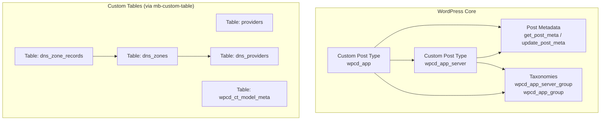
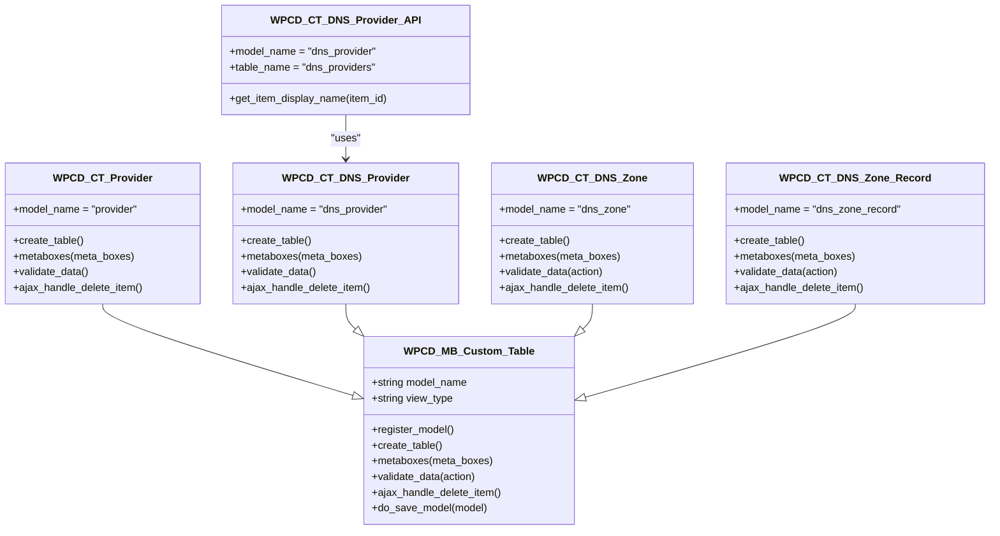
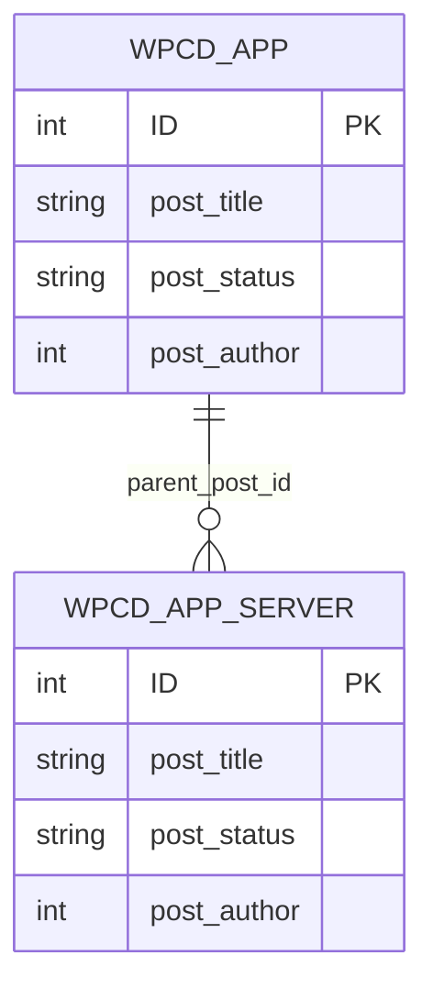
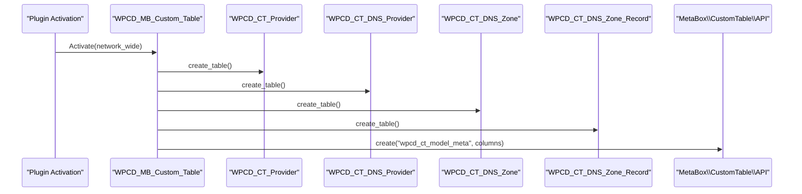
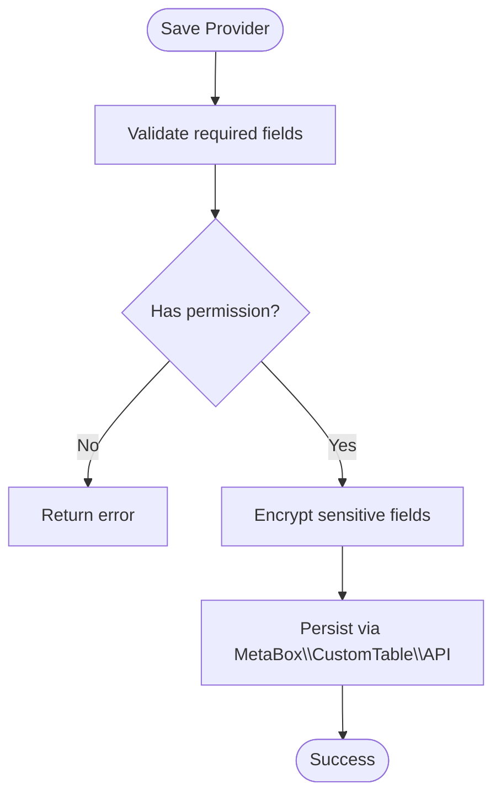
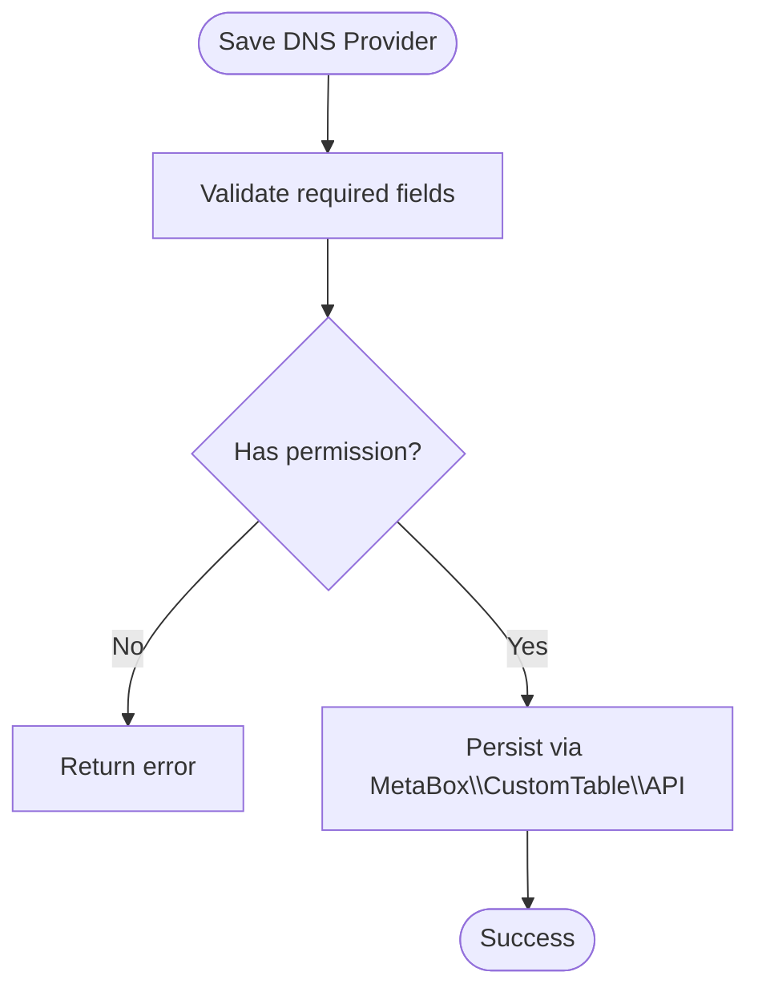
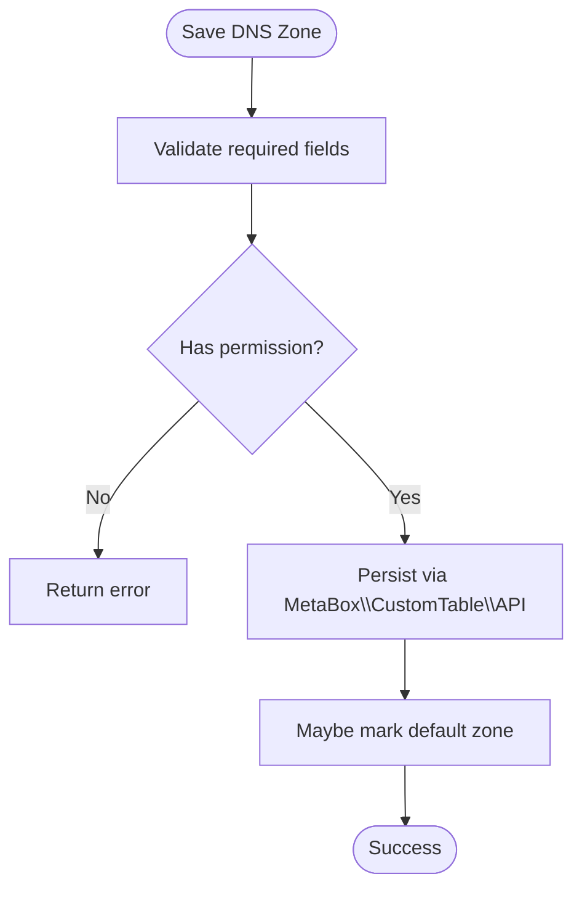
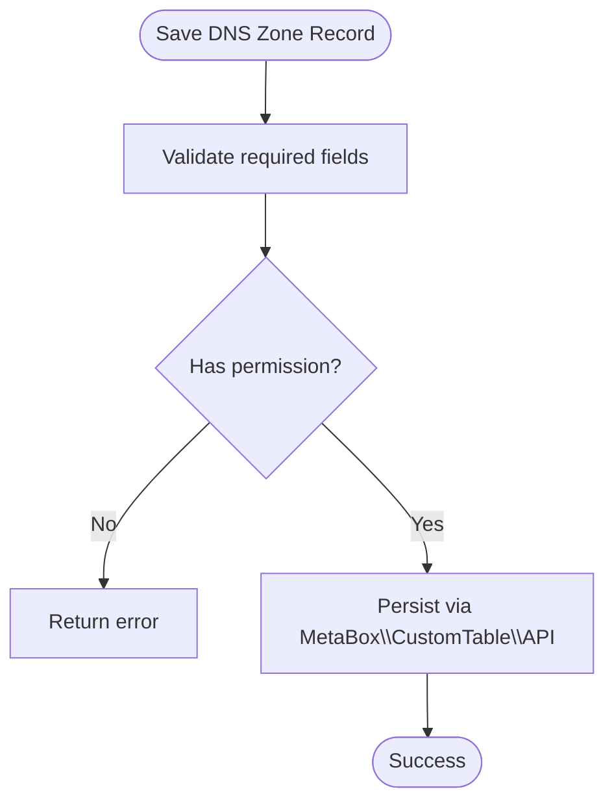
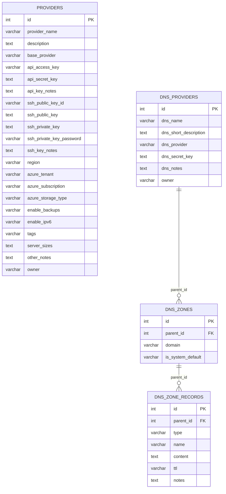
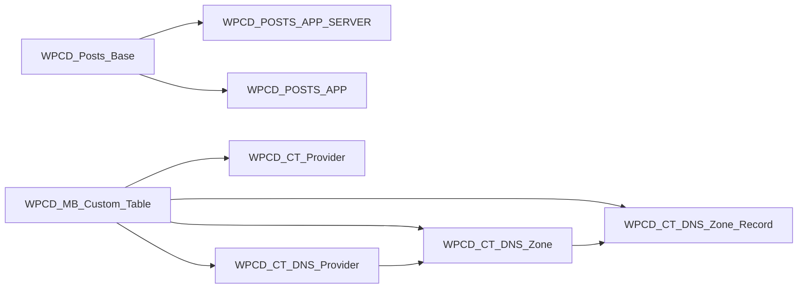

# Data Management

<cite>
**Referenced Files in This Document**
- [class-wpcd-posts-base.php](file://includes/core/class-wpcd-posts-base.php)
- [class-wpcd-posts-app-server.php](file://includes/core/class-wpcd-posts-app-server.php)
- [class-wpcd-posts-app.php](file://includes/core/class-wpcd-posts-app.php)
- [class-wpcd-custom-table.php](file://includes/core/custom-table/class-wpcd-custom-table.php)
- [class-wpcd-provider.php](file://includes/core/custom-table/class-wpcd-provider.php)
- [class-wpcd-dns-provider.php](file://includes/core/custom-table/class-wpcd-dns-provider.php)
- [class-wpcd-dns-zone.php](file://includes/core/custom-table/class-wpcd-dns-zone.php)
- [class-wpcd-dns-zone-record.php](file://includes/core/custom-table/class-wpcd-dns-zone-record.php)
- [class-wpcd-ct-dns-provider-api.php](file://includes/core/custom-table/api/class-wpcd-ct-dns-provider-api.php)
- [API.php](file://required_plugins/mb-custom-table/src/API.php)
</cite>

## Table of Contents
1. [Introduction](#introduction)
2. [Project Structure](#project-structure)
3. [Core Components](#core-components)
4. [Architecture Overview](#architecture-overview)
5. [Detailed Component Analysis](#detailed-component-analysis)
6. [Dependency Analysis](#dependency-analysis)
7. [Performance Considerations](#performance-considerations)
8. [Troubleshooting Guide](#troubleshooting-guide)
9. [Conclusion](#conclusion)

## Introduction
This document describes SimpleStack’s data management layer, focusing on:
- Custom post types for servers and applications
- Custom database tables for performance-critical configuration (providers, DNS providers, zones, zone records)
- The custom table abstraction layer and its API
- Data validation rules, business logic enforcement, and integrity constraints
- Caching strategies, indexing approaches, and performance considerations for large datasets

The goal is to provide a clear, code-mapped view of entities, relationships, fields, and access patterns so both technical and non-technical readers can understand how data is stored, validated, and accessed.

## Project Structure
SimpleStack organizes data persistence across two primary mechanisms:
- WordPress custom post types for high-level entities (servers and apps), with rich metadata and taxonomies
- A custom table abstraction layer (built on the mb-custom-table plugin) for structured, performance-sensitive configuration data (providers, DNS provider, zones, zone records)

**Diagram sources**
- [class-wpcd-posts-app-server.php:316-325](file://includes/core/class-wpcd-posts-app-server.php#L316-L325)
- [class-wpcd-posts-app.php:161-169](file://includes/core/class-wpcd-posts-app.php#L161-L169)
- [class-wpcd-custom-table.php:141-163](file://includes/core/custom-table/class-wpcd-custom-table.php#L141-L163)
- [class-wpcd-provider.php:78-106](file://includes/core/custom-table/class-wpcd-provider.php#L78-L106)
- [class-wpcd-dns-provider.php:73-85](file://includes/core/custom-table/class-wpcd-dns-provider.php#L73-L85)
- [class-wpcd-dns-zone.php:72-80](file://includes/core/custom-table/class-wpcd-dns-zone.php#L72-L80)
- [class-wpcd-dns-zone-record.php:70-82](file://includes/core/custom-table/class-wpcd-dns-zone-record.php#L70-L82)

**Section sources**
- [class-wpcd-posts-app-server.php:316-325](file://includes/core/class-wpcd-posts-app-server.php#L316-L325)
- [class-wpcd-posts-app.php:161-169](file://includes/core/class-wpcd-posts-app.php#L161-L169)
- [class-wpcd-custom-table.php:141-163](file://includes/core/custom-table/class-wpcd-custom-table.php#L141-L163)

## Core Components
- Custom Post Types
  - Server: wpcd_app_server
  - Application: wpcd_app
- Custom Tables
  - Providers (cloud provider configurations)
  - DNS Providers (DNS service credentials and settings)
  - DNS Zones (domains per DNS provider)
  - DNS Zone Records (A, AAAA, CNAME, TXT, NS entries)
- Abstraction Layer
  - WPCD_MB_Custom_Table base class
  - Model registration via mb_register_model
  - Table creation via MetaBox\CustomTable\API::create
  - API classes for each model (e.g., WPCD_CT_DNS_Provider_API)

Key responsibilities:
- Register and manage custom post types and their taxonomies
- Define and create custom tables during activation
- Provide consistent CRUD operations through API classes
- Enforce validation and permissions at save/delete time

**Section sources**
- [class-wpcd-posts-base.php:16-84](file://includes/core/class-wpcd-posts-base.php#L16-L84)
- [class-wpcd-posts-app-server.php:316-325](file://includes/core/class-wpcd-posts-app-server.php#L316-L325)
- [class-wpcd-posts-app.php:161-169](file://includes/core/class-wpcd-posts-app.php#L161-L169)
- [class-wpcd-custom-table.php:15-112](file://includes/core/custom-table/class-wpcd-custom-table.php#L15-L112)
- [class-wpcd-custom-table.php:141-163](file://includes/core/custom-table/class-wpcd-custom-table.php#L141-L163)
- [class-wpcd-provider.php:78-106](file://includes/core/custom-table/class-wpcd-provider.php#L78-L106)
- [class-wpcd-dns-provider.php:73-85](file://includes/core/custom-table/class-wpcd-dns-provider.php#L73-L85)
- [class-wpcd-dns-zone.php:72-80](file://includes/core/custom-table/class-wpcd-dns-zone.php#L72-L80)
- [class-wpcd-dns-zone-record.php:70-82](file://includes/core/custom-table/class-wpcd-dns-zone-record.php#L70-L82)
- [class-wpcd-ct-dns-provider-api.php:6-58](file://includes/core/custom-table/api/class-wpcd-ct-dns-provider-api.php#L6-L58)

## Architecture Overview
The system combines WordPress-native storage for high-level entities with a custom table layer for structured configuration. The custom table layer uses a base class to standardize model registration, table creation, admin/public UI, validation, and AJAX handling.

**Diagram sources**
- [class-wpcd-custom-table.php:15-112](file://includes/core/custom-table/class-wpcd-custom-table.php#L15-L112)
- [class-wpcd-provider.php:9-106](file://includes/core/custom-table/class-wpcd-provider.php#L9-L106)
- [class-wpcd-dns-provider.php:10-85](file://includes/core/custom-table/class-wpcd-dns-provider.php#L10-L85)
- [class-wpcd-dns-zone.php:9-80](file://includes/core/custom-table/class-wpcd-dns-zone.php#L9-L80)
- [class-wpcd-dns-zone-record.php:9-82](file://includes/core/custom-table/class-wpcd-dns-zone-record.php#L9-L82)
- [class-wpcd-ct-dns-provider-api.php:6-58](file://includes/core/custom-table/api/class-wpcd-ct-dns-provider-api.php#L6-L58)

## Detailed Component Analysis

### Custom Post Types: Servers and Applications
- Server (wpcd_app_server)
  - Registered and configured by WPCD_POSTS_APP_SERVER
  - Uses traits for taxonomies, teams, labels/notes
  - Extends WPCD_Posts_Base for display states and delete protection labels
- Application (wpcd_app)
  - Registered and configured by WPCD_POSTS_APP
  - Links to server via parent_post_id meta
  - Uses similar traits as servers

Data relationships:
- App -> Server: parent_post_id meta links an app to its server
- Both use taxonomies for grouping (wpcd_app_server_group, wpcd_app_group)
- Labels and notes are stored as post meta

Validation and integrity:
- Delete protection flags prevent accidental deletion
- Owner changes are gated by capability checks
- Search and filtering extend default WP queries via hooks

**Diagram sources**
- [class-wpcd-posts-app.php:761-793](file://includes/core/class-wpcd-posts-app.php#L761-L793)
- [class-wpcd-posts-base.php:38-80](file://includes/core/class-wpcd-posts-base.php#L38-L80)

**Section sources**
- [class-wpcd-posts-base.php:16-84](file://includes/core/class-wpcd-posts-base.php#L16-L84)
- [class-wpcd-posts-app-server.php:316-325](file://includes/core/class-wpcd-posts-app-server.php#L316-L325)
- [class-wpcd-posts-app.php:161-169](file://includes/core/class-wpcd-posts-app.php#L161-L169)
- [class-wpcd-posts-app.php:761-793](file://includes/core/class-wpcd-posts-app.php#L761-L793)

### Custom Table Abstraction Layer
- Base class WPCD_MB_Custom_Table provides:
  - Model registration via mb_register_model
  - Table creation via MetaBox\CustomTable\API::create
  - Admin/public page rendering, inline editing, AJAX handlers
  - Validation and permission checks
  - Meta table for model-specific metadata

Activation flow creates core tables:
- providers
- dns_providers
- dns_zones
- dns_zone_records
- wpcd_ct_model_meta (for model meta)

**Diagram sources**
- [class-wpcd-custom-table.php:122-163](file://includes/core/custom-table/class-wpcd-custom-table.php#L122-L163)
- [API.php:14-21](file://required_plugins/mb-custom-table/src/API.php#L14-L21)

**Section sources**
- [class-wpcd-custom-table.php:15-112](file://includes/core/custom-table/class-wpcd-custom-table.php#L15-L112)
- [class-wpcd-custom-table.php:122-163](file://includes/core/custom-table/class-wpcd-custom-table.php#L122-L163)
- [API.php:14-21](file://required_plugins/mb-custom-table/src/API.php#L14-L21)

### Providers Table
Purpose: Store cloud provider configurations including API keys, SSH keys, region, tags, and other provider-specific options.

Fields:
- provider_name (varchar(250) NOT NULL)
- description (text)
- base_provider (varchar(100) NOT NULL)
- api_access_key (varchar(200))
- api_secret_key (text)
- api_key_notes (text)
- ssh_public_key_id (varchar(100))
- ssh_public_key (text)
- ssh_private_key (text)
- ssh_private_key_password (varchar(250))
- ssh_key_notes (text)
- region (varchar(100))
- azure_tenant (varchar(200))
- azure_subscription (varchar(300))
- azure_storage_type (varchar(300))
- enable_backups (varchar(1))
- enable_ipv6 (varchar(1))
- tags (varchar(250))
- server_sizes (text)
- other_notes (text)
- owner (varchar(100))

Security:
- Sensitive fields (api_secret_key, ssh_private_key, ssh_private_key_password) are encrypted before saving using filters.

Validation:
- Required fields: provider_name, base_provider
- Permission checks for add/edit/delete actions

**Diagram sources**
- [class-wpcd-provider.php:78-106](file://includes/core/custom-table/class-wpcd-provider.php#L78-L106)
- [class-wpcd-provider.php:434-447](file://includes/core/custom-table/class-wpcd-provider.php#L434-L447)
- [class-wpcd-provider.php:454-481](file://includes/core/custom-table/class-wpcd-provider.php#L454-L481)

**Section sources**
- [class-wpcd-provider.php:78-106](file://includes/core/custom-table/class-wpcd-provider.php#L78-L106)
- [class-wpcd-provider.php:434-447](file://includes/core/custom-table/class-wpcd-provider.php#L434-L447)
- [class-wpcd-provider.php:454-481](file://includes/core/custom-table/class-wpcd-provider.php#L454-L481)

### DNS Providers Table
Purpose: Manage DNS service providers (e.g., Cloudflare, GoDaddy, DNS Made Easy) with credentials and notes.

Fields:
- dns_name (varchar(250) NOT NULL)
- dns_short_description (text)
- dns_provider (varchar(100) NOT NULL)
- dns_secret_key (text)
- dns_notes (text)
- owner (varchar(100))

Validation:
- Required fields: dns_name, dns_provider
- Permission checks enforced for add/edit/delete

Relationships:
- Parent-child: DNS Zones belong to a DNS Provider
- Child items: DNS Zone Records belong to a DNS Zone

**Diagram sources**
- [class-wpcd-dns-provider.php:73-85](file://includes/core/custom-table/class-wpcd-dns-provider.php#L73-L85)
- [class-wpcd-dns-provider.php:345-372](file://includes/core/custom-table/class-wpcd-dns-provider.php#L345-L372)

**Section sources**
- [class-wpcd-dns-provider.php:73-85](file://includes/core/custom-table/class-wpcd-dns-provider.php#L73-L85)
- [class-wpcd-dns-provider.php:345-372](file://includes/core/custom-table/class-wpcd-dns-provider.php#L345-L372)

### DNS Zones Table
Purpose: Define domains under a DNS provider.

Fields:
- parent_id (int(11) NOT NULL) -> references dns_providers.ID
- domain (varchar(200) NOT NULL)
- is_system_default (varchar(1))

Validation:
- Required field: domain
- Permission checks based on provider ownership

Behavior:
- After save, may mark default zone via API hook

**Diagram sources**
- [class-wpcd-dns-zone.php:72-80](file://includes/core/custom-table/class-wpcd-dns-zone.php#L72-L80)
- [class-wpcd-dns-zone.php:240-268](file://includes/core/custom-table/class-wpcd-dns-zone.php#L240-L268)
- [class-wpcd-dns-zone.php:193-195](file://includes/core/custom-table/class-wpcd-dns-zone.php#L193-L195)

**Section sources**
- [class-wpcd-dns-zone.php:72-80](file://includes/core/custom-table/class-wpcd-dns-zone.php#L72-L80)
- [class-wpcd-dns-zone.php:240-268](file://includes/core/custom-table/class-wpcd-dns-zone.php#L240-L268)
- [class-wpcd-dns-zone.php:193-195](file://includes/core/custom-table/class-wpcd-dns-zone.php#L193-L195)

### DNS Zone Records Table
Purpose: Store DNS record entries (A, AAAA, CNAME, TXT, NS) for a specific zone.

Fields:
- parent_id (int(11) NOT NULL) -> references dns_zones.ID
- type (varchar(200) NOT NULL)
- name (varchar(200))
- content (text)
- ttl (varchar(200))
- notes (text)

Validation:
- Required fields: type, name, content, ttl
- Permission checks based on zone and provider ownership

**Diagram sources**
- [class-wpcd-dns-zone-record.php:70-82](file://includes/core/custom-table/class-wpcd-dns-zone-record.php#L70-L82)
- [class-wpcd-dns-zone-record.php:364-402](file://includes/core/custom-table/class-wpcd-dns-zone-record.php#L364-L402)

**Section sources**
- [class-wpcd-dns-zone-record.php:70-82](file://includes/core/custom-table/class-wpcd-dns-zone-record.php#L70-L82)
- [class-wpcd-dns-zone-record.php:364-402](file://includes/core/custom-table/class-wpcd-dns-zone-record.php#L364-L402)

### Data Models Diagram

**Diagram sources**
- [class-wpcd-provider.php:78-106](file://includes/core/custom-table/class-wpcd-provider.php#L78-L106)
- [class-wpcd-dns-provider.php:73-85](file://includes/core/custom-table/class-wpcd-dns-provider.php#L73-L85)
- [class-wpcd-dns-zone.php:72-80](file://includes/core/custom-table/class-wpcd-dns-zone.php#L72-L80)
- [class-wpcd-dns-zone-record.php:70-82](file://includes/core/custom-table/class-wpcd-dns-zone-record.php#L70-L82)

## Dependency Analysis
- Custom Post Types depend on:
  - WPCD_Posts_Base for shared behavior (display states, delete protection)
  - Traits for taxonomy, team, and label/notes management
  - WordPress hooks for admin UI and query modification
- Custom Tables depend on:
  - WPCD_MB_Custom_Table for common functionality
  - MetaBox\CustomTable\API for schema creation and persistence
  - API classes (e.g., WPCD_CT_DNS_Provider_API) for model-specific helpers

Coupling and cohesion:
- Each custom table model encapsulates its own schema, validation, and UI, improving cohesion
- Shared base class reduces duplication and ensures consistent behavior

Potential circular dependencies:
- None observed; models reference each other only via parent_id foreign keys conceptually, not via PHP imports

External dependencies:
- WordPress core functions (wp_insert_post, get_post_meta, etc.)
- mb-custom-table plugin for custom table infrastructure

**Diagram sources**
- [class-wpcd-posts-base.php:16-84](file://includes/core/class-wpcd-posts-base.php#L16-L84)
- [class-wpcd-posts-app-server.php:316-325](file://includes/core/class-wpcd-posts-app-server.php#L316-L325)
- [class-wpcd-posts-app.php:161-169](file://includes/core/class-wpcd-posts-app.php#L161-L169)
- [class-wpcd-custom-table.php:15-112](file://includes/core/custom-table/class-wpcd-custom-table.php#L15-L112)
- [class-wpcd-provider.php:9-106](file://includes/core/custom-table/class-wpcd-provider.php#L9-L106)
- [class-wpcd-dns-provider.php:10-85](file://includes/core/custom-table/class-wpcd-dns-provider.php#L10-L85)
- [class-wpcd-dns-zone.php:9-80](file://includes/core/custom-table/class-wpcd-dns-zone.php#L9-L80)
- [class-wpcd-dns-zone-record.php:9-82](file://includes/core/custom-table/class-wpcd-dns-zone-record.php#L9-L82)

**Section sources**
- [class-wpcd-posts-base.php:16-84](file://includes/core/class-wpcd-posts-base.php#L16-L84)
- [class-wpcd-custom-table.php:15-112](file://includes/core/custom-table/class-wpcd-custom-table.php#L15-L112)

## Performance Considerations
- Indexing
  - No explicit indexes defined in table schemas; consider adding indexes on frequently queried columns such as parent_id, domain, type, and name for DNS-related tables to improve lookup performance.
- Query Optimization
  - For large datasets, prefer querying by indexed columns and avoid SELECT * where possible.
  - Use pagination and limit results in list views.
- Caching Strategies
  - Object caching (Redis/Memcached) is supported at the application level; enabling these services can reduce repeated database load for frequently accessed data.
  - Transients or object cache plugins can be used to cache computed lists (e.g., provider dropdowns).
- Database Schema Design
  - Keep fields normalized; avoid storing large blobs in frequently accessed rows.
  - Use appropriate data types (e.g., varchar vs text) to minimize storage overhead.
- Activation and Migration
  - Table creation is handled during plugin activation; ensure migrations are idempotent and safe for multisite environments.

[No sources needed since this section provides general guidance]

## Troubleshooting Guide
Common issues and resolutions:
- Validation Errors
  - Missing required fields (e.g., provider_name, base_provider, dns_name, dns_provider, domain, type, name, content, ttl) will cause save failures. Check form inputs and server logs.
- Permission Denied
  - Add/edit/delete actions enforce role/user permissions. Ensure the current user has the necessary capabilities or is listed as allowed users/roles.
- Encryption Issues
  - Sensitive fields (api_secret_key, ssh_private_key, ssh_private_key_password) are encrypted before saving. If decryption fails, verify encryption filters are active and keys are correctly configured.
- Deletion Cascades
  - Deleting a DNS provider removes associated zones and zone records. Confirm cascading deletes are expected when removing providers.

**Section sources**
- [class-wpcd-provider.php:454-481](file://includes/core/custom-table/class-wpcd-provider.php#L454-L481)
- [class-wpcd-dns-provider.php:345-372](file://includes/core/custom-table/class-wpcd-dns-provider.php#L345-L372)
- [class-wpcd-dns-zone.php:240-268](file://includes/core/custom-table/class-wpcd-dns-zone.php#L240-L268)
- [class-wpcd-dns-zone-record.php:364-402](file://includes/core/custom-table/class-wpcd-dns-zone-record.php#L364-L402)
- [class-wpcd-provider.php:434-447](file://includes/core/custom-table/class-wpcd-provider.php#L434-L447)

## Conclusion
SimpleStack’s data management layer combines WordPress custom post types for high-level entities with a robust custom table abstraction for structured configuration data. The design emphasizes:
- Clear separation of concerns between post-based entities and custom tables
- Consistent validation, permission checks, and security measures
- Extensibility through traits, APIs, and hooks
- Opportunities for performance tuning via indexing and caching

By following the documented entity relationships, field definitions, and access patterns, developers can confidently extend and maintain the system while ensuring data integrity and performance.

[No sources needed since this section summarizes without analyzing specific files]