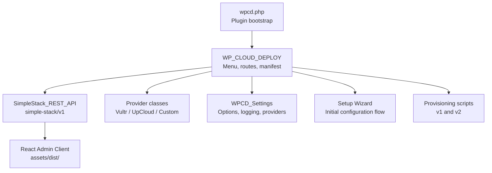
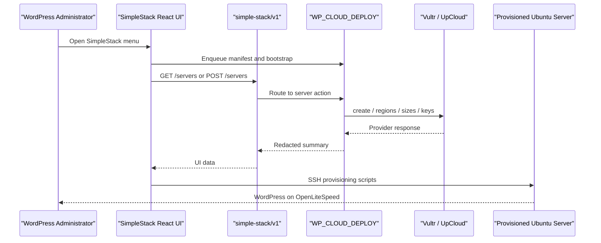
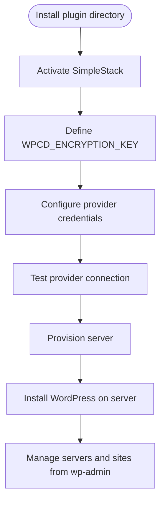
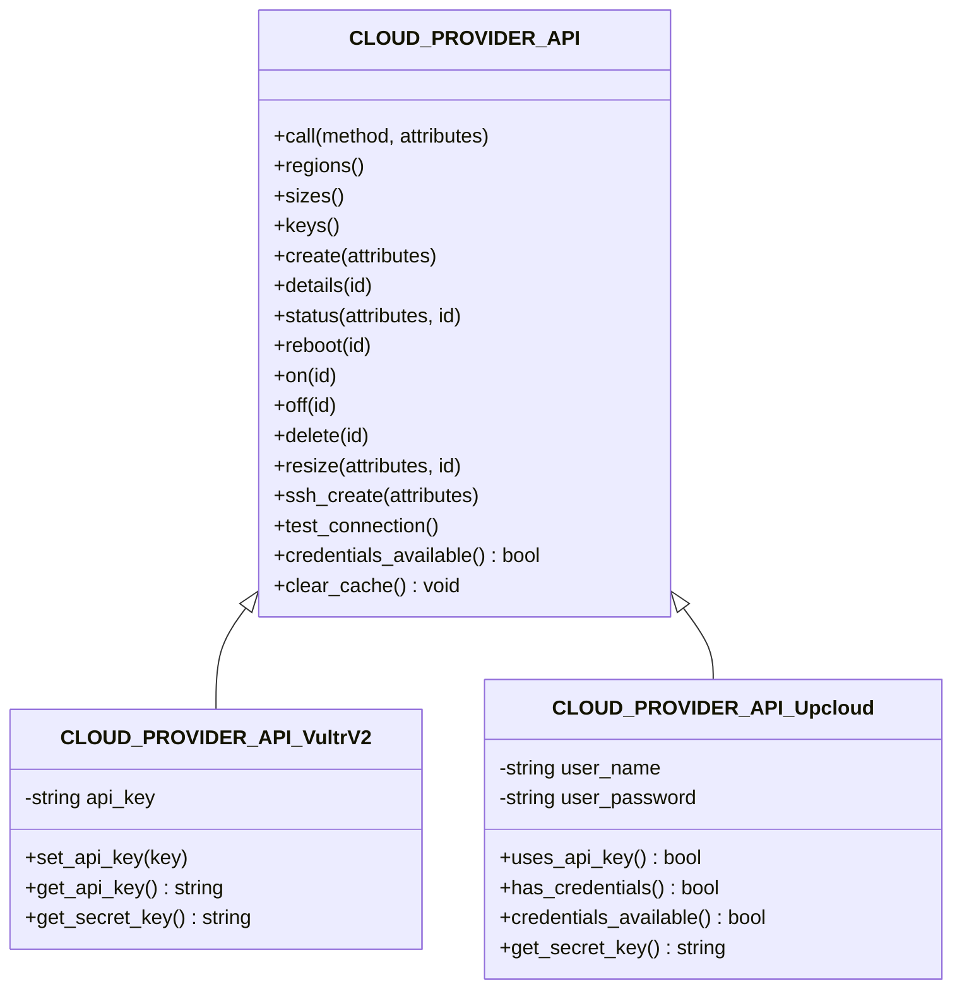
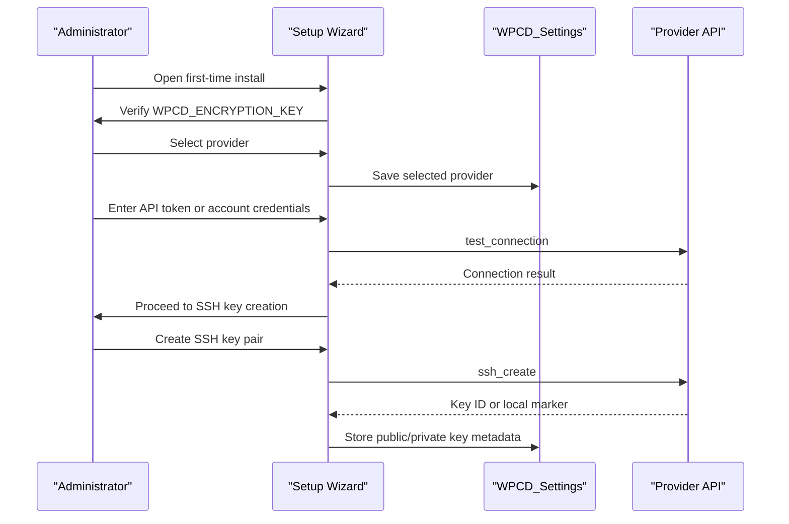
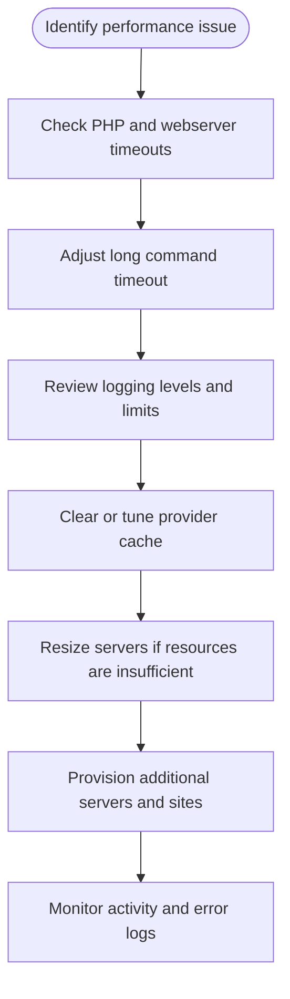
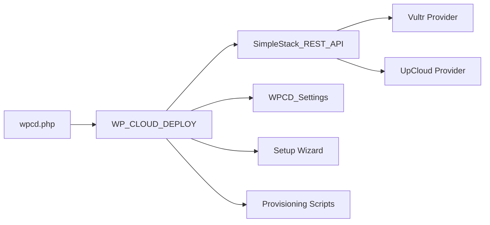

# Deployment & Operations

<cite>
**Referenced Files in This Document**
- [README.md](file://README.md)
- [wpcd.php](file://wpcd.php)
- [includes/core/wp-cloud-deploy.php](file://includes/core/wp-cloud-deploy.php)
- [docs/SIMPLESTACK.md](file://docs/SIMPLESTACK.md)
- [includes/core/api/class-simplestack-rest-api.php](file://includes/core/api/class-simplestack-rest-api.php)
- [includes/core/class-wpcd-settings.php](file://includes/core/class-wpcd-settings.php)
- [includes/core/class-wpcd-setup-wizard.php](file://includes/core/class-wpcd-setup-wizard.php)
- [includes/core/providers/class-vultr-v2.php](file://includes/core/providers/class-vultr-v2.php)
- [includes/core/providers/class-upcloud.php](file://includes/core/providers/class-upcloud.php)
</cite>

## Table of Contents
1. [Introduction](#introduction)
2. [Project Structure](#project-structure)
3. [Core Components](#core-components)
4. [Architecture Overview](#architecture-overview)
5. [Detailed Component Analysis](#detailed-component-analysis)
6. [Dependency Analysis](#dependency-analysis)
7. [Performance Considerations](#performance-considerations)
8. [Troubleshooting Guide](#troubleshooting-guide)
9. [Conclusion](#conclusion)
10. [Appendices](#appendices)

## Introduction
SimpleStack is an internal WordPress plugin that provisions servers at Vultr and UpCloud, installs OpenLiteSpeed with WordPress over SSH, and manages every server and site from the WordPress admin dashboard. It is a private fork of WP Cloud Deploy 5.8.0 rebuilt around a single web stack and a single React-based admin UI. There is no external control plane, no license server, no telemetry, and no upsell.

For production deployment, operators install the plugin inside `wp-content/plugins/simple-stack/`, activate it, configure provider credentials, set the OpenLiteSpeed WebAdmin access policy, and then provision servers and sites through the SimpleStack menu. The REST API surface is `simple-stack/v1` and is gated by `manage_options`.

**Section sources**
- [README.md:1-58](file://README.md#L1-L58)
- [docs/SIMPLESTACK.md:1-12](file://docs/SIMPLESTACK.md#L1-L12)

## Project Structure
The repository follows a layered WordPress plugin layout:

- Plugin entry point defines constants, activation hooks, required files, and loads the main controller.
- Core classes manage post types, roles, settings, providers, apps, logs, and notifications.
- A new SimpleStack REST layer under `includes/core/api/` exposes the React client’s operations.
- The React admin client lives under `src/admin/` and is built into `assets/dist/`.
- Provisioning scripts live under `includes/core/apps/wordpress-app/scripts/v{1,2}/`.
- Provider implementations are under `includes/core/providers/`.

**Diagram sources**
- [wpcd.php:16-130](file://wpcd.php#L16-L130)
- [includes/core/wp-cloud-deploy.php:15-138](file://includes/core/wp-cloud-deploy.php#L15-L138)
- [includes/core/api/class-simplestack-rest-api.php:21-53](file://includes/core/api/class-simplestack-rest-api.php#L21-L53)

**Section sources**
- [wpcd.php:16-130](file://wpcd.php#L16-L130)
- [includes/core/wp-cloud-deploy.php:15-138](file://includes/core/wp-cloud-deploy.php#L15-L138)
- [docs/SIMPLESTACK.md:15-32](file://docs/SIMPLESTACK.md#L15-L32)

## Core Components
This section summarizes the operational components an operator must understand when deploying and running SimpleStack in production.

| Component | Responsibility | Operational Impact |
|---|---|---|
| Plugin bootstrap | Defines constants, registers activation/deactivation hooks, loads required files, initializes REST and main controller | Controls runtime availability, cron schedules, and admin notices |
| Main controller | Registers menus, React container, Vite manifest handling, screen routing, help text | Determines whether the admin bundle loads and which screens are reachable |
| REST API | Registers controllers for servers, sites, logs, tabs, providers, security | Single authenticated API surface for the React UI |
| Settings | Stores options, logging levels, provider cache limits, backup settings, warning emails | Central place for maintenance tuning and diagnostics |
| Setup wizard | Guides encryption key setup, provider selection, credential entry, SSH key creation | First-run configuration path |
| Providers | Vultr v2, UpCloud, custom server, disabled DigitalOcean | Cloud API integration, region/size/key management, power/snapshot/resize behavior |
| Provisioning scripts | Install OpenLiteSpeed, PHP, MariaDB, Redis, certbot, firewall, OLS vhost | Server bootstrapping and site installation |

**Section sources**
- [wpcd.php:16-130](file://wpcd.php#L16-L130)
- [includes/core/wp-cloud-deploy.php:107-138](file://includes/core/wp-cloud-deploy.php#L107-L138)
- [includes/core/api/class-simplestack-rest-api.php:21-53](file://includes/core/api/class-simplestack-rest-api.php#L21-L53)
- [includes/core/class-wpcd-settings.php:32-66](file://includes/core/class-wpcd-settings.php#L32-L66)
- [includes/core/class-wpcd-setup-wizard.php:21-48](file://includes/core/class-wpcd-setup-wizard.php#L21-L48)
- [docs/SIMPLESTACK.md:278-297](file://docs/SIMPLESTACK.md#L278-L297)

## Architecture Overview
SimpleStack runs entirely inside WordPress. Operators use the SimpleStack top-level menu to reach Servers, Sites, Providers, and Activity. The React client mounts into `#simplestack-admin`, reads the Vite build manifest, and calls `simple-stack/v1`. All provider interactions go through provider classes; there is no third-party SaaS in the control path.

**Diagram sources**
- [includes/core/wp-cloud-deploy.php:324-336](file://includes/core/wp-cloud-deploy.php#L324-L336)
- [includes/core/wp-cloud-deploy.php:467-526](file://includes/core/wp-cloud-deploy.php#L467-L526)
- [includes/core/api/class-simplestack-rest-api.php:84-99](file://includes/core/api/class-simplestack-rest-api.php#L84-L99)
- [docs/SIMPLESTACK.md:67-114](file://docs/SIMPLESTACK.md#L67-L114)

## Detailed Component Analysis

### Production Installation and Activation
Installation requires copying the plugin directory into `wp-content/plugins/simple-stack/`, activating SimpleStack, configuring provider credentials, testing the connection, and provisioning a server. The plugin also warns about missing encryption keys, localhost usage, default permalinks, unreadable script directories, and non-running critical crons.

Key operational requirements:
- WordPress 6.5+ and PHP 8.1+.
- Node 20+ only for building the frontend; production does not need Node because `assets/dist/` is committed.
- Vultr API key and/or UpCloud API credentials.
- An SSH key pair for provider authentication.
- Non-default WordPress permalinks.
- `WPCD_ENCRYPTION_KEY` defined in `wp-config.php` for encrypted storage of secrets.

**Diagram sources**
- [README.md:47-58](file://README.md#L47-L58)
- [wpcd.php:166-235](file://wpcd.php#L166-L235)
- [wpcd.php:452-543](file://wpcd.php#L452-L543)

**Section sources**
- [README.md:39-58](file://README.md#L39-L58)
- [wpcd.php:166-235](file://wpcd.php#L166-L235)
- [wpcd.php:452-543](file://wpcd.php#L452-L543)

### Environment Configuration
Production environments should configure:

| Setting | Purpose | Recommendation |
|---|---|---|
| `WPCD_ENCRYPTION_KEY` | Encrypts API keys, SSH keys, and other secrets | Define a strong random value in `wp-config.php`; do not leave the example value |
| Permalinks | Required for callbacks and REST routing | Use a non-plain structure |
| PHP execution timeout | Long provisioning commands may exceed defaults | Increase `max_execution_time` to 180 seconds or more |
| Webserver timeouts | Nginx/Apache proxy timeouts can interrupt long commands | Set relevant timeouts to 600 seconds or more |
| OpenLiteSpeed WebAdmin IP | Restricts port 7080 access | Configure the admin IP; otherwise the console stays loopback-only |
| Cron schedule | Background tasks depend on scheduled actions | Ensure critical SimpleStack crons run regularly |

The settings screen documents SSH and webserver timeout guidance, logging controls, provider cache limits, backup settings, and warning email toggles.

**Section sources**
- [wpcd.php:452-543](file://wpcd.php#L452-L543)
- [includes/core/class-wpcd-settings.php:86-122](file://includes/core/class-wpcd-settings.php#L86-L122)
- [includes/core/class-wpcd-settings.php:194-322](file://includes/core/class-wpcd-settings.php#L194-L322)
- [docs/SIMPLESTACK.md:193-205](file://docs/SIMPLESTACK.md#L193-L205)

### Plugin Installation and Activation Process
Activation performs database and capability initialization, loads app traits, activates WordPress app components, sync components, roles/capabilities, log post types, pending tasks, optional DNS/custom tables, public app components, notification user components, and optionally email notifications. Deactivation reverses many of these steps.

Operational notes:
- Activation flushes rewrite rules.
- A transient suppresses immediate cron warnings right after activation.
- Missing build output renders an operator-facing notice rather than a blank screen.

**Section sources**
- [wpcd.php:166-262](file://wpcd.php#L166-L262)
- [includes/core/wp-cloud-deploy.php:324-336](file://includes/core/wp-cloud-deploy.php#L324-L336)

### Provider Credential Setup
Supported providers:
- Vultr v2 bearer token.
- UpCloud account username and password.
- Custom server.
- DigitalOcean present but disabled by default.

Credential handling:
- Credentials are stored encrypted.
- Provider classes decrypt values at runtime.
- REST responses redact secrets and expose presence booleans instead of values.
- Each provider declares feature flags such as `test_connection`, `ssh_create`, snapshots, resize, and backups.

**Diagram sources**
- [includes/core/providers/class-vultr-v2.php:30-127](file://includes/core/providers/class-vultr-v2.php#L30-L127)
- [includes/core/providers/class-upcloud.php:33-128](file://includes/core/providers/class-upcloud.php#L33-L128)

**Section sources**
- [docs/SIMPLESTACK.md:278-297](file://docs/SIMPLESTACK.md#L278-L297)
- [includes/core/providers/class-vultr-v2.php:19-29](file://includes/core/providers/class-vultr-v2.php#L19-L29)
- [includes/core/providers/class-upcloud.php:17-32](file://includes/core/providers/class-upcloud.php#L17-L32)
- [includes/core/class-wpcd-settings.php:519-531](file://includes/core/class-wpcd-settings.php#L519-L531)

### Initial Configuration Requirements
The setup wizard guides operators through:
1. General setup and encryption key verification.
2. Selecting a cloud provider.
3. Connecting to the provider and saving credentials.
4. Creating an SSH key pair and registering it with the provider.
5. Completing initial configuration.

The wizard validates provider selection, saves selected provider state, encrypts provider tokens and passwords, tests the provider connection, and stores generated SSH keys.

**Diagram sources**
- [includes/core/class-wpcd-setup-wizard.php:162-214](file://includes/core/class-wpcd-setup-wizard.php#L162-L214)
- [includes/core/class-wpcd-setup-wizard.php:312-366](file://includes/core/class-wpcd-setup-wizard.php#L312-L366)
- [includes/core/class-wpcd-setup-wizard.php:445-482](file://includes/core/class-wpcd-setup-wizard.php#L445-L482)
- [includes/core/class-wpcd-setup-wizard.php:682-731](file://includes/core/class-wpcd-setup-wizard.php#L682-L731)
- [includes/core/class-wpcd-setup-wizard.php:736-794](file://includes/core/class-wpcd-setup-wizard.php#L736-L794)

**Section sources**
- [includes/core/class-wpcd-setup-wizard.php:40-48](file://includes/core/class-wpcd-setup-wizard.php#L40-L48)
- [includes/core/class-wpcd-setup-wizard.php:162-214](file://includes/core/class-wpcd-setup-wizard.php#L162-L214)
- [includes/core/class-wpcd-setup-wizard.php:312-366](file://includes/core/class-wpcd-setup-wizard.php#L312-L366)
- [includes/core/class-wpcd-setup-wizard.php:445-482](file://includes/core/class-wpcd-setup-wizard.php#L445-L482)
- [includes/core/class-wpcd-setup-wizard.php:682-731](file://includes/core/class-wpcd-setup-wizard.php#L682-L731)
- [includes/core/class-wpcd-setup-wizard.php:736-794](file://includes/core/class-wpcd-setup-wizard.php#L736-L794)

### Update Procedures
SimpleStack ships a committed frontend build, so updating the plugin normally means replacing the plugin directory contents and reloading the admin interface. If the Vite manifest is missing, the admin page shows an operator-facing notice instructing the operator to rebuild the admin bundle.

Recommended update procedure:
1. Back up the WordPress database and site files.
2. Disable background provisioning if active instances are mid-operation.
3. Replace the plugin directory with the updated version.
4. Activate SimpleStack if needed.
5. Verify the SimpleStack admin bundle loads.
6. Run provider connection tests.
7. Review activity logs for failed tasks.

**Section sources**
- [README.md:67-77](file://README.md#L67-L77)
- [includes/core/wp-cloud-deploy.php:324-336](file://includes/core/wp-cloud-deploy.php#L324-L336)
- [includes/core/wp-cloud-deploy.php:376-399](file://includes/core/wp-cloud-deploy.php#L376-L399)

### Backup Strategies and Disaster Recovery
Backup-related functionality includes:
- Local configuration file backups.
- Site filesystem and database backups.
- Backup restore workflows.
- Scheduled backup management.
- Backup list refresh and credential saving.
- Cleanup and pruning of old backups.
- Server-level backup operations.

Operational recommendations:
- Enable provider-backed backups where supported, such as Vultr.
- Keep offsite copies of application backups.
- Test restores regularly.
- Use the backup prune operations to prevent unbounded disk growth.
- Monitor backup task logs and error logs.

**Section sources**
- [includes/core/class-wpcd-settings.php:419-440](file://includes/core/class-wpcd-settings.php#L419-L440)
- [includes/core/apps/wordpress-app/scripts/v1/raw/08-backup.txt:983-1052](file://includes/core/apps/wordpress-app/scripts/v1/raw/08-backup.txt#L983-L1052)
- [includes/core/apps/wordpress-app/scripts/v1/raw/41-wp-backup2.txt:1-449](file://includes/core/apps/wordpress-app/scripts/v1/raw/41-wp-backup2.txt#L1-L449)
- [includes/core/apps/wordpress-app/traits/traits-for-class-wordpress-app/after-prepare-server.php:139-167](file://includes/core/apps/wordpress-app/traits/traits-for-class-wordpress-app/after-prepare-server.php#L139-L167)

### Performance Tuning, Resource Allocation, and Scaling
Performance considerations include:

- PHP execution time: increase to 180 seconds or more for long provisioning commands.
- Webserver timeouts: set Nginx/Apache proxy and read timeouts to 600 seconds or more.
- Long command timeout setting: SimpleStack allows increasing the maximum time for long-running commands beyond the default.
- Provider cache limits: reduce repeated API calls for regions, sizes, and keys.
- Logging volume: avoid enabling all log types unless directed by support, because logs can grow quickly.
- Server sizing: provider size mappings filter out undersized plans and require realistic CPU/RAM for the stack.
- Scaling: scale horizontally by provisioning additional servers and sites; resize existing servers through provider-supported operations.

**Diagram sources**
- [includes/core/class-wpcd-settings.php:86-122](file://includes/core/class-wpcd-settings.php#L86-L122)
- [includes/core/class-wpcd-settings.php:394-417](file://includes/core/class-wpcd-settings.php#L394-L417)
- [includes/core/class-wpcd-settings.php:194-322](file://includes/core/class-wpcd-settings.php#L194-L322)
- [includes/core/providers/class-vultr-v2.php:298-333](file://includes/core/providers/class-vultr-v2.php#L298-L333)
- [includes/core/providers/class-upcloud.php:416-450](file://includes/core/providers/class-upcloud.php#L416-L450)

**Section sources**
- [includes/core/class-wpcd-settings.php:86-122](file://includes/core/class-wpcd-settings.php#L86-L122)
- [includes/core/class-wpcd-settings.php:394-417](file://includes/core/class-wpcd-settings.php#L394-L417)
- [includes/core/class-wpcd-settings.php:194-322](file://includes/core/class-wpcd-settings.php#L194-L322)
- [includes/core/providers/class-vultr-v2.php:298-333](file://includes/core/providers/class-vultr-v2.php#L298-L333)
- [includes/core/providers/class-upcloud.php:416-450](file://includes/core/providers/class-upcloud.php#L416-L450)

### Monitoring, Alerting, and Capacity Planning
Monitoring and alerting capabilities include:
- Merged activity feed across command, SSH, and error logs.
- Dedicated log post types for SSH, command, error, pending tasks, notify, and notify sent entries.
- Warning emails for absent critical crons.
- Pending task warnings.
- Log trimming controls to limit database growth.
- Provider cache visibility for diagnostics.

Capacity planning should consider:
- Provider plan constraints and minimum memory requirements.
- Disk usage from backups, logs, and site content.
- Network bandwidth and storage tier differences between providers.
- Snapshot and backup retention policies.
- Horizontal scaling through additional servers and sites.

**Section sources**
- [docs/SIMPLESTACK.md:72-91](file://docs/SIMPLESTACK.md#L72-L91)
- [wpcd.php:545-623](file://wpcd.php#L545-L623)
- [includes/core/class-wpcd-settings.php:194-322](file://includes/core/class-wpcd-settings.php#L194-L322)
- [includes/core/providers/class-vultr-v2.php:298-333](file://includes/core/providers/class-vultr-v2.php#L298-L333)
- [includes/core/providers/class-upcloud.php:416-450](file://includes/core/providers/class-upcloud.php#L416-L450)

### Troubleshooting Guide
Common operational issues and diagnostic procedures:

| Symptom | Likely Cause | Diagnostic Action |
|---|---|---|
| SimpleStack admin page is blank or shows a missing bundle notice | `assets/dist/.vite/manifest.json` is missing or unreadable | Rebuild the admin bundle or restore the committed build output |
| Provider connection fails | Invalid API token, wrong account credentials, or network restriction | Use the provider test endpoint and verify credentials |
| Provisioning hangs | PHP/webserver timeout too low or slow provider VM | Increase timeouts and review activity/logs |
| Critical cron warnings appear | WordPress cron not firing frequently enough | Verify system cron or traffic-driven WP-CRON scheduling |
| OpenLiteSpeed WebAdmin is unreachable | Admin IP not configured or port 7080 blocked | Configure the admin IP or use the provided SSH tunnel command |
| Secrets appear in logs or responses | Misconfiguration or unexpected logging level | Reduce logging verbosity and inspect secret redaction behavior |

Diagnostic tools available in the codebase:
- Activity log route for merged command, SSH, and error entries.
- Log type filtering and inclusion/exclusion patterns.
- Provider cache clearing.
- Better cron diagnostics.
- Encryption key warnings.
- Permalink and localhost warnings.

**Section sources**
- [includes/core/wp-cloud-deploy.php:324-336](file://includes/core/wp-cloud-deploy.php#L324-L336)
- [includes/core/wp-cloud-deploy.php:376-399](file://includes/core/wp-cloud-deploy.php#L376-L399)
- [includes/core/class-wpcd-settings.php:194-322](file://includes/core/class-wpcd-settings.php#L194-L322)
- [wpcd.php:452-543](file://wpcd.php#L452-L543)
- [wpcd.php:545-623](file://wpcd.php#L545-L623)
- [docs/SIMPLESTACK.md:193-205](file://docs/SIMPLESTACK.md#L193-L205)

## Dependency Analysis
SimpleStack depends on WordPress core, PHP, and the selected cloud provider APIs. Internally:

- `wpcd.php` loads required files and instantiates the main controller.
- `WP_CLOUD_DEPLOY` registers menus, React assets, and helper screens.
- `SimpleStack_REST_API` loads and registers REST controllers.
- Provider classes implement a shared contract for cloud operations.
- Settings and setup wizard provide configuration surfaces.
- Provisioning scripts execute on target servers via SSH.

**Diagram sources**
- [wpcd.php:267-416](file://wpcd.php#L267-L416)
- [includes/core/wp-cloud-deploy.php:107-138](file://includes/core/wp-cloud-deploy.php#L107-L138)
- [includes/core/api/class-simplestack-rest-api.php:63-99](file://includes/core/api/class-simplestack-rest-api.php#L63-L99)
- [includes/core/providers/class-vultr-v2.php:30-127](file://includes/core/providers/class-vultr-v2.php#L30-L127)
- [includes/core/providers/class-upcloud.php:33-128](file://includes/core/providers/class-upcloud.php#L33-L128)

**Section sources**
- [wpcd.php:267-416](file://wpcd.php#L267-L416)
- [includes/core/wp-cloud-deploy.php:107-138](file://includes/core/wp-cloud-deploy.php#L107-L138)
- [includes/core/api/class-simplestack-rest-api.php:63-99](file://includes/core/api/class-simplestack-rest-api.php#L63-L99)

## Performance Considerations
Production deployments should treat SimpleStack as a control plane that orchestrates external infrastructure. Performance bottlenecks usually occur in three places:

1. **WordPress host**: insufficient PHP/webserver timeouts, heavy logging, or infrequent cron execution.
2. **Provider API rate limits or latency**: mitigated by caching regions, sizes, and keys.
3. **Target server provisioning**: slow VM boot, large backups, or misconfigured OpenLiteSpeed hardening.

Best practices:
- Keep logging selective and bounded.
- Use provider caches and clear them only when provider metadata changes.
- Avoid enabling debug or trace logging in production unless troubleshooting.
- Size servers according to provider plan constraints and workload needs.
- Schedule backups and cleanup jobs to prevent disk exhaustion.
- Monitor activity logs for stuck tasks and failed provider calls.

[No sources needed since this section provides general guidance]

## Troubleshooting Guide
This guide consolidates operational diagnostics.

### Checklist
- Confirm WordPress permalinks are not plain.
- Confirm `WPCD_ENCRYPTION_KEY` is defined and not the example value.
- Confirm SimpleStack admin bundle exists.
- Confirm provider credentials pass the test connection.
- Confirm critical crons are running.
- Confirm OpenLiteSpeed WebAdmin IP is configured or SSH tunnel is used.
- Review activity, command, SSH, and error logs.
- Check provider cache status and clear it if metadata changed.

### Common Error Patterns
- Missing provider instance ID: indicates incomplete request data or stale server record.
- Missing region or size: indicates provider mapping or selection failure.
- Missing SSH key: especially important for UpCloud, which requires inline public key material during creation.
- Power operation timeout: both Vultr and UpCloud infer completion from server state and use elapsed-time backstops.

**Section sources**
- [wpcd.php:452-543](file://wpcd.php#L452-L543)
- [includes/core/providers/class-vultr-v2.php:500-553](file://includes/core/providers/class-vultr-v2.php#L500-L553)
- [includes/core/providers/class-upcloud.php:642-687](file://includes/core/providers/class-upcloud.php#L642-L687)

## Conclusion
SimpleStack is a focused hosting control plane that keeps provisioning, configuration, and management inside WordPress. For production, operators should secure secrets, configure provider credentials, restrict OpenLiteSpeed WebAdmin access, tune timeouts and logging, schedule backups, monitor activity logs, and plan capacity using provider plans and server resizing. The plugin’s architecture intentionally avoids external control paths and relies on provider APIs, making reliability dependent on correct environment configuration, credential management, and routine operational maintenance.

[No sources needed since this section summarizes without analyzing specific files]

## Appendices

### Stack Summary
| Layer | Choice |
|---|---|
| Cloud providers | Vultr API v2, UpCloud API 1.3, Custom Server |
| Operating system | Ubuntu 24.04 LTS and 26.04 LTS |
| Web server | OpenLiteSpeed only |
| PHP | lsphp83, lsphp84, lsphp85 |
| Admin client | React 19 + Tailwind CSS v4, built with Vite |
| REST API | simple-stack/v1, manage_options gated |
| Provisioning | Bash scripts under wordpress-app scripts v2 |

**Section sources**
- [README.md:27-38](file://README.md#L27-L38)
- [docs/SIMPLESTACK.md:15-32](file://docs/SIMPLESTACK.md#L15-L32)