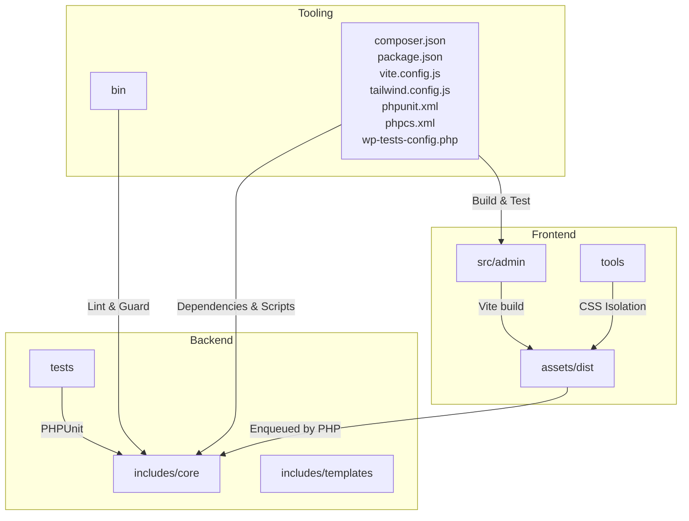
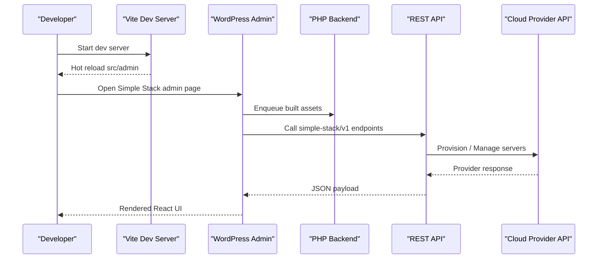
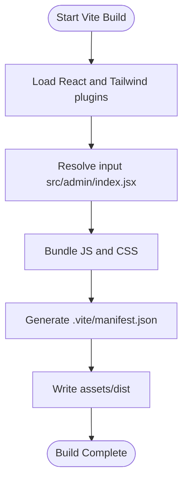
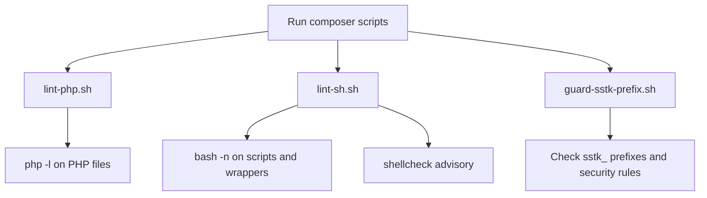
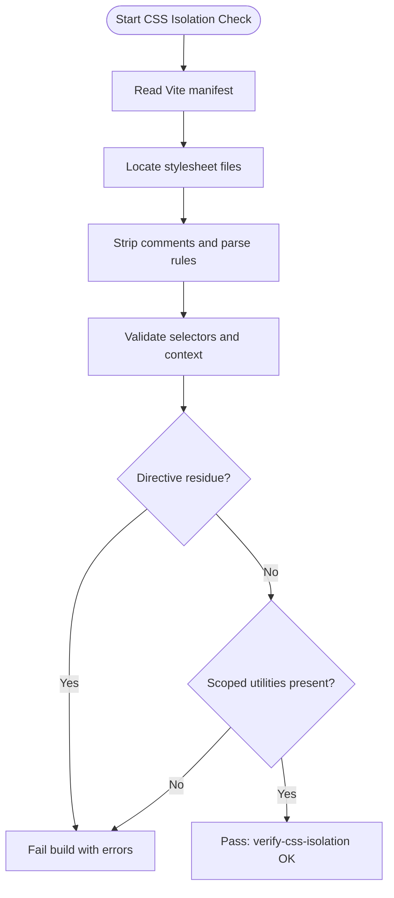
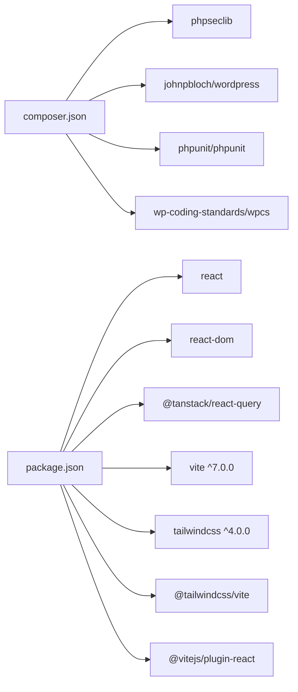

# Development Guide

<cite>
**Referenced Files in This Document**
- [README.md](file://README.md)
- [composer.json](file://composer.json)
- [package.json](file://package.json)
- [vite.config.js](file://vite.config.js)
- [tailwind.config.js](file://tailwind.config.js)
- [src/admin/index.jsx](file://src/admin/index.jsx)
- [src/admin/styles/index.css](file://src/admin/styles/index.css)
- [tools/verify-css-isolation.mjs](file://tools/verify-css-isolation.mjs)
- [phpunit.xml](file://phpunit.xml)
- [phpcs.xml](file://phpcs.xml)
- [tests/phpunit.php](file://tests/phpunit.php)
- [wp-tests-config.php](file://wp-tests-config.php)
- [bin/lint-php.sh](file://bin/lint-php.sh)
- [bin/lint-sh.sh](file://bin/lint-sh.sh)
- [bin/guard-sstk-prefix.sh](file://bin/guard-sstk-prefix.sh)
- [tests/phpunit/rest-api/ControllerServersTest.php](file://tests/phpunit/rest-api/ControllerServersTest.php)
- [tests/data/class-sstk-rest-api-controller-test.php](file://tests/data/class-sstk-rest-api-controller-test.php)
</cite>

## Update Summary
**Changes Made**
- Updated Node.js build system documentation to reflect Vite 7.0.0 and Tailwind CSS v4 integration
- Added comprehensive coverage of the new development tooling including CSS isolation verification
- Enhanced build pipeline documentation with Vite manifest generation and asset optimization
- Updated testing commands and development workflow sections
- Added detailed coverage of Tailwind CSS configuration and scoping strategies

## Table of Contents
1. [Introduction](#introduction)
2. [Project Structure](#project-structure)
3. [Core Components](#core-components)
4. [Architecture Overview](#architecture-overview)
5. [Detailed Component Analysis](#detailed-component-analysis)
6. [Dependency Analysis](#dependency-analysis)
7. [Performance Considerations](#performance-considerations)
8. [Troubleshooting Guide](#troubleshooting-guide)
9. [Conclusion](#conclusion)
10. [Appendices](#appendices)

## Introduction
This guide explains how to develop Simple Stack locally, build the React admin interface, run tests, and maintain code quality. It covers the dual development environment for the PHP backend and the React frontend, dependency management with Composer and npm, the Vite build pipeline with Tailwind CSS v4, PHPUnit testing, shell script validation, CSS isolation verification, coding standards, contribution workflow, debugging, performance profiling, and deployment procedures for development builds.

Simple Stack is a WordPress plugin that provisions servers through cloud provider APIs and manages them from the WordPress admin dashboard. The admin client is built with React 19 and Tailwind CSS v4 using Vite 7.0.0, while the backend uses PHP 8.1+ and integrates with cloud providers over SSH and REST endpoints.

**Section sources**
- [README.md:1-46](file://README.md#L1-L46)

## Project Structure
The repository is organized into clear layers:

- `includes/core`: PHP backend logic, REST API controllers, apps, providers, traits, and templates.
- `src/admin`: React source code for the admin UI, including components, routes, styles, and library modules.
- `assets/dist`: Built output for the admin client; committed so production installs do not require Node.
- `tests`: PHPUnit configuration, bootstrap, test data, and REST controller tests.
- `bin`: Shell scripts for linting and guard checks.
- `tools`: Build-time utilities such as CSS isolation verification.
- Root configuration files: `composer.json`, `package.json`, `vite.config.js`, `tailwind.config.js`, `phpunit.xml`, `phpcs.xml`, `wp-tests-config.php`.

**Diagram sources**
- [vite.config.js:11-37](file://vite.config.js#L11-L37)
- [tailwind.config.js:1-85](file://tailwind.config.js#L1-L85)
- [phpunit.xml:9-24](file://phpunit.xml#L9-L24)
- [phpcs.xml:1-40](file://phpcs.xml#L1-L40)
- [bin/lint-php.sh:1-33](file://bin/lint-php.sh#L1-L33)
- [bin/lint-sh.sh:1-83](file://bin/lint-sh.sh#L1-L83)
- [tools/verify-css-isolation.mjs:1-334](file://tools/verify-css-isolation.mjs#L1-L334)

**Section sources**
- [README.md:47-88](file://README.md#L47-L88)
- [vite.config.js:1-45](file://vite.config.js#L1-L45)
- [tailwind.config.js:1-85](file://tailwind.config.js#L1-L85)
- [phpunit.xml:1-40](file://phpunit.xml#L1-L40)
- [phpcs.xml:1-40](file://phpcs.xml#L1-L40)

## Core Components
- Backend (PHP):
  - REST API controllers under `includes/core/api` and app-specific REST controllers under `includes/core/apps/wordpress-app/rest-api`.
  - Providers for Vultr API v2 and UpCloud API 1.3 only.
  - The WordPress application engine is the only app.
- Frontend (React + Tailwind + Vite):
  - Admin UI entry at `src/admin/index.jsx`.
  - Components, routes, styles, and API helpers.
  - Build output to `assets/dist` with a Vite manifest used at runtime.
  - Tailwind CSS v4 with custom theme configuration and strict CSS isolation.
- Tooling:
  - Composer scripts for linting, guarding naming conventions, and running tests.
  - npm scripts for building, verifying CSS isolation, and running the dev server.
  - PHPUnit configuration and bootstrap for WordPress integration tests.

Key responsibilities:
- PHP layer exposes secure REST endpoints gated by capabilities and orchestrates provisioning via shell scripts executed over SSH.
- React layer renders administrative interfaces mounted at a dedicated DOM node and communicates with the REST API.
- Build tools ensure consistent outputs, enforce coding standards, and prevent style leakage into wp-admin.

**Section sources**
- [README.md:27-46](file://README.md#L27-L46)
- [composer.json:12-30](file://composer.json#L12-L30)
- [package.json:7-23](file://package.json#L7-L23)
- [vite.config.js:1-45](file://vite.config.js#L1-L45)
- [tailwind.config.js:1-85](file://tailwind.config.js#L1-L85)

## Architecture Overview
The development architecture consists of two environments working together:

- PHP backend:
  - Installed as a WordPress plugin.
  - Registers REST routes under a namespaced API.
  - Uses providers and shell scripts to provision and manage servers.
- React frontend:
  - Built with Vite 7.0.0 and Tailwind CSS v4.
  - Bundled into `assets/dist` and enqueued by PHP.
  - Mounted at a specific DOM element inside wp-admin.
  - Uses strict CSS isolation to prevent style leaks.

**Diagram sources**
- [README.md:60-77](file://README.md#L60-L77)
- [vite.config.js:11-37](file://vite.config.js#L11-L37)
- [composer.json:12-30](file://composer.json#L12-L30)

## Detailed Component Analysis

### Local Development Setup
- Install dependencies:
  - Run Composer to install PHP dependencies and WordPress core for tests.
  - Run npm to install front-end dependencies including Vite, React, and Tailwind CSS.
- Build and verify:
  - Build the React app to `assets/dist`.
  - Verify CSS isolation to ensure no styles leak into wp-admin.
  - Run linting and guard checks for PHP syntax, shell scripts, and naming constraints.

Recommended commands:
- `composer install`
- `npm ci`
- `npm run build`
- `npm run verify:css`
- `bash bin/lint-php.sh`
- `bash bin/lint-sh.sh`
- `bash bin/guard-sstk-prefix.sh`

Notes:
- Production installs do not need Node because `assets/dist` is committed.
- The Vite manifest is read at runtime; if missing, an operator-facing notice is shown instead of a blank screen.
- Development mode uses Vite's hot module replacement for instant feedback.

**Section sources**
- [README.md:60-88](file://README.md#L60-L88)
- [vite.config.js:18-37](file://vite.config.js#L18-L37)
- [package.json:7-12](file://package.json#L7-L12)

### Build Processes and Vite Pipeline
- Entry point: `src/admin/index.jsx`.
- Output directory: `assets/dist`.
- Manifest generation: enabled for runtime asset resolution.
- CSS handling: single stylesheet for the whole app; CSS code splitting disabled to simplify asset loading.
- Target: ES2020.
- Exclusions: WordPress-provided libraries are not duplicated.
- Tailwind CSS v4 integration with custom theme configuration.

**Diagram sources**
- [vite.config.js:11-37](file://vite.config.js#L11-L37)

**Section sources**
- [vite.config.js:1-45](file://vite.config.js#L1-L45)
- [package.json:7-23](file://package.json#L7-L23)

### Tailwind CSS Configuration and Scoping
- Custom theme configuration with brand colors, typography, and design tokens.
- Strict CSS isolation enforced through `important: '#simplestack-admin'`.
- Preflight disabled to prevent global resets affecting wp-admin.
- Content scanning configured for React components only.
- Layer-based CSS organization with theme and utility layers.

Key features:
- Scoped utilities that cannot leak into wp-admin chrome.
- Custom color palette with semantic naming.
- System font stack with monospace fallbacks.
- Responsive design tokens and border radius customization.

**Section sources**
- [tailwind.config.js:1-85](file://tailwind.config.js#L1-L85)
- [src/admin/styles/index.css:1-80](file://src/admin/styles/index.css#L1-L80)

### Testing Frameworks and PHPUnit Suite
- Configuration:
  - PHPUnit 9 configured via `phpunit.xml`.
  - Bootstrap file loads WordPress test library and Simple Stack as an mu-plugin.
  - Legacy REST API feature flag is enabled during tests.
- Database:
  - Local MySQL database matching `wp-tests-config.php`.
  - WordPress core installed via Composer into `vendor/wordpress/wordpress`.
- Running tests:
  - Execute PHPUnit after installing dependencies.

Test structure:
- REST controller tests under `tests/phpunit/rest-api/`.
- Test data and mock classes under `tests/data/`.

Mock strategies:
- Use a test provider class to replace real provider interactions.
- Create posts and meta programmatically to simulate servers and sites.

Example patterns:
- Route registration assertions.
- Request dispatching and response validation.
- Creating and deleting resources via REST requests.

**Section sources**
- [phpunit.xml:1-40](file://phpunit.xml#L1-L40)
- [tests/phpunit.php:1-67](file://tests/phpunit.php#L1-L67)
- [wp-tests-config.php:1-23](file://wp-tests-config.php#L1-L23)
- [tests/phpunit/rest-api/ControllerServersTest.php:1-170](file://tests/phpunit/rest-api/ControllerServersTest.php#L1-L170)
- [tests/data/class-sstk-rest-api-controller-test.php:1-41](file://tests/data/class-sstk-rest-api-controller-test.php#L1-L41)

### Code Quality Tools and Standards
- PHP linting:
  - Syntax check across all PHP files excluding dependencies and generated output.
- Shell script validation:
  - Syntax check for provisioning scripts and wrappers.
  - Advisory shellcheck pass when available.
- Naming guard:
  - Enforces the hard-cutover `SSTK_` / `sstk_` / `sstk-` / `simple-stack` contract.
  - Rejects retired upstream identifiers and enforces REST and port-7080 security constraints.
- Coding standards:
  - WordPress Coding Standards applied to REST API directories.
  - Documentation rules enforced.
  - Minimum supported WordPress version set.

**Diagram sources**
- [composer.json:25-30](file://composer.json#L25-L30)
- [bin/lint-php.sh:1-33](file://bin/lint-php.sh#L1-L33)
- [bin/lint-sh.sh:1-83](file://bin/lint-sh.sh#L1-L83)
- [bin/guard-sstk-prefix.sh:1-103](file://bin/guard-sstk-prefix.sh#L1-L103)
- [phpcs.xml:1-40](file://phpcs.xml#L1-L40)

**Section sources**
- [bin/lint-php.sh:1-33](file://bin/lint-php.sh#L1-L33)
- [bin/lint-sh.sh:1-83](file://bin/lint-sh.sh#L1-L83)
- [bin/guard-sstk-prefix.sh:1-103](file://bin/guard-sstk-prefix.sh#L1-L103)
- [phpcs.xml:1-40](file://phpcs.xml#L1-L40)

### CSS Isolation Verification
- Purpose:
  - Ensure the Simple Stack stylesheet cannot leak into wp-admin.
- Assertions:
  - No top-level selectors that style document elements.
  - All utility selectors anchored to the admin mount node.
  - At least one scoped utility exists to detect empty Tailwind runs.
  - No unprocessed Tailwind directives remain.
  - Vite manifest exists and lists a stylesheet.

Process:
- Reads the Vite manifest to locate emitted CSS files.
- Parses CSS to collect rules and contexts.
- Validates selector scoping and directive residue.
- Fails the build on violations with detailed error messages.

**Diagram sources**
- [tools/verify-css-isolation.mjs:1-334](file://tools/verify-css-isolation.mjs#L1-L334)
- [vite.config.js:18-37](file://vite.config.js#L18-L37)

**Section sources**
- [tools/verify-css-isolation.mjs:1-334](file://tools/verify-css-isolation.mjs#L1-L334)

### Adding New Features
Guidelines:
- Backend:
  - Add REST endpoints under `includes/core/api` or app-specific REST controllers.
  - Follow WordPress Coding Standards and documentation requirements.
  - Gate permissions appropriately; avoid unauthenticated access unless explicitly allowed.
- Frontend:
  - Add React components and routes under `src/admin`.
  - Ensure styles are scoped to the admin mount node.
  - Rebuild assets and verify CSS isolation.
- Tests:
  - Write PHPUnit tests for new REST endpoints.
  - Use test providers and mock data where appropriate.
- Quality:
  - Run linting and guard checks before submitting changes.
  - Ensure shell scripts pass syntax checks and advisory shellcheck results.

**Section sources**
- [phpcs.xml:1-40](file://phpcs.xml#L1-L40)
- [bin/guard-sstk-prefix.sh:53-84](file://bin/guard-sstk-prefix.sh#L53-L84)
- [tools/verify-css-isolation.mjs:253-315](file://tools/verify-css-isolation.mjs#L253-L315)

### Writing Tests
Recommendations:
- Use `WP_UnitTestCase` and WordPress test factory methods.
- Assert route registration and endpoint behavior.
- Create minimal test data for servers and sites.
- Mock external dependencies via test providers.
- Validate both success paths and error responses.

Patterns:
- Dispatch REST requests and assert returned data structures.
- Verify post status transitions and metadata updates.
- Use helper methods to create test entities consistently.

**Section sources**
- [tests/phpunit/rest-api/ControllerServersTest.php:1-170](file://tests/phpunit/rest-api/ControllerServersTest.php#L1-L170)
- [tests/data/class-sstk-rest-api-controller-test.php:1-41](file://tests/data/class-sstk-rest-api-controller-test.php#L1-L41)

### Coding Conventions
- PHP:
  - Follow WordPress Coding Standards.
  - Document classes, methods, and functions.
  - Maintain compatibility with minimum supported WordPress version.
- Shell scripts:
  - Keep scripts syntactically valid.
  - Replace placeholders before syntax checking wrappers.
  - Use shellcheck advisories to improve script quality.
- Frontend:
  - Scope all styles to the admin mount node.
  - Avoid importing Tailwind Preflight globally.
  - Keep dependencies aligned with Vite and React versions.
  - Use Tailwind CSS v4 utility classes with proper scoping.

**Section sources**
- [phpcs.xml:24-40](file://phpcs.xml#L24-L40)
- [bin/lint-sh.sh:1-83](file://bin/lint-sh.sh#L1-L83)
- [tools/verify-css-isolation.mjs:1-334](file://tools/verify-css-isolation.mjs#L1-L334)
- [tailwind.config.js:1-85](file://tailwind.config.js#L1-L85)

### Submitting Contributions
Before submitting:
- Run full verification suite:
  - Lint PHP and shell scripts.
  - Run guard checks.
  - Build assets and verify CSS isolation.
- Ensure tests pass:
  - Configure local MySQL database.
  - Run PHPUnit.
- Review naming and security constraints:
  - Keep all first-party identifiers inside the Simple Stack naming contract; there is no upstream compatibility layer.
  - Ensure public endpoints are intentional and secured.

**Section sources**
- [README.md:79-90](file://README.md#L79-L90)
- [composer.json:25-30](file://composer.json#L25-L30)
- [bin/guard-sstk-prefix.sh:1-103](file://bin/guard-sstk-prefix.sh#L1-L103)

### Debugging Techniques
- Enable WordPress debug mode in test configuration.
- Inspect REST API responses using browser developer tools.
- Use PHPUnit verbose output to identify failing assertions.
- Check Vite dev server logs for frontend issues.
- Validate CSS isolation failures to pinpoint leaked selectors.
- Monitor Tailwind CSS build output for unused utilities.

**Section sources**
- [wp-tests-config.php:12-12](file://wp-tests-config.php#L12-L12)
- [tools/verify-css-isolation.mjs:317-330](file://tools/verify-css-isolation.mjs#L317-L330)

### Performance Profiling
- Backend:
  - Profile REST endpoint execution time.
  - Monitor database queries during tests.
  - Use WordPress debug logging to trace slow operations.
- Frontend:
  - Use browser performance tools to analyze React rendering.
  - Inspect bundle size and chunk distribution.
  - Ensure no unnecessary re-renders in admin components.
  - Monitor Tailwind CSS utility generation for unused classes.

[No sources needed since this section provides general guidance]

### Deployment Procedures for Development Builds
- Build process:
  - Run `npm run build` to generate `assets/dist`.
  - Commit built assets so production installs do not require Node.
- Runtime:
  - Ensure Vite manifest exists; otherwise, an operator-facing notice is displayed.
  - Activate the plugin in WordPress and configure provider credentials.
- Verification:
  - Run CSS isolation verification to prevent style leaks.
  - Confirm REST endpoints respond correctly.

**Section sources**
- [README.md:67-77](file://README.md#L67-L77)
- [vite.config.js:18-37](file://vite.config.js#L18-L37)

## Dependency Analysis
Composer dependencies:
- Runtime:
  - PHP 8.1+.
  - phpseclib for SSH and cryptographic operations.
- Development:
  - WordPress core for tests.
  - PHPUnit and polyfills.
  - Watcher for continuous testing.
  - WordPress Coding Standards and PHPCS installer.

npm dependencies:
- Runtime:
  - React 19 and React DOM.
  - TanStack Query for data fetching.
- Development:
  - Vite 7.0.0, React plugin, Tailwind CSS v4, and Tailwind Vite plugin.

**Diagram sources**
- [composer.json:12-24](file://composer.json#L12-L24)
- [package.json:13-23](file://package.json#L13-L23)

**Section sources**
- [composer.json:1-42](file://composer.json#L1-L42)
- [package.json:1-25](file://package.json#L1-L25)

## Performance Considerations
- Minimize REST endpoint payload sizes.
- Cache frequently accessed data where appropriate.
- Avoid heavy computations in request handlers.
- Keep React components lean and memoized where necessary.
- Monitor bundle size and split chunks only when beneficial.
- Optimize Tailwind CSS content scanning to reduce build times.
- Leverage Vite's optimized dependency pre-bundling.

[No sources needed since this section provides general guidance]

## Troubleshooting Guide
Common issues and resolutions:
- Missing Vite manifest:
  - Rebuild assets with `npm run build`.
  - Ensure manifest generation is enabled.
- CSS isolation failure:
  - Check for unscoped selectors and directive residue.
  - Verify Tailwind content glob matches source files.
  - Ensure `important: '#simplestack-admin'` is configured.
- PHPUnit bootstrap errors:
  - Run `composer install` to install WordPress test library.
  - Ensure local MySQL database matches configuration.
- Shell script syntax errors:
  - Fix syntax in provisioning scripts and wrappers.
  - Replace placeholders before syntax checking.
- Guard failures:
  - Restore required identifiers and remove forbidden constructs.
  - Ensure public endpoints are exactly those allowed.
- Tailwind CSS build issues:
  - Verify CSS import structure without Preflight.
  - Check that content scanning includes all component files.
  - Ensure theme configuration is properly loaded.

**Section sources**
- [tools/verify-css-isolation.mjs:217-251](file://tools/verify-css-isolation.mjs#L217-L251)
- [tests/phpunit.php:12-25](file://tests/phpunit.php#L12-L25)
- [bin/lint-sh.sh:48-65](file://bin/lint-sh.sh#L48-L65)
- [bin/guard-sstk-prefix.sh:22-84](file://bin/guard-sstk-prefix.sh#L22-L84)
- [tailwind.config.js:1-85](file://tailwind.config.js#L1-L85)

## Conclusion
This guide provides a comprehensive overview of developing Simple Stack, covering setup, builds, testing, code quality, and contribution workflows. By following these practices, contributors can maintain consistency, security, and reliability across the PHP backend and React frontend while ensuring robust testing and deployment processes. The new Vite and Tailwind CSS v4 build system provides modern development tooling with strict CSS isolation guarantees.

[No sources needed since this section summarizes without analyzing specific files]

## Appendices
- Additional references:
  - Architecture and REST route reference in project documentation.
  - Build state and blockers tracked in project state file.
  - Project constraints documented in agents guide.

[No sources needed since this section references general documentation without analyzing specific files]