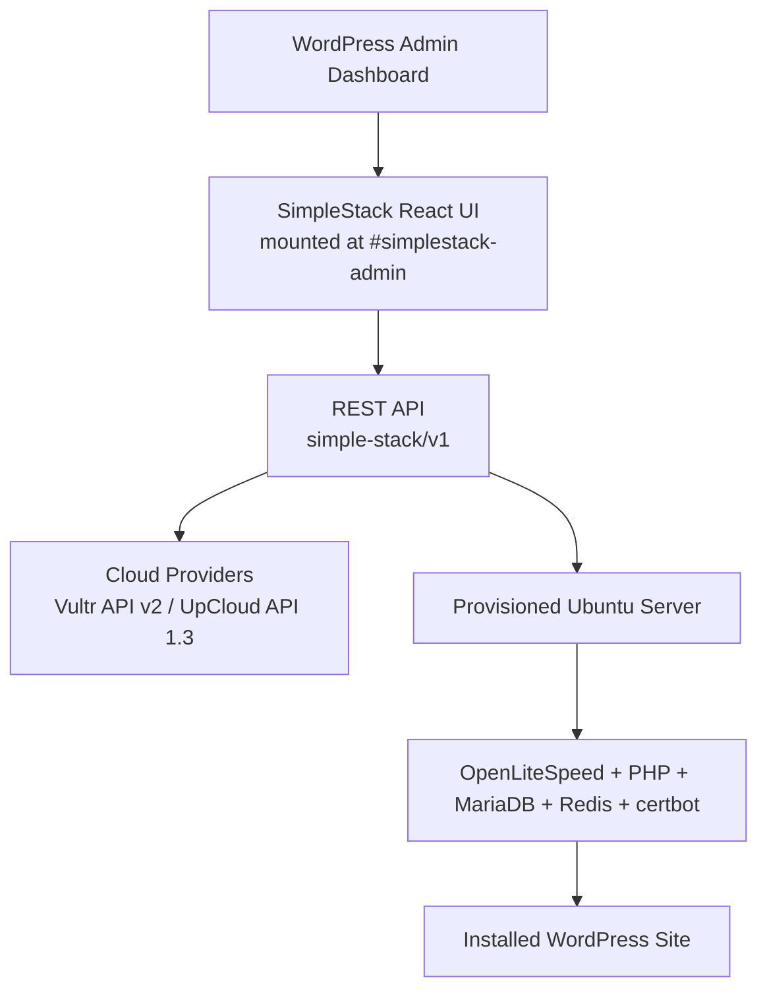
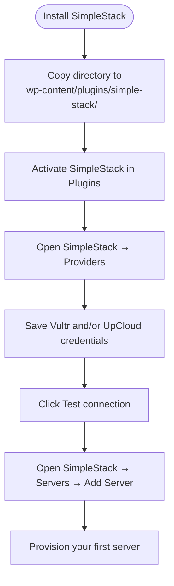
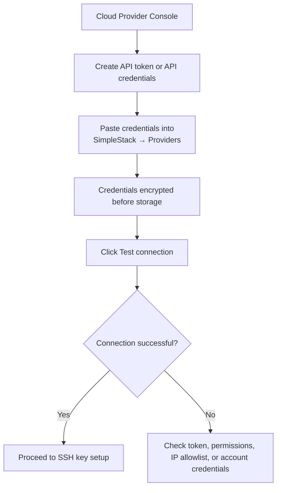
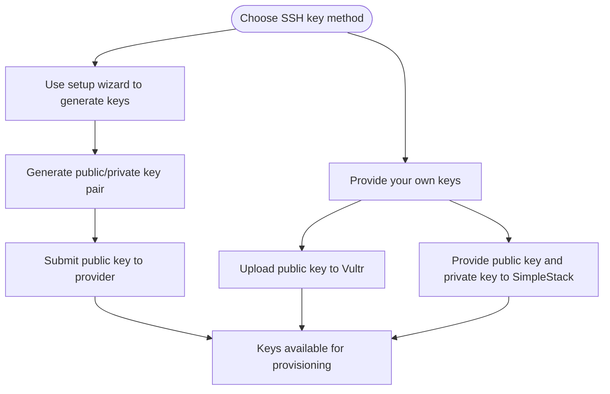
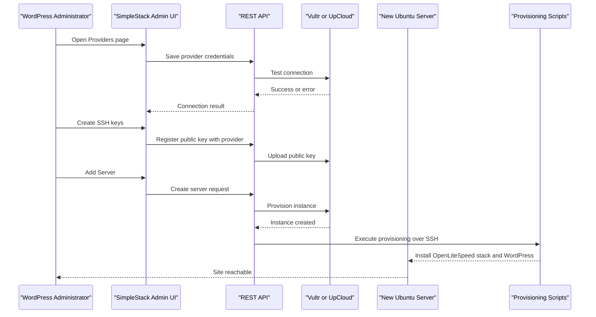
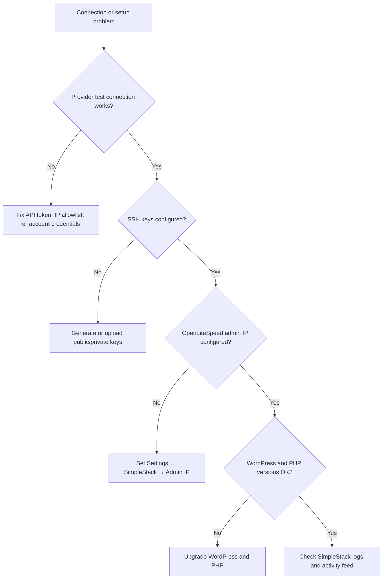

# Getting Started

<cite>
**Referenced Files in This Document**   
- [README.md](file://README.md)
- [wpcd.php](file://wpcd.php)
- [SIMPLESTACK.md](file://docs/SIMPLESTACK.md)
- [class-vultr-v2.php](file://includes/core/providers/class-vultr-v2.php)
- [class-upcloud.php](file://includes/core/providers/class-upcloud.php)
- [class-wpcd-setup-wizard.php](file://includes/core/class-wpcd-setup-wizard.php)
</cite>

## Table of Contents
1. [Introduction](#introduction)
2. [What SimpleStack Does](#what-simplestack-does)
3. [System Requirements](#system-requirements)
4. [Installation](#installation)
5. [Cloud Provider Setup](#cloud-provider-setup)
6. [SSH Key Configuration](#ssh-key-configuration)
7. [First-Time User Workflow](#first-time-user-workflow)
8. [Troubleshooting Connection Problems](#troubleshooting-connection-problems)
9. [Next Steps](#next-steps)

## Introduction
SimpleStack is an internal hosting control plane for One Dog Solutions. It lives inside WordPress and lets you provision servers at Vultr and UpCloud, install a WordPress site on them, and manage everything from the WordPress admin dashboard.

It is a private fork of WP Cloud Deploy 5.8.0 rebuilt around a single OpenLiteSpeed stack and a single admin UI. There is no external headless frontend and no third-party SaaS in the control path — only the cloud provider’s own API.

**Section sources**
- [README.md:1-25](file://README.md#L1-L25)

## What SimpleStack Does
- Provisions servers at Vultr (API v2), UpCloud (API 1.3), or an already-running custom server from a form in `wp-admin`.
- Installs WordPress over SSH with OpenLiteSpeed, PHP, MariaDB, Redis, certbot, firewall rules, and an OpenLiteSpeed virtual host.
- Manages servers and sites through dedicated tabs such as services, firewall, backups, logs, Fail2ban, SSH keys, resize, power, SSL, cache, PHP options, staging, clone, domain change, redirects, cron, SFTP, phpMyAdmin, Git, and per-site users.
- Probes hardening on demand, including installed plugins, `DISALLOW_FILE_EDIT`, and the PHP version the virtual host actually serves.
- Exposes a REST API under `simple-stack/v1` that the React admin UI calls.

**Diagram sources**
- [README.md:11-25](file://README.md#L11-L25)
- [SIMPLESTACK.md:15-31](file://docs/SIMPLESTACK.md#L15-L31)

**Section sources**
- [README.md:11-37](file://README.md#L11-L37)
- [SIMPLESTACK.md:15-31](file://docs/SIMPLESTACK.md#L15-L31)

## System Requirements
| Requirement | Minimum Version | Notes |
|---|---:|---|
| WordPress | 6.5+ | Declared by the plugin header. |
| PHP | 8.1+ | The plugin shows an admin notice if PHP is too old. |
| Node | 20+ | Required only for development builds; production installs do not need Node because `assets/dist/` is committed. |
| Cloud provider credentials | Vultr API key or UpCloud account credentials | See the next section. |
| SSH key pair | Public and private key | Used to connect to provisioned servers. |
| Permalinks | Non-default structure | Default permalinks are rejected because callbacks require a permalink structure. |
| Encryption key | `WPCD_ENCRYPTION_KEY` defined in `wp-config.php` | Protects stored passwords and private SSH keys. |

The plugin header declares `Requires at least: 6.5` and `Requires PHP: 8.1`. During activation and normal admin use, it checks for these conditions and warns when they are not met.

**Section sources**
- [README.md:39-46](file://README.md#L39-L46)
- [wpcd.php:3-12](file://wpcd.php#L3-L12)
- [wpcd.php:462-514](file://wpcd.php#L462-L514)

## Installation
1. Copy this repository directory into your WordPress installation at `wp-content/plugins/simple-stack/`.
2. Go to **Plugins** in the WordPress admin and activate **SimpleStack**.
3. Open **SimpleStack → Providers** and save your Vultr and/or UpCloud credentials.
4. Use **Test connection** to confirm the provider responds.
5. Open **SimpleStack → Servers → Add Server** to provision your first server.
6. Set **Settings → SimpleStack → Admin IP** to the address from which you will reach the OpenLiteSpeed WebAdmin console. Port `7080` is denied by default and is only opened to that configured address. If no admin IP is set, the provisioning script keeps the console on loopback and prints an SSH tunnel command instead.

After activation, SimpleStack loads its core classes, providers, REST layer, and app engine. If the setup wizard has not been completed, it may prompt you to continue configuration.

**Diagram sources**
- [README.md:47-58](file://README.md#L47-L58)
- [wpcd.php:166-235](file://wpcd.php#L166-L235)

**Section sources**
- [README.md:47-58](file://README.md#L47-L58)
- [wpcd.php:166-235](file://wpcd.php#L166-L235)
- [wpcd.php:406-414](file://wpcd.php#L406-L414)

## Cloud Provider Setup
SimpleStack supports two primary providers out of the box:

| Provider | Authentication | Where to configure |
|---|---|---|
| Vultr | Bearer token via API v2 | **SimpleStack → Providers** |
| UpCloud | Account user name and password via API 1.3 | **SimpleStack → Providers** |

### Vultr
- Create an API token in the Vultr console.
- In the access control settings, allow the IP address of your WordPress site so server creation can succeed. Allowing both IPv4 and IPv6 initially is the simplest approach; you can tighten it later.
- Paste the token into the Vultr provider field in SimpleStack.
- Click **Test connection** to verify authentication.

The Vultr provider reads the encrypted token from the `vpn_vultr-v2_apikey` option, decodes it before use, and never logs the token itself.

### UpCloud
- Use the account user name and password of your UpCloud account or an API-only sub-account. Do not store root account credentials on this site if you can avoid it.
- Enter both values in the UpCloud provider fields. They are encrypted before storage and sent only to `api.upcloud.com`.
- Click **Test connection** to verify authentication.

The UpCloud provider uses HTTP Basic authentication and stores `vpn_upcloud_user_name` and `vpn_upcloud_user_password`. It also requires a public SSH key and a locally stored private SSH key before it considers credentials fully available.

**Diagram sources**
- [class-vultr-v2.php:19-29](file://includes/core/providers/class-vultr-v2.php#L19-L29)
- [class-upcloud.php:17-32](file://includes/core/providers/class-upcloud.php#L17-L32)
- [class-wpcd-setup-wizard.php:551-559](file://includes/core/class-wpcd-setup-wizard.php#L551-L559)

**Section sources**
- [README.md:13-16](file://README.md#L13-L16)
- [class-vultr-v2.php:19-29](file://includes/core/providers/class-vultr-v2.php#L19-L29)
- [class-vultr-v2.php:120-127](file://includes/core/providers/class-vultr-v2.php#L120-L127)
- [class-upcloud.php:17-32](file://includes/core/providers/class-upcloud.php#L17-L32)
- [class-upcloud.php:117-127](file://includes/core/providers/class-upcloud.php#L117-L127)
- [class-upcloud.php:247-287](file://includes/core/providers/class-upcloud.php#L247-L287)
- [class-wpcd-setup-wizard.php:551-559](file://includes/core/class-wpcd-setup-wizard.php#L551-L559)

## SSH Key Configuration
SimpleStack uses SSH keys, not passwords, to connect to provisioned servers. You have two options:

### Option A: Let SimpleStack generate keys during setup
1. Complete provider credential setup.
2. Continue through the setup wizard until the **Create SSH Keys** step.
3. Confirm that SimpleStack should create a new key pair and submit the public portion to your provider.
4. After generation, SimpleStack stores the public key and private key securely and uses them for server connections.

### Option B: Provide your own keys
- For Vultr, upload the public key to your Vultr account and select it in the provider settings.
- For UpCloud, provide the public key material and keep the matching private key configured in SimpleStack.
- Ensure the private key is readable by the WordPress process so SimpleStack can connect over SSH.

UpCloud requires both a public key and a local private key before it reports credentials as available. Vultr accepts either a pre-existing key ID or a newly registered key.

**Diagram sources**
- [class-wpcd-setup-wizard.php:734-767](file://includes/core/class-wpcd-setup-wizard.php#L734-L767)
- [class-upcloud.php:213-231](file://includes/core/providers/class-upcloud.php#L213-L231)
- [class-vultr-v2.php:768-800](file://includes/core/providers/class-vultr-v2.php#L768-L800)

**Section sources**
- [class-wpcd-setup-wizard.php:734-767](file://includes/core/class-wpcd-setup-wizard.php#L734-L767)
- [class-upcloud.php:213-231](file://includes/core/providers/class-upcloud.php#L213-L231)
- [class-vultr-v2.php:768-800](file://includes/core/providers/class-vultr-v2.php#L768-L800)

## First-Time User Workflow
This is the end-to-end flow from provider setup to deploying your first WordPress site.

1. **Prepare your environment.**
   - Install WordPress 6.5+.
   - Run PHP 8.1+.
   - Define `WPCD_ENCRYPTION_KEY` in `wp-config.php`.
   - Change WordPress permalinks away from the default structure.

2. **Install and activate SimpleStack.**
   - Place the plugin at `wp-content/plugins/simple-stack/`.
   - Activate it in **Plugins**.

3. **Configure a cloud provider.**
   - Open **SimpleStack → Providers**.
   - Save Vultr or UpCloud credentials.
   - Click **Test connection**.

4. **Set up SSH keys.**
   - Use the setup wizard to generate keys, or upload your own public key and private key.

5. **Provision a server.**
   - Open **SimpleStack → Servers → Add Server**.
   - Choose provider, region, plan, OS, and SSH key.
   - Submit the request. SimpleStack provisions the instance and runs the provisioning scripts over SSH.

6. **Deploy a WordPress site.**
   - Open **SimpleStack → Sites → Add Site**.
   - Select the provisioned server and domain.
   - Submit the deployment. SimpleStack installs WordPress on the OpenLiteSpeed stack.

7. **Manage from the WordPress admin dashboard.**
   - Use the SimpleStack tabs for services, firewall, backups, logs, SSL, cache, PHP options, staging, cloning, domain changes, redirects, cron, SFTP, phpMyAdmin, Git, and more.

**Diagram sources**
- [README.md:47-58](file://README.md#L47-L58)
- [SIMPLESTACK.md:67-90](file://docs/SIMPLESTACK.md#L67-L90)
- [class-vultr-v2.php:369-451](file://includes/core/providers/class-vultr-v2.php#L369-L451)
- [class-upcloud.php:491-600](file://includes/core/providers/class-upcloud.php#L491-L600)

**Section sources**
- [README.md:39-58](file://README.md#L39-L58)
- [SIMPLESTACK.md:67-90](file://docs/SIMPLESTACK.md#L67-L90)

## Troubleshooting Connection Problems
### Provider connection fails
- **Vultr:** Verify the API token is correct and that the WordPress site’s IP address is allowed in the Vultr access control settings.
- **UpCloud:** Verify the account user name and password are correct and that the account has API access.
- Click **Test connection** after saving credentials.
- Check whether the provider returns a meaningful error rather than a generic network failure.

### SSH connection fails
- Confirm the private key is present and readable by the WordPress process.
- Confirm the public key was uploaded to the provider and selected for the server.
- For UpCloud, ensure both the public key and private key are configured before credentials are considered available.
- Check the SimpleStack activity log and SSH/command logs for the failing server.

### WordPress admin cannot reach OpenLiteSpeed WebAdmin
- Set **Settings → SimpleStack → Admin IP** to the address you will use to open port `7080`.
- Without an admin IP, port `7080` stays on loopback and the provisioning script prints an SSH tunnel command instead of opening it to the world.
- Never expose port `7080` publicly without restricting it to your trusted admin IP.

### Plugin refuses to run
- Ensure WordPress is 6.5+ and PHP is 8.1+.
- Ensure permalinks are not set to the default structure.
- Define `WPCD_ENCRYPTION_KEY` in `wp-config.php` with a real value, not the example placeholder.
- Make sure the plugin’s script folders are readable by the web server where required.

**Diagram sources**
- [wpcd.php:462-514](file://wpcd.php#L462-L514)
- [class-vultr-v2.php:19-29](file://includes/core/providers/class-vultr-v2.php#L19-L29)
- [class-upcloud.php:17-32](file://includes/core/providers/class-upcloud.php#L17-L32)
- [class-upcloud.php:213-231](file://includes/core/providers/class-upcloud.php#L213-L231)

**Section sources**
- [wpcd.php:462-514](file://wpcd.php#L462-L514)
- [class-vultr-v2.php:19-29](file://includes/core/providers/class-vultr-v2.php#L19-L29)
- [class-upcloud.php:17-32](file://includes/core/providers/class-upcloud.php#L17-L32)
- [class-upcloud.php:213-231](file://includes/core/providers/class-upcloud.php#L213-L231)

## Next Steps
After your first server and site are running:
- Explore the server tabs for services, firewall, backups, Monit, logs, Fail2ban, SSH keys, resize, and power controls.
- Explore the site tabs for SSL, cache, PHP options, `wp-config`, staging, clone, domain change, redirects, cron, SFTP, phpMyAdmin, Git, and per-site users.
- Use the security probe to check installed plugins, `DISALLOW_FILE_EDIT`, and the PHP version served by the virtual host.
- Keep the SimpleStack build and verification steps available if you modify source code, since this project enforces strict naming, REST safety, and CSS isolation rules.

**Section sources**
- [README.md:11-25](file://README.md#L11-L25)
- [SIMPLESTACK.md:117-150](file://docs/SIMPLESTACK.md#L117-L150)