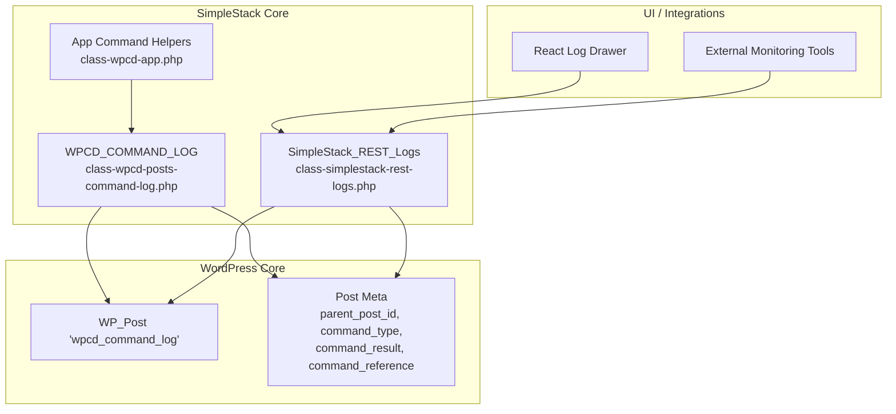
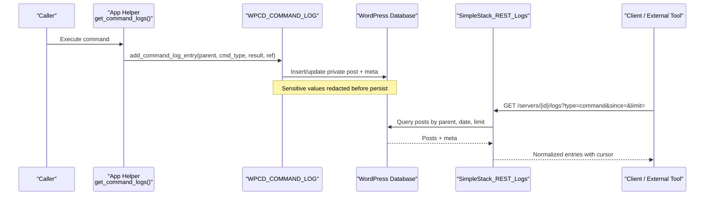
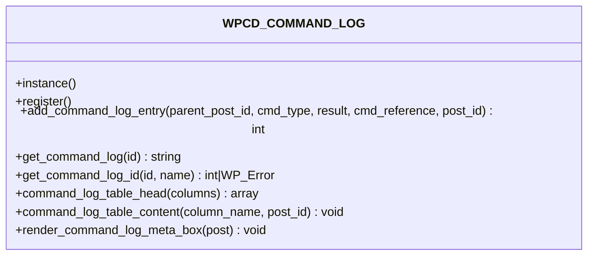
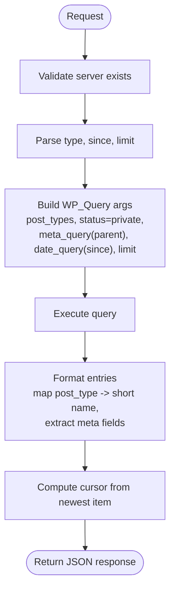
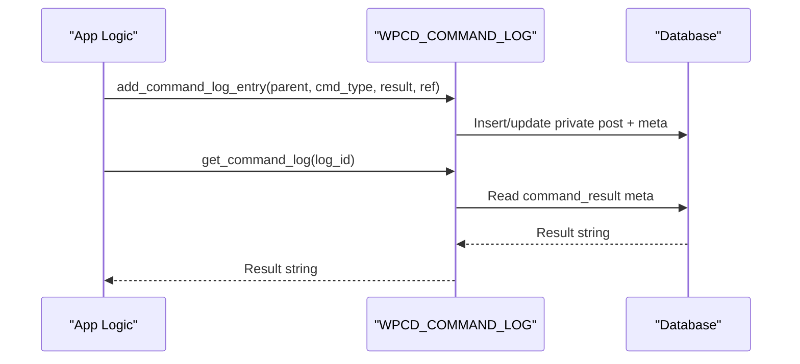
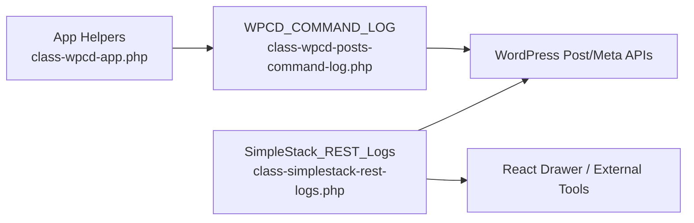

# Command Execution Logging

<cite>
**Referenced Files in This Document**
- [class-wpcd-posts-command-log.php](file://includes/core/class-wpcd-posts-command-log.php)
- [class-simplestack-rest-logs.php](file://includes/core/api/class-simplestack-rest-logs.php)
- [command_log.php](file://includes/templates/command_log.php)
- [class-wpcd-app.php](file://includes/core/apps/class-wpcd-app.php)
- [commands-and-logs.php](file://includes/core/apps/wordpress-app/traits/traits-for-class-wordpress-app/commands-and-logs.php)
</cite>

## Table of Contents
1. [Introduction](#introduction)
2. [Project Structure](#project-structure)
3. [Core Components](#core-components)
4. [Architecture Overview](#architecture-overview)
5. [Detailed Component Analysis](#detailed-component-analysis)
6. [Dependency Analysis](#dependency-analysis)
7. [Performance Considerations](#performance-considerations)
8. [Troubleshooting Guide](#troubleshooting-guide)
9. [Conclusion](#conclusion)

## Introduction
This document explains SimpleStack’s command execution logging system. It focuses on how the CommandLog subsystem records server commands, tracks their execution status and output, and exposes historical data for programmatic access and monitoring integrations. You will learn:
- How log entries are created and what fields they contain
- How to retrieve logs by time range or status
- How the REST API exposes command logs for live UIs and external tools
- Best practices for performance and analysis at scale

## Project Structure
The command logging feature spans a few core areas:
- A custom post type that stores each command execution as a private WordPress post with metadata
- A REST controller that serves filtered, paginated command logs
- App-level helpers that create and fetch logs during command execution flows

**Diagram sources**
- [class-wpcd-posts-command-log.php:63-112](file://includes/core/class-wpcd-posts-command-log.php#L63-L112)
- [class-simplestack-rest-logs.php:28-55](file://includes/core/api/class-simplestack-rest-logs.php#L28-L55)
- [class-wpcd-app.php:981-1024](file://includes/core/apps/class-wpcd-app.php#L981-L1024)

**Section sources**
- [class-wpcd-posts-command-log.php:63-112](file://includes/core/class-wpcd-posts-command-log.php#L63-L112)
- [class-simplestack-rest-logs.php:28-55](file://includes/core/api/class-simplestack-rest-logs.php#L28-L55)
- [class-wpcd-app.php:981-1024](file://includes/core/apps/class-wpcd-app.php#L981-L1024)

## Core Components
- WPCD_COMMAND_LOG (CommandLog class): Registers the custom post type, defines meta fields, provides methods to add and retrieve command logs, and renders admin views.
- SimpleStack_REST_Logs: Exposes read-only endpoints for command, SSH, and error logs with filtering by time and parent entity.
- App command helpers: Create logs around command execution and provide retrieval patterns used across apps.

Key responsibilities:
- Persisting command executions as private posts with structured metadata
- Sanitizing sensitive information from captured output
- Querying logs efficiently for UI and integrations
- Providing stable APIs for programmatic access

**Section sources**
- [class-wpcd-posts-command-log.php:15-34](file://includes/core/class-wpcd-posts-command-log.php#L15-L34)
- [class-simplestack-rest-logs.php:12-18](file://includes/core/api/class-simplestack-rest-logs.php#L12-L18)
- [class-wpcd-app.php:981-1024](file://includes/core/apps/class-wpcd-app.php#L981-L1024)

## Architecture Overview
The system uses WordPress posts as the storage layer for command logs. Each command execution creates a private post whose title references the target entity (server or app). Metadata captures the command type, result/output, reference identifier, and the parent entity ID. The REST API reads these posts and returns normalized entries suitable for live dashboards and external consumers.

**Diagram sources**
- [class-wpcd-app.php:981-1024](file://includes/core/apps/class-wpcd-app.php#L981-L1024)
- [class-wpcd-posts-command-log.php:282-320](file://includes/core/class-wpcd-posts-command-log.php#L282-L320)
- [class-simplestack-rest-logs.php:76-100](file://includes/core/api/class-simplestack-rest-logs.php#L76-L100)

## Detailed Component Analysis

### CommandLog Class (WPCD_COMMAND_LOG)
Responsibilities:
- Register the custom post type wpcd_command_log with private visibility and restricted capabilities
- Define searchable fields and admin table columns
- Provide methods to add and retrieve logs
- Render an admin meta box showing command details

Data model:
- Post type: wpcd_command_log
- Status: private
- Title: human-readable reference to the target entity
- Author: current user at creation time
- Metadata:
  - parent_post_id: ID of the server or app this log belongs to
  - command_type: string describing the command category
  - command_result: captured output or error text (sanitized)
  - command_reference: optional reference identifier

Lifecycle highlights:
- Creation: add_command_log_entry inserts or updates a private post and persists sanitized metadata
- Retrieval: get_command_log returns the stored result; get_command_log_id finds the latest matching entry by parent and command name

Admin UI:
- Custom columns show owner/parent, type, truncated result, and reference
- Meta box template displays full details for inspection

**Diagram sources**
- [class-wpcd-posts-command-log.php:15-34](file://includes/core/class-wpcd-posts-command-log.php#L15-L34)
- [class-wpcd-posts-command-log.php:63-112](file://includes/core/class-wpcd-posts-command-log.php#L63-L112)
- [class-wpcd-posts-command-log.php:208-219](file://includes/core/class-wpcd-posts-command-log.php#L208-L219)
- [class-wpcd-posts-command-log.php:225-261](file://includes/core/class-wpcd-posts-command-log.php#L225-L261)
- [class-wpcd-posts-command-log.php:282-320](file://includes/core/class-wpcd-posts-command-log.php#L282-L320)
- [class-wpcd-posts-command-log.php:329-365](file://includes/core/class-wpcd-posts-command-log.php#L329-L365)

**Section sources**
- [class-wpcd-posts-command-log.php:63-112](file://includes/core/class-wpcd-posts-command-log.php#L63-L112)
- [class-wpcd-posts-command-log.php:136-199](file://includes/core/class-wpcd-posts-command-log.php#L136-L199)
- [class-wpcd-posts-command-log.php:208-219](file://includes/core/class-wpcd-posts-command-log.php#L208-L219)
- [class-wpcd-posts-command-log.php:225-261](file://includes/core/class-wpcd-posts-command-log.php#L225-L261)
- [class-wpcd-posts-command-log.php:282-320](file://includes/core/class-wpcd-posts-command-log.php#L282-L320)
- [class-wpcd-posts-command-log.php:329-365](file://includes/core/class-wpcd-posts-command-log.php#L329-L365)

### REST Logs Controller (SimpleStack_REST_Logs)
Responsibilities:
- Serve read-only log streams for command, SSH, and error logs
- Filter logs by parent entity, time window, and limit
- Normalize log entries for consumption by the React log drawer and external tools
- Redact secrets from payloads

Endpoints:
- GET /servers/{id}/logs
  - Parameters:
    - type: all | command | ssh | error (default all)
    - since: ISO8601 timestamp (optional)
    - limit: integer 1–200 (default 50)
  - Response includes items, cursor (newest entry date), server id, and requested type
- GET /activity
  - Parameters:
    - limit: integer 1–200 (default 50)
    - server_id: integer (optional)
  - Returns merged recent activity across log types

Query behavior:
- Queries private posts ordered by date descending
- Supports date filtering via post_date_gmt when since is provided
- Uses no_found_rows for performance

Normalization:
- Maps post types to short names (e.g., wpcd_command_log -> command)
- Extracts relevant metadata into a flat structure with id, type, parent, title, date_gmt, and body/reference fields

**Diagram sources**
- [class-simplestack-rest-logs.php:44-65](file://includes/core/api/class-simplestack-rest-logs.php#L44-L65)
- [class-simplestack-rest-logs.php:76-100](file://includes/core/api/class-simplestack-rest-logs.php#L76-L100)
- [class-simplestack-rest-logs.php:137-178](file://includes/core/api/class-simplestack-rest-logs.php#L137-L178)
- [class-simplestack-rest-logs.php:187-222](file://includes/core/api/class-simplestack-rest-logs.php#L187-L222)
- [class-simplestack-rest-logs.php:231-238](file://includes/core/api/class-simplestack-rest-logs.php#L231-L238)

**Section sources**
- [class-simplestack-rest-logs.php:28-55](file://includes/core/api/class-simplestack-rest-logs.php#L28-L55)
- [class-simplestack-rest-logs.php:76-100](file://includes/core/api/class-simplestack-rest-logs.php#L76-L100)
- [class-simplestack-rest-logs.php:137-178](file://includes/core/api/class-simplestack-rest-logs.php#L137-L178)
- [class-simplestack-rest-logs.php:187-222](file://includes/core/api/class-simplestack-rest-logs.php#L187-L222)
- [class-simplestack-rest-logs.php:231-238](file://includes/core/api/class-simplestack-rest-logs.php#L231-L238)

### App-Level Command Helpers
Responsibilities:
- Orchestrate command execution and ensure logs are persisted
- Provide helper methods to fetch logs for a given operation
- Apply filters to allow extensions to augment logs

Key flow:
- get_command_logs creates or updates a command log entry using WPCD_COMMAND_LOG
- get_old_command_logs retrieves previously persisted logs for a given operation
- Various app workflows call these helpers to capture and display results

**Diagram sources**
- [class-wpcd-app.php:981-1024](file://includes/core/apps/class-wpcd-app.php#L981-L1024)
- [class-wpcd-posts-command-log.php:282-320](file://includes/core/class-wpcd-posts-command-log.php#L282-L320)
- [class-wpcd-posts-command-log.php:329-331](file://includes/core/class-wpcd-posts-command-log.php#L329-L331)

**Section sources**
- [class-wpcd-app.php:981-1024](file://includes/core/apps/class-wpcd-app.php#L981-L1024)
- [commands-and-logs.php:165-172](file://includes/core/apps/wordpress-app/traits/traits-for-class-wordpress-app/commands-and-logs.php#L165-L172)

### Log Entry Template
The admin meta box template renders:
- Command type
- Command reference
- Command result (formatted)
- Parent/post owner ID

It is included by the CommandLog class when rendering the detail view.

**Section sources**
- [command_log.php:27-45](file://includes/templates/command_log.php#L27-L45)
- [class-wpcd-posts-command-log.php:245-261](file://includes/core/class-wpcd-posts-command-log.php#L245-L261)

## Dependency Analysis
- WPCD_COMMAND_LOG depends on WordPress post APIs to store logs and on utility functions for sanitization and password redaction.
- SimpleStack_REST_Logs depends on WordPress query APIs and formats entries for clients.
- App helpers depend on WPCD_COMMAND_LOG to persist and retrieve logs.

**Diagram sources**
- [class-wpcd-app.php:981-1024](file://includes/core/apps/class-wpcd-app.php#L981-L1024)
- [class-wpcd-posts-command-log.php:282-320](file://includes/core/class-wpcd-posts-command-log.php#L282-L320)
- [class-simplestack-rest-logs.php:137-178](file://includes/core/api/class-simplestack-rest-logs.php#L137-L178)

**Section sources**
- [class-wpcd-app.php:981-1024](file://includes/core/apps/class-wpcd-app.php#L981-L1024)
- [class-wpcd-posts-command-log.php:282-320](file://includes/core/class-wpcd-posts-command-log.php#L282-L320)
- [class-simplestack-rest-logs.php:137-178](file://includes/core/api/class-simplestack-rest-logs.php#L137-L178)

## Performance Considerations
- Storage model: Each command execution is a private post with metadata. High-volume environments should monitor post counts and consider archiving strategies outside the plugin if needed.
- Query efficiency: The REST controller uses no_found_rows and orders by date descending, which is efficient for pagination-style polling.
- Filtering: Date filtering uses post_date_gmt; avoid overly broad queries without a since parameter to reduce load.
- Limits: Enforce reasonable limits (default 50, max 200) to prevent large payloads.
- Secret redaction: Output is sanitized and passwords are stripped before persistence, reducing risk but adding processing overhead. Keep outputs concise where possible.

[No sources needed since this section provides general guidance]

## Troubleshooting Guide
Common issues and resolutions:
- No logs appear for a command:
  - Ensure the app helper calls the logging method during execution.
  - Verify the parent entity ID is correct and matches the expected server/app record.
- Logs exist but cannot be retrieved via REST:
  - Confirm the server ID is valid and the request includes the correct type filter.
  - Check that the since parameter is valid ISO8601 if used.
- Sensitive data in logs:
  - The system redacts known password terms; verify your environment configuration for additional terms if necessary.
- Admin view shows “Parent post not found”:
  - Indicates the linked parent entity was deleted or the parent_post_id is incorrect.

Operational tips:
- Use the REST endpoint with a small limit and incremental since timestamps to poll for new logs efficiently.
- For bulk analysis, export logs periodically and process them externally rather than querying large ranges through the UI.

**Section sources**
- [class-wpcd-posts-command-log.php:142-158](file://includes/core/class-wpcd-posts-command-log.php#L142-L158)
- [class-simplestack-rest-logs.php:76-100](file://includes/core/api/class-simplestack-rest-logs.php#L76-L100)
- [class-simplestack-rest-logs.php:137-178](file://includes/core/api/class-simplestack-rest-logs.php#L137-L178)

## Conclusion
SimpleStack’s command execution logging system provides a robust, secure, and accessible way to track server commands. Logs are stored as private posts with structured metadata, sanitized for sensitive content, and exposed via a performant REST API. By leveraging the provided helpers and endpoints, you can integrate command logs into dashboards, alerting systems, and external monitoring tools while maintaining strong security and performance characteristics.

[No sources needed since this section summarizes without analyzing specific files]