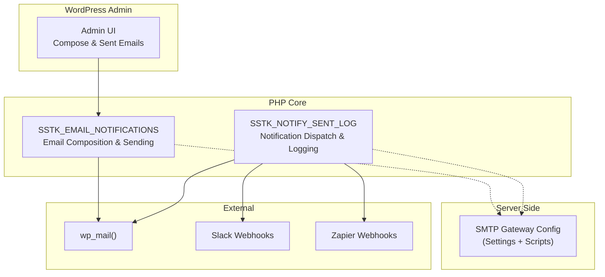
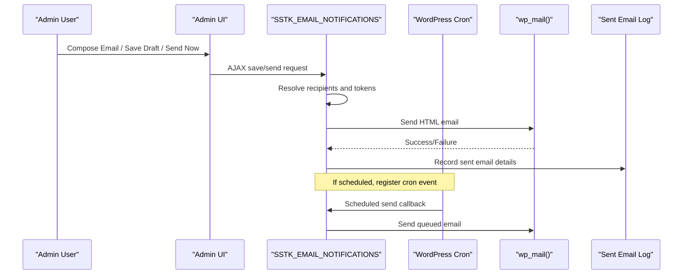
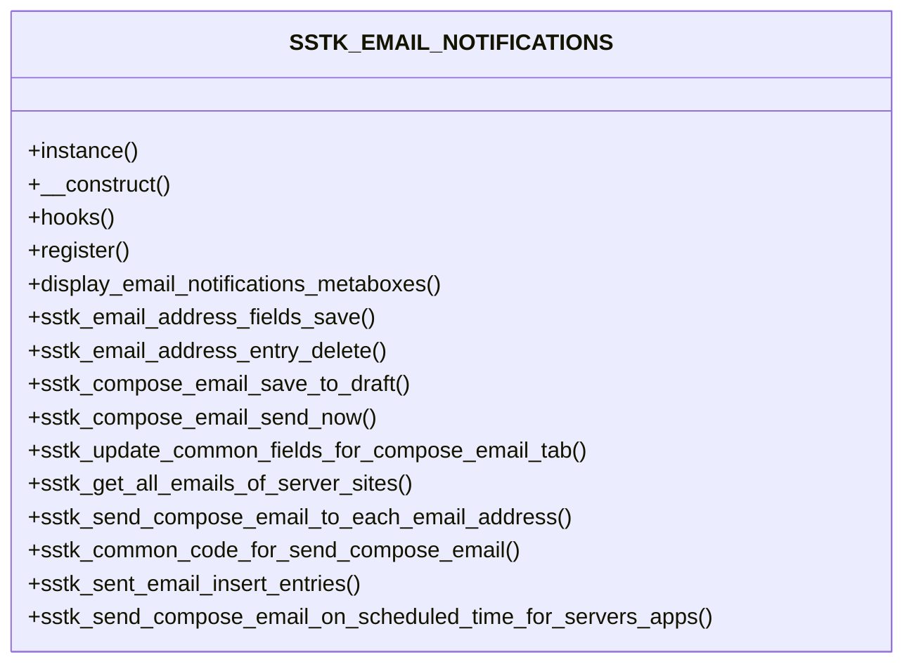
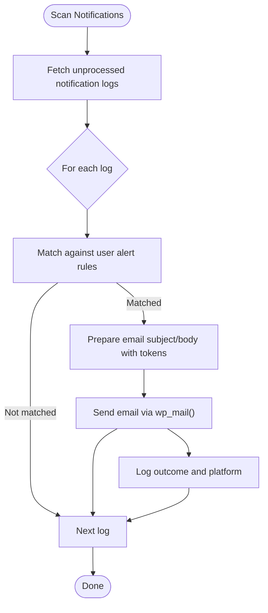
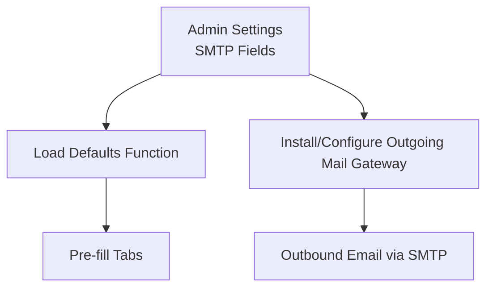

# Email Notification System

<cite>
**Referenced Files in This Document**   
- [class-sstk-email-notifications.php](file://includes/core/class-sstk-email-notifications.php)
- [class-sstk-posts-notify-sent-log.php](file://includes/core/class-sstk-posts-notify-sent-log.php)
- [class-wordpress-app-settings.php](file://includes/core/apps/wordpress-app/class-wordpress-app-settings.php)
- [services.php](file://includes/core/apps/wordpress-app/tabs-server/services.php)
- [14-mail.txt](file://includes/core/apps/wordpress-app/scripts/v1/raw/14-mail.txt)
- [email-admin.html](file://includes/core/apps/wordpress-app/templates/email-admin.html)
</cite>

## Table of Contents
1. [Introduction](#introduction)
2. [Project Structure](#project-structure)
3. [Core Components](#core-components)
4. [Architecture Overview](#architecture-overview)
5. [Detailed Component Analysis](#detailed-component-analysis)
6. [Dependency Analysis](#dependency-analysis)
7. [Performance Considerations](#performance-considerations)
8. [Troubleshooting Guide](#troubleshooting-guide)
9. [Conclusion](#conclusion)

## Introduction
This document explains Simple Stack’s email notification system, focusing on the SSTK_EMAIL_NOTIFICATIONS class and related components that send automated alerts, status updates, and operational notifications. It covers supported SMTP configuration options, template customization capabilities, notification triggers (including server provisioning events, backup completion, security alerts, and maintenance reminders), conditional notifications, integration with external services, deliverability best practices, spam prevention measures, and troubleshooting steps.

## Project Structure
The email notification system spans several files:
- Core email composition and sending logic resides in a dedicated class.
- A separate component manages user-facing notifications and dispatches them to email, Slack, and Zapier.
- Server-side SMTP gateway configuration is provided via settings and scripts.
- Templates provide default content for post-provisioning emails.

**Diagram sources**
- [class-sstk-email-notifications.php:30-99](file://includes/core/class-sstk-email-notifications.php#L30-L99)
- [class-sstk-posts-notify-sent-log.php:325-486](file://includes/core/class-sstk-posts-notify-sent-log.php#L325-L486)
- [class-wordpress-app-settings.php:2686-2749](file://includes/core/apps/wordpress-app/class-wordpress-app-settings.php#L2686-L2749)
- [services.php:862-933](file://includes/core/apps/wordpress-app/tabs-server/services.php#L862-L933)

**Section sources**
- [class-sstk-email-notifications.php:15-34](file://includes/core/class-sstk-email-notifications.php#L15-L34)
- [class-sstk-posts-notify-sent-log.php:15-34](file://includes/core/class-sstk-posts-notify-sent-log.php#L15-L34)

## Core Components
- SSTK_EMAIL_NOTIFICATIONS: Manages email address management, compose-and-send workflows, scheduled sends, and sent email logs.
- SSTK_NOTIFY_SENT_LOG: Scans pending notifications, applies user-level filters, and dispatches messages to email, Slack, or Zapier while logging outcomes.
- WordPress App Settings and Services: Provide SMTP gateway configuration fields and defaults used by server-side mail delivery.

Key responsibilities:
- Compose and send emails to server/app owners and additional recipients.
- Support token substitution for personalization.
- Schedule emails using WordPress cron.
- Track sent emails and errors.
- Route notifications based on user preferences and context.

**Section sources**
- [class-sstk-email-notifications.php:30-99](file://includes/core/class-sstk-email-notifications.php#L30-L99)
- [class-sstk-posts-notify-sent-log.php:325-486](file://includes/core/class-sstk-posts-notify-sent-log.php#L325-L486)

## Architecture Overview
The system supports two primary flows:
1. Manual or scheduled email composition from the admin UI.
2. Automated notification dispatch triggered by system events and processed by the notification scanner.

**Diagram sources**
- [class-sstk-email-notifications.php:943-1028](file://includes/core/class-sstk-email-notifications.php#L943-L1028)
- [class-sstk-email-notifications.php:1033-1097](file://includes/core/class-sstk-email-notifications.php#L1033-L1097)
- [class-sstk-email-notifications.php:1445-1465](file://includes/core/class-sstk-email-notifications.php#L1445-L1465)

## Detailed Component Analysis

### SSTK_EMAIL_NOTIFICATIONS Class
Responsibilities:
- Register custom post types for email addresses, sent emails, and batch entries.
- Provide admin metaboxes for composing emails and viewing sent emails.
- Handle AJAX endpoints for saving drafts, sending immediately, and listing sent emails.
- Manage scheduled sends via WordPress cron.
- Build recipient lists from server/app owners and additional recipients.
- Replace tokens in email body and subject.
- Use wp_mail() to send HTML emails and log results.

Important methods and behaviors:
- Hooks registration and metabox setup.
- Saving email address entries and deleting them.
- Updating common compose fields across server/app contexts.
- Resolving all email recipients for a given server/app or batch.
- Sending composed emails to each recipient with token replacement.
- Inserting sent email records into the database.
- Scheduling and executing scheduled sends.

**Diagram sources**
- [class-sstk-email-notifications.php:15-34](file://includes/core/class-sstk-email-notifications.php#L15-L34)
- [class-sstk-email-notifications.php:39-99](file://includes/core/class-sstk-email-notifications.php#L39-L99)
- [class-sstk-email-notifications.php:104-272](file://includes/core/class-sstk-email-notifications.php#L104-L272)
- [class-sstk-email-notifications.php:324-675](file://includes/core/class-sstk-email-notifications.php#L324-L675)
- [class-sstk-email-notifications.php:825-938](file://includes/core/class-sstk-email-notifications.php#L825-L938)
- [class-sstk-email-notifications.php:943-1097](file://includes/core/class-sstk-email-notifications.php#L943-L1097)
- [class-sstk-email-notifications.php:1110-1402](file://includes/core/class-sstk-email-notifications.php#L1110-L1402)
- [class-sstk-email-notifications.php:1445-1465](file://includes/core/class-sstk-email-notifications.php#L1445-L1465)

**Section sources**
- [class-sstk-email-notifications.php:30-99](file://includes/core/class-sstk-email-notifications.php#L30-L99)
- [class-sstk-email-notifications.php:324-675](file://includes/core/class-sstk-email-notifications.php#L324-L675)
- [class-sstk-email-notifications.php:943-1097](file://includes/core/class-sstk-email-notifications.php#L943-L1097)
- [class-sstk-email-notifications.php:1110-1402](file://includes/core/class-sstk-email-notifications.php#L1110-L1402)
- [class-sstk-email-notifications.php:1445-1465](file://includes/core/class-sstk-email-notifications.php#L1445-L1465)

### Notification Scanner and Dispatch (SSTK_NOTIFY_SENT_LOG)
Responsibilities:
- Scan pending notifications marked as not yet sent.
- Match notifications against user alert rules (servers/sites, types, references).
- Send email notifications using configured templates and tokens.
- Optionally send Slack and Zapier webhooks based on user preferences.
- Log success/failure and destination platform.

Dispatch flow:

**Diagram sources**
- [class-sstk-posts-notify-sent-log.php:325-486](file://includes/core/class-sstk-posts-notify-sent-log.php#L325-L486)
- [class-sstk-posts-notify-sent-log.php:510-562](file://includes/core/class-sstk-posts-notify-sent-log.php#L510-L562)

**Section sources**
- [class-sstk-posts-notify-sent-log.php:325-486](file://includes/core/class-sstk-posts-notify-sent-log.php#L325-L486)
- [class-sstk-posts-notify-sent-log.php:510-562](file://includes/core/class-sstk-posts-notify-sent-log.php#L510-L562)

### SMTP Configuration and Providers
Supported configuration:
- SMTP server and port.
- SMTP username and password.
- From domain and FQDN hostname.
- TLS and STARTTLS toggles.
- Optional note field for documentation.

These settings are exposed in the WordPress app settings and can be auto-filled on tabs. The server-side script installs and configures an outgoing mail gateway using these parameters.

Configuration entry points:
- Settings fields for SMTP server, user, password, domain, hostname, TLS, STARTTLS, and note.
- Default loading function to populate form fields.
- Server-side script to install and configure ssmtp with provided values.

**Diagram sources**
- [class-wordpress-app-settings.php:2686-2749](file://includes/core/apps/wordpress-app/class-wordpress-app-settings.php#L2686-L2749)
- [services.php:2567-2582](file://includes/core/apps/wordpress-app/tabs-server/services.php#L2567-L2582)
- [14-mail.txt:26-91](file://includes/core/apps/wordpress-app/scripts/v1/raw/14-mail.txt#L26-L91)

**Section sources**
- [class-wordpress-app-settings.php:2686-2749](file://includes/core/apps/wordpress-app/class-wordpress-app-settings.php#L2686-L2749)
- [services.php:862-933](file://includes/core/apps/wordpress-app/tabs-server/services.php#L862-L933)
- [services.php:2567-2582](file://includes/core/apps/wordpress-app/tabs-server/services.php#L2567-L2582)
- [14-mail.txt:26-91](file://includes/core/apps/wordpress-app/scripts/v1/raw/14-mail.txt#L26-L91)

### Template Customization Capabilities
- Composed emails support token substitution for personalization (e.g., user names, owner names, server name, site name).
- Automated notifications use configurable subject and body templates with tokens such as username, type, reference, message, server name, domain, date/time, server/site IDs, provider, and IP.
- A default post-provisioning email template exists for informing users that their server is ready.

Token usage:
- Compose workflow tokens include USER_FIRSTNAME, USER_LASTNAME, OWNER_FIRSTNAME, OWNER_LASTNAME, SERVER_NAME, SITE_NAME.
- Automated notification tokens include USERNAME, TYPE, REFERENCE, MESSAGE, SERVERNAME, DOMAIN, DATE, TIME, SERVERID, SITEID, FIRST_NAME, LAST_NAME, IPV4, PROVIDER.

Template location:
- Default server-ready email template is provided for reference and can be extended.

**Section sources**
- [class-sstk-email-notifications.php:1363-1402](file://includes/core/class-sstk-email-notifications.php#L1363-L1402)
- [class-sstk-posts-notify-sent-log.php:510-562](file://includes/core/class-sstk-posts-notify-sent-log.php#L510-L562)
- [email-admin.html:1-14](file://includes/core/apps/wordpress-app/templates/email-admin.html#L1-L14)

### Notification Triggers
Triggers covered by the codebase:
- Server provisioning: Post-provisioning email template indicates server readiness.
- Backup completion: Command callbacks indicate backup start/end events; these can be wired to notifications.
- Security alerts: Quota limit evaluation emits notification logs which can trigger alerts.
- Maintenance reminders: Not explicitly present in the referenced files; can be implemented by emitting notification logs and leveraging the scanner.

Relevant hooks and actions:
- Command completion hooks for backup and other operations.
- Quota evaluation action that logs notifications when limits are exceeded.

**Section sources**
- [email-admin.html:1-14](file://includes/core/apps/wordpress-app/templates/email-admin.html#L1-L14)
- [class-wordpress-app.php:143-147](file://includes/core/apps/wordpress-app/class-wordpress-app.php#L143-L147)
- [class-wordpress-posts-quota-limits.php:446-508](file://includes/core/apps/wordpress-app/class-wordpress-posts-quota-limits.php#L446-L508)

### Conditional Notifications
User-level conditions:
- Users can configure which servers/sites they want to monitor.
- Users can select notification types and references.
- The scanner matches incoming logs against these conditions before dispatching.

Implementation highlights:
- Retrieval of user-configured sites/servers/types/references.
- Permission checks ensure users only receive notifications for resources they can access.

**Section sources**
- [class-sstk-posts-notify-sent-log.php:404-474](file://includes/core/class-sstk-posts-notify-sent-log.php#L404-L474)

### Integration with External Notification Services
- Slack webhooks: Messages are constructed with tokens and posted to configured webhook URLs.
- Zapier webhooks: JSON payloads are built with tokens and posted to configured webhook URLs.
- Both integrations log success/failure and destination.

**Section sources**
- [class-sstk-posts-notify-sent-log.php:585-641](file://includes/core/class-sstk-posts-notify-sent-log.php#L585-L641)
- [class-sstk-posts-notify-sent-log.php:667-747](file://includes/core/class-sstk-posts-notify-sent-log.php#L667-L747)

## Dependency Analysis
- SSTK_EMAIL_NOTIFICATIONS depends on:
  - WordPress core functions (wp_mail, wp_schedule_event, wp_clear_scheduled_hook).
  - Token replacement utilities via the WordPress app class.
  - Server metadata helpers to resolve server names and domains.
- SSTK_NOTIFY_SENT_LOG depends on:
  - WordPress core functions (curl for webhooks, transient API).
  - WordPress app class for token replacement.
  - Helper classes to retrieve server and site information.

Coupling and cohesion:
- Email composition and sending are cohesive within SSTK_EMAIL_NOTIFICATIONS.
- Notification scanning and dispatch are cohesive within SSTK_NOTIFY_SENT_LOG.
- SMTP configuration is decoupled from sending logic but influences deliverability.

Potential circular dependencies:
- None observed between the analyzed components.

External dependencies:
- SMTP servers configured via settings and scripts.
- Slack and Zapier webhooks.

**Section sources**
- [class-sstk-email-notifications.php:1385-1402](file://includes/core/class-sstk-email-notifications.php#L1385-L1402)
- [class-sstk-posts-notify-sent-log.php:615-641](file://includes/core/class-sstk-posts-notify-sent-log.php#L615-L641)
- [class-sstk-posts-notify-sent-log.php:720-747](file://includes/core/class-sstk-posts-notify-sent-log.php#L720-L747)

## Performance Considerations
- Batch processing: When sending to multiple recipients, consider batching to reduce overhead.
- Cron scheduling: Scheduled emails run every two minutes; ensure this interval aligns with workload.
- Logging volume: Excessive logging can grow the database; manage log levels and limits.
- Network calls: Slack/Zapier webhooks involve HTTP requests; failures should be retried or logged appropriately.

[No sources needed since this section provides general guidance]

## Troubleshooting Guide
Common issues and resolutions:
- No recipients found: Ensure email addresses are attached to the server/app or add additional recipients.
- Empty subject/body: Verify compose fields or notification templates are populated.
- Email not sent: Check wp_mail() behavior and SMTP configuration; review error logs.
- Scheduled email not sent: Confirm cron events are registered and server time is correct.
- Deliverability problems: Validate SPF/DKIM/DMARC, use proper From/Reply-To headers, and avoid spammy content.

Operational checks:
- Review sent email logs for successful deliveries and errors.
- Inspect notification sent logs for dispatch outcomes and platforms.
- Validate SMTP settings and server-side mail gateway installation.

**Section sources**
- [class-sstk-email-notifications.php:1283-1402](file://includes/core/class-sstk-email-notifications.php#L1283-L1402)
- [class-sstk-posts-notify-sent-log.php:510-562](file://includes/core/class-sstk-posts-notify-sent-log.php#L510-L562)

## Conclusion
Simple Stack’s email notification system provides robust mechanisms for composing, scheduling, and sending automated alerts through SMTP, with flexible token-based templates and multi-channel integrations. Administrators can configure SMTP gateways, customize templates, and set up conditional notifications tailored to specific servers, sites, and event types. By following deliverability best practices and leveraging the provided logging and diagnostics, teams can maintain reliable and informative email communications across their infrastructure.

[No sources needed since this section summarizes without analyzing specific files]