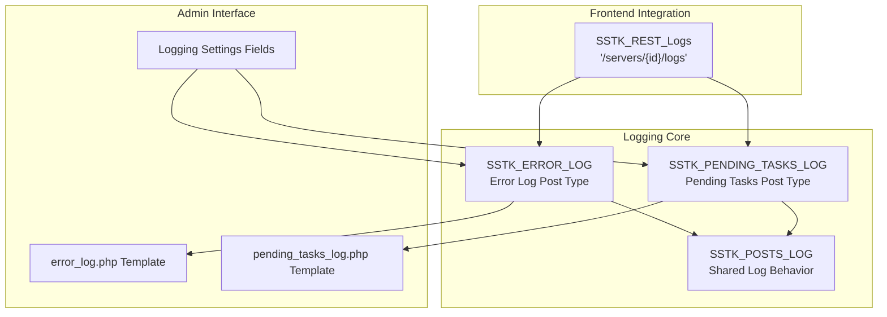
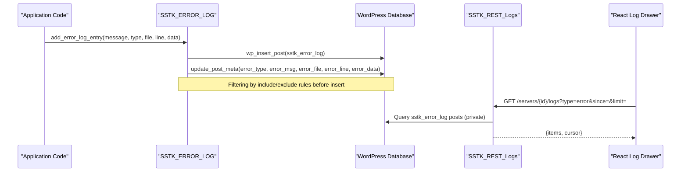
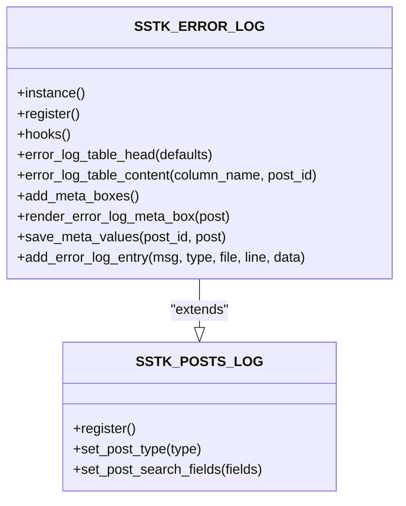
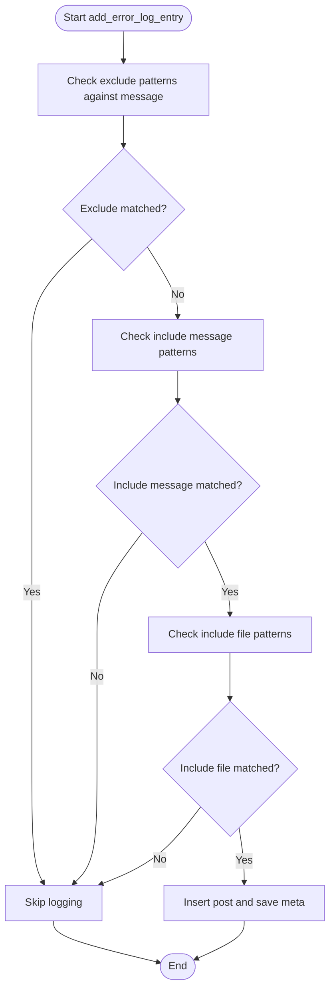
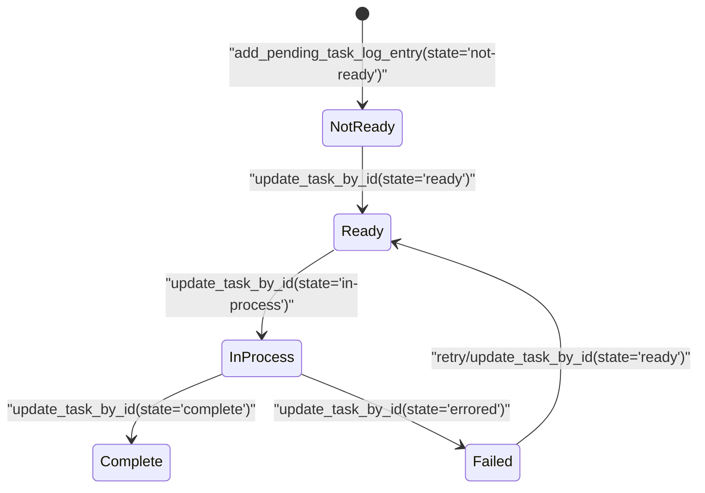
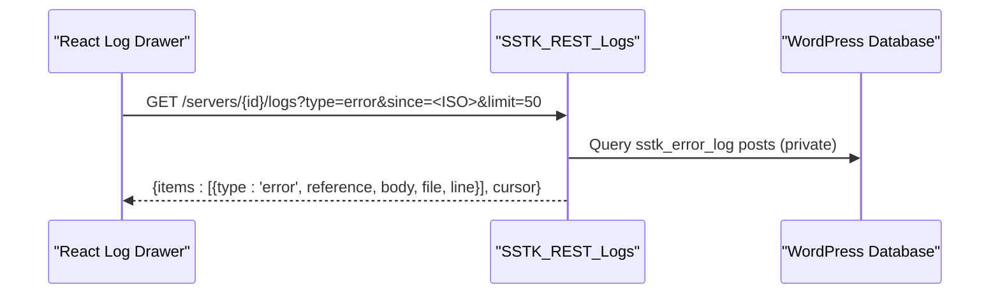
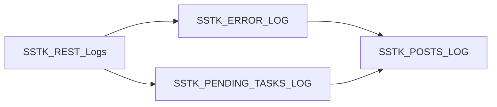

# Error Tracking & Debugging

<cite>
**Referenced Files in This Document**
- [class-sstk-posts-error-log.php](file://includes/core/class-sstk-posts-error-log.php)
- [class-sstk-posts-pending-tasks-log.php](file://includes/core/class-sstk-posts-pending-tasks-log.php)
- [class-sstk-rest-logs.php](file://includes/core/api/class-sstk-rest-logs.php)
- [error_log.php](file://includes/templates/error_log.php)
- [pending_tasks_log.php](file://includes/templates/pending_tasks_log.php)
- [class-sstk-settings.php](file://includes/core/class-sstk-settings.php)
- [class-sstk-posts-log.php](file://includes/core/class-sstk-posts-log.php)
</cite>

## Table of Contents
1. [Introduction](#introduction)
2. [Project Structure](#project-structure)
3. [Core Components](#core-components)
4. [Architecture Overview](#architecture-overview)
5. [Detailed Component Analysis](#detailed-component-analysis)
6. [Dependency Analysis](#dependency-analysis)
7. [Performance Considerations](#performance-considerations)
8. [Troubleshooting Guide](#troubleshooting-guide)
9. [Conclusion](#conclusion)

## Introduction
This document explains Simple Stack’s error tracking and debugging capabilities with a focus on:
- The `SSTK_ERROR_LOG` class for capturing, filtering, and storing application errors, exceptions, and warnings.
- Automatic context collection such as file, line number, message, type, and optional structured data.
- The pending tasks logging system used to track asynchronous operations, retries, state transitions, and failed jobs.
- How to configure error reporting levels and filters through the admin settings.
- How to access logs via the WordPress admin interface and the React-based log drawer.
- Debugging workflows, correlation techniques, and guidance for integrating with external services like Sentry or Rollbar.

## Project Structure
Simple Stack implements its logging infrastructure using WordPress custom post types and meta fields. The key pieces are:
- Error log storage and administration UI.
- Pending task log storage and administration UI.
- A REST controller that exposes recent logs to the frontend log drawer.
- Settings pages that expose logging configuration options.
- Shared base classes for common log behaviors such as trimming and search fields.

**Diagram sources**
- [class-sstk-posts-error-log.php:15-114](file://includes/core/class-sstk-posts-error-log.php#L15-L114)
- [class-sstk-posts-pending-tasks-log.php:15-153](file://includes/core/class-sstk-posts-pending-tasks-log.php#L15-L153)
- [class-sstk-rest-logs.php:19-65](file://includes/core/api/class-sstk-rest-logs.php#L19-L65)
- [error_log.php:27-48](file://includes/templates/error_log.php#L27-L48)
- [pending_tasks_log.php:27-92](file://includes/templates/pending_tasks_log.php#L27-L92)
- [class-sstk-settings.php:210-252](file://includes/core/class-sstk-settings.php#L210-L252)

**Section sources**
- [class-sstk-posts-error-log.php:15-114](file://includes/core/class-sstk-posts-error-log.php#L15-L114)
- [class-sstk-posts-pending-tasks-log.php:15-153](file://includes/core/class-sstk-posts-pending-tasks-log.php#L15-L153)
- [class-sstk-rest-logs.php:19-65](file://includes/core/api/class-sstk-rest-logs.php#L19-L65)
- [class-sstk-settings.php:210-252](file://includes/core/class-sstk-settings.php#L210-L252)

## Core Components
- `SSTK_ERROR_LOG`: Registers the `sstk_error_log` post type, defines columns, meta box rendering, and provides `add_error_log_entry()` for writing filtered error records.
- `SSTK_PENDING_TASKS_LOG`: Registers the `sstk_pending_log` post type, manages task lifecycle metadata, and provides methods to create, query, and update pending tasks.
- `SSTK_REST_Logs`: Exposes `/servers/{id}/logs` and `/activity` endpoints that return command, SSH, and error logs to the React log drawer.
- Templates: `error_log.php` and `pending_tasks_log.php` render detailed views for each log entry in the WordPress admin.
- Settings: Logging configuration includes log types, include/exclude patterns, and auto-trim limits.

**Section sources**
- [class-sstk-posts-error-log.php:15-358](file://includes/core/class-sstk-posts-error-log.php#L15-L358)
- [class-sstk-posts-pending-tasks-log.php:15-800](file://includes/core/class-sstk-posts-pending-tasks-log.php#L15-L800)
- [class-sstk-rest-logs.php:19-239](file://includes/core/api/class-sstk-rest-logs.php#L19-L239)
- [error_log.php:27-48](file://includes/templates/error_log.php#L27-L48)
- [pending_tasks_log.php:27-92](file://includes/templates/pending_tasks_log.php#L27-L92)
- [class-sstk-settings.php:210-252](file://includes/core/class-sstk-settings.php#L210-L252)

## Architecture Overview
The logging architecture is centered around WordPress posts:
- Errors are stored as private posts of type `sstk_error_log`.
- Pending tasks are stored as private posts of type `sstk_pending_log`.
- Both post types extend shared log behavior from `SSTK_POSTS_LOG`, including search fields and auto-trimming.
- The REST controller reads these posts and formats them for the frontend log drawer.

**Diagram sources**
- [class-sstk-posts-error-log.php:257-353](file://includes/core/class-sstk-posts-error-log.php#L257-L353)
- [class-sstk-rest-logs.php:76-101](file://includes/core/api/class-sstk-rest-logs.php#L76-L101)
- [class-sstk-rest-logs.php:137-177](file://includes/core/api/class-sstk-rest-logs.php#L137-L177)
- [class-sstk-rest-logs.php:187-222](file://includes/core/api/class-sstk-rest-logs.php#L187-L222)

## Detailed Component Analysis

### ErrorLog Class Architecture
`SSTK_ERROR_LOG` extends the shared log base class and registers the `sstk_error_log` post type. It:
- Adds admin columns for type, file, line, and date.
- Renders a meta box showing error details.
- Provides `add_error_log_entry()` which applies filtering rules and stores structured error context.

Key responsibilities:
- Post type registration and capability mapping.
- Admin UI hooks for listing and detail views.
- Filtering logic based on include/exclude text and file patterns.
- Sanitization and redaction of sensitive values before persistence.

**Diagram sources**
- [class-sstk-posts-error-log.php:15-358](file://includes/core/class-sstk-posts-error-log.php#L15-L358)

**Section sources**
- [class-sstk-posts-error-log.php:15-114](file://includes/core/class-sstk-posts-error-log.php#L15-L114)
- [class-sstk-posts-error-log.php:183-236](file://includes/core/class-sstk-posts-error-log.php#L183-L236)
- [class-sstk-posts-error-log.php:257-353](file://includes/core/class-sstk-posts-error-log.php#L257-L353)

#### Error Context Collection
When an error is recorded, the following context is captured:
- `error_type`: Category or classification of the error.
- `error_msg`: Human-readable message.
- `error_file`: Source file path where the error occurred.
- `error_line`: Line number in the source file.
- `error_data`: Optional structured payload (array/object serialized).

The class also:
- Redacts known password-like strings from messages.
- Applies include/exclude filters before insertion.
- Stores entries as private posts with the current user as author.

**Section sources**
- [class-sstk-posts-error-log.php:257-353](file://includes/core/class-sstk-posts-error-log.php#L257-L353)

#### Error Categorization and Severity Levels
The codebase supports categorizing errors via the `error_type` field. Severity levels are not enforced by a dedicated enum; instead, they can be represented within the `error_type` value or by combining it with other metadata. For example, you might use values like:
- `critical`
- `error`
- `warning`
- `info`

Administrators can filter and sort logs using the admin columns and search fields defined for the post type.

**Section sources**
- [class-sstk-posts-error-log.php:105-112](file://includes/core/class-sstk-posts-error-log.php#L105-L112)
- [class-sstk-posts-error-log.php:183-193](file://includes/core/class-sstk-posts-error-log.php#L183-L193)

#### Error Filtering Rules
Before persisting an error, the class evaluates:
- Exclude patterns: If any configured exclude pattern matches the message, the entry is skipped.
- Include patterns (message): If configured, only messages matching at least one include pattern are logged.
- Include patterns (files): If configured, only entries originating from files matching at least one include pattern are logged.

These rules allow fine-grained control over what gets recorded, reducing noise and focusing on relevant issues.

**Diagram sources**
- [class-sstk-posts-error-log.php:257-314](file://includes/core/class-sstk-posts-error-log.php#L257-L314)

**Section sources**
- [class-sstk-posts-error-log.php:257-314](file://includes/core/class-sstk-posts-error-log.php#L257-L314)

### Pending Tasks Logging System
`SSTK_PENDING_TASKS_LOG` manages asynchronous operations by creating and updating pending task records. Each record captures:
- Owner/parent reference (`parent_post_id`) and parent post type.
- Task type and key for lookup and deduplication.
- State machine values such as `not-ready`, `ready`, `in-process`, `complete`.
- Attempt counter, comments, history, and messages.
- Associated server ID for cross-referencing server-side work.
- Timestamps for start and completion.

Key methods:
- `add_pending_task_log_entry()`: Creates a new pending task record with initial metadata.
- `update_task_by_id()`: Updates details, state, references, comments, timestamps, and increments attempts.
- `get_tasks_by_key_state_type()`, `get_tasks_by_state_reference()`, `get_tasks_by_parent_state_type()`: Query helpers for finding tasks by various criteria.
- `sstk_is_server_available_for_commands()`: Prevents running commands on servers with active in-process tasks.

**Diagram sources**
- [class-sstk-posts-pending-tasks-log.php:478-535](file://includes/core/class-sstk-posts-pending-tasks-log.php#L478-L535)
- [class-sstk-posts-pending-tasks-log.php:655-714](file://includes/core/class-sstk-posts-pending-tasks-log.php#L655-L714)

**Section sources**
- [class-sstk-posts-pending-tasks-log.php:15-153](file://includes/core/class-sstk-posts-pending-tasks-log.php#L15-L153)
- [class-sstk-posts-pending-tasks-log.php:478-535](file://includes/core/class-sstk-posts-pending-tasks-log.php#L478-L535)
- [class-sstk-posts-pending-tasks-log.php:655-714](file://includes/core/class-sstk-posts-pending-tasks-log.php#L655-L714)
- [class-sstk-posts-pending-tasks-log.php:749-800](file://includes/core/class-sstk-posts-pending-tasks-log.php#L749-L800)

### Admin Interface and Templates
- Error log detail template renders fields for type, message, file, line, and additional data.
- Pending tasks detail template renders task metadata, state, attempts, reference, comment, history, messages, timestamps, related data, owner, and associated server.

These templates are included by their respective classes when rendering the meta boxes in the WordPress admin.

**Section sources**
- [error_log.php:27-48](file://includes/templates/error_log.php#L27-L48)
- [pending_tasks_log.php:27-92](file://includes/templates/pending_tasks_log.php#L27-L92)

### REST API Exposure for Logs
`SSTK_REST_Logs` exposes:
- `GET /servers/{id}/logs`: Returns command, SSH, and error logs for a server, optionally filtered by type and timestamp.
- `GET /activity`: Returns a merged activity feed across log types.

For error logs, the response includes:
- `reference`: error type.
- `body`: error message.
- `file`: source file.
- `line`: source line number.

This enables the React log drawer to display real-time error information alongside commands and SSH output.

**Diagram sources**
- [class-sstk-rest-logs.php:44-65](file://includes/core/api/class-sstk-rest-logs.php#L44-L65)
- [class-sstk-rest-logs.php:76-101](file://includes/core/api/class-sstk-rest-logs.php#L76-L101)
- [class-sstk-rest-logs.php:187-222](file://includes/core/api/class-sstk-rest-logs.php#L187-L222)

**Section sources**
- [class-sstk-rest-logs.php:19-65](file://includes/core/api/class-sstk-rest-logs.php#L19-L65)
- [class-sstk-rest-logs.php:76-101](file://includes/core/api/class-sstk-rest-logs.php#L76-L101)
- [class-sstk-rest-logs.php:137-177](file://includes/core/api/class-sstk-rest-logs.php#L137-L177)
- [class-sstk-rest-logs.php:187-222](file://includes/core/api/class-sstk-rest-logs.php#L187-L222)

## Dependency Analysis
- `SSTK_ERROR_LOG` depends on:
  - WordPress functions for post creation and meta updates.
  - Shared base class `SSTK_POSTS_LOG` for common log behavior.
  - Settings options for filtering and trimming.
- `SSTK_PENDING_TASKS_LOG` depends on:
  - WordPress functions for post creation and meta updates.
  - Shared base class `SSTK_POSTS_LOG`.
  - Application logic to set states and associate servers.
- `SSTK_REST_Logs` depends on:
  - WordPress query APIs to read private posts.
  - Formatting logic to map post meta to frontend-friendly structures.

**Diagram sources**
- [class-sstk-posts-error-log.php:15-358](file://includes/core/class-sstk-posts-error-log.php#L15-L358)
- [class-sstk-posts-pending-tasks-log.php:15-800](file://includes/core/class-sstk-posts-pending-tasks-log.php#L15-L800)
- [class-sstk-rest-logs.php:19-239](file://includes/core/api/class-sstk-rest-logs.php#L19-L239)

**Section sources**
- [class-sstk-posts-error-log.php:15-358](file://includes/core/class-sstk-posts-error-log.php#L15-L358)
- [class-sstk-posts-pending-tasks-log.php:15-800](file://includes/core/class-sstk-posts-pending-tasks-log.php#L15-L800)
- [class-sstk-rest-logs.php:19-239](file://includes/core/api/class-sstk-rest-logs.php#L19-L239)

## Performance Considerations
- Auto-trimming: The shared log base class enforces automatic trimming of log entries based on configured limits. For error logs, this helps prevent unbounded growth of the database.
- Query efficiency: The REST controller uses `no_found_rows` and limits to reduce overhead when fetching recent logs for the live drawer.
- Filtering cost: Include/exclude checks run on every error write; keep patterns concise to minimize string comparisons.

Recommendations:
- Set appropriate auto-trim limits for error logs to balance retention and performance.
- Use targeted include patterns for high-noise areas to avoid excessive writes.
- Avoid overly broad include patterns that could capture large payloads in `error_data`.

**Section sources**
- [class-sstk-posts-log.php:242-277](file://includes/core/class-sstk-posts-log.php#L242-L277)
- [class-sstk-rest-logs.php:137-177](file://includes/core/api/class-sstk-rest-logs.php#L137-L177)

## Troubleshooting Guide

### Accessing Error Logs in the Admin Interface
- Navigate to the Error Log section under the Simple Stack menu.
- Columns show type, file, line, and date.
- Click into a log entry to view the meta box with full details: type, message, file, line, and additional data.

**Section sources**
- [class-sstk-posts-error-log.php:183-236](file://includes/core/class-sstk-posts-error-log.php#L183-L236)
- [error_log.php:27-48](file://includes/templates/error_log.php#L27-L48)

### Accessing Pending Tasks in the Admin Interface
- Navigate to the Pending Tasks section under the Simple Stack menu.
- Columns show owner/parent, type, key, state, attempts, comment, server, start date, complete date, and date.
- Click into a pending task to view detailed metadata, history, messages, and associated server.

**Section sources**
- [class-sstk-posts-pending-tasks-log.php:254-273](file://includes/core/class-sstk-posts-pending-tasks-log.php#L254-L273)
- [pending_tasks_log.php:27-92](file://includes/templates/pending_tasks_log.php#L27-L92)

### Configuring Error Reporting Levels and Filters
- Go to the logging settings page.
- Select log types to enable (e.g., Error, Warning, Debug, Security).
- Configure include/exclude patterns for messages and files.
- Adjust auto-trim limits for error logs and other log types.

Common configurations:
- Enable “Error” and “Warning” to capture operational issues.
- Add specific file paths to include only relevant modules.
- Exclude noisy informational messages to reduce clutter.

**Section sources**
- [class-sstk-settings.php:210-252](file://includes/core/class-sstk-settings.php#L210-L252)
- [class-sstk-posts-error-log.php:257-314](file://includes/core/class-sstk-posts-error-log.php#L257-L314)

### Implementing Custom Error Handlers
To integrate your own error handling:
- Wrap critical operations with try/catch blocks.
- On exception, call `SSTK_ERROR_LOG()->add_error_log_entry()` with:
  - A descriptive message.
  - A meaningful type/category.
  - File and line context.
  - Optional structured data for correlation.

Best practices:
- Normalize error types to a consistent taxonomy.
- Avoid logging secrets; rely on built-in redaction but still sanitize inputs.
- Use unique keys or references in `error_data` to correlate related events.

**Section sources**
- [class-sstk-posts-error-log.php:257-353](file://includes/core/class-sstk-posts-error-log.php#L257-L353)

### Debugging Workflows and Correlation Techniques
- Use the REST endpoint `/servers/{id}/logs?type=error` to stream recent errors in the React log drawer.
- Correlate errors with pending tasks by referencing IDs or keys in `error_data` and matching them to `pending_task_reference` or `pending_task_key`.
- Track state transitions in pending tasks to understand retry behavior and failure points.

Tips:
- Include a correlation ID in both error logs and pending tasks for end-to-end tracing.
- Use the “Server” column in pending tasks to quickly locate related server-side activity.
- Combine error logs with command and SSH logs to reconstruct the full execution path.

**Section sources**
- [class-sstk-rest-logs.php:76-101](file://includes/core/api/class-sstk-rest-logs.php#L76-L101)
- [class-sstk-posts-pending-tasks-log.php:545-602](file://includes/core/class-sstk-posts-pending-tasks-log.php#L545-L602)

### Integrating with External Services (Sentry, Rollbar)
While Simple Stack does not include built-in integrations for Sentry or Rollbar, you can implement custom handlers:
- Create a wrapper around `SSTK_ERROR_LOG()->add_error_log_entry()` that forwards enriched error payloads to your external service.
- Map Simple Stack error types to severity levels expected by the external service.
- Attach correlation IDs and stack traces to enrich remote reports.
- Ensure sensitive data is scrubbed before sending to external systems.

Example integration approach:
- Hook into your application’s error handling layer.
- On error, call both Simple Stack’s logger and the external SDK.
- Use consistent identifiers across logs and tasks for unified troubleshooting.

[No sources needed since this section provides general guidance]

## Conclusion
Simple Stack’s error tracking and debugging system centers on structured error logs and a robust pending tasks framework:
- Errors are captured with rich context and filtered by configurable rules.
- Pending tasks provide visibility into asynchronous operations, retries, and failures.
- The admin interface and REST API make logs accessible for manual inspection and live monitoring.
- Administrators can tune logging behavior via settings, and developers can implement custom handlers to integrate with external services.

By leveraging these tools, teams can diagnose issues faster, correlate related events, and maintain reliable operations across servers and applications.