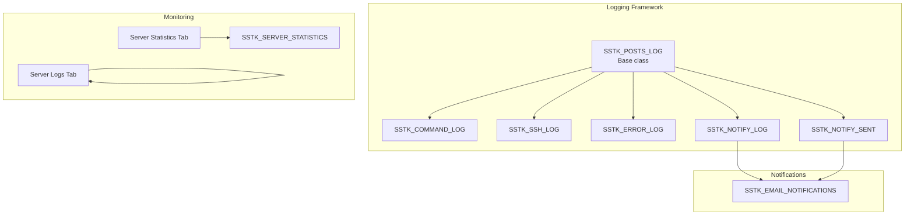
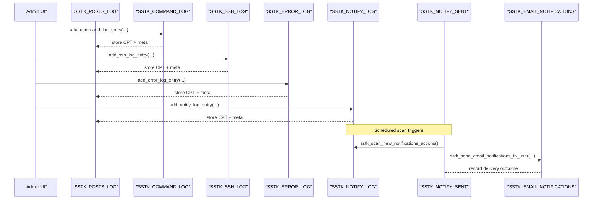
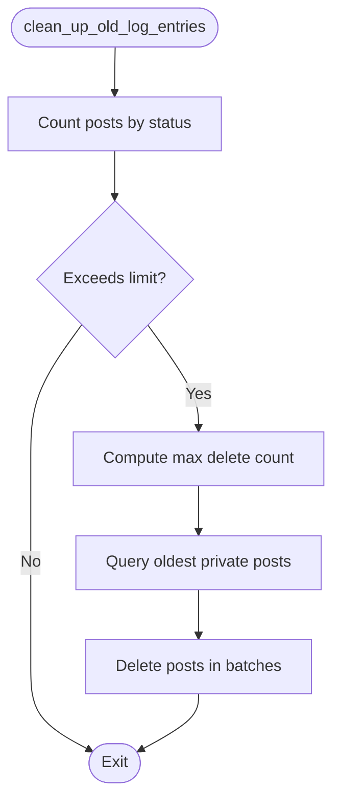
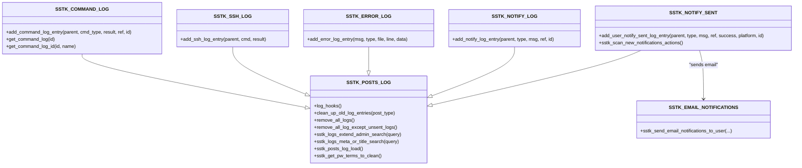

# Logging & Monitoring

<cite>
**Referenced Files in This Document**
- [class-sstk-posts-log.php](file://includes/core/class-sstk-posts-log.php)
- [class-sstk-posts-command-log.php](file://includes/core/class-sstk-posts-command-log.php)
- [class-sstk-posts-error-log.php](file://includes/core/class-sstk-posts-error-log.php)
- [class-sstk-posts-ssh-log.php](file://includes/core/class-sstk-posts-ssh-log.php)
- [class-sstk-posts-notify-log.php](file://includes/core/class-sstk-posts-notify-log.php)
- [class-sstk-posts-notify-sent-log.php](file://includes/core/class-sstk-posts-notify-sent-log.php)
- [class-sstk-email-notifications.php](file://includes/core/class-sstk-email-notifications.php)
- [class-sstk-server-statistics.php](file://includes/core/class-sstk-server-statistics.php)
- [tabs-server/statistics.php](file://includes/core/apps/wordpress-app/tabs-server/statistics.php)
- [tabs-server/logs.php](file://includes/core/apps/wordpress-app/tabs-server/logs.php)
- [functions.php](file://includes/core/functions.php)
- [class-sstk-settings.php](file://includes/core/class-sstk-settings.php)
</cite>

## Table of Contents
1. [Introduction](#introduction)
2. [Project Structure](#project-structure)
3. [Core Components](#core-components)
4. [Architecture Overview](#architecture-overview)
5. [Detailed Component Analysis](#detailed-component-analysis)
6. [Dependency Analysis](#dependency-analysis)
7. [Performance Considerations](#performance-considerations)
8. [Troubleshooting Guide](#troubleshooting-guide)
9. [Conclusion](#conclusion)

## Introduction
This document explains Simple Stack’s logging and monitoring systems with a focus on:
- Command execution logs, SSH logs, error logs, and notification logs
- Email notifications and alert delivery to users
- Server statistics collection and visualization
- Health checks via Monit integration
- Log retention policies and operational data analysis

It is designed for operators who need to configure, troubleshoot, and plan capacity using the collected metrics and logs.

## Project Structure
Simple Stack implements its logging and monitoring as WordPress custom post types (CPTs) with shared base functionality, plus dedicated classes for email notifications and server statistics. The UI integrates into wp-admin and exposes tabs for logs and statistics.

**Diagram sources**
- [class-sstk-posts-log.php:17-53](file://includes/core/class-sstk-posts-log.php#L17-L53)
- [class-sstk-posts-command-log.php:15-34](file://includes/core/class-sstk-posts-command-log.php#L15-L34)
- [class-sstk-posts-ssh-log.php:15-34](file://includes/core/class-sstk-posts-ssh-log.php#L15-L34)
- [class-sstk-posts-error-log.php:15-34](file://includes/core/class-sstk-posts-error-log.php#L15-L34)
- [class-sstk-posts-notify-log.php:15-34](file://includes/core/class-sstk-posts-notify-log.php#L15-L34)
- [class-sstk-posts-notify-sent-log.php:15-34](file://includes/core/class-sstk-posts-notify-sent-log.php#L15-L34)
- [class-sstk-email-notifications.php:15-34](file://includes/core/class-sstk-email-notifications.php#L15-L34)
- [class-sstk-server-statistics.php:15-34](file://includes/core/class-sstk-server-statistics.php#L15-L34)
- [tabs-server/statistics.php:375-425](file://includes/core/apps/wordpress-app/tabs-server/statistics.php#L375-L425)
- [tabs-server/logs.php:308-358](file://includes/core/apps/wordpress-app/tabs-server/logs.php#L308-L358)

**Section sources**
- [class-sstk-posts-log.php:17-53](file://includes/core/class-sstk-posts-log.php#L17-L53)
- [class-sstk-posts-command-log.php:15-34](file://includes/core/class-sstk-posts-command-log.php#L15-L34)
- [class-sstk-posts-ssh-log.php:15-34](file://includes/core/class-sstk-posts-ssh-log.php#L15-L34)
- [class-sstk-posts-error-log.php:15-34](file://includes/core/class-sstk-posts-error-log.php#L15-L34)
- [class-sstk-posts-notify-log.php:15-34](file://includes/core/class-sstk-posts-notify-log.php#L15-L34)
- [class-sstk-posts-notify-sent-log.php:15-34](file://includes/core/class-sstk-posts-notify-sent-log.php#L15-L34)
- [class-sstk-email-notifications.php:15-34](file://includes/core/class-sstk-email-notifications.php#L15-L34)
- [class-sstk-server-statistics.php:15-34](file://includes/core/class-sstk-server-statistics.php#L15-L34)
- [tabs-server/statistics.php:375-425](file://includes/core/apps/wordpress-app/tabs-server/statistics.php#L375-L425)
- [tabs-server/logs.php:308-358](file://includes/core/apps/wordpress-app/tabs-server/logs.php#L308-L358)

## Core Components
- Logging framework base: SSTK_POSTS_LOG provides common hooks, search enhancements, bulk actions, and log pruning.
- Log types:
  - Command logs: records executed commands and results.
  - SSH logs: records remote command executions over SSH.
  - Error logs: structured application errors with type, file, line, and optional payload.
  - Notification logs: alerts queued for delivery.
  - Notification sent logs: delivery outcomes across channels.
- Email notifications: compose, schedule, send, and track emails; also supports Slack and Zapier webhooks.
- Server statistics: collects and formats disk usage, vnstat traffic, vmstat memory, and top process snapshots.
- Server logs tab: lists system and service logs available on managed servers.

Key responsibilities:
- Structured storage of logs as private posts with searchable metadata.
- Pruning old logs based on configurable limits.
- Tokenized email templates and multi-channel delivery.
- Visualization-ready data formatting for charts.

**Section sources**
- [class-sstk-posts-log.php:17-53](file://includes/core/class-sstk-posts-log.php#L17-L53)
- [class-sstk-posts-command-log.php:15-34](file://includes/core/class-sstk-posts-command-log.php#L15-L34)
- [class-sstk-posts-ssh-log.php:15-34](file://includes/core/class-sstk-posts-ssh-log.php#L15-L34)
- [class-sstk-posts-error-log.php:15-34](file://includes/core/class-sstk-posts-error-log.php#L15-L34)
- [class-sstk-posts-notify-log.php:15-34](file://includes/core/class-sstk-posts-notify-log.php#L15-L34)
- [class-sstk-posts-notify-sent-log.php:15-34](file://includes/core/class-sstk-posts-notify-sent-log.php#L15-L34)
- [class-sstk-email-notifications.php:15-34](file://includes/core/class-sstk-email-notifications.php#L15-L34)
- [class-sstk-server-statistics.php:15-34](file://includes/core/class-sstk-server-statistics.php#L15-L34)
- [tabs-server/statistics.php:375-425](file://includes/core/apps/wordpress-app/tabs-server/statistics.php#L375-L425)
- [tabs-server/logs.php:308-358](file://includes/core/apps/wordpress-app/tabs-server/logs.php#L308-L358)

## Architecture Overview
The logging subsystem uses a shared base class to standardize behavior across all log types. Notifications are queued and then scanned for delivery. Server statistics are collected by scripts and formatted for charting.

**Diagram sources**
- [class-sstk-posts-command-log.php:282-321](file://includes/core/class-sstk-posts-command-log.php#L282-L321)
- [class-sstk-posts-ssh-log.php:272-309](file://includes/core/class-sstk-posts-ssh-log.php#L272-L309)
- [class-sstk-posts-error-log.php:257-353](file://includes/core/class-sstk-posts-error-log.php#L257-L353)
- [class-sstk-posts-notify-log.php:409-464](file://includes/core/class-sstk-posts-notify-log.php#L409-L464)
- [class-sstk-posts-notify-sent-log.php:325-486](file://includes/core/class-sstk-posts-notify-sent-log.php#L325-L486)
- [class-sstk-email-notifications.php:510-561](file://includes/core/class-sstk-email-notifications.php#L510-L561)

## Detailed Component Analysis

### Logging Framework Base (SSTK_POSTS_LOG)
Responsibilities:
- Registers admin hooks, scripts, and bulk actions for log CPTs.
- Enhances search across title and metadata.
- Provides capability checks and back-to-list navigation.
- Implements automatic pruning of old logs based on per-type limits.

Key behaviors:
- Search extension: merges meta queries and title/excerpt/content matching.
- Bulk purge: removes all or unsent logs via AJAX endpoints.
- Pruning: deletes oldest entries when counts exceed configured thresholds.

**Diagram sources**
- [class-sstk-posts-log.php:224-311](file://includes/core/class-sstk-posts-log.php#L224-L311)

**Section sources**
- [class-sstk-posts-log.php:60-91](file://includes/core/class-sstk-posts-log.php#L60-L91)
- [class-sstk-posts-log.php:138-181](file://includes/core/class-sstk-posts-log.php#L138-L181)
- [class-sstk-posts-log.php:224-311](file://includes/core/class-sstk-posts-log.php#L224-L311)
- [class-sstk-posts-log.php:361-472](file://includes/core/class-sstk-posts-log.php#L361-L472)
- [class-sstk-posts-log.php:483-577](file://includes/core/class-sstk-posts-log.php#L483-L577)
- [class-sstk-posts-log.php:720-767](file://includes/core/class-sstk-posts-log.php#L720-L767)

### Command Logs (SSTK_COMMAND_LOG)
Purpose:
- Records command execution details against a parent server or app.
- Stores command type, result, and reference.
- Redacts sensitive values before persistence.

Data model highlights:
- Meta fields: parent_post_id, command_type, command_result, command_reference.
- Searchable fields include parent, type, result, and reference.

Usage pattern:
- Create a new log entry with add_command_log_entry(...).
- Retrieve latest result via get_command_log(id).
- Find existing log by parent and command name via get_command_log_id(id, name).

**Section sources**
- [class-sstk-posts-command-log.php:63-113](file://includes/core/class-sstk-posts-command-log.php#L63-L113)
- [class-sstk-posts-command-log.php:282-321](file://includes/core/class-sstk-posts-command-log.php#L282-L321)
- [class-sstk-posts-command-log.php:329-365](file://includes/core/class-sstk-posts-command-log.php#L329-L365)

### SSH Logs (SSTK_SSH_LOG)
Purpose:
- Captures SSH command invocations and their outputs.
- Links each log to a parent server.
- Sanitizes sensitive strings from both command and result.

Data model highlights:
- Meta fields: parent_post_id, ssh_cmd, ssh_cmd_result.

Operational notes:
- Results are cleaned of common noise and passwords before saving.

**Section sources**
- [class-sstk-posts-ssh-log.php:63-113](file://includes/core/class-sstk-posts-ssh-log.php#L63-L113)
- [class-sstk-posts-ssh-log.php:272-309](file://includes/core/class-sstk-posts-ssh-log.php#L272-L309)

### Error Logs (SSTK_ERROR_LOG)
Purpose:
- Persists structured application errors with type, message, file, line, and optional data.
- Supports inclusion/exclusion filters to control what gets logged.

Filtering logic:
- Exclude messages by configured patterns.
- Include only messages/files that match configured patterns.

Data model highlights:
- Meta fields: error_type, error_msg, error_file, error_line, error_data.

**Section sources**
- [class-sstk-posts-error-log.php:63-113](file://includes/core/class-sstk-posts-error-log.php#L63-L113)
- [class-sstk-posts-error-log.php:257-353](file://includes/core/class-sstk-posts-error-log.php#L257-L353)

### Notification Logs (SSTK_NOTIFY_LOG)
Purpose:
- Queues notifications for delivery.
- Deduplicates rapid duplicates using transients.
- Tracks whether a notification has been sent.

Delivery pipeline:
- Scans for unsent notifications.
- Matches user alert rules (sites/servers/types/references).
- Sends via email, Slack, or Zapier and updates sent status.

Data model highlights:
- Meta fields: parent_post_id, notification_type, notification_message, notification_reference, notification_count, notification_sent.

**Section sources**
- [class-sstk-posts-notify-log.php:75-125](file://includes/core/class-sstk-posts-notify-log.php#L75-L125)
- [class-sstk-posts-notify-log.php:409-464](file://includes/core/class-sstk-posts-notify-log.php#L409-L464)

### Notification Sent Logs (SSTK_NOTIFY_SENT)
Purpose:
- Records delivery outcomes for each channel.
- Aggregates multiple attempts and success/failure statuses.

Delivery methods:
- Email via wp_mail.
- Slack webhook POST.
- Zapier webhook POST with JSON payload.

**Section sources**
- [class-sstk-posts-notify-sent-log.php:60-113](file://includes/core/class-sstk-posts-notify-sent-log.php#L60-L113)
- [class-sstk-posts-notify-sent-log.php:325-486](file://includes/core/class-sstk-posts-notify-sent-log.php#L325-L486)
- [class-sstk-posts-notify-sent-log.php:510-561](file://includes/core/class-sstk-posts-notify-sent-log.php#L510-L561)
- [class-sstk-posts-notify-sent-log.php:585-641](file://includes/core/class-sstk-posts-notify-sent-log.php#L585-L641)
- [class-sstk-posts-notify-sent-log.php:667-747](file://includes/core/class-sstk-posts-notify-sent-log.php#L667-L747)

### Email Notifications (SSTK_EMAIL_NOTIFICATIONS)
Capabilities:
- Compose and schedule emails for servers and apps.
- Manage recipient lists and additional recipients.
- Track sent emails and provide detail views.
- Support bulk operations for server/app batches.

Template tokens:
- Subject/body support token replacement for dynamic content.

**Section sources**
- [class-sstk-email-notifications.php:39-99](file://includes/core/class-sstk-email-notifications.php#L39-L99)
- [class-sstk-email-notifications.php:104-272](file://includes/core/class-sstk-email-notifications.php#L104-L272)
- [class-sstk-email-notifications.php:324-533](file://includes/core/class-sstk-email-notifications.php#L324-L533)
- [class-sstk-email-notifications.php:682-800](file://includes/core/class-sstk-email-notifications.php#L682-L800)

### Server Statistics (SSTK_SERVER_STATISTICS)
Functions:
- Format disk statistics for charts (aggregating loop devices).
- Parse vnstat one-line data into day/month/all-time datasets.
- Convert units (KiB/MiB/GiB) to numeric values.
- Extract vmstat memory samples for display.

Integration:
- Data stored as post meta and rendered in the Server Statistics tab.

**Section sources**
- [class-sstk-server-statistics.php:42-125](file://includes/core/class-sstk-server-statistics.php#L42-L125)
- [class-sstk-server-statistics.php:133-171](file://includes/core/class-sstk-server-statistics.php#L133-L171)
- [class-sstk-server-statistics.php:181-204](file://includes/core/class-sstk-server-statistics.php#L181-L204)
- [class-sstk-server-statistics.php:212-254](file://includes/core/class-sstk-server-statistics.php#L212-L254)
- [tabs-server/statistics.php:375-425](file://includes/core/apps/wordpress-app/tabs-server/statistics.php#L375-L425)

### Server Logs Tab
Purpose:
- Lists available system and service logs on managed servers.
- Differentiates log sets by web server type (OpenLiteSpeed vs nginx).

Common logs include access/error logs, MySQL error log, Redis log, auth.log, UFW firewall log, and backup logs.

**Section sources**
- [tabs-server/logs.php:308-358](file://includes/core/apps/wordpress-app/tabs-server/logs.php#L308-L358)

## Dependency Analysis

**Diagram sources**
- [class-sstk-posts-log.php:17-53](file://includes/core/class-sstk-posts-log.php#L17-L53)
- [class-sstk-posts-command-log.php:15-34](file://includes/core/class-sstk-posts-command-log.php#L15-L34)
- [class-sstk-posts-ssh-log.php:15-34](file://includes/core/class-sstk-posts-ssh-log.php#L15-L34)
- [class-sstk-posts-error-log.php:15-34](file://includes/core/class-sstk-posts-error-log.php#L15-L34)
- [class-sstk-posts-notify-log.php:15-34](file://includes/core/class-sstk-posts-notify-log.php#L15-L34)
- [class-sstk-posts-notify-sent-log.php:15-34](file://includes/core/class-sstk-posts-notify-sent-log.php#L15-L34)
- [class-sstk-email-notifications.php:15-34](file://includes/core/class-sstk-email-notifications.php#L15-L34)

**Section sources**
- [class-sstk-posts-log.php:17-53](file://includes/core/class-sstk-posts-log.php#L17-L53)
- [class-sstk-posts-command-log.php:15-34](file://includes/core/class-sstk-posts-command-log.php#L15-L34)
- [class-sstk-posts-ssh-log.php:15-34](file://includes/core/class-sstk-posts-ssh-log.php#L15-L34)
- [class-sstk-posts-error-log.php:15-34](file://includes/core/class-sstk-posts-error-log.php#L15-L34)
- [class-sstk-posts-notify-log.php:15-34](file://includes/core/class-sstk-posts-notify-log.php#L15-L34)
- [class-sstk-posts-notify-sent-log.php:15-34](file://includes/core/class-sstk-posts-notify-sent-log.php#L15-L34)
- [class-sstk-email-notifications.php:15-34](file://includes/core/class-sstk-email-notifications.php#L15-L34)

## Performance Considerations
- Log pruning: Use auto-trim settings to cap log growth and prevent database bloat.
- Batch deletion: Pruning deletes in controlled batches to avoid timeouts.
- Search optimization: Custom meta/title search reduces overhead compared to full-text scans.
- Statistics rendering: Data is pre-formatted for efficient chart rendering.

Recommendations:
- Set appropriate auto-trim limits per log type.
- Limit “Delete At Most” to balance cleanup speed and performance.
- Avoid enabling overly broad include patterns in error logging to reduce volume.

[No sources needed since this section provides general guidance]

## Troubleshooting Guide

### Using Logs
- Command logs: Inspect command_type and command_result to identify failures during provisioning or management tasks.
- SSH logs: Review ssh_cmd and ssh_cmd_result for remote command issues.
- Error logs: Filter by error_type, error_file, and error_line to locate PHP-level issues.
- Notification logs: Check notification_type and notification_message to understand alert context.
- Notification sent logs: Verify notify_sent_success and notify_sent_to_platform to diagnose delivery failures.

Search tips:
- Use the enhanced search to filter by metadata fields such as parent_post_id, command_type, error_type, and notification_type.

**Section sources**
- [class-sstk-posts-command-log.php:105-113](file://includes/core/class-sstk-posts-command-log.php#L105-L113)
- [class-sstk-posts-ssh-log.php:105-113](file://includes/core/class-sstk-posts-ssh-log.php#L105-L113)
- [class-sstk-posts-error-log.php:105-113](file://includes/core/class-sstk-posts-error-log.php#L105-L113)
- [class-sstk-posts-notify-log.php:117-125](file://includes/core/class-sstk-posts-notify-log.php#L117-L125)
- [class-sstk-posts-notify-sent-log.php:102-113](file://includes/core/class-sstk-posts-notify-sent-log.php#L102-L113)
- [class-sstk-posts-log.php:483-577](file://includes/core/class-sstk-posts-log.php#L483-L577)

### Configuring Log Retention
- Auto-trim limits: Configure per-type limits for notification logs, SSH logs, command logs, error logs, and update plan logs.
- Batch size: Control “Delete At Most” to prevent long-running deletions.
- Override: Define SSTK_AUTO_TRIM_LOG_LIMIT to enforce a global limit.

Configuration keys:
- auto_trim_notification_log_limit
- auto_trim_notification_sent_log_limit
- auto_trim_ssh_log_limit
- auto_trim_command_log_limit
- auto_trim_error_log_limit
- most_items_to_delete
- SSTK_AUTO_TRIM_LOG_LIMIT (constant)

**Section sources**
- [class-sstk-settings.php:270-305](file://includes/core/class-sstk-settings.php#L270-L305)
- [class-sstk-posts-log.php:242-277](file://includes/core/class-sstk-posts-log.php#L242-L277)

### Setting Up Monitoring Alerts
- Enable Monit on servers through provided scripts to monitor services and trigger callbacks.
- Callbacks report status changes to Simple Stack, which can generate notifications.

Relevant script references:
- Monit configuration and reporting callback generation.

**Section sources**
- [20-monit.txt:86-108](file://includes/core/apps/wordpress-app/scripts/v1/raw/20-monit.txt#L86-L108)
- [20-monit.txt:426-452](file://includes/core/apps/wordpress-app/scripts/v1/raw/20-monit.txt#L426-L452)
- [20-monit.txt:945-972](file://includes/core/apps/wordpress-app/scripts/v1/raw/20-monit.txt#L945-L972)

### Analyzing Operational Data
- Disk usage: Use formatted disk statistics to observe filesystem utilization trends.
- Network traffic: Use vnstat-derived datasets to analyze inbound/outbound traffic over time.
- Memory pressure: Use vmstat samples to detect memory spikes.
- Process load: Use top snapshots to identify resource-heavy processes.

Visualization:
- Data is prepared for Chart.js-based graphs in the Server Statistics tab.

**Section sources**
- [class-sstk-server-statistics.php:42-125](file://includes/core/class-sstk-server-statistics.php#L42-L125)
- [class-sstk-server-statistics.php:133-171](file://includes/core/class-sstk-server-statistics.php#L133-L171)
- [class-sstk-server-statistics.php:212-254](file://includes/core/class-sstk-server-statistics.php#L212-L254)
- [tabs-server/statistics.php:269-371](file://includes/core/apps/wordpress-app/tabs-server/statistics.php#L269-L371)

### Capacity Planning
- Track disk usage growth and set alerts when nearing thresholds.
- Monitor network throughput trends to right-size bandwidth.
- Observe memory usage patterns to adjust instance sizes.
- Correlate CPU and process load with peak traffic periods.

[No sources needed since this section provides general guidance]

## Conclusion
Simple Stack’s logging and monitoring stack provides a robust foundation for operational visibility:
- Centralized, structured logs for commands, SSH sessions, errors, and notifications.
- Automated pruning to keep databases healthy.
- Multi-channel alerting with detailed delivery tracking.
- Formatted server metrics for easy visualization and planning.

Operators should tune log retention, configure Monit-based health checks, and regularly review statistics to maintain reliable, performant environments.

[No sources needed since this section summarizes without analyzing specific files]