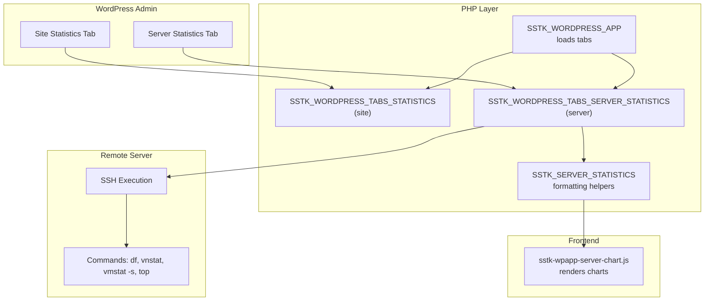
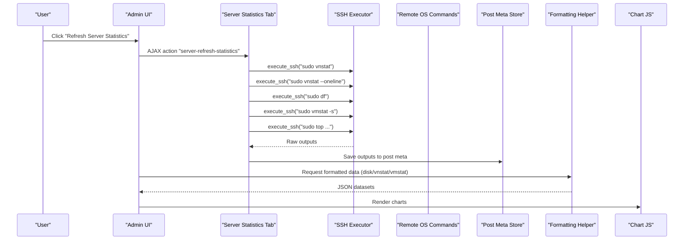
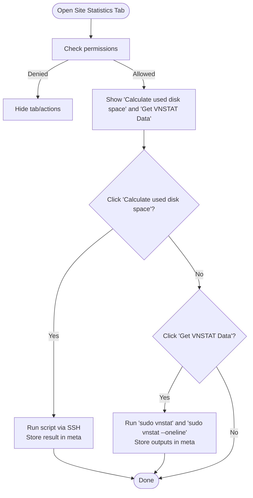
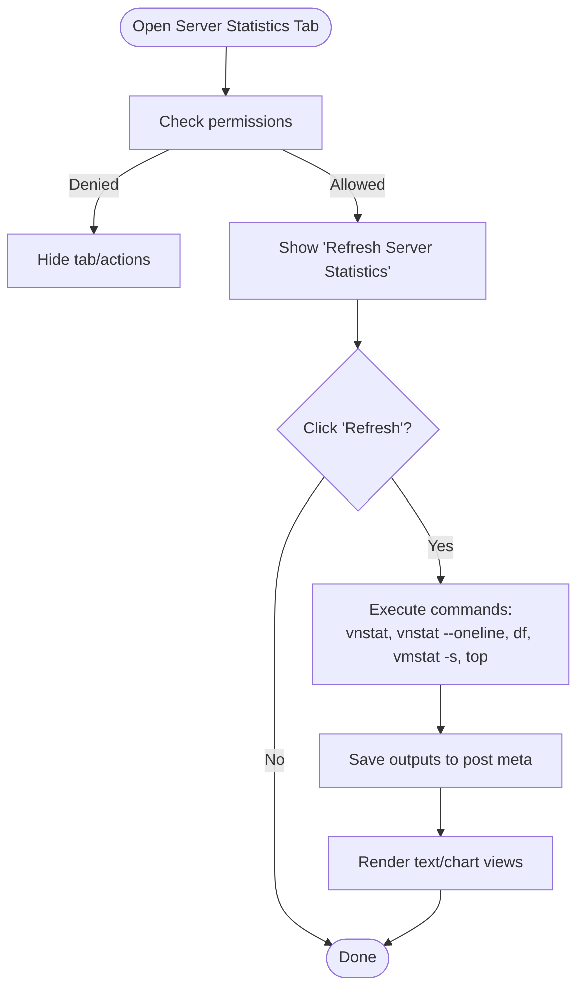
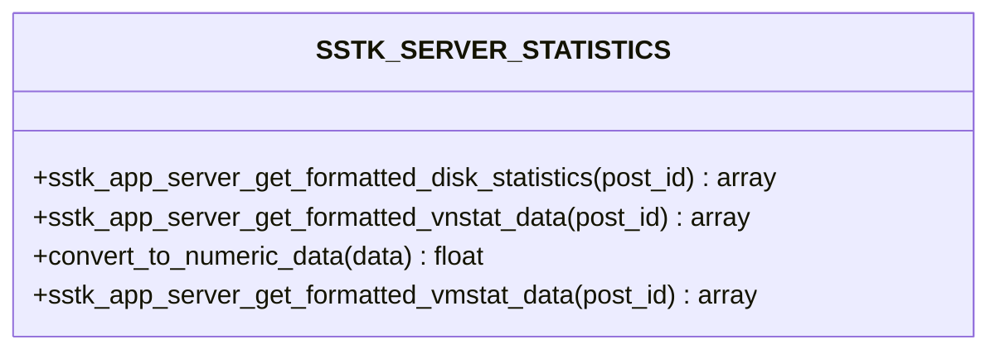
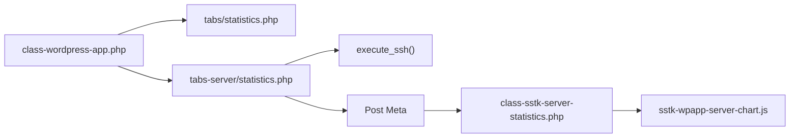

# Application Performance Metrics

<cite>
**Referenced Files in This Document**
- [class-wordpress-app.php](file://includes/core/apps/wordpress-app/class-wordpress-app.php)
- [statistics.php (site)](file://includes/core/apps/wordpress-app/tabs/statistics.php)
- [statistics.php (server)](file://includes/core/apps/wordpress-app/tabs-server/statistics.php)
- [class-sstk-server-statistics.php](file://includes/core/class-sstk-server-statistics.php)
- [sstk-wpapp-server-chart.js](file://includes/core/apps/wordpress-app/assets/js/sstk-wpapp-server-chart.js)
- [cache.php](file://includes/core/apps/wordpress-app/tabs/cache.php)
- [services.php (server)](file://includes/core/apps/wordpress-app/tabs-server/services.php)
</cite>

## Table of Contents
1. [Introduction](#introduction)
2. [Project Structure](#project-structure)
3. [Core Components](#core-components)
4. [Architecture Overview](#architecture-overview)
5. [Detailed Component Analysis](#detailed-component-analysis)
6. [Dependency Analysis](#dependency-analysis)
7. [Performance Considerations](#performance-considerations)
8. [Troubleshooting Guide](#troubleshooting-guide)
9. [Conclusion](#conclusion)

## Introduction
This document explains how Simple Stack collects and presents WordPress application performance metrics, focusing on the Statistics tabs for both sites and servers. It covers:
- What metrics are collected (disk usage, network traffic via VNSTAT, memory via VMSTAT, process load via TOP).
- How data is gathered from remote servers over SSH and stored as post meta.
- How the server-side statistics are formatted and visualized with charts.
- Where to find cache-related controls and guidance for object caching (Redis/Memcached).
- How to interpret the UI to identify bottlenecks and set baselines.

Note: The repository implements system-level and infrastructure-level performance visibility. WordPress-specific metrics such as database query performance, PHP execution time per request, and plugin overhead are not implemented here; however, the environment and caching controls that influence these metrics are present.

## Project Structure
The relevant pieces for performance metrics are organized around:
- App-level Statistics tab (per site): disk space used by the app and optional VNSTAT display.
- Server-level Statistics tab (per server): refreshable metrics including disk, VNSTAT, VMSTAT, and TOP output.
- A utility class that formats raw command outputs into chart-ready JSON.
- JavaScript that renders charts using Chart.js.
- Cache configuration tabs that guide enabling Redis/Memcached.

**Diagram sources**
- [class-wordpress-app.php:289-393](file://includes/core/apps/wordpress-app/class-wordpress-app.php#L289-L393)
- [statistics.php (site):15-94](file://includes/core/apps/wordpress-app/tabs/statistics.php#L15-L94)
- [statistics.php (server):15-90](file://includes/core/apps/wordpress-app/tabs-server/statistics.php#L15-L90)
- [class-sstk-server-statistics.php:36-125](file://includes/core/class-sstk-server-statistics.php#L36-L125)
- [sstk-wpapp-server-chart.js:1-120](file://includes/core/apps/wordpress-app/assets/js/sstk-wpapp-server-chart.js#L1-L120)

**Section sources**
- [class-wordpress-app.php:289-393](file://includes/core/apps/wordpress-app/class-wordpress-app.php#L289-L393)

## Core Components
- Site Statistics Tab: Provides a button to calculate disk space used by the site and an optional VNSTAT view. Data is stored in post meta and displayed inline.
- Server Statistics Tab: Provides a “Refresh Server Statistics” action that runs system commands over SSH and stores results in post meta for visualization.
- Formatting Utility: Converts raw text outputs (df, vnstat --oneline, vmstat -s) into arrays suitable for Chart.js.
- Frontend Charts: Renders disk, VNSTAT, and VMSTAT data as interactive charts with text/chart toggles.

Key responsibilities:
- Collecting metrics via SSH and persisting them.
- Rendering actionable UI elements (buttons, headings, custom HTML).
- Transforming raw outputs into chart datasets.

**Section sources**
- [statistics.php (site):15-356](file://includes/core/apps/wordpress-app/tabs/statistics.php#L15-L356)
- [statistics.php (server):15-432](file://includes/core/apps/wordpress-app/tabs-server/statistics.php#L15-L432)
- [class-sstk-server-statistics.php:15-258](file://includes/core/class-sstk-server-statistics.php#L15-L258)
- [sstk-wpapp-server-chart.js:1-120](file://includes/core/apps/wordpress-app/assets/js/sstk-wpapp-server-chart.js#L1-L120)

## Architecture Overview
The flow from user interaction to metric visualization:

**Diagram sources**
- [statistics.php (server):102-125](file://includes/core/apps/wordpress-app/tabs-server/statistics.php#L102-L125)
- [statistics.php (server):383-426](file://includes/core/apps/wordpress-app/tabs-server/statistics.php#L383-L426)
- [class-sstk-server-statistics.php:36-125](file://includes/core/class-sstk-server-statistics.php#L36-L125)
- [class-sstk-server-statistics.php:127-172](file://includes/core/class-sstk-server-statistics.php#L127-L172)
- [class-sstk-server-statistics.php:206-254](file://includes/core/class-sstk-server-statistics.php#L206-L254)

## Detailed Component Analysis

### Site Statistics Tab
Responsibilities:
- Register the “Statistics” tab for a WordPress site.
- Provide actions to calculate disk space used by the site and optionally fetch VNSTAT data.
- Persist results in post meta and render them in the UI.

Key behaviors:
- Security checks gate access to the tab and its actions.
- Disk space calculation triggers a script via SSH and stores the result.
- VNSTAT collection runs `vnstat` and `vnstat --oneline`, storing outputs for later display.

**Diagram sources**
- [statistics.php (site):66-73](file://includes/core/apps/wordpress-app/tabs/statistics.php#L66-L73)
- [statistics.php (site):105-141](file://includes/core/apps/wordpress-app/tabs/statistics.php#L105-L141)
- [statistics.php (site):163-276](file://includes/core/apps/wordpress-app/tabs/statistics.php#L163-L276)
- [statistics.php (site):287-323](file://includes/core/apps/wordpress-app/tabs/statistics.php#L287-L323)
- [statistics.php (site):333-350](file://includes/core/apps/wordpress-app/tabs/statistics.php#L333-L350)

**Section sources**
- [statistics.php (site):15-356](file://includes/core/apps/wordpress-app/tabs/statistics.php#L15-L356)

### Server Statistics Tab
Responsibilities:
- Register the “Statistics” tab for a server.
- Provide a “Refresh Server Statistics” action that collects system metrics via SSH.
- Render disk, VNSTAT, VMSTAT, and TOP outputs in both text and chart views.

Key behaviors:
- Validates permissions before executing any action.
- Executes multiple system commands and persists outputs to post meta.
- Exposes formatting endpoints for chart rendering.

**Diagram sources**
- [statistics.php (server):68-70](file://includes/core/apps/wordpress-app/tabs-server/statistics.php#L68-L70)
- [statistics.php (server):102-125](file://includes/core/apps/wordpress-app/tabs-server/statistics.php#L102-L125)
- [statistics.php (server):383-426](file://includes/core/apps/wordpress-app/tabs-server/statistics.php#L383-L426)

**Section sources**
- [statistics.php (server):15-432](file://includes/core/apps/wordpress-app/tabs-server/statistics.php#L15-L432)

### Formatting Utility (Charts)
Responsibilities:
- Parse raw command outputs into structured arrays for Chart.js.
- Normalize units (e.g., MiB/GiB to KiB) and aggregate values where appropriate.

Key methods:
- Disk statistics formatter: parses `df` output, aggregates snapshot mounts, and returns labels and datasets.
- VNSTAT formatter: splits `vnstat --oneline` output into day/month/all-time datasets.
- VMSTAT formatter: extracts first seven lines of `vmstat -s` output into label/value pairs.

**Diagram sources**
- [class-sstk-server-statistics.php:36-125](file://includes/core/class-sstk-server-statistics.php#L36-L125)
- [class-sstk-server-statistics.php:127-172](file://includes/core/class-sstk-server-statistics.php#L127-L172)
- [class-sstk-server-statistics.php:174-204](file://includes/core/class-sstk-server-statistics.php#L174-L204)
- [class-sstk-server-statistics.php:206-254](file://includes/core/class-sstk-server-statistics.php#L206-L254)

**Section sources**
- [class-sstk-server-statistics.php:15-258](file://includes/core/class-sstk-server-statistics.php#L15-L258)

### Frontend Chart Rendering
Responsibilities:
- Render charts for disk, VNSTAT, and VMSTAT data.
- Provide toggle links between text and chart views.

Implementation highlights:
- Uses Chart.js canvas elements embedded by the server statistics tab.
- Hides/shows sections based on user interactions.

**Section sources**
- [sstk-wpapp-server-chart.js:1-120](file://includes/core/apps/wordpress-app/assets/js/sstk-wpapp-server-chart.js#L1-L120)

### Cache Controls and Guidance
While not part of the Statistics tabs, the cache tab and server services tab provide guidance and controls for enabling object caches (Redis/Memcached), which directly impact WordPress performance.

- Cache tab includes messaging when Redis is not enabled and provides documentation links.
- Server services tab documents Memcached’s role as an object cache and links to comparative resources.

**Section sources**
- [cache.php:746-773](file://includes/core/apps/wordpress-app/tabs/cache.php#L746-L773)
- [services.php (server):1017-1042](file://includes/core/apps/wordpress-app/tabs-server/services.php#L1017-L1042)

## Dependency Analysis
High-level dependencies:
- The WordPress app loader includes both site and server statistics tabs.
- The server statistics tab depends on SSH execution and writes to post meta.
- The formatting utility reads post meta and produces JSON for frontend charts.
- The frontend chart script consumes rendered HTML/JS to visualize data.

**Diagram sources**
- [class-wordpress-app.php:289-393](file://includes/core/apps/wordpress-app/class-wordpress-app.php#L289-L393)
- [statistics.php (server):383-426](file://includes/core/apps/wordpress-app/tabs-server/statistics.php#L383-L426)
- [class-sstk-server-statistics.php:36-125](file://includes/core/class-sstk-server-statistics.php#L36-L125)
- [sstk-wpapp-server-chart.js:1-120](file://includes/core/apps/wordpress-app/assets/js/sstk-wpapp-server-chart.js#L1-L120)

**Section sources**
- [class-wordpress-app.php:289-393](file://includes/core/apps/wordpress-app/class-wordpress-app.php#L289-L393)

## Performance Considerations
- Metric scope: The current implementation focuses on system-level metrics (disk, network, memory, process load). WordPress-specific metrics like query performance, PHP execution time per request, and plugin overhead are not collected here.
- Caching: Enabling object caches (Redis/Memcached) can significantly reduce database load and improve response times. Use the cache and services tabs to enable and configure these components.
- Baselines: Use the “Refresh Server Statistics” action periodically to establish baseline trends for disk usage, network throughput, and memory consumption.
- Bottleneck identification:
  - High disk usage: Investigate large uploads, backups, or logs.
  - Network spikes: Correlate with traffic patterns or external API calls.
  - Memory pressure: Review VMSTAT data and consider scaling or optimizing PHP/memory settings.
  - Process load: Use TOP output to identify resource-heavy processes.

[No sources needed since this section provides general guidance]

## Troubleshooting Guide
Common issues and resolutions:
- Permissions errors when refreshing statistics:
  - Ensure the user has the required team/server permissions to view and act on the Statistics tab.
- No data displayed after refresh:
  - Confirm that VNSTAT, VMSTAT, and other utilities are installed on the remote server.
  - Verify SSH connectivity and sudo privileges for running commands.
- Charts not rendering:
  - Ensure Chart.js assets are loaded and canvas elements exist in the DOM.
  - Clear browser cache and reload the admin page.

Operational tips:
- For site-level disk usage, use the “Calculate used disk space” action and review the stored value.
- For server-level metrics, click “Refresh Server Statistics” and then switch between text and chart views to inspect data.

**Section sources**
- [statistics.php (site):66-73](file://includes/core/apps/wordpress-app/tabs/statistics.php#L66-L73)
- [statistics.php (server):68-70](file://includes/core/apps/wordpress-app/tabs-server/statistics.php#L68-L70)
- [statistics.php (server):383-426](file://includes/core/apps/wordpress-app/tabs-server/statistics.php#L383-L426)

## Conclusion
Simple Stack’s Statistics tabs provide practical, system-level insights into WordPress hosting environments. While they do not instrument WordPress core functions or third-party plugins for query timing or plugin overhead, they offer essential infrastructure metrics and clear pathways to enable object caching. By regularly collecting and reviewing these metrics, administrators can establish baselines, detect anomalies, and make informed decisions to optimize WordPress performance at the server and application layers.

[No sources needed since this section summarizes without analyzing specific files]