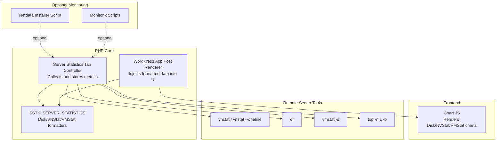
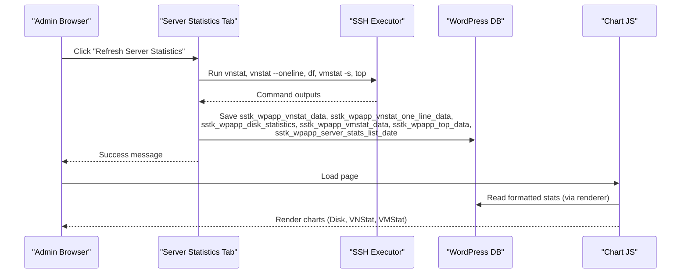
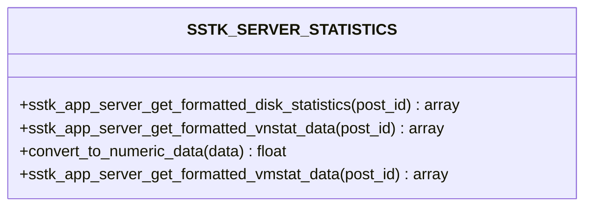
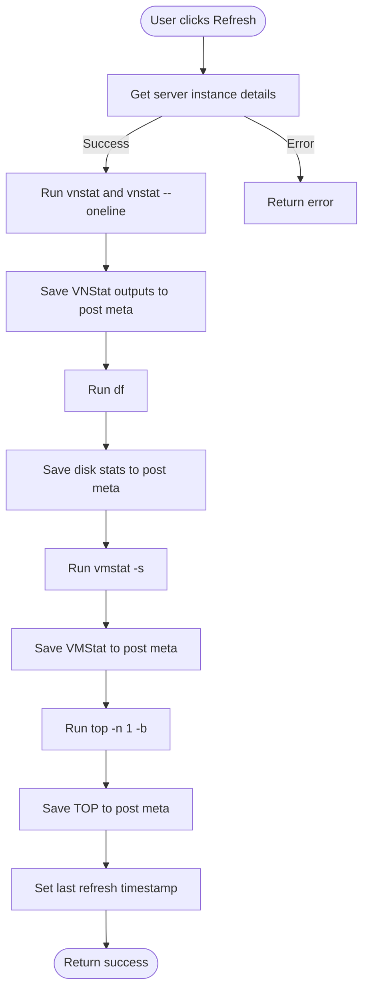
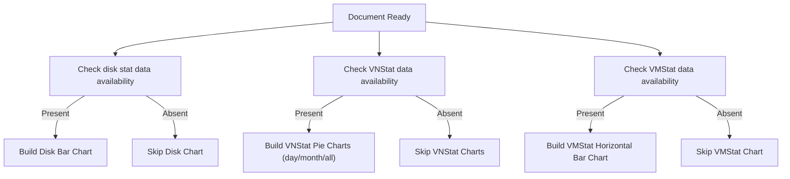
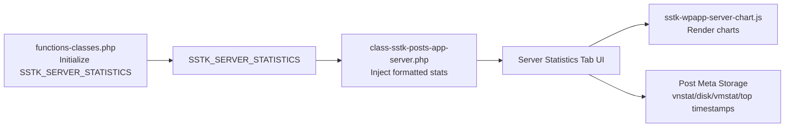
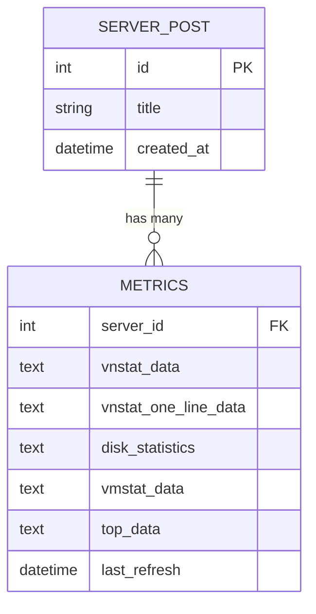

# Server Performance Metrics

<cite>
**Referenced Files in This Document**
- [class-sstk-server-statistics.php](file://includes/core/class-sstk-server-statistics.php)
- [statistics.php (Server Statistics Tab)](file://includes/core/apps/wordpress-app/tabs-server/statistics.php)
- [sstk-wpapp-server-chart.js](file://includes/core/apps/wordpress-app/assets/js/sstk-wpapp-server-chart.js)
- [functions-classes.php](file://includes/core/functions-classes.php)
- [class-sstk-posts-app-server.php](file://includes/core/class-sstk-posts-app-server.php)
- [43-netdata.txt](file://includes/core/apps/wordpress-app/scripts/v1/raw/43-netdata.txt)
- [21-monitorix.txt](file://includes/core/apps/wordpress-app/scripts/v1/raw/21-monitorix.txt)
</cite>

## Table of Contents
1. [Introduction](#introduction)
2. [Project Structure](#project-structure)
3. [Core Components](#core-components)
4. [Architecture Overview](#architecture-overview)
5. [Detailed Component Analysis](#detailed-component-analysis)
6. [Dependency Analysis](#dependency-analysis)
7. [Performance Considerations](#performance-considerations)
8. [Troubleshooting Guide](#troubleshooting-guide)
9. [Conclusion](#conclusion)
10. [Appendices](#appendices)

## Introduction
This document explains how Simple Stack collects and presents server-level performance metrics. It focuses on the ServerStatistics class and related components that gather disk usage, network throughput, memory statistics, and process snapshots from remote servers. It also covers data storage, chart rendering, and integration points with external monitoring tools such as Netdata and Monitorix.

Key capabilities covered:
- Disk space utilization parsing and visualization
- Network throughput via vnstat (daily, monthly, all-time)
- Memory statistics via vmstat
- Process snapshot via top
- Data persistence in WordPress post meta
- Frontend chart rendering using Chart.js
- Optional integrations for advanced monitoring

## Project Structure
The server statistics feature spans PHP classes, a tab controller, JavaScript charting logic, and optional scripts for third-party monitoring tools.

**Diagram sources**
- [class-sstk-server-statistics.php:42-124](file://includes/core/class-sstk-server-statistics.php#L42-L124)
- [statistics.php (Server Statistics Tab):383-427](file://includes/core/apps/wordpress-app/tabs-server/statistics.php#L383-L427)
- [sstk-wpapp-server-chart.js:22-62](file://includes/core/apps/wordpress-app/assets/js/sstk-wpapp-server-chart.js#L22-L62)
- [43-netdata.txt:223-245](file://includes/core/apps/wordpress-app/scripts/v1/raw/43-netdata.txt#L223-L245)
- [21-monitorix.txt:187-229](file://includes/core/apps/wordpress-app/scripts/v1/raw/21-monitorix.txt#L187-L229)

**Section sources**
- [class-sstk-server-statistics.php:15-258](file://includes/core/class-sstk-server-statistics.php#L15-L258)
- [statistics.php (Server Statistics Tab):15-432](file://includes/core/apps/wordpress-app/tabs-server/statistics.php#L15-L432)
- [sstk-wpapp-server-chart.js:1-247](file://includes/core/apps/wordpress-app/assets/js/sstk-wpapp-server-chart.js#L1-L247)

## Core Components
- SSTK_SERVER_STATISTICS: Provides methods to format raw command outputs into structured arrays for charts.
- Server Statistics Tab Controller: Orchestrates metric collection via SSH, persists results to post meta, and renders UI sections.
- Chart JS: Renders bar/pie/horizontal bar charts based on formatted data.
- Optional Monitoring Scripts: Install/configure Netdata or Monitorix for richer observability.

Responsibilities:
- Data collection: Executes system commands remotely and stores outputs.
- Data formatting: Parses text outputs into JSON-friendly structures.
- Visualization: Builds Chart.js datasets and labels.
- Integration: Supports optional third-party monitoring toolchains.

**Section sources**
- [class-sstk-server-statistics.php:42-124](file://includes/core/class-sstk-server-statistics.php#L42-L124)
- [statistics.php (Server Statistics Tab):383-427](file://includes/core/apps/wordpress-app/tabs-server/statistics.php#L383-L427)
- [sstk-wpapp-server-chart.js:86-243](file://includes/core/apps/wordpress-app/assets/js/sstk-wpapp-server-chart.js#L86-L243)

## Architecture Overview
The flow begins when an administrator triggers a refresh from the server details screen. The tab controller executes remote commands, saves outputs to post meta, and returns a timestamp. The frontend then requests formatted data and renders charts.

**Diagram sources**
- [statistics.php (Server Statistics Tab):383-427](file://includes/core/apps/wordpress-app/tabs-server/statistics.php#L383-L427)
- [sstk-wpapp-server-chart.js:22-62](file://includes/core/apps/wordpress-app/assets/js/sstk-wpapp-server-chart.js#L22-L62)

## Detailed Component Analysis

### SSTK_SERVER_STATISTICS Class
Purpose: Transform raw command outputs into chart-ready structures.

Key methods:
- Disk statistics formatter: Parses df output, aggregates snap partitions, and returns labels and numeric columns for total size, used, and available space.
- VNStat formatter: Splits one-line vnstat output into current day, month, and all-time RX/TX values; converts MiB/GiB to KiB for consistent units.
- VMStat formatter: Parses vmstat -s output lines to extract memory-related metrics and labels.

Data handling patterns:
- Input sanitization and tag stripping before parsing.
- Numeric conversion with unit normalization.
- JSON encoding for frontend consumption.

Complexity considerations:
- Linear scans over parsed lines for aggregation.
- Minimal overhead; suitable for periodic UI updates.

Error handling:
- Returns empty arrays when inputs are missing or malformed.

**Diagram sources**
- [class-sstk-server-statistics.php:42-124](file://includes/core/class-sstk-server-statistics.php#L42-L124)
- [class-sstk-server-statistics.php:133-170](file://includes/core/class-sstk-server-statistics.php#L133-L170)
- [class-sstk-server-statistics.php:181-203](file://includes/core/class-sstk-server-statistics.php#L181-L203)
- [class-sstk-server-statistics.php:212-253](file://includes/core/class-sstk-server-statistics.php#L212-L253)

**Section sources**
- [class-sstk-server-statistics.php:42-124](file://includes/core/class-sstk-server-statistics.php#L42-L124)
- [class-sstk-server-statistics.php:133-170](file://includes/core/class-sstk-server-statistics.php#L133-L170)
- [class-sstk-server-statistics.php:181-203](file://includes/core/class-sstk-server-statistics.php#L181-L203)
- [class-sstk-server-statistics.php:212-253](file://includes/core/class-sstk-server-statistics.php#L212-L253)

### Server Statistics Tab Controller
Purpose: Collect metrics, persist them, and render UI sections for disk, network, memory, and processes.

Collection workflow:
- Executes vnstat and vnstat --oneline to capture network traffic summaries.
- Runs df to capture filesystem usage.
- Runs vmstat -s to capture memory statistics.
- Runs top -n 1 -b to capture a process snapshot.
- Saves each output to post meta fields and records a refresh timestamp.

UI rendering:
- Displays text views and toggles to switch between text and chart views.
- Uses Chart.js to visualize disk usage, VNStat RX/TX distributions, and VMStat memory breakdown.

Scheduling and intervals:
- No built-in cron is present in this component; collection is triggered by user action.
- Last refresh time is stored in post meta for display.

**Diagram sources**
- [statistics.php (Server Statistics Tab):383-427](file://includes/core/apps/wordpress-app/tabs-server/statistics.php#L383-L427)

**Section sources**
- [statistics.php (Server Statistics Tab):147-170](file://includes/core/apps/wordpress-app/tabs-server/statistics.php#L147-L170)
- [statistics.php (Server Statistics Tab):172-371](file://includes/core/apps/wordpress-app/tabs-server/statistics.php#L172-L371)
- [statistics.php (Server Statistics Tab):383-427](file://includes/core/apps/wordpress-app/tabs-server/statistics.php#L383-L427)

### Frontend Chart Rendering
Purpose: Convert formatted data into interactive charts.

Features:
- Disk usage bar chart showing total blocks, used, and available.
- VNStat pie charts for RX/TX across day/month/all-time.
- VMStat horizontal bar chart for memory categories.

Behavior:
- Initializes charts on document ready.
- Provides toggles to show/hide text vs. chart views.
- Uses Chart.js for responsive visualizations.

**Diagram sources**
- [sstk-wpapp-server-chart.js:22-62](file://includes/core/apps/wordpress-app/assets/js/sstk-wpapp-server-chart.js#L22-L62)
- [sstk-wpapp-server-chart.js:86-150](file://includes/core/apps/wordpress-app/assets/js/sstk-wpapp-server-chart.js#L86-L150)
- [sstk-wpapp-server-chart.js:161-199](file://includes/core/apps/wordpress-app/assets/js/sstk-wpapp-server-chart.js#L161-L199)
- [sstk-wpapp-server-chart.js:202-243](file://includes/core/apps/wordpress-app/assets/js/sstk-wpapp-server-chart.js#L202-L243)

**Section sources**
- [sstk-wpapp-server-chart.js:1-247](file://includes/core/apps/wordpress-app/assets/js/sstk-wpapp-server-chart.js#L1-L247)

### Optional Monitoring Integrations
Simple Stack includes scripts to install and configure third-party monitoring tools:

- Netdata installer script: Installs Netdata, configures web server status endpoints where applicable, and sets up database access for metrics.
- Monitorix scripts: Enable/disable monitoring for services like Memcached, NGINX, and MariaDB, and manage upgrades.

These scripts are not part of the core metrics collection but can be leveraged to enrich observability beyond what Simple Stack’s built-in charts provide.

**Section sources**
- [43-netdata.txt:223-245](file://includes/core/apps/wordpress-app/scripts/v1/raw/43-netdata.txt#L223-L245)
- [21-monitorix.txt:187-229](file://includes/core/apps/wordpress-app/scripts/v1/raw/21-monitorix.txt#L187-L229)

## Dependency Analysis
- Initialization: The ServerStatistics class is registered during WordPress initialization and made accessible globally.
- Rendering: The app server post renderer injects formatted statistics into the admin UI.
- Storage: All metrics are persisted as WordPress post meta keyed by server post ID.
- Frontend: Chart JS consumes pre-formatted data provided by the backend.

**Diagram sources**
- [functions-classes.php:358-368](file://includes/core/functions-classes.php#L358-L368)
- [class-sstk-posts-app-server.php:203-264](file://includes/core/class-sstk-posts-app-server.php#L203-L264)
- [sstk-wpapp-server-chart.js:1-247](file://includes/core/apps/wordpress-app/assets/js/sstk-wpapp-server-chart.js#L1-L247)

**Section sources**
- [functions-classes.php:358-368](file://includes/core/functions-classes.php#L358-L368)
- [class-sstk-posts-app-server.php:203-264](file://includes/core/class-sstk-posts-app-server.php#L203-L264)

## Performance Considerations
- Collection frequency: Currently manual; no automated scheduling is implemented in the statistics tab. For frequent updates, consider integrating a custom cron or task scheduler to trigger the refresh endpoint programmatically.
- Remote command overhead: Each refresh runs multiple commands (vnstat, df, vmstat, top). Batch these operations and cache results to reduce SSH overhead.
- Data size: Storing full command outputs can grow post meta over time. Prune old snapshots if historical retention is needed.
- Chart rendering: Large datasets may impact browser performance. Limit visible series and use pagination or downsampling for long-term trends.

[No sources needed since this section provides general guidance]

## Troubleshooting Guide
Common issues and resolutions:
- No statistics displayed: Ensure the “Refresh Server Statistics” button was clicked and that SSH connectivity is valid. Verify post meta keys exist after refresh.
- Empty charts: Confirm that formatted data is present in the page context and that Chart.js canvas elements exist.
- Permission errors: The tab enforces permissions; ensure the user has the required capability to view and refresh server statistics.
- Outdated data: Check the last refresh timestamp stored in post meta and re-run the refresh if necessary.

Operational checks:
- Validate that vnstat, df, vmstat, and top commands execute successfully on the target server.
- Inspect the saved post meta keys for expected content:
  - sstk_wpapp_vnstat_data
  - sstk_wpapp_vnstat_one_line_data
  - sstk_wpapp_disk_statistics
  - sstk_wpapp_vmstat_data
  - sstk_wpapp_top_data
  - sstk_wpapp_server_stats_list_date

**Section sources**
- [statistics.php (Server Statistics Tab):102-125](file://includes/core/apps/wordpress-app/tabs-server/statistics.php#L102-L125)
- [statistics.php (Server Statistics Tab):383-427](file://includes/core/apps/wordpress-app/tabs-server/statistics.php#L383-L427)

## Conclusion
Simple Stack’s server statistics feature provides a practical way to collect and visualize key system metrics directly from the admin interface. While it does not include built-in alerting or Prometheus/Grafana exporters, it integrates well with external monitoring tools through optional scripts. For production environments requiring continuous monitoring, consider extending the system with scheduled tasks and exporting mechanisms tailored to your stack.

[No sources needed since this section summarizes without analyzing specific files]

## Appendices

### Data Model: Stored Metrics

[No sources needed since this diagram shows conceptual model, not actual code structure]

### Querying Server Metrics
- Retrieve formatted disk statistics for a given server post ID using the formatter method.
- Retrieve formatted VNStat data for daily/monthly/all-time breakdowns.
- Retrieve formatted VMStat memory metrics for visualization.

Example references:
- Disk formatter: [class-sstk-server-statistics.php:42-124](file://includes/core/class-sstk-server-statistics.php#L42-L124)
- VNStat formatter: [class-sstk-server-statistics.php:133-170](file://includes/core/class-sstk-server-statistics.php#L133-L170)
- VMStat formatter: [class-sstk-server-statistics.php:212-253](file://includes/core/class-sstk-server-statistics.php#L212-L253)

### Creating Custom Dashboards
- Use the existing Chart.js implementations as templates to build custom dashboards within the admin UI.
- Extend the tab controller to add new metrics or aggregate existing ones.
- Persist additional metrics to post meta and expose them via the formatter class.

[No sources needed since this section provides general guidance]

### Alerting and Thresholds
- Built-in alerting thresholds are not implemented in the statistics module.
- To implement alerts, extend the refresh workflow to evaluate thresholds against collected metrics and trigger notifications via WordPress hooks or external systems.

[No sources needed since this section provides general guidance]

### Integration With Prometheus or Grafana
- Simple Stack does not include a native Prometheus exporter.
- You can integrate third-party tools:
  - Netdata: Use the provided installer script to deploy Netdata and expose metrics.
  - Monitorix: Use the provided scripts to enable service-specific monitoring.
- Exporters or sidecars can be added to bridge Simple Stack metrics to Prometheus/Grafana if desired.

**Section sources**
- [43-netdata.txt:223-245](file://includes/core/apps/wordpress-app/scripts/v1/raw/43-netdata.txt#L223-L245)
- [21-monitorix.txt:187-229](file://includes/core/apps/wordpress-app/scripts/v1/raw/21-monitorix.txt#L187-L229)