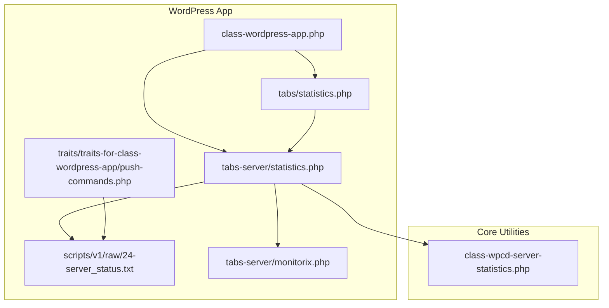
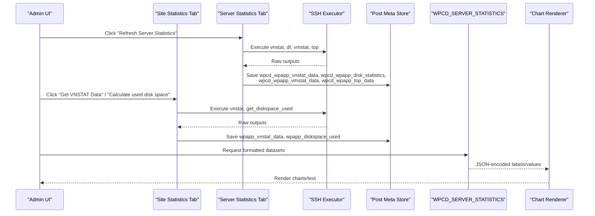
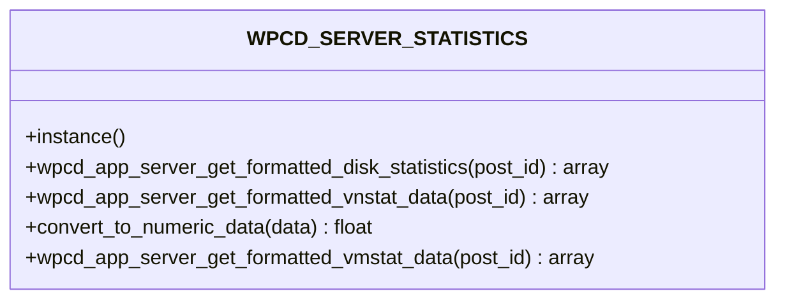
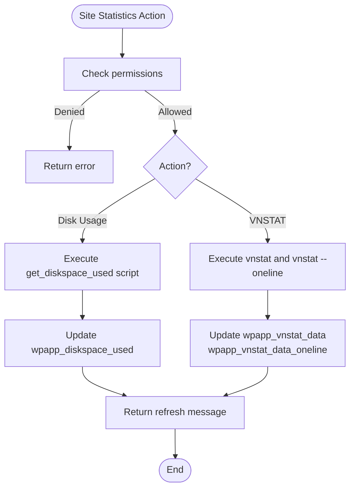
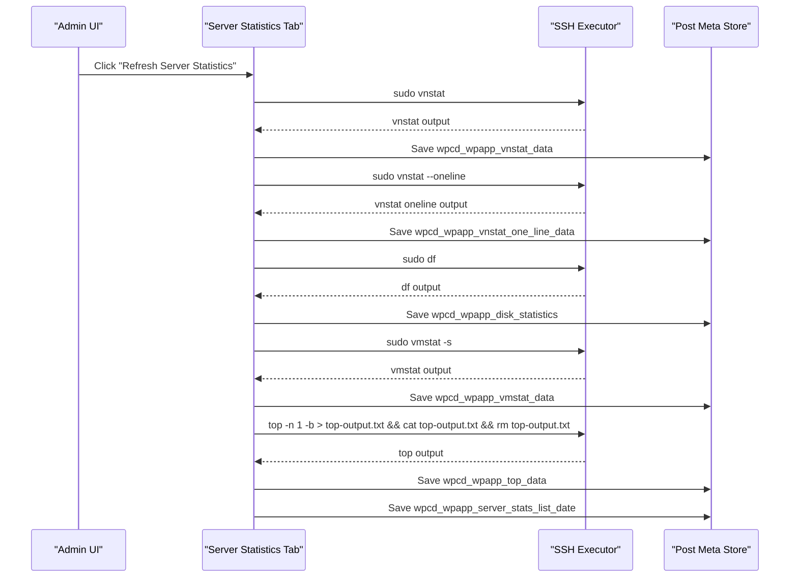
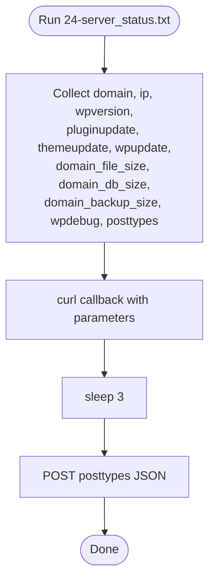
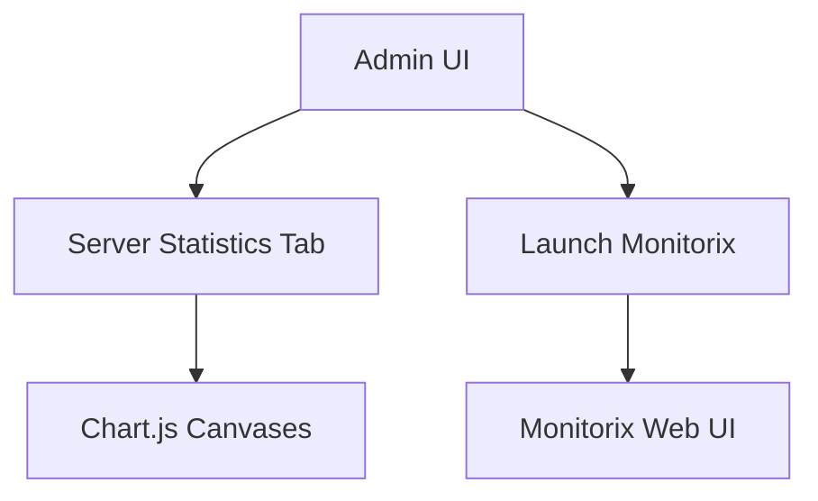
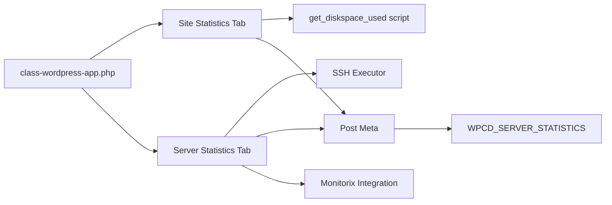

# System Monitoring & Metrics

<cite>
**Referenced Files in This Document**
- [class-wpcd-server-statistics.php](file://includes/core/class-wpcd-server-statistics.php)
- [statistics.php (Site)](file://includes/core/apps/wordpress-app/tabs/statistics.php)
- [statistics.php (Server)](file://includes/core/apps/wordpress-app/tabs-server/statistics.php)
- [class-wordpress-app.php](file://includes/core/apps/wordpress-app/class-wordpress-app.php)
- [24-server_status.txt](file://includes/core/apps/wordpress-app/scripts/v1/raw/24-server_status.txt)
- [push-commands.php](file://includes/core/apps/wordpress-app/traits/traits-for-class-wordpress-app/push-commands.php)
- [monitorix.php](file://includes/core/apps/wordpress-app/tabs-server/monitorix.php)
</cite>

## Table of Contents
1. [Introduction](#introduction)
2. [Project Structure](#project-structure)
3. [Core Components](#core-components)
4. [Architecture Overview](#architecture-overview)
5. [Detailed Component Analysis](#detailed-component-analysis)
6. [Dependency Analysis](#dependency-analysis)
7. [Performance Considerations](#performance-considerations)
8. [Troubleshooting Guide](#troubleshooting-guide)
9. [Conclusion](#conclusion)
10. [Appendices](#appendices)

## Introduction
This document explains SimpleStack’s system monitoring and metrics collection framework, focusing on:
- Server-level performance data: CPU usage, memory consumption, disk I/O, and network statistics.
- WordPress-specific metrics: site performance, database sizes, update status, and resource utilization.
- Real-time dashboards and historical visualization via charts and text views.
- Alert thresholds configuration for low disk space and related notifications.
- Programmatic querying of metrics, custom monitoring rules, and exporting performance data.

The framework combines server-side command execution over SSH with WordPress admin UI tabs to collect, store, format, and visualize metrics. It also integrates optional tools like Monitorix for richer real-time dashboards.

## Project Structure
Monitoring-related code is primarily located under the WordPress app module and core utilities:
- Core server statistics formatter: `includes/core/class-wpcd-server-statistics.php`
- Site-level statistics tab: `includes/core/apps/wordpress-app/tabs/statistics.php`
- Server-level statistics tab: `includes/core/apps/wordpress-app/tabs-server/statistics.php`
- WordPress app bootstrap that includes tabs: `includes/core/apps/wordpress-app/class-wordpress-app.php`
- Server status script and callback handling: `includes/core/apps/wordpress-app/scripts/v1/raw/24-server_status.txt`, `includes/core/apps/wordpress-app/traits/traits-for-class-wordpress-app/push-commands.php`
- Optional Monitorix integration: `includes/core/apps/wordpress-app/tabs-server/monitorix.php`

**Diagram sources**
- [class-wordpress-app.php:312-378](file://includes/core/apps/wordpress-app/class-wordpress-app.php#L312-L378)
- [statistics.php (Site):15-25](file://includes/core/apps/wordpress-app/tabs/statistics.php#L15-L25)
- [statistics.php (Server):15-27](file://includes/core/apps/wordpress-app/tabs-server/statistics.php#L15-L27)
- [class-wpcd-server-statistics.php:15-34](file://includes/core/class-wpcd-server-statistics.php#L15-L34)
- [24-server_status.txt:220-237](file://includes/core/apps/wordpress-app/scripts/v1/raw/24-server_status.txt#L220-L237)
- [push-commands.php:206-227](file://includes/core/apps/wordpress-app/traits/traits-for-class-wordpress-app/push-commands.php#L206-L227)
- [monitorix.php:288-317](file://includes/core/apps/wordpress-app/tabs-server/monitorix.php#L288-L317)

**Section sources**
- [class-wordpress-app.php:312-378](file://includes/core/apps/wordpress-app/class-wordpress-app.php#L312-L378)
- [statistics.php (Site):15-25](file://includes/core/apps/wordpress-app/tabs/statistics.php#L15-L25)
- [statistics.php (Server):15-27](file://includes/core/apps/wordpress-app/tabs-server/statistics.php#L15-L27)

## Core Components
- WPCD_SERVER_STATISTICS: Formats raw server metrics into chart-ready datasets for disk usage, vnstat traffic, and vmstat memory.
- Site Statistics Tab: Collects per-site disk usage and VNSTAT data; provides UI actions to refresh and display results.
- Server Statistics Tab: Orchestrates collection of vnstat, df, vmstat, and top outputs; stores them as post meta; renders text and chart views.
- WordPress App Bootstrap: Includes both site and server statistics tabs and other modules.
- Server Status Script and Callbacks: Gathers WordPress version, plugin/theme updates, file/database/backup sizes, and debug flags; posts results back to the controller for storage.
- Monitorix Integration: Provides a link to launch Monitorix and toggles for enabling/disabling Nginx and MySQL monitoring.

**Section sources**
- [class-wpcd-server-statistics.php:15-34](file://includes/core/class-wpcd-server-statistics.php#L15-L34)
- [statistics.php (Site):15-25](file://includes/core/apps/wordpress-app/tabs/statistics.php#L15-L25)
- [statistics.php (Server):15-27](file://includes/core/apps/wordpress-app/tabs-server/statistics.php#L15-L27)
- [class-wordpress-app.php:312-378](file://includes/core/apps/wordpress-app/class-wordpress-app.php#L312-L378)
- [24-server_status.txt:220-237](file://includes/core/apps/wordpress-app/scripts/v1/raw/24-server_status.txt#L220-L237)
- [push-commands.php:206-227](file://includes/core/apps/wordpress-app/traits/traits-for-class-wordpress-app/push-commands.php#L206-L227)
- [monitorix.php:288-317](file://includes/core/apps/wordpress-app/tabs-server/monitorix.php#L288-L317)

## Architecture Overview
The monitoring architecture follows a clear pipeline:
- Admin triggers a refresh action from the UI.
- The corresponding tab handler executes commands via SSH on the target server.
- Raw outputs are stored as post meta for sites or servers.
- A formatter class converts raw outputs into structured arrays for charting.
- The UI renders either text or Chart.js-based visualizations.
- Optional integrations (Monitorix) provide additional dashboards.

**Diagram sources**
- [statistics.php (Server):117-125](file://includes/core/apps/wordpress-app/tabs-server/statistics.php#L117-L125)
- [statistics.php (Server):383-427](file://includes/core/apps/wordpress-app/tabs-server/statistics.php#L383-L427)
- [statistics.php (Site):120-140](file://includes/core/apps/wordpress-app/tabs/statistics.php#L120-L140)
- [statistics.php (Site):287-351](file://includes/core/apps/wordpress-app/tabs/statistics.php#L287-L351)
- [class-wpcd-server-statistics.php:42-124](file://includes/core/class-wpcd-server-statistics.php#L42-L124)
- [class-wpcd-server-statistics.php:133-170](file://includes/core/class-wpcd-server-statistics.php#L133-L170)
- [class-wpcd-server-statistics.php:212-253](file://includes/core/class-wpcd-server-statistics.php#L212-L253)

## Detailed Component Analysis

### WPCD_SERVER_STATISTICS Class
Responsibilities:
- Format disk statistics (`df`) into chart columns and labels.
- Parse vnstat one-line output into day/month/all-time numeric series.
- Convert units (KiB/MiB/GiB) to KiB for consistent charting.
- Format vmstat memory lines into label/value pairs.

Key methods:
- `wpcd_app_server_get_formatted_disk_statistics(post_id)`
- `wpcd_app_server_get_formatted_vnstat_data(post_id)`
- `convert_to_numeric_data(data)`
- `wpcd_app_server_get_formatted_vmstat_data(post_id)`

Complexity considerations:
- Disk formatting iterates over each line once; O(n).
- VNSTAT parsing splits by delimiter and maps indices; O(1) relative to fixed fields.
- VMSTAT parsing processes first seven lines; O(1).

Error handling:
- Returns empty arrays when input is missing or invalid.
- Sanitizes labels and values before JSON encoding.

**Diagram sources**
- [class-wpcd-server-statistics.php:15-34](file://includes/core/class-wpcd-server-statistics.php#L15-L34)
- [class-wpcd-server-statistics.php:42-124](file://includes/core/class-wpcd-server-statistics.php#L42-L124)
- [class-wpcd-server-statistics.php:133-170](file://includes/core/class-wpcd-server-statistics.php#L133-L170)
- [class-wpcd-server-statistics.php:181-203](file://includes/core/class-wpcd-server-statistics.php#L181-L203)
- [class-wpcd-server-statistics.php:212-253](file://includes/core/class-wpcd-server-statistics.php#L212-L253)

**Section sources**
- [class-wpcd-server-statistics.php:42-124](file://includes/core/class-wpcd-server-statistics.php#L42-L124)
- [class-wpcd-server-statistics.php:133-170](file://includes/core/class-wpcd-server-statistics.php#L133-L170)
- [class-wpcd-server-statistics.php:181-203](file://includes/core/class-wpcd-server-statistics.php#L181-L203)
- [class-wpcd-server-statistics.php:212-253](file://includes/core/class-wpcd-server-statistics.php#L212-L253)

### Site Statistics Tab
Responsibilities:
- Provide UI to calculate per-site disk usage and fetch VNSTAT data.
- Store results in site post meta.
- Display cached data and prompt users to refresh.

Actions:
- `show-diskspace-used`: Executes a script to compute disk usage for the site domain and saves the result.
- `show-vnstat`: Runs `vnstat` and `vnstat --oneline`, storing both outputs.

Data flow:
- On action, execute SSH commands, trim last lines, update meta, return a message prompting page refresh.

**Diagram sources**
- [statistics.php (Site):120-140](file://includes/core/apps/wordpress-app/tabs/statistics.php#L120-L140)
- [statistics.php (Site):287-351](file://includes/core/apps/wordpress-app/tabs/statistics.php#L287-L351)

**Section sources**
- [statistics.php (Site):120-140](file://includes/core/apps/wordpress-app/tabs/statistics.php#L120-L140)
- [statistics.php (Site):163-275](file://includes/core/apps/wordpress-app/tabs/statistics.php#L163-L275)
- [statistics.php (Site):287-351](file://includes/core/apps/wordpress-app/tabs/statistics.php#L287-L351)

### Server Statistics Tab
Responsibilities:
- Orchestrate collection of vnstat, df, vmstat, and top outputs.
- Persist raw outputs to server post meta.
- Render text and chart views with toggle controls.

Actions:
- `server-refresh-statistics`: Executes commands via SSH, updates meta, records timestamp.

Visualization:
- Displays disk stats, vnstat traffic (day/month/all), vmstat memory, and top process list.
- Uses Chart.js canvases for charts and preformatted text blocks for raw outputs.

**Diagram sources**
- [statistics.php (Server):117-125](file://includes/core/apps/wordpress-app/tabs-server/statistics.php#L117-L125)
- [statistics.php (Server):383-427](file://includes/core/apps/wordpress-app/tabs-server/statistics.php#L383-L427)

**Section sources**
- [statistics.php (Server):117-125](file://includes/core/apps/wordpress-app/tabs-server/statistics.php#L117-L125)
- [statistics.php (Server):147-371](file://includes/core/apps/wordpress-app/tabs-server/statistics.php#L147-L371)
- [statistics.php (Server):383-427](file://includes/core/apps/wordpress-app/tabs-server/statistics.php#L383-L427)

### WordPress-Specific Metrics Collection
The server status script gathers:
- Domain name, public IP, WordPress version.
- Number of plugins/themes requiring updates.
- File size, database size, backup size.
- WP_DEBUG flag.
- Post types distribution.

These values are posted back to the application controller and stored against the site/app record.

**Diagram sources**
- [24-server_status.txt:220-237](file://includes/core/apps/wordpress-app/scripts/v1/raw/24-server_status.txt#L220-L237)
- [push-commands.php:206-227](file://includes/core/apps/wordpress-app/traits/traits-for-class-wordpress-app/push-commands.php#L206-L227)

**Section sources**
- [24-server_status.txt:220-237](file://includes/core/apps/wordpress-app/scripts/v1/raw/24-server_status.txt#L220-L237)
- [push-commands.php:206-227](file://includes/core/apps/wordpress-app/traits/traits-for-class-wordpress-app/push-commands.php#L206-L227)

### Real-Time Dashboards and Historical Visualization
- Real-time dashboards:
  - Monitorix integration allows launching a web UI for live server resource monitoring.
  - Toggle options enable/disable Nginx and MySQL monitoring within Monitorix.
- Historical visualization:
  - Server Statistics tab renders charts for disk usage, vnstat traffic (day/month/all), and vmstat memory using Chart.js canvases.
  - Text views show raw outputs for detailed inspection.

**Diagram sources**
- [statistics.php (Server):190-339](file://includes/core/apps/wordpress-app/tabs-server/statistics.php#L190-L339)
- [monitorix.php:288-317](file://includes/core/apps/wordpress-app/tabs-server/monitorix.php#L288-L317)

**Section sources**
- [statistics.php (Server):190-339](file://includes/core/apps/wordpress-app/tabs-server/statistics.php#L190-L339)
- [monitorix.php:288-317](file://includes/core/apps/wordpress-app/tabs-server/monitorix.php#L288-L317)

### Alert Threshold Configuration
- Low disk space threshold:
  - Configurable percentage (default 15%).
  - When diskspace falls below this limit, a notification log entry is written.
  - Evaluation occurs during daily callbacks; not real-time.

Configuration location:
- Alert settings are defined in the WordPress app settings, specifically the alert configuration section.

**Section sources**
- [class-wordpress-app-settings.php:2373-2402](file://includes/core/apps/wordpress-app/class-wordpress-app-settings.php#L2373-L2402)

## Dependency Analysis
- Tabs depend on the WordPress app bootstrap to be included.
- Server Statistics Tab depends on SSH executor to run system commands.
- Site Statistics Tab depends on helper scripts for disk usage calculation.
- WPCD_SERVER_STATISTICS depends on post meta containing raw outputs.
- Monitorix integration depends on stored credentials and domain metadata.

**Diagram sources**
- [class-wordpress-app.php:312-378](file://includes/core/apps/wordpress-app/class-wordpress-app.php#L312-L378)
- [statistics.php (Site):287-351](file://includes/core/apps/wordpress-app/tabs/statistics.php#L287-L351)
- [statistics.php (Server):383-427](file://includes/core/apps/wordpress-app/tabs-server/statistics.php#L383-L427)
- [class-wpcd-server-statistics.php:42-124](file://includes/core/class-wpcd-server-statistics.php#L42-L124)
- [monitorix.php:288-317](file://includes/core/apps/wordpress-app/tabs-server/monitorix.php#L288-L317)

**Section sources**
- [class-wordpress-app.php:312-378](file://includes/core/apps/wordpress-app/class-wordpress-app.php#L312-L378)
- [statistics.php (Site):287-351](file://includes/core/apps/wordpress-app/tabs/statistics.php#L287-L351)
- [statistics.php (Server):383-427](file://includes/core/apps/wordpress-app/tabs-server/statistics.php#L383-L427)
- [class-wpcd-server-statistics.php:42-124](file://includes/core/class-wpcd-server-statistics.php#L42-L124)
- [monitorix.php:288-317](file://includes/core/apps/wordpress-app/tabs-server/monitorix.php#L288-L317)

## Performance Considerations
- Command execution overhead:
  - Running `top`, `vmstat`, `vnstat`, and `df` can be expensive; schedule refreshes judiciously.
- Data storage:
  - Storing large raw outputs in post meta may increase database size; consider pruning or archiving older snapshots.
- Chart rendering:
  - Large datasets can slow down browser rendering; use aggregated or sampled data where possible.
- Network I/O:
  - VNSTAT reflects server-wide traffic; ensure it aligns with your monitoring goals.

[No sources needed since this section provides general guidance]

## Troubleshooting Guide
Common issues and resolutions:
- No statistics available:
  - Ensure the “Refresh Server Statistics” button has been clicked and SSH access is configured correctly.
  - Verify that required commands (`vnstat`, `df`, `vmstat`, `top`) are installed and executable by the user.
- Empty or malformed charts:
  - Confirm that post meta contains valid raw outputs.
  - Use the text view to inspect raw data before switching to charts.
- VNSTAT data not updating:
  - Re-run the VNSTAT collection action on the site statistics tab.
  - Check that the server has VNSTAT installed and running.
- Low disk space alerts:
  - Adjust the threshold in alert configuration if necessary.
  - Remember that evaluation happens during daily callbacks, not in real time.

**Section sources**
- [statistics.php (Server):147-371](file://includes/core/apps/wordpress-app/tabs-server/statistics.php#L147-L371)
- [statistics.php (Site):163-275](file://includes/core/apps/wordpress-app/tabs/statistics.php#L163-L275)
- [class-wordpress-app-settings.php:2373-2402](file://includes/core/apps/wordpress-app/class-wordpress-app-settings.php#L2373-L2402)

## Conclusion
SimpleStack’s monitoring framework provides a robust foundation for collecting and visualizing server and WordPress-specific metrics. By leveraging SSH-based command execution, structured formatting, and Chart.js visualizations, administrators gain actionable insights into system performance. Optional integrations like Monitorix enhance real-time capabilities, while configurable alert thresholds support proactive management. For best results, schedule periodic refreshes, monitor trends over time, and integrate external exporters for advanced analysis and capacity planning.

[No sources needed since this section summarizes without analyzing specific files]

## Appendices

### Programmatic Querying of System Metrics
- Retrieve formatted disk statistics:
  - Call `WPCD_SERVER_STATISTICS::instance()->wpcd_app_server_get_formatted_disk_statistics($post_id)`.
- Retrieve formatted VNSTAT data:
  - Call `WPCD_SERVER_STATISTICS::instance()->wpcd_app_server_get_formatted_vnstat_data($post_id)`.
- Retrieve formatted VMSTAT data:
  - Call `WPCD_SERVER_STATISTICS::instance()->wpcd_app_server_get_formatted_vmstat_data($post_id)`.

These methods return arrays with JSON-encoded labels and values suitable for charting libraries.

**Section sources**
- [class-wpcd-server-statistics.php:42-124](file://includes/core/class-wpcd-server-statistics.php#L42-L124)
- [class-wpcd-server-statistics.php:133-170](file://includes/core/class-wpcd-server-statistics.php#L133-L170)
- [class-wpcd-server-statistics.php:212-253](file://includes/core/class-wpcd-server-statistics.php#L212-L253)

### Setting Up Custom Monitoring Rules
- Extend the Server Statistics Tab:
  - Add new actions to collect additional metrics via SSH and persist them to post meta.
- Integrate with existing tabs:
  - Hook into the tab filters to include custom fields and buttons.
- Configure alert thresholds:
  - Use the alert configuration settings to define thresholds for notifications.

**Section sources**
- [statistics.php (Server):117-125](file://includes/core/apps/wordpress-app/tabs-server/statistics.php#L117-L125)
- [statistics.php (Server):147-371](file://includes/core/apps/wordpress-app/tabs-server/statistics.php#L147-L371)
- [class-wordpress-app-settings.php:2373-2402](file://includes/core/apps/wordpress-app/class-wordpress-app-settings.php#L2373-L2402)

### Exporting Performance Data for Analysis
- Export raw outputs:
  - Read post meta keys such as `wpcd_wpapp_vnstat_data`, `wpcd_wpapp_disk_statistics`, `wpcd_wpapp_vmstat_data`, and `wpcd_wpapp_top_data`.
- Export formatted datasets:
  - Use the formatter methods to obtain JSON-encoded labels and values for charting or external analysis.
- Integrate with external systems:
  - Schedule periodic exports via WP-Cron or external schedulers to push data to analytics platforms.

**Section sources**
- [statistics.php (Server):383-427](file://includes/core/apps/wordpress-app/tabs-server/statistics.php#L383-L427)
- [class-wpcd-server-statistics.php:42-124](file://includes/core/class-wpcd-server-statistics.php#L42-L124)
- [class-wpcd-server-statistics.php:133-170](file://includes/core/class-wpcd-server-statistics.php#L133-L170)
- [class-wpcd-server-statistics.php:212-253](file://includes/core/class-wpcd-server-statistics.php#L212-L253)