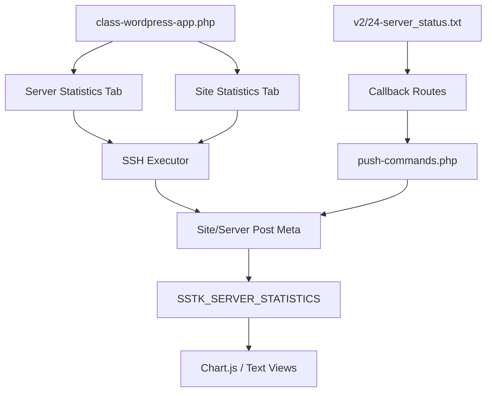
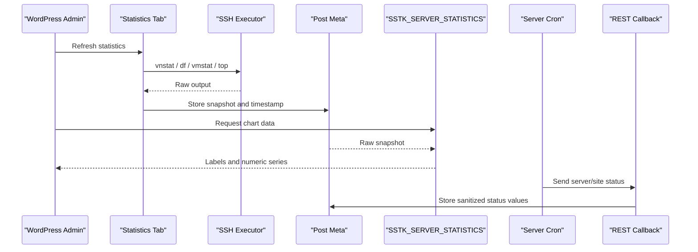

# System Monitoring & Metrics

<cite>
**Referenced Files in This Document**
- [class-sstk-server-statistics.php](file://includes/core/class-sstk-server-statistics.php)
- [statistics.php (Site)](file://includes/core/apps/wordpress-app/tabs/statistics.php)
- [statistics.php (Server)](file://includes/core/apps/wordpress-app/tabs-server/statistics.php)
- [class-wordpress-app.php](file://includes/core/apps/wordpress-app/class-wordpress-app.php)
- [24-server_status.txt](file://includes/core/apps/wordpress-app/scripts/v2/raw/24-server_status.txt)
- [push-commands.php](file://includes/core/apps/wordpress-app/traits/traits-for-class-wordpress-app/push-commands.php)
- [callbacks.php](file://includes/core/apps/wordpress-app/tabs-server/callbacks.php)
- [class-wordpress-app-settings.php](file://includes/core/apps/wordpress-app/class-wordpress-app-settings.php)
</cite>

## Table of Contents
1. [Introduction](#introduction)
2. [Project Structure](#project-structure)
3. [Core Components](#core-components)
4. [Architecture Overview](#architecture-overview)
5. [Detailed Component Analysis](#detailed-component-analysis)
6. [Dependency Analysis](#dependency-analysis)
7. [Performance Considerations](#performance-considerations)
8. [Troubleshooting Guide](#troubleshooting-guide)
9. [Conclusion](#conclusion)
10. [Appendices](#appendices)

## Introduction

Simple Stack collects server and WordPress-site metrics through SSH commands and scheduled callbacks. The WordPress admin stores raw snapshots as post meta, renders text views, and uses `SSTK_SERVER_STATISTICS` to produce chart-ready datasets.

The metrics pipeline is independent of the retired Monitorix integration. Monitorix has no current tab controller, wrapper, raw script, or admin workflow. Monit and Netdata remain separate operational tools with their own documentation.

All status automation is consumed from `scripts/v2/`; there is no `scripts/v1/` execution path.

## Project Structure

```text
includes/core/
├── class-sstk-server-statistics.php
└── apps/wordpress-app/
    ├── class-wordpress-app.php
    ├── tabs/statistics.php
    ├── tabs-server/statistics.php
    ├── tabs-server/callbacks.php
    ├── class-wordpress-app-settings.php
    ├── traits/traits-for-class-wordpress-app/push-commands.php
    └── scripts/v2/raw/24-server_status.txt
```



## Core Components

- **Site Statistics Tab:** Calculates site disk usage and collects site VNSTAT output.
- **Server Statistics Tab:** Collects VNSTAT, disk, memory, and process snapshots for a server.
- **SSTK_SERVER_STATISTICS:** Formats raw disk, VNSTAT, and VMSTAT output for charts.
- **Server Status Script:** Installs cron helpers for server health, per-site WordPress status, and package activity.
- **Callback Handlers:** Sanitize incoming metrics and persist them to server/site records.
- **Low-Disk Alert Setting:** Evaluates the configured percentage during daily callbacks, not in real time.

## Architecture Overview



## Detailed Component Analysis

### SSTK_SERVER_STATISTICS

The formatter exposes:

- `sstk_app_server_get_formatted_disk_statistics( $post_id )`
- `sstk_app_server_get_formatted_vnstat_data( $post_id )`
- `convert_to_numeric_data( $data )`
- `sstk_app_server_get_formatted_vmstat_data( $post_id )`

It returns empty arrays for missing IDs or unusable data. Disk output is parsed into chart columns, VNSTAT output into day/month/all-time series, and VMSTAT output into label/value pairs. Byte-unit values are normalized for charting.

### Site Statistics Tab

The `statistics` site tab supports two actions:

| Action | Remote work | Stored meta |
|---|---|---|
| `show-diskspace-used` | Runs `get_diskspace_used_misc.txt` for the site domain | `wpapp_diskspace_used` |
| `show-vnstat` | Runs `sudo vnstat` and `sudo vnstat --oneline` | `wpapp_vnstat_data`, `wpapp_vnstat_data_oneline` |

The VNSTAT card is shown only when `wordpress_app_show_vnstat_in_app` is enabled. Disk usage includes the last calculation time.

### Server Statistics Tab

The `svr_statistics` server tab supports `server-refresh-statistics`. It executes five SSH commands and stores the results:

| Command | Stored meta |
|---|---|
| `sudo vnstat` | `sstk_wpapp_vnstat_data` |
| `sudo vnstat --oneline` | `sstk_wpapp_vnstat_one_line_data` |
| `sudo df` | `sstk_wpapp_disk_statistics` |
| `sudo vmstat -s` | `sstk_wpapp_vmstat_data` |
| `sudo top -n 1 -b` | `sstk_wpapp_top_data` |

The tab also records `sstk_wpapp_server_stats_list_date`. Disk, traffic, and memory sections offer Chart.js and raw-text views; the process snapshot is displayed as text.

### WordPress and Server Status Callbacks

`scripts/v2/raw/24-server_status.txt` installs helper scripts and cron entries for:

- Server restart state, package updates, uptime, CPU, memory, disk, database size, PHP version, and package-check errors.
- Per-site WordPress version, active plugin/theme update counts, core update state, file/database/backup sizes, `WP_DEBUG`, and post-type counts.
- Package-manager activity.

The per-site helper runs as each site’s Linux user and posts results to the callback routes. `push-commands.php` sanitizes numeric and status fields before storing them.

### Low-Disk Notifications

The setting `wordpress_app_low_diskspace_notification_threshold` defaults to `15`. When callback processing finds free disk space below the configured percentage, it writes a notification-log entry. Evaluation occurs during daily callbacks and is not a real-time alert.

## Dependency Analysis

- Both statistics tabs depend on the WordPress app bootstrap.
- Remote collection depends on server SSH credentials and root command execution.
- VNSTAT charts require `vnstat` to be installed and returning parseable output.
- Disk and memory charts require `df` and `vmstat`.
- Callback processing depends on the callback routes being installed and reachable from the server.
- Chart rendering depends on valid raw snapshots in post meta.

## Performance Considerations

- Each manual server refresh runs five SSH commands; avoid unnecessary repeated refreshes.
- Raw snapshots are stored in post meta and can grow the database over time.
- Large chart datasets should be aggregated before rendering.
- Scheduled callbacks are daily; use Monit or Netdata for service-level real-time monitoring.

## Troubleshooting Guide

### No Charts or Empty Data

Refresh the relevant statistics tab, confirm SSH access, and verify that `vnstat`, `df`, `vmstat`, and `top` are available on the server. Inspect the raw-text view before diagnosing the formatter.

### VNSTAT Is Missing

Confirm the package and service are installed. For site-level VNSTAT, also verify that `wordpress_app_show_vnstat_in_app` is enabled.

### Callback Data Is Stale

Check the callback installation state, server-to-WordPress connectivity, cron execution, and `/var/log/wp-server-status.log` or `/var/log/wp-site-status.log` on the target host.

### Low-Disk Alerts Are Delayed

This is expected. The threshold is evaluated during daily callbacks rather than continuously.

## Conclusion

Simple Stack’s metrics system combines manual SSH snapshots, scheduled server/site callbacks, post-meta storage, and Chart.js formatting. It covers server resources, WordPress update posture, storage usage, and low-disk notification thresholds without relying on the retired Monitorix integration.

## Appendices

### Programmatic Queries

Use `SSTK_SERVER_STATISTICS::instance()` and the formatter methods listed above to retrieve chart-ready arrays. Export raw snapshots from the documented post-meta keys when detailed analysis is required.

### Extending Collection

Add new actions through the existing tab filters, execute validated read-only commands over SSH, store bounded snapshots, and extend `SSTK_SERVER_STATISTICS` only when a new chart format is required. Keep callback authentication and secret redaction intact.
