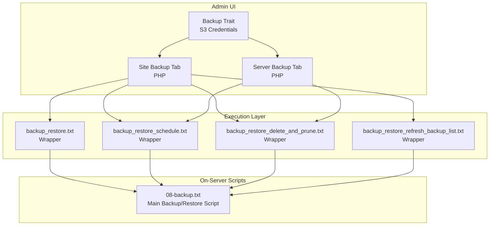
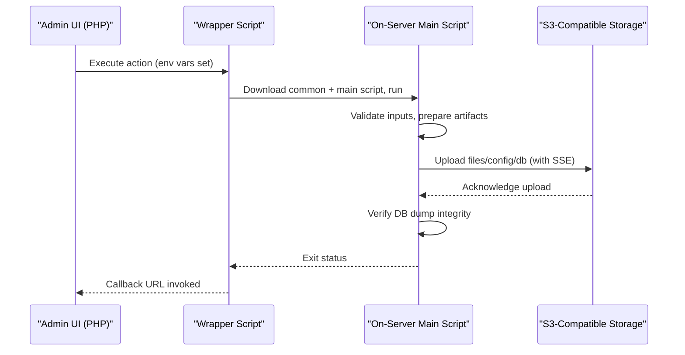
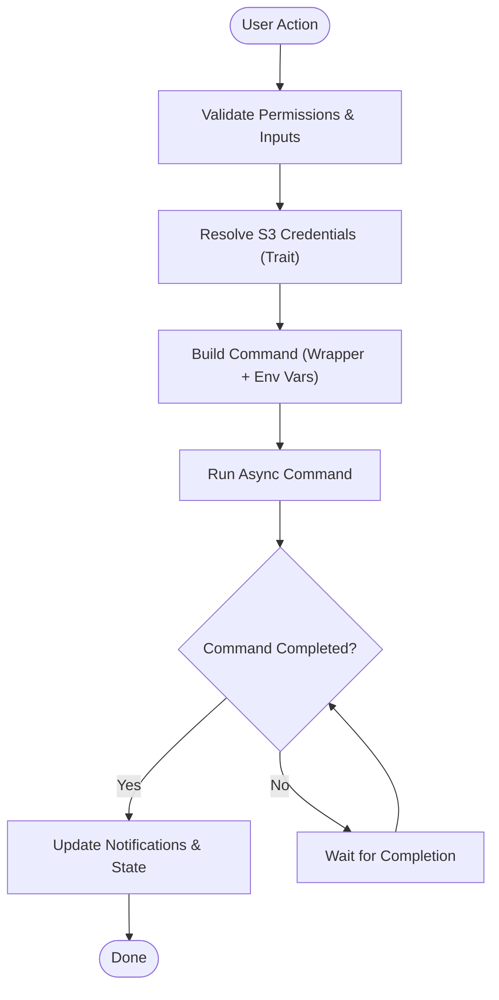
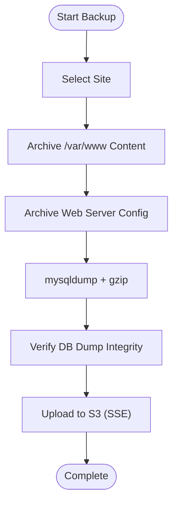
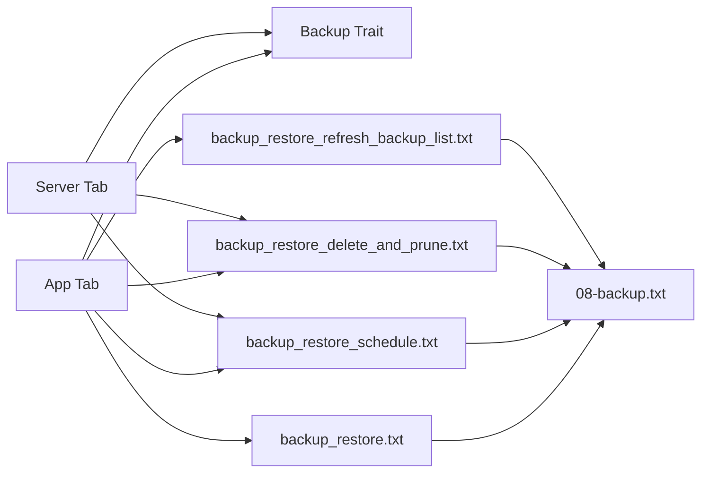

# Backup & Restore System

<cite>
**Referenced Files in This Document**
- [08-backup.txt](file://includes/core/apps/wordpress-app/scripts/v2/raw/08-backup.txt)
- [backup_restore.txt](file://includes/core/apps/wordpress-app/scripts/v2/backup_restore.txt)
- [backup_restore_schedule.txt](file://includes/core/apps/wordpress-app/scripts/v2/backup_restore_schedule.txt)
- [backup_restore_delete_and_prune.txt](file://includes/core/apps/wordpress-app/scripts/v2/backup_restore_delete_and_prune.txt)
- [backup_restore_refresh_backup_list.txt](file://includes/core/apps/wordpress-app/scripts/v2/backup_restore_refresh_backup_list.txt)
- [backup.php (App Tab)](file://includes/core/apps/wordpress-app/tabs/backup.php)
- [backup.php (Server Tab)](file://includes/core/apps/wordpress-app/tabs-server/backup.php)
- [backup.php (Trait)](file://includes/core/apps/wordpress-app/traits/traits-for-class-wordpress-app/backup.php)
</cite>

## Table of Contents
1. [Introduction](#introduction)
2. [Project Structure](#project-structure)
3. [Core Components](#core-components)
4. [Architecture Overview](#architecture-overview)
5. [Detailed Component Analysis](#detailed-component-analysis)
6. [Dependency Analysis](#dependency-analysis)
7. [Performance Considerations](#performance-considerations)
8. [Troubleshooting Guide](#troubleshooting-guide)
9. [Conclusion](#conclusion)

## Introduction
This document explains Simple Stack’s backup and restore system for WordPress sites and servers. It covers the complete backup lifecycle (database dumps, file system snapshots, and configuration backups), storage mechanisms (local and S3-compatible remote), encryption options, scheduling and retention, restore workflows (full, selective, conflict resolution), verification and integrity checks, and operational guidance for manual and automated operations via the admin interface.

## Project Structure
The backup and restore functionality is implemented across:
- PHP UI and orchestration layers that expose actions in the admin tabs for sites and servers.
- Bash scripts executed on the target server to perform actual backups, restores, scheduling, pruning, and credential management.
- A trait that centralizes S3 credential resolution (server-level vs global).

**Diagram sources**
- [backup.php (App Tab):192-401](file://includes/core/apps/wordpress-app/tabs/backup.php#L192-L401)
- [backup.php (Server Tab):92-136](file://includes/core/apps/wordpress-app/tabs-server/backup.php#L92-L136)
- [backup.php (Trait):21-71](file://includes/core/apps/wordpress-app/traits/traits-for-class-wordpress-app/backup.php#L21-L71)
- [backup_restore.txt:1-13](file://includes/core/apps/wordpress-app/scripts/v2/backup_restore.txt#L1-L13)
- [backup_restore_schedule.txt:1-7](file://includes/core/apps/wordpress-app/scripts/v2/backup_restore_schedule.txt#L1-L7)
- [backup_restore_delete_and_prune.txt:1-13](file://includes/core/apps/wordpress-app/scripts/v2/backup_restore_delete_and_prune.txt#L1-L13)
- [backup_restore_refresh_backup_list.txt:1-7](file://includes/core/apps/wordpress-app/scripts/v2/backup_restore_refresh_backup_list.txt#L1-L7)
- [08-backup.txt:1-800](file://includes/core/apps/wordpress-app/scripts/v2/raw/08-backup.txt#L1-L800)

**Section sources**
- [backup.php (App Tab):192-401](file://includes/core/apps/wordpress-app/tabs/backup.php#L192-L401)
- [backup.php (Server Tab):92-136](file://includes/core/apps/wordpress-app/tabs-server/backup.php#L92-L136)
- [backup.php (Trait):21-71](file://includes/core/apps/wordpress-app/traits/traits-for-class-wordpress-app/backup.php#L21-L71)
- [backup_restore.txt:1-13](file://includes/core/apps/wordpress-app/scripts/v2/backup_restore.txt#L1-L13)
- [backup_restore_schedule.txt:1-7](file://includes/core/apps/wordpress-app/scripts/v2/backup_restore_schedule.txt#L1-L7)
- [backup_restore_delete_and_prune.txt:1-13](file://includes/core/apps/wordpress-app/scripts/v2/backup_restore_delete_and_prune.txt#L1-L13)
- [backup_restore_refresh_backup_list.txt:1-7](file://includes/core/apps/wordpress-app/scripts/v2/backup_restore_refresh_backup_list.txt#L1-L7)
- [08-backup.txt:1-800](file://includes/core/apps/wordpress-app/scripts/v2/raw/08-backup.txt#L1-L800)

## Core Components
- Site Backup Tab (PHP): Exposes manual backup, automatic backup scheduling per site, restore options (full, web server config only, wp-config only), prune/delete local backups, and refresh backup list. Orchestrates execution by building commands and running them asynchronously.
- Server Backup Tab (PHP): Manages server-level S3 credentials, schedules automatic backups for all sites on a server, prunes/deletes server-wide local backups, toggles server configuration backups, and triggers provider snapshots when supported.
- Backup Trait (PHP): Resolves S3 credentials and bucket/region/endpoint from server meta or global settings; returns both shell-safe and raw values.
- Execution Wrappers (Bash): Lightweight wrappers that download common functions and the main script, export environment variables, execute the main script, and handle logging/callbacks.
- Main Backup Script (Bash): Implements the full backup lifecycle including database dump, file and configuration archives, S3 upload with SSE, verification, restore flow, scheduling, pruning, and credential updates.

Key responsibilities:
- Orchestration and UI: App and Server tabs.
- Credential resolution: Trait.
- On-server operations: Main script and wrappers.

**Section sources**
- [backup.php (App Tab):192-401](file://includes/core/apps/wordpress-app/tabs/backup.php#L192-L401)
- [backup.php (Server Tab):92-136](file://includes/core/apps/wordpress-app/tabs-server/backup.php#L92-L136)
- [backup.php (Trait):21-71](file://includes/core/apps/wordpress-app/traits/traits-for-class-wordpress-app/backup.php#L21-L71)
- [backup_restore.txt:1-13](file://includes/core/apps/wordpress-app/scripts/v2/backup_restore.txt#L1-L13)
- [backup_restore_schedule.txt:1-7](file://includes/core/apps/wordpress-app/scripts/v2/backup_restore_schedule.txt#L1-L7)
- [backup_restore_delete_and_prune.txt:1-13](file://includes/core/apps/wordpress-app/scripts/v2/backup_restore_delete_and_prune.txt#L1-L13)
- [backup_restore_refresh_backup_list.txt:1-7](file://includes/core/apps/wordpress-app/scripts/v2/backup_restore_refresh_backup_list.txt#L1-L7)
- [08-backup.txt:1-800](file://includes/core/apps/wordpress-app/scripts/v2/raw/08-backup.txt#L1-L800)

## Architecture Overview
The system follows a layered architecture:
- Admin UI layer (PHP) validates permissions, collects inputs, resolves S3 credentials, and constructs commands.
- Execution wrapper layer (Bash) downloads shared utilities and the main script, sets environment variables, runs the operation, and manages logs and callbacks.
- On-server script layer (Bash) performs the actual work: database dumps, file/config archiving, S3 uploads, verification, restore logic, scheduling, and pruning.

**Diagram sources**
- [backup.php (App Tab):245-401](file://includes/core/apps/wordpress-app/tabs/backup.php#L245-L401)
- [backup_restore.txt:1-13](file://includes/core/apps/wordpress-app/scripts/v2/backup_restore.txt#L1-L13)
- [08-backup.txt:118-199](file://includes/core/apps/wordpress-app/scripts/v2/raw/08-backup.txt#L118-L199)

## Detailed Component Analysis

### Site Backup Tab (PHP)
Responsibilities:
- Validates user permissions and allowed actions.
- Builds commands for manual backup, restore (full/webserver-config-only/wpconfig-only), prune/delete local backups, and refresh backup list.
- Uses the trait to resolve S3 credentials and passes them into the command context.
- Executes commands asynchronously and handles completion hooks to update notifications and state.

Key flows:
- Manual backup: invokes backup_restore.txt with action=backup.
- Restore: ensures PHP 8.1 availability, selects backup item, sets overwrite flag, and calls backup_restore.txt with appropriate restore action.
- Prune/Delete: invokes backup_restore_delete_and_prune.txt with days or delete flags.
- Refresh list: invokes backup_restore_refresh_backup_list.txt.

**Diagram sources**
- [backup.php (App Tab):192-401](file://includes/core/apps/wordpress-app/tabs/backup.php#L192-L401)
- [backup.php (Trait):21-71](file://includes/core/apps/wordpress-app/traits/traits-for-class-wordpress-app/backup.php#L21-L71)

**Section sources**
- [backup.php (App Tab):192-401](file://includes/core/apps/wordpress-app/tabs/backup.php#L192-L401)
- [backup.php (Trait):21-71](file://includes/core/apps/wordpress-app/traits/traits-for-class-wordpress-app/backup.php#L21-L71)

### Server Backup Tab (PHP)
Responsibilities:
- Manage server-level S3 credentials (save/update).
- Schedule automatic backups for all sites on the server.
- Prune/delete server-wide local backups.
- Toggle server configuration backups and delete configuration backups.
- Trigger provider snapshots if supported.

Credential handling:
- Reads/writes server meta for AWS key/secret/bucket/region/endpoint.
- Falls back to global settings when fields are empty.
- Encrypts secret before saving to server meta.

Scheduling:
- Uses backup_restore_schedule.txt wrapper to set up cron jobs and pass parameters like retention days and S3 sync delete behavior.

**Section sources**
- [backup.php (Server Tab):92-136](file://includes/core/apps/wordpress-app/tabs-server/backup.php#L92-L136)
- [backup.php (Server Tab):697-800](file://includes/core/apps/wordpress-app/tabs-server/backup.php#L697-L800)
- [backup_restore_schedule.txt:1-7](file://includes/core/apps/wordpress-app/scripts/v2/backup_restore_schedule.txt#L1-L7)

### Backup Trait (PHP)
Responsibilities:
- Resolves S3 credentials and bucket/region/endpoint from server meta or global settings.
- Returns both shell-safe (escaped) and raw values for use in bash contexts.

Behavior:
- If server-level values are missing, falls back to global settings.
- Defaults region to us-east-1 if not provided and endpoint is not set.

**Section sources**
- [backup.php (Trait):21-71](file://includes/core/apps/wordpress-app/traits/traits-for-class-wordpress-app/backup.php#L21-L71)

### Execution Wrappers (Bash)
Purpose:
- Download shared functions and the main script onto the server.
- Export environment variables (action, domain, credentials, etc.).
- Execute the main script and manage intermediate/done log files.
- Invoke callback URLs upon completion.

Types:
- backup_restore.txt: For manual backup and restore operations.
- backup_restore_schedule.txt: For scheduling automatic backups.
- backup_restore_delete_and_prune.txt: For pruning/deleting backups.
- backup_restore_refresh_backup_list.txt: For refreshing the backup list.

**Section sources**
- [backup_restore.txt:1-13](file://includes/core/apps/wordpress-app/scripts/v2/backup_restore.txt#L1-L13)
- [backup_restore_schedule.txt:1-7](file://includes/core/apps/wordpress-app/scripts/v2/backup_restore_schedule.txt#L1-L7)
- [backup_restore_delete_and_prune.txt:1-13](file://includes/core/apps/wordpress-app/scripts/v2/backup_restore_delete_and_prune.txt#L1-L13)
- [backup_restore_refresh_backup_list.txt:1-7](file://includes/core/apps/wordpress-app/scripts/v2/backup_restore_refresh_backup_list.txt#L1-L7)

### Main Backup Script (Bash)
Responsibilities:
- Interactive menu for backup, restore, schedule, unschedule, change AWS credentials, list backups, prune, delete, and configuration restoration.
- Performs:
  - File system archive creation for /var/www content.
  - Web server configuration archive (nginx or OpenLiteSpeed).
  - Database dump using mysqldump with routines and gzip compression.
  - Upload to S3-compatible storage with server-side encryption (SSE).
  - Verification of database dump integrity.
  - Full restore workflow: drop/recreate DB, remove existing site files/config, restore files/config/DB, fix ownership/permissions, disable object cache conflicts, attempt SSL certificate issuance, restart web server.
  - Scheduling helpers for per-site and all-sites backups with retention policies and optional deletion of remote backups.
  - Local backup pruning and deletion.
  - Credential management for S3.

**Diagram sources**
- [08-backup.txt:118-199](file://includes/core/apps/wordpress-app/scripts/v2/raw/08-backup.txt#L118-L199)

**Section sources**
- [08-backup.txt:1-800](file://includes/core/apps/wordpress-app/scripts/v2/raw/08-backup.txt#L1-L800)

## Dependency Analysis
- The App and Server tabs depend on the Backup Trait for resolving S3 credentials.
- All operations rely on wrapper scripts to bootstrap execution on the server.
- The main script depends on external tools: tar, gzip, mysqldump, aws CLI, certbot (for SSL), and system utilities (useradd, chown, chmod).
- S3 uploads use server-side encryption (SSE) and support custom endpoints for S3-compatible services.

**Diagram sources**
- [backup.php (App Tab):192-401](file://includes/core/apps/wordpress-app/tabs/backup.php#L192-L401)
- [backup.php (Server Tab):92-136](file://includes/core/apps/wordpress-app/tabs-server/backup.php#L92-L136)
- [backup.php (Trait):21-71](file://includes/core/apps/wordpress-app/traits/traits-for-class-wordpress-app/backup.php#L21-L71)
- [backup_restore.txt:1-13](file://includes/core/apps/wordpress-app/scripts/v2/backup_restore.txt#L1-L13)
- [backup_restore_schedule.txt:1-7](file://includes/core/apps/wordpress-app/scripts/v2/backup_restore_schedule.txt#L1-L7)
- [backup_restore_delete_and_prune.txt:1-13](file://includes/core/apps/wordpress-app/scripts/v2/backup_restore_delete_and_prune.txt#L1-L13)
- [backup_restore_refresh_backup_list.txt:1-7](file://includes/core/apps/wordpress-app/scripts/v2/backup_restore_refresh_backup_list.txt#L1-L7)
- [08-backup.txt:1-800](file://includes/core/apps/wordpress-app/scripts/v2/raw/08-backup.txt#L1-L800)

**Section sources**
- [backup.php (App Tab):192-401](file://includes/core/apps/wordpress-app/tabs/backup.php#L192-L401)
- [backup.php (Server Tab):92-136](file://includes/core/apps/wordpress-app/tabs-server/backup.php#L92-L136)
- [backup.php (Trait):21-71](file://includes/core/apps/wordpress-app/traits/traits-for-class-wordpress-app/backup.php#L21-L71)
- [backup_restore.txt:1-13](file://includes/core/apps/wordpress-app/scripts/v2/backup_restore.txt#L1-L13)
- [backup_restore_schedule.txt:1-7](file://includes/core/apps/wordpress-app/scripts/v2/backup_restore_schedule.txt#L1-L7)
- [backup_restore_delete_and_prune.txt:1-13](file://includes/core/apps/wordpress-app/scripts/v2/backup_restore_delete_and_prune.txt#L1-L13)
- [backup_restore_refresh_backup_list.txt:1-7](file://includes/core/apps/wordpress-app/scripts/v2/backup_restore_refresh_backup_list.txt#L1-L7)
- [08-backup.txt:1-800](file://includes/core/apps/wordpress-app/scripts/v2/raw/08-backup.txt#L1-L800)

## Performance Considerations
- Compression: Database dumps are gzipped at maximum compression level during backup.
- Parallelism: Operations are executed asynchronously via background processes on the server.
- Retention Policies: Configure low local retention and rely on S3 for long-term storage to reduce disk pressure.
- Bandwidth Throttling: Not exposed in the current implementation; consider configuring S3 client throttling externally if needed.
- Incremental Backups: Not implemented; the system performs full backups of files, configurations, and databases.

[No sources needed since this section provides general guidance]

## Troubleshooting Guide
Common issues and resolutions:
- Missing or invalid S3 credentials: Ensure server-level or global credentials are configured; verify region and endpoint.
- S3 upload failures: Check network connectivity, IAM permissions, and bucket existence; confirm SSE is supported by the endpoint.
- Database dump corruption: The script verifies the last line of the dump; if validation fails, inspect MySQL logs and retry.
- Restore conflicts: Existing site data will be overwritten; ensure you have a pre-restore backup. Object cache plugins are disabled during restore to avoid conflicts.
- SSL certificate issues: During restore, the script attempts to reinstall certificates; check certbot logs if HTTPS is not restored correctly.
- Scheduling problems: Verify crontab entries and helper scripts exist; review logs for scheduled tasks.

Operational tips:
- Use “Refresh Backup List” to ensure the UI shows the latest available backups.
- Prefer pruning over deleting to maintain a rolling window of recent backups locally while keeping older copies remotely.
- When changing credentials, save them on the server tab even if using global settings to propagate to the server.

**Section sources**
- [08-backup.txt:190-199](file://includes/core/apps/wordpress-app/scripts/v2/raw/08-backup.txt#L190-L199)
- [08-backup.txt:233-422](file://includes/core/apps/wordpress-app/scripts/v2/raw/08-backup.txt#L233-L422)
- [backup.php (App Tab):46-133](file://includes/core/apps/wordpress-app/tabs/backup.php#L46-L133)

## Conclusion
Simple Stack’s backup and restore system provides a robust, secure, and configurable approach to protecting WordPress environments. It supports comprehensive backups (files, configurations, databases), encrypted S3 storage, flexible scheduling and retention, and reliable restore workflows with conflict mitigation. While incremental backups and bandwidth throttling are not currently exposed, the system’s design allows for future enhancements. Administrators should configure proper S3 credentials, set sensible retention policies, and regularly verify backups to ensure recoverability.

[No sources needed since this section summarizes without analyzing specific files]