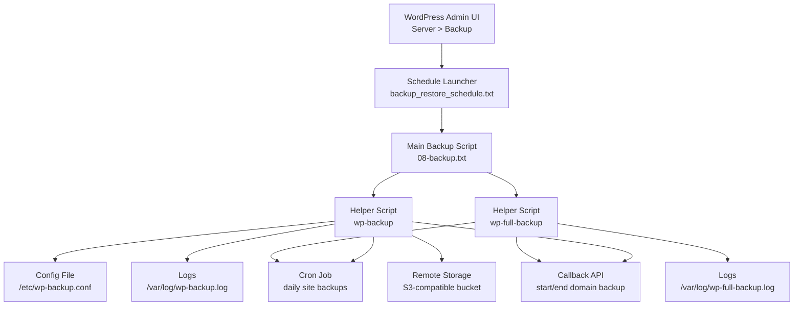
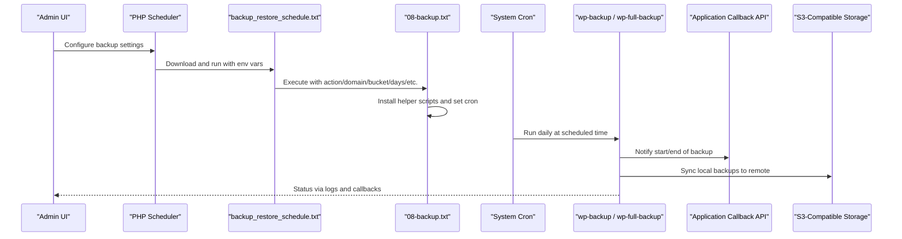
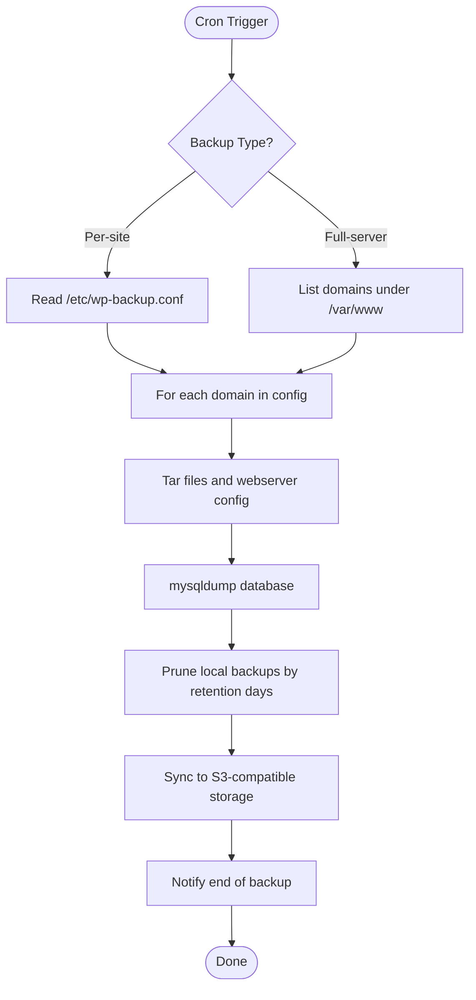
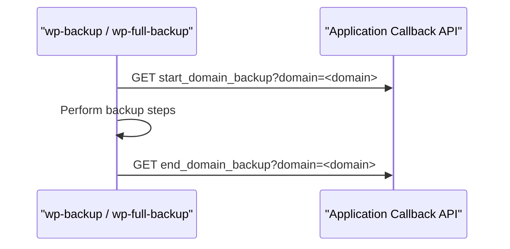
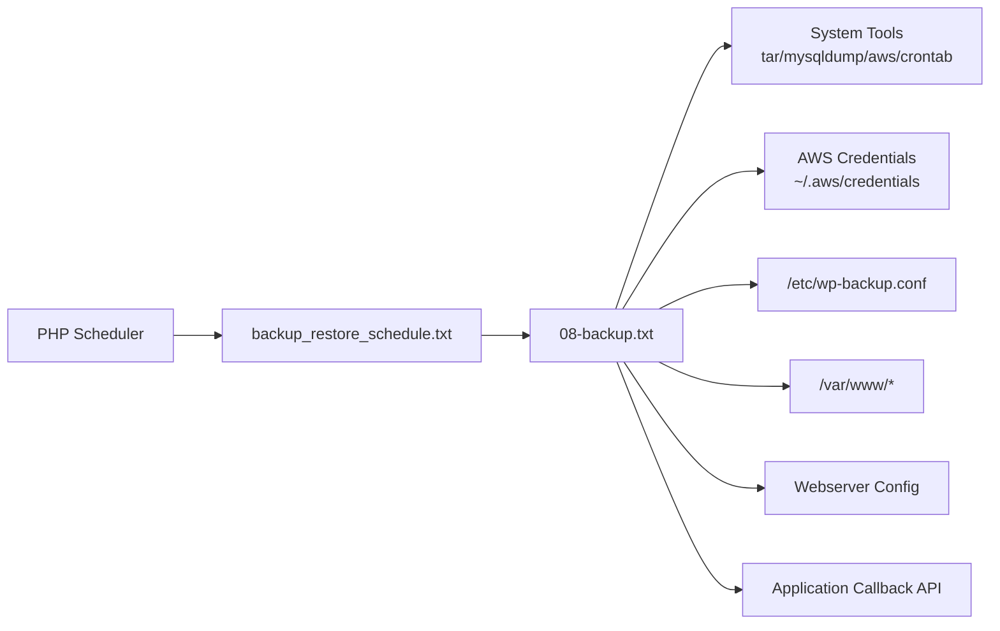

# Backup Scheduling & Automation

<cite>
**Referenced Files in This Document**
- [08-backup.txt (v1)](file://includes/core/apps/wordpress-app/scripts/v1/raw/08-backup.txt)
- [08-backup.txt (v2)](file://includes/core/apps/wordpress-app/scripts/v2/raw/08-backup.txt)
- [backup_restore_schedule.txt (v1)](file://includes/core/apps/wordpress-app/scripts/v1/backup_restore_schedule.txt)
- [backup_restore_schedule.txt (v2)](file://includes/core/apps/wordpress-app/scripts/v2/backup_restore_schedule.txt)
- [backup.php (server tab)](file://includes/core/apps/wordpress-app/tabs-server/backup.php)
- [logs.php (server tab)](file://includes/core/apps/wordpress-app/tabs-server/logs.php)
</cite>

## Table of Contents
1. [Introduction](#introduction)
2. [Project Structure](#project-structure)
3. [Core Components](#core-components)
4. [Architecture Overview](#architecture-overview)
5. [Detailed Component Analysis](#detailed-component-analysis)
6. [Dependency Analysis](#dependency-analysis)
7. [Performance Considerations](#performance-considerations)
8. [Troubleshooting Guide](#troubleshooting-guide)
9. [Conclusion](#conclusion)

## Introduction
This document explains SimpleStack’s automated backup scheduling system for WordPress sites. It covers the cron-based scheduler, helper scripts wp-backup and wp-full-backup, configuration file format, job management operations, retention policies, callback notifications, logging, and advanced options such as excluding local backups while keeping remote copies.

## Project Structure
The backup automation is implemented through:
- A main backup script that installs helper scripts and schedules cron jobs.
- Helper scripts executed by cron to perform per-site or full-server backups.
- A schedule launcher that downloads and executes the backup script with environment variables.
- PHP UI components that configure and trigger scheduling.

**Diagram sources**
- [backup_restore_schedule.txt (v1):1-7](file://includes/core/apps/wordpress-app/scripts/v1/backup_restore_schedule.txt#L1-L7)
- [08-backup.txt (v1):426-564](file://includes/core/apps/wordpress-app/scripts/v1/raw/08-backup.txt#L426-L564)
- [08-backup.txt (v1):591-737](file://includes/core/apps/wordpress-app/scripts/v1/raw/08-backup.txt#L591-L737)
- [backup.php (server tab):891-918](file://includes/core/apps/wordpress-app/tabs-server/backup.php#L891-L918)

**Section sources**
- [backup_restore_schedule.txt (v1):1-7](file://includes/core/apps/wordpress-app/scripts/v1/backup_restore_schedule.txt#L1-L7)
- [backup_restore_schedule.txt (v2):1-7](file://includes/core/apps/wordpress-app/scripts/v2/backup_restore_schedule.txt#L1-L7)
- [08-backup.txt (v1):426-564](file://includes/core/apps/wordpress-app/scripts/v1/raw/08-backup.txt#L426-L564)
- [08-backup.txt (v1):591-737](file://includes/core/apps/wordpress-app/scripts/v1/raw/08-backup.txt#L591-L737)
- [backup.php (server tab):891-918](file://includes/core/apps/wordpress-app/tabs-server/backup.php#L891-L918)

## Core Components
- Main backup script: Installs helper scripts, configures cron entries, and manages scheduled tasks.
- Per-site helper script (wp-backup): Reads /etc/wp-backup.conf and backs up each configured domain daily.
- Full-server helper script (wp-full-backup): Iterates all domains under /var/www and backs them up on a fixed schedule.
- Schedule launcher: Downloads the main script and runs it with environment variables provided by the UI.
- Configuration file (/etc/wp-backup.conf): Stores per-site backup parameters.
- Logging: Writes status to /var/log/wp-backup.log and /var/log/wp-full-backup.log.
- Callbacks: Notifies the application via HTTP when a backup starts and ends.

Key responsibilities:
- Cron scheduling: Daily execution at specified times.
- Retention policy: Local pruning based on days; optional deletion of remote copies.
- Excluding local backups: Use special retention value to keep only remote copies.

**Section sources**
- [08-backup.txt (v1):426-564](file://includes/core/apps/wordpress-app/scripts/v1/raw/08-backup.txt#L426-L564)
- [08-backup.txt (v1):591-737](file://includes/core/apps/wordpress-app/scripts/v1/raw/08-backup.txt#L591-L737)
- [backup_restore_schedule.txt (v1):1-7](file://includes/core/apps/wordpress-app/scripts/v1/backup_restore_schedule.txt#L1-L7)
- [backup.php (server tab):891-918](file://includes/core/apps/wordpress-app/tabs-server/backup.php#L891-L918)

## Architecture Overview
The system uses a layered approach:
- The WordPress admin triggers scheduling via PHP code.
- The schedule launcher downloads and executes the main backup script with environment variables.
- The main script installs helper scripts and sets up cron jobs.
- Cron executes helper scripts which perform backups and notify the application.

**Diagram sources**
- [backup.php (server tab):891-918](file://includes/core/apps/wordpress-app/tabs-server/backup.php#L891-L918)
- [backup_restore_schedule.txt (v1):1-7](file://includes/core/apps/wordpress-app/scripts/v1/backup_restore_schedule.txt#L1-L7)
- [08-backup.txt (v1):426-564](file://includes/core/apps/wordpress-app/scripts/v1/raw/08-backup.txt#L426-L564)
- [08-backup.txt (v1):591-737](file://includes/core/apps/wordpress-app/scripts/v1/raw/08-backup.txt#L591-L737)

## Detailed Component Analysis

### Cron-Based Scheduling Mechanism
- Per-site backups:
  - A cron entry runs the wp-backup helper script daily.
  - Default schedule: every day at 06:00.
  - The helper reads /etc/wp-backup.conf and processes each line.
- Full-server backups:
  - A separate cron entry runs the wp-full-backup helper script daily.
  - Default schedule: every day at 05:30.
  - The helper iterates over all domains under /var/www.

**Diagram sources**
- [08-backup.txt (v1):426-564](file://includes/core/apps/wordpress-app/scripts/v1/raw/08-backup.txt#L426-L564)
- [08-backup.txt (v1):591-737](file://includes/core/apps/wordpress-app/scripts/v1/raw/08-backup.txt#L591-L737)

**Section sources**
- [08-backup.txt (v1):531-533](file://includes/core/apps/wordpress-app/scripts/v1/raw/08-backup.txt#L531-L533)
- [08-backup.txt (v1):731-733](file://includes/core/apps/wordpress-app/scripts/v1/raw/08-backup.txt#L731-L733)

### Helper Scripts: wp-backup and wp-full-backup
- wp-backup:
  - Reads /etc/wp-backup.conf line by line.
  - Parameters per line: domain, bucket, retention_days, localuser, s3_sync_delete_parm, callback_domain, s3_endpoint.
  - Performs file and database backups, prunes old local backups, syncs to remote storage, and invokes callbacks.
- wp-full-backup:
  - Accepts parameters: days, bucket, localuser, s3_sync_delete_parm, callback_domain, s3_endpoint.
  - Iterates all domains under /var/www and performs the same steps as wp-backup.

Parameters and behavior:
- days:
  - Positive integer: prune local backups older than N days.
  - 0: do not delete any local backups.
  - -1: remove all local backups after successful remote sync (keep only remote copies).
- s3_sync_delete_parm:
  - Controls whether remote deletions mirror local pruning.
  - Typical values include 'delete' or 'follow-symlinks'.
- callback_domain:
  - Base URL used to call the application’s callback endpoints for start/end notifications.

Execution context:
- Both helpers run as root due to cron.
- They rely on AWS CLI credentials stored in the user’s home directory.

**Section sources**
- [08-backup.txt (v1):430-526](file://includes/core/apps/wordpress-app/scripts/v1/raw/08-backup.txt#L430-L526)
- [08-backup.txt (v1):602-701](file://includes/core/apps/wordpress-app/scripts/v1/raw/08-backup.txt#L602-L701)

### Configuration File Format: /etc/wp-backup.conf
- One line per site.
- Fields (space-separated):
  - domain
  - bucket
  - retention_days
  - localuser
  - s3_sync_delete_parm
  - callback_domain
  - s3_endpoint

Example structure:
- example.com my-bucket 30 www-data delete https://example.com https://s3.custom.endpoint

Notes:
- The main script writes lines using echo with these fields.
- Removing a job deletes the corresponding line from the file.

**Section sources**
- [08-backup.txt (v1):559-560](file://includes/core/apps/wordpress-app/scripts/v1/raw/08-backup.txt#L559-L560)
- [08-backup.txt (v1):574-584](file://includes/core/apps/wordpress-app/scripts/v1/raw/08-backup.txt#L574-L584)

### Job Management Operations
- Add scheduled task (per-site):
  - Uses action=schedule.
  - Prompts for domain, bucket, and retention days if not provided.
  - Creates or updates /etc/wp-backup.conf and ensures cron entry exists.
- Remove scheduled task (per-site):
  - Uses action=unschedule.
  - Lists current jobs from /etc/wp-backup.conf and removes selected line.
- Add scheduled task (full-server):
  - Uses action=schedule_full.
  - Prompts for bucket and retention days.
  - Installs wp-full-backup and adds cron entry.
- Remove scheduled task (full-server):
  - Uses action=unschedule_full.
  - Removes cron entry and deletes wp-full-backup helper.

Environment variables passed by the launcher:
- action, domain, job, days, aws_access_key_id, aws_secret_access_key, bucket, aws_region, s3_endpoint, s3_sync_delete_parm, callback_domain.

**Section sources**
- [backup_restore_schedule.txt (v1):1-7](file://includes/core/apps/wordpress-app/scripts/v1/backup_restore_schedule.txt#L1-L7)
- [08-backup.txt (v1):426-564](file://includes/core/apps/wordpress-app/scripts/v1/raw/08-backup.txt#L426-L564)
- [08-backup.txt (v1):567-588](file://includes/core/apps/wordpress-app/scripts/v1/raw/08-backup.txt#L567-L588)
- [08-backup.txt (v1):591-737](file://includes/core/apps/wordpress-app/scripts/v1/raw/08-backup.txt#L591-L737)
- [08-backup.txt (v1):740-747](file://includes/core/apps/wordpress-app/scripts/v1/raw/08-backup.txt#L740-L747)

### Retention Policies
- Local retention:
  - Controlled by days parameter.
  - If days is positive, local backups older than N days are removed.
  - If days is 0, no local pruning occurs.
  - If days is -1, all local backups are deleted after successful remote sync.
- Remote retention:
  - Controlled by s3_sync_delete_parm.
  - When set to 'delete', remote deletions mirror local pruning.
  - Other values like 'follow-symlinks' avoid deleting remote copies.

Advanced option: exclude local backups while maintaining remote copies
- Set days=-1 to remove all local backups after syncing.
- Keep s3_sync_delete_parm set to 'delete' or another appropriate value depending on desired remote behavior.

**Section sources**
- [08-backup.txt (v1):499-504](file://includes/core/apps/wordpress-app/scripts/v1/raw/08-backup.txt#L499-L504)
- [08-backup.txt (v1):521-525](file://includes/core/apps/wordpress-app/scripts/v1/raw/08-backup.txt#L521-L525)
- [08-backup.txt (v1):673-678](file://includes/core/apps/wordpress-app/scripts/v1/raw/08-backup.txt#L673-L678)
- [08-backup.txt (v1):696-700](file://includes/core/apps/wordpress-app/scripts/v1/raw/08-backup.txt#L696-L700)

### Callback Mechanisms
- Start notification:
  - Called before backing up a domain.
  - Endpoint pattern includes start_domain_backup with domain query parameter.
- End notification:
  - Called after backing up a domain.
  - Endpoint pattern includes end_domain_backup with domain query parameter.
- Callback domain:
  - Provided via callback_domain parameter.
  - Used to construct the base URL for callback endpoints.

**Diagram sources**
- [08-backup.txt (v1):434-438](file://includes/core/apps/wordpress-app/scripts/v1/raw/08-backup.txt#L434-L438)
- [08-backup.txt (v1):517-520](file://includes/core/apps/wordpress-app/scripts/v1/raw/08-backup.txt#L517-L520)
- [08-backup.txt (v1):607-612](file://includes/core/apps/wordpress-app/scripts/v1/raw/08-backup.txt#L607-L612)
- [08-backup.txt (v1):690-695](file://includes/core/apps/wordpress-app/scripts/v1/raw/08-backup.txt#L690-L695)

**Section sources**
- [08-backup.txt (v1):434-438](file://includes/core/apps/wordpress-app/scripts/v1/raw/08-backup.txt#L434-L438)
- [08-backup.txt (v1):517-520](file://includes/core/apps/wordpress-app/scripts/v1/raw/08-backup.txt#L517-L520)
- [08-backup.txt (v1):607-612](file://includes/core/apps/wordpress-app/scripts/v1/raw/08-backup.txt#L607-L612)
- [08-backup.txt (v1):690-695](file://includes/core/apps/wordpress-app/scripts/v1/raw/08-backup.txt#L690-L695)

### Logging Backup Operations
- Per-site backups log to /var/log/wp-backup.log.
- Full-server backups log to /var/log/wp-full-backup.log.
- Database dump failures are logged with timestamps.
- Success/failure of remote sync is appended to logs.

Viewing logs:
- The server logs tab exposes /var/log/wp-backup.log for site-specific backup logs.

**Section sources**
- [08-backup.txt (v1):493-497](file://includes/core/apps/wordpress-app/scripts/v1/raw/08-backup.txt#L493-L497)
- [08-backup.txt (v1):515-515](file://includes/core/apps/wordpress-app/scripts/v1/raw/08-backup.txt#L515-L515)
- [08-backup.txt (v1):667-671](file://includes/core/apps/wordpress-app/scripts/v1/raw/08-backup.txt#L667-L671)
- [08-backup.txt (v1):688-689](file://includes/core/apps/wordpress-app/scripts/v1/raw/08-backup.txt#L688-L689)
- [logs.php (server tab):316-335](file://includes/core/apps/wordpress-app/tabs-server/logs.php#L316-L335)

### Examples

#### Setting Up Per-Site Backups
- Use action=schedule.
- Provide domain, bucket, and retention days.
- The system creates /etc/wp-backup.conf entry and ensures cron runs wp-backup daily at 06:00.

Configuration example:
- Domain: example.com
- Bucket: my-wordpress-backups
- Retention: 30 days
- Result: /etc/wp-backup.conf contains a line for example.com; cron runs wp-backup daily.

**Section sources**
- [08-backup.txt (v1):426-564](file://includes/core/apps/wordpress-app/scripts/v1/raw/08-backup.txt#L426-L564)

#### Setting Up Full Server Backups
- Use action=schedule_full.
- Provide bucket and retention days.
- The system installs wp-full-backup and adds cron entry running daily at 05:30.

Configuration example:
- Bucket: my-wordpress-backups
- Retention: 30 days
- Result: cron runs wp-full-backup daily; all domains under /var/www are backed up.

**Section sources**
- [08-backup.txt (v1):591-737](file://includes/core/apps/wordpress-app/scripts/v1/raw/08-backup.txt#L591-L737)

#### Configuring Backup Retention Periods
- days=30: keep local backups for 30 days.
- days=0: never prune local backups.
- days=-1: delete all local backups after successful remote sync (remote-only strategy).

**Section sources**
- [08-backup.txt (v1):499-504](file://includes/core/apps/wordpress-app/scripts/v1/raw/08-backup.txt#L499-L504)
- [08-backup.txt (v1):521-525](file://includes/core/apps/wordpress-app/scripts/v1/raw/08-backup.txt#L521-L525)
- [08-backup.txt (v1):673-678](file://includes/core/apps/wordpress-app/scripts/v1/raw/08-backup.txt#L673-L678)
- [08-backup.txt (v1):696-700](file://includes/core/apps/wordpress-app/scripts/v1/raw/08-backup.txt#L696-L700)

### Advanced Scheduling Options
- Exclude local backups while maintaining remote copies:
  - Set days=-1 to remove all local backups after successful sync.
  - Ensure s3_sync_delete_parm is set appropriately (e.g., 'delete' or 'follow-symlinks').
- S3 endpoint support:
  - s3_endpoint allows using S3-compatible services.
- Callback integration:
  - callback_domain enables start/end notifications to the application.

**Section sources**
- [08-backup.txt (v1):506-512](file://includes/core/apps/wordpress-app/scripts/v1/raw/08-backup.txt#L506-L512)
- [08-backup.txt (v1):680-686](file://includes/core/apps/wordpress-app/scripts/v1/raw/08-backup.txt#L680-L686)
- [08-backup.txt (v1):434-438](file://includes/core/apps/wordpress-app/scripts/v1/raw/08-backup.txt#L434-L438)
- [08-backup.txt (v1):517-520](file://includes/core/apps/wordpress-app/scripts/v1/raw/08-backup.txt#L517-L520)

## Dependency Analysis
- PHP UI depends on the schedule launcher to execute the main backup script.
- The main backup script depends on:
  - System tools: tar, mysqldump, gzip, find, sed, crontab.
  - AWS CLI for remote synchronization.
  - User credentials in ~/.aws/credentials.
- Helper scripts depend on:
  - /etc/wp-backup.conf for per-site configuration.
  - /var/www for site directories.
  - Webserver configuration directories (/etc/nginx or /usr/local/lsws/conf).
  - Application callback endpoints for notifications.

**Diagram sources**
- [backup.php (server tab):891-918](file://includes/core/apps/wordpress-app/tabs-server/backup.php#L891-L918)
- [backup_restore_schedule.txt (v1):1-7](file://includes/core/apps/wordpress-app/scripts/v1/backup_restore_schedule.txt#L1-L7)
- [08-backup.txt (v1):426-564](file://includes/core/apps/wordpress-app/scripts/v1/raw/08-backup.txt#L426-L564)
- [08-backup.txt (v1):591-737](file://includes/core/apps/wordpress-app/scripts/v1/raw/08-backup.txt#L591-L737)

**Section sources**
- [backup.php (server tab):891-918](file://includes/core/apps/wordpress-app/tabs-server/backup.php#L891-L918)
- [backup_restore_schedule.txt (v1):1-7](file://includes/core/apps/wordpress-app/scripts/v1/backup_restore_schedule.txt#L1-L7)
- [08-backup.txt (v1):426-564](file://includes/core/apps/wordpress-app/scripts/v1/raw/08-backup.txt#L426-L564)
- [08-backup.txt (v1):591-737](file://includes/core/apps/wordpress-app/scripts/v1/raw/08-backup.txt#L591-L737)

## Performance Considerations
- Large sites may benefit from off-peak scheduling; default times are early morning.
- Using days=-1 reduces local disk usage but increases reliance on remote storage availability.
- S3-compatible endpoints may have different performance characteristics; consider network latency and bandwidth.
- Avoid overlapping heavy operations (database dumps, large file archives) during peak hours.

[No sources needed since this section provides general guidance]

## Troubleshooting Guide
Common issues and resolutions:
- Failed scheduled jobs:
  - Check /var/log/wp-backup.log and /var/log/wp-full-backup.log for errors.
  - Verify AWS credentials in ~/.aws/credentials.
  - Confirm cron entries exist and are correct.
- Database dump failures:
  - Inspect logs for “database dump failed” messages.
  - Validate database connectivity and permissions.
- Remote sync failures:
  - Ensure s3_sync_delete_parm is correctly set.
  - Test AWS CLI access and endpoint configuration.
- Callback failures:
  - Verify callback_domain is reachable and endpoints respond.
  - Check application logs for callback requests.

Steps to diagnose:
- Review cron configuration for wp-backup and wp-full-backup.
- Validate /etc/wp-backup.conf entries.
- Confirm helper scripts are executable and present.
- Test AWS CLI commands manually with the same user context.

**Section sources**
- [08-backup.txt (v1):493-497](file://includes/core/apps/wordpress-app/scripts/v1/raw/08-backup.txt#L493-L497)
- [08-backup.txt (v1):515-515](file://includes/core/apps/wordpress-app/scripts/v1/raw/08-backup.txt#L515-L515)
- [08-backup.txt (v1):667-671](file://includes/core/apps/wordpress-app/scripts/v1/raw/08-backup.txt#L667-L671)
- [08-backup.txt (v1):688-689](file://includes/core/apps/wordpress-app/scripts/v1/raw/08-backup.txt#L688-L689)
- [logs.php (server tab):316-335](file://includes/core/apps/wordpress-app/tabs-server/logs.php#L316-L335)

## Conclusion
SimpleStack’s backup automation provides robust daily scheduling for both per-site and full-server backups. It supports flexible retention policies, remote storage integration, and application callbacks. By understanding the helper scripts, configuration file format, and cron setup, administrators can tailor backup strategies to their needs, including advanced options like remote-only backups. Proper monitoring of logs and validation of credentials and endpoints ensure reliable operation.

[No sources needed since this section summarizes without analyzing specific files]