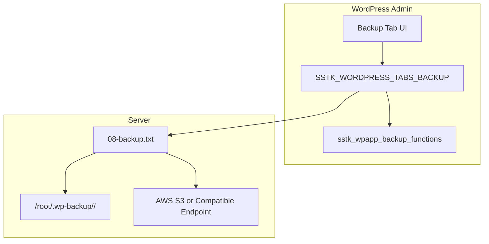
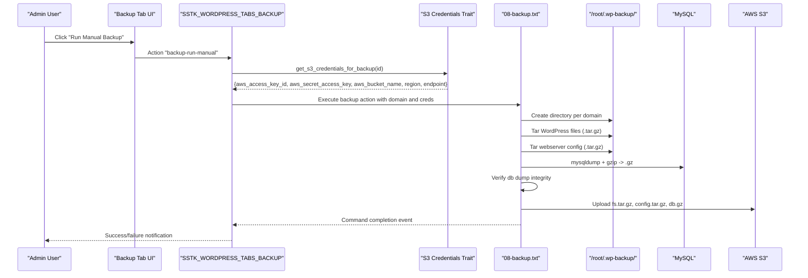
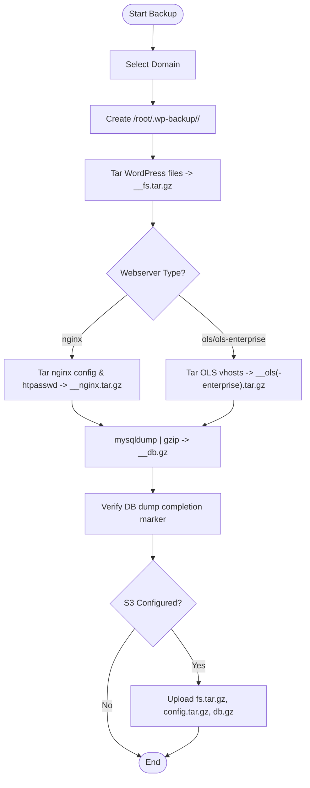
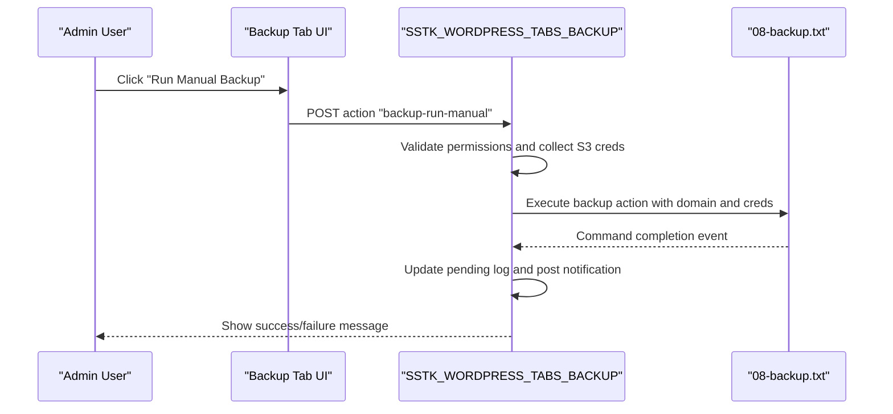
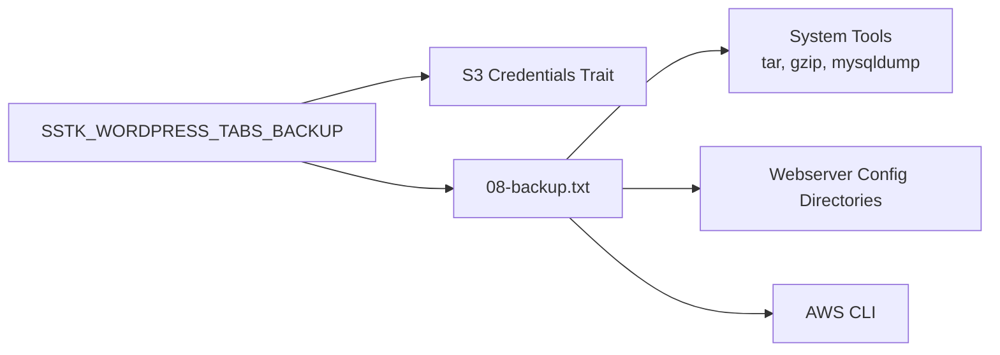

# Core Backup Operations

<cite>
**Referenced Files in This Document**
- [08-backup.txt](file://includes/core/apps/wordpress-app/scripts/v1/raw/08-backup.txt)
- [backup.php](file://includes/core/apps/wordpress-app/tabs/backup.php)
- [backup.php (trait)](file://includes/core/apps/wordpress-app/traits/traits-for-class-wordpress-app/backup.php)
</cite>

## Table of Contents
1. [Introduction](#introduction)
2. [Project Structure](#project-structure)
3. [Core Components](#core-components)
4. [Architecture Overview](#architecture-overview)
5. [Detailed Component Analysis](#detailed-component-analysis)
6. [Dependency Analysis](#dependency-analysis)
7. [Performance Considerations](#performance-considerations)
8. [Troubleshooting Guide](#troubleshooting-guide)
9. [Conclusion](#conclusion)

## Introduction
This document explains Simple Stack’s core backup operations for WordPress sites. It covers the complete backup workflow, including:
- File system snapshots of WordPress content
- Web server configuration backups for nginx and OpenLiteSpeed
- MySQL database exports
- Local storage structure under /root/.wp-backup/
- File naming conventions with timestamps
- Compression formats used (tar.gz and gzip)
- Manual backup execution via the admin UI
- Backup verification and integrity checks
- Database credential extraction from wp-config.php
- Error handling during backup operations

The implementation is primarily driven by a server-side bash script that performs the actual backup tasks, coordinated by a PHP tab class that exposes actions in the WordPress admin interface.

## Project Structure
The backup feature spans two main layers:
- PHP layer: Admin UI and command orchestration
  - Tab controller for backup actions
  - Trait providing S3 credentials resolution
- Bash layer: Server-side backup script
  - Performs file, config, and database backups
  - Handles scheduling, pruning, listing, and restoration flows

**Diagram sources**
- [backup.php:15-36](file://includes/core/apps/wordpress-app/tabs/backup.php#L15-L36)
- [backup.php:245-401](file://includes/core/apps/wordpress-app/tabs/backup.php#L245-L401)
- [backup.php (trait):21-71](file://includes/core/apps/wordpress-app/traits/traits-for-class-wordpress-app/backup.php#L21-L71)
- [08-backup.txt:118-199](file://includes/core/apps/wordpress-app/scripts/v1/raw/08-backup.txt#L118-L199)

**Section sources**
- [backup.php:15-36](file://includes/core/apps/wordpress-app/tabs/backup.php#L15-L36)
- [backup.php:245-401](file://includes/core/apps/wordpress-app/tabs/backup.php#L245-L401)
- [backup.php (trait):21-71](file://includes/core/apps/wordpress-app/traits/traits-for-class-wordpress-app/backup.php#L21-L71)
- [08-backup.txt:118-199](file://includes/core/apps/wordpress-app/scripts/v1/raw/08-backup.txt#L118-L199)

## Core Components
- Backup Tab Controller (PHP)
  - Exposes actions such as manual backup, schedule, refresh list, restore full/webserver/wpconfig-only, prune, and delete local backups.
  - Validates permissions, builds commands, and runs them asynchronously on the server.
- Backup Script (Bash)
  - Implements the actual backup logic: files, webserver configs, database dumps, verification, optional S3 upload, scheduling, pruning, listing, and restoration.
- S3 Credentials Trait (PHP)
  - Resolves AWS credentials and bucket settings per site or globally, returning both shell-safe and raw values.

Key responsibilities:
- PHP orchestrates user actions and passes parameters to the server script.
- Bash script executes the backup pipeline and manages local artifacts.
- Credentials are resolved securely and passed into the script context.

**Section sources**
- [backup.php:192-401](file://includes/core/apps/wordpress-app/tabs/backup.php#L192-L401)
- [08-backup.txt:118-199](file://includes/core/apps/wordpress-app/scripts/v1/raw/08-backup.txt#L118-L199)
- [backup.php (trait):21-71](file://includes/core/apps/wordpress-app/traits/traits-for-class-wordpress-app/backup.php#L21-L71)

## Architecture Overview
The backup flow integrates the WordPress admin UI, PHP controller, and server-side bash script. The PHP layer constructs a command and invokes it on the target server; the bash script then performs the backup steps and optionally uploads results to S3.

**Diagram sources**
- [backup.php:245-401](file://includes/core/apps/wordpress-app/tabs/backup.php#L245-L401)
- [backup.php (trait):21-71](file://includes/core/apps/wordpress-app/traits/traits-for-class-wordpress-app/backup.php#L21-L71)
- [08-backup.txt:118-199](file://includes/core/apps/wordpress-app/scripts/v1/raw/08-backup.txt#L118-L199)

## Detailed Component Analysis

### Backup Creation Workflow
The backup creation process captures three primary components:
- WordPress files: tar.gz archive of the site’s web root
- Web server configuration:
  - nginx: sites-enabled entries and htpasswd entries for the domain
  - OpenLiteSpeed: vhosts directory entries for the domain
- Database export: mysqldump piped through gzip

Storage and naming:
- Local storage path: /root/.wp-backup/<domain>/
- Naming convention includes timestamp: <domain>_<YYYY-MM-DD-HHhMMsss>_fs.tar.gz, <domain>_<timestamp>_<webserver_type>.tar.gz, <domain>_<timestamp>_db.gz

Compression formats:
- tar.gz for file and configuration archives
- gzip for database dumps (.gz)

Webserver-specific handling:
- nginx: backs up /etc/nginx sites-enabled and htpasswd entries
- OpenLiteSpeed/OpenLiteSpeed Enterprise: backs up /usr/local/lsws/conf/vhosts/<domain>/*

Database credential extraction:
- In scheduled/full backup paths, credentials are parsed directly from wp-config.php (DB_HOST, DB_USER, DB_PASSWORD, DB_NAME), with port parsing support.
- In interactive/manual backup paths, helper functions retrieve credentials using environment variables set by the platform.

Verification and integrity checking:
- After creating the database dump, the script verifies the last line contains a completion marker to ensure the dump completed successfully.

Optional S3 upload:
- If configured, the script uploads all three artifacts to an S3-compatible endpoint using provided credentials and region.

**Diagram sources**
- [08-backup.txt:137-199](file://includes/core/apps/wordpress-app/scripts/v1/raw/08-backup.txt#L137-L199)
- [08-backup.txt:456-526](file://includes/core/apps/wordpress-app/scripts/v1/raw/08-backup.txt#L456-L526)
- [08-backup.txt:630-701](file://includes/core/apps/wordpress-app/scripts/v1/raw/08-backup.txt#L630-L701)

**Section sources**
- [08-backup.txt:137-199](file://includes/core/apps/wordpress-app/scripts/v1/raw/08-backup.txt#L137-L199)
- [08-backup.txt:456-526](file://includes/core/apps/wordpress-app/scripts/v1/raw/08-backup.txt#L456-L526)
- [08-backup.txt:630-701](file://includes/core/apps/wordpress-app/scripts/v1/raw/08-backup.txt#L630-L701)

### Backup Storage Structure and Naming Conventions
- Directory layout:
  - /root/.wp-backup/<domain>/<files>
- File types:
  - <domain>_<YYYY-MM-DD-HHhMMsss>_fs.tar.gz
  - <domain>_<YYYY-MM-DD-HHhMMsss>_<webserver_type>.tar.gz
  - <domain>_<YYYY-MM-DD-HHhMMsss>_db.gz
- Compression:
  - tar.gz for file and configuration archives
  - gzip for database dumps

Retention and cleanup:
- Pruning removes local backups older than a specified number of days.
- Full deletion options exist for single-site or all-sites backups.

**Section sources**
- [08-backup.txt:137-199](file://includes/core/apps/wordpress-app/scripts/v1/raw/08-backup.txt#L137-L199)
- [08-backup.txt:801-841](file://includes/core/apps/wordpress-app/scripts/v1/raw/08-backup.txt#L801-L841)
- [08-backup.txt:844-887](file://includes/core/apps/wordpress-app/scripts/v1/raw/08-backup.txt#L844-L887)

### Webserver-Specific Backup Handling
- nginx:
  - Backs up site configuration files under /etc/nginx/sites-enabled matching the domain
  - Includes htpasswd entries for the domain
- OpenLiteSpeed/OpenLiteSpeed Enterprise:
  - Backs up virtual host configuration files under /usr/local/lsws/conf/vhosts/<domain>/*

Restoration paths also detect the webserver type and apply appropriate restore routines.

**Section sources**
- [08-backup.txt:150-163](file://includes/core/apps/wordpress-app/scripts/v1/raw/08-backup.txt#L150-L163)
- [08-backup.txt:468-478](file://includes/core/apps/wordpress-app/scripts/v1/raw/08-backup.txt#L468-L478)
- [08-backup.txt:643-653](file://includes/core/apps/wordpress-app/scripts/v1/raw/08-backup.txt#L643-L653)

### Database Credential Extraction from wp-config.php
In scheduled/full backup flows, the script extracts database credentials directly from wp-config.php:
- DB_HOST (with optional port parsing)
- DB_USER
- DB_PASSWORD
- DB_NAME

These values are used to run mysqldump and create the compressed database archive.

For interactive/manual backups, helper functions retrieve credentials via environment variables set by the platform.

**Section sources**
- [08-backup.txt:481-491](file://includes/core/apps/wordpress-app/scripts/v1/raw/08-backup.txt#L481-L491)
- [08-backup.txt:656-666](file://includes/core/apps/wordpress-app/scripts/v1/raw/08-backup.txt#L656-L666)
- [08-backup.txt:167-172](file://includes/core/apps/wordpress-app/scripts/v1/raw/08-backup.txt#L167-L172)

### Manual Backup Execution via Admin UI
The WordPress admin UI provides a “Run Manual Backup” button. When clicked:
- The PHP tab controller validates permissions and collects S3 credentials.
- It constructs a command invoking the server-side script with action=backup and domain.
- The command runs asynchronously on the server.
- Upon completion, the controller updates pending logs and posts notifications.

**Diagram sources**
- [backup.php:245-401](file://includes/core/apps/wordpress-app/tabs/backup.php#L245-L401)
- [backup.php:46-133](file://includes/core/apps/wordpress-app/tabs/backup.php#L46-L133)

**Section sources**
- [backup.php:245-401](file://includes/core/apps/wordpress-app/tabs/backup.php#L245-L401)
- [backup.php:46-133](file://includes/core/apps/wordpress-app/tabs/backup.php#L46-L133)

### Backup Verification and Integrity Checking
After creating the database dump, the script verifies its integrity by decompressing the archive and checking the last line for a completion marker. If missing, it logs a warning indicating potential corruption.

Additionally, when restoring, the script ensures the selected backup exists and prompts for confirmation before destructive operations.

**Section sources**
- [08-backup.txt:190-196](file://includes/core/apps/wordpress-app/scripts/v1/raw/08-backup.txt#L190-L196)
- [08-backup.txt:493-497](file://includes/core/apps/wordpress-app/scripts/v1/raw/08-backup.txt#L493-L497)
- [08-backup.txt:233-285](file://includes/core/apps/wordpress-app/scripts/v1/raw/08-backup.txt#L233-L285)

### Error Handling During Backup Operations
- Permission checks: The script requires root privileges to execute.
- Missing dependencies: Checks for common functions file existence.
- S3 configuration: Validates presence of access key, secret key, and bucket name; writes credentials to ~/.aws/credentials if needed.
- Database dump validation: Logs failure if the dump does not contain expected completion markers.
- Orphaned backup detection: Lists and optionally removes backups for domains no longer present in the webserver configuration.

**Section sources**
- [08-backup.txt:3-15](file://includes/core/apps/wordpress-app/scripts/v1/raw/08-backup.txt#L3-L15)
- [08-backup.txt:51-87](file://includes/core/apps/wordpress-app/scripts/v1/raw/08-backup.txt#L51-L87)
- [08-backup.txt:190-196](file://includes/core/apps/wordpress-app/scripts/v1/raw/08-backup.txt#L190-L196)
- [08-backup.txt:890-935](file://includes/core/apps/wordpress-app/scripts/v1/raw/08-backup.txt#L890-L935)

## Dependency Analysis
The backup system has clear separation between orchestration and execution:
- PHP controller depends on:
  - S3 credentials trait for resolving AWS settings
  - Asynchronous command runner to execute server scripts
- Bash script depends on:
  - System tools: tar, gzip, mysqldump, find, grep
  - Webserver configuration directories based on detected type
  - Optional AWS CLI for S3 uploads

**Diagram sources**
- [backup.php:245-401](file://includes/core/apps/wordpress-app/tabs/backup.php#L245-L401)
- [backup.php (trait):21-71](file://includes/core/apps/wordpress-app/traits/traits-for-class-wordpress-app/backup.php#L21-L71)
- [08-backup.txt:118-199](file://includes/core/apps/wordpress-app/scripts/v1/raw/08-backup.txt#L118-L199)

**Section sources**
- [backup.php:245-401](file://includes/core/apps/wordpress-app/tabs/backup.php#L245-L401)
- [backup.php (trait):21-71](file://includes/core/apps/wordpress-app/traits/traits-for-class-wordpress-app/backup.php#L21-L71)
- [08-backup.txt:118-199](file://includes/core/apps/wordpress-app/scripts/v1/raw/08-backup.txt#L118-L199)

## Performance Considerations
- Compression levels: Database dumps use maximum gzip compression (-9), which may increase CPU usage but reduces storage size.
- Large file systems: Archiving entire WordPress directories can be I/O intensive; consider excluding large non-essential directories if needed.
- S3 uploads: Network-bound operations; ensure adequate bandwidth and consider using compatible endpoints for faster transfers.
- Retention policies: Configure appropriate retention days to avoid excessive disk usage.

[No sources needed since this section provides general guidance]

## Troubleshooting Guide
Common issues and resolutions:
- Root privilege required: Ensure the script runs as root.
- Missing common functions: Install or locate the shared functions file referenced by the script.
- S3 credentials not configured: Provide access key, secret key, and bucket; verify region and endpoint.
- Database dump failed: Check MySQL connectivity and credentials; inspect logs for errors.
- Orphaned backups: Use listing and removal utilities to clean up backups for removed domains.

Operational tips:
- Refresh the backup list in the admin UI to ensure accurate selection for restores.
- Confirm overwrite behavior before performing destructive restore operations.
- Monitor command logs for detailed progress and error messages.

**Section sources**
- [08-backup.txt:3-15](file://includes/core/apps/wordpress-app/scripts/v1/raw/08-backup.txt#L3-L15)
- [08-backup.txt:51-87](file://includes/core/apps/wordpress-app/scripts/v1/raw/08-backup.txt#L51-L87)
- [08-backup.txt:190-196](file://includes/core/apps/wordpress-app/scripts/v1/raw/08-backup.txt#L190-L196)
- [08-backup.txt:890-935](file://includes/core/apps/wordpress-app/scripts/v1/raw/08-backup.txt#L890-L935)

## Conclusion
Simple Stack’s backup system provides a robust, multi-layered approach to backing up WordPress environments. The PHP admin interface offers intuitive controls, while the server-side bash script handles comprehensive file, configuration, and database backups with verification and optional cloud storage. Proper configuration of S3 credentials, awareness of webserver-specific behaviors, and adherence to retention policies ensure reliable and efficient backups.

[No sources needed since this section summarizes without analyzing specific files]