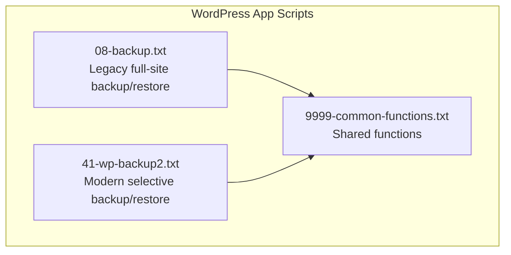
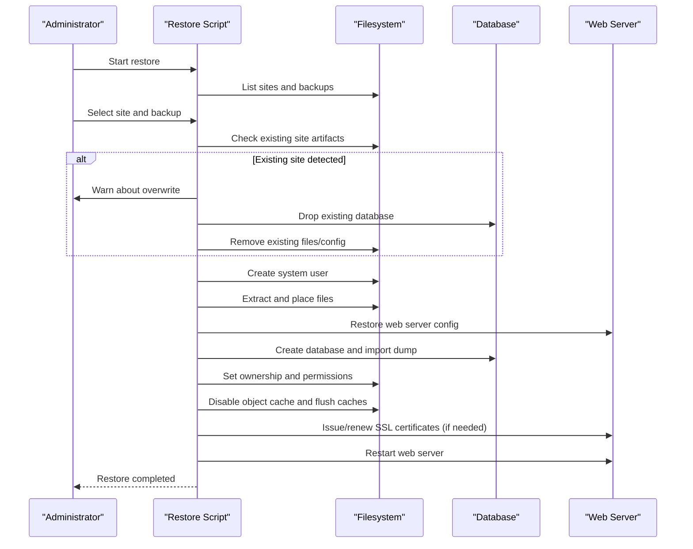
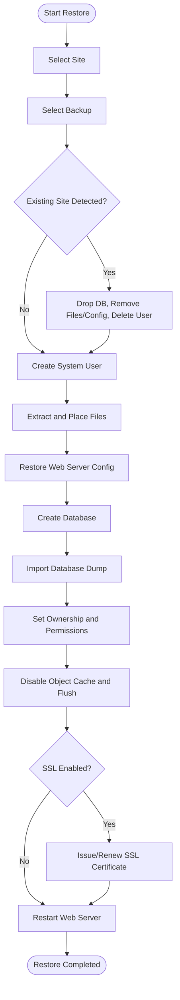
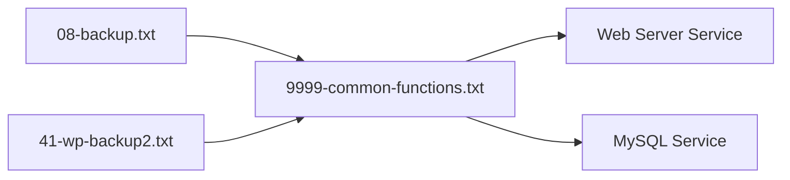

# Restore Procedures

<cite>
**Referenced Files in This Document**
- [08-backup.txt](file://includes/core/apps/wordpress-app/scripts/v1/raw/08-backup.txt)
- [41-wp-backup2.txt](file://includes/core/apps/wordpress-app/scripts/v1/raw/41-wp-backup2.txt)
- [9999-common-functions.txt](file://includes/core/apps/wordpress-app/scripts/v1/raw/9999-common-functions.txt)
</cite>

## Table of Contents
1. [Introduction](#introduction)
2. [Project Structure](#project-structure)
3. [Core Components](#core-components)
4. [Architecture Overview](#architecture-overview)
5. [Detailed Component Analysis](#detailed-component-analysis)
6. [Dependency Analysis](#dependency-analysis)
7. [Performance Considerations](#performance-considerations)
8. [Troubleshooting Guide](#troubleshooting-guide)
9. [Conclusion](#conclusion)

## Introduction
This document explains Simple Stack’s restore procedures for WordPress sites. It covers the complete restoration workflow, including site selection, backup validation, and step-by-step recovery. The restore sequence includes:
- User account recreation
- File system restoration
- Web server configuration recovery (Nginx or OpenLiteSpeed)
- Database recreation and import
- Permission management
- Object cache disabling to prevent conflicts
- Automatic SSL certificate handling during restore operations

It also documents conflict resolution when restoring to existing sites, selective restoration options, point-in-time recovery using timestamped backups, and post-restore cleanup procedures.

## Project Structure
Restore functionality is implemented as shell scripts under the WordPress app scripts directory. Two primary scripts provide restore capabilities:
- Legacy full-site restore script with interactive menus and S3 upload support
- Modern backup/restore script with selective components, incremental backups, and remote storage via Rclone

**Diagram sources**
- [08-backup.txt:1-20](file://includes/core/apps/wordpress-app/scripts/v1/raw/08-backup.txt#L1-L20)
- [41-wp-backup2.txt:1-20](file://includes/core/apps/wordpress-app/scripts/v1/raw/41-wp-backup2.txt#L1-L20)
- [9999-common-functions.txt:361-387](file://includes/core/apps/wordpress-app/scripts/v1/raw/9999-common-functions.txt#L361-L387)

**Section sources**
- [08-backup.txt:1-20](file://includes/core/apps/wordpress-app/scripts/v1/raw/08-backup.txt#L1-L20)
- [41-wp-backup2.txt:1-20](file://includes/core/apps/wordpress-app/scripts/v1/raw/41-wp-backup2.txt#L1-L20)

## Core Components
- Interactive site and backup selection
- Conflict detection and resolution for existing sites
- Selective component restoration (files, database, webserver config)
- Point-in-time recovery using timestamped backups
- Post-restore cleanup and service restarts
- Automatic SSL certificate reissuance where applicable

Key responsibilities:
- Site selection and backup listing
- Backup validation (e.g., database dump verification)
- System user creation and file permissions
- Web server configuration restoration
- Database drop/create/import
- Object cache disabling and cache flushes
- SSL certificate handling per web server type
- Restarting the web server after restore

**Section sources**
- [08-backup.txt:203-423](file://includes/core/apps/wordpress-app/scripts/v1/raw/08-backup.txt#L203-L423)
- [41-wp-backup2.txt:360-609](file://includes/core/apps/wordpress-app/scripts/v1/raw/41-wp-backup2.txt#L360-L609)

## Architecture Overview
The restore process follows a consistent flow across both scripts:
1. Validate prerequisites and load shared functions
2. Prompt for site selection and backup selection
3. Detect conflicts if the site already exists
4. Perform selective or full restoration steps
5. Handle SSL certificates automatically based on web server type
6. Clean up caches and restart services

**Diagram sources**
- [08-backup.txt:203-423](file://includes/core/apps/wordpress-app/scripts/v1/raw/08-backup.txt#L203-L423)
- [41-wp-backup2.txt:360-609](file://includes/core/apps/wordpress-app/scripts/v1/raw/41-wp-backup2.txt#L360-L609)
- [9999-common-functions.txt:361-387](file://includes/core/apps/wordpress-app/scripts/v1/raw/9999-common-functions.txt#L361-L387)

## Detailed Component Analysis

### Site Selection and Backup Validation
- Both scripts present an interactive menu to select a site and then a specific backup.
- Backups are organized by domain and timestamp; labels can be included for clarity.
- Database backup integrity is validated by checking the last line of the gzipped dump for a completion marker.

Operational highlights:
- Site listing and numbering
- Backup listing with indicators for files, database, and webserver config availability
- Optional label display for human-readable identification
- Database dump verification before proceeding

**Section sources**
- [08-backup.txt:21-49](file://includes/core/apps/wordpress-app/scripts/v1/raw/08-backup.txt#L21-L49)
- [08-backup.txt:190-196](file://includes/core/apps/wordpress-app/scripts/v1/raw/08-backup.txt#L190-L196)
- [41-wp-backup2.txt:19-50](file://includes/core/apps/wordpress-app/scripts/v1/raw/41-wp-backup2.txt#L19-L50)
- [41-wp-backup2.txt:294-299](file://includes/core/apps/wordpress-app/scripts/v1/raw/41-wp-backup2.txt#L294-L299)

### Conflict Resolution When Restoring to Existing Sites
When the target site already exists, the scripts detect pre-existing artifacts such as:
- Site directory under /var/www
- Web server site configurations
- PHP pool configuration files
- OpenLiteSpeed virtual host directories

Resolution steps:
- Prompt the administrator to confirm overwrite unless bypassed via environment variable
- Drop the existing database and remove associated MySQL user privileges
- Remove existing site files and web server configuration entries
- Delete the existing system user before recreating it

**Section sources**
- [08-backup.txt:233-285](file://includes/core/apps/wordpress-app/scripts/v1/raw/08-backup.txt#L233-L285)
- [41-wp-backup2.txt:392-406](file://includes/core/apps/wordpress-app/scripts/v1/raw/41-wp-backup2.txt#L392-L406)

### Step-by-Step Recovery Process

#### User Account Recreation
- Derives a system username from the domain name (first 32 characters).
- Creates a new system user with home directory set to the site’s HTML path and group www-data.

**Section sources**
- [08-backup.txt:287-290](file://includes/core/apps/wordpress-app/scripts/v1/raw/08-backup.txt#L287-L290)
- [41-wp-backup2.txt:408-410](file://includes/core/apps/wordpress-app/scripts/v1/raw/41-wp-backup2.txt#L408-L410)

#### File System Restoration
- Extracts the filesystem backup into a temporary location and moves it to /var/www/domain.
- Sets ownership recursively to the created user and www-data group.
- Applies group write and setgid bits to ensure proper access patterns.

**Section sources**
- [08-backup.txt:294-340](file://includes/core/apps/wordpress-app/scripts/v1/raw/08-backup.txt#L294-L340)
- [41-wp-backup2.txt:427-449](file://includes/core/apps/wordpress-app/scripts/v1/raw/41-wp-backup2.txt#L427-L449)

#### Web Server Configuration Recovery
- Extracts the web server configuration archive and applies site-specific restoration routines.
- For Nginx, uses a helper function to restore site configuration.
- For OpenLiteSpeed, uses a helper function to restore virtual host configuration and optionally restores .htaccess.

**Section sources**
- [08-backup.txt:298-310](file://includes/core/apps/wordpress-app/scripts/v1/raw/08-backup.txt#L298-L310)
- [08-backup.txt:983-1001](file://includes/core/apps/wordpress-app/scripts/v1/raw/08-backup.txt#L983-L1001)
- [41-wp-backup2.txt:482-494](file://includes/core/apps/wordpress-app/scripts/v1/raw/41-wp-backup2.txt#L482-L494)

#### Database Recreation and Import
- Retrieves database credentials and connection details from site metadata helpers.
- Drops the existing database (if any), removes associated user privileges, and creates a fresh database.
- Imports the gzipped SQL dump into the newly created database.

**Section sources**
- [08-backup.txt:315-334](file://includes/core/apps/wordpress-app/scripts/v1/raw/08-backup.txt#L315-L334)
- [41-wp-backup2.txt:558-603](file://includes/core/apps/wordpress-app/scripts/v1/raw/41-wp-backup2.txt#L558-L603)

#### Permission Management
- Ensures correct ownership and group permissions for the site’s HTML directory.
- Applies group write and setgid flags to maintain consistent access control.

**Section sources**
- [08-backup.txt:336-340](file://includes/core/apps/wordpress-app/scripts/v1/raw/08-backup.txt#L336-L340)
- [41-wp-backup2.txt:444-449](file://includes/core/apps/wordpress-app/scripts/v1/raw/41-wp-backup2.txt#L444-L449)

### Selective Restoration Options
The modern backup/restore script supports selective restoration:
- files: Restore only the filesystem
- database: Restore only the database (requires files to be present)
- webserver: Restore only web server configuration

Behavior:
- If restoring only the database without files, the script aborts with an error message.
- If restoring webserver configuration, it cleans up existing site configuration and recreates the system user before applying restored settings.

**Section sources**
- [41-wp-backup2.txt:378-390](file://includes/core/apps/wordpress-app/scripts/v1/raw/41-wp-backup2.txt#L378-L390)
- [41-wp-backup2.txt:466-496](file://includes/core/apps/wordpress-app/scripts/v1/raw/41-wp-backup2.txt#L466-L496)
- [41-wp-backup2.txt:558-567](file://includes/core/apps/wordpress-app/scripts/v1/raw/41-wp-backup2.txt#L558-L567)

### Point-in-Time Recovery Using Timestamped Backups
Backups are named with timestamps, enabling precise selection of a desired restore point:
- Full backups include files, database, and webserver configuration archives.
- Incremental backups use an incremental ID and restore point to reconstruct state up to a specific timestamp.

Operational notes:
- Listing backups shows available components and optional labels.
- Selecting a backup by number allows choosing exact points in time.

**Section sources**
- [08-backup.txt:21-49](file://includes/core/apps/wordpress-app/scripts/v1/raw/08-backup.txt#L21-L49)
- [41-wp-backup2.txt:19-50](file://includes/core/apps/wordpress-app/scripts/v1/raw/41-wp-backup2.txt#L19-L50)
- [41-wp-backup2.txt:431-442](file://includes/core/apps/wordpress-app/scripts/v1/raw/41-wp-backup2.txt#L431-L442)

### Post-Restore Cleanup Procedures
After restoration:
- Removes any object cache plugin file to avoid conflicts.
- Disables LiteSpeed object cache option when applicable.
- Uninstalls/deactivates Redis cache plugin and flushes caches multiple times to clear stale data.
- Restarts the web server to apply changes.

**Section sources**
- [08-backup.txt:342-355](file://includes/core/apps/wordpress-app/scripts/v1/raw/08-backup.txt#L342-L355)
- [41-wp-backup2.txt:451-463](file://includes/core/apps/wordpress-app/scripts/v1/raw/41-wp-backup2.txt#L451-L463)
- [9999-common-functions.txt:361-387](file://includes/core/apps/wordpress-app/scripts/v1/raw/9999-common-functions.txt#L361-L387)

### Webserver-Specific Restoration Steps

#### Nginx
- Uses helper functions to remove and restore site configuration.
- Automatically issues or reissues SSL certificates when HTTPS was enabled:
  - Prepares configuration for Certbot by temporarily adjusting directives.
  - Runs Certbot with reinstall/expand flags and redirects.
  - Handles wildcard multisite scenarios by disabling HTTPS and providing guidance.

**Section sources**
- [08-backup.txt:304-310](file://includes/core/apps/wordpress-app/scripts/v1/raw/08-backup.txt#L304-L310)
- [08-backup.txt:357-409](file://includes/core/apps/wordpress-app/scripts/v1/raw/08-backup.txt#L357-L409)
- [41-wp-backup2.txt:488-494](file://includes/core/apps/wordpress-app/scripts/v1/raw/41-wp-backup2.txt#L488-L494)
- [41-wp-backup2.txt:498-549](file://includes/core/apps/wordpress-app/scripts/v1/raw/41-wp-backup2.txt#L498-L549)

#### OpenLiteSpeed (OLS)
- Uses helper functions to remove and restore virtual host configuration.
- Optionally restores .htaccess when performing full restore.
- Automatically handles HTTPS:
  - Removes existing HTTPS redirects.
  - Enables Certbot integration for OLS and re-enables HTTPS redirects upon success.

**Section sources**
- [08-backup.txt:307-310](file://includes/core/apps/wordpress-app/scripts/v1/raw/08-backup.txt#L307-L310)
- [08-backup.txt:410-416](file://includes/core/apps/wordpress-app/scripts/v1/raw/08-backup.txt#L410-L416)
- [08-backup.txt:994-1001](file://includes/core/apps/wordpress-app/scripts/v1/raw/08-backup.txt#L994-L1001)
- [41-wp-backup2.txt:491-494](file://includes/core/apps/wordpress-app/scripts/v1/raw/41-wp-backup2.txt#L491-L494)
- [41-wp-backup2.txt:550-554](file://includes/core/apps/wordpress-app/scripts/v1/raw/41-wp-backup2.txt#L550-L554)

### Automatic SSL Certificate Handling During Restore Operations
- For Nginx, Certbot is invoked with non-interactive flags, reinstall/expand options, and redirect rules.
- For wildcard multisites, HTTPS may be disabled and instructions provided to configure later.
- For OpenLiteSpeed, helper functions manage HTTPS redirects and Certbot integration.

**Section sources**
- [08-backup.txt:357-416](file://includes/core/apps/wordpress-app/scripts/v1/raw/08-backup.txt#L357-L416)
- [41-wp-backup2.txt:498-554](file://includes/core/apps/wordpress-app/scripts/v1/raw/41-wp-backup2.txt#L498-L554)

### Examples of Selective Restoration Options
- Restore files only: Useful when moving content to a new server with existing web server configuration.
- Restore database only: Requires files to be present; otherwise, the operation aborts.
- Restore webserver configuration only: Reapplies site configuration and ensures proper user setup.

**Section sources**
- [41-wp-backup2.txt:378-390](file://includes/core/apps/wordpress-app/scripts/v1/raw/41-wp-backup2.txt#L378-L390)
- [41-wp-backup2.txt:466-496](file://includes/core/apps/wordpress-app/scripts/v1/raw/41-wp-backup2.txt#L466-L496)
- [41-wp-backup2.txt:558-567](file://includes/core/apps/wordpress-app/scripts/v1/raw/41-wp-backup2.txt#L558-L567)

### Flowchart of Restore Logic

**Diagram sources**
- [08-backup.txt:203-423](file://includes/core/apps/wordpress-app/scripts/v1/raw/08-backup.txt#L203-L423)
- [41-wp-backup2.txt:360-609](file://includes/core/apps/wordpress-app/scripts/v1/raw/41-wp-backup2.txt#L360-L609)

## Dependency Analysis
The restore scripts depend on shared functions for common tasks:
- Restarting the appropriate web server (Nginx or OpenLiteSpeed)
- Helper functions for removing/restoring site configurations
- Database credential retrieval and database creation utilities

**Diagram sources**
- [08-backup.txt:1-20](file://includes/core/apps/wordpress-app/scripts/v1/raw/08-backup.txt#L1-L20)
- [41-wp-backup2.txt:1-20](file://includes/core/apps/wordpress-app/scripts/v1/raw/41-wp-backup2.txt#L1-L20)
- [9999-common-functions.txt:361-387](file://includes/core/apps/wordpress-app/scripts/v1/raw/9999-common-functions.txt#L361-L387)

**Section sources**
- [9999-common-functions.txt:361-387](file://includes/core/apps/wordpress-app/scripts/v1/raw/9999-common-functions.txt#L361-L387)

## Performance Considerations
- Avoid unnecessary cache operations: Multiple cache flushes are performed to ensure clean state but may add overhead.
- Prefer selective restoration when possible to reduce I/O and processing time.
- Use incremental backups for large sites to minimize restore duration and bandwidth usage.

[No sources needed since this section provides general guidance]

## Troubleshooting Guide
Common issues and resolutions:
- Database corruption warning: If the database dump verification fails, inspect the backup integrity and retry.
- Missing wp-config.php when restoring database only: Ensure files are restored first; otherwise, the script aborts.
- SSL certificate failures: Verify DNS and web server configuration; Certbot requires valid HTTP challenge paths.
- Permission errors: Confirm that ownership and group permissions are correctly applied to the site’s HTML directory.
- Web server not restarting: Check service status and logs; ensure helper functions are available and executable.

**Section sources**
- [08-backup.txt:190-196](file://includes/core/apps/wordpress-app/scripts/v1/raw/08-backup.txt#L190-L196)
- [41-wp-backup2.txt:558-567](file://includes/core/apps/wordpress-app/scripts/v1/raw/41-wp-backup2.txt#L558-L567)
- [08-backup.txt:357-416](file://includes/core/apps/wordpress-app/scripts/v1/raw/08-backup.txt#L357-L416)
- [41-wp-backup2.txt:498-554](file://includes/core/apps/wordpress-app/scripts/v1/raw/41-wp-backup2.txt#L498-L554)

## Conclusion
Simple Stack’s restore procedures provide robust, automated workflows for recovering WordPress sites. They handle user account recreation, filesystem restoration, web server configuration recovery, database recreation and import, permission management, object cache disabling, and automatic SSL certificate handling. With selective restoration options and timestamped backups, administrators can perform precise point-in-time recoveries while minimizing conflicts and downtime.

[No sources needed since this section summarizes without analyzing specific files]