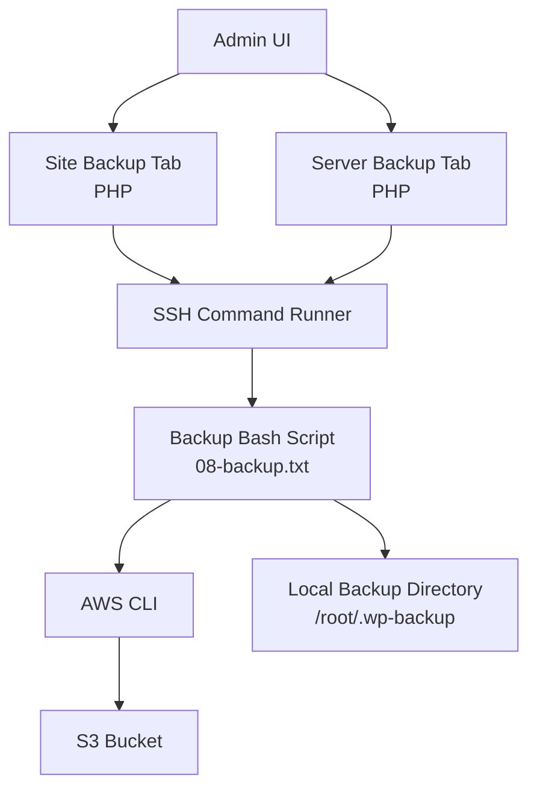
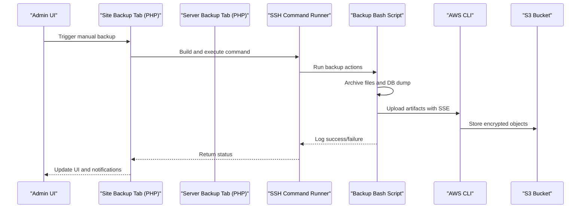
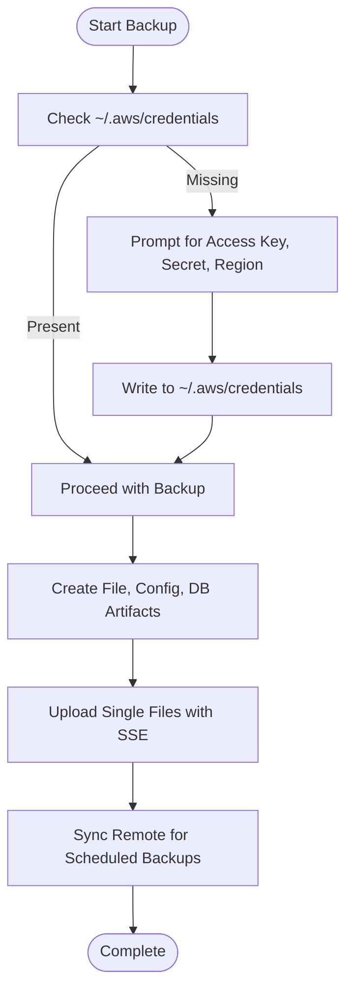
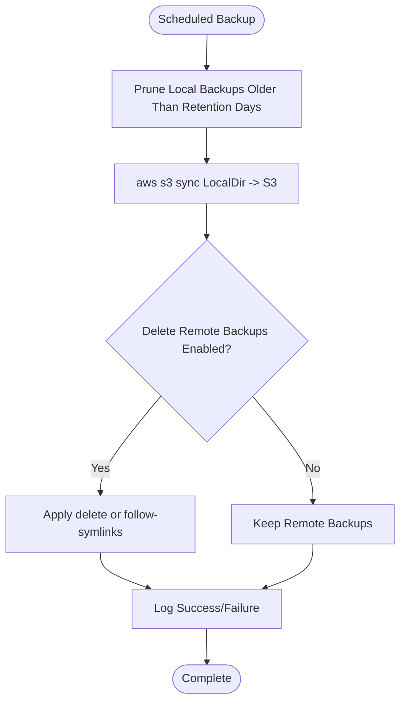
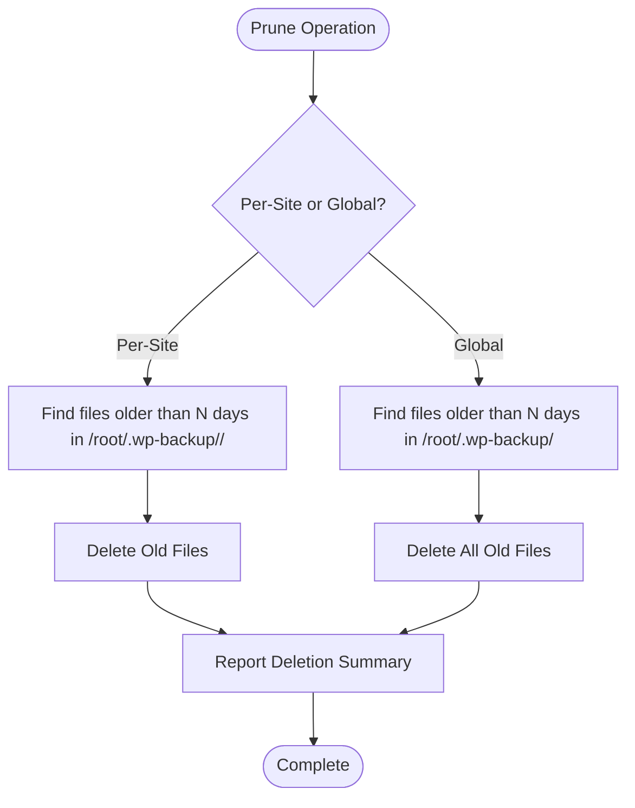
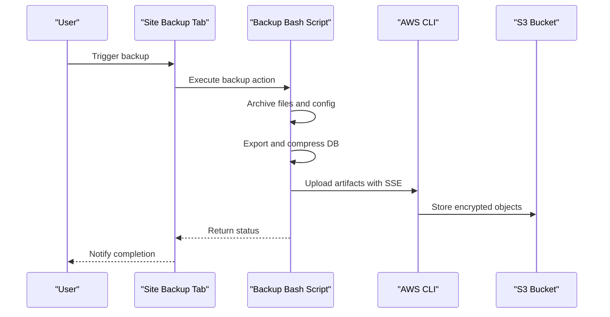
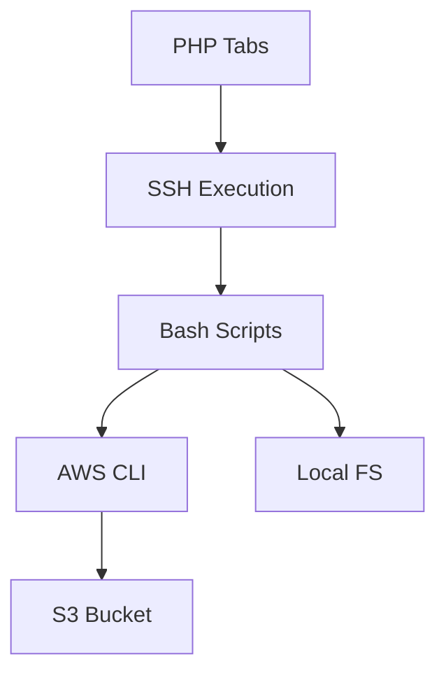

# Storage Management & Remote Backups

<cite>
**Referenced Files in This Document**   
- [08-backup.txt](file://includes/core/apps/wordpress-app/scripts/v1/raw/08-backup.txt)
- [backup.php (site tab)](file://includes/core/apps/wordpress-app/tabs/backup.php)
- [backup.php (server tab)](file://includes/core/apps/wordpress-app/tabs-server/backup.php)
- [backup_restore.txt](file://includes/core/apps/wordpress-app/scripts/v1/backup_restore.txt)
- [backup_restore_schedule.txt](file://includes/core/apps/wordpress-app/scripts/v1/backup_restore_schedule.txt)
- [backup_restore_delete_and_prune.txt](file://includes/core/apps/wordpress-app/scripts/v1/backup_restore_delete_and_prune.txt)
- [backup_restore_save_credentials.txt](file://includes/core/apps/wordpress-app/scripts/v1/backup_restore_save_credentials.txt)
- [environment variables.txt](file://includes/core/apps/wordpress-app/scripts/v1/raw/environment%20variables.txt)
</cite>

## Table of Contents
1. [Introduction](#introduction)
2. [Project Structure](#project-structure)
3. [Core Components](#core-components)
4. [Architecture Overview](#architecture-overview)
5. [Detailed Component Analysis](#detailed-component-analysis)
6. [Dependency Analysis](#dependency-analysis)
7. [Performance Considerations](#performance-considerations)
8. [Troubleshooting Guide](#troubleshooting-guide)
9. [Conclusion](#conclusion)
10. [Appendices](#appendices)

## Introduction
This document explains SimpleStack’s storage management and remote backup capabilities for WordPress sites. It covers:

- AWS S3 integration, including credential configuration, bucket requirements, secure uploads with server-side encryption, and S3-compatible endpoints.
- Local backup organization, retention pruning, and disk space optimization.
- Backup lifecycle from creation to archival, scheduling, and restoration.
- Security considerations for credentials, permissions, and encryption.
- Monitoring guidance for local and remote storage usage.

The implementation is primarily driven by PHP tabs that orchestrate SSH execution of Bash scripts on the target server. The core backup logic lives in a Bash script that uses the AWS CLI to upload or sync backups to an S3 bucket.

## Project Structure
The relevant codebase for storage and backups spans:

- **PHP tabs**: Provide UI, validation, credential handling, and command orchestration.
- **Bash orchestrator scripts**: Execute backup, restore, schedule, prune, and credential operations on the server.
- **AWS CLI usage**: Performs secure uploads and incremental syncs to S3 or S3-compatible services.

**Diagram sources**
- [backup.php (site tab):245-401](file://includes/core/apps/wordpress-app/tabs/backup.php#L245-L401)
- [backup.php (server tab):697-800](file://includes/core/apps/wordpress-app/tabs-server/backup.php#L697-L800)
- [08-backup.txt:118-199](file://includes/core/apps/wordpress-app/scripts/v1/raw/08-backup.txt#L118-L199)

**Section sources**
- [backup.php (site tab):1-133](file://includes/core/apps/wordpress-app/tabs/backup.php#L1-L133)
- [backup.php (server tab):1-136](file://includes/core/apps/wordpress-app/tabs-server/backup.php#L1-L136)
- [08-backup.txt:1-117](file://includes/core/apps/wordpress-app/scripts/v1/raw/08-backup.txt#L1-L117)

## Core Components
- **Site Backup Tab**: Manages per-site manual backups, scheduled backups, restore options, and local backup pruning.
- **Server Backup Tab**: Manages server-wide automatic backups, S3 credential persistence, and bulk operations across all sites.
- **Backup Bash Script**: Implements backup creation, database export, file archiving, S3 upload/sync, retention pruning, and restore flows.
- **AWS CLI Integration**: Uses `aws s3 cp` for single-file uploads with server-side encryption and `aws s3 sync` for incremental updates.

Key responsibilities:
- Credential resolution and persistence.
- Secure upload with server-side encryption.
- Incremental synchronization to remote storage.
- Local retention policy enforcement.
- Restore workflows for full site, web server config, and wp-config.php.

**Section sources**
- [backup.php (site tab):245-401](file://includes/core/apps/wordpress-app/tabs/backup.php#L245-L401)
- [backup.php (server tab):697-800](file://includes/core/apps/wordpress-app/tabs-server/backup.php#L697-L800)
- [08-backup.txt:118-199](file://includes/core/apps/wordpress-app/scripts/v1/raw/08-backup.txt#L118-L199)

## Architecture Overview
The backup flow combines PHP orchestration with server-side Bash execution and AWS CLI operations.

**Diagram sources**
- [backup.php (site tab):245-401](file://includes/core/apps/wordpress-app/tabs/backup.php#L245-L401)
- [08-backup.txt:118-199](file://includes/core/apps/wordpress-app/scripts/v1/raw/08-backup.txt#L118-L199)

## Detailed Component Analysis

### AWS S3 Integration and Credentials
- **Credential Configuration**:
  - Interactive setup prompts for Access Key ID, Secret Access Key, and default region when credentials are missing.
  - Writes credentials to `~/.aws/credentials` under the `[default]` profile.
  - Supports environment variable injection via orchestrator scripts for non-interactive runs.
- **Bucket Requirements**:
  - Buckets must be pre-created before running backups.
  - Region should match the configured AWS region.
- **Secure Uploads**:
  - Uses `aws s3 cp` with server-side encryption (`--sse`) for individual artifact uploads.
  - Uses `aws s3 sync` for incremental updates during scheduled backups.
- **S3-Compatible Services**:
  - Optional endpoint URL parameter enables alternative S3-compatible providers.
  - Endpoint is passed via `--endpoint-url` when provided.

**Diagram sources**
- [08-backup.txt:51-87](file://includes/core/apps/wordpress-app/scripts/v1/raw/08-backup.txt#L51-L87)
- [08-backup.txt:118-199](file://includes/core/apps/wordpress-app/scripts/v1/raw/08-backup.txt#L118-L199)
- [08-backup.txt:499-525](file://includes/core/apps/wordpress-app/scripts/v1/raw/08-backup.txt#L499-L525)

**Section sources**
- [08-backup.txt:51-87](file://includes/core/apps/wordpress-app/scripts/v1/raw/08-backup.txt#L51-L87)
- [08-backup.txt:118-199](file://includes/core/apps/wordpress-app/scripts/v1/raw/08-backup.txt#L118-L199)
- [backup_restore_save_credentials.txt:5](file://includes/core/apps/wordpress-app/scripts/v1/backup_restore_save_credentials.txt#L5)

### S3-Compatible Service Support and Bandwidth Throttling
- **Custom Endpoints**:
  - The optional `s3_endpoint` parameter allows using S3-compatible services.
  - Passed through orchestrator scripts and appended to AWS CLI commands as `--endpoint-url`.
- **Bandwidth Throttling**:
  - No explicit bandwidth throttling flags are present in the backup scripts.
  - Performance tuning would require external AWS CLI configuration or custom wrappers not present in this repository.

**Section sources**
- [08-backup.txt:175-188](file://includes/core/apps/wordpress-app/scripts/v1/raw/08-backup.txt#L175-L188)
- [08-backup.txt:507-515](file://includes/core/apps/wordpress-app/scripts/v1/raw/08-backup.txt#L507-L515)
- [backup_restore_schedule.txt:5](file://includes/core/apps/wordpress-app/scripts/v1/backup_restore_schedule.txt#L5)

### Sync Strategies and Incremental Updates
- **Incremental Sync**:
  - Scheduled backups use `aws s3 sync` to synchronize local backup directories to the remote bucket.
  - Supports deletion strategies via `s3_sync_delete_parm`, which can be set to `delete` or `follow-symlinks`.
- **Retention Policy**:
  - Local retention days control pruning of old local backups.
  - Optional remote deletion can mirror local pruning if enabled.

**Diagram sources**
- [08-backup.txt:499-525](file://includes/core/apps/wordpress-app/scripts/v1/raw/08-backup.txt#L499-L525)
- [08-backup.txt:673-690](file://includes/core/apps/wordpress-app/scripts/v1/raw/08-backup.txt#L673-L690)

**Section sources**
- [08-backup.txt:499-525](file://includes/core/apps/wordpress-app/scripts/v1/raw/08-backup.txt#L499-L525)
- [08-backup.txt:673-690](file://includes/core/apps/wordpress-app/scripts/v1/raw/08-backup.txt#L673-L690)

### Local Backup Management
- **Directory Structure**:
  - Local backups are stored under `/root/.wp-backup/<domain>/`.
  - Each domain has its own subdirectory containing file archives, configuration archives, and database dumps.
- **File Pruning**:
  - Pruning removes local files older than the specified retention days.
  - Supports per-site and global pruning operations.
- **Disk Space Optimization**:
  - Setting retention days to `-1` disables local retention entirely after syncing to remote storage.
  - Manual deletion operations remove entire domain backup directories.

**Diagram sources**
- [08-backup.txt:801-840](file://includes/core/apps/wordpress-app/scripts/v1/raw/08-backup.txt#L801-L840)

**Section sources**
- [08-backup.txt:801-840](file://includes/core/apps/wordpress-app/scripts/v1/raw/08-backup.txt#L801-L840)

### Backup Lifecycle Management
- **Creation**:
  - Archives website files and web server configuration.
  - Exports database using `mysqldump` and compresses it.
- **Archival**:
  - Uploads artifacts to S3 with server-side encryption.
  - Syncs local directory to remote bucket for scheduled backups.
- **Restoration**:
  - Full restore includes files, configuration, and database.
  - Partial restores support web server configuration only or wp-config.php only.

**Diagram sources**
- [08-backup.txt:118-199](file://includes/core/apps/wordpress-app/scripts/v1/raw/08-backup.txt#L118-L199)
- [backup_restore.txt:6](file://includes/core/apps/wordpress-app/scripts/v1/backup_restore.txt#L6)

**Section sources**
- [08-backup.txt:118-199](file://includes/core/apps/wordpress-app/scripts/v1/raw/08-backup.txt#L118-L199)
- [backup_restore.txt:6](file://includes/core/apps/wordpress-app/scripts/v1/backup_restore.txt#L6)

### Security Considerations
- **Credential Storage**:
  - Credentials are written to `~/.aws/credentials` on the server.
  - PHP side stores sensitive values encrypted in post meta; decrypted only when needed.
- **Access Permissions**:
  - Scripts run as root on the server; ensure least-privilege principles for AWS IAM policies.
- **Encryption Options**:
  - Server-side encryption is enabled for S3 uploads via `--sse`.
  - For enhanced security, consider enabling S3 bucket-level encryption and restricting access via IAM policies.

**Section sources**
- [08-backup.txt:51-87](file://includes/core/apps/wordpress-app/scripts/v1/raw/08-backup.txt#L51-L87)
- [backup.php (server tab):773-790](file://includes/core/apps/wordpress-app/tabs-server/backup.php#L773-L790)

## Dependency Analysis
The backup system depends on:

- **PHP Tabs**: Validate inputs, resolve credentials, and construct commands.
- **SSH Execution**: Runs commands on the target server.
- **Bash Scripts**: Implement backup logic, interact with AWS CLI, and manage local files.
- **AWS CLI**: Handles S3 uploads and sync operations.
- **S3 Bucket**: Stores encrypted backups and supports incremental sync.

**Diagram sources**
- [backup.php (site tab):245-401](file://includes/core/apps/wordpress-app/tabs/backup.php#L245-L401)
- [backup.php (server tab):697-800](file://includes/core/apps/wordpress-app/tabs-server/backup.php#L697-L800)
- [08-backup.txt:118-199](file://includes/core/apps/wordpress-app/scripts/v1/raw/08-backup.txt#L118-L199)

**Section sources**
- [backup.php (site tab):245-401](file://includes/core/apps/wordpress-app/tabs/backup.php#L245-L401)
- [backup.php (server tab):697-800](file://includes/core/apps/wordpress-app/tabs-server/backup.php#L697-L800)
- [08-backup.txt:118-199](file://includes/core/apps/wordpress-app/scripts/v1/raw/08-backup.txt#L118-L199)

## Performance Considerations
- **Upload Strategy**:
  - Single-file uploads with `aws s3 cp` for immediate artifacts.
  - Incremental sync with `aws s3 sync` for scheduled backups.
- **Bandwidth Throttling**:
  - Not implemented in the current scripts; consider external AWS CLI configuration if needed.
- **Compression**:
  - Database dumps are compressed with gzip.
  - File and configuration archives are tar.gz.
- **Concurrency**:
  - No parallel upload concurrency is configured; performance may depend on network conditions and AWS CLI defaults.

[No sources needed since this section provides general guidance]

## Troubleshooting Guide
- **Credential Issues**:
  - Verify `~/.aws/credentials` exists and contains valid keys and region.
  - Ensure environment variables are correctly passed via orchestrator scripts.
- **S3 Connectivity**:
  - Confirm bucket name and region match the configured credentials.
  - For S3-compatible services, verify endpoint URL is correct and accessible.
- **Backup Failures**:
  - Check logs for errors during archive creation, database export, or S3 upload.
  - Validate database connectivity and credentials used for `mysqldump`.
- **Retention and Pruning**:
  - Review retention days settings and ensure pruning operations are executed as expected.
  - Monitor local disk usage under `/root/.wp-backup/`.

**Section sources**
- [08-backup.txt:51-87](file://includes/core/apps/wordpress-app/scripts/v1/raw/08-backup.txt#L51-L87)
- [08-backup.txt:118-199](file://includes/core/apps/wordpress-app/scripts/v1/raw/08-backup.txt#L118-L199)
- [environment variables.txt:110-146](file://includes/core/apps/wordpress-app/scripts/v1/raw/environment%20variables.txt#L110-L146)

## Conclusion
SimpleStack’s storage management integrates AWS S3 and S3-compatible services with robust local backup management. The system supports secure uploads with server-side encryption, incremental synchronization, and configurable retention policies. Administrators can manage credentials interactively or via environment variables, monitor backup lifecycles, and optimize disk usage through pruning. Security is addressed through encrypted credential storage and server-side encryption for remote backups.

[No sources needed since this section summarizes without analyzing specific files]

## Appendices

### Example: Configuring AWS Credentials Interactively
- When credentials are missing, the script prompts for Access Key ID, Secret Access Key, and default region.
- Values are written to `~/.aws/credentials` under the `[default]` profile.

**Section sources**
- [08-backup.txt:51-87](file://includes/core/apps/wordpress-app/scripts/v1/raw/08-backup.txt#L51-L87)

### Example: Managing Backup Lifecycle
- **Creation**: Archive files, configuration, and database; upload to S3 with encryption.
- **Archival**: Sync local backups to remote bucket for scheduled jobs.
- **Restoration**: Full or partial restore options available via UI.

**Section sources**
- [08-backup.txt:118-199](file://includes/core/apps/wordpress-app/scripts/v1/raw/08-backup.txt#L118-L199)
- [backup_restore.txt:6](file://includes/core/apps/wordpress-app/scripts/v1/backup_restore.txt#L6)

### Example: Monitoring Storage Usage
- **Local**: Inspect `/root/.wp-backup/` for backup sizes and retention compliance.
- **Remote**: Use S3 console or CLI to review bucket contents and object counts.

[No sources needed since this section provides general guidance]