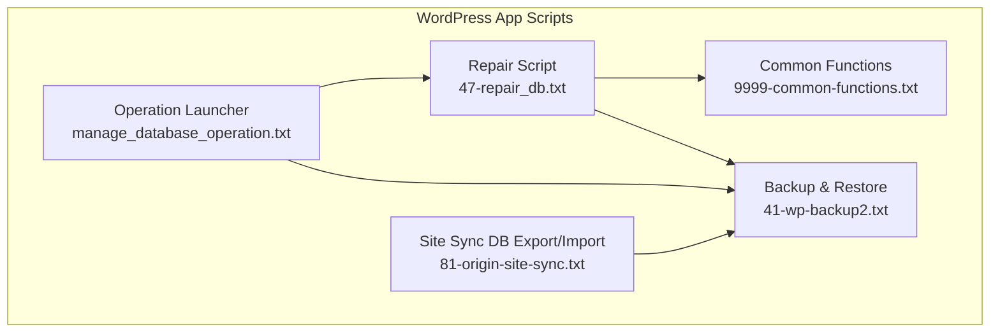
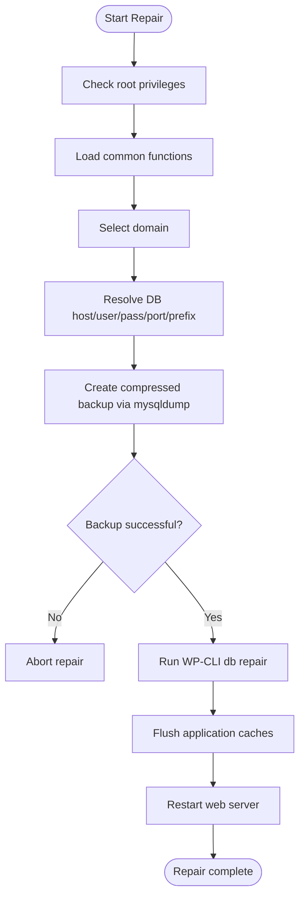
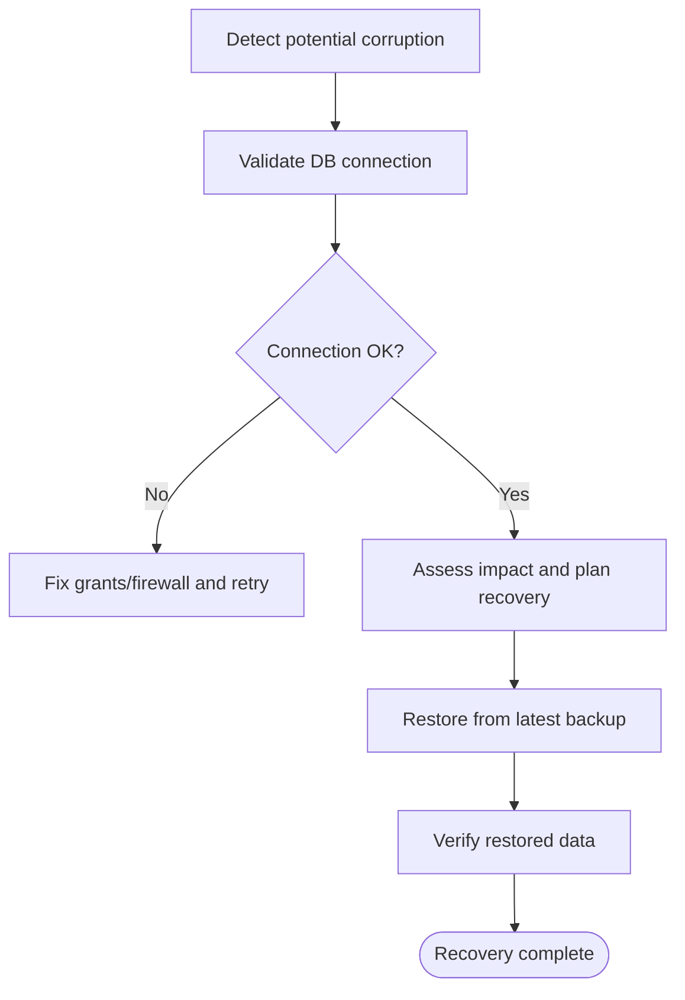
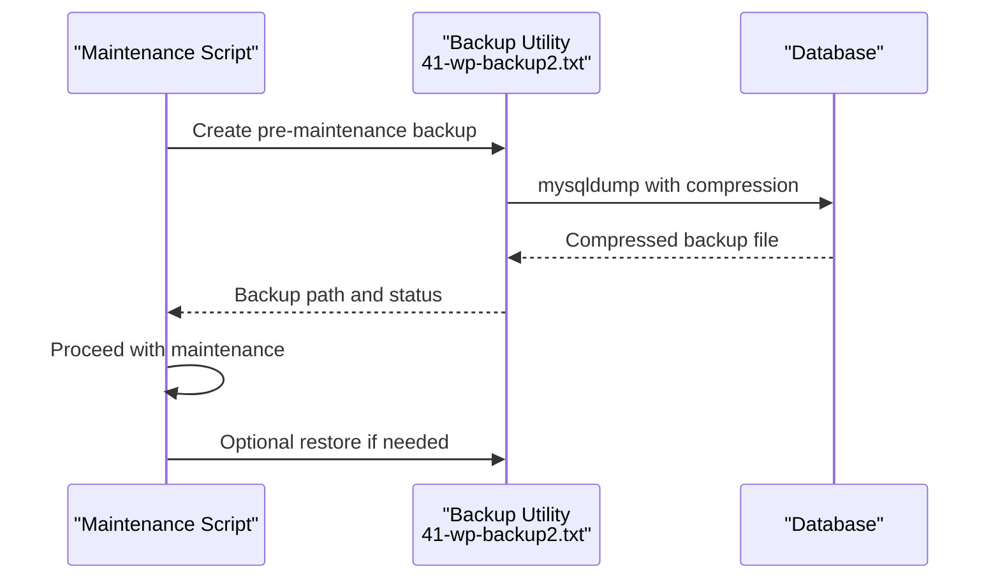
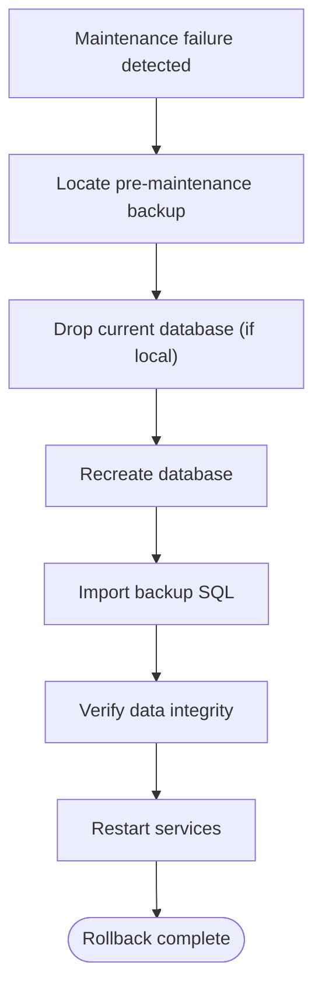
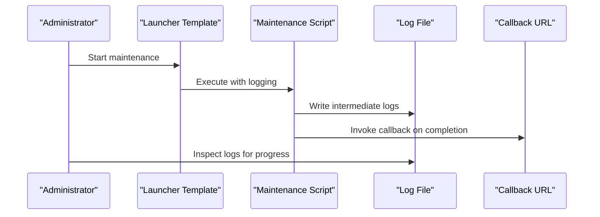
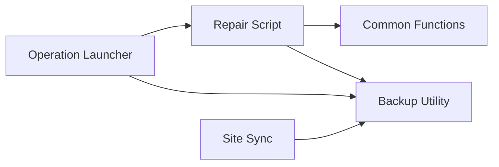

# Database Maintenance

<cite>
**Referenced Files in This Document**
- [47-repair_db.txt](file://includes/core/apps/wordpress-app/scripts/v1/raw/47-repair_db.txt)
- [47-repair_db.txt](file://includes/core/apps/wordpress-app/scripts/v2/raw/47-repair_db.txt)
- [manage_database_operation.txt](file://includes/core/apps/wordpress-app/scripts/v1/manage_database_operation.txt)
- [manage_database_operation.txt](file://includes/core/apps/wordpress-app/scripts/v2/manage_database_operation.txt)
- [9999-common-functions.txt](file://includes/core/apps/wordpress-app/scripts/v1/raw/9999-common-functions.txt)
- [41-wp-backup2.txt](file://includes/core/apps/wordpress-app/scripts/v1/raw/41-wp-backup2.txt)
- [81-origin-site-sync.txt](file://includes/core/apps/wordpress-app/scripts/v1/raw/81-origin-site-sync.txt)
- [after-prepare-server.php](file://includes/core/apps/wordpress-app/traits/traits-for-class-wordpress-app/after-prepare-server.php)
</cite>

## Table of Contents
1. [Introduction](#introduction)
2. [Project Structure](#project-structure)
3. [Core Components](#core-components)
4. [Architecture Overview](#architecture-overview)
5. [Detailed Component Analysis](#detailed-component-analysis)
6. [Dependency Analysis](#dependency-analysis)
7. [Performance Considerations](#performance-considerations)
8. [Troubleshooting Guide](#troubleshooting-guide)
9. [Conclusion](#conclusion)

## Introduction
This document explains SimpleStack’s database maintenance capabilities, focusing on repair procedures, corruption detection and recovery, optimization guidance, backup integration during maintenance, rollback procedures, and safe operational practices. It is intended for administrators who need to perform reliable database maintenance with minimal downtime and clear visibility into progress and outcomes.

## Project Structure
The database maintenance features are implemented primarily as shell scripts invoked by the WordPress app layer. Key files include:
- Repair script that orchestrates domain selection, pre-repair backup, repair execution, cache flush, and web server restart.
- A generic launcher template used to execute remote or background database operations.
- Common functions providing database connectivity checks and environment helpers.
- Backup and restore utilities that integrate with maintenance workflows.
- Site sync utilities that demonstrate database export/import patterns.



**Diagram sources**
- [47-repair_db.txt:1-92](file://includes/core/apps/wordpress-app/scripts/v1/raw/47-repair_db.txt#L1-L92)
- [manage_database_operation.txt:1-11](file://includes/core/apps/wordpress-app/scripts/v1/manage_database_operation.txt#L1-L11)
- [9999-common-functions.txt:1870-1896](file://includes/core/apps/wordpress-app/scripts/v1/raw/9999-common-functions.txt#L1870-L1896)
- [41-wp-backup2.txt:550-608](file://includes/core/apps/wordpress-app/scripts/v1/raw/41-wp-backup2.txt#L550-L608)
- [81-origin-site-sync.txt:85-106](file://includes/core/apps/wordpress-app/scripts/v1/raw/81-origin-site-sync.txt#L85-L106)

**Section sources**
- [47-repair_db.txt:1-92](file://includes/core/apps/wordpress-app/scripts/v1/raw/47-repair_db.txt#L1-L92)
- [manage_database_operation.txt:1-11](file://includes/core/apps/wordpress-app/scripts/v1/manage_database_operation.txt#L1-L11)
- [9999-common-functions.txt:1870-1896](file://includes/core/apps/wordpress-app/scripts/v1/raw/9999-common-functions.txt#L1870-L1896)
- [41-wp-backup2.txt:550-608](file://includes/core/apps/wordpress-app/scripts/v1/raw/41-wp-backup2.txt#L550-L608)
- [81-origin-site-sync.txt:85-106](file://includes/core/apps/wordpress-app/scripts/v1/raw/81-origin-site-sync.txt#L85-L106)

## Core Components
- Repair workflow: Selects a domain, performs a pre-repair database backup using mysqldump, executes a repair routine via WP-CLI, clears caches, and restarts the web server.
- Operation launcher: Downloads and executes a target script with exported parameters, logs output, and triggers a callback upon completion.
- Common functions: Provide database connection validation and other shared helpers.
- Backup and restore: Full and incremental backups, scheduled backups, and restore flows including dropping/recreating databases and importing SQL dumps.
- Site sync: Demonstrates exporting and importing databases across servers using mysqldump and mysql.

Key responsibilities:
- Safety: Pre-maintenance backups and error handling before destructive actions.
- Visibility: Logging intermediate steps and invoking callbacks to report status.
- Integration: Reusing common functions and existing backup infrastructure.

**Section sources**
- [47-repair_db.txt:1-92](file://includes/core/apps/wordpress-app/scripts/v1/raw/47-repair_db.txt#L1-L92)
- [manage_database_operation.txt:1-11](file://includes/core/apps/wordpress-app/scripts/v1/manage_database_operation.txt#L1-L11)
- [9999-common-functions.txt:1870-1896](file://includes/core/apps/wordpress-app/scripts/v1/raw/9999-common-functions.txt#L1870-L1896)
- [41-wp-backup2.txt:550-608](file://includes/core/apps/wordpress-app/scripts/v1/raw/41-wp-backup2.txt#L550-L608)
- [81-origin-site-sync.txt:85-106](file://includes/core/apps/wordpress-app/scripts/v1/raw/81-origin-site-sync.txt#L85-L106)

## Architecture Overview
The maintenance architecture centers around shell-based scripts orchestrated by the WordPress app layer. The repair flow integrates with backup utilities and common functions to ensure safety and observability.

```mermaid
sequenceDiagram
participant Admin as "Administrator"
participant Launcher as "Launcher Template<br/>manage_database_operation.txt"
participant Repair as "Repair Script<br/>47-repair_db.txt"
participant Common as "Common Functions<br/>9999-common-functions.txt"
participant Backup as "Backup Utility<br/>41-wp-backup2.txt"
participant WebServer as "Web Server"
Admin->>Launcher : Trigger database operation
Launcher->>Repair : Download and execute with params
Repair->>Common : Resolve domain/db credentials
Repair->>Backup : Create pre-repair backup (mysqldump)
Backup-->>Repair : Backup file path
Repair->>Repair : Execute repair routine (WP-CLI db repair)
Repair->>Repair : Flush application caches
Repair->>WebServer : Restart web server
Repair-->>Launcher : Complete; callback triggered
```

**Diagram sources**
- [manage_database_operation.txt:1-11](file://includes/core/apps/wordpress-app/scripts/v1/manage_database_operation.txt#L1-L11)
- [47-repair_db.txt:1-92](file://includes/core/apps/wordpress-app/scripts/v1/raw/47-repair_db.txt#L1-L92)
- [9999-common-functions.txt:1870-1896](file://includes/core/apps/wordpress-app/scripts/v1/raw/9999-common-functions.txt#L1870-L1896)
- [41-wp-backup2.txt:550-608](file://includes/core/apps/wordpress-app/scripts/v1/raw/41-wp-backup2.txt#L550-L608)

## Detailed Component Analysis

### Repair Workflow
The repair workflow ensures a safe, auditable process:
- Root privilege check and dependency validation.
- Domain selection and credential resolution via common functions.
- Pre-repair backup creation using mysqldump with compression.
- Execution of repair routine through WP-CLI.
- Cache clearing for application consistency.
- Web server restart to apply changes.



**Diagram sources**
- [47-repair_db.txt:15-91](file://includes/core/apps/wordpress-app/scripts/v1/raw/47-repair_db.txt#L15-L91)

Operational notes:
- The repair script currently targets older ISAM tables via WP-CLI and includes comments indicating limitations for modern engines.
- The script uses mysqldump to create a compressed backup prior to any repair action.
- After repair, it flushes caches and restarts the web server.

**Section sources**
- [47-repair_db.txt:1-92](file://includes/core/apps/wordpress-app/scripts/v1/raw/47-repair_db.txt#L1-L92)

### Corruption Detection and Recovery
Corruption detection and recovery are supported through:
- Pre-maintenance backups ensuring recoverability.
- Connection validation via common functions to verify database accessibility.
- Site sync utilities demonstrating export/import patterns for restoring data integrity.

Recovery mechanisms:
- Use the backup created before repair to restore if needed.
- Validate connectivity and permissions before attempting repairs.
- For cross-server scenarios, use mysqldump and mysql to export/import databases.



**Diagram sources**
- [9999-common-functions.txt:1870-1896](file://includes/core/apps/wordpress-app/scripts/v1/raw/9999-common-functions.txt#L1870-L1896)
- [41-wp-backup2.txt:550-608](file://includes/core/apps/wordpress-app/scripts/v1/raw/41-wp-backup2.txt#L550-L608)
- [81-origin-site-sync.txt:85-106](file://includes/core/apps/wordpress-app/scripts/v1/raw/81-origin-site-sync.txt#L85-L106)

**Section sources**
- [9999-common-functions.txt:1870-1896](file://includes/core/apps/wordpress-app/scripts/v1/raw/9999-common-functions.txt#L1870-L1896)
- [41-wp-backup2.txt:550-608](file://includes/core/apps/wordpress-app/scripts/v1/raw/41-wp-backup2.txt#L550-L608)
- [81-origin-site-sync.txt:85-106](file://includes/core/apps/wordpress-app/scripts/v1/raw/81-origin-site-sync.txt#L85-L106)

### Optimization Guidance
While explicit optimization scripts for table fragmentation and index rebuilding are not present in the repository, the following guidance applies based on available tools:
- Use mysqldump to export data for safe offline analysis and reimport after optimization.
- Leverage WP-CLI commands where applicable for site-level maintenance tasks.
- Monitor performance metrics and adjust configurations as needed.

Recommended approach:
- Plan maintenance windows to minimize impact.
- Perform full backups before any optimization.
- Validate connectivity and permissions prior to running optimization routines.

[No sources needed since this section provides general guidance]

### Backup Integration During Maintenance
Maintenance workflows integrate with backup utilities to ensure safety:
- Pre-repair backups are created using mysqldump and stored locally.
- Backup and restore scripts support full/incremental backups and scheduling.
- Site sync demonstrates export/import patterns for cross-server operations.



**Diagram sources**
- [47-repair_db.txt:61-71](file://includes/core/apps/wordpress-app/scripts/v1/raw/47-repair_db.txt#L61-L71)
- [41-wp-backup2.txt:550-608](file://includes/core/apps/wordpress-app/scripts/v1/raw/41-wp-backup2.txt#L550-L608)

**Section sources**
- [47-repair_db.txt:61-71](file://includes/core/apps/wordpress-app/scripts/v1/raw/47-repair_db.txt#L61-L71)
- [41-wp-backup2.txt:550-608](file://includes/core/apps/wordpress-app/scripts/v1/raw/41-wp-backup2.txt#L550-L608)

### Rollback Procedures
Rollback procedures rely on pre-maintenance backups:
- If repair fails or causes issues, restore the database from the backup created before the repair.
- Ensure application files are consistent with the restored database state.
- Restart services to apply restored configuration.



**Diagram sources**
- [41-wp-backup2.txt:550-608](file://includes/core/apps/wordpress-app/scripts/v1/raw/41-wp-backup2.txt#L550-L608)

**Section sources**
- [41-wp-backup2.txt:550-608](file://includes/core/apps/wordpress-app/scripts/v1/raw/41-wp-backup2.txt#L550-L608)

### Monitoring Repair Progress
Progress monitoring is achieved through:
- Intermediate logging files generated by the operation launcher.
- Callback URLs invoked upon completion to update system status.
- Console output from repair and backup scripts.



**Diagram sources**
- [manage_database_operation.txt:1-11](file://includes/core/apps/wordpress-app/scripts/v1/manage_database_operation.txt#L1-L11)

**Section sources**
- [manage_database_operation.txt:1-11](file://includes/core/apps/wordpress-app/scripts/v1/manage_database_operation.txt#L1-L11)

### Handling Large Database Operations
For large databases:
- Use mysqldump with compression to reduce storage and transfer overhead.
- Schedule maintenance during low-traffic periods.
- Monitor disk space and memory usage during operations.
- Consider splitting operations or using incremental strategies where applicable.

[No sources needed since this section provides general guidance]

## Dependency Analysis
The maintenance components depend on each other as follows:
- Repair script depends on common functions for environment and credential resolution.
- Operation launcher depends on network access to download scripts and invoke callbacks.
- Backup utility supports both local and remote operations and integrates with scheduling.
- Site sync demonstrates database export/import patterns useful for recovery and replication.



**Diagram sources**
- [47-repair_db.txt:1-92](file://includes/core/apps/wordpress-app/scripts/v1/raw/47-repair_db.txt#L1-L92)
- [manage_database_operation.txt:1-11](file://includes/core/apps/wordpress-app/scripts/v1/manage_database_operation.txt#L1-L11)
- [41-wp-backup2.txt:550-608](file://includes/core/apps/wordpress-app/scripts/v1/raw/41-wp-backup2.txt#L550-L608)
- [81-origin-site-sync.txt:85-106](file://includes/core/apps/wordpress-app/scripts/v1/raw/81-origin-site-sync.txt#L85-L106)

**Section sources**
- [47-repair_db.txt:1-92](file://includes/core/apps/wordpress-app/scripts/v1/raw/47-repair_db.txt#L1-L92)
- [manage_database_operation.txt:1-11](file://includes/core/apps/wordpress-app/scripts/v1/manage_database_operation.txt#L1-L11)
- [41-wp-backup2.txt:550-608](file://includes/core/apps/wordpress-app/scripts/v1/raw/41-wp-backup2.txt#L550-L608)
- [81-origin-site-sync.txt:85-106](file://includes/core/apps/wordpress-app/scripts/v1/raw/81-origin-site-sync.txt#L85-L106)

## Performance Considerations
- Avoid running heavy maintenance during peak traffic hours.
- Use compressed backups to reduce I/O and storage pressure.
- Monitor database connections and resource utilization during operations.
- Validate application caches are flushed to prevent stale data inconsistencies.

[No sources needed since this section provides general guidance]

## Troubleshooting Guide
Common issues and resolutions:
- Permission errors: Ensure scripts run with appropriate privileges (root for certain operations).
- Connectivity failures: Validate database grants and firewall rules using common functions.
- Backup failures: Check disk space and mysqldump availability; review logs for detailed errors.
- Service restart issues: Confirm web server service names and restart commands.

Diagnostic steps:
- Use common functions to test database connectivity.
- Inspect intermediate log files generated by the operation launcher.
- Verify backup files exist and are valid before proceeding with restoration.

**Section sources**
- [9999-common-functions.txt:1870-1896](file://includes/core/apps/wordpress-app/scripts/v1/raw/9999-common-functions.txt#L1870-L1896)
- [manage_database_operation.txt:1-11](file://includes/core/apps/wordpress-app/scripts/v1/manage_database_operation.txt#L1-L11)

## Conclusion
SimpleStack’s database maintenance tools provide a structured approach to repair, backup, and recovery. While explicit optimization scripts for fragmentation and index rebuilding are not included, the available utilities support safe maintenance through pre-operation backups, connectivity validation, and robust logging. Administrators should follow the outlined procedures to ensure reliability, minimize downtime, and maintain data integrity during maintenance operations.