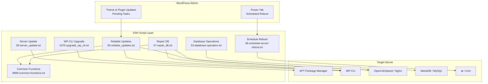
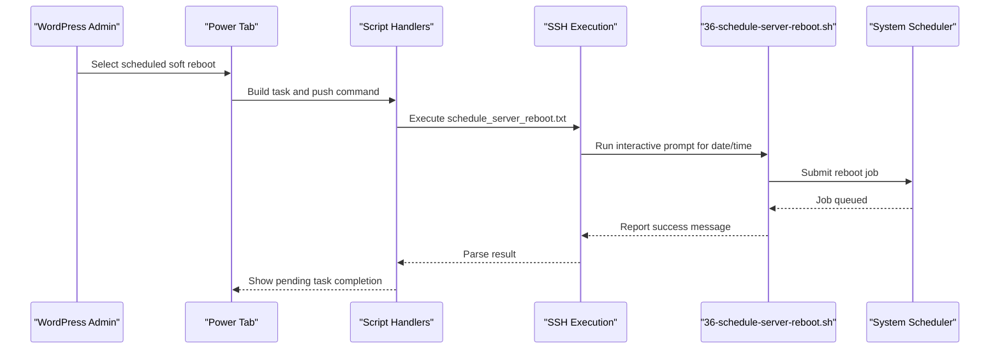
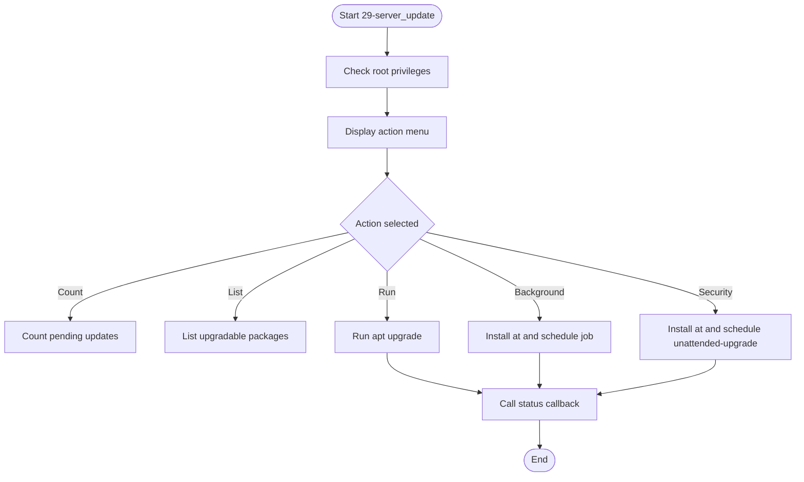
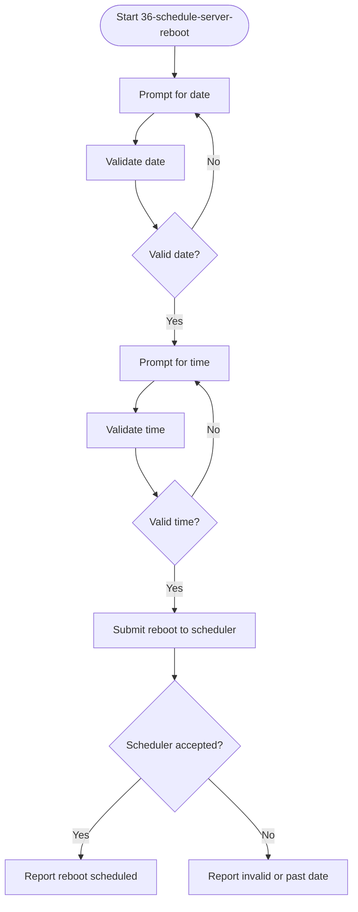
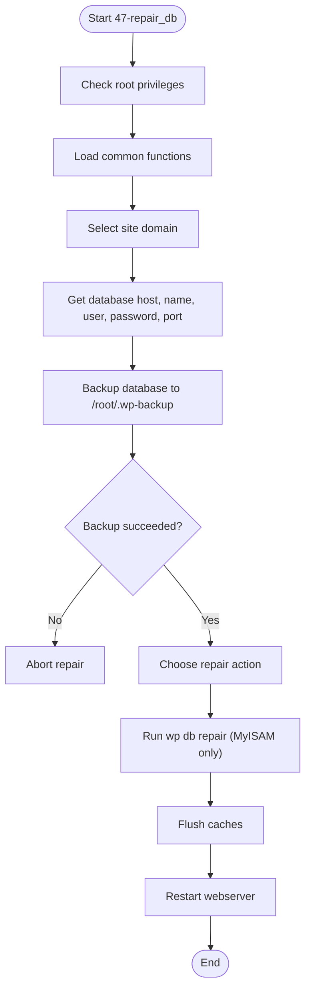
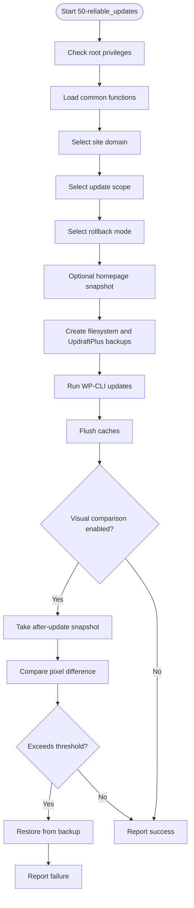
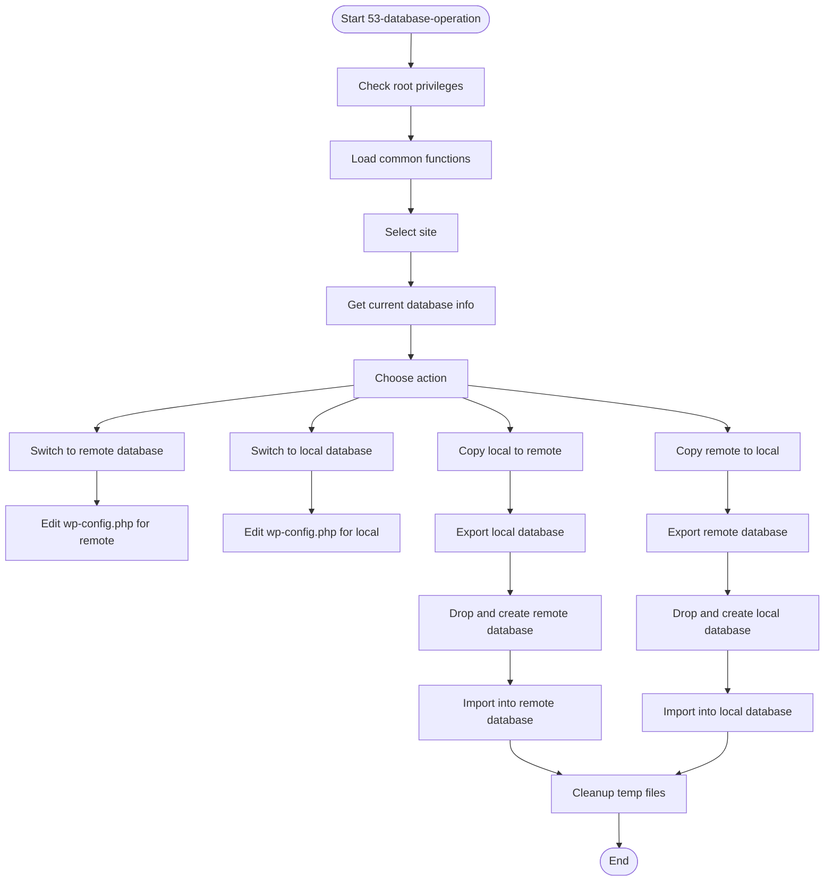
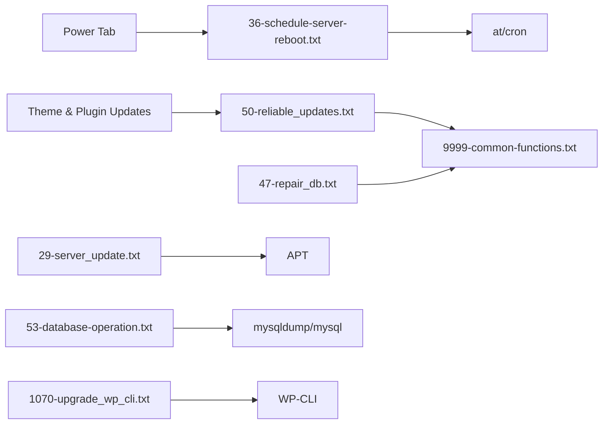

# Maintenance Utilities

<cite>
**Referenced Files in This Document**
- [README.md](file://README.md)
- [29-server_update.txt](file://includes/core/apps/wordpress-app/scripts/v2/raw/29-server_update.txt)
- [36-schedule-server-reboot.txt](file://includes/core/apps/wordpress-app/scripts/v2/raw/36-schedule-server-reboot.txt)
- [47-repair_db.txt](file://includes/core/apps/wordpress-app/scripts/v2/raw/47-repair_db.txt)
- [50-reliable_updates.txt](file://includes/core/apps/wordpress-app/scripts/v2/raw/50-reliable_updates.txt)
- [1070-upgrade_wp_cli.txt](file://includes/core/apps/wordpress-app/scripts/v2/raw/1070-upgrade_wp_cli.txt)
- [53-database-operation.txt](file://includes/core/apps/wordpress-app/scripts/v2/raw/53-database-operation.txt)
- [9999-common-functions.txt](file://includes/core/apps/wordpress-app/scripts/v2/raw/9999-common-functions.txt)
- [environment variables.txt](file://includes/core/apps/wordpress-app/scripts/v2/raw/environment%20variables.txt)
- [power.php](file://includes/core/apps/wordpress-app/tabs-server/power.php)
- [script-handlers.php](file://includes/core/apps/wordpress-app/traits/traits-for-class-wordpress-app/script-handlers.php)
- [theme-and-plugin-updates.php](file://includes/core/apps/wordpress-app/tabs/theme-and-plugin-updates.php)
- [class-simplestack-rest-security.php](file://includes/core/api/class-simplestack-rest-security.php)
</cite>

## Table of Contents
1. [Introduction](#introduction)
2. [Project Structure](#project-structure)
3. [Core Components](#core-components)
4. [Architecture Overview](#architecture-overview)
5. [Detailed Component Analysis](#detailed-component-analysis)
6. [Dependency Analysis](#dependency-analysis)
7. [Performance Considerations](#performance-considerations)
8. [Troubleshooting Guide](#troubleshooting-guide)
9. [Conclusion](#conclusion)
10. [Appendices](#appendices)

## Introduction
This document explains SimpleStack’s maintenance utilities for operating system updates, scheduled reboots, database repair and operations, and WordPress CLI management. It focuses on the Bash scripts under `includes/core/apps/wordpress-app/scripts/v2/raw`, their shared helper library, and the PHP interfaces that invoke them from the WordPress admin UI.

The maintenance surface includes:
- Operating system package updates with background execution and callback reporting.
- Scheduled server reboots using the system scheduler.
- Database backup, repair, optimization, and local-to-remote or remote-to-local copy workflows.
- Reliable WordPress core, theme, and plugin updates with pre-update backups, optional visual regression rollback, and cache flushing.
- WP-CLI upgrade automation and script execution environments.

These utilities are designed for zero-downtime or low-downtime maintenance when combined with proper scheduling, callbacks, and rollback strategies.

**Section sources**
- [README.md:1-37](file://README.md#L1-L37)

## Project Structure
SimpleStack’s maintenance tooling is primarily implemented as versioned Bash scripts executed over SSH against provisioned servers. The v2 script set lives under `includes/core/apps/wordpress-app/scripts/v2/raw`. A shared helper library provides common functions such as webserver detection, cache flushing, backup orchestration, user selection, and service restarts.

**Diagram sources**
- [power.php:126-140](file://includes/core/apps/wordpress-app/tabs-server/power.php#L126-L140)
- [script-handlers.php:659-661](file://includes/core/apps/wordpress-app/traits/traits-for-class-wordpress-app/script-handlers.php#L659-L661)
- [script-handlers.php:1670-1674](file://includes/core/apps/wordpress-app/traits/traits-for-class-wordpress-app/script-handlers.php#L1670-L1674)
- [theme-and-plugin-updates.php:622-652](file://includes/core/apps/wordpress-app/tabs/theme-and-plugin-updates.php#L622-L652)
- [29-server_update.txt:1-165](file://includes/core/apps/wordpress-app/scripts/v2/raw/29-server_update.txt#L1-L165)
- [36-schedule-server-reboot.txt:1-46](file://includes/core/apps/wordpress-app/scripts/v2/raw/36-schedule-server-reboot.txt#L1-L46)
- [47-repair_db.txt:1-92](file://includes/core/apps/wordpress-app/scripts/v2/raw/47-repair_db.txt#L1-L92)
- [50-reliable_updates.txt:1-317](file://includes/core/apps/wordpress-app/scripts/v2/raw/50-reliable_updates.txt#L1-L317)
- [1070-upgrade_wp_cli.txt:1-10](file://includes/core/apps/wordpress-app/scripts/v2/raw/1070-upgrade_wp_cli.txt#L1-L10)
- [53-database-operation.txt:1-212](file://includes/core/apps/wordpress-app/scripts/v2/raw/53-database-operation.txt#L1-L212)
- [9999-common-functions.txt:279-300](file://includes/core/apps/wordpress-app/scripts/v2/raw/9999-common-functions.txt#L279-L300)

**Section sources**
- [README.md:37-37](file://README.md#L37-L37)
- [environment variables.txt:1-3](file://includes/core/apps/wordpress-app/scripts/v2/raw/environment%20variables.txt#L1-L3)

## Core Components
This section summarizes the primary maintenance components and their responsibilities.

| Component | Purpose | Key Behaviors |
|---|---|---|
| Operating System Updates | Count, list, run, and schedule OS package updates | Supports immediate and background execution via `at`; reports status through a callback URL; detects reboot requirements; avoids concurrent APT usage |
| Scheduled Reboot | Schedule a future server reboot at a specified date and time | Validates input dates and times; uses the system scheduler to execute reboot |
| Database Repair | Backup and attempt database repair for a selected site | Backs up the database before repair; currently limited to legacy MyISAM repair via WP-CLI; flushes caches and restarts the webserver |
| Reliable Updates | Automate WordPress core, theme, and plugin updates with rollback | Creates filesystem and UpdraftPlus backups; optionally captures screenshots and compares visual differences; rolls back if pixel difference exceeds threshold; flushes caches and reports success/failure |
| WP-CLI Upgrade | Upgrade WP-CLI to the latest stable release | Runs WP-CLI update command with root allowance |
| Database Operations | Switch database connections and copy databases between local and remote hosts | Validates connectivity; edits `wp-config.php`; exports and imports via `mysqldump` and `mysql` |

**Section sources**
- [29-server_update.txt:11-27](file://includes/core/apps/wordpress-app/scripts/v2/raw/29-server_update.txt#L11-L27)
- [36-schedule-server-reboot.txt:8-35](file://includes/core/apps/wordpress-app/scripts/v2/raw/36-schedule-server-reboot.txt#L8-L35)
- [47-repair_db.txt:29-85](file://includes/core/apps/wordpress-app/scripts/v2/raw/47-repair_db.txt#L29-L85)
- [50-reliable_updates.txt:17-60](file://includes/core/apps/wordpress-app/scripts/v2/raw/50-reliable_updates.txt#L17-L60)
- [1070-upgrade_wp_cli.txt:1-10](file://includes/core/apps/wordpress-app/scripts/v2/raw/1070-upgrade_wp_cli.txt#L1-L10)
- [53-database-operation.txt:62-90](file://includes/core/apps/wordpress-app/scripts/v2/raw/53-database-operation.txt#L62-L90)

## Architecture Overview
Maintenance tasks originate in the WordPress admin interface and are translated into SSH commands that execute target scripts. Shared helpers provide consistent behavior across scripts, including environment detection, caching, backups, and service restarts.

**Diagram sources**
- [power.php:126-140](file://includes/core/apps/wordpress-app/tabs-server/power.php#L126-L140)
- [power.php:508-544](file://includes/core/apps/wordpress-app/tabs-server/power.php#L508-L544)
- [script-handlers.php:659-661](file://includes/core/apps/wordpress-app/traits/traits-for-class-wordpress-app/script-handlers.php#L659-L661)
- [script-handlers.php:1670-1674](file://includes/core/apps/wordpress-app/traits/traits-for-class-wordpress-app/script-handlers.php#L1670-L1674)
- [36-schedule-server-reboot.txt:8-45](file://includes/core/apps/wordpress-app/scripts/v2/raw/36-schedule-server-reboot.txt#L8-L45)

## Detailed Component Analysis

### Operating System Updates
The operating system update utility supports counting pending updates, listing available packages, running updates immediately, and scheduling updates in the background. It also distinguishes security-only updates and reports whether a reboot is required.

Key behaviors:
- Requires root privileges.
- Detects and avoids concurrent APT usage by checking the package manager lock.
- Uses `apt-get --with-new-pkgs upgrade` for general updates and `unattended-upgrade` for security updates.
- Schedules background jobs using `at` and writes a helper script to `/usr/local/bin/server-status`.
- Calls a callback URL with parameters indicating restart requirement, total updates, and package lists.

**Diagram sources**
- [29-server_update.txt:3-27](file://includes/core/apps/wordpress-app/scripts/v2/raw/29-server_update.txt#L3-L27)
- [29-server_update.txt:44-77](file://includes/core/apps/wordpress-app/scripts/v2/raw/29-server_update.txt#L44-L77)
- [29-server_update.txt:79-120](file://includes/core/apps/wordpress-app/scripts/v2/raw/29-server_update.txt#L79-L120)
- [29-server_update.txt:123-164](file://includes/core/apps/wordpress-app/scripts/v2/raw/29-server_update.txt#L123-L164)

**Section sources**
- [29-server_update.txt:1-165](file://includes/core/apps/wordpress-app/scripts/v2/raw/29-server_update.txt#L1-L165)
- [environment variables.txt:542-556](file://includes/core/apps/wordpress-app/scripts/v2/raw/environment%20variables.txt#L542-L556)

### Scheduled Reboots
The scheduled reboot utility prompts for a valid date and time, validates inputs, and schedules a reboot using the system scheduler. It is invoked from the Power tab in the WordPress admin UI.

Key behaviors:
- Requires root privileges.
- Validates date format and ensures the requested time is not in the past.
- Submits a reboot job to the scheduler.
- Reports success or failure based on scheduler submission result.

**Diagram sources**
- [36-schedule-server-reboot.txt:8-35](file://includes/core/apps/wordpress-app/scripts/v2/raw/36-schedule-server-reboot.txt#L8-L35)
- [36-schedule-server-reboot.txt:37-45](file://includes/core/apps/wordpress-app/scripts/v2/raw/36-schedule-server-reboot.txt#L37-L45)

**Section sources**
- [36-schedule-server-reboot.txt:1-46](file://includes/core/apps/wordpress-app/scripts/v2/raw/36-schedule-server-reboot.txt#L1-L46)
- [power.php:126-140](file://includes/core/apps/wordpress-app/tabs-server/power.php#L126-L140)
- [power.php:508-544](file://includes/core/apps/wordpress-app/tabs-server/power.php#L508-L544)
- [script-handlers.php:1670-1674](file://includes/core/apps/wordpress-app/traits/traits-for-class-wordpress-app/script-handlers.php#L1670-L1674)

### Database Repair and Optimization
The database repair utility backs up the selected site’s database before attempting repair. It currently exposes only a MyISAM-focused repair path via WP-CLI and then flushes caches and restarts the webserver.

Important notes:
- The script comments indicate it is incomplete and not suitable for modern InnoDB-only repairs.
- It requires root privileges and depends on the shared helper library.
- It selects a domain, retrieves database credentials, creates a timestamped gzip backup, runs WP-CLI repair, clears caches, and restarts the webserver.

**Diagram sources**
- [47-repair_db.txt:15-27](file://includes/core/apps/wordpress-app/scripts/v2/raw/47-repair_db.txt#L15-L27)
- [47-repair_db.txt:29-60](file://includes/core/apps/wordpress-app/scripts/v2/raw/47-repair_db.txt#L29-L60)
- [47-repair_db.txt:61-85](file://includes/core/apps/wordpress-app/scripts/v2/raw/47-repair_db.txt#L61-L85)
- [47-repair_db.txt:87-92](file://includes/core/apps/wordpress-app/scripts/v2/raw/47-repair_db.txt#L87-L92)

**Section sources**
- [47-repair_db.txt:1-92](file://includes/core/apps/wordpress-app/scripts/v2/raw/47-repair_db.txt#L1-L92)

### Reliable WordPress Updates
The reliable updates utility automates updates for themes, plugins, and WordPress core. It supports updating all items, specific items, exclusions, and full stacks. It also supports two modes: with and without rollback.

Key behaviors:
- Requires root privileges and loads shared helpers.
- Prompts for update scope and rollback mode.
- Optionally takes a screenshot of the homepage before updates using an external image capture service.
- Creates filesystem backups and optionally triggers UpdraftPlus backups.
- Executes WP-CLI update commands for themes, plugins, and core.
- After updates, flushes caches, optionally captures a second screenshot, compares images, and rolls back if the pixel difference exceeds a configured threshold.
- Reports success or failure through a callback URL.

**Diagram sources**
- [50-reliable_updates.txt:17-60](file://includes/core/apps/wordpress-app/scripts/v2/raw/50-reliable_updates.txt#L17-L60)
- [50-reliable_updates.txt:92-116](file://includes/core/apps/wordpress-app/scripts/v2/raw/50-reliable_updates.txt#L92-L116)
- [50-reliable_updates.txt:118-187](file://includes/core/apps/wordpress-app/scripts/v2/raw/50-reliable_updates.txt#L118-L187)
- [50-reliable_updates.txt:190-249](file://includes/core/apps/wordpress-app/scripts/v2/raw/50-reliable_updates.txt#L190-L249)
- [50-reliable_updates.txt:251-317](file://includes/core/apps/wordpress-app/scripts/v2/raw/50-reliable_updates.txt#L251-L317)

**Section sources**
- [50-reliable_updates.txt:1-317](file://includes/core/apps/wordpress-app/scripts/v2/raw/50-reliable_updates.txt#L1-L317)
- [theme-and-plugin-updates.php:622-652](file://includes/core/apps/wordpress-app/tabs/theme-and-plugin-updates.php#L622-L652)

### WP-CLI Upgrade Automation
The WP-CLI upgrade script upgrades WP-CLI to the latest stable version. It is intended to be executed with appropriate privileges and relies on WP-CLI being installed and accessible.

Key behaviors:
- Prints a timestamped log message.
- Runs the WP-CLI update command with automatic confirmation and root allowance.
- Expects WP-CLI output indicating successful update.

**Section sources**
- [1070-upgrade_wp_cli.txt:1-10](file://includes/core/apps/wordpress-app/scripts/v2/raw/1070-upgrade_wp_cli.txt#L1-L10)

### Database Operations and Local/Remote Switching
The database operations utility allows switching a site’s database connection between local and remote hosts and copying databases between those locations.

Key behaviors:
- Requires root privileges and loads shared helpers.
- Prompts for site selection and desired action.
- For switching, validates connectivity and edits `wp-config.php` fields for host, database name, user, and password.
- For copying, exports the source database using `mysqldump`, drops and recreates the destination database, and imports the dump.
- Cleans up temporary SQL files after successful import.

**Diagram sources**
- [53-database-operation.txt:1-15](file://includes/core/apps/wordpress-app/scripts/v2/raw/53-database-operation.txt#L1-L15)
- [53-database-operation.txt:62-90](file://includes/core/apps/wordpress-app/scripts/v2/raw/53-database-operation.txt#L62-L90)
- [53-database-operation.txt:92-134](file://includes/core/apps/wordpress-app/scripts/v2/raw/53-database-operation.txt#L92-L134)
- [53-database-operation.txt:137-173](file://includes/core/apps/wordpress-app/scripts/v2/raw/53-database-operation.txt#L137-L173)
- [53-database-operation.txt:176-212](file://includes/core/apps/wordpress-app/scripts/v2/raw/53-database-operation.txt#L176-L212)

**Section sources**
- [53-database-operation.txt:1-212](file://includes/core/apps/wordpress-app/scripts/v2/raw/53-database-operation.txt#L1-L212)

### Shared Helper Library
The shared helper library centralizes common functionality used by maintenance scripts. It defines supported Ubuntu versions, webserver detection, LSPHP version management, space checks, cache flushing, backup orchestration, user/domain selection, and service restarts.

Highlights relevant to maintenance:
- Webserver detection sets global variables used by other scripts to determine restart behavior.
- Cache flushing supports multiple caching plugins and object caches.
- Backup helpers ensure sufficient disk space and verify backup creation.
- Service restart functions handle OpenLiteSpeed and Nginx.

**Section sources**
- [9999-common-functions.txt:16-27](file://includes/core/apps/wordpress-app/scripts/v2/raw/9999-common-functions.txt#L16-L27)
- [9999-common-functions.txt:77-123](file://includes/core/apps/wordpress-app/scripts/v2/raw/9999-common-functions.txt#L77-L123)
- [9999-common-functions.txt:125-200](file://includes/core/apps/wordpress-app/scripts/v2/raw/9999-common-functions.txt#L125-L200)
- [9999-common-functions.txt:202-270](file://includes/core/apps/wordpress-app/scripts/v2/raw/9999-common-functions.txt#L202-L270)
- [9999-common-functions.txt:272-300](file://includes/core/apps/wordpress-app/scripts/v2/raw/9999-common-functions.txt#L272-L300)
- [9999-common-functions.txt:487-513](file://includes/core/apps/wordpress-app/scripts/v2/raw/9999-common-functions.txt#L487-L513)

## Dependency Analysis
Maintenance scripts depend on:
- Root privileges for system-level operations.
- Shared helper functions for consistent behavior.
- External tools such as `apt`, `at`, `mysqldump`, `mysql`, and WP-CLI.
- WordPress admin UI components for initiating tasks.

**Diagram sources**
- [power.php:126-140](file://includes/core/apps/wordpress-app/tabs-server/power.php#L126-L140)
- [script-handlers.php:1670-1674](file://includes/core/apps/wordpress-app/traits/traits-for-class-wordpress-app/script-handlers.php#L1670-L1674)
- [theme-and-plugin-updates.php:622-652](file://includes/core/apps/wordpress-app/tabs/theme-and-plugin-updates.php#L622-L652)
- [29-server_update.txt:44-77](file://includes/core/apps/wordpress-app/scripts/v2/raw/29-server_update.txt#L44-L77)
- [36-schedule-server-reboot.txt:37-45](file://includes/core/apps/wordpress-app/scripts/v2/raw/36-schedule-server-reboot.txt#L37-L45)
- [47-repair_db.txt:61-85](file://includes/core/apps/wordpress-app/scripts/v2/raw/47-repair_db.txt#L61-L85)
- [50-reliable_updates.txt:118-187](file://includes/core/apps/wordpress-app/scripts/v2/raw/50-reliable_updates.txt#L118-L187)
- [1070-upgrade_wp_cli.txt:1-10](file://includes/core/apps/wordpress-app/scripts/v2/raw/1070-upgrade_wp_cli.txt#L1-L10)
- [53-database-operation.txt:137-173](file://includes/core/apps/wordpress-app/scripts/v2/raw/53-database-operation.txt#L137-L173)

**Section sources**
- [environment variables.txt:1-3](file://includes/core/apps/wordpress-app/scripts/v2/raw/environment%20variables.txt#L1-L3)

## Performance Considerations
- Operating system updates can consume significant CPU, memory, and I/O. Prefer background scheduling during low-traffic windows and monitor callback results.
- Visual regression rollback involves capturing and comparing screenshots, which adds network latency and processing overhead. Disable this feature if not needed.
- Database export/import operations can lock tables and increase load. Perform large copies during maintenance windows.
- Cache flushing may temporarily reduce performance while caches rebuild. Coordinate with application owners to minimize impact.
- WP-CLI operations should avoid running concurrently with heavy site traffic where possible.

[No sources needed since this section provides general guidance]

## Troubleshooting Guide
Common issues and resolutions:
- **APT already running**: The update script detects the package manager lock and reports a warning. Wait for another update process to finish or clear stale locks carefully.
- **Insufficient disk space**: Backup and update routines check free space and abort if insufficient. Expand storage or prune old backups before retrying.
- **Invalid date/time for reboot**: The scheduler rejects past or malformed values. Re-enter a valid future date and time.
- **Database backup failure**: Repair operations abort if mysqldump fails. Verify database credentials, permissions, and connectivity.
- **Visual comparison unauthorized**: If screenshot capture credentials are invalid, the reliable updates script skips snapshot capture. Provide valid API credentials to enable rollback.
- **WP-CLI not found or permission errors**: Ensure WP-CLI is installed and executable by the expected user or root context.

**Section sources**
- [29-server_update.txt:59-76](file://includes/core/apps/wordpress-app/scripts/v2/raw/29-server_update.txt#L59-L76)
- [50-reliable_updates.txt:92-106](file://includes/core/apps/wordpress-app/scripts/v2/raw/50-reliable_updates.txt#L92-L106)
- [47-repair_db.txt:61-70](file://includes/core/apps/wordpress-app/scripts/v2/raw/47-repair_db.txt#L61-L70)
- [36-schedule-server-reboot.txt:8-35](file://includes/core/apps/wordpress-app/scripts/v2/raw/36-schedule-server-reboot.txt#L8-L35)

## Conclusion
SimpleStack’s maintenance utilities provide a robust foundation for automated system updates, scheduled reboots, database operations, and WordPress updates with rollback capabilities. By combining background execution, callback reporting, backups, and cache management, operators can perform maintenance with minimal downtime. For production environments, prefer scheduled maintenance windows, validate prerequisites, and monitor outcomes through callbacks and logs.

[No sources needed since this section summarizes without analyzing specific files]

## Appendices

### Creating Custom Maintenance Scripts
Guidelines:
- Place custom scripts under `includes/core/apps/wordpress-app/scripts/v2/raw/` following the existing naming convention.
- Require root privileges for system-level changes.
- Source `9999-common-functions.sh` to reuse shared helpers.
- Use interactive prompts or environment variables for configuration.
- Implement status callbacks for integration with the WordPress admin UI.
- Test scripts manually before exposing them through the UI.

**Section sources**
- [environment variables.txt:1-3](file://includes/core/apps/wordpress-app/scripts/v2/raw/environment%20variables.txt#L1-L3)
- [9999-common-functions.txt:1-14](file://includes/core/apps/wordpress-app/scripts/v2/raw/9999-common-functions.txt#L1-L14)

### Scheduling Regular Maintenance Tasks
Recommendations:
- Use the background update mechanism to schedule OS updates during off-peak hours.
- Combine scheduled reboots with update cycles to apply kernel or service changes safely.
- Configure database copy operations during maintenance windows to avoid impacting live traffic.
- Monitor callback endpoints for success, failure, and reboot-required signals.

**Section sources**
- [29-server_update.txt:79-120](file://includes/core/apps/wordpress-app/scripts/v2/raw/29-server_update.txt#L79-L120)
- [36-schedule-server-reboot.txt:37-45](file://includes/core/apps/wordpress-app/scripts/v2/raw/36-schedule-server-reboot.txt#L37-L45)

### Monitoring Maintenance Operations
Best practices:
- Inspect callback URLs for status parameters such as update success, failure, and reboot flags.
- Review pending tasks in the WordPress admin UI for progress and completion messages.
- Log script outputs and error conditions for auditability.
- Integrate external monitoring systems with callback endpoints for alerting.

**Section sources**
- [29-server_update.txt:47-76](file://includes/core/apps/wordpress-app/scripts/v2/raw/29-server_update.txt#L47-L76)
- [50-reliable_updates.txt:233-248](file://includes/core/apps/wordpress-app/scripts/v2/raw/50-reliable_updates.txt#L233-L248)

### Disaster Recovery Procedures
Recommended steps:
- Always create filesystem and database backups before maintenance.
- Use reliable updates with rollback enabled to automatically restore from backups if visual regression thresholds are exceeded.
- For database corruption, use the database operations utility to switch to a known-good remote database temporarily while repairing the local one.
- Keep recent backups in external storage and test restoration procedures regularly.

**Section sources**
- [50-reliable_updates.txt:251-257](file://includes/core/apps/wordpress-app/scripts/v2/raw/50-reliable_updates.txt#L251-L257)
- [50-reliable_updates.txt:216-232](file://includes/core/apps/wordpress-app/scripts/v2/raw/50-reliable_updates.txt#L216-L232)
- [53-database-operation.txt:137-173](file://includes/core/apps/wordpress-app/scripts/v2/raw/53-database-operation.txt#L137-L173)