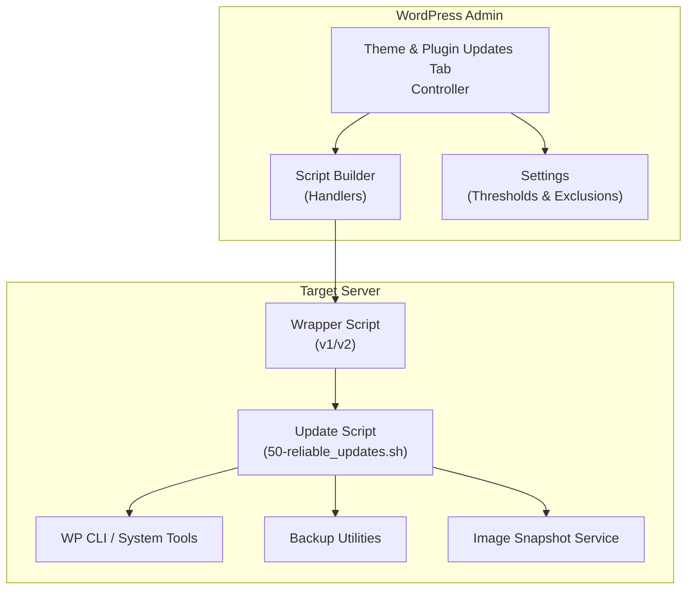
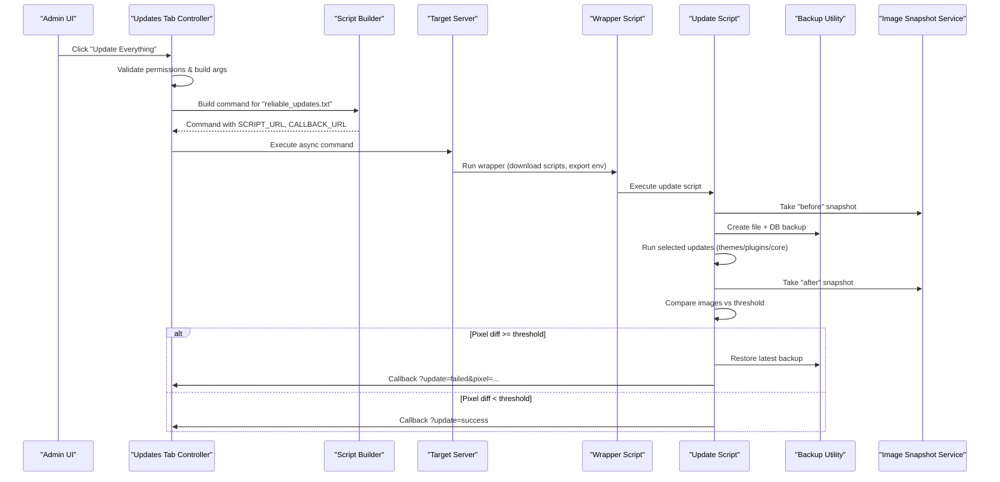
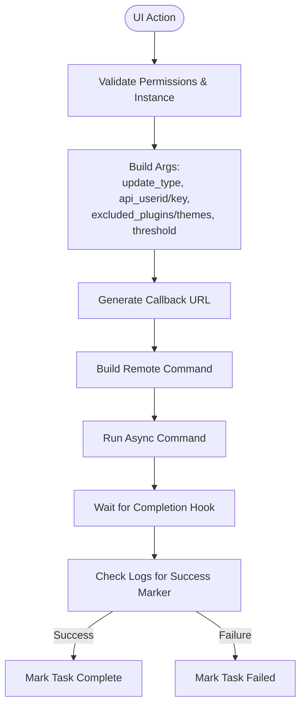
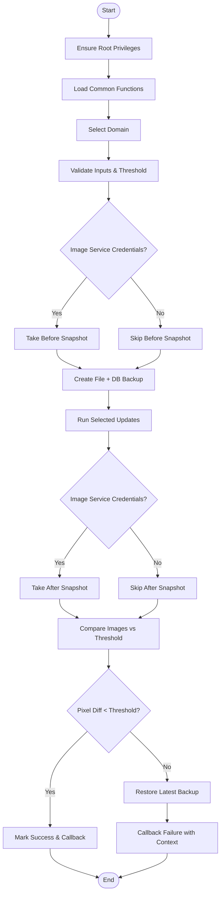
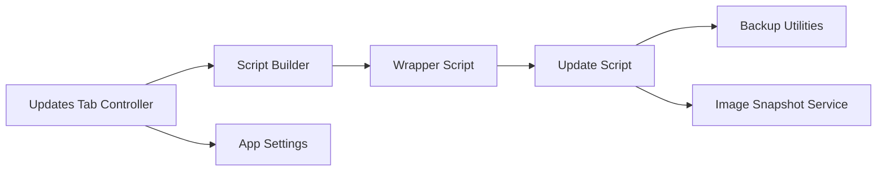

# Reliable Updates

<cite>
**Referenced Files in This Document**   
- [reliable_updates.txt (v1)](file://includes/core/apps/wordpress-app/scripts/v1/reliable_updates.txt)
- [reliable_updates.txt (v2)](file://includes/core/apps/wordpress-app/scripts/v2/reliable_updates.txt)
- [50-reliable_updates.txt](file://includes/core/apps/wordpress-app/scripts/v1/raw/50-reliable_updates.txt)
- [theme-and-plugin-updates.php](file://includes/core/apps/wordpress-app/tabs/theme-and-plugin-updates.php)
- [script-handlers.php](file://includes/core/apps/wordpress-app/traits/traits-for-class-wordpress-app/script-handlers.php)
- [class-wordpress-app-settings.php](file://includes/core/apps/wordpress-app/class-wordpress-app-settings.php)
</cite>

## Table of Contents
1. [Introduction](#introduction)
2. [Project Structure](#project-structure)
3. [Core Components](#core-components)
4. [Architecture Overview](#architecture-overview)
5. [Detailed Component Analysis](#detailed-component-analysis)
6. [Dependency Analysis](#dependency-analysis)
7. [Performance Considerations](#performance-considerations)
8. [Troubleshooting Guide](#troubleshooting-guide)
9. [Conclusion](#conclusion)
10. [Appendices](#appendices)

## Introduction
This document explains Simple Stack’s reliable update system for WordPress sites, focusing on safe updates for core, themes, and plugins with automatic rollback capabilities. It covers the end-to-end flow from UI actions to server-side execution, verification via image comparison, failure recovery through backups, and configuration options that control update behavior. It also provides best practices for stability, handling third-party components, monitoring status, and integrating with CI/CD pipelines.

## Project Structure
The reliable update feature spans PHP orchestration in the WordPress admin and Bash scripts executed on the target server:

- Admin UI and orchestration:
  - Theme and plugin updates tab controller
  - Script builder and success detection
  - Settings for thresholds and exclusions
- Server-side automation:
  - Wrapper script that downloads and runs the actual update script
  - Update script that performs backups, updates, and post-update checks

**Diagram sources**
- [theme-and-plugin-updates.php:149-309](file://includes/core/apps/wordpress-app/tabs/theme-and-plugin-updates.php#L149-L309)
- [script-handlers.php:1257-1270](file://includes/core/apps/wordpress-app/traits/traits-for-class-wordpress-app/script-handlers.php#L1257-L1270)
- [reliable_updates.txt (v1):1-13](file://includes/core/apps/wordpress-app/scripts/v1/reliable_updates.txt#L1-L13)
- [50-reliable_updates.txt:251-316](file://includes/core/apps/wordpress-app/scripts/v1/raw/50-reliable_updates.txt#L251-L316)

**Section sources**
- [theme-and-plugin-updates.php:149-309](file://includes/core/apps/wordpress-app/tabs/theme-and-plugin-updates.php#L149-L309)
- [script-handlers.php:1257-1270](file://includes/core/apps/wordpress-app/traits/traits-for-class-wordpress-app/script-handlers.php#L1257-L1270)
- [reliable_updates.txt (v1):1-13](file://includes/core/apps/wordpress-app/scripts/v1/reliable_updates.txt#L1-L13)
- [50-reliable_updates.txt:251-316](file://includes/core/apps/wordpress-app/scripts/v1/raw/50-reliable_updates.txt#L251-L316)

## Core Components
- Theme and plugin updates tab controller: Validates permissions, maps UI actions to internal action names, builds parameters (including thresholds and exclusions), constructs the remote command, and triggers asynchronous execution. It also handles completion callbacks and updates pending task statuses.
- Script builder/handlers: Maps the logical “reliable_updates” operation to concrete script URLs and filenames, injects callback URLs and log file paths, and ensures backup script availability.
- Wrapper scripts (v1/v2): Download common functions, the backup script, and the main update script; export environment variables; execute the update script; rename logs; and call a callback URL upon completion.
- Update script (50-reliable_updates.sh): Performs preflight checks, takes a snapshot of the site homepage, backs up files and database, runs selected updates (themes, plugins, core), compares before/after images, and rolls back if pixel differences exceed a configured threshold.

Key responsibilities:
- Safe execution with backups
- Selective updates and exclusions
- Visual regression detection via image comparison
- Automatic rollback using prior backups
- Status callbacks to mark tasks complete or failed

**Section sources**
- [theme-and-plugin-updates.php:149-309](file://includes/core/apps/wordpress-app/tabs/theme-and-plugin-updates.php#L149-L309)
- [script-handlers.php:1257-1270](file://includes/core/apps/wordpress-app/traits/traits-for-class-wordpress-app/script-handlers.php#L1257-L1270)
- [reliable_updates.txt (v1):1-13](file://includes/core/apps/wordpress-app/scripts/v1/reliable_updates.txt#L1-L13)
- [reliable_updates.txt (v2):1-13](file://includes/core/apps/wordpress-app/scripts/v2/reliable_updates.txt#L1-L13)
- [50-reliable_updates.txt:92-116](file://includes/core/apps/wordpress-app/scripts/v1/raw/50-reliable_updates.txt#L92-L116)
- [50-reliable_updates.txt:190-249](file://includes/core/apps/wordpress-app/scripts/v1/raw/50-reliable_updates.txt#L190-L249)

## Architecture Overview
The reliable update process is orchestrated from the WordPress admin and executed on the target server. The flow includes parameter preparation, script delivery, execution, verification, and callback-driven state updates.

**Diagram sources**
- [theme-and-plugin-updates.php:219-309](file://includes/core/apps/wordpress-app/tabs/theme-and-plugin-updates.php#L219-L309)
- [script-handlers.php:1257-1270](file://includes/core/apps/wordpress-app/traits/traits-for-class-wordpress-app/script-handlers.php#L1257-L1270)
- [reliable_updates.txt (v1):1-13](file://includes/core/apps/wordpress-app/scripts/v1/reliable_updates.txt#L1-L13)
- [50-reliable_updates.txt:92-116](file://includes/core/apps/wordpress-app/scripts/v1/raw/50-reliable_updates.txt#L92-L116)
- [50-reliable_updates.txt:190-249](file://includes/core/apps/wordpress-app/scripts/v1/raw/50-reliable_updates.txt#L190-L249)

## Detailed Component Analysis

### Theme and Plugin Updates Tab Controller
Responsibilities:
- Map UI actions to internal action names (e.g., “update-everything” → “update_everything”).
- Prepare parameters: update type, API credentials for image service, exclusion lists, pixel threshold, and callback URL.
- Construct and run the remote command asynchronously.
- On command completion, determine success by inspecting logs and trigger appropriate hooks to update pending tasks.

Key behaviors:
- If image service credentials are missing, it sets update_type to allow optional rollbacks without automated image-based rollback.
- Uses a unique command name per execution to correlate logs and callbacks.
- Supports bulk actions and background pending-task processing.

**Diagram sources**
- [theme-and-plugin-updates.php:149-309](file://includes/core/apps/wordpress-app/tabs/theme-and-plugin-updates.php#L149-L309)
- [theme-and-plugin-updates.php:56-90](file://includes/core/apps/wordpress-app/tabs/theme-and-plugin-updates.php#L56-L90)

**Section sources**
- [theme-and-plugin-updates.php:149-309](file://includes/core/apps/wordpress-app/tabs/theme-and-plugin-updates.php#L149-L309)
- [theme-and-plugin-updates.php:56-90](file://includes/core/apps/wordpress-app/tabs/theme-and-plugin-updates.php#L56-L90)

### Script Builder and Handlers
Responsibilities:
- Map the logical operation “reliable_updates” to concrete script URLs and filenames.
- Inject callback URLs and log file naming patterns.
- Ensure backup script availability for rollback operations.

Key behaviors:
- For “reliable_updates”, sets SCRIPT_URL to the update script, SCRIPT_NAME to a .sh filename, SCRIPT_LOGS to a unique log path, and CALLBACK_URL to the completion endpoint.
- Also sets SCRIPT_URL_BACKUP and SCRIPT_NAME_BACKUP so the wrapper can fetch the backup script.

**Section sources**
- [script-handlers.php:1257-1270](file://includes/core/apps/wordpress-app/traits/traits-for-class-wordpress-app/script-handlers.php#L1257-L1270)

### Wrapper Scripts (v1/v2)
Responsibilities:
- Download common functions, backup script, and the main update script.
- Export environment variables including action, domain, update_type, API credentials, threshold, callback URL, and exclusion lists.
- Execute the update script, finalize logs, and invoke the callback URL.

Behavioral notes:
- Both v1 and v2 wrappers perform the same sequence of steps, ensuring consistent execution across versions.

**Section sources**
- [reliable_updates.txt (v1):1-13](file://includes/core/apps/wordpress-app/scripts/v1/reliable_updates.txt#L1-L13)
- [reliable_updates.txt (v2):1-13](file://includes/core/apps/wordpress-app/scripts/v2/reliable_updates.txt#L1-L13)

### Update Script (50-reliable_updates.sh)
Responsibilities:
- Preflight: ensure root privileges, load common functions, select domain, validate inputs.
- Optional snapshot: capture a baseline screenshot of the site homepage using an external image service when credentials are provided.
- Backups: create file and database backups; optionally use UpdraftPlus if installed.
- Updates: run selected updates (all themes, all plugins, WordPress core, specific items, or exclude lists).
- Verification: compare before/after screenshots; if pixel difference exceeds threshold, restore the latest backup; otherwise mark success.
- Callbacks: notify the admin side of success or failure with additional context (e.g., pixel difference).

**Diagram sources**
- [50-reliable_updates.txt:1-16](file://includes/core/apps/wordpress-app/scripts/v1/raw/50-reliable_updates.txt#L1-L16)
- [50-reliable_updates.txt:92-116](file://includes/core/apps/wordpress-app/scripts/v1/raw/50-reliable_updates.txt#L92-L116)
- [50-reliable_updates.txt:190-249](file://includes/core/apps/wordpress-app/scripts/v1/raw/50-reliable_updates.txt#L190-L249)
- [50-reliable_updates.txt:251-316](file://includes/core/apps/wordpress-app/scripts/v1/raw/50-reliable_updates.txt#L251-L316)

**Section sources**
- [50-reliable_updates.txt:1-16](file://includes/core/apps/wordpress-app/scripts/v1/raw/50-reliable_updates.txt#L1-L16)
- [50-reliable_updates.txt:92-116](file://includes/core/apps/wordpress-app/scripts/v1/raw/50-reliable_updates.txt#L92-L116)
- [50-reliable_updates.txt:190-249](file://includes/core/apps/wordpress-app/scripts/v1/raw/50-reliable_updates.txt#L190-L249)
- [50-reliable_updates.txt:251-316](file://includes/core/apps/wordpress-app/scripts/v1/raw/50-reliable_updates.txt#L251-L316)

### Configuration and Policies
- Pixel threshold: Controls how much visual change is acceptable between before/after snapshots. Configured via settings and passed to the update script.
- Excluded plugins/themes: Lists of plugin/theme slugs/folders to skip during updates.
- Image service credentials: Required for automated snapshot and comparison; if missing, update_type is adjusted to allow optional rollback without automated image-based rollback.

Configuration keys:
- wordpress_app_tandc_updates_pixel_threshold
- wordpress_app_plugin_updates_excluded_list
- wordpress_app_theme_updates_excluded_list
- wordpress_app_hcti_api_user_id
- wordpress_app_hcti_api_key

**Section sources**
- [class-wordpress-app-settings.php:2311-2368](file://includes/core/apps/wordpress-app/class-wordpress-app-settings.php#L2311-L2368)
- [theme-and-plugin-updates.php:253-269](file://includes/core/apps/wordpress-app/tabs/theme-and-plugin-updates.php#L253-L269)

## Dependency Analysis
- The theme and plugin updates tab depends on:
  - Script handlers to map logical operations to concrete scripts and URLs.
  - Settings to retrieve thresholds and exclusion lists.
  - Asynchronous command execution infrastructure to run server-side scripts.
- The wrapper scripts depend on:
  - Network access to download scripts and call back the admin endpoint.
  - System utilities (wget, dos2unix, bash) and WP CLI on the target server.
- The update script depends on:
  - Backup utilities and UpdraftPlus (optional).
  - External image snapshot service for visual regression testing.

**Diagram sources**
- [theme-and-plugin-updates.php:219-309](file://includes/core/apps/wordpress-app/tabs/theme-and-plugin-updates.php#L219-L309)
- [script-handlers.php:1257-1270](file://includes/core/apps/wordpress-app/traits/traits-for-class-wordpress-app/script-handlers.php#L1257-L1270)
- [reliable_updates.txt (v1):1-13](file://includes/core/apps/wordpress-app/scripts/v1/reliable_updates.txt#L1-L13)
- [50-reliable_updates.txt:251-316](file://includes/core/apps/wordpress-app/scripts/v1/raw/50-reliable_updates.txt#L251-L316)

**Section sources**
- [theme-and-plugin-updates.php:219-309](file://includes/core/apps/wordpress-app/tabs/theme-and-plugin-updates.php#L219-L309)
- [script-handlers.php:1257-1270](file://includes/core/apps/wordpress-app/traits/traits-for-class-wordpress-app/script-handlers.php#L1257-L1270)
- [reliable_updates.txt (v1):1-13](file://includes/core/apps/wordpress-app/scripts/v1/reliable_updates.txt#L1-L13)
- [50-reliable_updates.txt:251-316](file://includes/core/apps/wordpress-app/scripts/v1/raw/50-reliable_updates.txt#L251-L316)

## Performance Considerations
- Image snapshot and comparison add network latency and CPU overhead; consider adjusting thresholds and enabling only when necessary.
- Bulk updates across many sites should be scheduled via pending tasks to avoid overloading the admin interface.
- Backups consume disk space; ensure adequate free space before initiating updates.
- Use exclusion lists to limit update scope and reduce risk and time.

[No sources needed since this section provides general guidance]

## Troubleshooting Guide
Common issues and resolutions:
- Missing image service credentials:
  - Symptom: Automated image comparison is skipped; update_type may switch to allow optional rollback.
  - Resolution: Configure image service API user ID and key in integrations/settings.
- Insufficient disk space for rollback:
  - Symptom: Rollback skipped due to low free space.
  - Resolution: Free up disk space or prune old backups before retrying.
- No backup found:
  - Symptom: Rollback cannot proceed because no backup exists.
  - Resolution: Ensure backups are created successfully before updates; verify backup utility configuration.
- Callback not received:
  - Symptom: Pending task remains in-process.
  - Resolution: Verify outbound connectivity from the server to the callback URL; check firewall rules and DNS resolution.
- Third-party plugin/theme failures:
  - Symptom: Visual regression detected after update.
  - Resolution: Add problematic plugins/themes to exclusion lists; test updates in staging first.

Operational tips:
- Monitor command logs for markers like “Updates are complete”.
- Review pending tasks to track success/failure states.
- Keep thresholds conservative initially and adjust based on observed diffs.

**Section sources**
- [theme-and-plugin-updates.php:56-90](file://includes/core/apps/wordpress-app/tabs/theme-and-plugin-updates.php#L56-L90)
- [script-handlers.php:329-332](file://includes/core/apps/wordpress-app/traits/traits-for-class-wordpress-app/script-handlers.php#L329-L332)
- [50-reliable_updates.txt:220-249](file://includes/core/apps/wordpress-app/scripts/v1/raw/50-reliable_updates.txt#L220-L249)

## Conclusion
Simple Stack’s reliable update system provides a robust mechanism for updating WordPress core, themes, and plugins safely. It combines pre-flight backups, selective updates, visual regression testing via image comparison, and automatic rollback when changes exceed a configurable threshold. Administrators can fine-tune behavior through settings such as pixel thresholds and exclusion lists, while monitoring progress via command logs and pending tasks. Following the best practices outlined here will help maintain site stability during updates and streamline integration into CI/CD workflows.

[No sources needed since this section summarizes without analyzing specific files]

## Appendices

### Example: Configuring Update Policies
- Set pixel threshold:
  - Configure the maximum allowed pixel difference between before/after images.
- Define excluded plugins/themes:
  - Provide comma-separated lists of plugin/theme identifiers to skip during updates.
- Enable image service:
  - Provide API user ID and key to enable automated snapshot and comparison.

**Section sources**
- [class-wordpress-app-settings.php:2311-2368](file://includes/core/apps/wordpress-app/class-wordpress-app-settings.php#L2311-L2368)
- [theme-and-plugin-updates.php:253-269](file://includes/core/apps/wordpress-app/tabs/theme-and-plugin-updates.php#L253-L269)

### Handling Update Conflicts
- Use exclusion lists to prevent known incompatible plugins/themes from being updated automatically.
- Test updates in staging environments first.
- Adjust thresholds to balance sensitivity and false positives.

**Section sources**
- [50-reliable_updates.txt:155-187](file://includes/core/apps/wordpress-app/scripts/v1/raw/50-reliable_updates.txt#L155-L187)
- [class-wordpress-app-settings.php:2338-2365](file://includes/core/apps/wordpress-app/class-wordpress-app-settings.php#L2338-L2365)

### Monitoring Update Status
- View command logs for markers indicating completion.
- Check pending tasks for success/failure states.
- Use callback URLs to integrate with external monitoring systems.

**Section sources**
- [theme-and-plugin-updates.php:56-90](file://includes/core/apps/wordpress-app/tabs/theme-and-plugin-updates.php#L56-L90)
- [script-handlers.php:329-332](file://includes/core/apps/wordpress-app/traits/traits-for-class-wordpress-app/script-handlers.php#L329-L332)

### Integrating with CI/CD Pipelines
- Trigger updates via pending tasks or direct API calls to the admin endpoints.
- Use webhook-style callbacks to report status to CI systems.
- Automate exclusion list management and threshold tuning based on pipeline results.

[No sources needed since this section provides general guidance]