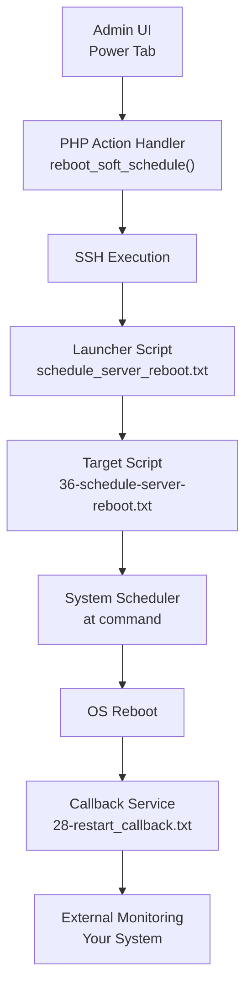
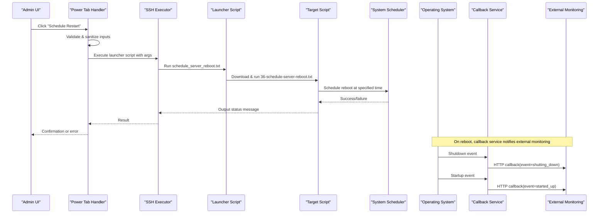
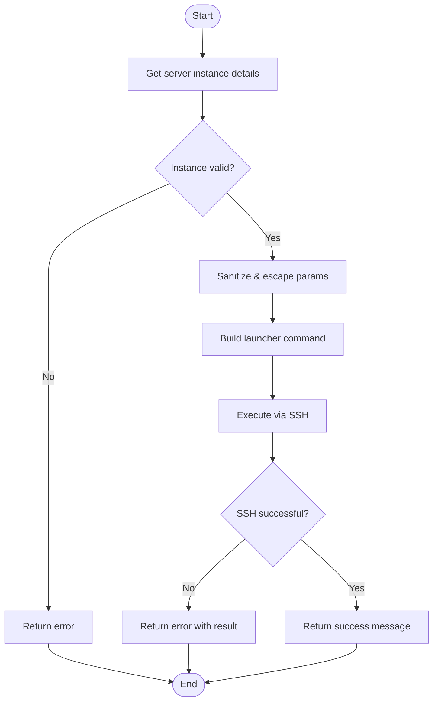
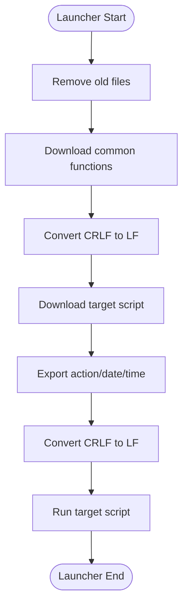
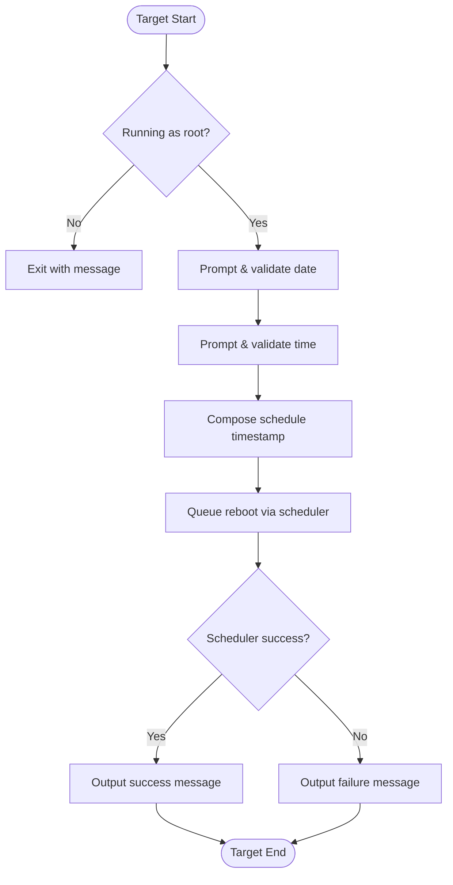
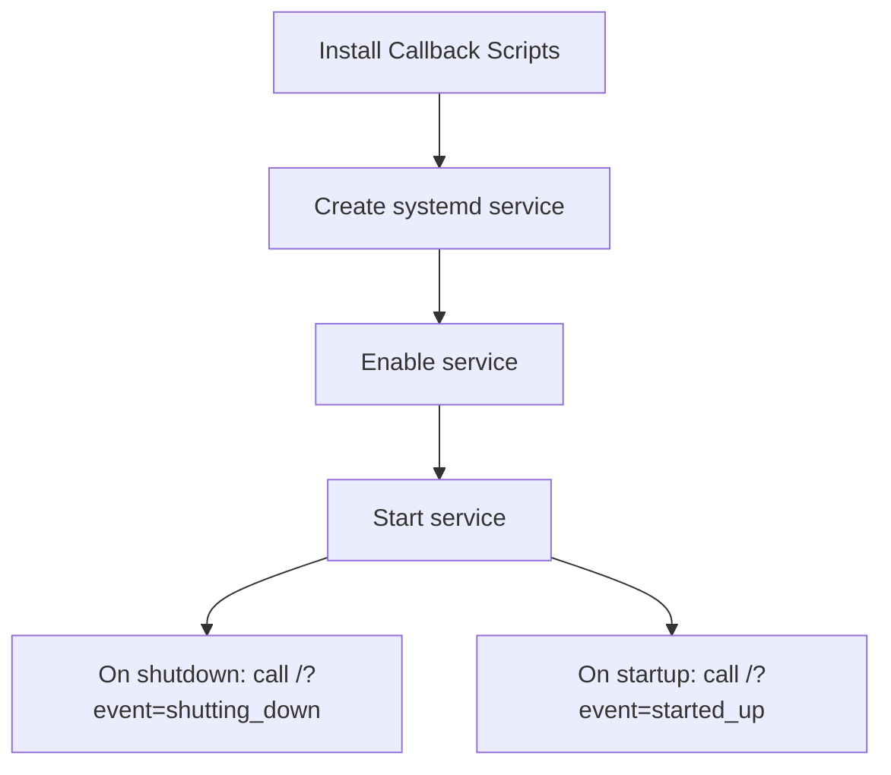
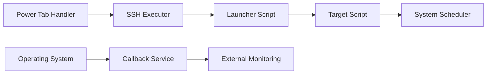

# Scheduled Reboots

<cite>
**Referenced Files in This Document**
- [power.php](file://includes/core/apps/wordpress-app/tabs-server/power.php)
- [36-schedule-server-reboot.txt (v1)](file://includes/core/apps/wordpress-app/scripts/v1/raw/36-schedule-server-reboot.txt)
- [36-schedule-server-reboot.txt (v2)](file://includes/core/apps/wordpress-app/scripts/v2/raw/36-schedule-server-reboot.txt)
- [schedule_server_reboot.txt (launcher v1)](file://includes/core/apps/wordpress-app/scripts/v1/schedule_server_reboot.txt)
- [28-restart_callback.txt](file://includes/core/apps/wordpress-app/scripts/v1/raw/28-restart_callback.txt)
- [script-handlers.php](file://includes/core/apps/wordpress-app/traits/traits-for-class-wordpress-app/script-handlers.php)
</cite>

## Table of Contents
1. [Introduction](#introduction)
2. [Project Structure](#project-structure)
3. [Core Components](#core-components)
4. [Architecture Overview](#architecture-overview)
5. [Detailed Component Analysis](#detailed-component-analysis)
6. [Dependency Analysis](#dependency-analysis)
7. [Performance Considerations](#performance-considerations)
8. [Troubleshooting Guide](#troubleshooting-guide)
9. [Conclusion](#conclusion)

## Introduction
This document explains SimpleStack’s scheduled reboot functionality for WordPress App servers. It covers how to configure maintenance windows, implement zero-downtime reboot strategies, and automate regular reboots. It also documents the reboot script execution environment, pre-reboot checks, graceful service shutdowns, and post-reboot verification processes. Finally, it provides examples for setting up regular maintenance schedules, handling emergency reboots, integrating with external monitoring systems, and best practices for minimizing disruption during reboots.

## Project Structure
The scheduled reboot feature spans both PHP logic in the WordPress App tabs and shell scripts executed on the server:

- UI and orchestration: Power tab actions and scheduling flow are implemented in the WordPress App server Power tab.
- Server-side scheduling: The system uses a launcher script to fetch and run a target script that leverages the system scheduler to execute a reboot at a specified time.
- Callback integration: A callback mechanism can notify an external endpoint before shutdown and after startup.



**Diagram sources**
- [power.php:508-557](file://includes/core/apps/wordpress-app/tabs-server/power.php#L508-L557)
- [schedule_server_reboot.txt (launcher v1):1-8](file://includes/core/apps/wordpress-app/scripts/v1/schedule_server_reboot.txt#L1-L8)
- [36-schedule-server-reboot.txt (v1):37-45](file://includes/core/apps/wordpress-app/scripts/v1/raw/36-schedule-server-reboot.txt#L37-L45)
- [28-restart_callback.txt:27-71](file://includes/core/apps/wordpress-app/scripts/v1/raw/28-restart_callback.txt#L27-L71)

**Section sources**
- [power.php:117-157](file://includes/core/apps/wordpress-app/tabs-server/power.php#L117-L157)
- [power.php:282-339](file://includes/core/apps/wordpress-app/tabs-server/power.php#L282-L339)
- [schedule_server_reboot.txt (launcher v1):1-8](file://includes/core/apps/wordpress-app/scripts/v1/schedule_server_reboot.txt#L1-L8)
- [36-schedule-server-reboot.txt (v1):1-46](file://includes/core/apps/wordpress-app/scripts/v1/raw/36-schedule-server-reboot.txt#L1-L46)
- [28-restart_callback.txt:1-107](file://includes/core/apps/wordpress-app/scripts/v1/raw/28-restart_callback.txt#L1-L107)

## Core Components
- Power tab action handler: Validates user permissions, sanitizes inputs, and triggers the scheduled reboot via SSH.
- Launcher script: Downloads and executes the target script with required environment variables.
- Target script: Accepts date/time parameters, validates them, and schedules a reboot using the system scheduler.
- Callback service: Installs systemd hooks to call an external endpoint on shutdown/startup events.

Key responsibilities:
- Input validation and escaping in PHP.
- Secure remote execution over SSH.
- Robust date/time validation on the server.
- Integration with OS-level scheduling and systemd services.

**Section sources**
- [power.php:508-557](file://includes/core/apps/wordpress-app/tabs-server/power.php#L508-L557)
- [schedule_server_reboot.txt (launcher v1):1-8](file://includes/core/apps/wordpress-app/scripts/v1/schedule_server_reboot.txt#L1-L8)
- [36-schedule-server-reboot.txt (v1):8-45](file://includes/core/apps/wordpress-app/scripts/v1/raw/36-schedule-server-reboot.txt#L8-L45)
- [28-restart_callback.txt:27-71](file://includes/core/apps/wordpress-app/scripts/v1/raw/28-restart_callback.txt#L27-L71)

## Architecture Overview
The end-to-end flow for a scheduled reboot is as follows:



**Diagram sources**
- [power.php:508-557](file://includes/core/apps/wordpress-app/tabs-server/power.php#L508-L557)
- [schedule_server_reboot.txt (launcher v1):1-8](file://includes/core/apps/wordpress-app/scripts/v1/schedule_server_reboot.txt#L1-L8)
- [36-schedule-server-reboot.txt (v1):37-45](file://includes/core/apps/wordpress-app/scripts/v1/raw/36-schedule-server-reboot.txt#L37-L45)
- [28-restart_callback.txt:27-71](file://includes/core/apps/wordpress-app/scripts/v1/raw/28-restart_callback.txt#L27-L71)

## Detailed Component Analysis

### Power Tab Scheduling Flow
- Permissions and action routing: The Power tab defines allowed actions including soft reboot, provider hard reboot, graceful shutdown, hard shutdown, power on, and scheduled soft reboot.
- Scheduling method: The scheduled reboot method retrieves server instance details, sanitizes and escapes date/time parameters, builds the command to run the launcher script, executes it via SSH, and evaluates success based on output.



**Diagram sources**
- [power.php:508-557](file://includes/core/apps/wordpress-app/tabs-server/power.php#L508-L557)

**Section sources**
- [power.php:117-157](file://includes/core/apps/wordpress-app/tabs-server/power.php#L117-L157)
- [power.php:508-557](file://includes/core/apps/wordpress-app/tabs-server/power.php#L508-L557)

### Launcher Script Behavior
- Purpose: Prepare the environment, download the common functions and target script, set environment variables (action, reboot_date, reboot_time), convert line endings, and execute the target script.
- Security: Uses sudo to ensure root privileges and sanitizes arguments passed from PHP.



**Diagram sources**
- [schedule_server_reboot.txt (launcher v1):1-8](file://includes/core/apps/wordpress-app/scripts/v1/schedule_server_reboot.txt#L1-L8)

**Section sources**
- [schedule_server_reboot.txt (launcher v1):1-8](file://includes/core/apps/wordpress-app/scripts/v1/schedule_server_reboot.txt#L1-L8)

### Target Script Validation and Scheduling
- Root check: Ensures the script runs as root.
- Interactive prompts: If not provided via environment variables, prompts for date and time and validates them using the system date utility.
- Scheduling: Composes the schedule timestamp and queues a reboot using the system scheduler. Returns a success or failure message based on the scheduler’s exit code.



**Diagram sources**
- [36-schedule-server-reboot.txt (v1):1-46](file://includes/core/apps/wordpress-app/scripts/v1/raw/36-schedule-server-reboot.txt#L1-L46)
- [36-schedule-server-reboot.txt (v2):1-46](file://includes/core/apps/wordpress-app/scripts/v2/raw/36-schedule-server-reboot.txt#L1-L46)

**Section sources**
- [36-schedule-server-reboot.txt (v1):1-46](file://includes/core/apps/wordpress-app/scripts/v1/raw/36-schedule-server-reboot.txt#L1-L46)
- [36-schedule-server-reboot.txt (v2):1-46](file://includes/core/apps/wordpress-app/scripts/v2/raw/36-schedule-server-reboot.txt#L1-L46)

### Graceful Shutdown and Immediate Reboot Patterns
- Graceful shutdown: Sends a MySQL stop command followed by a scheduled shutdown via the system scheduler. Updates server state to off and fires success hooks.
- Immediate soft reboot: Stops MySQL then schedules a reboot one minute later via the system scheduler. Updates server state to in-progress and fires success hooks.

```mermaid
sequenceDiagram
participant Admin as "Admin UI"
participant PowerTab as "Power Tab Handler"
participant SSH as "SSH Executor"
participant OS as "Operating System"
Admin->>PowerTab : Trigger "Graceful Shutdown"
PowerTab->>SSH : Execute "stop mysql; schedule shutdown"
SSH-->>PowerTab : Result
PowerTab->>PowerTab : Update server state to off
PowerTab-->>Admin : Confirmation
Admin->>PowerTab : Trigger "Soft Reboot"
PowerTab->>SSH : Execute "stop mysql; schedule reboot +1m"
SSH-->>PowerTab : Result
PowerTab->>PowerTab : Update server state to in-progress
PowerTab-->>Admin : Confirmation
```

**Diagram sources**
- [power.php:430-456](file://includes/core/apps/wordpress-app/tabs-server/power.php#L430-L456)
- [power.php:567-593](file://includes/core/apps/wordpress-app/tabs-server/power.php#L567-L593)

**Section sources**
- [power.php:430-456](file://includes/core/apps/wordpress-app/tabs-server/power.php#L430-L456)
- [power.php:567-593](file://includes/core/apps/wordpress-app/tabs-server/power.php#L567-L593)

### Post-Reboot Verification and Callback Integration
- Callback installation: Installs startup and shutdown scripts and a systemd service that calls an external endpoint with event parameters.
- Lifecycle hooks: The service is configured to run before shutdown/reboot/halt and after network availability, ensuring reliable notifications.



**Diagram sources**
- [28-restart_callback.txt:27-71](file://includes/core/apps/wordpress-app/scripts/v1/raw/28-restart_callback.txt#L27-L71)

**Section sources**
- [28-restart_callback.txt:27-71](file://includes/core/apps/wordpress-app/scripts/v1/raw/28-restart_callback.txt#L27-L71)

## Dependency Analysis
- PHP layer depends on:
  - Server instance retrieval methods.
  - SSH execution utilities.
  - Pending tasks background processing for bulk operations.
- Shell scripts depend on:
  - Root privileges.
  - System scheduler (at).
  - Systemd for callback service management.



**Diagram sources**
- [power.php:508-557](file://includes/core/apps/wordpress-app/tabs-server/power.php#L508-L557)
- [schedule_server_reboot.txt (launcher v1):1-8](file://includes/core/apps/wordpress-app/scripts/v1/schedule_server_reboot.txt#L1-L8)
- [36-schedule-server-reboot.txt (v1):37-45](file://includes/core/apps/wordpress-app/scripts/v1/raw/36-schedule-server-reboot.txt#L37-L45)
- [28-restart_callback.txt:27-71](file://includes/core/apps/wordpress-app/scripts/v1/raw/28-restart_callback.txt#L27-L71)

**Section sources**
- [power.php:508-557](file://includes/core/apps/wordpress-app/tabs-server/power.php#L508-L557)
- [script-handlers.php:659-661](file://includes/core/apps/wordpress-app/traits/traits-for-class-wordpress-app/script-handlers.php#L659-L661)
- [script-handlers.php:1670-1670](file://includes/core/apps/wordpress-app/traits/traits-for-class-wordpress-app/script-handlers.php#L1670-L1670)

## Performance Considerations
- Use scheduled reboots during low-traffic periods to minimize impact.
- Stop non-essential services before reboot to reduce downtime.
- Ensure the system scheduler is enabled and functioning correctly.
- Avoid frequent reboots; batch maintenance tasks where possible.
- Monitor callback endpoints to prevent unnecessary retries or backpressure.

[No sources needed since this section provides general guidance]

## Troubleshooting Guide
Common issues and resolutions:
- Permission errors: Ensure scripts run as root. The target script enforces a root check and exits if not privileged.
- Invalid date/time: The target script validates input using the system date utility; correct the format and retry.
- Scheduler failures: Verify the system scheduler is installed and running; check its logs for job queue issues.
- SSH execution failures: Confirm SSH connectivity and credentials; inspect the PHP error messages returned by the SSH executor.
- Callback not firing: Verify the systemd service is enabled and running; check the external endpoint logs for incoming requests.

Operational tips:
- Use the Power tab’s “After-restart Instructions” to verify server state updates automatically when callbacks are installed.
- For bulk operations, use the pending tasks screen to track progress and completion status.

**Section sources**
- [36-schedule-server-reboot.txt (v1):1-6](file://includes/core/apps/wordpress-app/scripts/v1/raw/36-schedule-server-reboot.txt#L1-L6)
- [36-schedule-server-reboot.txt (v1):8-35](file://includes/core/apps/wordpress-app/scripts/v1/raw/36-schedule-server-reboot.txt#L8-L35)
- [power.php:403-416](file://includes/core/apps/wordpress-app/tabs-server/power.php#L403-L416)

## Conclusion
SimpleStack’s scheduled reboot feature provides a robust, extensible mechanism for managing server maintenance. By combining PHP orchestration, secure remote script execution, OS-level scheduling, and callback integrations, administrators can plan maintenance windows, implement graceful shutdowns, and integrate with external monitoring systems. Following the best practices outlined here will help minimize service disruption and improve operational reliability.

[No sources needed since this section summarizes without analyzing specific files]