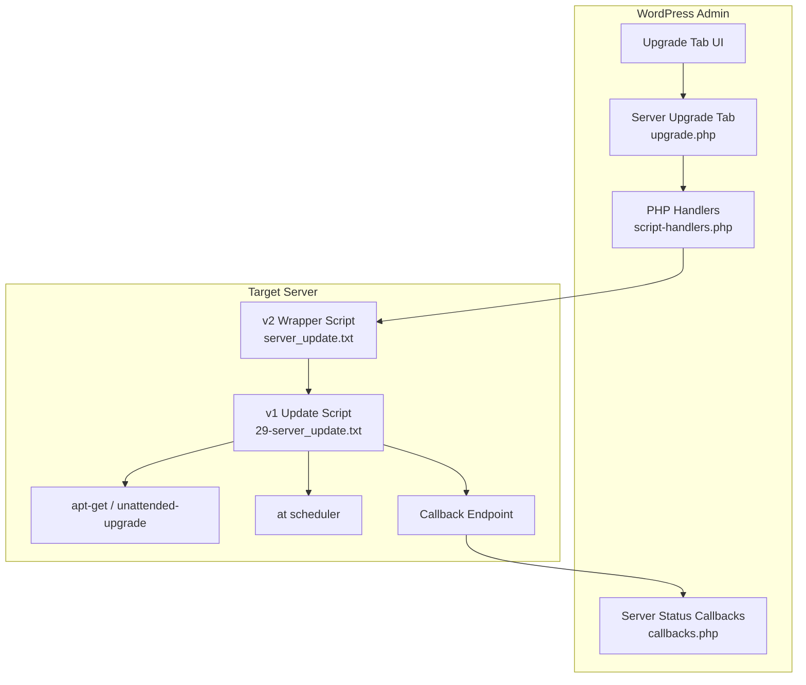
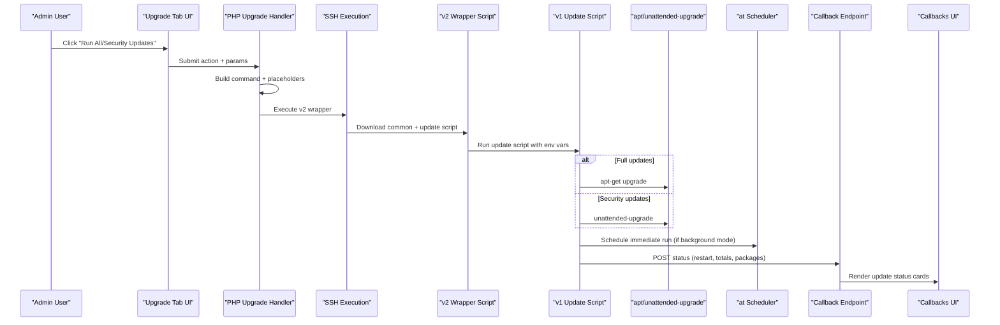
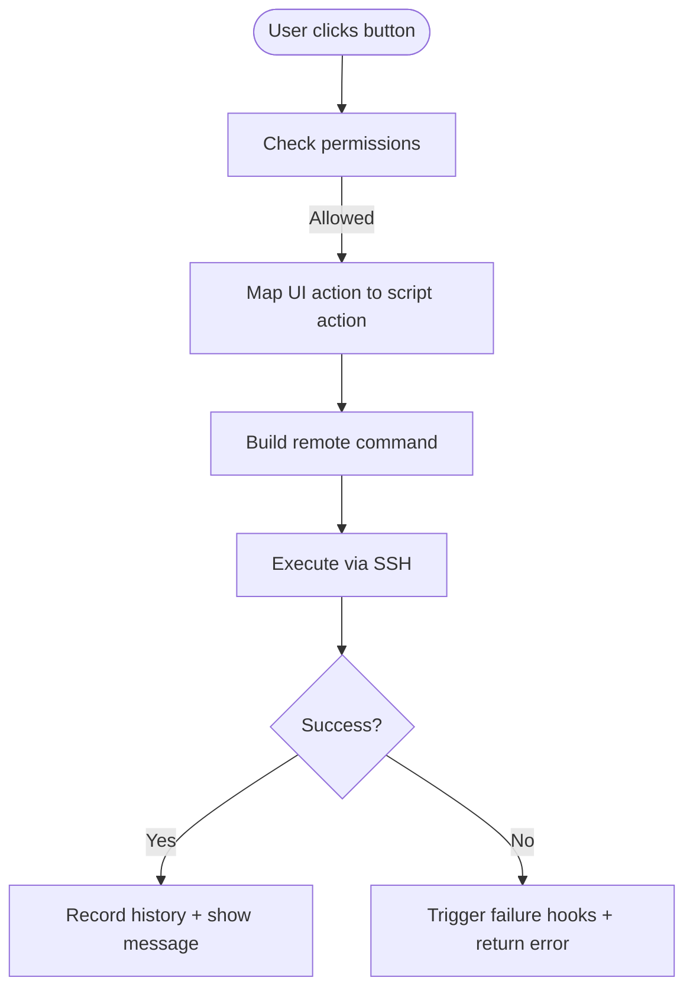
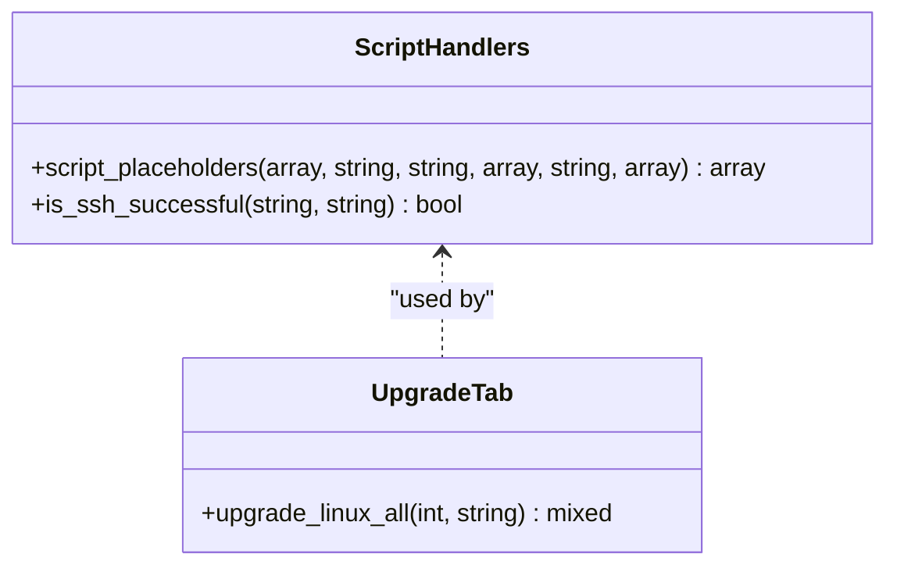
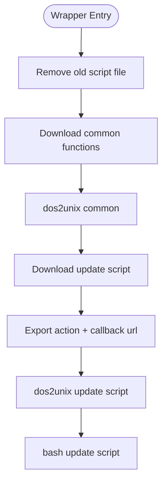
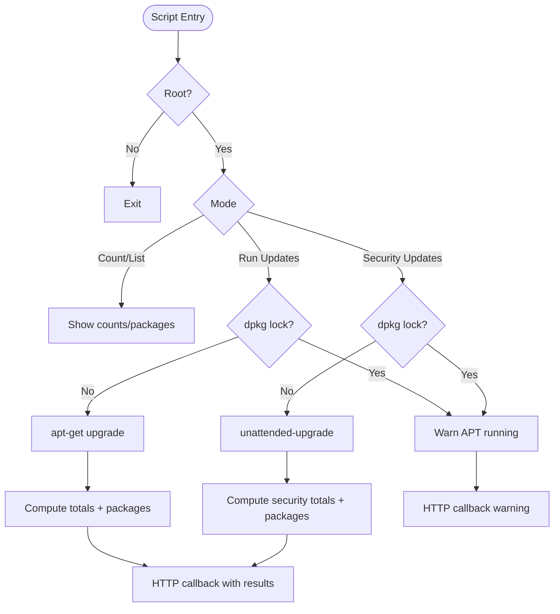
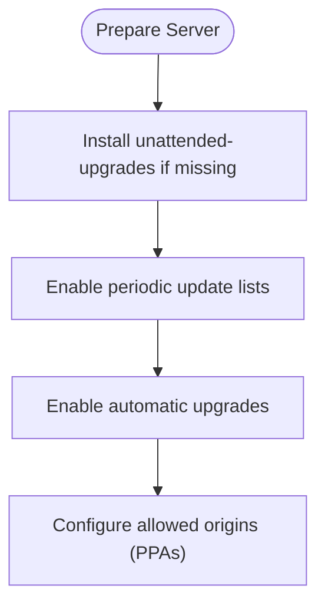
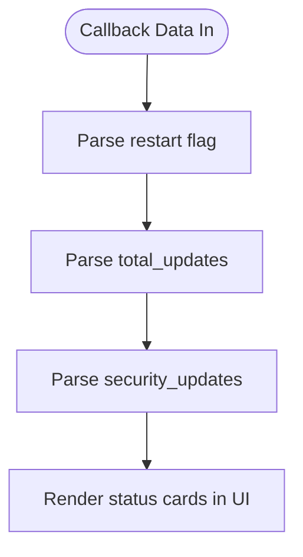
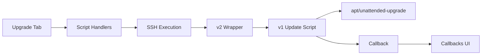

# System Updates

<cite>
**Referenced Files in This Document**   
- [README.md](file://README.md)
- [upgrade.php](file://includes/core/apps/wordpress-app/tabs-server/upgrade.php)
- [callbacks.php](file://includes/core/apps/wordpress-app/tabs-server/callbacks.php)
- [script-handlers.php](file://includes/core/apps/wordpress-app/traits/traits-for-class-wordpress-app/script-handlers.php)
- [server_update.txt (v1)](file://includes/core/apps/wordpress-app/scripts/v1/raw/29-server_update.txt)
- [server_update.txt (v2 wrapper)](file://includes/core/apps/wordpress-app/scripts/v2/server_update.txt)
- [01-prepare_server.txt (v1)](file://includes/core/apps/wordpress-app/scripts/v1/raw/01-prepare_server.txt)
- [01-prepare_server.txt (v2)](file://includes/core/apps/wordpress-app/scripts/v2/raw/01-prepare_server.txt)
</cite>

## Table of Contents
1. [Introduction](#introduction)
2. [Project Structure](#project-structure)
3. [Core Components](#core-components)
4. [Architecture Overview](#architecture-overview)
5. [Detailed Component Analysis](#detailed-component-analysis)
6. [Dependency Analysis](#dependency-analysis)
7. [Performance Considerations](#performance-considerations)
8. [Troubleshooting Guide](#troubleshooting-guide)
9. [Conclusion](#conclusion)

## Introduction
This document explains Simple Stack’s system update functionality for servers, focusing on automated operating system package updates, security patches, and dependency management. It covers the end-to-end update flow from the WordPress admin UI to server-side scripts, including pre-update checks, background scheduling via `at`, callback reporting, and integration with unattended-upgrades. It also documents configuration options exposed by the UI, how to customize behavior, handle failures, and monitor progress.

Simple Stack provisions Ubuntu 24.04 LTS and 26.04 LTS servers and manages them through a single web stack and admin UI. The update feature is implemented as a combination of PHP handlers in the WordPress plugin and Bash scripts executed over SSH on target servers.

**Section sources**
- [README.md:27-37](file://README.md#L27-L37)

## Project Structure
The system update feature spans several layers:
- WordPress Admin UI and tab logic that exposes actions and displays status
- PHP script handler that builds and executes remote commands
- Server-side Bash scripts that perform OS-level updates and report back

**Diagram sources**
- [upgrade.php:2531-2608](file://includes/core/apps/wordpress-app/tabs-server/upgrade.php#L2531-L2608)
- [script-handlers.php:1710-1718](file://includes/core/apps/wordpress-app/traits/traits-for-class-wordpress-app/script-handlers.php#L1710-L1718)
- [server_update.txt (v2 wrapper):1-9](file://includes/core/apps/wordpress-app/scripts/v2/server_update.txt#L1-L9)
- [server_update.txt (v1):44-164](file://includes/core/apps/wordpress-app/scripts/v1/raw/29-server_update.txt#L44-L164)
- [callbacks.php:680-844](file://includes/core/apps/wordpress-app/tabs-server/callbacks.php#L680-L844)

**Section sources**
- [README.md:27-37](file://README.md#L27-L37)
- [upgrade.php:2531-2608](file://includes/core/apps/wordpress-app/tabs-server/upgrade.php#L2531-L2608)
- [script-handlers.php:1710-1718](file://includes/core/apps/wordpress-app/traits/traits-for-class-wordpress-app/script-handlers.php#L1710-L1718)
- [server_update.txt (v2 wrapper):1-9](file://includes/core/apps/wordpress-app/scripts/v2/server_update.txt#L1-L9)
- [server_update.txt (v1):44-164](file://includes/core/apps/wordpress-app/scripts/v1/raw/29-server_update.txt#L44-L164)
- [callbacks.php:680-844](file://includes/core/apps/wordpress-app/tabs-server/callbacks.php#L680-L844)

## Core Components
- Upgrade Tab UI: Presents “Run All Linux Updates Now” and “Run Linux Security Updates Only” buttons, shows pending update counts, and provides confirmation prompts.
- PHP Handler: Builds the remote command, injects placeholders (script URLs, names), executes via SSH, and interprets success/failure based on output patterns.
- v2 Wrapper Script: Downloads the common functions and the actual update script, sets environment variables, normalizes line endings, and runs the update script.
- v1 Update Script: Performs OS-level updates using `apt-get upgrade` or `unattended-upgrade`, schedules background execution via `at`, and reports status via HTTP callback.
- Callbacks: Parses callback data and renders cards showing restart requirement, total updates, security updates, unattended updates count, and last updated timestamp.

Key responsibilities:
- Pre-update checks: root user check, dpkg lock detection, reboot-required flag.
- Update types: full upgrades vs. security-only updates.
- Background scheduling: uses `at` to run updates asynchronously.
- Reporting: callback sends restart flag, update counts, and package lists; UI displays these metrics.

**Section sources**
- [upgrade.php:358-433](file://includes/core/apps/wordpress-app/tabs-server/upgrade.php#L358-L433)
- [upgrade.php:2531-2608](file://includes/core/apps/wordpress-app/tabs-server/upgrade.php#L2531-L2608)
- [script-handlers.php:731-736](file://includes/core/apps/wordpress-app/traits/traits-for-class-wordpress-app/script-handlers.php#L731-L736)
- [script-handlers.php:1710-1718](file://includes/core/apps/wordpress-app/traits/traits-for-class-wordpress-app/script-handlers.php#L1710-L1718)
- [server_update.txt (v2 wrapper):1-9](file://includes/core/apps/wordpress-app/scripts/v2/server_update.txt#L1-L9)
- [server_update.txt (v1):1-164](file://includes/core/apps/wordpress-app/scripts/v1/raw/29-server_update.txt#L1-L164)
- [callbacks.php:680-844](file://includes/core/apps/wordpress-app/tabs-server/callbacks.php#L680-L844)

## Architecture Overview
The update process flows from the WordPress admin to the server and back via callbacks.

**Diagram sources**
- [upgrade.php:2531-2608](file://includes/core/apps/wordpress-app/tabs-server/upgrade.php#L2531-L2608)
- [script-handlers.php:1710-1718](file://includes/core/apps/wordpress-app/traits/traits-for-class-wordpress-app/script-handlers.php#L1710-L1718)
- [server_update.txt (v2 wrapper):1-9](file://includes/core/apps/wordpress-app/scripts/v2/server_update.txt#L1-L9)
- [server_update.txt (v1):44-164](file://includes/core/apps/wordpress-app/scripts/v1/raw/29-server_update.txt#L44-L164)
- [callbacks.php:680-844](file://includes/core/apps/wordpress-app/tabs-server/callbacks.php#L680-L844)

## Detailed Component Analysis

### Upgrade Tab UI and Actions
- Exposes two primary actions:
  - “Run All Linux Updates Now” maps to action `run_updates_cron`.
  - “Run Linux Security Updates Only” maps to action `run_security_updates_cron`.
- Displays pending update counts read from server status metadata.
- Provides confirmation prompts before executing updates.

**Diagram sources**
- [upgrade.php:138-147](file://includes/core/apps/wordpress-app/tabs-server/upgrade.php#L138-L147)
- [upgrade.php:358-433](file://includes/core/apps/wordpress-app/tabs-server/upgrade.php#L358-L433)
- [upgrade.php:2531-2608](file://includes/core/apps/wordpress-app/tabs-server/upgrade.php#L2531-L2608)

**Section sources**
- [upgrade.php:138-147](file://includes/core/apps/wordpress-app/tabs-server/upgrade.php#L138-L147)
- [upgrade.php:358-433](file://includes/core/apps/wordpress-app/tabs-server/upgrade.php#L358-L433)
- [upgrade.php:2531-2608](file://includes/core/apps/wordpress-app/tabs-server/upgrade.php#L2531-L2608)

### PHP Script Handler and Placeholders
- Resolves script paths and names for `server_update.txt`.
- Injects common function URL/name and other shared variables.
- Determines success based on expected output strings from the update script.

**Diagram sources**
- [script-handlers.php:1710-1718](file://includes/core/apps/wordpress-app/traits/traits-for-class-wordpress-app/script-handlers.php#L1710-L1718)
- [script-handlers.php:731-736](file://includes/core/apps/wordpress-app/traits/traits-for-class-wordpress-app/script-handlers.php#L731-L736)
- [upgrade.php:2531-2608](file://includes/core/apps/wordpress-app/tabs-server/upgrade.php#L2531-L2608)

**Section sources**
- [script-handlers.php:731-736](file://includes/core/apps/wordpress-app/traits/traits-for-class-wordpress-app/script-handlers.php#L731-L736)
- [script-handlers.php:1710-1718](file://includes/core/apps/wordpress-app/traits/traits-for-class-wordpress-app/script-handlers.php#L1710-L1718)
- [upgrade.php:2531-2608](file://includes/core/apps/wordpress-app/tabs-server/upgrade.php#L2531-L2608)

### v2 Wrapper Script
- Downloads common functions and the actual update script.
- Normalizes line endings and sets environment variables (`action`, `callback_server_status`).
- Executes the update script under sudo.

**Diagram sources**
- [server_update.txt (v2 wrapper):1-9](file://includes/core/apps/wordpress-app/scripts/v2/server_update.txt#L1-L9)

**Section sources**
- [server_update.txt (v2 wrapper):1-9](file://includes/core/apps/wordpress-app/scripts/v2/server_update.txt#L1-L9)

### v1 Update Script
- Enforces root execution.
- Supports multiple modes:
  - Count/list updates
  - Run updates immediately
  - Schedule updates in background via `at`
  - Run security updates in background via `at`
- Pre-checks:
  - Detects `/var/run/reboot-required` to set restart flag.
  - Checks dpkg lock to avoid concurrent APT operations.
- Update engines:
  - Full upgrades: `apt-get --with-new-pkgs upgrade -y`
  - Security-only: `unattended-upgrade`
- Reports status via HTTP callback with parameters:
  - `restart`: yes/no
  - `total_updates`: number of pending updates
  - `list_of_packages`: comma-separated list of upgradable packages
  - `security_updates`: number of security updates (for security path)
  - `apt_already_running_warning`: when dpkg lock is present

**Diagram sources**
- [server_update.txt (v1):1-164](file://includes/core/apps/wordpress-app/scripts/v1/raw/29-server_update.txt#L1-L164)

**Section sources**
- [server_update.txt (v1):1-164](file://includes/core/apps/wordpress-app/scripts/v1/raw/29-server_update.txt#L1-L164)

### Unattended Upgrades Integration
- During server preparation, the setup script installs and enables unattended-upgrades, configuring periodic update lists and automatic upgrades.
- This ensures security patches are applied automatically each night unless overridden.

**Diagram sources**
- [01-prepare_server.txt (v1):366-400](file://includes/core/apps/wordpress-app/scripts/v1/raw/01-prepare_server.txt#L366-L400)
- [01-prepare_server.txt (v2):412-445](file://includes/core/apps/wordpress-app/scripts/v2/raw/01-prepare_server.txt#L412-L445)

**Section sources**
- [01-prepare_server.txt (v1):366-400](file://includes/core/apps/wordpress-app/scripts/v1/raw/01-prepare_server.txt#L366-L400)
- [01-prepare_server.txt (v2):412-445](file://includes/core/apps/wordpress-app/scripts/v2/raw/01-prepare_server.txt#L412-L445)

### Callbacks and UI Rendering
- The callback endpoint parses incoming data and renders cards for:
  - Restart requirement
  - Security updates count
  - Total updates pending
  - Unattended updates pending
  - Last updated timestamp

**Diagram sources**
- [callbacks.php:680-844](file://includes/core/apps/wordpress-app/tabs-server/callbacks.php#L680-L844)

**Section sources**
- [callbacks.php:680-844](file://includes/core/apps/wordpress-app/tabs-server/callbacks.php#L680-L844)

## Dependency Analysis
- Upgrade Tab depends on:
  - Script handlers to build and execute commands
  - SSH execution layer to run scripts on servers
  - Callbacks to display update status
- Script handlers depend on:
  - Placeholder resolution for script URLs/names
  - Output parsing to determine success/failure
- Update scripts depend on:
  - OS tools: `apt-get`, `unattended-upgrade`, `lsof`, `curl`, `at`
  - System state: dpkg lock, reboot-required flag

**Diagram sources**
- [upgrade.php:2531-2608](file://includes/core/apps/wordpress-app/tabs-server/upgrade.php#L2531-L2608)
- [script-handlers.php:1710-1718](file://includes/core/apps/wordpress-app/traits/traits-for-class-wordpress-app/script-handlers.php#L1710-L1718)
- [server_update.txt (v2 wrapper):1-9](file://includes/core/apps/wordpress-app/scripts/v2/server_update.txt#L1-L9)
- [server_update.txt (v1):44-164](file://includes/core/apps/wordpress-app/scripts/v1/raw/29-server_update.txt#L44-L164)
- [callbacks.php:680-844](file://includes/core/apps/wordpress-app/tabs-server/callbacks.php#L680-L844)

**Section sources**
- [upgrade.php:2531-2608](file://includes/core/apps/wordpress-app/tabs-server/upgrade.php#L2531-L2608)
- [script-handlers.php:1710-1718](file://includes/core/apps/wordpress-app/traits/traits-for-class-wordpress-app/script-handlers.php#L1710-L1718)
- [server_update.txt (v2 wrapper):1-9](file://includes/core/apps/wordpress-app/scripts/v2/server_update.txt#L1-L9)
- [server_update.txt (v1):44-164](file://includes/core/apps/wordpress-app/scripts/v1/raw/29-server_update.txt#L44-L164)
- [callbacks.php:680-844](file://includes/core/apps/wordpress-app/tabs-server/callbacks.php#L680-L844)

## Performance Considerations
- Background scheduling via `at` avoids blocking the UI during long-running updates.
- Avoiding concurrent APT operations prevents lock contention and partial upgrades.
- Using `unattended-upgrade` for security updates reduces manual intervention and improves timeliness of critical patches.
- Callback-based reporting decouples update execution from UI rendering, improving responsiveness.

[No sources needed since this section provides general guidance]

## Troubleshooting Guide
Common issues and resolutions:
- APT already running:
  - Symptom: Warning about dpkg lock; updates may not start.
  - Resolution: Wait for existing APT processes to finish or resolve lock conflicts.
- Missing `at` scheduler:
  - Symptom: Background scheduling fails.
  - Resolution: Ensure `at` is installed; the update script attempts to install it.
- No callback received:
  - Symptom: UI does not reflect update status.
  - Resolution: Verify network connectivity from server to callback endpoint; check firewall rules and SSL certificate validity.
- Reboot required:
  - Symptom: Restart flag set after updates.
  - Resolution: Plan a controlled reboot window and apply restart at maintenance time.
- Unattended-upgrades not configured:
  - Symptom: Security updates not applied automatically.
  - Resolution: Run server preparation to enable unattended-upgrades and configure periodic updates.

**Section sources**
- [server_update.txt (v1):59-76](file://includes/core/apps/wordpress-app/scripts/v1/raw/29-server_update.txt#L59-L76)
- [server_update.txt (v1):80-120](file://includes/core/apps/wordpress-app/scripts/v1/raw/29-server_update.txt#L80-L120)
- [server_update.txt (v1):123-164](file://includes/core/apps/wordpress-app/scripts/v1/raw/29-server_update.txt#L123-L164)
- [01-prepare_server.txt (v1):366-400](file://includes/core/apps/wordpress-app/scripts/v1/raw/01-prepare_server.txt#L366-L400)
- [01-prepare_server.txt (v2):412-445](file://includes/core/apps/wordpress-app/scripts/v2/raw/01-prepare_server.txt#L412-L445)

## Conclusion
Simple Stack’s system update feature provides a robust, auditable workflow for applying OS-level updates and security patches across managed servers. It combines a clear UI, reliable PHP handlers, and resilient server-side scripts with background scheduling and callback reporting. By leveraging unattended-upgrades and careful pre-update checks, it balances automation with safety. Operators can schedule updates selectively, monitor progress via the UI, and troubleshoot common issues using the guidance provided.

[No sources needed since this section summarizes without analyzing specific files]