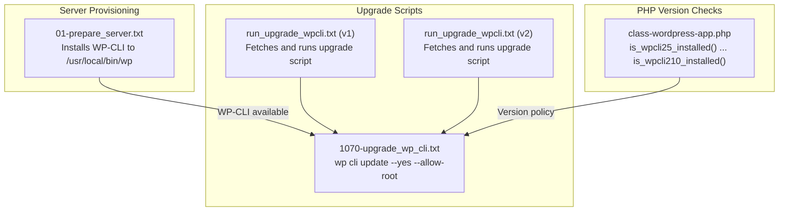
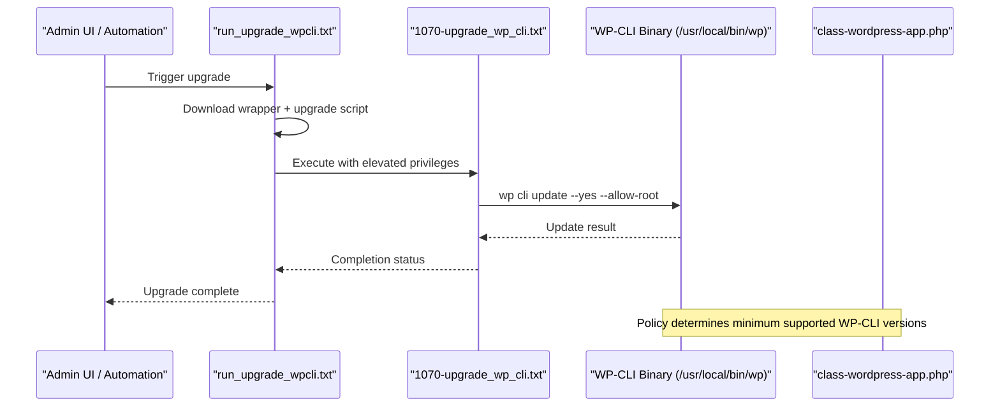
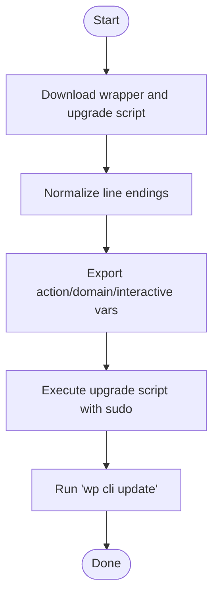
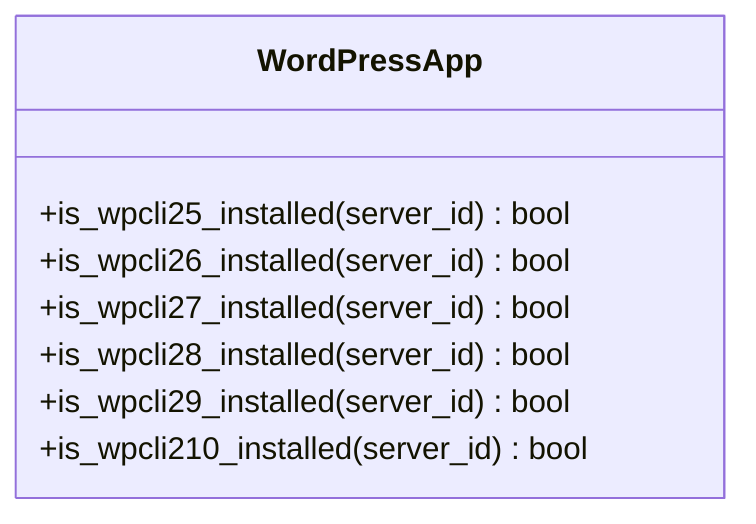
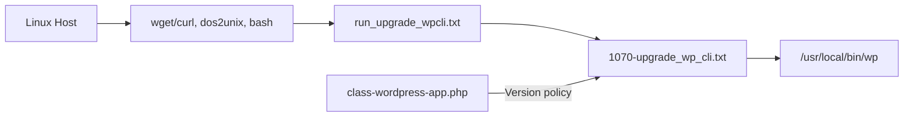

# WP-CLI Management

<cite>
**Referenced Files in This Document**
- [class-wordpress-app.php](file://includes/core/apps/wordpress-app/class-wordpress-app.php)
- [01-prepare_server.txt](file://includes/core/apps/wordpress-app/scripts/v1/raw/01-prepare_server.txt)
- [1070-upgrade_wp_cli.txt](file://includes/core/apps/wordpress-app/scripts/v1/raw/1070-upgrade_wp_cli.txt)
- [run_upgrade_wpcli.txt (v1)](file://includes/core/apps/wordpress-app/scripts/v1/run_upgrade_wpcli.txt)
- [run_upgrade_wpcli.txt (v2)](file://includes/core/apps/wordpress-app/scripts/v2/run_upgrade_wpcli.txt)
- [environment variables.txt](file://includes/core/apps/wordpress-app/scripts/v1/raw/environment%20variables.txt)
</cite>

## Table of Contents
1. [Introduction](#introduction)
2. [Project Structure](#project-structure)
3. [Core Components](#core-components)
4. [Architecture Overview](#architecture-overview)
5. [Detailed Component Analysis](#detailed-component-analysis)
6. [Dependency Analysis](#dependency-analysis)
7. [Performance Considerations](#performance-considerations)
8. [Troubleshooting Guide](#troubleshooting-guide)
9. [Conclusion](#conclusion)
10. [Appendices](#appendices)

## Introduction
This document explains how SimpleStack manages WP-CLI across WordPress sites and servers. It covers automated installation, upgrade procedures, version management, script execution environment, dependency resolution, compatibility checks, and operational best practices for automation and security. It also provides guidance for managing multiple WordPress installations, configuring WP-CLI aliases, integrating with deployment workflows, troubleshooting common issues, and optimizing performance.

## Project Structure
WP-CLI management is implemented through a combination of server provisioning scripts, dedicated upgrade scripts, and PHP-side version compatibility checks:

- Server provisioning installs WP-CLI globally and performs an initial update.
- Dedicated upgrade scripts fetch and execute the latest stable WP-CLI.
- PHP-side helpers determine whether specific WP-CLI versions are present based on plugin version history or manual upgrades.

**Diagram sources**
- [01-prepare_server.txt:970-973](file://includes/core/apps/wordpress-app/scripts/v1/raw/01-prepare_server.txt#L970-L973)
- [1070-upgrade_wp_cli.txt:1-10](file://includes/core/apps/wordpress-app/scripts/v1/raw/1070-upgrade_wp_cli.txt#L1-L10)
- [run_upgrade_wpcli.txt (v1):1-9](file://includes/core/apps/wordpress-app/scripts/v1/run_upgrade_wpcli.txt#L1-L9)
- [run_upgrade_wpcli.txt (v2):1-9](file://includes/core/apps/wordpress-app/scripts/v2/run_upgrade_wpcli.txt#L1-L9)
- [class-wordpress-app.php:1420-1580](file://includes/core/apps/wordpress-app/class-wordpress-app.php#L1420-L1580)

**Section sources**
- [01-prepare_server.txt:970-973](file://includes/core/apps/wordpress-app/scripts/v1/raw/01-prepare_server.txt#L970-L973)
- [1070-upgrade_wp_cli.txt:1-10](file://includes/core/apps/wordpress-app/scripts/v1/raw/1070-upgrade_wp_cli.txt#L1-L10)
- [run_upgrade_wpcli.txt (v1):1-9](file://includes/core/apps/wordpress-app/scripts/v1/run_upgrade_wpcli.txt#L1-L9)
- [run_upgrade_wpcli.txt (v2):1-9](file://includes/core/apps/wordpress-app/scripts/v2/run_upgrade_wpcli.txt#L1-L9)
- [class-wordpress-app.php:1420-1580](file://includes/core/apps/wordpress-app/class-wordpress-app.php#L1420-L1580)

## Core Components
- Automated installation during server preparation:
  - Downloads the WP-CLI PHAR to a global location and ensures it is executable.
  - Runs an initial update to align with the latest stable release.
- Upgrade workflow:
  - Wrapper scripts download and execute the upgrade script under elevated privileges.
  - The upgrade script calls the WP-CLI self-update command with non-interactive flags.
- Version management and compatibility:
  - PHP helper methods determine if specific WP-CLI versions are installed by evaluating plugin initial version metadata and optional manual upgrade markers.

Key responsibilities:
- Installation and baseline update: [01-prepare_server.txt:970-973](file://includes/core/apps/wordpress-app/scripts/v1/raw/01-prepare_server.txt#L970-L973)
- Upgrade orchestration: [run_upgrade_wpcli.txt (v1):1-9](file://includes/core/apps/wordpress-app/scripts/v1/run_upgrade_wpcli.txt#L1-L9), [run_upgrade_wpcli.txt (v2):1-9](file://includes/core/apps/wordpress-app/scripts/v2/run_upgrade_wpcli.txt#L1-L9)
- Upgrade action: [1070-upgrade_wp_cli.txt:1-10](file://includes/core/apps/wordpress-app/scripts/v1/raw/1070-upgrade_wp_cli.txt#L1-L10)
- Version detection: [class-wordpress-app.php:1420-1580](file://includes/core/apps/wordpress-app/class-wordpress-app.php#L1420-L1580)

**Section sources**
- [01-prepare_server.txt:970-973](file://includes/core/apps/wordpress-app/scripts/v1/raw/01-prepare_server.txt#L970-L973)
- [1070-upgrade_wp_cli.txt:1-10](file://includes/core/apps/wordpress-app/scripts/v1/raw/1070-upgrade_wp_cli.txt#L1-L10)
- [run_upgrade_wpcli.txt (v1):1-9](file://includes/core/apps/wordpress-app/scripts/v1/run_upgrade_wpcli.txt#L1-L9)
- [run_upgrade_wpcli.txt (v2):1-9](file://includes/core/apps/wordpress-app/scripts/v2/run_upgrade_wpcli.txt#L1-L9)
- [class-wordpress-app.php:1420-1580](file://includes/core/apps/wordpress-app/class-wordpress-app.php#L1420-L1580)

## Architecture Overview
The WP-CLI management architecture combines server-level bootstrapping with targeted upgrade routines and PHP-driven policy checks.

**Diagram sources**
- [run_upgrade_wpcli.txt (v1):1-9](file://includes/core/apps/wordpress-app/scripts/v1/run_upgrade_wpcli.txt#L1-L9)
- [run_upgrade_wpcli.txt (v2):1-9](file://includes/core/apps/wordpress-app/scripts/v2/run_upgrade_wpcli.txt#L1-L9)
- [1070-upgrade_wp_cli.txt:1-10](file://includes/core/apps/wordpress-app/scripts/v1/raw/1070-upgrade_wp_cli.txt#L1-L10)
- [class-wordpress-app.php:1420-1580](file://includes/core/apps/wordpress-app/class-wordpress-app.php#L1420-L1580)

## Detailed Component Analysis

### Automated Installation During Server Preparation
- Installs WP-CLI globally at a standard path and marks it executable.
- Performs an initial update to ensure a known baseline.

Operational notes:
- Uses a quiet download and sets executable permissions.
- Invokes the update command silently to avoid interactive prompts.

**Section sources**
- [01-prepare_server.txt:970-973](file://includes/core/apps/wordpress-app/scripts/v1/raw/01-prepare_server.txt#L970-L973)

### Upgrade Workflow
- Wrapper scripts download both a common helper and the upgrade script, normalize line endings, set required environment variables, and execute the upgrade script with elevated privileges.
- The upgrade script updates WP-CLI to the latest stable version using non-interactive flags.

Execution flow:

**Diagram sources**
- [run_upgrade_wpcli.txt (v1):1-9](file://includes/core/apps/wordpress-app/scripts/v1/run_upgrade_wpcli.txt#L1-L9)
- [run_upgrade_wpcli.txt (v2):1-9](file://includes/core/apps/wordpress-app/scripts/v2/run_upgrade_wpcli.txt#L1-L9)
- [1070-upgrade_wp_cli.txt:1-10](file://includes/core/apps/wordpress-app/scripts/v1/raw/1070-upgrade_wp_cli.txt#L1-L10)

**Section sources**
- [run_upgrade_wpcli.txt (v1):1-9](file://includes/core/apps/wordpress-app/scripts/v1/run_upgrade_wpcli.txt#L1-L9)
- [run_upgrade_wpcli.txt (v2):1-9](file://includes/core/apps/wordpress-app/scripts/v2/run_upgrade_wpcli.txt#L1-L9)
- [1070-upgrade_wp_cli.txt:1-10](file://includes/core/apps/wordpress-app/scripts/v1/raw/1070-upgrade_wp_cli.txt#L1-L10)

### Version Management and Compatibility Checks
- PHP helper methods evaluate whether specific WP-CLI versions are installed:
  - They check the initial plugin version to infer automatic installation policies.
  - They fall back to a stored marker indicating manual upgrades when applicable.
- Supported versions include 2.5 through 2.10, each with its own method.

Policy highlights:
- Newer plugin versions automatically install corresponding WP-CLI versions.
- Manual upgrades leave a marker that is recognized by the same logic.

**Diagram sources**
- [class-wordpress-app.php:1420-1580](file://includes/core/apps/wordpress-app/class-wordpress-app.php#L1420-L1580)

**Section sources**
- [class-wordpress-app.php:1420-1580](file://includes/core/apps/wordpress-app/class-wordpress-app.php#L1420-L1580)

### Script Execution Environment and Dependency Resolution
- Environment variables documentation describes parameters used by scripts; while not WP-CLI-specific, they inform how scripts accept inputs non-interactively.
- The upgrade wrappers export action, domain, and interactive flags before executing the upgrade script.

Environment considerations:
- Ensure required variables are exported prior to invoking upgrade wrappers.
- Use non-interactive modes where possible to support automation.

**Section sources**
- [environment variables.txt:1-800](file://includes/core/apps/wordpress-app/scripts/v1/raw/environment%20variables.txt#L1-L800)
- [run_upgrade_wpcli.txt (v1):1-9](file://includes/core/apps/wordpress-app/scripts/v1/run_upgrade_wpcli.txt#L1-L9)
- [run_upgrade_wpcli.txt (v2):1-9](file://includes/core/apps/wordpress-app/scripts/v2/run_upgrade_wpcli.txt#L1-L9)

## Dependency Analysis
WP-CLI management depends on:
- System-level tools: wget/curl for downloading artifacts, dos2unix for line ending normalization, bash for execution.
- Filesystem access: ability to write to the home directory and execute scripts via sudo.
- Network access: connectivity to remote repositories hosting the WP-CLI PHAR and helper scripts.
- PHP integration: version policy enforcement via helper methods.

**Diagram sources**
- [run_upgrade_wpcli.txt (v1):1-9](file://includes/core/apps/wordpress-app/scripts/v1/run_upgrade_wpcli.txt#L1-L9)
- [run_upgrade_wpcli.txt (v2):1-9](file://includes/core/apps/wordpress-app/scripts/v2/run_upgrade_wpcli.txt#L1-L9)
- [1070-upgrade_wp_cli.txt:1-10](file://includes/core/apps/wordpress-app/scripts/v1/raw/1070-upgrade_wp_cli.txt#L1-L10)
- [class-wordpress-app.php:1420-1580](file://includes/core/apps/wordpress-app/class-wordpress-app.php#L1420-L1580)

**Section sources**
- [run_upgrade_wpcli.txt (v1):1-9](file://includes/core/apps/wordpress-app/scripts/v1/run_upgrade_wpcli.txt#L1-L9)
- [run_upgrade_wpcli.txt (v2):1-9](file://includes/core/apps/wordpress-app/scripts/v2/run_upgrade_wpcli.txt#L1-L9)
- [1070-upgrade_wp_cli.txt:1-10](file://includes/core/apps/wordpress-app/scripts/v1/raw/1070-upgrade_wp_cli.txt#L1-L10)
- [class-wordpress-app.php:1420-1580](file://includes/core/apps/wordpress-app/class-wordpress-app.php#L1420-L1580)

## Performance Considerations
- Prefer running upgrades during maintenance windows to minimize impact on site operations.
- Use non-interactive flags to avoid blocking prompts and reduce overhead from user input.
- Keep WP-CLI updated to benefit from performance improvements and bug fixes.
- Avoid redundant updates by checking current version before triggering upgrades.

[No sources needed since this section provides general guidance]

## Troubleshooting Guide
Common issues and resolutions:
- Permission errors when updating WP-CLI:
  - Ensure the upgrade is executed with appropriate privileges (the wrapper uses sudo).
  - Confirm the WP-CLI binary is writable by the executing user or run under a privileged context.
- Network failures during download:
  - Verify outbound connectivity to the repository hosting the PHAR and helper scripts.
  - Check firewall rules and proxy settings if applicable.
- Line-ending issues on Windows-created scripts:
  - The wrappers normalize line endings before execution to prevent shell parsing errors.
- Non-interactive mode failures:
  - Ensure required environment variables are exported and values are valid.

Operational tips:
- Inspect logs around the time of the upgrade to identify failures.
- Validate that the WP-CLI binary exists and is executable after installation.

**Section sources**
- [run_upgrade_wpcli.txt (v1):1-9](file://includes/core/apps/wordpress-app/scripts/v1/run_upgrade_wpcli.txt#L1-L9)
- [run_upgrade_wpcli.txt (v2):1-9](file://includes/core/apps/wordpress-app/scripts/v2/run_upgrade_wpcli.txt#L1-L9)
- [1070-upgrade_wp_cli.txt:1-10](file://includes/core/apps/wordpress-app/scripts/v1/raw/1070-upgrade_wp_cli.txt#L1-L10)

## Conclusion
SimpleStack automates WP-CLI installation and upgrades through robust server provisioning and targeted upgrade scripts, backed by PHP-driven version policy checks. This approach ensures consistent environments, supports automation, and simplifies multi-site management. Following the best practices outlined here will help maintain secure, performant, and reliable WP-CLI operations across your deployments.

[No sources needed since this section summarizes without analyzing specific files]

## Appendices

### Managing Multiple WordPress Installations
- Run WP-CLI commands per site root so that the correct wp-config.php is loaded.
- Use separate aliases or wrapper functions to target different sites consistently.
- Automate site enumeration and iterate over directories to apply changes uniformly.

[No sources needed since this section provides general guidance]

### Configuring WP-CLI Aliases
- Define site-specific aliases in the WP-CLI configuration file to streamline repeated tasks.
- Include environment variables such as URL, database credentials, and paths within alias definitions.
- Validate aliases regularly to ensure they point to active and accessible installations.

[No sources needed since this section provides general guidance]

### Integrating With Deployment Workflows
- Trigger the upgrade wrapper from CI/CD pipelines after provisioning or before applying site changes.
- Gate deployments on successful WP-CLI version checks to enforce compatibility.
- Log outputs and exit codes to integrate with monitoring and alerting systems.

[No sources needed since this section provides general guidance]

### Security Considerations
- Restrict who can trigger upgrades and modify WP-CLI binaries.
- Pin or validate checksums of downloaded artifacts in high-security environments.
- Limit network access to trusted repositories and use proxies with certificate validation where possible.

[No sources needed since this section provides general guidance]