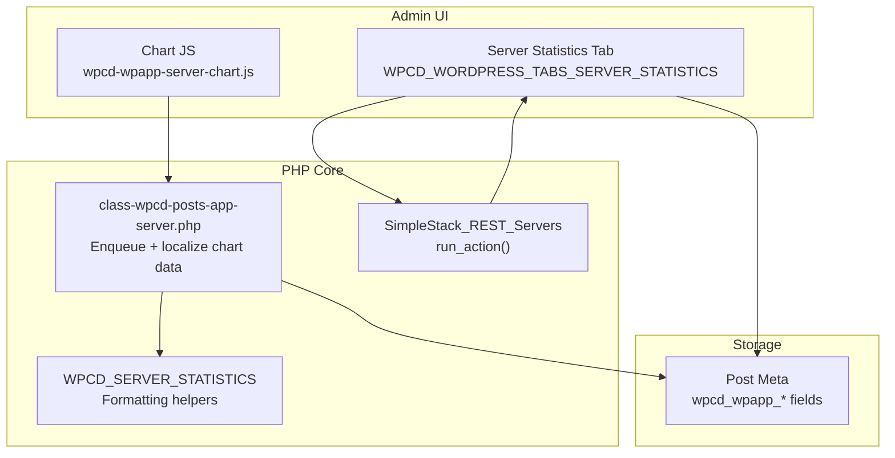
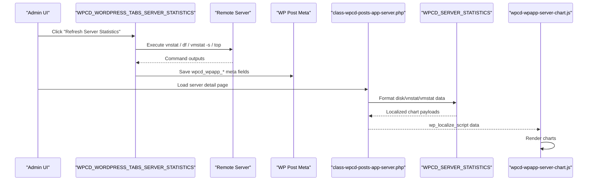
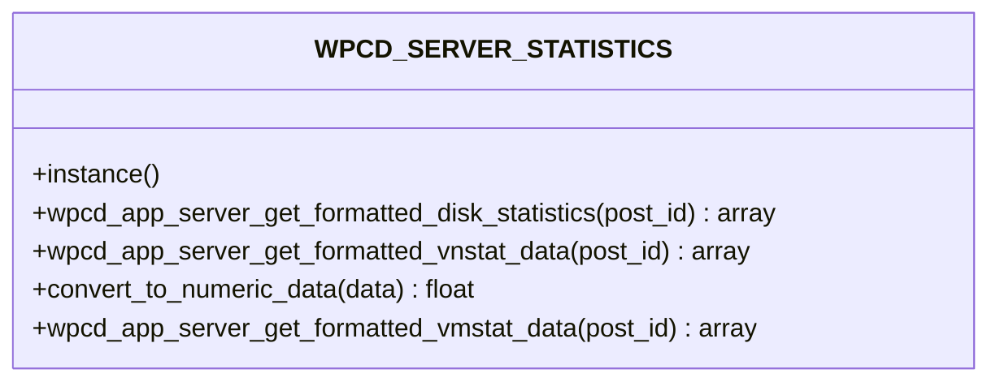
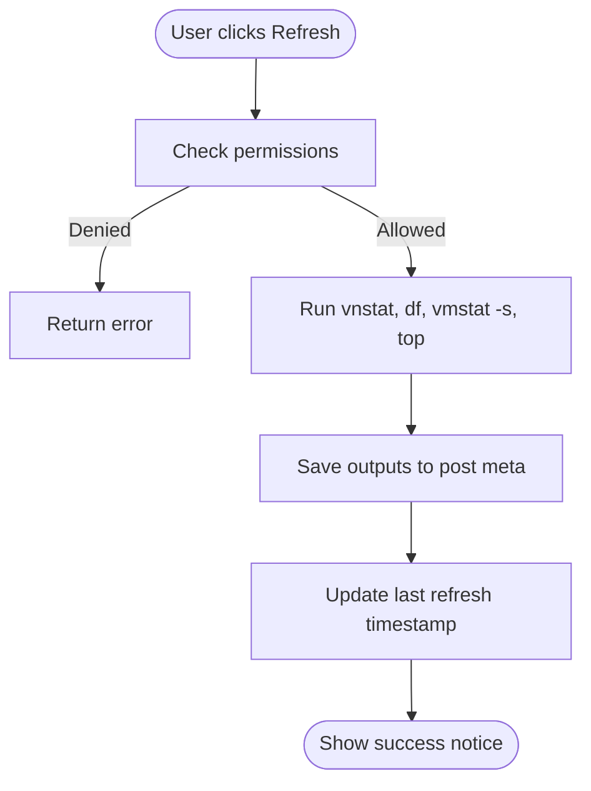
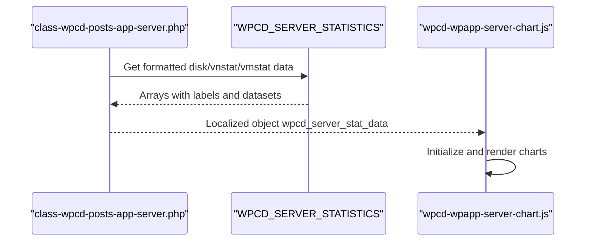
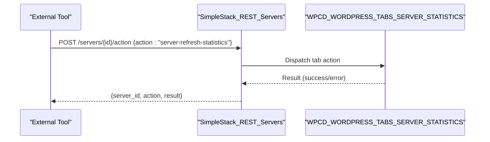
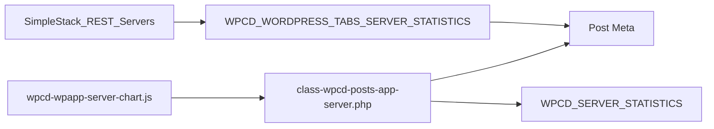

# Built-in Server Statistics Collection

<cite>
**Referenced Files in This Document**
- [class-wpcd-server-statistics.php](file://includes/core/class-wpcd-server-statistics.php)
- [statistics.php (server tab)](file://includes/core/apps/wordpress-app/tabs-server/statistics.php)
- [class-wpcd-posts-app-server.php](file://includes/core/class-wpcd-posts-app-server.php)
- [wpcd-wpapp-server-chart.js](file://includes/core/apps/wordpress-app/assets/js/wpcd-wpapp-server-chart.js)
- [functions-classes.php](file://includes/core/functions-classes.php)
- [class-simplestack-rest-servers.php](file://includes/core/api/class-simplestack-rest-servers.php)
</cite>

## Table of Contents
1. [Introduction](#introduction)
2. [Project Structure](#project-structure)
3. [Core Components](#core-components)
4. [Architecture Overview](#architecture-overview)
5. [Detailed Component Analysis](#detailed-component-analysis)
6. [Dependency Analysis](#dependency-analysis)
7. [Performance Considerations](#performance-considerations)
8. [Troubleshooting Guide](#troubleshooting-guide)
9. [Conclusion](#conclusion)

## Introduction
This document explains SimpleStack’s built-in server statistics collection system. It focuses on the WPCD_SERVER_STATISTICS class, how metrics are collected and stored, and how they are presented in the admin interface. It also covers usage via the REST API, data retention considerations, database optimization for statistics storage, performance impact, troubleshooting missing data, optimizing collection intervals, and scaling for large fleets.

The current implementation collects:
- Disk usage snapshots (df output)
- Network traffic summaries (vnstat)
- Memory details (vmstat -s)
- Top processes snapshot (top)

These are gathered on demand from the server via SSH and stored as post meta on the server record. There is no automatic continuous background collector in the code reviewed here; collection occurs when the user triggers a refresh or when an action invokes it.

## Project Structure
The statistics feature spans several layers:
- Data formatting utilities: WPCD_SERVER_STATISTICS
- Admin UI tab and actions: WPCD_WORDPRESS_TABS_SERVER_STATISTICS
- Script enqueuing and chart data preparation: class-wpcd-posts-app-server.php
- Frontend chart rendering: wpcd-wpapp-server-chart.js
- Class bootstrap: functions-classes.php
- REST bridge for running actions: class-simplestack-rest-servers.php

**Diagram sources**
- [statistics.php (server tab):102-125](file://includes/core/apps/wordpress-app/tabs-server/statistics.php#L102-L125)
- [class-wpcd-posts-app-server.php:195-242](file://includes/core/class-wpcd-posts-app-server.php#L195-L242)
- [wpcd-wpapp-server-chart.js:22-62](file://includes/core/apps/wordpress-app/assets/js/wpcd-wpapp-server-chart.js#L22-L62)
- [class-simplestack-rest-servers.php:327-363](file://includes/core/api/class-simplestack-rest-servers.php#L327-L363)

**Section sources**
- [class-wpcd-server-statistics.php:15-258](file://includes/core/class-wpcd-server-statistics.php#L15-L258)
- [statistics.php (server tab):15-432](file://includes/core/apps/wordpress-app/tabs-server/statistics.php#L15-L432)
- [class-wpcd-posts-app-server.php:195-242](file://includes/core/class-wpcd-posts-app-server.php#L195-L242)
- [wpcd-wpapp-server-chart.js:1-247](file://includes/core/apps/wordpress-app/assets/js/wpcd-wpapp-server-chart.js#L1-L247)
- [class-simplestack-rest-servers.php:327-363](file://includes/core/api/class-simplestack-rest-servers.php#L327-L363)

## Core Components
- WPCD_SERVER_STATISTICS: Provides methods to format raw stats into chart-ready arrays. It reads post meta values and transforms them for visualization.
- WPCD_WORDPRESS_TABS_SERVER_STATISTICS: Adds the “Statistics” tab to the server detail screen, renders sections for disk space, vnstat, vmstat, and top, and handles the “Refresh Server Statistics” action that runs commands on the remote server and stores results.
- class-wpcd-posts-app-server.php: Enqueues Chart.js and the chart script, then localizes formatted data for disk, vnstat, and vmstat charts.
- wpcd-wpapp-server-chart.js: Renders bar/pie/horizontal bar charts using the localized data.
- SimpleStack_REST_Servers: Exposes run_action endpoint that dispatches to tab actions, enabling programmatic refresh of statistics.

Key responsibilities:
- Collecting: The tab’s refresh action executes remote commands and writes results to post meta.
- Formatting: WPCD_SERVER_STATISTICS converts raw text outputs into JSON-friendly structures for charts.
- Rendering: The frontend script consumes localized data to draw charts.

**Section sources**
- [class-wpcd-server-statistics.php:15-258](file://includes/core/class-wpcd-server-statistics.php#L15-L258)
- [statistics.php (server tab):15-432](file://includes/core/apps/wordpress-app/tabs-server/statistics.php#L15-L432)
- [class-wpcd-posts-app-server.php:195-242](file://includes/core/class-wpcd-posts-app-server.php#L195-L242)
- [wpcd-wpapp-server-chart.js:1-247](file://includes/core/apps/wordpress-app/assets/js/wpcd-wpapp-server-chart.js#L1-L247)
- [class-simplestack-rest-servers.php:327-363](file://includes/core/api/class-simplestack-rest-servers.php#L327-L363)

## Architecture Overview
The flow from user interaction to rendered charts:

**Diagram sources**
- [statistics.php (server tab):383-427](file://includes/core/apps/wordpress-app/tabs-server/statistics.php#L383-L427)
- [class-wpcd-posts-app-server.php:195-242](file://includes/core/class-wpcd-posts-app-server.php#L195-L242)
- [class-wpcd-server-statistics.php:42-254](file://includes/core/class-wpcd-server-statistics.php#L42-L254)
- [wpcd-wpapp-server-chart.js:22-62](file://includes/core/apps/wordpress-app/assets/js/wpcd-wpapp-server-chart.js#L22-L62)

## Detailed Component Analysis

### WPCD_SERVER_STATISTICS class
Responsibilities:
- Read raw stats from post meta.
- Parse and sanitize outputs.
- Produce chart-ready arrays with labels and datasets.

Methods:
- wpcd_app_server_get_formatted_disk_statistics(post_id): Parses df-like output, aggregates snap mounts, returns labels and three series (1K-blocks, Used, Available).
- wpcd_app_server_get_formatted_vnstat_data(post_id): Splits one-line vnstat output into day/month/all-time RX/TX pairs.
- convert_to_numeric_data(data): Converts human-readable sizes (KiB/MiB/GiB) to KiB numeric values.
- wpcd_app_server_get_formatted_vmstat_data(post_id): Reads vmstat -s output lines and builds memory dataset labels/values.

Complexity notes:
- Parsing is linear in number of lines and tokens per line.
- Aggregation for snaps is O(n) over lines.
- Output sanitization ensures safe JSON encoding.

Error handling:
- Returns empty arrays when input is missing or invalid.

**Diagram sources**
- [class-wpcd-server-statistics.php:15-258](file://includes/core/class-wpcd-server-statistics.php#L15-L258)

**Section sources**
- [class-wpcd-server-statistics.php:42-254](file://includes/core/class-wpcd-server-statistics.php#L42-L254)

### Server Statistics Tab (UI and Actions)
Responsibilities:
- Register the “Statistics” tab and its view permission.
- Render sections for disk space, vnstat, vmstat, and top.
- Provide a “Refresh Server Statistics” button.
- On refresh, execute remote commands and persist results.

Key behaviors:
- Permission checks ensure only authorized users can view or refresh.
- Refresh action runs:
  - sudo vnstat
  - sudo vnstat --oneline
  - sudo df
  - sudo vmstat -s
  - sudo top -n 1 -b > top-output.txt && cat top-output.txt && rm top-output.txt
- Stores outputs in post meta keys:
  - wpcd_wpapp_vnstat_data
  - wpcd_wpapp_vnstat_one_line_data
  - wpcd_wpapp_disk_statistics
  - wpcd_wpapp_vmstat_data
  - wpcd_wpapp_top_data
  - wpcd_wpapp_server_stats_list_date

**Diagram sources**
- [statistics.php (server tab):102-125](file://includes/core/apps/wordpress-app/tabs-server/statistics.php#L102-L125)
- [statistics.php (server tab):383-427](file://includes/core/apps/wordpress-app/tabs-server/statistics.php#L383-L427)

**Section sources**
- [statistics.php (server tab):15-432](file://includes/core/apps/wordpress-app/tabs-server/statistics.php#L15-L432)

### Chart Data Preparation and Rendering
- class-wpcd-posts-app-server.php:
  - Registers Chart.js and the chart script.
  - Calls WPCD_SERVER_STATISTICS methods to build localized data for disk, vnstat, and vmstat.
  - Uses wp_localize_script to pass data to the frontend.
- wpcd-wpapp-server-chart.js:
  - Initializes charts based on available data.
  - Renders:
    - Bar chart for disk usage
    - Pie charts for vnstat RX/TX across time windows
    - Horizontal bar chart for vmstat memory categories

**Diagram sources**
- [class-wpcd-posts-app-server.php:195-242](file://includes/core/class-wpcd-posts-app-server.php#L195-L242)
- [wpcd-wpapp-server-chart.js:22-62](file://includes/core/apps/wordpress-app/assets/js/wpcd-wpapp-server-chart.js#L22-L62)

**Section sources**
- [class-wpcd-posts-app-server.php:195-242](file://includes/core/class-wpcd-posts-app-server.php#L195-L242)
- [wpcd-wpapp-server-chart.js:1-247](file://includes/core/apps/wordpress-app/assets/js/wpcd-wpapp-server-chart.js#L1-L247)

### REST API Integration
- SimpleStack_REST_Servers::run_action(id, action, params) forwards to the tab action chain.
- To programmatically refresh statistics, call POST /servers/{id}/action with action = "server-refresh-statistics".
- The response includes server_id, action, and result.

**Diagram sources**
- [class-simplestack-rest-servers.php:327-363](file://includes/core/api/class-simplestack-rest-servers.php#L327-L363)
- [statistics.php (server tab):102-125](file://includes/core/apps/wordpress-app/tabs-server/statistics.php#L102-L125)

**Section sources**
- [class-simplestack-rest-servers.php:327-363](file://includes/core/api/class-simplestack-rest-servers.php#L327-L363)

## Dependency Analysis
- WPCD_SERVER_STATISTICS depends on WordPress post meta APIs to read raw stats.
- The server statistics tab depends on:
  - Server instance resolution
  - SSH execution helpers
  - Post meta persistence
- The chart script depends on Chart.js and localized data provided by PHP.
- The REST controller delegates to the same tab action logic used by the admin UI.

**Diagram sources**
- [class-simplestack-rest-servers.php:327-363](file://includes/core/api/class-simplestack-rest-servers.php#L327-L363)
- [statistics.php (server tab):383-427](file://includes/core/apps/wordpress-app/tabs-server/statistics.php#L383-L427)
- [class-wpcd-posts-app-server.php:195-242](file://includes/core/class-wpcd-posts-app-server.php#L195-L242)
- [class-wpcd-server-statistics.php:42-254](file://includes/core/class-wpcd-server-statistics.php#L42-L254)
- [wpcd-wpapp-server-chart.js:22-62](file://includes/core/apps/wordpress-app/assets/js/wpcd-wpapp-server-chart.js#L22-L62)

**Section sources**
- [class-simplestack-rest-servers.php:327-363](file://includes/core/api/class-simplestack-rest-servers.php#L327-L363)
- [statistics.php (server tab):102-125](file://includes/core/apps/wordpress-app/tabs-server/statistics.php#L102-L125)
- [class-wpcd-posts-app-server.php:195-242](file://includes/core/class-wpcd-posts-app-server.php#L195-L242)
- [class-wpcd-server-statistics.php:42-254](file://includes/core/class-wpcd-server-statistics.php#L42-L254)
- [wpcd-wpapp-server-chart.js:22-62](file://includes/core/apps/wordpress-app/assets/js/wpcd-wpapp-server-chart.js#L22-L62)

## Performance Considerations
- Collection frequency:
  - No automatic scheduler is present in the analyzed files. Collection is triggered manually via the UI or REST action.
  - Each refresh performs multiple SSH calls and writes multiple meta entries.
- Storage footprint:
  - Raw command outputs are stored as post meta strings. Large outputs (e.g., top) can increase meta size.
- Rendering cost:
  - Charts are client-side; heavy datasets increase browser workload.
- Recommendations:
  - Limit refresh frequency to avoid excessive SSH overhead.
  - Prune or compress large outputs if needed.
  - Use caching at the application layer if you need repeated access without re-parsing.

[No sources needed since this section provides general guidance]

## Troubleshooting Guide

Common issues and resolutions:
- Missing data in charts:
  - Ensure the “Refresh Server Statistics” action has been executed successfully.
  - Verify post meta keys exist:
    - wpcd_wpapp_disk_statistics
    - wpcd_wpapp_vnstat_data
    - wpcd_wpapp_vnstat_one_line_data
    - wpcd_wpapp_vmstat_data
    - wpcd_wpapp_top_data
    - wpcd_wpapp_server_stats_list_date
- SSH connectivity problems:
  - Confirm SSH credentials and network reachability to the target server.
  - Validate that required commands (vnstat, df, vmstat, top) are installed and executable with sudo.
- Permissions errors:
  - Ensure the user has the required capability to view and refresh the statistics tab.
- REST integration failures:
  - Verify the action slug is exactly “server-refresh-statistics”.
  - Check the response payload for error codes and messages.

Operational tips:
- If data appears stale, re-run the refresh action.
- For large fleets, batch refresh requests and throttle to avoid overwhelming the host or target servers.

**Section sources**
- [statistics.php (server tab):102-125](file://includes/core/apps/wordpress-app/tabs-server/statistics.php#L102-L125)
- [statistics.php (server tab):383-427](file://includes/core/apps/wordpress-app/tabs-server/statistics.php#L383-L427)
- [class-simplestack-rest-servers.php:327-363](file://includes/core/api/class-simplestack-rest-servers.php#L327-L363)

## Conclusion
SimpleStack’s built-in server statistics system provides on-demand collection of disk usage, network traffic, memory details, and process snapshots. Data is persisted as post meta and visualized through client-side charts. The system integrates cleanly with the admin UI and exposes a REST action for automation. Since there is no built-in continuous collector in the analyzed code, administrators should schedule refreshes externally if periodic updates are required, while considering performance and storage implications.

[No sources needed since this section summarizes without analyzing specific files]