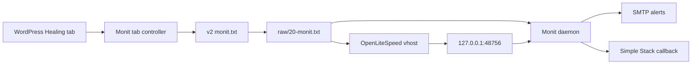

# Monit Service Monitoring

## Scope

Simple Stack exposes Monit through the server **Healing** tab. The integration is OpenLiteSpeed-only and uses the fixed `v2` provisioning tree. It installs Monit, generates service checks, configures SMTP and optional M/Monit registration, publishes the dashboard through an OpenLiteSpeed virtual host, and supports component, SSL, callback, and lifecycle actions.

There is no Nginx or PHP-FPM branch and no Monit upgrade action. Unsupported actions fail rather than being treated as successful.

## Components

| Component | Current path | Responsibility |
|---|---|---|
| Admin controller | `includes/core/apps/wordpress-app/tabs-server/monit.php` | Permission checks, field schema, input validation, SSH dispatch, encrypted metadata, and action-specific result handling |
| Wrapper | `includes/core/apps/wordpress-app/scripts/v2/monit.txt` | Downloads helpers and the raw script over validated HTTPS, exports parameters, and executes as root |
| Raw provisioner | `includes/core/apps/wordpress-app/scripts/v2/raw/20-monit.txt` | Fail-closed installation, configuration, validation, service control, SSL, callbacks, and removal |
| Shared script handler | `includes/core/apps/wordpress-app/traits/traits-for-class-wordpress-app/script-handlers.php` | Maps `monit.txt` to `raw/20-monit.txt` and matches the success message for the requested action |

## Architecture

Monit's HTTP daemon binds only to `127.0.0.1:48756`. Public access is through the managed OpenLiteSpeed vhost, not a direct public Monit listener.

## Installation contract

The PHP controller validates permissions, required fields, domain syntax, credentials, SMTP port, and optional M/Monit URL before dispatch. It retains exact secret values only for log redaction; execution still receives shell-escaped arguments.

The raw script then:

1. Requires root, loads shared helpers, and enables strict error handling.
2. Validates all supplied values before package or service changes.
3. Verifies that OpenLiteSpeed is installed and is not enterprise LiteSpeed.
4. Refuses to overwrite an unrelated domain, vhost registration, or document root.
5. Installs Monit if needed and writes configuration atomically.
6. Keeps HTTP, SMTP, and M/Monit credentials in root-only `0600` include files under `/etc/monit/conf.d/`.
7. Writes the main `/etc/monit/monitrc` without embedded credentials.
8. Generates component checks and an OpenLiteSpeed vhost that proxies to loopback port `48756`.
9. Installs the callback reporter under `/etc/simple-stack/` and `/etc/cron.d/` when the callback URL is present.
10. Runs `monit -t`, validates OpenLiteSpeed with `lswsctrl configtest`, enables Monit at boot, restarts Monit, and verifies both services are active.

Installation is successful only after those validation and service-state checks pass.

## Monitored components

| Component | Default after install | Configuration |
|---|---|---|
| OpenLiteSpeed | Enabled | Process, local HTTP, CPU, restart and timeout checks |
| MySQL/MariaDB | Enabled | Process, CPU, memory, TCP and socket checks |
| Filesystem | Enabled | Root filesystem space alert above 80% |
| System resources | Enabled | CPU and memory alerts with dynamically calculated thresholds |
| Memcached | Disabled | Process, memory, CPU and local port checks |
| Redis | Disabled | Process, memory, CPU, children and local port checks |

**Enable Popular** enables OpenLiteSpeed, MySQL, filesystem, and system checks. **Disable All** disables every component, including Memcached and Redis.

## SSL and dashboard access

SSL enablement requires a valid notification email and an existing managed Monit vhost. The script issues a certificate with Certbot, requires both the certificate and private-key files, updates the vhost atomically, adds the HTTP-to-HTTPS redirect, validates OpenLiteSpeed, restarts it, and verifies that it is active.

SSL disablement restores the default OpenLiteSpeed certificate paths, removes the redirect, deletes the managed certificate when present, and performs the same configuration and service checks.

The admin UI launches a credential-free dashboard URL. Monit prompts for the configured basic-auth credentials; credentials are not placed in the link or displayed in the tab.

## Email, M/Monit, and callbacks

- SMTP settings are required for installation and email updates. Blank password submissions preserve the stored encrypted password.
- SMTP credentials are encrypted in server metadata and written to a root-only Monit include file.
- M/Monit registration is optional. Its URL is treated as a secret, encrypted at rest, masked in logs, and written to a root-only include file.
- Installation creates a callback reporter that reads new Monit log lines and sends their status to the authenticated command callback. The callback URL and log offset are root-only files under `/etc/simple-stack/`.
- Callback scheduling requires an active cron service. Legacy callback files are removed when the managed reporter is installed or removed.

## Action results

The PHP controller accepts only the action currently being executed. For example, an install action must return `Monit has been installed.`; a webserver enable action must return `OpenLiteSpeed monitoring has been enabled.` Output from another action cannot mark the request successful.

Failures return `WP_Error` with redacted command output. Metadata is updated only after the action-specific success check passes.

## Lifecycle behavior

- **Temporary deactivation** stops Monit but leaves it enabled at boot, so a server restart reactivates it.
- **Activation** validates the configuration, starts Monit, and verifies active state.
- **Uninstall** purges the package, removes callback/configuration/state/log artifacts, removes only the managed OpenLiteSpeed vhost, validates OpenLiteSpeed, restarts it, and verifies active state.
- **Metadata reset** changes only the WordPress-side view. It does not install or remove software on the server.

## Troubleshooting

- **Installation stops before changes:** inspect the validation message for domain, credential, SMTP, callback, or OpenLiteSpeed prerequisites.
- **Monit configuration fails:** run `monit -t -c /etc/monit/monitrc` on the server and inspect the root-only include files without copying their contents into logs.
- **OpenLiteSpeed validation fails:** run `/usr/local/lsws/bin/lswsctrl configtest` and inspect only the managed Monit vhost and registration.
- **Dashboard is unreachable:** verify OpenLiteSpeed is active, the domain maps to the managed vhost, and the vhost proxy targets `127.0.0.1:48756`.
- **Email alerts fail:** verify SMTP connectivity, TLS support, port, credentials, and the alert recipient.
- **Callback does not arrive:** verify cron is active, the callback URL file is readable by root, and the Monit log is growing.

## Related implementation

- [Monit admin controller](../../../../../../includes/core/apps/wordpress-app/tabs-server/monit.php)
- [Monit wrapper](../../../../../../includes/core/apps/wordpress-app/scripts/v2/monit.txt)
- [Monit raw script](../../../../../../includes/core/apps/wordpress-app/scripts/v2/raw/20-monit.txt)
- [Script handler](../../../../../../includes/core/apps/wordpress-app/traits/traits-for-class-wordpress-app/script-handlers.php)
- [Simple Stack operator documentation](../../../../../../docs/SIMPLESTACK.md)
