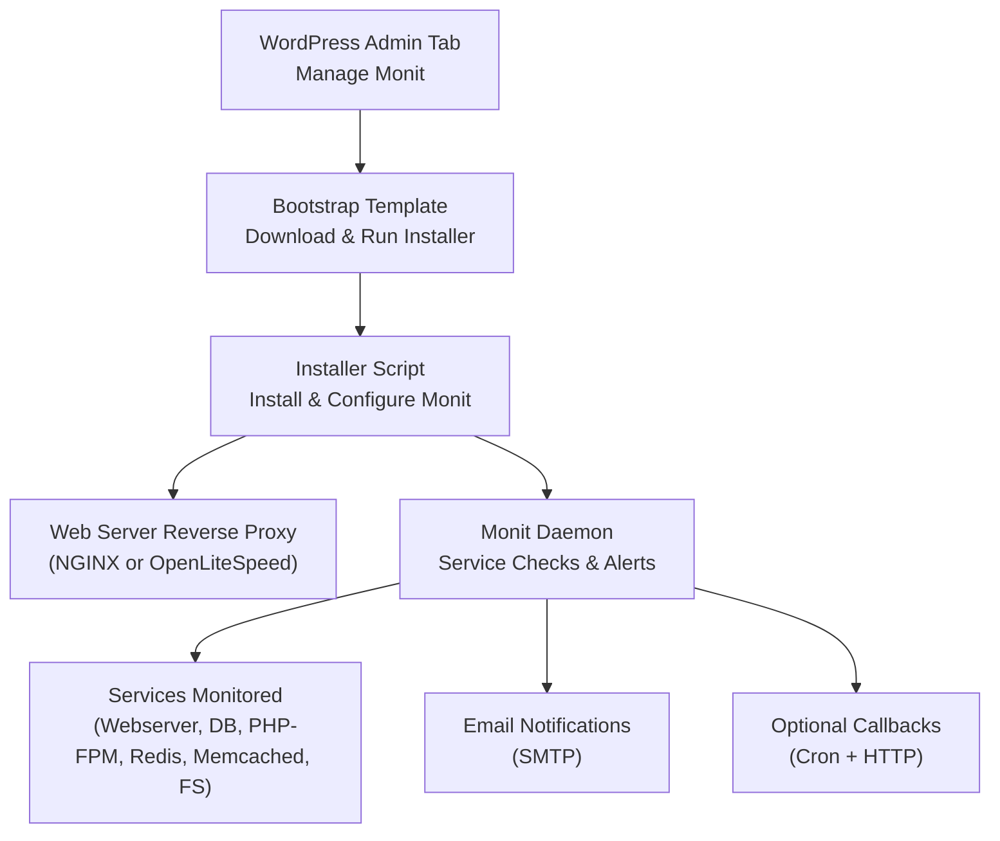
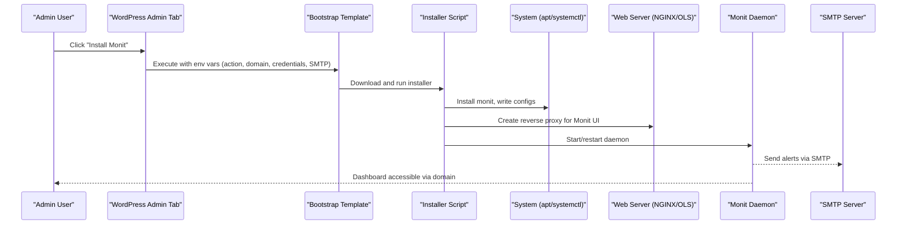
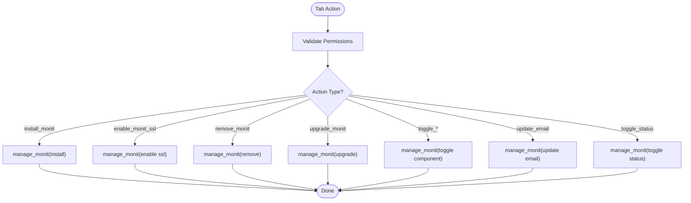
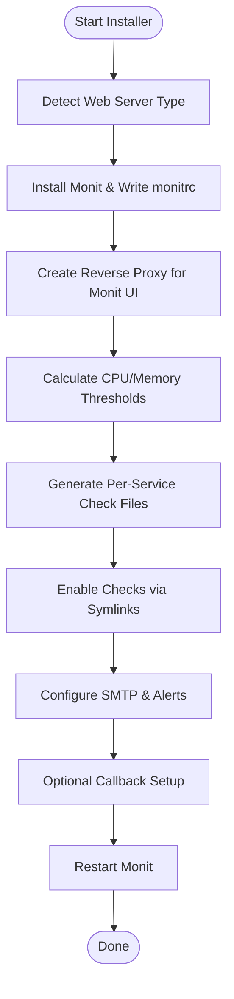
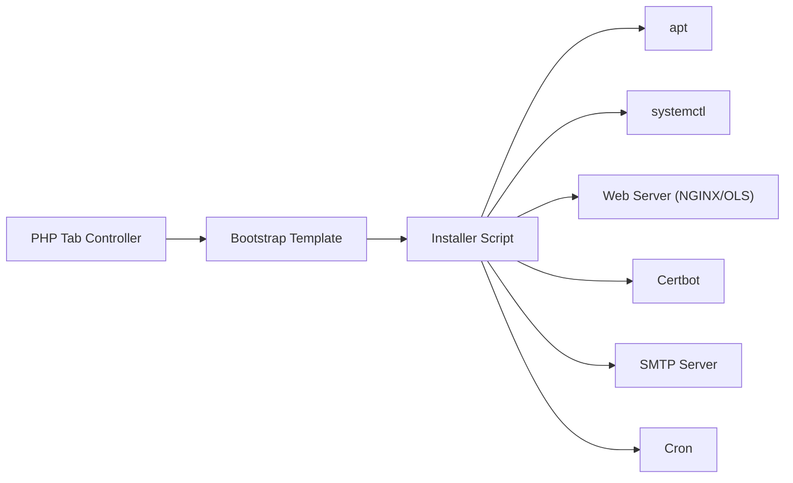

# Monit Service Monitoring

<cite>
**Referenced Files in This Document**
- [monit.php](file://includes/core/apps/wordpress-app/tabs-server/monit.php)
- [20-monit.txt](file://includes/core/apps/wordpress-app/scripts/v1/raw/20-monit.txt)
- [monit.txt (v1)](file://includes/core/apps/wordpress-app/scripts/v1/monit.txt)
- [monit.txt (v2)](file://includes/core/apps/wordpress-app/scripts/v2/monit.txt)
</cite>

## Table of Contents
1. [Introduction](#introduction)
2. [Project Structure](#project-structure)
3. [Core Components](#core-components)
4. [Architecture Overview](#architecture-overview)
5. [Detailed Component Analysis](#detailed-component-analysis)
6. [Dependency Analysis](#dependency-analysis)
7. [Performance Considerations](#performance-considerations)
8. [Troubleshooting Guide](#troubleshooting-guide)
9. [Conclusion](#conclusion)
10. [Appendices](#appendices)

## Introduction
This document explains how SimpleStack integrates Monit for service monitoring and automatic healing on servers hosting WordPress applications. It covers installation, configuration, service checks, resource thresholds, alerting via email, enabling/disabling features from the dashboard, and operational best practices. The implementation is driven by a PHP tab that exposes actions to install and manage Monit, and a shell script that performs the actual system-level setup and configuration.

## Project Structure
The Monit integration consists of:
- A server tab UI that lets users install, configure, enable/disable components, update email alerts, toggle SSL, and uninstall Monit.
- A bootstrap template that downloads and executes the real installer script with environment variables.
- The installer script that installs Monit, configures it, generates per-service check files, sets up logging, optional callback notifications, and manages web server reverse proxy for the Monit dashboard.

**Diagram sources**
- [monit.php:127-189](file://includes/core/apps/wordpress-app/tabs-server/monit.php#L127-L189)
- [monit.txt (v1):1-9](file://includes/core/apps/wordpress-app/scripts/v1/monit.txt#L1-L9)
- [20-monit.txt:148-300](file://includes/core/apps/wordpress-app/scripts/v1/raw/20-monit.txt#L148-L300)

**Section sources**
- [monit.php:1-1387](file://includes/core/apps/wordpress-app/tabs-server/monit.php#L1-L1387)
- [monit.txt (v1):1-9](file://includes/core/apps/wordpress-app/scripts/v1/monit.txt#L1-L9)
- [monit.txt (v2):1-9](file://includes/core/apps/wordpress-app/scripts/v2/monit.txt#L1-L9)
- [20-monit.txt:1-973](file://includes/core/apps/wordpress-app/scripts/v1/raw/20-monit.txt#L1-L973)

## Core Components
- Server Tab Controller: Provides the “Healing” tab where users can install Monit, toggle services, update email settings, enable SSL, and manage Monit lifecycle.
- Bootstrap Templates: v1 and v2 templates that download the common helper and the installer script, then execute it with environment variables.
- Installer Script: Performs all system-level tasks including installing Monit, generating monitrc, creating per-service check files, setting up reverse proxy, configuring email, optional callbacks, and managing service toggles.

Key responsibilities:
- Installation and removal of Monit.
- Generation of service-specific configuration files under /etc/monit/conf-available and enabling them via symlinks.
- Dynamic threshold calculation based on CPU cores and memory.
- Alerting via SMTP and optional callback mechanism.
- Enabling/disabling individual monitors and global on/off states.

**Section sources**
- [monit.php:127-189](file://includes/core/apps/wordpress-app/tabs-server/monit.php#L127-L189)
- [monit.txt (v1):1-9](file://includes/core/apps/wordpress-app/scripts/v1/monit.txt#L1-L9)
- [monit.txt (v2):1-9](file://includes/core/apps/wordpress-app/scripts/v2/monit.txt#L1-L9)
- [20-monit.txt:148-300](file://includes/core/apps/wordpress-app/scripts/v1/raw/20-monit.txt#L148-L300)

## Architecture Overview
The end-to-end flow starts from the WordPress admin interface, triggers an action handled by the Monit tab controller, which calls the installer script via the bootstrap template. The installer script installs Monit, writes configuration files, and restarts the daemon. Monit then periodically checks services and resources, sending alerts via email and optionally invoking a callback.

**Diagram sources**
- [monit.php:127-189](file://includes/core/apps/wordpress-app/tabs-server/monit.php#L127-L189)
- [monit.txt (v1):1-9](file://includes/core/apps/wordpress-app/scripts/v1/monit.txt#L1-L9)
- [20-monit.txt:148-300](file://includes/core/apps/wordpress-app/scripts/v1/raw/20-monit.txt#L148-L300)

## Detailed Component Analysis

### Server Tab Controller (PHP)
Responsibilities:
- Exposes actions such as install, upgrade, remove, toggle components, update email, toggle SSL, and toggle Monit status.
- Builds dynamic form fields for domain, basic auth, SMTP, alert email, and M/Monit URL.
- Persists user credentials and settings securely and constructs launch URLs for the Monit dashboard.

Important behaviors:
- Validates permissions before executing any action.
- Supports toggling monitoring for webserver, MySQL/MariaDB, Redis, Memcached, PHP-FPM, and filesystem.
- Provides bulk enable/disable controls and a temporary on/off switch for Monit itself.

**Diagram sources**
- [monit.php:127-189](file://includes/core/apps/wordpress-app/tabs-server/monit.php#L127-L189)

**Section sources**
- [monit.php:127-189](file://includes/core/apps/wordpress-app/tabs-server/monit.php#L127-L189)
- [monit.php:212-773](file://includes/core/apps/wordpress-app/tabs-server/monit.php#L212-L773)

### Bootstrap Templates (v1 and v2)
Purpose:
- Download a common helper script and the main installer script.
- Export environment variables for the installer, including action, domain, authentication, SMTP, alert email, M/Monit server, and callback URL.
- Execute the installer script with elevated privileges.

Variables passed to the installer include:
- action, domain, email, monit_user, monit_password, email_notifications, monit_smtp_server, monit_smtp_port, monit_smtp_user, monit_smtp_pass, monit_alert_email, monit_mmonit_server, callback_url.

**Section sources**
- [monit.txt (v1):1-9](file://includes/core/apps/wordpress-app/scripts/v1/monit.txt#L1-L9)
- [monit.txt (v2):1-9](file://includes/core/apps/wordpress-app/scripts/v2/monit.txt#L1-L9)

### Installer Script (Shell)
Capabilities:
- Installs Monit and writes /etc/monit/monitrc with daemon interval, log path, id/state files, event queue, HTTPD port, allow user/password, and includes conf.d/conf-enabled directories.
- Optionally configures m-monit registration.
- Creates reverse proxy entries for NGINX or OpenLiteSpeed to expose Monit UI at a configured domain.
- Generates per-service check files under /etc/monit/conf-available and enables them via symlinks.
- Calculates dynamic thresholds for CPU and memory based on system resources.
- Configures email alerts via SMTP with TLS.
- Provides optional callback mechanism using cron and curl to report Monit events.
- Supports enabling/disabling specific monitors and bulk operations.
- Manages SSL for the Monit dashboard using Certbot.

Service checks created:
- Webserver (NGINX or OpenLiteSpeed).
- MySQL/MariaDB.
- Redis.
- Memcached.
- PHP-FPM versions (multiple versions supported when using NGINX).
- Filesystem usage.
- System-wide CPU and memory checks.

Resource thresholds:
- CPU alert and restart thresholds are computed dynamically using number of CPU cores.
- Memory alert and restart thresholds are computed dynamically using total RAM.
- Filesystem space alert threshold is set at a fixed percentage.

Alerting:
- Email alerts are sent via SMTP with TLS.
- Optional callback mechanism compares Monit logs and posts differences to a provided URL.

Lifecycle management:
- Enable/disable individual monitors.
- Enable/disable all monitors.
- Update email settings.
- Enable/disable SSL for Monit UI.
- Remove/uninstall Monit completely.
- Temporarily deactivate/reactivate Monit.

**Diagram sources**
- [20-monit.txt:148-300](file://includes/core/apps/wordpress-app/scripts/v1/raw/20-monit.txt#L148-L300)
- [20-monit.txt:302-516](file://includes/core/apps/wordpress-app/scripts/v1/raw/20-monit.txt#L302-L516)
- [20-monit.txt:415-489](file://includes/core/apps/wordpress-app/scripts/v1/raw/20-monit.txt#L415-L489)
- [20-monit.txt:684-723](file://includes/core/apps/wordpress-app/scripts/v1/raw/20-monit.txt#L684-L723)
- [20-monit.txt:779-839](file://includes/core/apps/wordpress-app/scripts/v1/raw/20-monit.txt#L779-L839)

**Section sources**
- [20-monit.txt:148-300](file://includes/core/apps/wordpress-app/scripts/v1/raw/20-monit.txt#L148-L300)
- [20-monit.txt:302-516](file://includes/core/apps/wordpress-app/scripts/v1/raw/20-monit.txt#L302-L516)
- [20-monit.txt:415-489](file://includes/core/apps/wordpress-app/scripts/v1/raw/20-monit.txt#L415-L489)
- [20-monit.txt:684-723](file://includes/core/apps/wordpress-app/scripts/v1/raw/20-monit.txt#L684-L723)
- [20-monit.txt:779-839](file://includes/core/apps/wordpress-app/scripts/v1/raw/20-monit.txt#L779-L839)
- [20-monit.txt:892-908](file://includes/core/apps/wordpress-app/scripts/v1/raw/20-monit.txt#L892-L908)
- [20-monit.txt:910-954](file://includes/core/apps/wordpress-app/scripts/v1/raw/20-monit.txt#L910-L954)
- [20-monit.txt:956-972](file://includes/core/apps/wordpress-app/scripts/v1/raw/20-monit.txt#L956-L972)

## Dependency Analysis
- The PHP tab controller depends on WordPress hooks and meta storage to persist Monit state and user inputs.
- The bootstrap templates depend on network access to download scripts and require sudo execution context.
- The installer script depends on:
  - apt package manager for installing Monit.
  - systemctl for service management.
  - Web server configuration (NGINX or OpenLiteSpeed) for reverse proxy.
  - Certbot for SSL provisioning.
  - SMTP server for email alerts.
  - Cron for optional callback reporting.

**Diagram sources**
- [monit.php:127-189](file://includes/core/apps/wordpress-app/tabs-server/monit.php#L127-L189)
- [monit.txt (v1):1-9](file://includes/core/apps/wordpress-app/scripts/v1/monit.txt#L1-L9)
- [20-monit.txt:148-300](file://includes/core/apps/wordpress-app/scripts/v1/raw/20-monit.txt#L148-L300)

**Section sources**
- [monit.php:127-189](file://includes/core/apps/wordpress-app/tabs-server/monit.php#L127-L189)
- [monit.txt (v1):1-9](file://includes/core/apps/wordpress-app/scripts/v1/monit.txt#L1-L9)
- [20-monit.txt:148-300](file://includes/core/apps/wordpress-app/scripts/v1/raw/20-monit.txt#L148-L300)

## Performance Considerations
- Dynamic thresholds: CPU and memory thresholds are calculated based on the number of CPU cores and total memory, reducing false positives on different server sizes.
- Cycle-based conditions: Monit uses cycle counts to avoid immediate restarts on transient spikes, improving stability.
- Event queue: Monit’s event queue is configured with a base directory and slot count to handle bursts of events without dropping alerts.
- Logging: Monit logs to a dedicated file; periodic diffing is used by the optional callback to minimize overhead.
- Reverse proxy: Only one lightweight reverse proxy entry is added for the Monit UI, minimizing web server impact.

[No sources needed since this section provides general guidance]

## Troubleshooting Guide
Common issues and resolutions:
- Monit not starting after installation:
  - Verify /etc/monit/monitrc permissions and syntax.
  - Ensure the Monit user/password are alphanumeric as required by Monit.
  - Check web server reverse proxy configuration if accessing via domain.
- Email alerts not received:
  - Confirm SMTP server supports TLS and credentials are correct.
  - Validate that the alert email address is set.
- SSL for Monit UI fails:
  - Ensure DNS points to the server and domain matches the configured domain.
  - Check Certbot logs and web server configuration changes.
- False positives or excessive restarts:
  - Adjust thresholds or cycle counts in generated check files if necessary.
  - Review system load patterns and tune thresholds accordingly.
- Callback not firing:
  - Verify cron job exists and curl can reach the callback URL.
  - Check permissions for /usr/local/bin/monit-reporting.

Operational tips:
- Use the “Toggle Monit On/Off” control for temporary deactivation; it will be re-enabled on reboot.
- Use “Uninstall Monit” to fully remove Monit and related configurations.
- Use “Add Metas”/“Remove Metas” to reconcile dashboard state with server state if they drift.

**Section sources**
- [monit.php:212-773](file://includes/core/apps/wordpress-app/tabs-server/monit.php#L212-L773)
- [20-monit.txt:684-723](file://includes/core/apps/wordpress-app/scripts/v1/raw/20-monit.txt#L684-L723)
- [20-monit.txt:779-839](file://includes/core/apps/wordpress-app/scripts/v1/raw/20-monit.txt#L779-L839)
- [20-monit.txt:892-908](file://includes/core/apps/wordpress-app/scripts/v1/raw/20-monit.txt#L892-L908)
- [20-monit.txt:910-954](file://includes/core/apps/wordpress-app/scripts/v1/raw/20-monit.txt#L910-L954)
- [20-monit.txt:956-972](file://includes/core/apps/wordpress-app/scripts/v1/raw/20-monit.txt#L956-L972)

## Conclusion
SimpleStack’s Monit integration provides a robust, automated approach to monitoring critical services and system resources. Through a user-friendly dashboard, administrators can install Monit, configure email alerts, enable SSL, and toggle monitoring for web servers, databases, PHP-FPM, caches, and filesystem usage. The installer script dynamically calculates thresholds and generates service-specific checks, ensuring reliable operation across diverse server environments. Best practices include conservative threshold tuning, validating SMTP connectivity, and leveraging the temporary on/off controls for maintenance windows.

[No sources needed since this section summarizes without analyzing specific files]

## Appendices

### Example Configuration Artifacts
- Monit main configuration written to /etc/monit/monitrc during installation.
- Per-service check files under /etc/monit/conf-available and enabled via symlinks in /etc/monit/conf-enabled.
- Web server reverse proxy configuration for NGINX or OpenLiteSpeed exposing the Monit UI.

References:
- Main configuration and daemon settings: [20-monit.txt:250-289](file://includes/core/apps/wordpress-app/scripts/v1/raw/20-monit.txt#L250-L289)
- Service checks generation and enabling: [20-monit.txt:313-516](file://includes/core/apps/wordpress-app/scripts/v1/raw/20-monit.txt#L313-L516)
- Reverse proxy setup: [20-monit.txt:160-182](file://includes/core/apps/wordpress-app/scripts/v1/raw/20-monit.txt#L160-L182)

**Section sources**
- [20-monit.txt:250-289](file://includes/core/apps/wordpress-app/scripts/v1/raw/20-monit.txt#L250-L289)
- [20-monit.txt:313-516](file://includes/core/apps/wordpress-app/scripts/v1/raw/20-monit.txt#L313-L516)
- [20-monit.txt:160-182](file://includes/core/apps/wordpress-app/scripts/v1/raw/20-monit.txt#L160-L182)