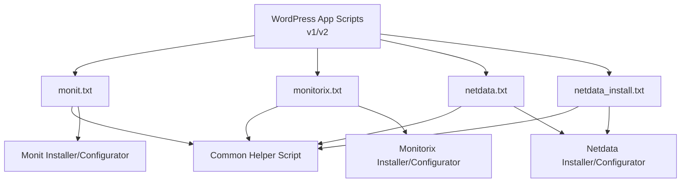
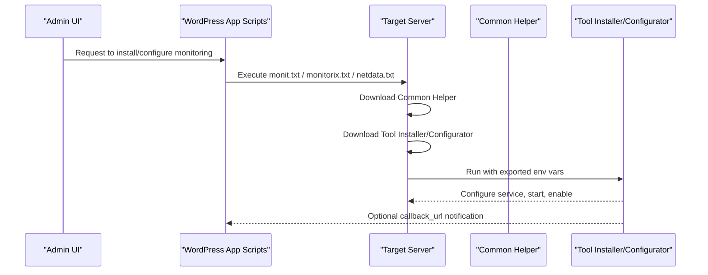
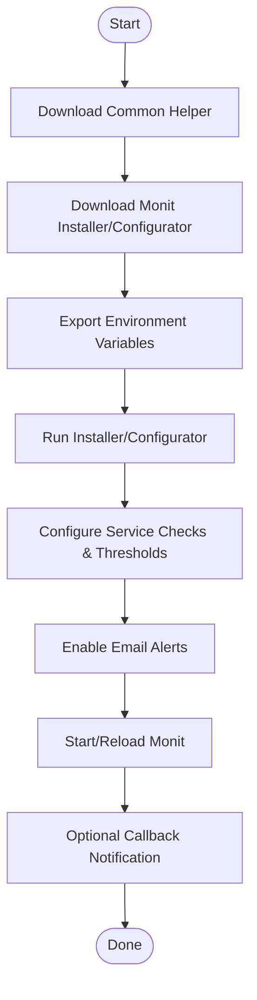
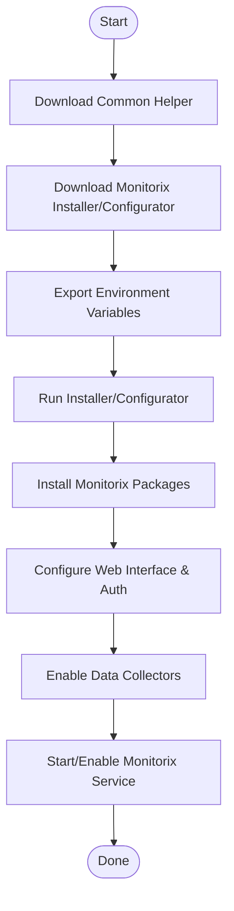
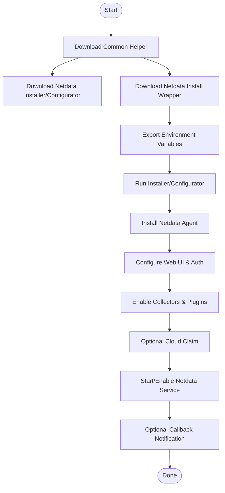
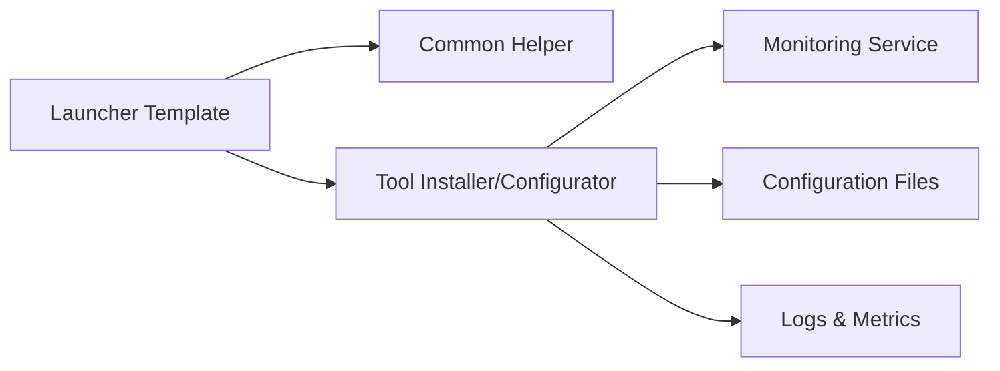

# Monitoring Solutions

<cite>
**Referenced Files in This Document**
- [monit.txt (v1)](file://includes/core/apps/wordpress-app/scripts/v1/monit.txt)
- [monit.txt (v2)](file://includes/core/apps/wordpress-app/scripts/v2/monit.txt)
- [monitorix.txt (v1)](file://includes/core/apps/wordpress-app/scripts/v1/monitorix.txt)
- [monitorix.txt (v2)](file://includes/core/apps/wordpress-app/scripts/v2/monitorix.txt)
- [netdata.txt (v1)](file://includes/core/apps/wordpress-app/scripts/v1/netdata.txt)
- [netdata.txt (v2)](file://includes/core/apps/wordpress-app/scripts/v2/netdata.txt)
- [netdata_install.txt (v1)](file://includes/core/apps/wordpress-app/scripts/v1/netdata_install.txt)
- [netdata_install.txt (v2)](file://includes/core/apps/wordpress-app/scripts/v2/netdata_install.txt)
</cite>

## Table of Contents
1. [Introduction](#introduction)
2. [Project Structure](#project-structure)
3. [Core Components](#core-components)
4. [Architecture Overview](#architecture-overview)
5. [Detailed Component Analysis](#detailed-component-analysis)
6. [Dependency Analysis](#dependency-analysis)
7. [Performance Considerations](#performance-considerations)
8. [Troubleshooting Guide](#troubleshooting-guide)
9. [Conclusion](#conclusion)

## Introduction
This document explains SimpleStack’s monitoring solutions for server health, performance metrics, and alerting. It covers:
- Monit configuration for service monitoring, automatic restarts, and resource threshold alerts
- Monitorix setup for web-based system statistics visualization and historical data tracking
- Netdata installation for real-time performance monitoring, custom metrics, and dashboard customization
It also provides guidance on configuring thresholds, setting up email/SMS alerts, integrating with external platforms, preventing alert fatigue, optimizing agent performance, log aggregation, metric retention policies, and troubleshooting monitoring gaps.

## Project Structure
SimpleStack provisions and configures monitoring tools via versioned script templates executed on target servers. Each tool has a launcher template that downloads a common helper and the actual installer/configurator, then executes it with environment variables.

**Diagram sources**
- [monit.txt (v1):1-9](file://includes/core/apps/wordpress-app/scripts/v1/monit.txt#L1-L9)
- [monitorix.txt (v1):1-9](file://includes/core/apps/wordpress-app/scripts/v1/monitorix.txt#L1-L9)
- [netdata.txt (v1):1-9](file://includes/core/apps/wordpress-app/scripts/v1/netdata.txt#L1-L9)
- [netdata_install.txt (v1):1-11](file://includes/core/apps/wordpress-app/scripts/v1/netdata_install.txt#L1-L11)

**Section sources**
- [monit.txt (v1):1-9](file://includes/core/apps/wordpress-app/scripts/v1/monit.txt#L1-L9)
- [monitorix.txt (v1):1-9](file://includes/core/apps/wordpress-app/scripts/v1/monitorix.txt#L1-L9)
- [netdata.txt (v1):1-9](file://includes/core/apps/wordpress-app/scripts/v1/netdata.txt#L1-L9)
- [netdata_install.txt (v1):1-11](file://includes/core/apps/wordpress-app/scripts/v1/netdata_install.txt#L1-L11)

## Core Components
- Monit: Service watchdog and process monitor with configurable checks, auto-restart, and email notifications.
- Monitorix: Lightweight web-based system statistics collector and visualizer with historical charts.
- Netdata: Real-time performance monitoring with rich dashboards, extensible collectors, and optional cloud integration.

Each component is installed/configured by a templated script that:
- Downloads a shared helper script
- Downloads the tool-specific installer/configurator
- Exports required parameters as environment variables
- Executes the installer/configurator

**Section sources**
- [monit.txt (v1):1-9](file://includes/core/apps/wordpress-app/scripts/v1/monit.txt#L1-L9)
- [monitorix.txt (v1):1-9](file://includes/core/apps/wordpress-app/scripts/v1/monitorix.txt#L1-L9)
- [netdata.txt (v1):1-9](file://includes/core/apps/wordpress-app/scripts/v1/netdata.txt#L1-L9)
- [netdata_install.txt (v1):1-11](file://includes/core/apps/wordpress-app/scripts/v1/netdata_install.txt#L1-L11)

## Architecture Overview
The following sequence shows how SimpleStack triggers the monitoring setup on a server.

**Diagram sources**
- [monit.txt (v1):1-9](file://includes/core/apps/wordpress-app/scripts/v1/monit.txt#L1-L9)
- [monitorix.txt (v1):1-9](file://includes/core/apps/wordpress-app/scripts/v1/monitorix.txt#L1-L9)
- [netdata.txt (v1):1-9](file://includes/core/apps/wordpress-app/scripts/v1/netdata.txt#L1-L9)
- [netdata_install.txt (v1):1-11](file://includes/core/apps/wordpress-app/scripts/v1/netdata_install.txt#L1-L11)

## Detailed Component Analysis

### Monit Configuration
Purpose:
- Monitor critical services and processes
- Automatically restart failed services
- Enforce resource thresholds (CPU, memory, disk, load)
- Send email alerts on events

Key environment variables used by the launcher:
- action, domain, email, user, password
- email_notifications
- monit_smtp_server, monit_smtp_port, monit_smtp_user, monit_smtp_pass
- monit_alert_email
- monit_mmonit_server
- callback_url

Operational flow:

Configuration guidance:
- Service checks: Define process/service rules for web server, PHP-FPM, database, cache, and cron.
- Resource thresholds: Set CPU, memory, disk usage, and load average limits per service or globally.
- Auto-restart: Enable restart actions when checks fail; consider cooldowns to avoid flapping.
- Email alerts: Provide SMTP server, port, credentials, and alert recipient(s).
- External integrations: Optionally connect to mmonit for centralized monitoring.

Best practices:
- Use conservative thresholds initially and tune based on observed baselines.
- Group related checks and use descriptive names for easier triage.
- Avoid aggressive restarts for transient issues; add delays and retry counts.
- Rotate logs and limit alert frequency to reduce noise.

**Diagram sources**
- [monit.txt (v1):1-9](file://includes/core/apps/wordpress-app/scripts/v1/monit.txt#L1-L9)

**Section sources**
- [monit.txt (v1):1-9](file://includes/core/apps/wordpress-app/scripts/v1/monit.txt#L1-L9)
- [monit.txt (v2):1-9](file://includes/core/apps/wordpress-app/scripts/v2/monit.txt#L1-L9)

### Monitorix Setup
Purpose:
- Web-based visualization of system metrics (CPU, memory, disk, network, services)
- Historical data storage and charting
- Basic authentication for the web interface

Key environment variables used by the launcher:
- action, domain, email, user, pass

Operational flow:

Configuration guidance:
- Web UI: Bind to localhost or expose via reverse proxy with HTTPS and auth.
- Authentication: Set admin username/password using provided variables.
- Collectors: Enable OS-level collectors (system, network, disks, services).
- Retention: Adjust historical data retention to balance storage and visibility.
- Access control: Restrict access to internal networks or authenticated users.

Best practices:
- Place behind an authenticated reverse proxy.
- Limit retention to keep storage manageable.
- Disable unnecessary collectors to reduce overhead.

**Diagram sources**
- [monitorix.txt (v1):1-9](file://includes/core/apps/wordpress-app/scripts/v1/monitorix.txt#L1-L9)

**Section sources**
- [monitorix.txt (v1):1-9](file://includes/core/apps/wordpress-app/scripts/v1/monitorix.txt#L1-L9)
- [monitorix.txt (v2):1-9](file://includes/core/apps/wordpress-app/scripts/v2/monitorix.txt#L1-L9)

### Netdata Installation and Customization
Purpose:
- Real-time performance monitoring with interactive dashboards
- Extensive built-in collectors and support for custom metrics
- Optional cloud integration for centralized views

Key environment variables used by the launcher:
- action, domain, user, pass, email
- callback_url
- claim_token, claim_rooms_token

Operational flow:

Configuration guidance:
- Web UI: Secure with basic auth or reverse proxy; set user/password from variables.
- Collectors: Enable relevant collectors (system, nginx/apache, MySQL/MariaDB, Redis, etc.).
- Custom metrics: Add custom collectors or plugins to capture application-specific KPIs.
- Dashboard customization: Pin key charts, create custom dashboards, and share them.
- Cloud integration: Use claim tokens to register with Netdata Cloud for centralized dashboards.

Best practices:
- Start with default collectors and add only what you need.
- Use labels/tags to organize metrics across multiple servers.
- Tune collection intervals per collector to balance detail and overhead.
- Integrate with alerting systems (email, webhook, PagerDuty, Slack) via Netdata’s alerting framework.

**Diagram sources**
- [netdata.txt (v1):1-9](file://includes/core/apps/wordpress-app/scripts/v1/netdata.txt#L1-L9)
- [netdata_install.txt (v1):1-11](file://includes/core/apps/wordpress-app/scripts/v1/netdata_install.txt#L1-L11)

**Section sources**
- [netdata.txt (v1):1-9](file://includes/core/apps/wordpress-app/scripts/v1/netdata.txt#L1-L9)
- [netdata.txt (v2):1-9](file://includes/core/apps/wordpress-app/scripts/v2/netdata.txt#L1-L9)
- [netdata_install.txt (v1):1-11](file://includes/core/apps/wordpress-app/scripts/v1/netdata_install.txt#L1-L11)
- [netdata_install.txt (v2):1-11](file://includes/core/apps/wordpress-app/scripts/v2/netdata_install.txt#L1-L11)

## Dependency Analysis
All three monitoring tools follow the same provisioning pattern:
- A launcher template downloads a common helper and the tool-specific installer/configurator
- The installer/configurator performs package installation, configuration, and service management
- Optional callbacks notify the orchestrator upon completion

**Diagram sources**
- [monit.txt (v1):1-9](file://includes/core/apps/wordpress-app/scripts/v1/monit.txt#L1-L9)
- [monitorix.txt (v1):1-9](file://includes/core/apps/wordpress-app/scripts/v1/monitorix.txt#L1-L9)
- [netdata.txt (v1):1-9](file://includes/core/apps/wordpress-app/scripts/v1/netdata.txt#L1-L9)
- [netdata_install.txt (v1):1-11](file://includes/core/apps/wordpress-app/scripts/v1/netdata_install.txt#L1-L11)

**Section sources**
- [monit.txt (v1):1-9](file://includes/core/apps/wordpress-app/scripts/v1/monit.txt#L1-L9)
- [monitorix.txt (v1):1-9](file://includes/core/apps/wordpress-app/scripts/v1/monitorix.txt#L1-L9)
- [netdata.txt (v1):1-9](file://includes/core/apps/wordpress-app/scripts/v1/netdata.txt#L1-L9)
- [netdata_install.txt (v1):1-11](file://includes/core/apps/wordpress-app/scripts/v1/netdata_install.txt#L1-L11)

## Performance Considerations
- Prefer lightweight collectors and disable unused ones to minimize overhead.
- Adjust collection intervals: longer intervals reduce CPU/disk usage at the cost of granularity.
- Aggregate metrics centrally (e.g., Netdata Cloud, mmonit) to avoid redundant local storage.
- Use log rotation and retention policies to prevent disk growth.
- Monitor the monitoring agents themselves (CPU, memory, disk) to ensure they do not become bottlenecks.

[No sources needed since this section provides general guidance]

## Troubleshooting Guide
Common issues and resolutions:
- Network connectivity: Ensure wget/curl can reach script URLs; verify proxies and firewall rules.
- Permissions: Confirm sudo privileges and correct file permissions for scripts and configs.
- SMTP/email delivery: Validate SMTP server, port, credentials, and TLS settings; check spam filters.
- Service startup failures: Inspect logs for configuration errors; validate syntax and dependencies.
- High resource usage: Reduce collector count/intervals; tune thresholds; review alert frequencies.
- Missing metrics: Verify collectors are enabled and compatible with the OS and software versions.

Operational tips:
- Review intermediate and final logs produced by the installers.
- Use the web interfaces (Monitorix, Netdata) to validate data ingestion.
- Test alert channels independently before enabling production alerts.

**Section sources**
- [netdata_install.txt (v1):1-11](file://includes/core/apps/wordpress-app/scripts/v1/netdata_install.txt#L1-L11)

## Conclusion
SimpleStack streamlines the deployment and configuration of Monit, Monitorix, and Netdata through consistent, versioned script templates. By leveraging these tools together, teams can achieve robust service monitoring, comprehensive system metrics visualization, and real-time performance insights. Apply best practices for thresholds, alerting, and agent performance to maintain reliable operations while minimizing alert fatigue and resource consumption.

[No sources needed since this section summarizes without analyzing specific files]