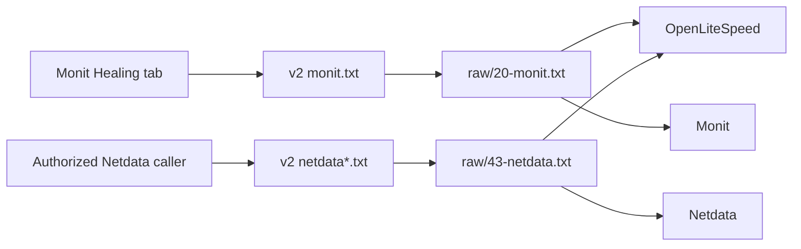

# Monitoring Solutions

## Current stack

Simple Stack 1.0.0 supports OpenLiteSpeed only and provisions from the fixed `scripts/v2` tree. Monitoring is split between a first-class Monit integration and a retained Netdata script bridge. Monitorix is retired.

| Solution | Status | Interface |
|---|---|---|
| Monit | Active | Server **Healing** tab with permission-gated install, component, SSL, email, callback, activation, and removal actions |
| Netdata | Retained script bridge | Fixed-v2 wrappers and raw provisioner; no dedicated Netdata tab controller is loaded by the current server-tab bootstrap |
| Monitorix | Retired | No tab, wrapper, raw script, metadata workflow, or compatibility path |

## Shared provisioning model

Both retained provisioning paths download the common helper and a tool-specific raw script, normalize line endings, export action parameters, and execute as root on the target server. The PHP script-handler trait resolves the fixed-v2 raw script and examines command output.

Monit is the hardened path: it validates inputs before changes, writes secrets to root-only includes, binds its HTTP daemon to loopback, validates Monit and OpenLiteSpeed configuration, and verifies service state. Netdata remains legacy script-level automation and still requires live-runtime certification.

## Architecture

## Operational guidance

- Keep Monit and Netdata bound to loopback and expose them only through authenticated OpenLiteSpeed vhosts.
- Never copy dashboard, SMTP, M/Monit, callback, or cloud claim credentials into logs or REST responses.
- Tune resource thresholds and collection intervals to the server workload.
- Validate SMTP, TLS, DNS, and callback reachability before relying on alerts.
- Use command logs and configuration validators when installation or service startup fails.

## Detailed pages

- [Monit Service Monitoring](Monit%20Service%20Monitoring.md)
- [Netdata Real-time Monitoring](Netdata%20Real-time%20Monitoring.md)
- [Monitorix Statistics Visualization](Monitorix%20Statistics%20Visualization.md)
