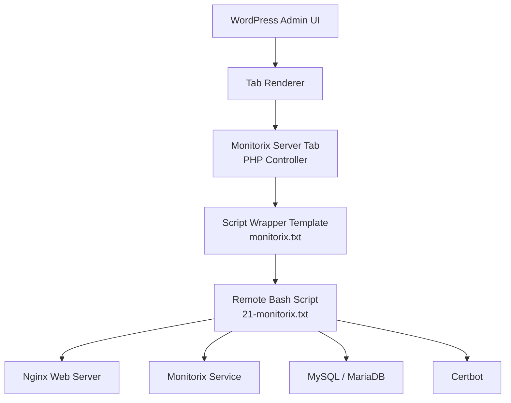
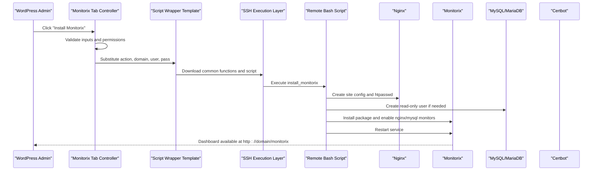
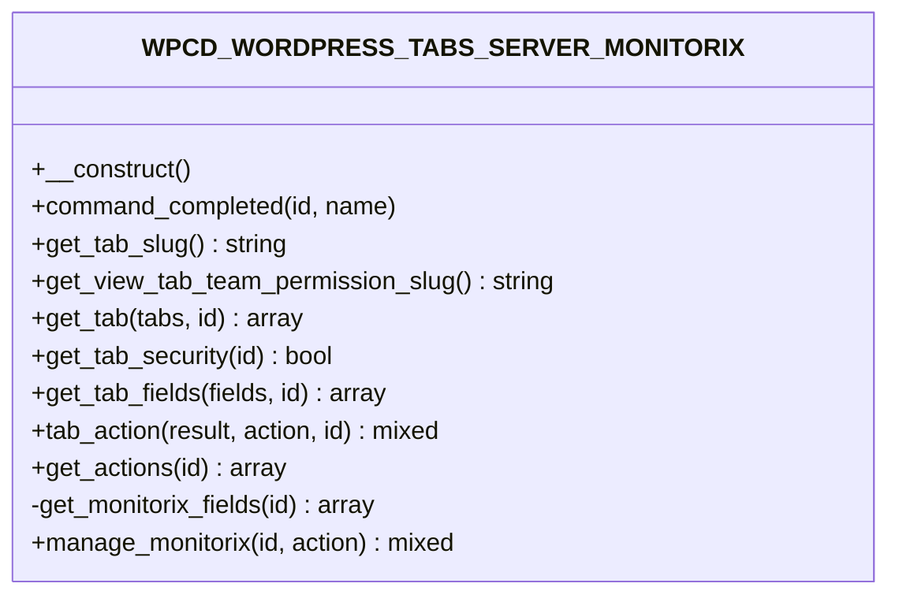
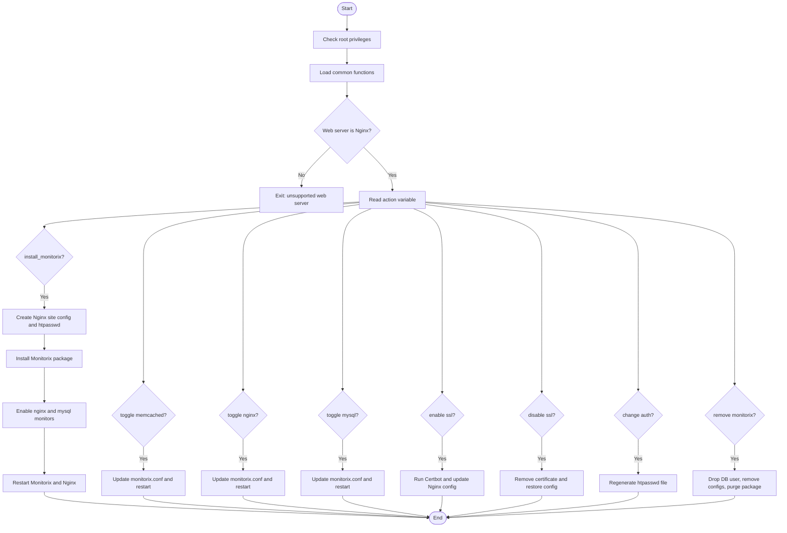
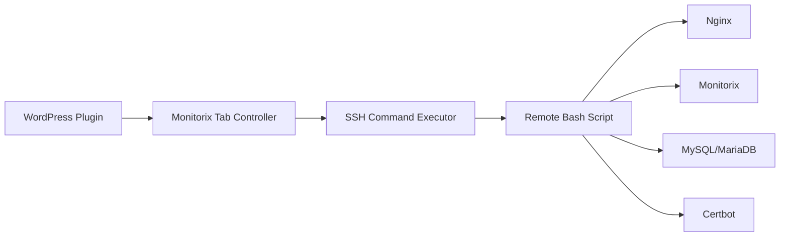

# Monitorix Statistics Visualization

<cite>
**Referenced Files in This Document**
- [monitorix.php](file://includes/core/apps/wordpress-app/tabs-server/monitorix.php)
- [monitorix.txt (v1)](file://includes/core/apps/wordpress-app/scripts/v1/monitorix.txt)
- [monitorix.txt (v2)](file://includes/core/apps/wordpress-app/scripts/v2/monitorix.txt)
- [21-monitorix.txt](file://includes/core/apps/wordpress-app/scripts/v1/raw/21-monitorix.txt)
- [environment variables.txt](file://includes/core/apps/wordpress-app/scripts/v1/raw/environment%20variables.txt)
- [SIMPLESTACK.md](file://docs/SIMPLESTACK.md)
</cite>

## Table of Contents
1. [Introduction](#introduction)
2. [Project Structure](#project-structure)
3. [Core Components](#core-components)
4. [Architecture Overview](#architecture-overview)
5. [Detailed Component Analysis](#detailed-component-analysis)
6. [Dependency Analysis](#dependency-analysis)
7. [Performance Considerations](#performance-considerations)
8. [Troubleshooting Guide](#troubleshooting-guide)
9. [Conclusion](#conclusion)
10. [Appendices](#appendices)

## Introduction
This document explains how SimpleStack integrates the Monitorix web-based statistics visualization system into its WordPress application stack. It covers installation through the SimpleStack server tab, configuration of monitored components such as Nginx and MySQL/MariaDB, enabling HTTPS for the Monitorix dashboard, historical data collection, graph generation, report scheduling, access control, security considerations, performance guidance, storage management, and troubleshooting.

Monitorix is a third-party monitoring tool that SimpleStack installs and configures on supported servers. The integration focuses on:
- Installing and removing Monitorix from a server.
- Enabling or disabling specific monitors such as Nginx, MySQL/MariaDB, and Memcached.
- Enabling or disabling HTTPS for the Monitorix dashboard using Certbot.
- Managing credentials and dashboard state through encrypted server metadata.
- Executing remote provisioning scripts over SSH.

The documentation also clarifies what SimpleStack controls versus what remains under Monitorix’s own configuration files and runtime behavior.

## Project Structure
SimpleStack exposes a dedicated “Monitorix” server tab when the target server runs Nginx and the user has permission to view it. The tab renders fields and actions, validates inputs, maps UI actions to backend script actions, executes remote commands via SSH, and updates server metadata.

**Diagram sources**
- [monitorix.php:15-28](file://includes/core/apps/wordpress-app/tabs-server/monitorix.php#L15-L28)
- [monitorix.php:76-87](file://includes/core/apps/wordpress-app/tabs-server/monitorix.php#L76-L87)
- [monitorix.php:135-187](file://includes/core/apps/wordpress-app/tabs-server/monitorix.php#L135-L187)
- [monitorix.php:592-720](file://includes/core/apps/wordpress-app/tabs-server/monitorix.php#L592-L720)
- [monitorix.txt (v1):1-9](file://includes/core/apps/wordpress-app/scripts/v1/monitorix.txt#L1-L9)
- [monitorix.txt (v2):1-9](file://includes/core/apps/wordpress-app/scripts/v2/monitorix.txt#L1-L9)
- [21-monitorix.txt:1-20](file://includes/core/apps/wordpress-app/scripts/v1/raw/21-monitorix.txt#L1-L20)

**Section sources**
- [monitorix.php:15-28](file://includes/core/apps/wordpress-app/tabs-server/monitorix.php#L15-L28)
- [monitorix.php:76-87](file://includes/core/apps/wordpress-app/tabs-server/monitorix.php#L76-L87)
- [monitorix.php:135-187](file://includes/core/apps/wordpress-app/tabs-server/monitorix.php#L135-L187)
- [monitorix.php:592-720](file://includes/core/apps/wordpress-app/tabs-server/monitorix.php#L592-L720)
- [monitorix.txt (v1):1-9](file://includes/core/apps/wordpress-app/scripts/v1/monitorix.txt#L1-L9)
- [monitorix.txt (v2):1-9](file://includes/core/apps/wordpress-app/scripts/v2/monitorix.txt#L1-L9)
- [21-monitorix.txt:1-20](file://includes/core/apps/wordpress-app/scripts/v1/raw/21-monitorix.txt#L1-L20)

## Core Components
- **Monitorix Server Tab Controller**: A PHP class registers the tab, defines visibility rules, builds form fields and actions, validates permissions, maps UI actions to backend script actions, executes remote commands, and updates server metadata.
- **Script Wrapper Templates**: `monitorix.txt` templates download common functions and the actual remote script, substitute placeholders, and execute the script with environment variables.
- **Remote Bash Script**: `21-monitorix.txt` performs the real work on the server: installing Monitorix, configuring Nginx proxy, creating HTTP basic authentication, enabling/disabling monitors, managing SSL with Certbot, upgrading on older Ubuntu releases, and cleaning up on removal.
- **Environment Variables Reference**: Documents required variables for actions such as installing Monitorix.

Key responsibilities:
- Restricting the tab to Nginx servers and authorized users.
- Collecting domain, username, and password during installation.
- Encrypting and storing credentials in server metadata.
- Generating and executing remote commands safely.
- Updating status flags for installed state, SSL, and component monitors.

**Section sources**
- [monitorix.php:15-28](file://includes/core/apps/wordpress-app/tabs-server/monitorix.php#L15-L28)
- [monitorix.php:76-87](file://includes/core/apps/wordpress-app/tabs-server/monitorix.php#L76-L87)
- [monitorix.php:135-187](file://includes/core/apps/wordpress-app/tabs-server/monitorix.php#L135-L187)
- [monitorix.php:592-720](file://includes/core/apps/wordpress-app/tabs-server/monitorix.php#L592-L720)
- [monitorix.txt (v1):1-9](file://includes/core/apps/wordpress-app/scripts/v1/monitorix.txt#L1-L9)
- [monitorix.txt (v2):1-9](file://includes/core/apps/wordpress-app/scripts/v2/monitorix.txt#L1-L9)
- [21-monitorix.txt:1-20](file://includes/core/apps/wordpress-app/scripts/v1/raw/21-monitorix.txt#L1-L20)
- [environment variables.txt:438-443](file://includes/core/apps/wordpress-app/scripts/v1/raw/environment%20variables.txt#L438-L443)

## Architecture Overview
The end-to-end flow starts in the WordPress admin interface and ends on the remote server where Monitorix runs behind Nginx.

**Diagram sources**
- [monitorix.php:135-187](file://includes/core/apps/wordpress-app/tabs-server/monitorix.php#L135-L187)
- [monitorix.php:592-720](file://includes/core/apps/wordpress-app/tabs-server/monitorix.php#L592-L720)
- [monitorix.txt (v1):1-9](file://includes/core/apps/wordpress-app/scripts/v1/monitorix.txt#L1-L9)
- [21-monitorix.txt:47-163](file://includes/core/apps/wordpress-app/scripts/v1/raw/21-monitorix.txt#L47-L163)

## Detailed Component Analysis

### Monitorix Server Tab Controller
The controller class:
- Registers filters to add the tab name, tab fields, and tab actions.
- Limits visibility to Nginx servers and users with the required team permission.
- Builds UI sections for installation, launch link, SSL toggle, component toggles, uninstall/upgrade, and meta synchronization.
- Validates and sanitizes inputs before executing remote commands.
- Updates server metadata after successful operations.

Important behaviors:
- The tab appears only when the server type is Nginx and the user passes both team-level and author-level checks.
- Installation requires domain, username, and password; these are sanitized and then escaped for shell execution.
- Toggles derive the underlying script action from current metadata values.
- SSL toggle uses the stored domain and blog admin email to request a certificate.
- Success paths update metadata such as installation status, domain, credentials, SSL flag, and monitor flags.

**Diagram sources**
- [monitorix.php:15-28](file://includes/core/apps/wordpress-app/tabs-server/monitorix.php#L15-L28)
- [monitorix.php:57-66](file://includes/core/apps/wordpress-app/tabs-server/monitorix.php#L57-L66)
- [monitorix.php:76-87](file://includes/core/apps/wordpress-app/tabs-server/monitorix.php#L76-L87)
- [monitorix.php:110-123](file://includes/core/apps/wordpress-app/tabs-server/monitorix.php#L110-L123)
- [monitorix.php:135-187](file://includes/core/apps/wordpress-app/tabs-server/monitorix.php#L135-L187)
- [monitorix.php:197-201](file://includes/core/apps/wordpress-app/tabs-server/monitorix.php#L197-L201)
- [monitorix.php:210-582](file://includes/core/apps/wordpress-app/tabs-server/monitorix.php#L210-L582)
- [monitorix.php:592-720](file://includes/core/apps/wordpress-app/tabs-server/monitorix.php#L592-L720)

**Section sources**
- [monitorix.php:15-28](file://includes/core/apps/wordpress-app/tabs-server/monitorix.php#L15-L28)
- [monitorix.php:76-87](file://includes/core/apps/wordpress-app/tabs-server/monitorix.php#L76-L87)
- [monitorix.php:110-123](file://includes/core/apps/wordpress-app/tabs-server/monitorix.php#L110-L123)
- [monitorix.php:135-187](file://includes/core/apps/wordpress-app/tabs-server/monitorix.php#L135-L187)
- [monitorix.php:210-582](file://includes/core/apps/wordpress-app/tabs-server/monitorix.php#L210-L582)
- [monitorix.php:592-720](file://includes/core/apps/wordpress-app/tabs-server/monitorix.php#L592-L720)

### Script Wrapper Templates
The wrapper template:
- Removes any previous copy of the script.
- Downloads common functions and the target script.
- Normalizes line endings.
- Exports environment variables including action, domain, email, user, and password.
- Executes the script.

Both v1 and v2 wrappers follow the same pattern; they differ mainly in the repository version used by SimpleStack.

**Section sources**
- [monitorix.txt (v1):1-9](file://includes/core/apps/wordpress-app/scripts/v1/monitorix.txt#L1-L9)
- [monitorix.txt (v2):1-9](file://includes/core/apps/wordpress-app/scripts/v2/monitorix.txt#L1-L9)

### Remote Bash Script
The remote script handles:
- Root privilege checks.
- Loading common functions.
- Rejecting non-Nginx environments.
- Interactive menu for actions.
- Installing Monitorix on different Ubuntu versions.
- Creating an Nginx site configuration that proxies to Monitorix on localhost.
- Creating HTTP basic authentication credentials.
- Enabling Nginx and MySQL/MariaDB monitors.
- Upgrading Monitorix on older Ubuntu releases.
- Enabling and disabling Memcached, Nginx, and MySQL/MariaDB monitors.
- Enabling and disabling HTTPS using Certbot.
- Changing authentication credentials.
- Removing Monitorix and associated artifacts.

**Diagram sources**
- [21-monitorix.txt:1-20](file://includes/core/apps/wordpress-app/scripts/v1/raw/21-monitorix.txt#L1-L20)
- [21-monitorix.txt:47-163](file://includes/core/apps/wordpress-app/scripts/v1/raw/21-monitorix.txt#L47-L163)
- [21-monitorix.txt:168-183](file://includes/core/apps/wordpress-app/scripts/v1/raw/21-monitorix.txt#L168-L183)
- [21-monitorix.txt:187-203](file://includes/core/apps/wordpress-app/scripts/v1/raw/21-monitorix.txt#L187-L203)
- [21-monitorix.txt:207-263](file://includes/core/apps/wordpress-app/scripts/v1/raw/21-monitorix.txt#L207-L263)
- [21-monitorix.txt:267-327](file://includes/core/apps/wordpress-app/scripts/v1/raw/21-monitorix.txt#L267-L327)
- [21-monitorix.txt:330-354](file://includes/core/apps/wordpress-app/scripts/v1/raw/21-monitorix.txt#L330-L354)

**Section sources**
- [21-monitorix.txt:1-20](file://includes/core/apps/wordpress-app/scripts/v1/raw/21-monitorix.txt#L1-L20)
- [21-monitorix.txt:47-163](file://includes/core/apps/wordpress-app/scripts/v1/raw/21-monitorix.txt#L47-L163)
- [21-monitorix.txt:168-183](file://includes/core/apps/wordpress-app/scripts/v1/raw/21-monitorix.txt#L168-L183)
- [21-monitorix.txt:187-203](file://includes/core/apps/wordpress-app/scripts/v1/raw/21-monitorix.txt#L187-L203)
- [21-monitorix.txt:207-263](file://includes/core/apps/wordpress-app/scripts/v1/raw/21-monitorix.txt#L207-L263)
- [21-monitorix.txt:267-327](file://includes/core/apps/wordpress-app/scripts/v1/raw/21-monitorix.txt#L267-L327)
- [21-monitorix.txt:330-354](file://includes/core/apps/wordpress-app/scripts/v1/raw/21-monitorix.txt#L330-L354)

### Environment Variables and Action Mapping
The environment variables reference documents required variables for Monitorix installation, including domain, user, and password. The controller maps UI actions to script actions and ensures required parameters are present before execution.

**Section sources**
- [environment variables.txt:438-443](file://includes/core/apps/wordpress-app/scripts/v1/raw/environment%20variables.txt#L438-L443)
- [monitorix.php:603-627](file://includes/core/apps/wordpress-app/tabs-server/monitorix.php#L603-L627)
- [monitorix.php:629-692](file://includes/core/apps/wordpress-app/tabs-server/monitorix.php#L629-L692)

## Dependency Analysis
The integration depends on:
- WordPress admin UI and tab rendering infrastructure.
- SimpleStack REST and tab schema mechanisms.
- SSH execution layer for running remote commands.
- Nginx web server for proxying requests to Monitorix.
- MySQL or MariaDB for database monitoring.
- Certbot for obtaining TLS certificates.
- System services: Monitorix and Nginx.

**Diagram sources**
- [monitorix.php:135-187](file://includes/core/apps/wordpress-app/tabs-server/monitorix.php#L135-L187)
- [monitorix.php:592-720](file://includes/core/apps/wordpress-app/tabs-server/monitorix.php#L592-L720)
- [21-monitorix.txt:47-163](file://includes/core/apps/wordpress-app/scripts/v1/raw/21-monitorix.txt#L47-L163)

**Section sources**
- [monitorix.php:135-187](file://includes/core/apps/wordpress-app/tabs-server/monitorix.php#L135-L187)
- [monitorix.php:592-720](file://includes/core/apps/wordpress-app/tabs-server/monitorix.php#L592-L720)
- [21-monitorix.txt:47-163](file://includes/core/apps/wordpress-app/scripts/v1/raw/21-monitorix.txt#L47-L163)

## Performance Considerations
- **Metric Selection**: Only enable monitors you need. The integration supports toggling Nginx, MySQL/MariaDB, and Memcached monitors. Disabling unused monitors reduces overhead and simplifies graphs.
- **Historical Data**: Monitorix stores historical data locally. Large retention periods can increase disk usage. Manage retention through Monitorix’s own configuration rather than relying solely on SimpleStack.
- **Graph Generation**: Graphs are generated by Monitorix based on collected RRD data. Ensure sufficient disk space and appropriate polling intervals to avoid performance degradation.
- **Report Scheduling**: Report generation is handled by Monitorix. Use Monitorix’s built-in scheduling options to balance freshness and resource consumption.
- **Storage Management**: Periodically review Monitorix data directories and logs. Prune old data if necessary and ensure log rotation is configured.

[No sources needed since this section provides general guidance]

## Troubleshooting Guide

### Common Issues and Resolutions
- **Tab Not Visible**:
  - The tab is restricted to Nginx servers and requires team and author permissions.
  - Verify the server web server type and user permissions.

- **Installation Fails**:
  - Confirm DNS points to the server for the chosen domain.
  - Check SSH logs for errors during script execution.
  - Ensure the server is reachable and has required packages available.

- **Dashboard Not Accessible**:
  - Verify Nginx site configuration exists and is enabled.
  - Confirm HTTP basic authentication credentials are correct.
  - If HTTPS was enabled, check Certbot logs and certificate validity.

- **SSL Enablement Fails**:
  - Ensure DNS resolves correctly.
  - Avoid repeated failed attempts to prevent rate limiting.
  - Review SSH logs for Certbot errors.

- **Component Monitor Disabled**:
  - Use the corresponding toggle in the tab to enable the monitor.
  - Confirm the service is running and accessible.

- **Metadata Out of Sync**:
  - Use the meta synchronization options to reset dashboard state.
  - Reinstall if necessary to reinitialize metadata.

**Section sources**
- [monitorix.php:76-87](file://includes/core/apps/wordpress-app/tabs-server/monitorix.php#L76-L87)
- [monitorix.php:135-187](file://includes/core/apps/wordpress-app/tabs-server/monitorix.php#L135-L187)
- [monitorix.php:210-582](file://includes/core/apps/wordpress-app/tabs-server/monitorix.php#L210-L582)
- [monitorix.php:592-720](file://includes/core/apps/wordpress-app/tabs-server/monitorix.php#L592-L720)
- [21-monitorix.txt:47-163](file://includes/core/apps/wordpress-app/scripts/v1/raw/21-monitorix.txt#L47-L163)
- [21-monitorix.txt:267-327](file://includes/core/apps/wordpress-app/scripts/v1/raw/21-monitorix.txt#L267-L327)

## Conclusion
SimpleStack provides a controlled, permission-gated interface to install and manage Monitorix on Nginx servers. It automates Nginx proxy setup, HTTP basic authentication, component monitor toggles, and HTTPS provisioning. While SimpleStack manages installation and operational state, detailed metric selection, historical data retention, and report scheduling remain under Monitorix’s configuration. Operators should select relevant metrics, secure access, monitor storage usage, and use the provided troubleshooting steps to maintain a reliable monitoring dashboard.

[No sources needed since this section summarizes without analyzing specific files]

## Appendices

### Installation Workflow Summary
- Open the server details page and navigate to the Monitorix tab.
- Provide domain, username, and password.
- Click Install Monitorix.
- Launch the dashboard using the provided link.
- Toggle SSL and component monitors as needed.
- Use meta synchronization if dashboard state becomes inconsistent.

**Section sources**
- [monitorix.php:210-582](file://includes/core/apps/wordpress-app/tabs-server/monitorix.php#L210-L582)
- [monitorix.php:592-720](file://includes/core/apps/wordpress-app/tabs-server/monitorix.php#L592-L720)

### Security Notes
- Credentials are stored encrypted in server metadata.
- The dashboard is protected by HTTP basic authentication.
- HTTPS can be enabled using Certbot; ensure DNS is correctly configured.
- The tab enforces team and author permissions.

**Section sources**
- [monitorix.php:210-582](file://includes/core/apps/wordpress-app/tabs-server/monitorix.php#L210-L582)
- [monitorix.php:592-720](file://includes/core/apps/wordpress-app/tabs-server/monitorix.php#L592-L720)
- [21-monitorix.txt:47-163](file://includes/core/apps/wordpress-app/scripts/v1/raw/21-monitorix.txt#L47-L163)
- [21-monitorix.txt:267-327](file://includes/core/apps/wordpress-app/scripts/v1/raw/21-monitorix.txt#L267-L327)

### Integration With SimpleStack Authentication
SimpleStack’s tab system enforces access control through team permissions and author checks. The Monitorix tab requires a specific team permission slug and author authorization to render and act. This aligns with SimpleStack’s broader approach to restricting administrative features.

**Section sources**
- [monitorix.php:62-66](file://includes/core/apps/wordpress-app/tabs-server/monitorix.php#L62-L66)
- [monitorix.php:96-98](file://includes/core/apps/wordpress-app/tabs-server/monitorix.php#L96-L98)
- [monitorix.php:135-148](file://includes/core/apps/wordpress-app/tabs-server/monitorix.php#L135-L148)
- [SIMPLESTACK.md:93-114](file://docs/SIMPLESTACK.md#L93-L114)