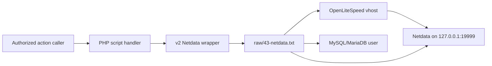

# Netdata Real-time Monitoring

## Scope

Simple Stack retains a script-level Netdata integration for the fixed `v2` provisioning tree. It supports OpenLiteSpeed only; the current raw script aborts when `/usr/local/lsws/bin/lshttpd` is unavailable. Nginx and PHP-FPM branches from earlier revisions are not present.

The PHP script-handler trait still maps the Netdata wrappers to `raw/43-netdata.txt` and recognizes their success messages. The current server-tab bootstrap does not load a dedicated Netdata controller, so this page documents the retained provisioning bridge rather than a first-class admin tab.

## Components

| Component | Current path | Responsibility |
|---|---|---|
| Generic wrapper | `includes/core/apps/wordpress-app/scripts/v2/netdata.txt` | Downloads shared helpers and the raw script, exports action parameters, and runs the script as root |
| Background install wrapper | `includes/core/apps/wordpress-app/scripts/v2/netdata_install.txt` | Runs installation in the background, stores intermediate/final logs, and invokes the completion callback |
| Raw provisioning script | `includes/core/apps/wordpress-app/scripts/v2/raw/43-netdata.txt` | Installs, removes, updates, secures, and configures Netdata |
| PHP dispatcher and result checks | `includes/core/apps/wordpress-app/traits/traits-for-class-wordpress-app/script-handlers.php` | Resolves the fixed script tree, builds placeholders, and matches action output |

Provisioning is fixed to `v2`; there is no `v1` tree or fallback.

## Architecture

The raw script creates an OpenLiteSpeed virtual host whose proxy processor targets `127.0.0.1:19999`. HTTP basic authentication is managed through the vhost password files. Certbot webroot issuance is used when HTTPS is enabled.

## Supported actions

The raw script accepts the following programmatic action names and equivalent numeric menu selections:

| Action | Numeric value | Result |
|---|---:|---|
| `netdata_install` | 1 | Creates the OLS vhost and credentials, installs Netdata, creates the MySQL user, and restarts services |
| `netdata_remove` | 2 | Disables SSL, uninstalls Netdata, removes the managed vhost/document root, drops the MySQL user, and restarts OpenLiteSpeed |
| `netdata_update` | 3 | Runs the official Netdata kickstart updater |
| `netdata_ssl_enable` | 4 | Issues a certificate and updates the OLS vhost certificate paths and HTTPS redirect |
| `netdata_ssl_disable` | 5 | Removes the managed certificate and restores the default OLS certificate paths |
| `netdata_auth_add` | 6 | Adds the password-protection context |
| `netdata_auth_remove` | 7 | Removes the password-protection context |
| `netdata_auth_change` | 8 | Recreates the vhost `htpasswd` entry |
| `netdata_enable_registry` | 9 | Enables registry announcements |
| `netdata_set_registry` | 10 | Points the agent at another registry; authentication must be disabled first |

## Installation flow

1. Require root, load `9999-common-functions.sh`, and verify OpenLiteSpeed is installed.
2. Collect the dashboard domain, basic-auth username/password, and Netdata Cloud claim tokens when they are not supplied.
3. Create the OpenLiteSpeed `netdata` vhost with a loopback proxy to port `19999` and password files.
4. Run the official kickstart installer with telemetry disabled and the supplied claim parameters.
5. Create the `netdata` MySQL user with `USAGE` privileges.
6. Restart OpenLiteSpeed and Netdata, enable Netdata at boot, and emit `Netdata has been installed`.

The install wrapper runs this flow asynchronously and records completion through the command callback. The generic wrapper is used for the remaining actions.

## Result handling

`script-handlers.php` recognizes fixed success strings for installation, removal, update, authentication, SSL, and registry operations. Unlike the hardened Monit path, Netdata success matching is grouped by wrapper rather than constrained to each individual action. Operators should inspect the command log when an action reports failure or remains pending.

## Security and operational boundaries

- Netdata is exposed through an OpenLiteSpeed vhost; the agent itself listens on loopback port `19999`.
- Basic-auth credentials live in the managed vhost password file and must not be copied into logs or REST responses.
- Claim tokens are secrets and must be redacted from command and callback logs.
- The current Netdata wrappers are legacy provisioning code and are not runtime-certified on a live OpenLiteSpeed server.
- There is no Nginx, PHP-FPM, or enterprise LiteSpeed configuration path in the current raw script.

## Related implementation

- [Netdata wrapper](../../../../../../includes/core/apps/wordpress-app/scripts/v2/netdata.txt)
- [Netdata install wrapper](../../../../../../includes/core/apps/wordpress-app/scripts/v2/netdata_install.txt)
- [Netdata raw script](../../../../../../includes/core/apps/wordpress-app/scripts/v2/raw/43-netdata.txt)
- [Script handler](../../../../../../includes/core/apps/wordpress-app/traits/traits-for-class-wordpress-app/script-handlers.php)
- [Simple Stack operator documentation](../../../../../../docs/SIMPLESTACK.md)
