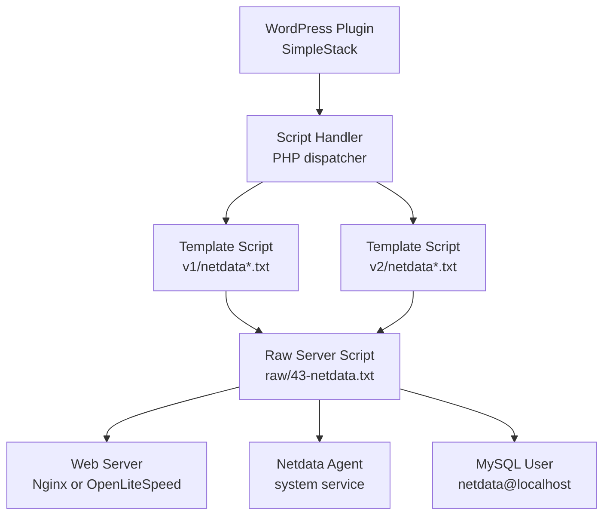
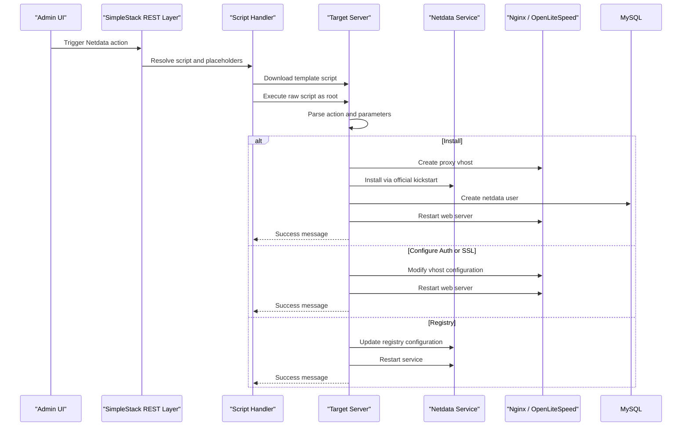
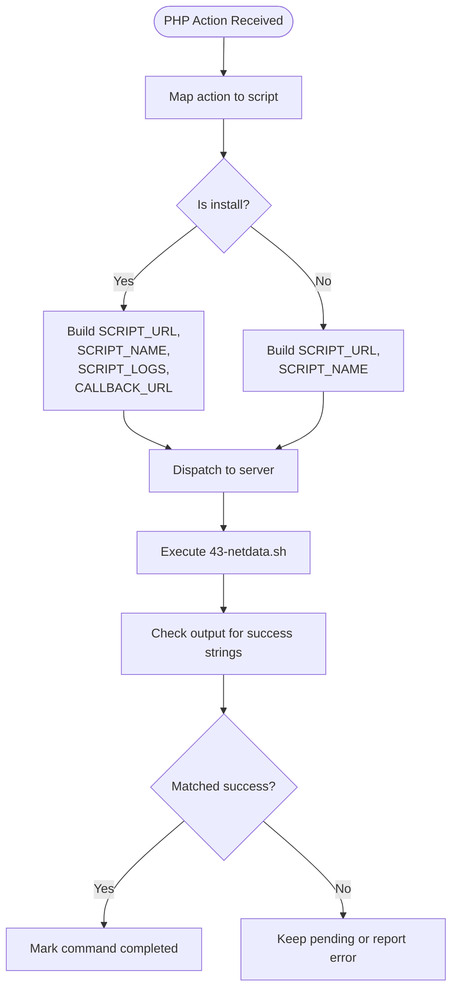
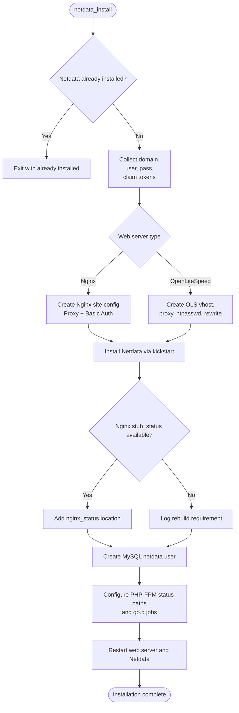
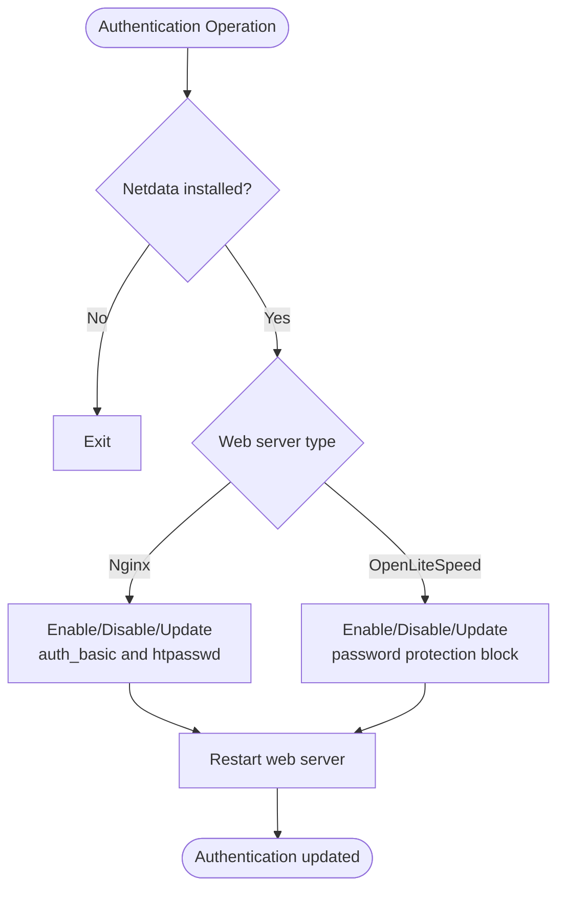
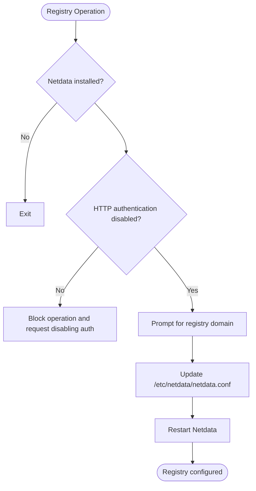
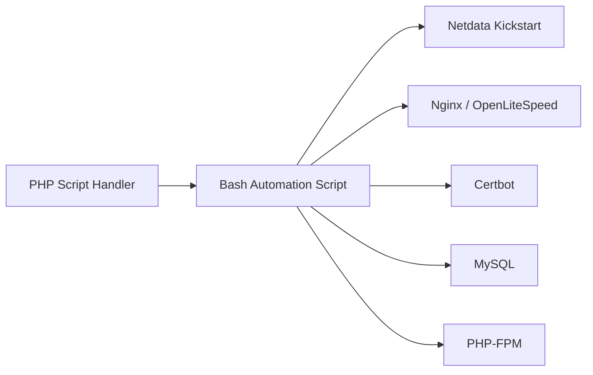

# Netdata Real-time Monitoring

<cite>
**Referenced Files in This Document**   
- [SIMPLESTACK.md](file://docs/SIMPLESTACK.md)
- [script-handlers.php](file://includes/core/apps/wordpress-app/traits/traits-for-class-wordpress-app/script-handlers.php)
- [netdata.txt (v1)](file://includes/core/apps/wordpress-app/scripts/v1/netdata.txt)
- [netdata_install.txt (v1)](file://includes/core/apps/wordpress-app/scripts/v1/netdata_install.txt)
- [netdata.txt (v2)](file://includes/core/apps/wordpress-app/scripts/v2/netdata.txt)
- [netdata_install.txt (v2)](file://includes/core/apps/wordpress-app/scripts/v2/netdata_install.txt)
- [43-netdata.txt](file://includes/core/apps/wordpress-app/scripts/v1/raw/43-netdata.txt)
</cite>

## Table of Contents
1. [Introduction](#introduction)
2. [Project Structure](#project-structure)
3. [Core Components](#core-components)
4. [Architecture Overview](#architecture-overview)
5. [Detailed Component Analysis](#detailed-component-analysis)
6. [Dependency Analysis](#dependency-analysis)
7. [Performance Considerations](#performance-considerations)
8. [Troubleshooting Guide](#troubleshooting-guide)
9. [Conclusion](#conclusion)
10. [Appendices](#appendices)

## Introduction
This document explains how Netdata real-time performance monitoring is integrated into the SimpleStack WordPress plugin. The integration does not reimplement Netdata; instead, it automates its installation, configuration, and lifecycle management through server provisioning scripts. It also documents how the PHP layer dispatches these scripts, how success is detected, and what operations are supported on the target server.

The repository’s primary hosting stack uses OpenLiteSpeed on Ubuntu 24.04 LTS and 26.04 LTS, with multiple `lsphp` versions. Netdata support is provided for both Nginx and OpenLiteSpeed web servers, including HTTP authentication, SSL via Certbot, registry configuration, and optional PHP-FPM status collection.

## Project Structure
Netdata-related code in this repository is organized around two layers:

- **PHP orchestration layer**: Determines which script to run, prepares placeholders, downloads the script onto the target server, executes it as root, and interprets output to determine success or failure.
- **Server-side automation layer**: A Bash script that installs, removes, upgrades, secures, and configures Netdata according to the selected action.

**Diagram sources**
- [script-handlers.php:1467-1488](file://includes/core/apps/wordpress-app/traits/traits-for-class-wordpress-app/script-handlers.php#L1467-L1488)
- [netdata.txt (v1):1-9](file://includes/core/apps/wordpress-app/scripts/v1/netdata.txt#L1-L9)
- [netdata_install.txt (v1):1-11](file://includes/core/apps/wordpress-app/scripts/v1/netdata_install.txt#L1-L11)
- [netdata.txt (v2):1-9](file://includes/core/apps/wordpress-app/scripts/v2/netdata.txt#L1-L9)
- [netdata_install.txt (v2):1-11](file://includes/core/apps/wordpress-app/scripts/v2/netdata_install.txt#L1-L11)
- [43-netdata.txt:1-14](file://includes/core/apps/wordpress-app/scripts/v1/raw/43-netdata.txt#L1-L14)

**Section sources**
- [SIMPLESTACK.md:15-32](file://docs/SIMPLESTACK.md#L15-L32)
- [SIMPLESTACK.md:154-177](file://docs/SIMPLESTACK.md#L154-L177)
- [script-handlers.php:1467-1488](file://includes/core/apps/wordpress-app/traits/traits-for-class-wordpress-app/script-handlers.php#L1467-L1488)

## Core Components
The Netdata integration consists of four main components:

| Component | Responsibility | Key Behavior |
|---|---|---|
| PHP script handler | Maps a tab action to a downloadable script and placeholder set | Builds `SCRIPT_URL`, `SCRIPT_NAME`, `CALLBACK_URL`, and common variables |
| v1/v2 template scripts | Download and execute the raw server script | Export environment variables such as `action`, `domain`, `user`, `pass`, `email`, `claim_token`, and `claim_rooms_token` |
| Raw server script | Performs all Netdata operations on the target host | Supports install, remove, update, SSL enable/disable, basic auth, and registry configuration |
| Success detection logic | Interprets script output to mark commands completed | Matches specific success strings returned by the Bash script |

### Supported Netdata Operations
The raw script exposes an interactive menu and programmatic actions:

- Install Netdata
- Remove Netdata
- Upgrade Netdata
- Enable HTTPS
- Disable HTTPS
- Add HTTP authentication
- Remove HTTP authentication
- Update HTTP authentication credentials
- Enable Netdata as a registry
- Set registry target

These operations are dispatched through the `action` environment variable supplied by the PHP template.

**Section sources**
- [script-handlers.php:591-626](file://includes/core/apps/wordpress-app/traits/traits-for-class-wordpress-app/script-handlers.php#L591-L626)
- [script-handlers.php:1467-1488](file://includes/core/apps/wordpress-app/traits/traits-for-class-wordpress-app/script-handlers.php#L1467-L1488)
- [43-netdata.txt:121-140](file://includes/core/apps/wordpress-app/scripts/v1/raw/43-netdata.txt#L121-L140)
- [43-netdata.txt:658-716](file://includes/core/apps/wordpress-app/scripts/v1/raw/43-netdata.txt#L658-L716)

## Architecture Overview
The end-to-end flow begins when an operator triggers a Netdata action from the SimpleStack admin UI. The PHP layer selects the appropriate script version, builds placeholders, downloads the script to the target server, runs it as root, and then checks whether the output matches expected success messages.

**Diagram sources**
- [script-handlers.php:1467-1488](file://includes/core/apps/wordpress-app/traits/traits-for-class-wordpress-app/script-handlers.php#L1467-L1488)
- [netdata_install.txt (v1):1-11](file://includes/core/apps/wordpress-app/scripts/v1/netdata_install.txt#L1-L11)
- [43-netdata.txt:142-313](file://includes/core/apps/wordpress-app/scripts/v1/raw/43-netdata.txt#L142-L313)
- [43-netdata.txt:374-428](file://includes/core/apps/wordpress-app/scripts/v1/raw/43-netdata.txt#L374-L428)
- [43-netdata.txt:581-653](file://includes/core/apps/wordpress-app/scripts/v1/raw/43-netdata.txt#L581-L653)

## Detailed Component Analysis

### PHP Script Handler
The PHP handler maps the `netdata_install.txt` and `netdata.txt` actions to the actual server script path and execution context. For installation, it also supplies a callback URL so the plugin can be notified when the background command finishes.

Key responsibilities:
- Select the script version (`v1` or `v2`)
- Build `SCRIPT_URL` pointing to `raw/43-netdata.txt`
- Assign `SCRIPT_NAME` as `43-netdata.sh`
- For installation, include `SCRIPT_LOGS` and `CALLBACK_URL`
- Merge common variables such as domain, user, pass, email, claim tokens, and callback URL

Success detection is implemented by matching known output strings. For `netdata_install.txt`, success includes “Netdata has been installed” or “Netdata is already installed”. For `netdata.txt`, success includes installation, removal, update, authentication changes, SSL changes, and registry state messages.

**Diagram sources**
- [script-handlers.php:591-626](file://includes/core/apps/wordpress-app/traits/traits-for-class-wordpress-app/script-handlers.php#L591-L626)
- [script-handlers.php:1467-1488](file://includes/core/apps/wordpress-app/traits/traits-for-class-wordpress-app/script-handlers.php#L1467-L1488)

**Section sources**
- [script-handlers.php:591-626](file://includes/core/apps/wordpress-app/traits/traits-for-class-wordpress-app/script-handlers.php#L591-L626)
- [script-handlers.php:1467-1488](file://includes/core/apps/wordpress-app/traits/traits-for-class-wordpress-app/script-handlers.php#L1467-L1488)

### Template Scripts
The template scripts are thin wrappers that:
- Remove any previous temporary script file
- Download the shared common functions script
- Convert line endings
- Download the raw Netdata script
- Export environment variables
- Execute the raw script

The difference between `netdata.txt` and `netdata_install.txt` is primarily execution context: the install variant logs intermediate output and invokes a completion callback after successful execution.

Environment variables passed to the raw script include:
- `action`: operation identifier
- `domain`: Netdata hostname
- `user`: HTTP authentication username
- `pass`: HTTP authentication password
- `email`: certificate email address
- `callback_url`: plugin callback endpoint
- `claim_token`: Netdata Cloud claim token
- `claim_rooms_token`: Netdata Cloud rooms token

**Section sources**
- [netdata.txt (v1):1-9](file://includes/core/apps/wordpress-app/scripts/v1/netdata.txt#L1-L9)
- [netdata_install.txt (v1):1-11](file://includes/core/apps/wordpress-app/scripts/v1/netdata_install.txt#L1-L11)
- [netdata.txt (v2):1-9](file://includes/core/apps/wordpress-app/scripts/v2/netdata.txt#L1-L9)
- [netdata_install.txt (v2):1-11](file://includes/core/apps/wordpress-app/scripts/v2/netdata_install.txt#L1-L11)

### Raw Server Script
The raw script `43-netdata.txt` is the core automation layer. It requires root privileges, sources common functions, and presents an action menu. It supports both Nginx and OpenLiteSpeed.

#### Installation Flow
When installing Netdata:
1. Checks whether Netdata is already installed.
2. Prompts for domain, authentication user/password, and Netdata Cloud claim tokens if missing.
3. Creates a web server virtual host:
   - Nginx: proxy to `127.0.0.1:19999` with HTTP authentication.
   - OpenLiteSpeed: create vhost directory, htpasswd, proxy processor, and rewrite rules.
4. Installs Netdata using the official kickstart script with telemetry disabled and optional cloud claim parameters.
5. Optionally adds Nginx `stub_status` for Nginx metrics.
6. Creates a MySQL user `netdata@localhost`.
7. Configures PHP-FPM status paths and Go.d jobs for multiple PHP versions.
8. Restarts the web server and enables/restarts the Netdata service.

**Diagram sources**
- [43-netdata.txt:142-313](file://includes/core/apps/wordpress-app/scripts/v1/raw/43-netdata.txt#L142-L313)

#### SSL and Authentication
The script provides separate functions for enabling and disabling HTTPS and for managing HTTP authentication:

- **HTTPS enable**: Uses Certbot for Nginx or webroot mode for OpenLiteSpeed, updates certificate paths, and optionally inserts HTTP-to-HTTPS redirects.
- **HTTPS disable**: Removes managed certificates and reverts listener configuration.
- **HTTP authentication**: Adds or removes basic auth blocks for Nginx and OpenLiteSpeed, creates or updates htpasswd files, and restarts the web server.

**Diagram sources**
- [43-netdata.txt:470-579](file://includes/core/apps/wordpress-app/scripts/v1/raw/43-netdata.txt#L470-L579)

#### Registry Configuration
Netdata can be configured as a registry or pointed at another registry. The script validates that HTTP authentication is disabled before allowing registry configuration because registry communication should not require per-request authentication.

**Diagram sources**
- [43-netdata.txt:581-653](file://includes/core/apps/wordpress-app/scripts/v1/raw/43-netdata.txt#L581-L653)

**Section sources**
- [43-netdata.txt:1-14](file://includes/core/apps/wordpress-app/scripts/v1/raw/43-netdata.txt#L1-L14)
- [43-netdata.txt:142-313](file://includes/core/apps/wordpress-app/scripts/v1/raw/43-netdata.txt#L142-L313)
- [43-netdata.txt:374-428](file://includes/core/apps/wordpress-app/scripts/v1/raw/43-netdata.txt#L374-L428)
- [43-netdata.txt:470-579](file://includes/core/apps/wordpress-app/scripts/v1/raw/43-netdata.txt#L470-L579)
- [43-netdata.txt:581-653](file://includes/core/apps/wordpress-app/scripts/v1/raw/43-netdata.txt#L581-L653)

## Dependency Analysis
The Netdata integration depends on several external and internal components:

| Dependency | Role | Notes |
|---|---|---|
| Official Netdata installer | Installs and updates Netdata | Uses `https://get.netdata.cloud/kickstart.sh` |
| Nginx or OpenLiteSpeed | Proxies Netdata traffic | Requires vhost configuration and restart |
| Certbot | Manages TLS certificates | Used for HTTPS enable/disable |
| MySQL/MariaDB | Provides a dedicated user | Script creates `netdata@localhost` |
| PHP-FPM | Optional application metrics | Status paths and Go.d jobs configured for multiple PHP versions |
| Common functions script | Shared utilities | Required by the raw script |

**Diagram sources**
- [script-handlers.php:1467-1488](file://includes/core/apps/wordpress-app/traits/traits-for-class-wordpress-app/script-handlers.php#L1467-L1488)
- [43-netdata.txt:223-226](file://includes/core/apps/wordpress-app/scripts/v1/raw/43-netdata.txt#L223-L226)
- [43-netdata.txt:241-245](file://includes/core/apps/wordpress-app/scripts/v1/raw/43-netdata.txt#L241-L245)
- [43-netdata.txt:294-307](file://includes/core/apps/wordpress-app/scripts/v1/raw/43-netdata.txt#L294-L307)

**Section sources**
- [43-netdata.txt:223-226](file://includes/core/apps/wordpress-app/scripts/v1/raw/43-netdata.txt#L223-L226)
- [43-netdata.txt:241-245](file://includes/core/apps/wordpress-app/scripts/v1/raw/43-netdata.txt#L241-L245)
- [43-netdata.txt:294-307](file://includes/core/apps/wordpress-app/scripts/v1/raw/43-netdata.txt#L294-L307)

## Performance Considerations
The current implementation focuses on operational automation rather than tuning Netdata’s internal data retention, collection frequency, or storage backend. Operators should consider the following based on the script behavior:

- **Telemetry**: The installer is invoked with telemetry disabled, reducing outbound reporting.
- **Cloud claim tokens**: Claim tokens connect the agent to Netdata Cloud; ensure they are scoped appropriately.
- **PHP-FPM metrics**: Multiple PHP versions are configured for status collection. If only one PHP version is active, unnecessary FPM status endpoints may still be created.
- **Nginx stub_status**: Only enabled if the Nginx build includes the required module; otherwise, a rebuild is required.
- **Service restarts**: Each major operation restarts the web server and/or Netdata, which can cause brief downtime during configuration changes.

[No sources needed since this section provides general guidance]

## Troubleshooting Guide

### Command Does Not Complete
If the SimpleStack UI does not show completion, check:
- Whether the script output contains one of the recognized success strings.
- Whether the callback URL was reachable after script execution.
- Whether the background process exited successfully.

Relevant success patterns are defined in the PHP handler for both install and generic Netdata actions.

**Section sources**
- [script-handlers.php:591-626](file://includes/core/apps/wordpress-app/traits/traits-for-class-wordpress-app/script-handlers.php#L591-L626)

### Netdata Already Installed
The installer exits early if Netdata is already present. Use the upgrade or configuration actions instead of reinstalling.

**Section sources**
- [43-netdata.txt:142-150](file://includes/core/apps/wordpress-app/scripts/v1/raw/43-netdata.txt#L142-L150)

### Nginx Metrics Not Available
If Nginx metrics are missing, the script reports that the Nginx build must be rebuilt with the `with-http_stub_status_module` option.

**Section sources**
- [43-netdata.txt:227-238](file://includes/core/apps/wordpress-app/scripts/v1/raw/43-netdata.txt#L227-L238)

### HTTPS Enable Fails
For Nginx, verify that Certbot can modify the site configuration. For OpenLiteSpeed, verify that the webroot exists and that certificate paths are updated correctly.

**Section sources**
- [43-netdata.txt:374-428](file://includes/core/apps/wordpress-app/scripts/v1/raw/43-netdata.txt#L374-L428)

### Registry Configuration Blocked
Registry configuration requires HTTP authentication to be disabled. If authentication is enabled, the script blocks the operation and asks you to disable it first.

**Section sources**
- [43-netdata.txt:610-653](file://includes/core/apps/wordpress-app/scripts/v1/raw/43-netdata.txt#L610-L653)

### Uninstall Leaves Artifacts
Uninstall removes the Netdata package and web server configuration, deletes the Netdata document root, drops the MySQL user, and restarts the web server. If cleanup fails, inspect APT locks and manual configuration remnants.

**Section sources**
- [43-netdata.txt:315-359](file://includes/core/apps/wordpress-app/scripts/v1/raw/43-netdata.txt#L315-L359)

## Conclusion
The SimpleStack plugin integrates Netdata by delegating installation and configuration to a robust Bash automation script. The PHP layer provides a safe, auditable control plane that downloads scripts, executes them as root, and interprets results. The supported operations cover the most common production needs: installation, removal, upgrades, HTTPS, HTTP authentication, and registry setup.

For advanced customization—such as custom charts, dashboard personalization, or external data export—the repository does not provide built-in automation. Those tasks would need to be performed directly on the target server or extended through additional scripts and configuration files outside this repository.

[No sources needed since this section summarizes without analyzing specific files]

## Appendices

### Netdata Actions Summary
| Action | Purpose | Primary Effects |
|---|---|---|
| Install | Deploy Netdata with web server proxy and optional cloud registration | Installs agent, creates vhost, optional MySQL user, optional PHP-FPM metrics |
| Remove | Uninstall Netdata and clean up artifacts | Removes package, vhost, document root, MySQL user |
| Update | Upgrade Netdata | Runs official updater |
| Enable HTTPS | Configure TLS via Certbot | Updates certificate paths and optionally redirects HTTP to HTTPS |
| Disable HTTPS | Remove managed TLS configuration | Reverts listeners and removes Certbot-managed entries |
| Add HTTP Authentication | Protect Netdata with basic auth | Creates or updates htpasswd and vhost auth block |
| Remove HTTP Authentication | Disable basic auth | Removes auth block and htpasswd usage |
| Update HTTP Authentication | Change credentials | Recreates htpasswd entry |
| Enable Registry | Announce this node as a Netdata registry | Updates registry configuration |
| Set Registry Target | Point this node at another registry | Updates registry announce target |

**Section sources**
- [43-netdata.txt:121-140](file://includes/core/apps/wordpress-app/scripts/v1/raw/43-netdata.txt#L121-L140)
- [43-netdata.txt:658-716](file://includes/core/apps/wordpress-app/scripts/v1/raw/43-netdata.txt#L658-L716)