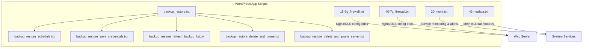
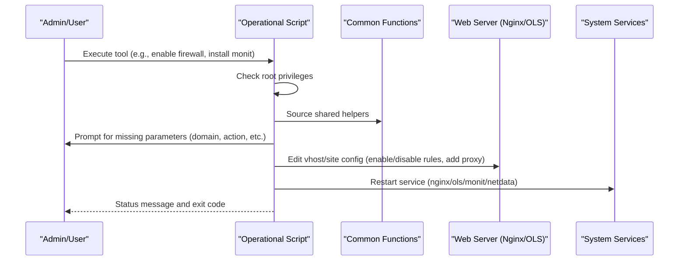
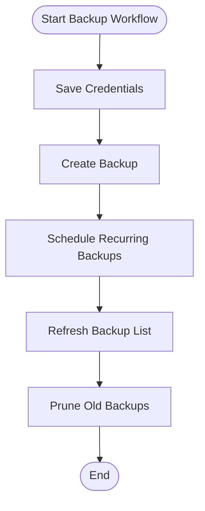
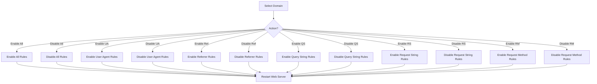
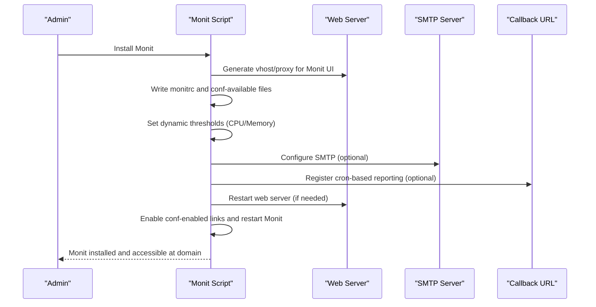
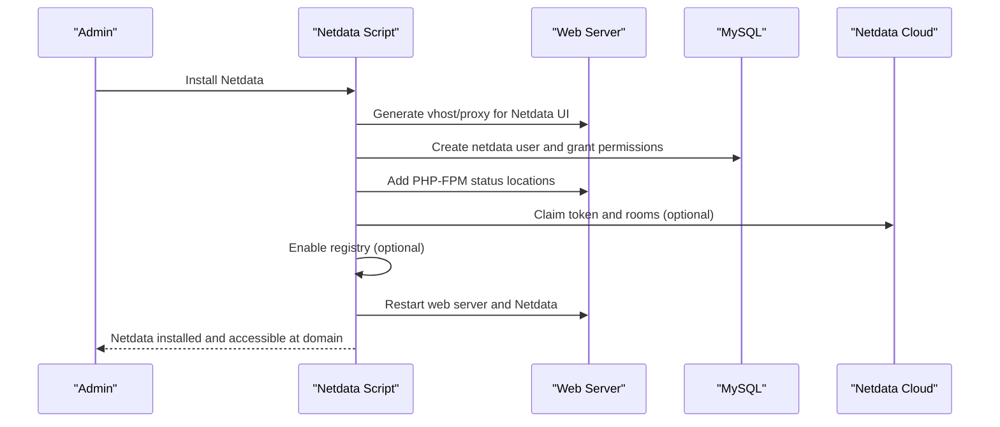
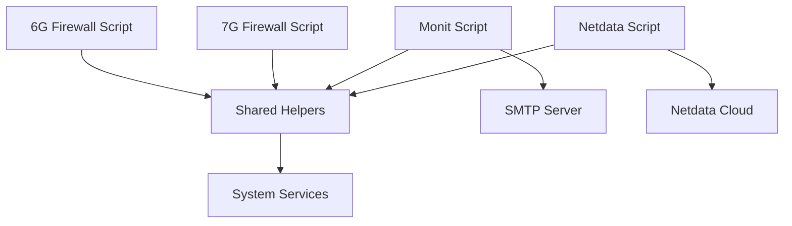

# Operational Tools

<cite>
**Referenced Files in This Document**
- [15-6g_firewall.txt](file://includes/core/apps/wordpress-app/scripts/v1/raw/15-6g_firewall.txt)
- [40-7g_firewall.txt](file://includes/core/apps/wordpress-app/scripts/v1/raw/40-7g_firewall.txt)
- [20-monit.txt](file://includes/core/apps/wordpress-app/scripts/v1/raw/20-monit.txt)
- [43-netdata.txt](file://includes/core/apps/wordpress-app/scripts/v1/raw/43-netdata.txt)
- [backup_restore.txt](file://includes/core/apps/wordpress-app/scripts/v1/backup_restore.txt)
- [backup_restore_schedule.txt](file://includes/core/apps/wordpress-app/scripts/v1/backup_restore_schedule.txt)
- [backup_restore_save_credentials.txt](file://includes/core/apps/wordpress-app/scripts/v1/backup_restore_save_credentials.txt)
- [backup_restore_refresh_backup_list.txt](file://includes/core/apps/wordpress-app/scripts/v1/backup_restore_refresh_backup_list.txt)
- [backup_restore_delete_and_prune.txt](file://includes/core/apps/wordpress-app/scripts/v1/backup_restore_delete_and_prune.txt)
- [backup_restore_delete_and_prune_server.txt](file://includes/core/apps/wordpress-app/scripts/v1/backup_restore_delete_and_prune_server.txt)
- [monit.txt](file://includes/core/apps/wordpress-app/scripts/v1/monit.txt)
- [netdata.txt](file://includes/core/apps/wordpress-app/scripts/v1/netdata.txt)
- [class-sstk-app.php](file://includes/core/apps/class-sstk-app.php)
</cite>

## Table of Contents
1. [Introduction](#introduction)
2. [Project Structure](#project-structure)
3. [Core Components](#core-components)
4. [Architecture Overview](#architecture-overview)
5. [Detailed Component Analysis](#detailed-component-analysis)
6. [Dependency Analysis](#dependency-analysis)
7. [Performance Considerations](#performance-considerations)
8. [Troubleshooting Guide](#troubleshooting-guide)
9. [Conclusion](#conclusion)

## Introduction
This document explains Simple Stack’s operational tools for backup and restore, security hardening with 6G/7G firewall rules, monitoring setup with Monit and Netdata, performance optimization utilities, and system maintenance tasks. It also documents the script execution framework, parameter passing, and output capture mechanisms used by these tools. Practical examples are included for scheduling backups, configuring firewalls, setting up monitoring alerts, and running maintenance tasks. Guidance is provided for troubleshooting failures, analyzing logs, and recovering from failed operations.

## Project Structure
Operational tools are implemented as shell scripts under the WordPress app scripts directory. The key areas covered here include:
- Backup and Restore: orchestration scripts for creating, listing, saving credentials, refreshing lists, and pruning backups.
- Security Hardening: 6G and 7G firewall rule management for Nginx and OpenLiteSpeed (OLS).
- Monitoring: Monit installation and configuration; Netdata installation, authentication, SSL, and registry configuration.
- Maintenance Utilities: general-purpose scripts referenced by versioned upgrade and maintenance flows.

**Diagram sources**
- [backup_restore.txt](file://includes/core/apps/wordpress-app/scripts/v1/backup_restore.txt)
- [backup_restore_schedule.txt](file://includes/core/apps/wordpress-app/scripts/v1/backup_restore_schedule.txt)
- [backup_restore_save_credentials.txt](file://includes/core/apps/wordpress-app/scripts/v1/backup_restore_save_credentials.txt)
- [backup_restore_refresh_backup_list.txt](file://includes/core/apps/wordpress-app/scripts/v1/backup_restore_refresh_backup_list.txt)
- [backup_restore_delete_and_prune.txt](file://includes/core/apps/wordpress-app/scripts/v1/backup_restore_delete_and_prune.txt)
- [backup_restore_delete_and_prune_server.txt](file://includes/core/apps/wordpress-app/scripts/v1/backup_restore_delete_and_prune_server.txt)
- [15-6g_firewall.txt](file://includes/core/apps/wordpress-app/scripts/v1/raw/15-6g_firewall.txt)
- [40-7g_firewall.txt](file://includes/core/apps/wordpress-app/scripts/v1/raw/40-7g_firewall.txt)
- [20-monit.txt](file://includes/core/apps/wordpress-app/scripts/v1/raw/20-monit.txt)
- [43-netdata.txt](file://includes/core/apps/wordpress-app/scripts/v1/raw/43-netdata.txt)

**Section sources**
- [15-6g_firewall.txt:1-261](file://includes/core/apps/wordpress-app/scripts/v1/raw/15-6g_firewall.txt#L1-L261)
- [40-7g_firewall.txt:1-260](file://includes/core/apps/wordpress-app/scripts/v1/raw/40-7g_firewall.txt#L1-L260)
- [20-monit.txt:1-973](file://includes/core/apps/wordpress-app/scripts/v1/raw/20-monit.txt#L1-L973)
- [43-netdata.txt:1-717](file://includes/core/apps/wordpress-app/scripts/v1/raw/43-netdata.txt#L1-L717)

## Core Components
- Backup and Restore Orchestration:
  - Create, schedule, refresh, save credentials, and prune backups across sites and servers.
- Security Hardening:
  - Enable/disable 6G and 7G firewall rules per site for Nginx and OLS.
- Monitoring:
  - Install and configure Monit to monitor web server, database, cache, PHP processes, filesystem, and CPU/memory.
  - Install and configure Netdata for metrics collection, basic auth, HTTPS, and registry settings.
- Maintenance Utilities:
  - General-purpose scripts invoked by higher-level workflows.

Key responsibilities:
- Parameter-driven actions via environment variables or interactive prompts.
- Web server integration through configuration file edits and service restarts.
- Logging and alerting via system services and optional callbacks.

**Section sources**
- [backup_restore.txt](file://includes/core/apps/wordpress-app/scripts/v1/backup_restore.txt)
- [backup_restore_schedule.txt](file://includes/core/apps/wordpress-app/scripts/v1/backup_restore_schedule.txt)
- [backup_restore_save_credentials.txt](file://includes/core/apps/wordpress-app/scripts/v1/backup_restore_save_credentials.txt)
- [backup_restore_refresh_backup_list.txt](file://includes/core/apps/wordpress-app/scripts/v1/backup_restore_refresh_backup_list.txt)
- [backup_restore_delete_and_prune.txt](file://includes/core/apps/wordpress-app/scripts/v1/backup_restore_delete_and_prune.txt)
- [backup_restore_delete_and_prune_server.txt](file://includes/core/apps/wordpress-app/scripts/v1/backup_restore_delete_and_prune_server.txt)
- [15-6g_firewall.txt:1-261](file://includes/core/apps/wordpress-app/scripts/v1/raw/15-6g_firewall.txt#L1-L261)
- [40-7g_firewall.txt:1-260](file://includes/core/apps/wordpress-app/scripts/v1/raw/40-7g_firewall.txt#L1-L260)
- [20-monit.txt:1-973](file://includes/core/apps/wordpress-app/scripts/v1/raw/20-monit.txt#L1-L973)
- [43-netdata.txt:1-717](file://includes/core/apps/wordpress-app/scripts/v1/raw/43-netdata.txt#L1-L717)

## Architecture Overview
The operational tools follow a consistent pattern:
- Root-only execution guard.
- Load shared functions from a common helper script.
- Prompt for required parameters if not provided via environment variables.
- Perform targeted configuration changes on the web server (Nginx or OLS).
- Restart services to apply changes.
- Provide user feedback and exit codes.

**Diagram sources**
- [15-6g_firewall.txt:1-261](file://includes/core/apps/wordpress-app/scripts/v1/raw/15-6g_firewall.txt#L1-L261)
- [40-7g_firewall.txt:1-260](file://includes/core/apps/wordpress-app/scripts/v1/raw/40-7g_firewall.txt#L1-L260)
- [20-monit.txt:1-973](file://includes/core/apps/wordpress-app/scripts/v1/raw/20-monit.txt#L1-L973)
- [43-netdata.txt:1-717](file://includes/core/apps/wordpress-app/scripts/v1/raw/43-netdata.txt#L1-L717)

## Detailed Component Analysis

### Backup and Restore Operations
Purpose:
- Manage full site backups, schedules, credential storage, list refresh, and retention policies.

Key scripts:
- backup_restore.txt: Main orchestration for backup/restore actions.
- backup_restore_schedule.txt: Scheduling backups via cron-like mechanisms.
- backup_restore_save_credentials.txt: Securely store provider credentials for remote storage.
- backup_restore_refresh_backup_list.txt: Refresh local metadata about available backups.
- backup_restore_delete_and_prune.txt: Delete specific backups and prune old ones.
- backup_restore_delete_and_prune_server.txt: Server-wide cleanup of backups.

Usage patterns:
- Run interactively or non-interactively using environment variables.
- Typical flow: save credentials -> create backup -> schedule recurring backups -> refresh list -> prune old backups.

Scheduling example:
- Use the schedule script to set periodic backups based on retention policy.

Credential management:
- Store provider credentials securely before performing remote backups.

Retention and pruning:
- Configure maximum number of backups and automatic deletion of older archives.

**Diagram sources**
- [backup_restore.txt](file://includes/core/apps/wordpress-app/scripts/v1/backup_restore.txt)
- [backup_restore_schedule.txt](file://includes/core/apps/wordpress-app/scripts/v1/backup_restore_schedule.txt)
- [backup_restore_save_credentials.txt](file://includes/core/apps/wordpress-app/scripts/v1/backup_restore_save_credentials.txt)
- [backup_restore_refresh_backup_list.txt](file://includes/core/apps/wordpress-app/scripts/v1/backup_restore_refresh_backup_list.txt)
- [backup_restore_delete_and_prune.txt](file://includes/core/apps/wordpress-app/scripts/v1/backup_restore_delete_and_prune.txt)
- [backup_restore_delete_and_prune_server.txt](file://includes/core/apps/wordpress-app/scripts/v1/backup_restore_delete_and_prune_server.txt)

**Section sources**
- [backup_restore.txt](file://includes/core/apps/wordpress-app/scripts/v1/backup_restore.txt)
- [backup_restore_schedule.txt](file://includes/core/apps/wordpress-app/scripts/v1/backup_restore_schedule.txt)
- [backup_restore_save_credentials.txt](file://includes/core/apps/wordpress-app/scripts/v1/backup_restore_save_credentials.txt)
- [backup_restore_refresh_backup_list.txt](file://includes/core/apps/wordpress-app/scripts/v1/backup_restore_refresh_backup_list.txt)
- [backup_restore_delete_and_prune.txt](file://includes/core/apps/wordpress-app/scripts/v1/backup_restore_delete_and_prune.txt)
- [backup_restore_delete_and_prune_server.txt](file://includes/core/apps/wordpress-app/scripts/v1/backup_restore_delete_and_prune_server.txt)

### Security Hardening: 6G and 7G Firewall Rules
Purpose:
- Enable or disable sets of request filtering rules at the web server level for selected domains.

Supported web servers:
- Nginx: Inserts conditional checks into site configuration files.
- OpenLiteSpeed (OLS): Uses helper functions to enable/disable rule categories.

Rule categories:
- User Agent, Referrer, Query String, Request String, Request Method.
- All rules can be enabled/disabled in bulk.

Execution model:
- Interactive menu selects domain and action.
- Edits site configuration and restarts the web server.

**Diagram sources**
- [15-6g_firewall.txt:1-261](file://includes/core/apps/wordpress-app/scripts/v1/raw/15-6g_firewall.txt#L1-L261)
- [40-7g_firewall.txt:1-260](file://includes/core/apps/wordpress-app/scripts/v1/raw/40-7g_firewall.txt#L1-L260)

Configuration notes:
- For Nginx, rules are injected near client body size directives.
- For OLS, helper functions toggle rule blocks.

**Section sources**
- [15-6g_firewall.txt:1-261](file://includes/core/apps/wordpress-app/scripts/v1/raw/15-6g_firewall.txt#L1-L261)
- [40-7g_firewall.txt:1-260](file://includes/core/apps/wordpress-app/scripts/v1/raw/40-7g_firewall.txt#L1-L260)

### Monitoring Setup: Monit
Purpose:
- Install and configure Monit to monitor system resources, web server, database, caches, PHP-FPM processes, and filesystem usage.

Capabilities:
- Install Monit and generate configuration files for various services.
- Enable/disable individual monitors (webserver, MySQL, Redis, Memcached, PHP, filesystem).
- Configure email notifications via SMTP.
- Optional callback mechanism to forward Monit events to an external URL.
- Enable HTTPS for the Monit UI using Certbot (Nginx) or OLS-specific steps.

Parameters:
- Domain for Monit UI access.
- Monit user/password.
- SMTP server, port, username, password, and alert email address.
- Optional m-moni registration server.

**Diagram sources**
- [20-monit.txt:1-973](file://includes/core/apps/wordpress-app/scripts/v1/raw/20-monit.txt#L1-L973)

Alerting and recovery:
- Alerts trigger when CPU/memory thresholds are exceeded.
- Automatic restart attempts for services upon failure detection.
- Email notifications configured via SMTP.

**Section sources**
- [20-monit.txt:1-973](file://includes/core/apps/wordpress-app/scripts/v1/raw/20-monit.txt#L1-L973)
- [monit.txt](file://includes/core/apps/wordpress-app/scripts/v1/monit.txt)

### Monitoring Setup: Netdata
Purpose:
- Install Netdata for real-time system and application metrics, secure it with HTTP authentication, enable HTTPS, and optionally configure registry settings.

Capabilities:
- Install, remove, and update Netdata.
- Add HTTP authentication (htpasswd) for Nginx and OLS.
- Enable/disable HTTPS via Certbot (Nginx) or OLS webroot method.
- Configure Netdata registry (centralized metrics).
- Integrate PHP-FPM status endpoints for each PHP version.

Parameters:
- Domain for Netdata UI.
- Username/password for HTTP authentication.
- Netdata Cloud claim tokens (optional).
- Registry domain (optional).

**Diagram sources**
- [43-netdata.txt:1-717](file://includes/core/apps/wordpress-app/scripts/v1/raw/43-netdata.txt#L1-L717)

Authentication and security:
- Basic auth protects the Netdata UI.
- HTTPS can be enabled using Certbot or OLS webroot challenge.

Registry configuration:
- Centralize metrics by enabling registry and pointing targets to a registry domain.

**Section sources**
- [43-netdata.txt:1-717](file://includes/core/apps/wordpress-app/scripts/v1/raw/43-netdata.txt#L1-L717)
- [netdata.txt](file://includes/core/apps/wordpress-app/scripts/v1/netdata.txt)

### Script Execution Framework, Parameters, and Output Capture
Framework characteristics:
- Root privilege check at script entry.
- Source shared functions from a common helper script.
- Interactive menus prompt for required inputs unless environment variables are pre-set.
- Configuration edits target web server vhosts/sites and service configurations.
- Service restarts applied after configuration changes.
- User-facing messages indicate success/failure and provide next steps.

Parameter passing:
- Environment variables such as domain, action, SMTP details, and credentials are read directly.
- If variables are missing, the script prompts the user interactively.

Output capture:
- Standard output provides progress and status messages.
- Some tools write logs to system log files (e.g., Monit logs).
- Optional callbacks forward event summaries to external URLs.

Security considerations:
- Scripts enforce root-only execution.
- Credentials are stored securely via dedicated scripts.
- Access to monitoring UIs is protected by HTTP authentication and optional HTTPS.

**Section sources**
- [15-6g_firewall.txt:1-261](file://includes/core/apps/wordpress-app/scripts/v1/raw/15-6g_firewall.txt#L1-L261)
- [40-7g_firewall.txt:1-260](file://includes/core/apps/wordpress-app/scripts/v1/raw/40-7g_firewall.txt#L1-L260)
- [20-monit.txt:1-973](file://includes/core/apps/wordpress-app/scripts/v1/raw/20-monit.txt#L1-L973)
- [43-netdata.txt:1-717](file://includes/core/apps/wordpress-app/scripts/v1/raw/43-netdata.txt#L1-L717)

## Dependency Analysis
Operational tools depend on:
- Shared helper functions for common operations (domain selection, web server restarts).
- System services: nginx, openlitespeed, monit, netdata, mysql/mariadb, redis, memcached, php-fpm.
- External integrations: SMTP servers for email alerts, Netdata Cloud for centralized metrics.

Coupling and cohesion:
- Each tool is cohesive around its purpose (firewall, monitoring, backup).
- Coupling occurs via shared helpers and system services.

Potential circular dependencies:
- None observed among the operational scripts; they primarily call system commands and helpers.

External dependencies:
- Certbot for HTTPS provisioning.
- Package managers (apt-get) for installing software.
- Curl for downloading installer scripts.

**Diagram sources**
- [15-6g_firewall.txt:1-261](file://includes/core/apps/wordpress-app/scripts/v1/raw/15-6g_firewall.txt#L1-L261)
- [40-7g_firewall.txt:1-260](file://includes/core/apps/wordpress-app/scripts/v1/raw/40-7g_firewall.txt#L1-L260)
- [20-monit.txt:1-973](file://includes/core/apps/wordpress-app/scripts/v1/raw/20-monit.txt#L1-L973)
- [43-netdata.txt:1-717](file://includes/core/apps/wordpress-app/scripts/v1/raw/43-netdata.txt#L1-L717)

**Section sources**
- [15-6g_firewall.txt:1-261](file://includes/core/apps/wordpress-app/scripts/v1/raw/15-6g_firewall.txt#L1-L261)
- [40-7g_firewall.txt:1-260](file://includes/core/apps/wordpress-app/scripts/v1/raw/40-7g_firewall.txt#L1-L260)
- [20-monit.txt:1-973](file://includes/core/apps/wordpress-app/scripts/v1/raw/20-monit.txt#L1-L973)
- [43-netdata.txt:1-717](file://includes/core/apps/wordpress-app/scripts/v1/raw/43-netdata.txt#L1-L717)

## Performance Considerations
- Dynamic thresholds: Monit calculates CPU and memory alert/restart thresholds based on system resources.
- Service restart limits: Monit includes safeguards to avoid excessive restart loops.
- Web server optimizations: Firewall rules and monitoring proxies should be tuned to minimize overhead.
- Netdata collectors: PHP-FPM status endpoints are added per PHP version; ensure only active versions are monitored.

[No sources needed since this section provides general guidance]

## Troubleshooting Guide
Common issues and resolutions:
- Root privilege errors: Ensure scripts are executed as root.
- Missing helper functions: Verify that the common functions file exists and is sourced correctly.
- Web server configuration errors: Validate syntax after edits; confirm service restarts succeed.
- SMTP connectivity problems: Test SMTP server, port, TLS, and credentials; verify network reachability.
- Netdata installation failures: Check package manager locks, curl availability, and internet connectivity.
- Monit alerts not firing: Confirm conf-enabled symlinks exist and Monit service is running.

Log analysis:
- Monit logs: Review /var/log/monit.log for events and state changes.
- Web server logs: Inspect error logs for configuration reload issues.
- Netdata logs: Check system journal or Netdata logs for collector errors.

Recovery procedures:
- Re-run the relevant script to regenerate configuration and restart services.
- For firewall rules, re-enable or disable rules explicitly to ensure correct state.
- For backups, refresh the backup list and prune outdated archives.

**Section sources**
- [15-6g_firewall.txt:1-261](file://includes/core/apps/wordpress-app/scripts/v1/raw/15-6g_firewall.txt#L1-L261)
- [40-7g_firewall.txt:1-260](file://includes/core/apps/wordpress-app/scripts/v1/raw/40-7g_firewall.txt#L1-L260)
- [20-monit.txt:1-973](file://includes/core/apps/wordpress-app/scripts/v1/raw/20-monit.txt#L1-L973)
- [43-netdata.txt:1-717](file://includes/core/apps/wordpress-app/scripts/v1/raw/43-netdata.txt#L1-L717)

## Conclusion
Simple Stack’s operational tools provide a robust framework for managing backups, securing sites with 6G/7G firewall rules, and setting up comprehensive monitoring with Monit and Netdata. The scripts follow a consistent execution model, support both interactive and automated usage, and integrate tightly with system services. By following the documented workflows and troubleshooting guidance, administrators can reliably maintain system health, enforce security policies, and optimize performance.

[No sources needed since this section summarizes without analyzing specific files]